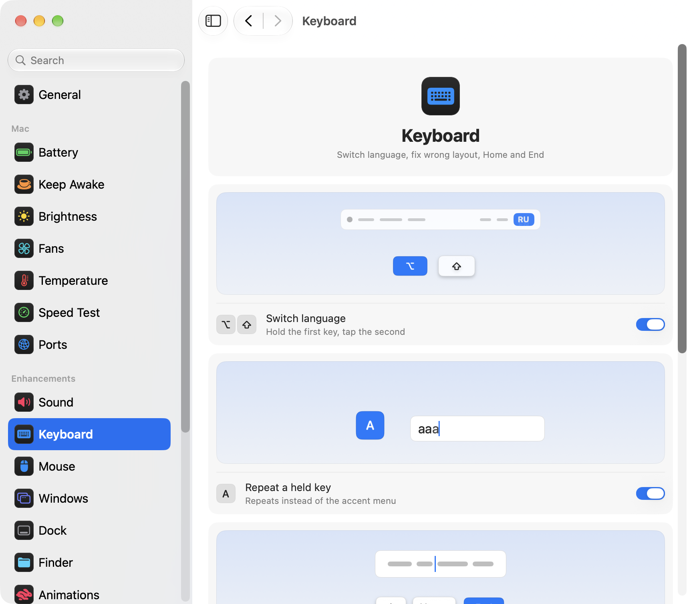

<p align="center"></p>
<h1 align="center">pikapik</h1>
<p align="center">Small fixes for the keyboard, mouse, windows and Finder, right in your Mac’s menu bar.</p>
<p align="center"><sub><b>English</b> · <a href="docs/readme/README.ru.md">Русский</a> · <a href="docs/readme/README.uk.md">Українська</a> · <a href="docs/readme/README.de.md">Deutsch</a> · <a href="docs/readme/README.fr.md">Français</a> · <a href="docs/readme/README.es.md">Español</a> · <a href="docs/readme/README.it.md">Italiano</a> · <a href="docs/readme/README.pt-BR.md">Português (Brasil)</a> · <a href="docs/readme/README.ja.md">日本語</a> · <a href="docs/readme/README.zh-Hans.md">简体中文</a> · <a href="docs/readme/README.ko.md">한국어</a> · <a href="docs/readme/README.ro.md">Română</a> · <a href="docs/readme/README.pl.md">Polski</a> · <a href="docs/readme/README.tr.md">Türkçe</a> · <a href="docs/readme/README.nl.md">Nederlands</a> · <a href="docs/readme/README.sv.md">Svenska</a> · <a href="docs/readme/README.cs.md">Čeština</a> · <a href="docs/readme/README.zh-Hant.md">繁體中文</a> · <a href="docs/readme/README.ar.md">العربية</a> · <a href="docs/readme/README.hi.md">हिन्दी</a> · <a href="docs/readme/README.id.md">Bahasa Indonesia</a> · <a href="docs/readme/README.vi.md">Tiếng Việt</a> · <a href="docs/readme/README.th.md">ไทย</a></sub></p>

<p align="center">
<picture>
<source media="(prefers-color-scheme: dark)" srcset="docs/media/settings-en-dark.png">

</picture>
</p>

## Install

```bash
brew install --cask dev-pikapik/pika-tools/pikapik && open -a pikapik
```

pikapik appears in the menu bar at the top of the screen. Everything stays off until you turn it on.

<details>
<summary>No Homebrew? Two other ways</summary>

Without Homebrew, open Terminal, paste this line and press Return:

```bash
/bin/bash -c "$(curl -fsSL https://raw.githubusercontent.com/dev-pikapik/pika-tools/main/install.sh)"
```

Or download [pikapik.dmg](https://github.com/dev-pikapik/pika-tools/releases/latest/download/pikapik.dmg), open it and drag the app to Applications.

Homebrew and the script both put the app in `/Applications`, launch it, ask for permissions and turn on Open at Login. After that the app updates itself, see **Updates**. To remove it, see **Uninstall**.

</details>

## What it does

<table>
<tbody><tr>
<td width="50%" valign="top">
<picture><source media="(prefers-color-scheme: dark)" srcset="docs/media/keep-awake-dark.png"></picture>
<br><b>Keep Awake</b>
<br>Your Mac stays awake for as long as you need, even with the lid closed.
</td>
<td width="50%" valign="top">
<picture><source media="(prefers-color-scheme: dark)" srcset="docs/media/fans-dark.png"></picture>
<br><b>Fans</b>
<br>See how fast your fans spin, and choose their speed.
</td>
</tr></tbody>
<tbody><tr>
<td width="50%" valign="top">
<picture><source media="(prefers-color-scheme: dark)" srcset="docs/media/command-keys-dark.png"></picture>
<br><b>Protect ⌘Q and ⌘W</b>
<br>Nothing quits or closes by accident. Add ⇧ when you mean it.
</td>
<td width="50%" valign="top">
<picture><source media="(prefers-color-scheme: dark)" srcset="docs/media/compress-dark.png"></picture>
<br><b>Smaller copy</b>
<br>Right-click a photo, PDF or video to get a lighter copy.
</td>
</tr></tbody>
<tbody><tr>
<td width="50%" valign="top">
<picture><source media="(prefers-color-scheme: dark)" srcset="docs/media/convert-dark.png"></picture>
<br><b>Convert</b>
<br>Save a picture, video or song in another format from the right-click menu.
</td>
<td width="50%" valign="top">
<picture><source media="(prefers-color-scheme: dark)" srcset="docs/media/input-switch-dark.png"></picture>
<br><b>Switch language</b>
<br>Hold ⌥ and tap ⇧ to change the keyboard language.
</td>
</tr></tbody>
<tbody><tr>
<td width="50%" valign="top">
<picture><source media="(prefers-color-scheme: dark)" srcset="docs/media/quit-on-close-dark.png"></picture>
<br><b>Quit with the last window</b>
<br>Close an app’s last window, and the app quits too.
</td>
<td width="50%" valign="top">
<picture><source media="(prefers-color-scheme: dark)" srcset="docs/media/window-zoom-dark.png"></picture>
<br><b>Green button enlarges</b>
<br>The window fills the screen without going full screen.
</td>
</tr></tbody>
<tbody><tr>
<td width="50%" valign="top">
<picture><source media="(prefers-color-scheme: dark)" srcset="docs/media/dock-hide-dark.png"></picture>
<br><b>Hide with a Dock click</b>
<br>Click the app you’re in, and it steps out of the way.
</td>
<td width="50%" valign="top">
<picture><source media="(prefers-color-scheme: dark)" srcset="docs/media/new-file-dark.png"></picture>
<br><b>New file</b>
<br>Right-click in Finder, type a name, and an empty file appears.
</td>
</tr></tbody>
<tbody><tr>
<td width="50%" valign="top">
<picture><source media="(prefers-color-scheme: dark)" srcset="docs/media/finder-cut-dark.png"></picture>
<br><b>⌘X moves files</b>
<br>Cut files in Finder and paste them where you want.
</td>
<td width="50%" valign="top">
<picture><source media="(prefers-color-scheme: dark)" srcset="docs/media/finder-open-dark.png"></picture>
<br><b>Return opens files</b>
<br>Select files in Finder and press Return to open them.
</td>
</tr></tbody>
<tbody><tr>
<td width="50%" valign="top">
<picture><source media="(prefers-color-scheme: dark)" srcset="docs/media/finder-delete-dark.png"></picture>
<br><b>Delete to Trash</b>
<br>Press ⌫ in Finder, and the selected files go to the Trash.
</td>
<td width="50%" valign="top">
<picture><source media="(prefers-color-scheme: dark)" srcset="docs/media/game-mode-dark.png"></picture>
<br><b>Game Mode</b>
<br>While you play, nothing pops up over the game or closes it.
</td>
</tr></tbody>
<tbody><tr>
<td width="50%" valign="top">
<picture><source media="(prefers-color-scheme: dark)" srcset="docs/media/speed-test-dark.png"></picture>
<br><b>Speed Test</b>
<br>How fast your internet is, and what it’s good for.
</td>
<td width="50%" valign="top">
<picture><source media="(prefers-color-scheme: dark)" srcset="docs/media/side-buttons-dark.png"></picture>
<br><b>Side mouse buttons</b>
<br>Buttons 4 and 5 go back and forward, like a swipe.
</td>
</tr></tbody>
<tbody><tr>
<td width="50%" valign="top">
<picture><source media="(prefers-color-scheme: dark)" srcset="docs/media/wheel-lines-dark.png"></picture>
<br><b>Scroll by lines</b>
<br>Every click of the wheel scrolls the same, however fast you spin it.
</td>
<td width="50%" valign="top">
<picture><source media="(prefers-color-scheme: dark)" srcset="docs/media/wheel-direction-dark.png"></picture>
<br><b>Scroll direction</b>
<br>One direction for the trackpad, another for the mouse.
</td>
</tr></tbody>
<tbody><tr>
<td width="50%" valign="top">
<picture><source media="(prefers-color-scheme: dark)" srcset="docs/media/linear-pointer-dark.png"></picture>
<br><b>No pointer acceleration</b>
<br>The pointer moves exactly as far as your hand.
</td>
<td width="50%" valign="top">
<picture><source media="(prefers-color-scheme: dark)" srcset="docs/media/key-repeat-dark.png"></picture>
<br><b>Repeat a held key</b>
<br>Hold a key to type it again and again, without the accent menu.
</td>
</tr></tbody>
<tbody><tr>
<td width="50%" valign="top">
<picture><source media="(prefers-color-scheme: dark)" srcset="docs/media/home-end-dark.png"></picture>
<br><b>Home and End</b>
<br>Jump to the start or end of a line while you type.
</td>
<td width="50%" valign="top">
<picture><source media="(prefers-color-scheme: dark)" srcset="docs/media/animations-dark.png"></picture>
<br><b>Animations</b>
<br>Speed up the Dock, windows and Quick Look, all the way to instant.
</td>
</tr></tbody>
<tbody><tr>
<td width="50%" valign="top">
<picture><source media="(prefers-color-scheme: dark)" srcset="docs/media/leftover-permissions-dark.png"></picture>
<br><b>Permissions of deleted apps</b>
<br>Remove the permissions macOS still keeps for apps you deleted.
</td>
<td width="50%" valign="top">
<picture><source media="(prefers-color-scheme: dark)" srcset="docs/media/pet-dark.png"></picture>
<br><b>Pet on the desktop</b>
<br>A little friend strolls behind your windows. Pick it up and toss it, or press Space to make it jump. Dress it up in clothes from its wardrobe and earn awards as you play together.
</td>
</tr></tbody>
<tbody><tr>
<td width="50%" valign="top">
<picture><source media="(prefers-color-scheme: dark)" srcset="docs/media/uninstaller-dark.png"></picture>
<br><b>Uninstaller</b>
<br>Remove an app and its files. You can put it all back.
</td>
<td width="50%" valign="top">
<picture><source media="(prefers-color-scheme: dark)" srcset="docs/media/game-fps-dark.png"></picture>
<br><b>Show FPS</b>
<br>A small counter shows how smoothly your game runs, in the corner you choose.
</td>
</tr></tbody>
<tbody><tr>
<td width="50%" valign="top">
<picture><source media="(prefers-color-scheme: dark)" srcset="docs/media/archive-dark.png"></picture>
<br><b>Archives</b>
<br>Unpack RAR and other archives, or pack files into a ZIP, with a right-click.
</td>
<td width="50%" valign="top"></td>
</tr></tbody>
</table>

## Details

<details>
<summary>First launch</summary>

pikapik needs two permissions. On first launch it opens Settings on the Permissions page, which walks you through them, and macOS shows its own prompts. Go to **System Settings › Privacy & Security** and turn on pikapik in:

- **Accessibility**, so the app can change a key press or click before it reaches other apps.
- **Input Monitoring**, so the app can see key presses and clicks in the first place.

The app picks up the change within a couple of seconds, no restart needed.

Some features ask for more when you use them: **Fan control**, **Finder Extensions**, **iCloud Drive**, **Full Disk Access** and **Screen Recording**. They're all on the Permissions page in Settings: each permission has a line about what it's for, a green check or an orange cross, and one button, **Allow** when it's missing and **Turn Off** when it's on. So you can take any permission back right there.

pikapik doesn't record, store or send anything you type or click. Events are handled in memory and passed on right away. pikapik goes online only for updates (it asks GitHub for the latest release and downloads it only if you choose to update) and for the Speed Test when you start it (it uses Apple's servers). The Mac App Store version is updated by the App Store, and its Speed Test uses Cloudflare. The progress of your pet (steps, throws, awards and the like) is counted only on this Mac and never sent anywhere. You can erase it in Settings › Pet.

</details>

<details>
<summary>Every tool in detail</summary>

**Protect ⌘Q and ⌘W.** ⌘Q and ⌘W alone do nothing, so you don't quit an app or close a window by accident. Add Shift to do it on purpose: ⇧⌘Q quits, ⇧⌘W closes. Works in every app. Each key has its own switch. Off by default.

**Switch language with Option+Shift.** Hold Option and tap Shift: macOS moves to the next input source. Keep holding Option and tap Shift again to go further. Hold Shift and tap Option to go back. If you press another key, click, or add Cmd, Ctrl or Fn in between, nothing switches, so shortcuts like Option+Shift+arrow work as before. Off by default.

**Repeat a held key.** Hold a key and it types the letter again and again instead of showing the accent menu. Handy in games and when you type fast. Apps that are already open pick it up after a restart. Turn it off and macOS works as usual again. Off by default.

**Home and End go to the start and end of a line.** While you type, Home moves the cursor to the start of the line and End to its end, instead of scrolling the page. Add ⇧ to select up to there, or ⌘ to jump to the start or end of the whole text. Outside text fields, and in terminals, virtual machines and remote desktop apps, the keys work as before. You can list other apps where they should work as usual. Off by default.

**Turn off pointer acceleration.** The pointer moves exactly as far as the mouse does, however fast you move it. A **Tracking speed** slider sets how fast it goes. Works for mice only, the trackpad stays as it is. Turn it off or quit pikapik, and macOS gets its own settings back. Off by default.

**Scroll by lines.** Every click of the mouse wheel scrolls the same number of lines, however fast you spin it. Pick from 1 to 10 lines per click, 3 by default. Natural scrolling stays as you set it in System Settings. Works for mice only, the trackpad stays as it is. Off by default. Beside the **Distance per click** slider, a small page scrolls by the distance you pick, and a dot marks the default.

Some apps and games count scrolling in exact pixels: for them, switch the same setting to pixels and pick from 1 to 200 pixels per click, 40 by default. The slider also says how much of the screen height that is.

**Scroll direction for trackpad and mouse.** macOS has one natural scrolling switch for both the trackpad and the mouse. Turn this on and pick a direction for each one: **Natural**, where the page follows your fingers like on iPhone, or **Classic**, where the page moves the other way. The trackpad choice also covers sideways scrolling and the glide after you lift your fingers. The Magic Mouse scrolls by touch, so it follows the trackpad choice. Pick the same on each of your Macs, and scrolling feels the same on all of them, even when you move the mouse to another Mac with Universal Control. Off by default. When you turn it on, both start the way System Settings has them, so nothing changes until you pick something else.

**Side buttons go back and forward.** Mouse buttons 4 and 5 go back and forward in Finder, Safari and other Apple apps and in many other apps, just like a swipe on the trackpad. Apps that handle these buttons themselves get them as they are. If your mouse has them the other way round, turn on **Swap the side buttons**. Off by default.

**Quit when the last window closes.** Close the last window of an app, and the app quits. Finder stays open, and so do apps with windows on other desktops or in the Dock. You can list apps that should never quit this way. Off by default.

**Hide with a click in the Dock.** Click the Dock icon of the app you're in, and it hides. Click again to bring it back. Off by default.

**Green button enlarges the window.** Click the green button of a window, and it grows to fill the screen without going full screen. Click again to bring back the previous size. Hold ⌥ and the button works as it always did. Full screen stays in the button's menu and on ⌃⌘F. You can list apps where the green button should work as usual. Off by default.

**New File in Finder.** Right-click in a Finder window or on the Desktop, choose **New File**, type a name, and an empty file appears. It’s a .txt by default. Off by default.

**Enter opens files in Finder.** Select files in a Finder window or on the Desktop and press Return or Enter, and they open. F2 or fn F2 renames the selected file. In text fields, for example while you type a name, the keys work as usual. Off by default.

**⌘X cuts files in Finder.** Select files and press ⌘X, open the folder you want and press ⌘V, and the files move there instead of being copied. ⌘C cancels the cut. Off by default.

**Delete removes files in Finder.** Select files and press ⌫ or ⌦ (fn ⌫ on a laptop), and they go to the Trash, just like with ⌘⌫. While you rename a file, search or type in any other field, the keys erase letters as usual. Off by default.

**Smaller Copy in Finder.** Right-click a file in Finder and choose **Make a Smaller Copy**. A lighter version of a photo, GIF, PDF or video appears right next to it, often several times smaller. Uncompressed sound like WAV or AIFF becomes a compact M4A. If a file can’t get any smaller, no copy is made and pikapik tells you so. The original stays as it is, and nothing leaves your Mac. Off by default.

**Convert in Finder.** Right-click a file in Finder and choose **Convert To** to save it in another format: a picture as JPEG, PNG, HEIC, GIF, TIFF or PDF, a video as MP4, MOV or just its sound, music as M4A, WAV or AIFF. The original stays as it is, and nothing leaves your Mac. Turns on separately from Smaller Copy. Off by default.

**Archives in Finder.** Right-click an archive in Finder and choose **Extract**, and its files appear next to it. Right-click any other file or folder and choose **Create Archive…** to make a ZIP, 7Z, TAR.GZ or TAR.XZ. ZIP and 7Z can have a password, and any archive can be split into parts, for example 15 MB ones for email or 4 GB ones for a USB drive. A ZIP made this way has no hidden service files, keeps names in any language readable and handles files over 4 GB. Off by default. Not in the Mac App Store version.

pikapik also opens what macOS can’t: RAR, even split into parts, 7Z locked with a password, split sets such as .001, .z01, .r00 and .part1.rar, and ZIPX, CAB, LZH, ARJ, ZST, LZMA, WIM and more. Double-click opens them in pikapik. File names in old ZIPs, for example in Cyrillic, Japanese or Chinese, come out readable. A switch, **Open archives with this app**, in Settings › Finder also hands ZIP and 7Z to pikapik, while TAR and GZ stay with the built-in archive app, which already handles them well. pikapik can unpack RAR but not make it: the RAR license allows only unpacking.

A window asks for the password, **Stop** cancels any job, and from a damaged or unfinished archive pikapik takes out what can still be read. It asks before unpacking an archive that would swell to a huge size, stops in time if the disk would fill up, and blocks archives that try to write outside their own folder. Press Space on an archive in Finder to preview what is inside.

**Game Mode.** Add your games, and while you play one, your Mac doesn’t pull you out of it. Spotlight, Siri, ⌘Tab, Mission Control and swipes between desktops don’t open over the game, ⌘Q and ⌘W don’t close it by accident, the pointer doesn’t slip onto the Dock, the menu bar or another screen, and the screen stays on. Each of these has its own switch on the Games page, and pikapik suggests games it finds on your Mac. In a game, Ctrl-click stays a click, and Ctrl+arrows don’t switch the desktop. Minecraft is recognized too: add the Minecraft Launcher or CurseForge, and Game Mode turns on inside Minecraft itself. To leave a game, press ⇧⌘Q; to close its window, press ⇧⌘W. ⌥⌘Esc always works. As soon as you leave the game, everything works as usual. Off by default.

Turn on Game Mode and play. More game settings holds the catalogue published by your Mac, with current key assignments and an animated preview for every action.

Automatic pauses actions that open windows or move focus. A quick deliberate language shortcut switches the input source silently. Held movement keys keep their priority, so running and jumping don’t change the language by accident.

Settings → Games → More game settings has a group called Mouse and trackpad. It lists only what is turned on in macOS on your Mac, with Apple’s own names and a small drawing for each: shortcuts on a mouse button, swiping between desktops and full-screen apps, Mission Control and App Exposé, pinching for Apps and spreading for the Desktop, the swipe in from the right edge for Notification Centre, and every hot corner with the action it runs. While a game is in front they are paused, so a stray swipe or a brush against a screen corner can’t pull you out of it. Gestures inside the game keep working. Each one can be set to work as usual.

Open Settings → Games → Add a Game and click your running game. Games through Java and other runtimes appear here too, even without an app bundle. Minecraft appears as Minecraft instead of java. Find the game’s process and drag its row onto Your games in Settings → Games.

**Show FPS.** FPS means frames per second: how many pictures the game draws each second. Switch on **Show FPS** on the Games page, and while Game Mode is on, a small dark label with that number sits in a corner of any game. Click a corner on the picture above the switch to choose it. A dash means the first frames haven’t arrived yet, and a faded 0 means the game has stopped drawing. On macOS 27 most games are counted by macOS itself, with no permission. A game it can’t count, mostly an older one, is counted through screen recording: the Screen Recording row then appears on the Permissions page, pikapik never asks during a game, and the number can’t go above the screen’s refresh rate. On macOS 14 to 26 and in the Mac App Store version every game is counted this way, so the row appears as soon as you switch Show FPS on, and **Allow** under the switch takes you to it. No picture is kept or sent. Off by default.

**Pet wardrobe and awards.** Open Settings › Pet to dress your pet: more than 30 things to wear, from hats and glasses to capes and wings, and ready-made looks such as a wizard, a pirate or an astronaut. A few are free from the start. The rest are awards that come as you play together: pick your pet up and toss it, kick the ball around, watch it climb windows and chat, or simply keep it company day after day. Your pet tells you when you have earned a new one.

To know when an award is due, pikapik only counts what you and your pet do: steps, pick-ups, throws, jumps, climbs, ball games, chats, days together, whether you were together early in the morning, after midnight or at a weekend, the Settings pages you opened and the things you tried on. Outside the Mac App Store, pikapik also notes whether you opened our GitHub page from Settings. The counts, the date of each award and what your pet wears stay on this Mac. Nothing is sent anywhere, and none of it goes into the exported settings file or iCloud sync. Erase it all any time in Settings › Pet, and your pet starts over.

**Uninstaller.** Open Settings › Uninstaller, pick an app from the list or drop one on the picture, and pikapik shows everything that app keeps on your Mac: the app itself, its saved data, settings, temporary files, background helpers and more, each with the reason it is listed. Files that clearly belong to the app are ticked, files that are only maybe related are not, and files that other apps use too are marked. Choose what to remove and click **Move to Trash**. Nothing is deleted for good: everything goes to the Trash. If the app is open, pikapik asks it to quit first, and if some files need an administrator, your Mac asks for the password once.

Changed your mind? Click **Put Back**, and everything returns to where it was and the background helpers start again. The last ten removals wait under Recently removed for as long as their files are in the Trash. **Reset App** keeps the app and removes only its saved data, settings and temporary files, which can help when an app misbehaves. Apps you moved to the Trash yourself appear under In the Trash, with the files they left behind, and Leftovers of removed apps finds files of apps that are already gone. A switch, Offer to clean up when an app goes to the Trash, is off by default, and nothing is removed until you choose. The page needs **Full Disk Access** to see everything an app keeps. The Uninstaller is not in the Mac App Store version.

Each tool has its own switch in the menu and in Settings.

The menu bar icon shows the state at a glance: the pikapik mark when the tools are working, the same mark turned pale when everything is off, and a warning triangle when a tool is on but permissions are missing.

The menu bar panel starts with just a few rows. You choose which ones it shows: click the pencil button at the bottom, tick what you want to see and click **Done**. Hidden rows keep working and stay in Settings. If the panel doesn't fit the screen, it scrolls.

The app follows your system language or the one you pick in Settings. It is available in all 23 languages listed at the top of this page.

</details>

<details>
<summary>Keep Awake</summary>

Stops your Mac from falling asleep while you're away from the keyboard: for any time from 1 second to 365 days, or until you turn it off. Flip it on from the menu, set the duration in Settings: type days, hours, minutes and seconds, use ↑ and ↓, or click a preset from 15 minutes to 8 hours. The menu shows how much time is left and when it ends. **Display** has two choices. **Always on**: it doesn't go dark, with no screen saver or lock screen. **Turns off as usual**: it goes dark on its own timer while the Mac keeps working. **Turn off the display now** (also in the menu) darkens it at once while the Mac keeps working: move the mouse or press a key to bring it back. Quitting pikapik ends Keep Awake.

On a MacBook you can also turn on **Work with the lid closed**. macOS has no switch for that, so pikapik runs `pmset -a disablesleep 1` and asks for an administrator password: only an administrator can change how the Mac sleeps. The setting goes back to normal on its own when Keep Awake ends, when you quit the app, or if it crashes. If you don't enter the password, nothing changes. Keep the Mac ventilated with the lid closed. **Stop when battery is below 20%** ends the session before the battery runs out.

Keep Awake, the display and lid-closed modes can be put on a button in Control Center, the menu bar or a desktop widget through the Shortcuts app, with links you copy from Settings › Keep Awake.

</details>

<details>
<summary>Speed Test</summary>

Shows how fast your internet is right now. Click **Check Speed** in Settings › Speed Test, or **Check** in the menu once you add the row with the pencil button. In about half a minute you see download and upload speed, ping and responsiveness: how quickly things react while the connection is busy. Below, in plain words, is what it's good for: 4K movies, video calls, online games and big downloads. The check uses networkQuality, which comes with macOS, and Apple's servers. The last result stays until the next check, and a link for Shortcuts starts it from Control Center.

</details>

<details>
<summary>Settings</summary>

Open Settings from the menu with **Settings…** or ⌘, or launch pikapik again from Finder, Launchpad or Spotlight. While the window is open, the app shows up in the Dock and in ⌘Tab.

- **General**: open at login, appearance (System, Light or Dark), language, updates, and backup: export and import settings as a file, or sync them through iCloud Drive.
- **Keep Awake**: duration, display and lid options.
- **Fans**: see each fan’s speed, choose Auto or a manual speed once Fan control is allowed.
- **Speed Test**: check the internet speed and see what it's good for.
- **Keyboard**: language switch, key repeat, Home and End.
- **Mouse**: pointer acceleration and tracking speed, scrolling by lines, scroll direction, side buttons.
- **Windows**: enlarge with the green button (with a list of exceptions), ⌘Q and ⌘W protection, quit on last window (with a list of exceptions).
- **Dock**: hide with a click in the Dock.
- **Finder**: new file, smaller copy, conversion and archives, Enter to open, ⌘X to cut, Delete to move to the Trash.
- **Uninstaller**: remove an app with its files, put it all back later, and clean up what removed apps left behind.
- **Games**: your list of games and the Game Mode options.
- **Pet**: turn the little friend on or off, let it chat and play with a ball, dress it up and see your awards.
- **Permissions**: every permission pikapik uses, each with its status and one button to allow it or turn it off. A tool that is missing a permission looks half-grey, and clicking it opens this page at the right row.
- **About**: version, links to the changelog and to report a problem.

Many settings come with a small picture of what they do, such as a Mac staying awake or a window hiding behind the Dock. The picture changes together with the switch and stands still when Reduce Motion is on in System Settings.

Every page has a **Restore Defaults…** button at the bottom. It asks first, then turns off the tools on that page and puts their options back, as if pikapik never touched them.

**Sync settings with iCloud** keeps pikapik the same on all your Macs. The settings live in the pika-tools folder in iCloud Drive, and the most recent change wins. It's off by default and needs iCloud Drive turned on. Permissions aren't synced: every Mac asks for them on its own.

</details>

<details>
<summary>Updates</summary>

pikapik checks for new versions at launch and every 6 hours. You can turn that off in Settings › General. When one is out, an **Update to …** button appears in the menu: one click and the app downloads the update, installs it and restarts. You can also check by hand with **Check Now** in Settings › General.

With Homebrew you can also run `brew upgrade --cask pikapik`.

Starting with 1.3, permissions stay in place after updates.

</details>

<details>
<summary>Uninstall</summary>

```bash
/bin/bash -c "$(curl -fsSL https://raw.githubusercontent.com/dev-pikapik/pika-tools/main/uninstall.sh)"
```

If you installed with Homebrew: `brew uninstall --cask --zap pikapik`.

Both quit the app, remove it from login items and delete it. The script also resets its permissions.

</details>

<details>
<summary>FAQ</summary>

**Why does it need two permissions?**
macOS splits keyboard and mouse access in two. Input Monitoring lets the app see events, Accessibility lets it change them. Blocking a shortcut needs both.

**macOS says the app is from an unidentified developer.**
pikapik is signed, but not notarized by Apple. Homebrew and the install script take care of this for you. If you used the dmg, open **System Settings › Privacy & Security** and click **Open Anyway**, or run:

```bash
xattr -dr com.apple.quarantine /Applications/pikapik.app
```

**Does it work on Intel Macs?**
Yes. It's a universal app for Apple Silicon and Intel, macOS 14 Sonoma or later.

**The permission is on, but nothing works.**
In **System Settings › Privacy & Security**, remove pikapik from both lists with the − button, then add it again. Or do it in pikapik: on the Permissions page, click **Turn Off** for each permission, then **Allow** again.

</details>

<p align="center">☕ If you enjoy pikapik, you can <a href="https://buymeacoffee.com/pikapik">buy me a coffee</a> — it all goes into developing and supporting the app.</p>

<p align="center"><sub><a href="docs/whats-new/README.md">What’s new</a> · <a href="https://github.com/dev-pikapik/homebrew-pika-tools">Homebrew tap</a> · <a href="CONTRIBUTING.md">Build from source</a> · <a href="LICENSE">MIT License</a> · © 2026 pikapik</sub></p>
