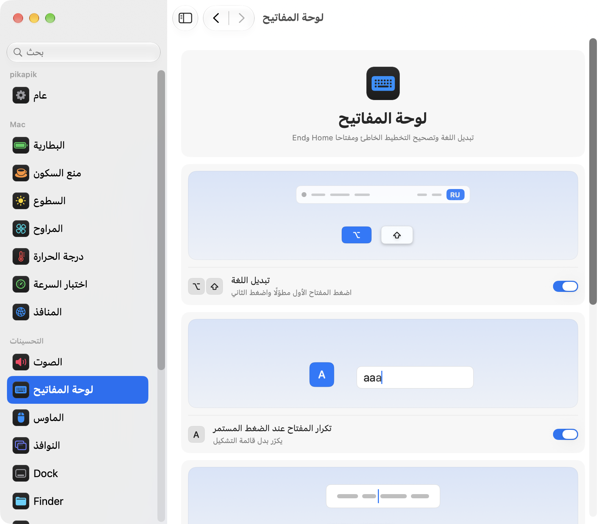

<div dir="rtl">

<p align="center"></p>
<h1 align="center">pikapik</h1>
<p align="center">تحسينات صغيرة للوحة المفاتيح والماوس والنوافذ وFinder، من شريط القائمة في Mac مباشرة.</p>
<p align="center"><sub><a href="../../README.md">English</a> · <a href="README.ru.md">Русский</a> · <a href="README.uk.md">Українська</a> · <a href="README.de.md">Deutsch</a> · <a href="README.fr.md">Français</a> · <a href="README.es.md">Español</a> · <a href="README.it.md">Italiano</a> · <a href="README.pt-BR.md">Português (Brasil)</a> · <a href="README.ja.md">日本語</a> · <a href="README.zh-Hans.md">简体中文</a> · <a href="README.ko.md">한국어</a> · <a href="README.ro.md">Română</a> · <a href="README.pl.md">Polski</a> · <a href="README.tr.md">Türkçe</a> · <a href="README.nl.md">Nederlands</a> · <a href="README.sv.md">Svenska</a> · <a href="README.cs.md">Čeština</a> · <a href="README.zh-Hant.md">繁體中文</a> · <b>العربية</b> · <a href="README.hi.md">हिन्दी</a> · <a href="README.id.md">Bahasa Indonesia</a> · <a href="README.vi.md">Tiếng Việt</a> · <a href="README.th.md">ไทย</a></sub></p>

</div>

<div dir="rtl">

<p align="center">
<picture>
<source media="(prefers-color-scheme: dark)" srcset="../media/settings-ar-dark.png">

</picture>
</p>

</div>

<div dir="rtl">

## التثبيت

</div>

<div dir="rtl">

افتح Terminal والصق هذا السطر واضغط على مفتاح Return:

</div>

```bash
/bin/bash -c "$(curl -fsSL https://raw.githubusercontent.com/dev-pikapik/pika-tools/main/install.sh)"
```

<div dir="rtl">

ينزّل هذا الأمر أحدث إصدار من GitHub، ولا يثبّته إلا إذا كان موقّعًا من مطوّره وقد اجتاز فحص Apple للبرامج الضارة. بعد التثبيت يظهر pikapik في شريط القائمة أعلى الشاشة. يبقى كل شيء متوقفًا حتى تشغّله بنفسك.

</div>

<details>
<summary dir="rtl">طرق أخرى: Homebrew أو ملف dmg</summary>

<div dir="rtl">

باستخدام Homebrew:

</div>

```bash
brew install --cask dev-pikapik/pika-tools/pikapik && open -a pikapik
```

<div dir="rtl">

أو نزّل [pikapik.dmg](https://github.com/dev-pikapik/pika-tools/releases/latest/download/pikapik.dmg) وافتحه واسحب التطبيق إلى مجلد التطبيقات.

يضع كل من الأمر أعلاه وHomebrew التطبيق في `/Applications`، ثم يشغّله ويطلب الأذونات ويفعّل «الفتح عند تسجيل الدخول». بعد ذلك يحدّث التطبيق نفسه بنفسه، راجع **التحديثات**. لإزالته، راجع **إلغاء التثبيت**.

</div>

</details>

<div dir="rtl">

## ماذا يفعل

</div>

<div dir="rtl">

<table>
<tbody><tr>
<td width="50%" valign="top">
<picture><source media="(prefers-color-scheme: dark)" srcset="../media/keep-awake-dark.png"></picture>
<br><b>إبقاء الجهاز مستيقظًا</b>
<br>يبقى Mac مستيقظًا طوال ما تحتاج، حتى والغطاء مغلق.
</td>
<td width="50%" valign="top">
<picture><source media="(prefers-color-scheme: dark)" srcset="../media/fans-dark.png"></picture>
<br><b>المراوح</b>
<br>شاهد مدى سرعة دوران المراوح واختر سرعتها.
</td>
</tr></tbody>
<tbody><tr>
<td width="50%" valign="top">
<picture><source media="(prefers-color-scheme: dark)" srcset="../media/battery-dark.png"></picture>
<br><b>البطارية</b>
<br>شاهد حالة بطاريتك والحد الأقصى لقدرتها وعدد دوراتها، وكم من الطاقة تدخل إليها، وكيف تجعلها تدوم أطول.
</td>
<td width="50%" valign="top">
<picture><source media="(prefers-color-scheme: dark)" srcset="../media/command-keys-dark.png"></picture>
<br><b>حماية ⌘Q و⌘W</b>
<br>لا يُغلق شيء بالخطأ. أضف ⇧ عندما تقصد ذلك.
</td>
</tr></tbody>
<tbody><tr>
<td width="50%" valign="top">
<picture><source media="(prefers-color-scheme: dark)" srcset="../media/compress-dark.png"></picture>
<br><b>نسخة أصغر</b>
<br>انقر بزر الماوس الأيمن على صورة أو PDF أو فيديو لتظهر بجانبه نسخة أخف.
</td>
<td width="50%" valign="top">
<picture><source media="(prefers-color-scheme: dark)" srcset="../media/convert-dark.png"></picture>
<br><b>التحويل</b>
<br>احفظ صورة أو فيديو أو أغنية بتنسيق آخر من قائمة الزر الأيمن.
</td>
</tr></tbody>
<tbody><tr>
<td width="50%" valign="top">
<picture><source media="(prefers-color-scheme: dark)" srcset="../media/input-switch-dark.png"></picture>
<br><b>تبديل اللغة</b>
<br>اضغط مع الاستمرار على ⌥ ثم انقر ⇧ لتغيير لغة لوحة المفاتيح.
</td>
<td width="50%" valign="top">
<picture><source media="(prefers-color-scheme: dark)" srcset="../media/quit-on-close-dark.png"></picture>
<br><b>الإنهاء مع آخر نافذة</b>
<br>أغلق آخر نافذة لتطبيق، فيُنهى التطبيق أيضًا.
</td>
</tr></tbody>
<tbody><tr>
<td width="50%" valign="top">
<picture><source media="(prefers-color-scheme: dark)" srcset="../media/window-zoom-dark.png"></picture>
<br><b>الزر الأخضر يكبّر النافذة</b>
<br>تملأ النافذة الشاشة دون الدخول في وضع ملء الشاشة.
</td>
<td width="50%" valign="top">
<picture><source media="(prefers-color-scheme: dark)" srcset="../media/dock-hide-dark.png"></picture>
<br><b>التصغير بنقرة في Dock</b>
<br>انقر التطبيق الذي تستخدمه فيتنحّى جانبًا.
</td>
</tr></tbody>
<tbody><tr>
<td width="50%" valign="top">
<picture><source media="(prefers-color-scheme: dark)" srcset="../media/new-file-dark.png"></picture>
<br><b>ملف جديد</b>
<br>انقر بالزر الأيمن في Finder واكتب اسمًا، فيظهر ملف فارغ.
</td>
<td width="50%" valign="top">
<picture><source media="(prefers-color-scheme: dark)" srcset="../media/finder-cut-dark.png"></picture>
<br><b>⌘X ينقل الملفات</b>
<br>قصّ الملفات في Finder والصقها حيث تريد.
</td>
</tr></tbody>
<tbody><tr>
<td width="50%" valign="top">
<picture><source media="(prefers-color-scheme: dark)" srcset="../media/finder-open-dark.png"></picture>
<br><b>Enter يفتح الملفات</b>
<br>حدّد الملفات في Finder واضغط Enter لفتحها.
</td>
<td width="50%" valign="top">
<picture><source media="(prefers-color-scheme: dark)" srcset="../media/finder-delete-dark.png"></picture>
<br><b>Delete إلى المهملات</b>
<br>اضغط ⌫ في Finder فتذهب الملفات المحددة إلى المهملات.
</td>
</tr></tbody>
<tbody><tr>
<td width="50%" valign="top">
<picture><source media="(prefers-color-scheme: dark)" srcset="../media/desktop-icons-dark.png"></picture>
<br><b>إخفاء أيقونات سطح المكتب</b>
<br>بنقرة واحدة يصبح سطح المكتب فارغًا قبل مكالمة أو لقطة شاشة.
</td>
<td width="50%" valign="top">
<picture><source media="(prefers-color-scheme: dark)" srcset="../media/hidden-files-dark.png"></picture>
<br><b>إظهار الملفات المخفية</b>
<br>اعرض الملفات والمجلدات التي يخفيها macOS.
</td>
</tr></tbody>
<tbody><tr>
<td width="50%" valign="top">
<picture><source media="(prefers-color-scheme: dark)" srcset="../media/game-mode-dark.png"></picture>
<br><b>وضع الألعاب</b>
<br>أثناء اللعب لا يظهر شيء فوق اللعبة ولا يغلقها شيء.
</td>
<td width="50%" valign="top">
<picture><source media="(prefers-color-scheme: dark)" srcset="../media/speed-test-dark.png"></picture>
<br><b>اختبار السرعة</b>
<br>ما مدى سرعة الإنترنت لديك، وما الذي يكفي له.
</td>
</tr></tbody>
<tbody><tr>
<td width="50%" valign="top">
<picture><source media="(prefers-color-scheme: dark)" srcset="../media/side-buttons-dark.png"></picture>
<br><b>الأزرار الجانبية</b>
<br>الزران 4 و5 للرجوع والتقدم، مثل السحب على لوحة التعقب.
</td>
<td width="50%" valign="top">
<picture><source media="(prefers-color-scheme: dark)" srcset="../media/hide-app-dark.png"></picture>
<br><b>الإخفاء بزر الماوس</b>
<br>ضغطة واحدة تُخفي التطبيق الظاهر في المقدمة، مثل ⌘H. ويبقى التطبيق قيد التشغيل.
</td>
</tr></tbody>
<tbody><tr>
<td width="50%" valign="top">
<picture><source media="(prefers-color-scheme: dark)" srcset="../media/wheel-lines-dark.png"></picture>
<br><b>التمرير بالأسطر</b>
<br>كل نقرة من العجلة تمرّر المسافة نفسها مهما كانت سرعة الدوران.
</td>
<td width="50%" valign="top">
<picture><source media="(prefers-color-scheme: dark)" srcset="../media/wheel-direction-dark.png"></picture>
<br><b>اتجاه التمرير</b>
<br>اتجاه للوحة التعقب وآخر للماوس.
</td>
</tr></tbody>
<tbody><tr>
<td width="50%" valign="top">
<picture><source media="(prefers-color-scheme: dark)" srcset="../media/linear-pointer-dark.png"></picture>
<br><b>إيقاف تسارع المؤشر</b>
<br>يتحرك المؤشر بقدر حركة يدك تمامًا.
</td>
<td width="50%" valign="top">
<picture><source media="(prefers-color-scheme: dark)" srcset="../media/key-repeat-dark.png"></picture>
<br><b>تكرار المفتاح عند الضغط المستمر</b>
<br>اضغط مع الاستمرار على مفتاح ليتكرر، بدلًا من قائمة الحركات.
</td>
</tr></tbody>
<tbody><tr>
<td width="50%" valign="top">
<picture><source media="(prefers-color-scheme: dark)" srcset="../media/home-end-dark.png"></picture>
<br><b>Home وEnd</b>
<br>انتقل إلى بداية السطر أو نهايته أثناء الكتابة.
</td>
<td width="50%" valign="top">
<picture><source media="(prefers-color-scheme: dark)" srcset="../media/animations-dark.png"></picture>
<br><b>الرسوم المتحركة</b>
<br>سرّع Dock والنوافذ والنظرة السريعة، حتى تصبح فورية.
</td>
</tr></tbody>
<tbody><tr>
<td width="50%" valign="top">
<picture><source media="(prefers-color-scheme: dark)" srcset="../media/leftover-permissions-dark.png"></picture>
<br><b>أذونات التطبيقات المحذوفة</b>
<br>أزل الأذونات التي يحتفظ بها macOS لتطبيقات حذفتها بالفعل.
</td>
<td width="50%" valign="top">
<picture><source media="(prefers-color-scheme: dark)" srcset="../media/pet-dark.png"></picture>
<br><b>رفيق على سطح المكتب</b>
<br>صديق صغير يتمشى خلف نوافذك. التقطه وارمه، أو اضغط مفتاح المسافة فيقفز. ألبِسه من خزانة الملابس واربح الجوائز وأنتما تلعبان معًا. ينشط وأنت تكتب ويغفو حين تبتعد.
</td>
</tr></tbody>
<tbody><tr>
<td width="50%" valign="top">
<picture><source media="(prefers-color-scheme: dark)" srcset="../media/uninstaller-dark.png"></picture>
<br><b>إزالة التطبيقات</b>
<br>أزل تطبيقًا مع ملفاته، ويمكنك إرجاع كل شيء.
</td>
<td width="50%" valign="top">
<picture><source media="(prefers-color-scheme: dark)" srcset="../media/game-fps-dark.png"></picture>
<br><b>إظهار FPS</b>
<br>عدّاد صغير يعرض مدى سلاسة لعبتك في الزاوية التي تختارها.
</td>
</tr></tbody>
<tbody><tr>
<td width="50%" valign="top">
<picture><source media="(prefers-color-scheme: dark)" srcset="../media/archive-dark.png"></picture>
<br><b>الملفات المضغوطة</b>
<br>افتح RAR وغيره من الملفات المضغوطة، أو اجمع الملفات في ZIP، بنقرة بالزر الأيمن.
</td>
<td width="50%" valign="top">
<picture><source media="(prefers-color-scheme: dark)" srcset="../media/dock-display-dark.png"></picture>
<br><b>إبقاء Dock على شاشة واحدة</b>
<br>لن يقفز Dock إلى شاشة أخرى. لنقله، اجعل شاشة أخرى هي الشاشة الرئيسية.
</td>
</tr></tbody>
<tbody><tr>
<td width="50%" valign="top">
<picture><source media="(prefers-color-scheme: dark)" srcset="../media/temperatures-dark.png"></picture>
<br><b>درجة الحرارة</b>
<br>اعرف مدى سخونة جهاز Mac من الداخل، من المعالج إلى البطارية.
</td>
<td width="50%" valign="top">
<picture><source media="(prefers-color-scheme: dark)" srcset="../media/background-dark.png"></picture>
<br><b>المهام في الخلفية</b>
<br>اعرف ما يعمل في الخلفية ومن أين جاء.
</td>
</tr></tbody>
<tbody><tr>
<td width="50%" valign="top">
<picture><source media="(prefers-color-scheme: dark)" srcset="../media/ports-dark.png"></picture>
<br><b>المنافذ</b>
<br>اعرف أي برنامج يحجز المنفذ، ثم حرّره.
</td>
<td width="50%" valign="top">
<picture><source media="(prefers-color-scheme: dark)" srcset="../media/app-volume-dark.png"></picture>
<br><b>مستوى صوت التطبيقات</b>
<br>اخفض صوت أي تطبيق أو اكتمه دون المساس بالتطبيقات الأخرى.
</td>
</tr></tbody>
<tbody><tr>
<td width="50%" valign="top">
<picture><source media="(prefers-color-scheme: dark)" srcset="../media/brightness-dark.png"></picture>
<br><b>سطوع الشاشات</b>
<br>اجعل الشاشة التي لا يستطيع macOS ضبطها بنفسه أغمق أو أسطع، بمنزلق أو بمفاتيح السطوع.
</td>
<td width="50%" valign="top">
<picture><source media="(prefers-color-scheme: dark)" srcset="../media/layout-fix-dark.png"></picture>
<br><b>تصحيح التخطيط الخاطئ</b>
<br>كتبت ghbdtn بدلًا من привет؟ اضغط مفتاح المسافة فتُصحَّح الكلمة.
</td>
</tr></tbody>
</table>

</div>

<div dir="rtl">

## تفاصيل أكثر

</div>

<details>
<summary dir="rtl">التشغيل الأول</summary>

<div dir="rtl">

يحتاج pikapik إلى إذنين. عند التشغيل الأول يفتح الإعدادات على صفحة «الأذونات» التي ترشدك خطوة بخطوة، ويعرض macOS طلباته الخاصة. انتقل إلى **إعدادات النظام › الخصوصية والأمن** وفعّل pikapik في:

- **تسهيلات الاستخدام**، ليتمكن التطبيق من تغيير ضغطة المفتاح أو النقرة قبل أن تصل إلى التطبيقات الأخرى.
- **مراقبة الإدخال**، ليتمكن التطبيق من رؤية ضغطات المفاتيح والنقرات دون تغييرها. هكذا يعمل تبديل اللغة.

يلاحظ التطبيق التغيير خلال ثانية أو ثانيتين، ولا حاجة لإعادة التشغيل.

تطلب بعض الميزات المزيد عند استخدامها: **التحكم بالمراوح** و**إضافات Finder** و**iCloud Drive** و**الوصول الكامل إلى القرص** و**تسجيل الشاشة** و**تسجيل صوت النظام**. كلها في صفحة «الأذونات» في الإعدادات: لكل إذن سطر يوضح سبب الحاجة إليه، وعلامة صح خضراء أو علامة × برتقالية، وزر واحد: **السماح** عندما يكون ناقصًا، و**إطفاء** عندما يكون مفعّلًا. وهكذا يمكنك التراجع عن أي إذن من هناك مباشرة.

لا يسجّل pikapik ولا يحفظ ولا يرسل أي شيء تكتبه أو تنقر عليه. تُعالَج الأحداث في الذاكرة وتُمرَّر فورًا. ولتصحيح الكلمات المكتوبة بتخطيط خاطئ، يحتفظ pikapik في الذاكرة بآخر بضع كلمات كتبتها فقط، وينساها بمجرد أن تنقر أو تنتقل إلى تطبيق آخر. والكلمات الوحيدة التي يحفظها هي التي طلبت منه تركها كما هي، على جهاز Mac هذا فقط، إلى أن تمسحها من الإعدادات › لوحة المفاتيح. لا يتصل pikapik بالإنترنت إلا من أجل التحديثات (يسأل GitHub عن أحدث إصدار ولا ينزّله إلا إذا اخترت التحديث) ومن أجل اختبار السرعة حين تبدأه أنت (ويستخدم خوادم Apple). أما نسخة Mac App Store فيحدّثها App Store، ويستخدم اختبار السرعة فيها Cloudflare. يُحتسب تقدّم رفيقك (الخطوات والرميات والجوائز وما شابه) على جهاز Mac هذا فقط، ولا يُرسَل إلى أي مكان. يمكنك مسحه من الإعدادات › الرفيق.

</div>

</details>

<details>
<summary dir="rtl">كل أداة بالتفصيل</summary>

<div dir="rtl">

**مستوى صوت التطبيقات.** افتح الإعدادات › الصوت وشغّل **مستوى صوت التطبيقات**. يحصل كل تطبيق يُصدر صوتًا على منزلقه الخاص وعلى زر كتم، في الإعدادات وفي القائمة. اخفض صوت مكالمة فيديو عالية، واكتم لعبة صاخبة، واترك موسيقاك كما هي: يبقى مستوى صوت جهاز Mac وصوت التطبيقات الأخرى كما هو. يتذكر pikapik مستوى كل تطبيق، ولا يمسّ أبدًا تطبيقًا تتركه على أعلى مستوى. يبقى التطبيق الذي ضبطته في القائمة حتى بعد إعادة التشغيل، بلون باهت ما دام مغلقًا، فيمكنك ضبط مستواه قبل أن يبدأ: اضغط **إضافة تطبيق…** أو اسحب تطبيقًا من Finder إلى القائمة. ويجعل الزر ✕ بجانب التطبيق pikapik ينسى إعداداته ويعيده إلى أعلى مستوى. ولتغيير صوت تطبيق يمرّر pikapik صوته عبر نفسه، لذلك يحتاج إلى إذن **تسجيل صوت النظام**، وتسمح به في صفحة «الأذونات». الصوت يُمرَّر فقط: لا يُسجَّل ولا يُحفظ ولا يُرسل إلى أي مكان، ولا يُستخدم الميكروفون. يتطلب macOS 14.2 أو أحدث، ويكون مخفيًا في macOS 14.0 و14.1. متوقف افتراضيًا.

**سطوع الشاشات.** يغيّر macOS سطوع الشاشة المدمجة وشاشات Apple، لكنه لا يغيّر سطوع معظم الشاشات الأخرى. افتح الإعدادات › السطوع: تحصل كل شاشة لا يستطيع macOS ضبطها بنفسه على منزلقها الخاص، ويمكنك أيضًا إضافة سطر «السطوع» إلى لوحة شريط القوائم. يغيّر pikapik سطوع الشاشة نفسها، وهو الإعداد نفسه الذي تغيّره أزرار الشاشة. إذا لم تستجب شاشة، فشغّل **تعتيم الصورة بدلاً من ذلك**: تصبح الصورة أغمق، لكنها لا تصير سوداء أبدًا. شغّل **مفاتيح السطوع**، فتضبط مفاتيح السطوع الشاشة التي يقف عليها المؤشر وتعرض شريطًا صغيرًا يبيّن مستوى السطوع. اضغط مع الاستمرار على ⌥⇧ لخطوات أدق. تحتاج المفاتيح إلى إذن **تسهيلات الاستخدام**، وتسمح به في صفحة «الأذونات»، أما المنزلقات فتعمل من دونه. يتذكر pikapik مستوى كل شاشة ويعيد ضبطه بعد السكون. إصدار Mac App Store يعتّم الصورة فقط. مفاتيح السطوع متوقفة افتراضيًا.

**حماية ⌘Q و⌘W.** لا يفعل ⌘Q ولا ⌘W وحدهما شيئًا، فلا تُنهي تطبيقًا أو تغلق نافذة عن طريق الخطأ. أضف Shift لتفعل ذلك عن قصد: ⇧⌘Q يُنهي، و⇧⌘W يغلق. يعمل في جميع التطبيقات. لكل مفتاح مفتاح تشغيل خاص به. متوقف افتراضيًا.

**تبديل اللغة بـ Option+Shift.** اضغط مع الاستمرار على Option واضغط Shift: ينتقل macOS إلى مصدر الإدخال التالي. استمر في الضغط على Option واضغط Shift مرة أخرى للانتقال إلى ما بعده. اضغط مع الاستمرار على Shift واضغط Option للرجوع. إذا ضغطت مفتاحًا آخر أو نقرت أو أضفت Command أو Control أو Fn أثناء ذلك، فلن تتبدّل اللغة، لذا تعمل اختصارات مثل Option+Shift+سهم كما كانت. متوقف افتراضيًا.

**تكرار المفتاح عند الضغط المستمر.** اضغط على مفتاح باستمرار فيكتب الحرف مرارًا وتكرارًا بدلًا من إظهار قائمة التشكيل. مفيد في الألعاب وعند الكتابة. التطبيقات المفتوحة تطبّق ذلك بعد إعادة تشغيلها. أوقفه ويعود macOS إلى سلوكه المعتاد. متوقف افتراضيًا.

**Home وEnd إلى بداية السطر ونهايته.** أثناء الكتابة، ينقل Home المؤشر إلى بداية السطر وEnd إلى نهايته، بدلًا من تمرير الصفحة. مع ⇧ يحددان النص حتى هناك، ومع ⌘ ينتقلان إلى بداية النص كله أو نهايته. خارج حقول النص، وفي الطرفيات والأجهزة الافتراضية وتطبيقات سطح المكتب البعيد، يعمل المفتاحان كما كانا من قبل. في إصدار Mac App Store يعمل المفتاحان بهذا الشكل أيضًا خارج حقول النص، باستثناء المتصفحات وFinder والموسيقى. يمكنك إضافة تطبيقات أخرى يجب أن يعملا فيها كالمعتاد. متوقف افتراضيًا.

**تصحيح الكلمات المكتوبة بتخطيط خاطئ.** إذا خرجت كلمة بلا معنى، مثل ghbdtn بدلًا من привет، يعيد pikapik كتابتها بالتخطيط الصحيح بمجرد أن تضغط مفتاح المسافة أو Return، ويبدّل التخطيط لتُكتب الكلمة التالية صحيحة. يعمل مع كل تخطيطات لوحة المفاتيح التي أضفتها إلى جهاز Mac. لا تتغير الكلمة إلا إذا لم تكن موجودة في أي لغة من لغاتك، وكانت المفاتيح نفسها تعطي في تخطيط آخر كلمة شائعة، لذلك تبقى الأسماء والأخطاء المطبعية والكلمات النادرة كما كتبتها، وكذلك النص في حقول كلمات المرور وTerminal والتطبيقات التي تختارها. اضغط ⌃⇧مسافة لتصحيح آخر كلمة أو النص المحدد، واضغط مرة أخرى لتجربة تخطيطاتك الأخرى. وبعد التصحيح مباشرةً تتراجع المفاتيح نفسها عنه، ولن يصحح pikapik تلك الكلمة من تلقاء نفسه مرة أخرى. يمكنك تغيير الاختصار من الإعدادات › لوحة المفاتيح. في إصدار Mac App Store، حدّد النص واضغط ⌃⇧مسافة، أو اختر «تصحيح تخطيط لوحة المفاتيح» من قائمة «خدمات». **تصحيح الكلمات أثناء الكتابة** والاختصار متوقفان إلى أن تشغّلهما من الإعدادات › لوحة المفاتيح، ويحتاجان إلى «تسهيلات الاستخدام» التي تطلبها صفحة «الأذونات». متوقف افتراضيًا. إذا كان لديك تخطيط واحد فقط، تتيح لك الملاحظة في الصفحة إضافة التخطيط الخاص بلغتك مباشرةً من هناك، دون الذهاب إلى إعدادات النظام (نسخة الموقع).

**إيقاف تسارع المؤشر.** يتحرك المؤشر بالمسافة نفسها التي يتحركها الماوس تمامًا، مهما كانت سرعة تحريكك له. ويضبط شريط التمرير **سرعة التعقب** مدى سرعة حركته. يعمل مع الماوس فقط، وتبقى لوحة التعقب كما هي. أوقف الخيار أو أنهِ pikapik، فيستعيد macOS إعداداته الخاصة. متوقف افتراضيًا.

**التمرير بالأسطر.** كل نقرة على عجلة الماوس تمرّر العدد نفسه من الأسطر مهما كانت سرعة تدويرها. اختر من سطر واحد إلى 10 أسطر لكل نقرة، والافتراضي 3. يبقى التمرير الطبيعي كما ضبطته في إعدادات النظام. يعمل مع الماوس فقط، ولوحة التتبع تبقى كما هي. متوقف افتراضيًا. بجوار شريط التمرير **المسافة لكل نقرة**، تتحرك صفحة صغيرة بالمسافة التي تختارها، وتحدّد نقطة القيمة الافتراضية.

بعض التطبيقات والألعاب تحسب التمرير بالبكسل بدقة: لها، بدّل الإعداد نفسه إلى البكسلات واختر من 1 إلى 200 بكسل لكل نقرة، والافتراضي 40. ويوضّح شريط التمرير أيضًا نسبة ذلك من ارتفاع الشاشة.

**اتجاه التمرير للوحة التعقب والماوس.** في macOS مفتاح واحد للتمرير الطبيعي يشمل لوحة التعقب والماوس معًا. شغّل هذه الميزة واختر اتجاهًا لكل منهما: **طبيعي** حيث تتبع الصفحة أصابعك كما في iPhone، أو **كلاسيكي** حيث تتحرك الصفحة في الاتجاه المعاكس. يشمل اختيار لوحة التعقب أيضًا التمرير الجانبي واستمرار الحركة بعد رفع أصابعك. يمرر Magic Mouse باللمس، لذلك يتبع اختيار لوحة التعقب. اختر الشيء نفسه على كل أجهزة Mac لديك، وسيكون التمرير متشابهًا عليها كلها، حتى عندما تنقل الماوس إلى Mac آخر عبر التحكم العام. متوقفة افتراضيًا. عند تشغيلها يبدأ الاختياران كما في إعدادات النظام، فلا يتغير شيء حتى تختار غير ذلك.

**الأزرار الجانبية للرجوع والتقدم.** يعمل الزرّان 4 و5 في الماوس للرجوع والتقدّم في Finder وSafari وغيرهما من تطبيقات Apple وفي كثير من التطبيقات الأخرى، تمامًا مثل السحب على لوحة التتبع. أما التطبيقات التي تتعامل مع هذين الزرّين بنفسها، فتستلمهما كما هما. وإذا كانا معكوسين في الماوس لديك، فشغّل **تبديل الأزرار الجانبية**. متوقف افتراضيًا.

**زر في الماوس يُخفي التطبيق الحالي.** شغّل **إخفاء التطبيق الحالي بزر الماوس** في الإعدادات › الماوس، ثم اضغط الزر الذي تريد استخدامه، مثل الزر الأوسط أو زر جانبي. بعدها تُخفي ضغطة واحدة التطبيق الظاهر في المقدمة، تمامًا مثل ⌘H: يبقى التطبيق قيد التشغيل، ونقرة على أيقونته في Dock تُعيده. وأثناء اللعب ووضع الألعاب قيد التشغيل، يعمل الزر في اللعبة كالمعتاد. متوقف افتراضيًا.

**الإنهاء عند إغلاق آخر نافذة.** أغلق آخر نافذة لتطبيق فيُنهى التطبيق. يبقى Finder مفتوحًا، وكذلك التطبيقات التي لها نوافذ على أسطح مكتب أخرى أو في Dock. يمكنك إعداد قائمة بالتطبيقات التي يجب ألا تُنهى بهذه الطريقة أبدًا. متوقف افتراضيًا.

**التصغير أو الإخفاء بنقرة في Dock.** انقر على أيقونة التطبيق الذي تستخدمه في Dock فتنزل كل نوافذه إلى Dock. انقر مرة أخرى لإعادتها كلها. ويمكنك أيضًا أن تجعل النقرة تُخفي التطبيق كله، مثل ⌘H. متوقف افتراضيًا.

**إبقاء Dock على شاشة واحدة.** عند وجود عدة شاشات، ينقل macOS Dock إلى شاشة أخرى بمجرد أن يضغط المؤشر على حافتها السفلية. عند تشغيل هذه الميزة لم يعد ذلك يحدث، مهما كانت سرعة تحريكك للمؤشر: يوقف pikapik هذا النقل بإعداد Dock نفسه ولا يتدخل في المؤشر أبدًا. لنقل Dock عمدًا، اجعل شاشة أخرى هي الشاشة الرئيسية: في **إعدادات النظام › شاشات العرض** انقر على تلك الشاشة واختر **شاشة العرض الرئيسية** في **استخدام كـ**، فينتقل Dock معها. يفعل صف **شاشة العرض الرئيسية** أسفل المفتاح الشيء نفسه هناك مباشرةً، وعند إيقاف المفتاح تعود الشاشات كما كانت. يقرأ Dock إعداده عند بدء تشغيله فقط، لذلك يُعاد تشغيل Dock مرة واحدة عند تشغيل المفتاح أو إيقافه. لا حاجة إلى أي إذن. المفتاح متوقف افتراضيًا وغير متوفر في إصدار Mac App Store.

**الزر الأخضر يكبّر النافذة.** انقر على الزر الأخضر لنافذة ما فتملأ الشاشة دون أن تنتقل إلى وضع ملء الشاشة. انقر مرة أخرى لاستعادة الحجم السابق. اضغط مع الاستمرار على ⌥ فيعمل الزر كالمعتاد. يبقى ملء الشاشة متاحًا من قائمة الزر وعلى ⌃⌘F. يمكنك إدراج التطبيقات التي يجب أن يعمل فيها الزر الأخضر كالمعتاد. متوقف افتراضيًا.

**ملف جديد في Finder.** انقر بزر الماوس الأيمن في نافذة Finder أو على سطح المكتب، واختر **ملف جديد**، واكتب اسمًا، فيظهر ملف فارغ. الامتداد ‎.txt افتراضيًا. متوقف افتراضيًا.

**Enter يفتح الملفات في Finder.** حدّد ملفات في نافذة Finder أو على سطح المكتب واضغط Return أو Enter فتُفتح. ويعيد F2 أو fn F2 تسمية الملف المحدد. وفي حقول النص، مثل أثناء كتابة اسم، تعمل المفاتيح كالمعتاد. متوقف افتراضيًا.

**⌘X يقصّ الملفات في Finder.** حدّد ملفات واضغط ⌘X، ثم افتح المجلد المطلوب واضغط ⌘V، فتنتقل الملفات إليه بدل أن تُنسخ. ويلغي ⌘C القص. متوقف افتراضيًا.

**Delete يحذف الملفات في Finder.** حدّد الملفات واضغط ⌫ أو ⌦ (fn ⌫ في الحاسوب المحمول)، فتنتقل إلى سلة المهملات، تمامًا كما مع ⌘⌫. أثناء إعادة تسمية ملف أو البحث أو الكتابة في أي حقل آخر، يمحو المفتاحان الحروف كالمعتاد. متوقف افتراضيًا.

**نسخة أصغر في Finder.** انقر بزر الماوس الأيمن على ملف في Finder واختر **إنشاء نسخة أصغر**. تُحفظ بجانبه نسخة أخف من الصورة أو ملف GIF أو PDF أو الفيديو، وغالبًا تكون أصغر بعدة مرات. الصوت غير المضغوط مثل WAV أو AIFF يصبح ملف M4A صغيرًا. إذا لم يكن ممكنًا تصغير الملف أكثر، فلن تُنشأ نسخة وسيخبرك pikapik بذلك. يبقى الأصل كما هو، ولا يغادر أي شيء جهاز Mac. متوقف افتراضيًا.

**التحويل في Finder.** انقر بزر الماوس الأيمن على ملف في Finder واختر **تحويل إلى** لحفظه بتنسيق آخر: الصورة بتنسيق JPEG أو PNG أو HEIC أو GIF أو TIFF أو PDF، والفيديو بتنسيق MP4 أو MOV أو الصوت فقط، والموسيقى بتنسيق M4A أو WAV أو AIFF. يبقى الأصل كما هو، ولا يغادر أي شيء جهاز Mac. يُشغَّل بشكل منفصل عن النسخة الأصغر. متوقف افتراضيًا.

**الملفات المضغوطة في Finder.** انقر بزر الماوس الأيمن على ملف مضغوط في Finder واختر **استخراج**، فتظهر ملفاته بجانبه. انقر بزر الماوس الأيمن على أي ملف أو مجلد آخر واختر **إنشاء ملف مضغوط…** لإنشاء ZIP أو 7Z أو TAR.GZ أو TAR.XZ. يمكن حماية ZIP و7Z بكلمة سر، ويمكن تقسيم أي ملف مضغوط إلى أجزاء، مثل أجزاء بحجم 15 ميغابايت للبريد الإلكتروني أو 4 غيغابايت لذاكرة USB. وتُكتب كلمة السر مرتين، حتى لا يمنعك خطأ مطبعي من فتح ملفاتك. ولا يحتوي ملف ZIP المُنشأ بهذه الطريقة على ملفات مخفية يضيفها النظام، وتبقى الأسماء بأي لغة مقروءة، ويمكنه التعامل مع ملفات أكبر من 4 غيغابايت. متوقف افتراضيًا. لإصدار Mac App Store بعض القيود، موضّحة أدناه.

يفتح pikapik أيضًا ما لا يستطيع macOS فتحه: RAR حتى لو كان مقسّمًا إلى أجزاء، و7Z المحمي بكلمة سر، ومجموعات الأجزاء مثل ‎.001 و‎.z01 و‎.r00 و‎.part1.rar، وكذلك ZIPX وCAB وLZH وARJ وZST وLZMA وWIM وغيرها. يفتحها النقر المزدوج في pikapik. وتظهر أسماء الملفات في ملفات ZIP القديمة، مثل الأسماء بالسيريلية أو باليابانية أو بالصينية، مقروءة. أما المفتاح **فتح الملفات المضغوطة باستخدام هذا التطبيق** في الإعدادات › Finder فيُسلّم ملفات ZIP و7Z أيضًا إلى pikapik، بينما يبقى TAR وGZ مع تطبيق الملفات المضغوطة المدمج في النظام، فهو يتعامل معهما جيدًا أصلًا. يستطيع pikapik استخراج RAR لكنه لا ينشئه: ترخيص RAR يسمح بالاستخراج فقط.

تسأل نافذة عن كلمة السر، ويُلغي **إيقاف** أي مهمة، ويستخرج pikapik من الملف المضغوط التالف أو غير المكتمل ما لا يزال قابلًا للقراءة. ويسألك قبل استخراج ملف مضغوط سيتضخم إلى حجم هائل، ويتوقف في الوقت المناسب إذا كان القرص سيمتلئ، ويمنع الملفات المضغوطة التي تحاول الكتابة خارج مجلدها. حدّد ملفًا مضغوطًا في Finder واضغط مفتاح المسافة لمعاينة ما بداخله.
**الملفات المضغوطة في إصدار Mac App Store.** تعمل هناك أيضًا، لكن بالأدوات المدمجة في macOS بدلًا من 7-Zip المرفق، ولذلك لها حدود: كلمة المرور متاحة لـ ZIP فقط وليست لـ 7Z؛ ولا يمكن تقسيم الملف المضغوط إلى أجزاء، ولا يمكن فتح الملفات المضغوطة المقسّمة إلى أجزاء (.001 و.part1.rar و.z01 وما شابهها)؛ ولا يمكن فتح ملفات .xz و.lzma و.zst المفردة (أما .gz و.bz2 فيمكن)؛ ولا يمكن فتح ملفات 7Z وRAR المحمية بكلمة مرور؛ ولا يوجد مفتاح **فتح الملفات المضغوطة باستخدام هذا التطبيق**. وفي المرة الأولى يطلب pikapik إذن الوصول إلى مجلد المنزل، كما يفعل مع «ملف جديد» و«نسخة أصغر»، لأن هذا الإصدار لا يكتب إلا حيث سمحت له. فعّل إضافة Finder من إعدادات النظام › عام › عناصر تسجيل الدخول والإضافات، وسيُريك pikapik أين تنقر.


**إخفاء أيقونات سطح المكتب.** شغّله قبل مكالمة أو تسجيل للشاشة أو لقطة شاشة، فتختفي الملفات والمجلدات من سطح المكتب. أوقفه فتعود إلى أماكنها نفسها. لا يُنقل شيء: تبقى الملفات في مجلد «سطح المكتب» في Finder. إنه الإعداد **إظهار العناصر › على سطح المكتب** في إعدادات النظام › سطح المكتب وشريط الأيقونات، لكنه أقرب إلى يدك، لذلك يتطابق الاثنان دائمًا. في إصدار Mac App Store يغطي هذا الصف الأيقونات بدلًا من ذلك بخلفية الشاشة على كل شاشة، أو بلون عادي إذا كانت خلفية الشاشة متحركة، وتبقى النقرات تصل إلى سطح المكتب. وفي الإعدادات يفتح زر **فتح** أسفله تلك الصفحة من إعدادات النظام.

**إظهار الملفات المخفية.** تظهر الملفات والمجلدات التي يخفيها macOS، مثل «المكتبة» في مجلد المستخدم أو الملفات التي تبدأ أسماؤها بنقطة، باهتة في Finder وعلى سطح المكتب. الأمر مثل الضغط على ⇧⌘. في Finder، لكنك ترى بنظرة واحدة إن كان مفعّلًا. لتطبيق التغيير، سيُعاد تشغيل Finder للحظة ثم يعيد فتح نوافذه وعلامات التبويب. وإذا كان Finder ينسخ ملفات أو ينقلها، فسيُعاد تشغيله بعد أن ينتهي. كلاهما في الإعدادات › Finder. لإضافتهما إلى لوحة شريط القوائم، انقر زر القلم في أسفل اللوحة وحدّدهما. في إصدار Mac App Store تعرض الإعدادات › Finder بدلًا من ذلك المفاتيح ⇧⌘. الخاصة بـ Finder.

**وضع الألعاب.** أضف ألعابك، وأثناء اللعب لن يُخرجك Mac من اللعبة. لا يفتح Spotlight وSiri و⌘Tab وMission Control والسحب بين سطوح المكتب فوق اللعبة، ولا يغلقها ⌘Q و⌘W عن طريق الخطأ، ولا ينزلق المؤشر إلى Dock أو شريط القائمة أو شاشة أخرى، وتبقى الشاشة مضاءة. لكل من هذه مفتاح خاص في صفحة الألعاب، ويقترح pikapik الألعاب التي يجدها على جهاز Mac. في اللعبة يبقى Control-نقر نقرة عادية، ولا يبدّل Control مع الأسهم سطح المكتب. ويتعرّف التطبيق على Minecraft أيضًا: أضف Minecraft Launcher أو CurseForge، فيعمل الوضع داخل Minecraft نفسها. للخروج من اللعبة اضغط ⇧⌘Q، ولإغلاق نافذتها ⇧⌘W. يعمل ⌥⌘Esc دائمًا. بمجرد أن تغادر اللعبة يعمل كل شيء كالمعتاد. متوقف افتراضيًا.

شغّل وضع الألعاب والعب. تحتوي إعدادات الألعاب الإضافية كتالوج Mac بالمفاتيح الحالية ومعاينة متحركة لكل إجراء.

يوقف الوضع التلقائي الإجراءات التي تفتح نوافذ أو تنقل التركيز. يغيّر اختصار اللغة القصير والمقصود المصدر دون نافذة النظام. تكون الأولوية لمفاتيح الحركة المضغوطة، فلا يغيّر الجري والقفز اللغة بالخطأ.

في الإعدادات ← الألعاب ← إعدادات ألعاب إضافية توجد مجموعة «الماوس ولوحة التعقب». تعرض فقط ما هو مفعّل في macOS على جهاز Mac لديك، بأسماء Apple نفسها ورسم صغير لكل عنصر: اختصارات على زر الماوس، والسحب بين أسطح المكتب والتطبيقات بملء الشاشة، وMission Control وApp Exposé، والقرص للتطبيقات وتباعد الأصابع لسطح المكتب، والسحب من الحافة اليمنى لمركز الإشعارات، وكل زاوية نشطة مع الإجراء الذي تنفذه. وما دامت لعبة في المقدمة تكون هذه الإجراءات موقوفة مؤقتاً، فلا يُخرجك سحب عن غير قصد أو لمسة لزاوية الشاشة من اللعبة. وتواصل الإيماءات داخل اللعبة عملها. ويمكن ضبط أي عنصر ليعمل كالمعتاد. في نسخة الموقع، يتيح **تغيير…** عند الزاوية الساخنة اختيار إجراء آخر لها مباشرةً، ويعيد **إرجاع** الإجراء الأول؛ وكل تغيير يعيد تشغيل Dock مرة واحدة.

افتح الإعدادات ← الألعاب ← إضافة لعبة وانقر على اللعبة التي تعمل. تظهر أيضاً الألعاب التي تستخدم Java وغيرها من بيئات التشغيل، حتى دون ملف .app. يظهر Minecraft باسم Minecraft بدلاً من java. ابحث عن عملية اللعبة واسحب صفها إلى ألعابك في الإعدادات ← الألعاب.

**إظهار FPS.** FPS تعني عدد الإطارات في الثانية: كم صورة ترسمها اللعبة كل ثانية. شغّل **إظهار FPS** في صفحة الألعاب، وما دام وضع الألعاب قيد التشغيل، تظهر في زاوية أي لعبة شارة صغيرة داكنة عليها هذا الرقم. انقر على زاوية في الصورة فوق المفتاح لاختيارها. تعني الشرطة أن الإطارات الأولى لم تصل بعد، ويعني الصفر الباهت أن اللعبة توقفت عن الرسم. في macOS 27 يحسب macOS نفسه معظم الألعاب دون أي إذن. أما اللعبة التي لا يستطيع macOS حسابها، وهي غالبًا قديمة، فتُحسب عبر تسجيل الشاشة: عندها يظهر في صفحة «الأذونات» صفّ **تسجيل الشاشة**، ولا يطلب pikapik الإذن أبدًا أثناء اللعب، ولا يمكن أن يتجاوز الرقم معدل تحديث الشاشة. في macOS 14–26 وفي إصدار Mac App Store تُحسب كل الألعاب بهذه الطريقة، لذلك يظهر هذا الصفّ فور تشغيل **إظهار FPS**، ويقودك إليه زر **السماح** الموجود تحت المفتاح. لا تُحفظ أي صورة ولا تُرسل. معطّل افتراضيًا.

**خزانة الملابس والجوائز للرفيق.** افتح الإعدادات › الرفيق لتُلبس رفيقك: أكثر من 30 قطعة، من القبعات والنظارات إلى الأردية والأجنحة، وأزياء جاهزة مثل الساحر والقرصان ورائد الفضاء. بضع قطع مجانية من البداية، أما الباقي فجوائز تأتيك وأنتما تلعبان معًا: التقط رفيقك وارمه، واركل الكرة، وشاهده يتسلق النوافذ ويتكلم، أو ببساطة رافقه يومًا بعد يوم. وعندما تحصل على جائزة جديدة يخبرك رفيقك بذلك.

لمعرفة متى يحين موعد الجائزة، يعدّ pikapik فقط ما تفعله أنت ورفيقك: الخطوات، وعدد المرات التي تلتقطه فيها وترميه، وقفزاته، وتسلقه، وألعاب الكرة، والأحاديث، والأيام التي قضيتماها معًا، وهل كنتما معًا في الصباح الباكر أو بعد منتصف الليل أو في عطلة نهاية الأسبوع، وصفحات الإعدادات التي فتحتها، والقطع التي جرّبتها. وخارج Mac App Store يسجّل pikapik أيضًا ما إذا فتحت صفحتنا على GitHub من الإعدادات. تبقى هذه الأرقام وتاريخ كل جائزة وما يرتديه رفيقك على جهاز Mac هذا. لا يُرسَل شيء إلى أي مكان، ولا يدخل أي منها في ملف الإعدادات المصدَّر أو مزامنة iCloud. يمكنك مسح كل شيء في أي وقت من الإعدادات › الرفيق، فيبدأ رفيقك من جديد.

**إزالة التطبيقات.** افتح الإعدادات › إزالة التطبيقات، واختر تطبيقًا من القائمة أو أسقط تطبيقًا على الصورة، فيعرض pikapik كل ما يحتفظ به ذلك التطبيق على جهاز Mac: التطبيق نفسه وبياناته المحفوظة وإعداداته وملفاته المؤقتة ومساعداته العاملة في الخلفية وغيرها، مع سبب ظهور كل عنصر في القائمة. الملفات التي تنتمي إلى التطبيق بوضوح تكون محددة بعلامة، أما التي قد تكون مرتبطة به فقط فلا تكون محددة، والملفات التي تستخدمها تطبيقات أخرى أيضًا تحمل علامة مميزة. اختر ما تريد إزالته وانقر **نقل إلى سلة المهملات**. لا يُحذف شيء نهائيًا: يذهب كل شيء إلى سلة المهملات. إذا كان التطبيق مفتوحًا فسيطلب منه pikapik الإغلاق أولًا، وإذا احتاجت بعض الملفات إلى مسؤول النظام فسيطلب جهاز Mac كلمة السر مرة واحدة.

غيّرت رأيك؟ انقر **إرجاع** فيعود كل شيء إلى مكانه وتبدأ المساعدات العاملة في الخلفية من جديد. تبقى آخر عشر عمليات إزالة في «أُزيلت مؤخرًا» ما دامت ملفاتها في سلة المهملات. ويُبقي **إعادة ضبط التطبيق** التطبيق نفسه ويزيل بياناته المحفوظة وإعداداته وملفاته المؤقتة فقط، وقد يفيد حين يتصرف تطبيق بشكل غريب. أما التطبيقات التي نقلتها بنفسك إلى سلة المهملات فتظهر في «في سلة المهملات» مع الملفات التي خلّفتها، ويعثر «بقايا التطبيقات المحذوفة» على ملفات تطبيقات لم تعد موجودة. مفتاح «اقتراح التنظيف عند نقل تطبيق إلى سلة المهملات» متوقف افتراضيًا، ولا يُزال شيء إلا بعد أن تختار. لترى الصفحة كل ما يحتفظ به التطبيق تحتاج إلى **الوصول الكامل إلى القرص**. هذه الأداة غير متوفرة في إصدار Mac App Store.

**درجة الحرارة.** افتح الإعدادات › درجة الحرارة لتعرف مدى سخونة جهاز Mac من الداخل. في الأعلى كلمة واحدة تلخّص الحال، من «طبيعي» إلى «ساخن جدًا»، ومعها سطر يوضّح هل يعمل جهاز Mac بأقصى سرعة أم يبطئ ليبرد. وفي الأسفل لكل جزء سطر خاص باسم واضح بدل رمز المستشعر: المعالج والرسومات والذاكرة والتخزين وWi-Fi والبطارية، بحسب المستشعرات الموجودة في جهازك. يعرض كل سطر الدرجات وشريطًا قصيرًا يصبح أخضر أو أصفر أو برتقاليًا بحسب المدى الطبيعي لذلك الجزء. تتجدد الأرقام كل ثانيتين، وفقط أثناء نظرك إليها، لذلك لا تكاد تُثقل جهاز Mac. لا حاجة إلى كلمة سر أو إذن. ويمكنك أيضًا إضافة سطر «درجة الحرارة» إلى لوحة شريط القوائم. يعرض إصدار Mac App Store المستوى العام، وعلى أجهزة Mac المزودة ببطارية يعرض أيضًا درجة حرارة البطارية.

تعرض صفحة **المهام في الخلفية** كل ما يبدأ وحده على جهاز Mac: التطبيقات التي تُفتح عند تسجيل الدخول، والخدمات العاملة في الخلفية، والمساعدات المخبأة داخل التطبيقات، وبقايا التطبيقات التي أزلتها من قبل. ترى عند كل مهمة التطبيق الذي أضافها، وهل تعمل الآن، وأين يوجد ملفها، وبنقرة واحدة يظهر الملف في Finder. مهامك أنت تُطفأ بزر واحد وتعود بالسهولة نفسها، ولا يُحذف شيء. أما مهام كل المستخدمين ومهام جهاز Mac بالكامل فيديرها macOS، لذلك يفتح زرها عناصر تسجيل الدخول في إعدادات النظام. في إصدار Mac App Store تعرض الصفحة المهام فقط: تمنحها مرة واحدة إذن الوصول إلى مجلد المنزل في نافذة الفتح المعتادة، وتفتح الأزرار عناصر تسجيل الدخول.

**المنافذ.** عندما يقول برنامج إن منفذه مستخدم بالفعل، افتح الإعدادات › المنافذ. سترى كل برنامج يحجز منفذًا على جهاز Mac، مع أيقونته وأرقام المنافذ، وهل يمكن للأجهزة الأخرى على شبكتك الاتصال به. اكتب رقمًا لتعرف من يحجز هذا المنفذ، أو لتتأكد من أنه متاح. انقر على صف لترى العناوين التي تُفتح في المتصفح، وملف البرنامج، والأمر الذي شغّله، ومجلده، ورقم العملية. يطلب **تحرير المنفذ** من البرنامج أن يُغلق نفسه، فيتمكن من حفظ عمله، وإذا لم يُغلق يعرض عليك فرض إنهائه. ويسألك pikapik قبل كل خطوة. ولا يُنهي أبدًا أجزاء macOS ولا برامج المستخدمين الآخرين: أما «مستقبِل البث السريع» و«مشاركة الملفات» و«مشاركة الشاشة» و«الدخول عن بُعد» فيخبرك بالمفتاح الذي يحرر منفذها في إعدادات النظام. صفحة المنافذ غير متوفرة في إصدار Mac App Store: فهناك لا يسمح macOS للتطبيق بمعرفة البرنامج الذي يحجز المنفذ.

لكل أداة مفتاح تشغيل خاص بها في القائمة وفي الإعدادات.

تُظهر أيقونة شريط القائمة الحالة بنظرة واحدة: علامة pikapik عندما تعمل الأدوات، والعلامة نفسها باهتة عندما يكون كل شيء متوقفًا، ومثلث تحذير عندما تكون أداة قيد التشغيل لكن الأذونات ناقصة.

تبدأ لوحة شريط القوائم بعدد قليل من الصفوف. يمكنك اختيار الصفوف التي تظهر فيها: انقر زر القلم في الأسفل، وحدّد ما تريد رؤيته، ثم انقر **تم**. الصفوف المخفية تواصل عملها وتبقى في الإعدادات. وإذا كانت اللوحة أطول من الشاشة، فيمكنك تمريرها.

يتبع التطبيق لغة النظام أو اللغة التي تختارها في الإعدادات. تتوفر جميع اللغات الـ 23 المدرجة أعلى هذه الصفحة.

</div>

</details>

<details>
<summary dir="rtl">إبقاء الجهاز مستيقظًا</summary>

<div dir="rtl">

يمنع جهاز Mac من الدخول في وضع الإسبات وأنت بعيد عن لوحة المفاتيح: لأي مدة من ثانية واحدة إلى 365 يومًا، أو حتى توقفه بنفسك. شغّله من القائمة، وحدّد المدة في الإعدادات: اكتب الأيام والساعات والدقائق والثواني، أو استخدم ↑ و↓، أو انقر على خيار جاهز من 15 دقيقة إلى 8 ساعات. تعرض القائمة الوقت المتبقي وموعد الانتهاء. في **الشاشة** خياران. **قيد التشغيل دائمًا**: لا تنطفئ، بلا شاشة توقف أو شاشة قفل. **تنطفئ كالمعتاد**: تنطفئ حسب مؤقتها بينما يواصل جهاز Mac العمل. **إطفاء الشاشة الآن** (موجود في القائمة أيضًا) يطفئ الشاشة فورًا ويواصل Mac العمل: حرّك الماوس أو اضغط على أي مفتاح لإعادتها. إنهاء pikapik يُنهي إبقاء الجهاز مستيقظًا.

على MacBook يمكنك أيضًا تشغيل **العمل والغطاء مغلق**. لا يوفر macOS مفتاحًا لذلك، لذا يشغّل pikapik الأمر `pmset -a disablesleep 1` ويطلب كلمة سر المسؤول: وحده المسؤول يستطيع تغيير طريقة إسبات Mac. يعود الإعداد إلى وضعه الطبيعي تلقائيًا عند انتهاء إبقاء الجهاز مستيقظًا، أو عند إنهاء التطبيق، أو إذا توقف بشكل مفاجئ. إذا لم تُدخل كلمة السر، فلن يتغير شيء. احرص على تهوية Mac جيدًا والغطاء مغلق. يُنهي **الإيقاف عندما تقل البطارية عن 20%** الجلسة قبل نفاد البطارية.

يمكن وضع «منع السكون» ووضعَي الشاشة والغطاء المغلق على زر في مركز التحكم أو شريط القوائم أو ودجت على سطح المكتب عبر تطبيق الاختصارات، بروابط تنسخها من الإعدادات › منع السكون.

</div>

</details>

<details>
<summary dir="rtl">اختبار السرعة</summary>

<div dir="rtl">

يعرض مدى سرعة الإنترنت لديك الآن. انقر على **فحص السرعة** في الإعدادات › اختبار السرعة، أو على **فحص** في القائمة بعد إضافة الصف بزر القلم. خلال نحو نصف دقيقة ترى سرعة التنزيل والرفع والبينغ والاستجابة: مدى سرعة استجابة كل شيء أثناء انشغال الاتصال. وتحتها كلمات بسيطة تقول ما الذي يناسبه: أفلام 4K ومكالمات الفيديو والألعاب عبر الإنترنت والتنزيلات الكبيرة. يستخدم الفحص أداة networkQuality المضمّنة في macOS وخوادم Apple. تبقى آخر نتيجة حتى الفحص التالي، ويبدأ رابط لتطبيق الاختصارات الفحص من مركز التحكم.

</div>

</details>

<details>
<summary dir="rtl">الإعدادات</summary>

<div dir="rtl">

افتح الإعدادات من القائمة عبر **الإعدادات…** أو ⌘، أو شغّل pikapik مرة أخرى من Finder أو Launchpad أو Spotlight. ما دامت النافذة مفتوحة، يظهر التطبيق في Dock وفي ⌘Tab.

- **عام**: الفتح عند تسجيل الدخول، والمظهر (النظام أو فاتح أو داكن)، واللغة والتحديثات، والنسخ الاحتياطي: تصدير الإعدادات واستيرادها كملف، أو مزامنتها عبر iCloud Drive.
- **البطارية**: نسبة الشحن، والوقت حتى اكتمال الشحن أو الوقت المتبقي، والحالة، والحد الأقصى للقدرة، وعدد الدورات، ومحوّل الطاقة والقدرة بالواط، ونصائح لتدوم البطارية أطول. تعرض الصفحة المعلومات فقط، ويبقى حد الشحن في **إعدادات النظام › البطارية**. تظهر فقط على Mac المزوّد ببطارية.
- **منع السكون**: المدة وخيارات الشاشة والغطاء.
- **السطوع**: منزلق لكل شاشة لا يستطيع macOS ضبطها بنفسه، ومفاتيح السطوع، وتعتيم الصورة بدلاً من ذلك.
- **المراوح**: سرعة كل مروحة، الوضع التلقائي أو سرعة يدوية بعد السماح بالتحكم بالمراوح.
- **درجة الحرارة**: مدى سخونة جهاز Mac، إجمالًا ولكل جزء، مثل المعالج والذاكرة والبطارية.
- **اختبار السرعة**: فحص سرعة الإنترنت ومعرفة ما الذي يناسبه.
- **المنافذ**: أي برنامج يحجز أي منفذ، وعناوينه وتفاصيله، وزر لتحرير المنفذ.
- **الصوت**: مستوى صوت التطبيقات، مع منزلق وزر كتم لكل تطبيق يشغّل الصوت.
- **لوحة المفاتيح**: تبديل اللغة، وتكرار المفتاح، وHome وEnd، وتصحيح التخطيط الخاطئ.
- **الماوس**: تسارع المؤشر وسرعة التعقب، والتمرير بالأسطر، واتجاه التمرير، والزرّان الجانبيان، وزر يُخفي التطبيق الحالي.
- **النوافذ**: تكبير النافذة بالزر الأخضر (مع قائمة استثناءات)، والحماية من ⌘Q و⌘W، والإنهاء عند آخر نافذة (مع قائمة استثناءات).
- **Dock**: التصغير أو الإخفاء بنقرة في Dock، وإبقاء Dock على شاشة واحدة.
- **Finder**: ملف جديد، ونسخة أصغر وتحويل وملفات مضغوطة، والفتح بمفتاح Return، والقص بـ ⌘X، والحذف بـ ⌫، وإخفاء أيقونات سطح المكتب، وإظهار الملفات المخفية.
- **إزالة التطبيقات**: إزالة تطبيق مع ملفاته، وإرجاع كل شيء لاحقًا، وتنظيف ما خلّفته التطبيقات التي أُزيلت.
- **المهام في الخلفية**: كل ما يعمل في الخلفية، والتطبيق الذي أضافه، وزر لإطفاء مهامك أنت وتشغيلها مجددًا.
- **الألعاب**: قائمة ألعابك وخيارات وضع الألعاب.
- **الرفيق**: تشغيل الرفيق وإيقافه، وحديثه وعيشه على إيقاعك واللعب بالكرة، وخزانة الملابس والجوائز.
- **الأذونات**: كل الأذونات التي يستخدمها pikapik، لكل منها حالتها وزر واحد للسماح بها أو إيقافها. الأداة التي ينقصها إذن تبدو رمادية باهتة، والنقر عليها يفتح هذه الصفحة عند الصف المناسب.
- **حول**: الإصدار، وروابط سجل التغييرات والإبلاغ عن مشكلة.

تأتي كثير من الإعدادات مع صورة صغيرة توضح ما تفعله، مثل جهاز Mac الذي يبقى مستيقظًا أو نافذة تختبئ خلف Dock. تتغير الصورة مع المفتاح، وتتوقف عن الحركة عند تفعيل «تقليل الحركة» في إعدادات النظام.

في أسفل كل صفحة زر **استعادة الإعدادات الافتراضية…**. يسألك أولًا، ثم يوقف أدوات تلك الصفحة ويعيد خياراتها كما كانت، كأن pikapik لم يلمسها قط.

**مزامنة الإعدادات مع iCloud** تُبقي pikapik متطابقًا على كل أجهزة Mac لديك. تُحفظ الإعدادات في مجلد pikapik داخل iCloud Drive، ويُعتمد آخر تغيير. هذه الميزة متوقفة افتراضيًا وتحتاج إلى تشغيل iCloud Drive. الأذونات لا تُزامَن: كل جهاز Mac يطلبها بنفسه.

</div>

</details>

<details>
<summary dir="rtl">التحديثات</summary>

<div dir="rtl">

يتحقق pikapik من وجود إصدارات جديدة عند التشغيل وكل 6 ساعات. يمكنك إيقاف ذلك من الإعدادات › عام. عند صدور إصدار جديد، يظهر في القائمة زر **التحديث إلى …**: نقرة واحدة فينزّل التطبيق التحديث ويثبّته ويعيد التشغيل. يمكنك أيضًا التحقق يدويًا عبر **تحقق الآن** في الإعدادات › عام.

مع Homebrew يمكنك أيضًا تشغيل `brew upgrade --cask pikapik`.

بدءًا من الإصدار 1.3، تبقى الأذونات كما هي بعد التحديثات.

</div>

</details>

<details>
<summary dir="rtl">إلغاء التثبيت</summary>

```bash
/bin/bash -c "$(curl -fsSL https://raw.githubusercontent.com/dev-pikapik/pika-tools/main/uninstall.sh)"
```

<div dir="rtl">

إذا ثبّتّه باستخدام Homebrew: `brew uninstall --cask --zap pikapik`.

كلاهما يُنهي التطبيق ويزيله من عناصر تسجيل الدخول ويحذفه. ويعيد السكربت أيضًا تعيين أذوناته.

</div>

</details>

<details>
<summary dir="rtl">الأسئلة الشائعة</summary>

<div dir="rtl">

**لماذا يحتاج إلى إذنين؟**
يقسم macOS الوصول إلى لوحة المفاتيح والماوس إلى قسمين. تتيح تسهيلات الاستخدام للتطبيق تغيير ضغطة المفتاح أو النقرة، ولا تحتاج معظم الميزات إلى غيرها. أما مراقبة الإدخال فتتيح له المشاهدة فقط، وهذا يكفي لتبديل اللغة.

**يقول macOS إن التطبيق من مطوّر غير معروف.**
pikapik موقّع من مطوّره ويجتاز فحص Apple للبرامج الضارة، لذلك لا يُفترض أن تظهر هذه الرسالة. إذا ظهرت، فافتح **إعدادات النظام › الخصوصية والأمن** وانقر على **الفتح على أي حال**.

**هل يعمل على أجهزة Mac بمعالج Intel؟**
نعم. إنه تطبيق عام لـ Apple Silicon وIntel، ويتطلب macOS 14 Sonoma أو أحدث.

**الإذن مفعّل، لكن لا شيء يعمل.**
في **إعدادات النظام › الخصوصية والأمن**، أزل pikapik من القائمتين بزر −، ثم أضفه مرة أخرى. أو افعل ذلك داخل pikapik: في صفحة «الأذونات» انقر على **إطفاء** لكل إذن، ثم على **السماح** مرة أخرى.

</div>

</details>

<div dir="rtl">

<p align="center">☕ إن أعجبك pikapik فيمكنك أن <a href="https://buymeacoffee.com/pikapik">تشتري لي فنجان قهوة</a>، وكل ما يصل يذهب إلى تطوير التطبيق ودعمه.</p>

<p align="center"><sub><a href="../whats-new/README.ar.md">ما الجديد</a> · <a href="https://github.com/dev-pikapik/homebrew-pika-tools">مستودع Homebrew</a> · <a href="../../CONTRIBUTING.md">البناء بنفسك</a> · <a href="../../LICENSE">ترخيص MIT</a> · © 2026 pikapik</sub></p>

</div>
