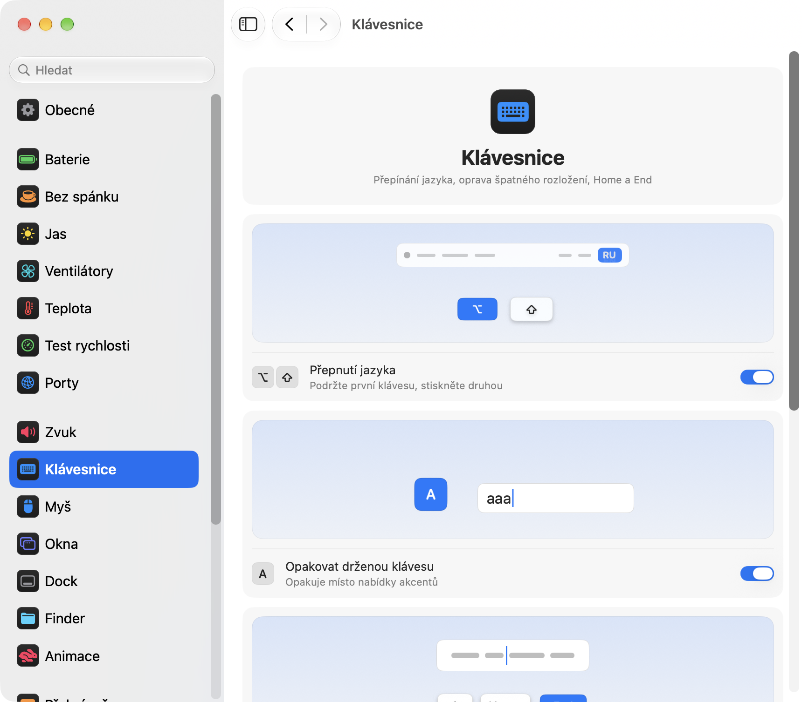

<p align="center"></p>
<h1 align="center">pikapik</h1>
<p align="center"><b>Váš Mac vám rozumí na půl slova.</b><br>Drobná vylepšení klávesnice, myši, oken a Finderu přímo v řádku nabídek vašeho Macu.</p>
<p align="center"><sub><a href="../../README.md">English</a> · <a href="README.ru.md">Русский</a> · <a href="README.uk.md">Українська</a> · <a href="README.de.md">Deutsch</a> · <a href="README.fr.md">Français</a> · <a href="README.es.md">Español</a> · <a href="README.it.md">Italiano</a> · <a href="README.pt-BR.md">Português (Brasil)</a> · <a href="README.ja.md">日本語</a> · <a href="README.zh-Hans.md">简体中文</a> · <a href="README.ko.md">한국어</a> · <a href="README.ro.md">Română</a> · <a href="README.pl.md">Polski</a> · <a href="README.tr.md">Türkçe</a> · <a href="README.nl.md">Nederlands</a> · <a href="README.sv.md">Svenska</a> · <b>Čeština</b> · <a href="README.zh-Hant.md">繁體中文</a> · <a href="README.ar.md">العربية</a> · <a href="README.hi.md">हिन्दी</a> · <a href="README.id.md">Bahasa Indonesia</a> · <a href="README.vi.md">Tiếng Việt</a> · <a href="README.th.md">ไทย</a></sub></p>

<p align="center">
<picture>
<source media="(prefers-color-scheme: dark)" srcset="../media/settings-cs-dark.png">

</picture>
</p>

## Instalace

Otevřete Terminál, vložte tento řádek a stiskněte Return:

```bash
/bin/bash -c "$(curl -fsSL https://raw.githubusercontent.com/dev-pikapik/pika-tools/main/install.sh)"
```

Příkaz stáhne nejnovější verzi z GitHubu a nainstaluje ji, jen pokud je podepsaná vývojářem a prošla kontrolou společnosti Apple na škodlivý software. pikapik najdete v řádku nabídek nahoře na obrazovce. Vše je vypnuté, dokud to sami nezapnete.

<details>
<summary>Jiné způsoby: Homebrew nebo dmg</summary>

S Homebrew:

```bash
brew install --cask dev-pikapik/pika-tools/pikapik && open -a pikapik
```

Nebo si stáhněte [pikapik.dmg](https://github.com/dev-pikapik/pika-tools/releases/latest/download/pikapik.dmg), otevřete ho a přetáhněte aplikaci do složky Aplikace.

Výše uvedený příkaz i Homebrew uloží aplikaci do `/Applications`, spustí ji, požádají o oprávnění a zapnou otevírání po přihlášení. Potom se aplikace aktualizuje sama, viz **Aktualizace**. Jak ji odstranit, najdete v části **Odinstalace**.

</details>

## Co umí

<table>
<tbody><tr>
<td width="50%" valign="top">
<picture><source media="(prefers-color-scheme: dark)" srcset="../media/keep-awake-dark.png"></picture>
<br><b>Nespat</b>
<br>Mac zůstane vzhůru, jak dlouho potřebujete, i se zavřeným víkem.
</td>
<td width="50%" valign="top">
<picture><source media="(prefers-color-scheme: dark)" srcset="../media/fans-dark.png"></picture>
<br><b>Ventilátory</b>
<br>Podívejte se, jak rychle se ventilátory točí, a vyberte jejich rychlost.
</td>
</tr></tbody>
<tbody><tr>
<td width="50%" valign="top">
<picture><source media="(prefers-color-scheme: dark)" srcset="../media/battery-dark.png"></picture>
<br><b>Baterie</b>
<br>Podívejte se na stav baterie, její kapacitu a počet cyklů, kolik energie do ní teče a jak prodloužit její výdrž.
</td>
<td width="50%" valign="top">
<picture><source media="(prefers-color-scheme: dark)" srcset="../media/command-keys-dark.png"></picture>
<br><b>Ochrana ⌘Q a ⌘W</b>
<br>Nic se nezavře omylem. Když to myslíte vážně, přidejte ⇧.
</td>
</tr></tbody>
<tbody><tr>
<td width="50%" valign="top">
<picture><source media="(prefers-color-scheme: dark)" srcset="../media/compress-dark.png"></picture>
<br><b>Menší kopie</b>
<br>Klikněte pravým tlačítkem na fotku, PDF nebo video a vedle se objeví lehčí kopie.
</td>
<td width="50%" valign="top">
<picture><source media="(prefers-color-scheme: dark)" srcset="../media/convert-dark.png"></picture>
<br><b>Převod</b>
<br>Uložte obrázek, video nebo skladbu v jiném formátu z nabídky pravého tlačítka.
</td>
</tr></tbody>
<tbody><tr>
<td width="50%" valign="top">
<picture><source media="(prefers-color-scheme: dark)" srcset="../media/input-switch-dark.png"></picture>
<br><b>Přepnutí jazyka</b>
<br>Podržte ⌥ a ťukněte na ⇧, jazyk klávesnice se přepne.
</td>
<td width="50%" valign="top">
<picture><source media="(prefers-color-scheme: dark)" srcset="../media/quit-on-close-dark.png"></picture>
<br><b>Ukončení s posledním oknem</b>
<br>Zavřete poslední okno aplikace a ukončí se i aplikace.
</td>
</tr></tbody>
<tbody><tr>
<td width="50%" valign="top">
<picture><source media="(prefers-color-scheme: dark)" srcset="../media/window-zoom-dark.png"></picture>
<br><b>Zelené tlačítko zvětšuje</b>
<br>Okno vyplní obrazovku bez přechodu na celou obrazovku.
</td>
<td width="50%" valign="top">
<picture><source media="(prefers-color-scheme: dark)" srcset="../media/dock-hide-dark.png"></picture>
<br><b>Minimalizace kliknutím v Docku</b>
<br>Klikněte na aplikaci, ve které právě jste, a uhne z cesty.
</td>
</tr></tbody>
<tbody><tr>
<td width="50%" valign="top">
<picture><source media="(prefers-color-scheme: dark)" srcset="../media/new-file-dark.png"></picture>
<br><b>Nový soubor</b>
<br>Pravé tlačítko ve Finderu, jméno a prázdný soubor je hotový.
</td>
<td width="50%" valign="top">
<picture><source media="(prefers-color-scheme: dark)" srcset="../media/finder-cut-dark.png"></picture>
<br><b>⌘X přesouvá soubory</b>
<br>Vyjměte soubory ve Finderu a vložte je, kam potřebujete.
</td>
</tr></tbody>
<tbody><tr>
<td width="50%" valign="top">
<picture><source media="(prefers-color-scheme: dark)" srcset="../media/finder-open-dark.png"></picture>
<br><b>Enter otevírá soubory</b>
<br>Vyberte soubory ve Finderu a stiskněte Enter, otevřou se.
</td>
<td width="50%" valign="top">
<picture><source media="(prefers-color-scheme: dark)" srcset="../media/finder-delete-dark.png"></picture>
<br><b>Delete do koše</b>
<br>Stiskněte ⌫ ve Finderu a vybrané soubory půjdou do koše.
</td>
</tr></tbody>
<tbody><tr>
<td width="50%" valign="top">
<picture><source media="(prefers-color-scheme: dark)" srcset="../media/desktop-icons-dark.png"></picture>
<br><b>Skrýt ikony na ploše</b>
<br>Jedním kliknutím uklidíte plochu před hovorem nebo snímkem obrazovky.
</td>
<td width="50%" valign="top">
<picture><source media="(prefers-color-scheme: dark)" srcset="../media/hidden-files-dark.png"></picture>
<br><b>Zobrazit skryté soubory</b>
<br>Uvidíte soubory a složky, které macOS skrývá.
</td>
</tr></tbody>
<tbody><tr>
<td width="50%" valign="top">
<picture><source media="(prefers-color-scheme: dark)" srcset="../media/game-mode-dark.png"></picture>
<br><b>Herní režim</b>
<br>Zatímco hrajete, nic nevyskočí přes hru a nic ji nezavře.
</td>
<td width="50%" valign="top">
<picture><source media="(prefers-color-scheme: dark)" srcset="../media/speed-test-dark.png"></picture>
<br><b>Test rychlosti</b>
<br>Jak rychlý je váš internet a na co stačí.
</td>
</tr></tbody>
<tbody><tr>
<td width="50%" valign="top">
<picture><source media="(prefers-color-scheme: dark)" srcset="../media/side-buttons-dark.png"></picture>
<br><b>Boční tlačítka</b>
<br>Tlačítka 4 a 5 jdou zpět a vpřed, jako přejetí prsty.
</td>
<td width="50%" valign="top">
<picture><source media="(prefers-color-scheme: dark)" srcset="../media/hide-app-dark.png"></picture>
<br><b>Skrytí tlačítkem myši</b>
<br>Jedno stisknutí skryje aplikaci v popředí, jako ⌘H. Aplikace dál běží.
</td>
</tr></tbody>
<tbody><tr>
<td width="50%" valign="top">
<picture><source media="(prefers-color-scheme: dark)" srcset="../media/wheel-lines-dark.png"></picture>
<br><b>Posouvání po řádcích</b>
<br>Každé cvaknutí kolečka posune stejně, ať točíte jakkoli rychle.
</td>
<td width="50%" valign="top">
<picture><source media="(prefers-color-scheme: dark)" srcset="../media/wheel-direction-dark.png"></picture>
<br><b>Směr posouvání</b>
<br>Jeden směr pro trackpad, jiný pro myš.
</td>
</tr></tbody>
<tbody><tr>
<td width="50%" valign="top">
<picture><source media="(prefers-color-scheme: dark)" srcset="../media/linear-pointer-dark.png"></picture>
<br><b>Bez zrychlení ukazatele</b>
<br>Ukazatel ujede přesně tolik co vaše ruka.
</td>
<td width="50%" valign="top">
<picture><source media="(prefers-color-scheme: dark)" srcset="../media/key-repeat-dark.png"></picture>
<br><b>Opakovat drženou klávesu</b>
<br>Podržte klávesu a píše se znovu a znovu, bez nabídky diakritiky.
</td>
</tr></tbody>
<tbody><tr>
<td width="50%" valign="top">
<picture><source media="(prefers-color-scheme: dark)" srcset="../media/home-end-dark.png"></picture>
<br><b>Home a End</b>
<br>Při psaní skok na začátek nebo konec řádku.
</td>
<td width="50%" valign="top">
<picture><source media="(prefers-color-scheme: dark)" srcset="../media/animations-dark.png"></picture>
<br><b>Animace</b>
<br>Zrychlete Dock, okna a Rychlý náhled, klidně až na okamžité.
</td>
</tr></tbody>
<tbody><tr>
<td width="50%" valign="top">
<picture><source media="(prefers-color-scheme: dark)" srcset="../media/leftover-permissions-dark.png"></picture>
<br><b>Oprávnění smazaných aplikací</b>
<br>Odstraňte oprávnění, která si macOS nechává pro už smazané aplikace.
</td>
<td width="50%" valign="top">
<picture><source media="(prefers-color-scheme: dark)" srcset="../media/pet-dark.png"></picture>
<br><b>Mazlíček na ploše</b>
<br>Malý kamarád se prochází za vašimi okny. Zvedněte ho a hoďte, nebo stiskněte mezerník a vyskočí. Oblékejte ho do věcí z jeho šatníku a získávejte ocenění, když si spolu hrajete. Když píšete, ožije, a když odejdete, podřimuje.
</td>
</tr></tbody>
<tbody><tr>
<td width="50%" valign="top">
<picture><source media="(prefers-color-scheme: dark)" srcset="../media/uninstaller-dark.png"></picture>
<br><b>Odinstalace aplikací</b>
<br>Odeberte aplikaci s jejími soubory. Vše lze vrátit.
</td>
<td width="50%" valign="top">
<picture><source media="(prefers-color-scheme: dark)" srcset="../media/game-fps-dark.png"></picture>
<br><b>Zobrazit FPS</b>
<br>Malé počítadlo v rohu, který si zvolíte, ukazuje, jak plynule hra běží.
</td>
</tr></tbody>
<tbody><tr>
<td width="50%" valign="top">
<picture><source media="(prefers-color-scheme: dark)" srcset="../media/archive-dark.png"></picture>
<br><b>Archivy</b>
<br>Pravým kliknutím rozbalíte RAR a další archivy nebo sbalíte soubory do archivu ZIP.
</td>
<td width="50%" valign="top">
<picture><source media="(prefers-color-scheme: dark)" srcset="../media/dock-display-dark.png"></picture>
<br><b>Držet Dock na jednom displeji</b>
<br>Dock už neskáče na jiný displej. Chcete-li ho přesunout, nastavte jako hlavní jiný displej.
</td>
</tr></tbody>
<tbody><tr>
<td width="50%" valign="top">
<picture><source media="(prefers-color-scheme: dark)" srcset="../media/temperatures-dark.png"></picture>
<br><b>Teplota</b>
<br>Podívejte se, jak moc je Mac uvnitř zahřátý, od procesoru po baterii.
</td>
<td width="50%" valign="top">
<picture><source media="(prefers-color-scheme: dark)" srcset="../media/background-dark.png"></picture>
<br><b>Úlohy na pozadí</b>
<br>Podívejte se, co běží na pozadí a odkud se to vzalo.
</td>
</tr></tbody>
<tbody><tr>
<td width="50%" valign="top">
<picture><source media="(prefers-color-scheme: dark)" srcset="../media/ports-dark.png"></picture>
<br><b>Porty</b>
<br>Zjistěte, který program zabral port, a uvolněte ho.
</td>
<td width="50%" valign="top">
<picture><source media="(prefers-color-scheme: dark)" srcset="../media/app-volume-dark.png"></picture>
<br><b>Hlasitost aplikací</b>
<br>Ztište nebo ztlumte libovolnou aplikaci, aniž byste ovlivnili ostatní.
</td>
</tr></tbody>
<tbody><tr>
<td width="50%" valign="top">
<picture><source media="(prefers-color-scheme: dark)" srcset="../media/brightness-dark.png"></picture>
<br><b>Jas monitorů</b>
<br>Ztmavte nebo zesvětlete monitor, který macOS sám neumí nastavit, posuvníkem nebo klávesami jasu.
</td>
<td width="50%" valign="top">
<picture><source media="(prefers-color-scheme: dark)" srcset="../media/layout-fix-dark.png"></picture>
<br><b>Opravit špatné rozložení</b>
<br>Napsali jste ghbdtn místo привет? Stiskněte mezerník a slovo se opraví.
</td>
</tr></tbody>
<tbody><tr>
<td width="50%" valign="top">
<picture><source media="(prefers-color-scheme: dark)" srcset="../media/middle-click-dark.png"></picture>
<br><b>Prostřední kliknutí na trackpadu</b>
<br>Klepněte třemi prsty a odkaz se otevře na nové kartě, jako prostředním tlačítkem myši.
</td>
</tr></tbody>
</table>

## Podrobnosti

<details>
<summary>První spuštění</summary>

pikapik potřebuje dvě oprávnění. Při prvním spuštění otevře nastavení na stránce Oprávnění, která vás provede krok za krokem, a macOS zobrazí vlastní dotazy. Přejděte do **Nastavení systému › Soukromí a zabezpečení** a zapněte pikapik v seznamech:

- **Zpřístupnění**, aby aplikace mohla změnit stisk klávesy nebo kliknutí dřív, než se dostane k jiným aplikacím.
- **Sledování vstupu**, aby aplikace viděla stisky kláves a kliknutí, aniž by je měnila. Tak funguje přepínání jazyka.

Aplikace změnu zaznamená během pár sekund, restart není potřeba.

Některé funkce žádají při použití o něco víc: **Přístup správce**, **Rozšíření Finderu**, **iCloud Drive**, **Úplný přístup k disku**, **Záznam obrazovky** a **Nahrávání zvuku systému**. Všechno je na stránce Oprávnění v nastavení: každé oprávnění má řádek o tom, k čemu slouží, zelenou fajfku nebo oranžový křížek a jedno tlačítko: **Povolit**, když chybí, **Vypnout**, když je zapnuté. Libovolné oprávnění tak můžete vzít zpět rovnou tam.

pikapik nenahrává, neukládá ani neodesílá nic z toho, co píšete nebo na co klikáte. Události se zpracovávají v paměti a hned se předávají dál. Aby mohl opravovat slova napsaná ve špatném rozložení, drží pikapik v paměti jen několik posledních napsaných slov a zapomene je, jakmile kliknete nebo přejdete do jiné aplikace. Ukládá jen slova, která podle vás nemá opravovat, a to jen v tomto Macu, dokud je nevymažete v Nastavení › Klávesnice. pikapik se připojuje k internetu jen kvůli aktualizacím (ptá se GitHubu na nejnovější verzi a stáhne ji, jen když se rozhodnete aktualizovat) a kvůli testu rychlosti, když ho spustíte (používá servery Apple). Verzi z Mac App Store aktualizuje App Store a její test rychlosti používá Cloudflare. Postup mazlíčka (kroky, hody, ocenění a podobně) se počítá jen v tomto Macu a nikam se neposílá. Smazat ho můžete v Nastavení › Mazlíček.

</details>

<details>
<summary>Každý nástroj podrobně</summary>

**Přehrávač.** Videa, která QuickTime neotevře, třeba MKV, WebM, AVI, WMV a FLV, se přehrají ve vlastním okně. Otevřete Nastavení › Přehrávač a klikněte na **Otevřít video…**, nebo klikněte pravým na video a vyberte **Otevřít v aplikaci › pikapik Player**. Mezerník spouští a pozastavuje, ← a → na pauze posunou o jeden snímek a při přehrávání o 5 sekund, J a L o 10, ↑ a ↓ mění hlasitost a F přepne na celou obrazovku. Nabídka **Rychlost** jde od 0,5× do 2×, **Uložit snímek…** uloží PNG a přehrávač pokračuje tam, kde video skončilo. Kapitoly videa se ukážou jako značky na časové liště a v nabídce **Kapitoly**, mezi nimi skáčou klávesy Page Down a Page Up a dvojí stisk A opakuje úsek mezi oběma stisky, dokud A nestisknete potřetí. Ovládací panel je z matného skla a během přehrávání se skryje, a po najetí na časovou lištu se ukáže malý náhled té chvíle. Video, které už je otevřené, se přenese do popředí, místo aby se otevřelo podruhé. Přehrávač nemá přístup k síti a o žádná oprávnění nežádá. Každý formát na té stránce je tlačítko, které ukazuje aplikaci, jež ho teď otevírá: kliknutím z pikapik Player uděláte pro daný formát výchozí aplikaci a dalším kliknutím ho vrátíte aplikaci, která ho otevírala dřív. Tlačítko **Otevřít vše v aplikaci pikapik** to udělá se všemi formáty po sobě a změní se na **Vrátit původní aplikace** (macOS vás požádá o potvrzení každého z nich). Licence FFmpeg a dav1d i jejich zdrojový kód najdete na stejné stránce. Titulky zatím nejsou podporované. Ve verzi z Mac App Store není.

**Hlasitost aplikací.** Otevřete Nastavení › Zvuk a zapněte **Hlasitost aplikací**. Každá aplikace, která přehrává zvuk, dostane vlastní posuvník a tlačítko pro ztlumení, v Nastavení i v nabídce. Hlasitý videohovor ztišíte, hlučnou hru ztlumíte a hudbu necháte, jak je: hlasitost Macu ani ostatních aplikací se nezmění. pikapik si pamatuje hlasitost každé aplikace a aplikace, kterou necháte na plnou hlasitost, se nikdy nedotkne. Aplikace, kterou jste nastavili, zůstane v seznamu i po restartu, zešedlá, dokud je zavřená, takže hlasitost můžete nastavit ještě před jejím spuštěním: klikněte na **Přidat aplikaci…** nebo aplikaci přetáhněte z Finderu. Křížek ✕ vedle aplikace ji zapomene a vrátí ji na plnou hlasitost. Aby mohl hlasitost aplikace měnit, pouští pikapik její zvuk přes sebe, a proto potřebuje oprávnění **Nahrávání zvuku systému**, které povolíte na stránce Oprávnění. Zvuk se jen předává dál: nenahrává se, neukládá ani nikam neposílá a mikrofon se nepoužívá. Vyžaduje macOS 14.2 nebo novější a v macOS 14.0 a 14.1 je skrytý. Ve výchozím stavu vypnuto.

**Jas monitorů.** macOS mění jas vestavěného displeje a monitorů Apple, ale u většiny ostatních monitorů ne. Otevřete Nastavení › Jas: každý monitor, který macOS sám neumí nastavit, dostane vlastní posuvník. Řádek „Jas“ můžete přidat i do panelu v řádku nabídek. pikapik mění jas samotného monitoru, stejné nastavení jako tlačítka na monitoru. Pokud monitor nereaguje, zapněte **Místo toho ztmavovat obraz**: obraz ztmavne, ale nikdy nezčerná. Zapněte **Klávesy jasu** a klávesy jasu budou měnit jas monitoru, na kterém je ukazatel, a zobrazí malý indikátor; podržte ⌥⇧ pro jemnější kroky. Klávesy potřebují oprávnění **Zpřístupnění**, které povolíte na stránce Oprávnění, a posuvníky fungují i bez něj. pikapik si pamatuje jas každého monitoru a po spánku ho nastaví znovu. Verze z Mac App Store obraz jen ztmavuje. Klávesy jasu jsou ve výchozím stavu vypnuté.

**Ochrana ⌘Q a ⌘W.** Samotné ⌘Q a ⌘W nic nedělají, takže omylem neukončíte aplikaci ani nezavřete okno. Přidejte Shift, když to chcete udělat záměrně: ⇧⌘Q ukončí, ⇧⌘W zavře. Funguje ve všech aplikacích. Každá klávesa má vlastní přepínač. Ve výchozím stavu vypnuto.

**Přepínání jazyka pomocí Option+Shift.** Podržte Option a ťukněte na Shift: macOS přepne na další zdroj vstupu. Držte dál Option a znovu ťukněte na Shift, chcete-li pokračovat. Podržte Shift a ťukněte na Option, chcete-li se vrátit. Když mezitím stisknete jinou klávesu, kliknete nebo přidáte Command, Control či Fn, nic se nepřepne, takže zkratky jako Option+Shift+šipka fungují jako dřív. Ve výchozím stavu vypnuto.

**Opakovat drženou klávesu.** Podržte klávesu a písmeno se píše znovu a znovu, místo aby se ukázala nabídka akcentů. Hodí se ve hrách i při psaní. Už otevřené aplikace to převezmou po restartu. Když to vypnete, macOS se chová jako obvykle. Ve výchozím stavu vypnuto.

**Home a End na začátek a konec řádku.** Když píšete, Home přesune kurzor na začátek řádku a End na jeho konec, místo aby posouvaly stránku. S ⇧ vyberou text až tam, s ⌘ skočí na začátek nebo konec celého textu. Mimo textová pole a v terminálech, virtuálních počítačích a aplikacích pro vzdálenou plochu fungují klávesy jako dřív. Ve verzi z Mac App Store fungují takto i mimo textová pole, kromě prohlížečů, Finderu a Hudby. Můžete přidat další aplikace, kde mají fungovat jako obvykle. Ve výchozím stavu vypnuto.

**Oprava slov napsaných ve špatném rozložení.** Když slovo vyjde jako hatmatilka, třeba ghbdtn místo привет, pikapik ho přepíše ve správném rozložení, jakmile stisknete mezerník nebo Return, a přepne rozložení, aby další slovo vyšlo správně. Funguje se všemi rozloženími klávesnice, která jste si do Macu přidali. Slovo se změní jen tehdy, když neexistuje v žádném z vašich jazyků a stejné klávesy v jiném rozložení dávají běžné slovo, takže jména, překlepy a méně častá slova zůstanou tak, jak jste je napsali, a stejně tak text v polích pro hesla, v Terminálu a v aplikacích, které si vyberete. Stiskněte ⌃⇧Mezerník a opraví se poslední slovo nebo vybraný text, dalším stisknutím vyzkoušíte jiná rozložení. Hned po opravě ji tytéž klávesy vrátí zpět a pikapik už to slovo sám opravovat nebude. Zkratku můžete změnit v Nastavení › Klávesnice. Ve verzi z Mac App Store vyberte text a stiskněte ⌃⇧Mezerník, nebo v nabídce „Služby“ zvolte „Opravit rozložení klávesnice“. **Opravovat slova při psaní** i zkratka jsou vypnuté, dokud je nezapnete v Nastavení › Klávesnice, a potřebují Zpřístupnění, o které žádá stránka Oprávnění. Ve výchozím stavu vypnuto. Pokud máte jen jedno rozložení, poznámka na stránce vám nabídne rozložení pro váš jazyk a přidáte ho hned tam, bez cesty do Nastavení systému (verze ze stránek).

**Vypnout zrychlení ukazatele.** Ukazatel se posune přesně tolik jako myš, ať s ní pohybujete jakkoli rychle. Jezdec **Rychlost ukazatele** určuje, jak rychle se pohybuje. Funguje jen s myší, trackpad zůstane, jak je. Vypněte funkci nebo ukončete pikapik a macOS dostane zpět svoje vlastní nastavení. Ve výchozím stavu vypnuto.

**Posouvat po řádcích.** Každé cvaknutí kolečka myši posune stejný počet řádků, ať kolečkem točíte jakkoli rychle. Vyberte 1 až 10 řádků na cvaknutí, ve výchozím stavu 3. Přirozené posouvání zůstane tak, jak jste ho nastavili v Nastavení systému. Funguje jen pro myš, trackpad zůstává beze změny. Ve výchozím stavu vypnuto. Vedle posuvníku **Vzdálenost na cvaknutí** se malá stránka posune o zvolenou vzdálenost a tečka označuje výchozí hodnotu.

Některé aplikace a hry počítají posouvání v přesných pixelech: pro ně přepněte stejné nastavení na pixely a vyberte 1 až 200 pixelů na cvaknutí, výchozí je 40. Posuvník také ukazuje, jak velkou část výšky obrazovky to tvoří.

**Směr posouvání pro trackpad a myš.** macOS má jen jeden přepínač přirozeného posouvání pro trackpad i myš zároveň. Zapněte tuto funkci a vyberte směr pro každé zvlášť: **Přirozený**, kdy stránka jde za prsty jako na iPhonu, nebo **Klasický**, kdy se stránka posouvá opačným směrem. Volba pro trackpad platí i pro posouvání do stran a pro dojezd po zvednutí prstů. Magic Mouse posouvá dotykem, a proto se řídí volbou pro trackpad. Vyberte na každém svém Macu totéž a posouvání bude všude stejné, i když myš přesunete na jiný Mac přes Společné ovládání. Ve výchozím stavu vypnuto. Po zapnutí jsou obě volby stejné jako v Nastavení systému, takže se nic nezmění, dokud nevyberete něco jiného.

**Boční tlačítka pro zpět a vpřed.** Tlačítka myši 4 a 5 fungují jako zpět a vpřed ve Finderu, v Safari a dalších aplikacích Apple i v mnoha dalších aplikacích, stejně jako přejetí po trackpadu. Aplikace, které tato tlačítka zpracovávají samy, je dostanou beze změny. Pokud je má vaše myš obráceně, zapněte **Prohodit boční tlačítka**. Ve výchozím stavu vypnuto.

**Tlačítko myši skryje aktuální aplikaci.** Zapněte **Tlačítko myši skryje aktuální aplikaci** v Nastavení › Myš a stiskněte tlačítko, které chcete používat, třeba prostřední nebo boční. Potom jedno stisknutí skryje aplikaci v popředí, úplně stejně jako ⌘H: aplikace dál běží a kliknutím na její ikonu v Docku ji vrátíte zpět. Když hrajete a je zapnutý Herní režim, tlačítko ve hře funguje jako obvykle. Ve výchozím stavu vypnuto.

**Prostřední kliknutí na trackpadu.** Klepněte nebo klikněte třemi prsty a trackpad zafunguje jako prostřední tlačítko myši: ve většině prohlížečů tím otevřete odkaz na nové kartě nebo zavřete kartu. Místo tří prstů si můžete zvolit čtyři. Aby klepnutí fungovalo, musí být v Nastavení systému › Trackpad zapnuté **Kliknutí klepnutím**. Pokud je tam u položky „Hledání a datové detektory“ zvolené klepnutí třemi prsty, tři prsty mohou jen klikat, a pokud je zapnuté „Tažení třemi prsty“, zvolte čtyři prsty. Řádek **Prsty** v Nastavení ukazuje, co na vašem Macu funguje. Myš zůstane, jak je. Potřebuje oprávnění **Zpřístupnění** i **Sledování vstupu** a ve verzi z Mac App Store není. Ve výchozím stavu vypnuto.

**Ukončení po zavření posledního okna.** Zavřete poslední okno aplikace a aplikace se ukončí. Finder zůstane otevřený, stejně jako aplikace s okny na jiných plochách nebo v Docku. Můžete si sestavit seznam aplikací, které se tímto způsobem nikdy ukončit nemají. Ve výchozím stavu vypnuto.

**Minimalizovat nebo skrýt kliknutím v Docku.** Klikněte v Docku na ikonu aplikace, se kterou právě pracujete, a všechna její okna sjedou do Docku. Dalším kliknutím je všechna vrátíte. Kliknutí můžete nastavit i tak, aby skrylo celou aplikaci, jako ⌘H. Ve výchozím stavu vypnuto.

**Držet Dock na jednom displeji.** Když máte víc displejů, macOS přesune Dock na jiný displej, jakmile ukazatel zatlačí na jeho spodní okraj. Po zapnutí se to už neděje, ať ukazatelem pohybujete jakkoli rychle: pikapik přesouvání vypíná vlastním nastavením Docku a ukazatele se nikdy nedotýká. Chcete-li Dock přesunout záměrně, nastavte jako hlavní jiný displej: v **Nastavení systému › Monitory** klikněte na ten displej a v nabídce **Používat jako** vyberte **Hlavní monitor**. Dock se pak přesune s ním. Řádek **Hlavní monitor** pod přepínačem to udělá rovnou tam a po vypnutí přepínače se monitory vrátí, jak byly. Dock své nastavení načítá jen při spuštění, takže se při zapnutí nebo vypnutí přepínače jednou restartuje. Žádné oprávnění není potřeba. Přepínač je ve výchozím stavu vypnutý a ve verzi z Mac App Store není.

**Zelené tlačítko zvětší okno.** Klikněte na zelené tlačítko okna a okno se zvětší tak, aby vyplnilo obrazovku, aniž by přešlo do režimu celé obrazovky. Dalším kliknutím se vrátí původní velikost. S podrženým ⌥ tlačítko funguje jako vždy. Celá obrazovka zůstává v nabídce tlačítka a na ⌃⌘F. Můžete sestavit seznam aplikací, ve kterých má zelené tlačítko fungovat jako obvykle. Ve výchozím stavu vypnuto.

**Nový soubor ve Finderu.** Klikněte pravým v okně Finderu nebo na ploše, vyberte **Nový soubor**, napište název a objeví se prázdný soubor. Standardně .txt. Ve výchozím stavu vypnuto.

**Enter otevírá soubory ve Finderu.** Vyberte soubory v okně Finderu nebo na ploše a stiskněte Return nebo Enter, soubory se otevřou. F2 nebo fn F2 přejmenuje vybraný soubor. V textových polích, například když píšete název, klávesy fungují jako obvykle. Ve výchozím stavu vypnuto.

**⌘X vyjímá soubory ve Finderu.** Vyberte soubory a stiskněte ⌘X, otevřete cílovou složku a stiskněte ⌘V: soubory se tam přesunou místo zkopírování. ⌘C vyjmutí zruší. Ve výchozím stavu vypnuto.

**Delete maže soubory ve Finderu.** Vyberte soubory a stiskněte ⌫ nebo ⌦ (fn ⌫ na notebooku) – přesunou se do Koše, stejně jako s ⌘⌫. Když přejmenováváte soubor, hledáte nebo píšete do jiného pole, klávesy mažou písmena jako obvykle. Ve výchozím stavu vypnuto.

**Menší kopie ve Finderu.** Klikněte pravým na soubor ve Finderu a vyberte **Vytvořit menší kopii**. Vedle se objeví lehčí verze fotky, GIFu, PDF nebo videa, často několikrát menší. Nekomprimovaný zvuk jako WAV nebo AIFF se změní na úsporné M4A. Pokud soubor už menší být nemůže, kopie se nevytvoří a pikapik vám to řekne. Originál zůstane beze změny a nic neopustí váš Mac. Ve výchozím stavu vypnuto.

**Převod ve Finderu.** Klikněte pravým na soubor ve Finderu a vyberte **Převést na** a soubor se uloží v jiném formátu: obrázek jako JPEG, PNG, HEIC, GIF, TIFF nebo PDF, video jako MP4, MOV nebo jen zvuk, hudba jako M4A, WAV nebo AIFF. Originál zůstane beze změny a nic neopustí váš Mac. Zapíná se zvlášť od menší kopie. Ve výchozím stavu vypnuto.

**Archivy ve Finderu.** Klikněte pravým na archiv ve Finderu, vyberte **Rozbalit** a jeho soubory se objeví vedle něj. Klikněte pravým na jakýkoli jiný soubor nebo složku, vyberte **Vytvořit archiv…** a vznikne ZIP, 7Z, TAR.GZ nebo TAR.XZ. ZIP a 7Z mohou mít heslo a každý archiv lze rozdělit na části, například po 15 MB pro e-mail nebo po 4 GB pro USB disk. Heslo se zadává dvakrát, aby vás překlep nepřipravil o vlastní soubory. ZIP vytvořený tímto způsobem neobsahuje skryté soubory, které přidává systém, názvy v jakémkoli jazyce zůstanou čitelné a zvládne i soubory větší než 4 GB. Ve výchozím stavu vypnuto. Verze z Mac App Store má určitá omezení, popsaná níže.

pikapik otevře i to, co macOS neotevře: RAR, třeba rozdělený na části, 7Z chráněný heslem, sady částí jako .001, .z01, .r00 a .part1.rar a také ZIPX, CAB, LZH, ARJ, ZST, LZMA, WIM a další. Po dvojkliku je otevře pikapik. Názvy souborů ve starých archivech ZIP, například v azbuce, japonštině nebo čínštině, se zobrazí čitelně. Přepínač **Otevírat archivy v této aplikaci** v Nastavení › Finder zařídí, že i ZIP a 7Z otevře pikapik, zatímco TAR a GZ zůstanou u vestavěné aplikace pro archivy, která si s nimi už dobře poradí. pikapik umí RAR rozbalit, ale nevytvoří ho: licence RAR povoluje jen rozbalování.

Okno se zeptá na heslo, **Zastavit** zruší jakoukoli úlohu a z poškozeného nebo neúplného archivu pikapik vytáhne, co se ještě dá přečíst. Před rozbalením archivu, který by nabobtnal do obrovské velikosti, se zeptá, včas se zastaví, kdyby se měl zaplnit disk, a archivy, které se pokoušejí zapisovat mimo vlastní složku, zablokuje. Vyberte archiv ve Finderu a stiskněte mezerník, abyste viděli, co obsahuje.
**Archivy ve verzi z Mac App Store.** Fungují i tam, ale s nástroji zabudovanými v macOS místo přibaleného 7-Zipu, proto mají omezení: heslo lze nastavit jen u ZIP, ne u 7Z; archiv nelze rozdělit na části a sady částí (.001, .part1.rar, .z01 a podobně) nejdou otevřít; samostatné soubory .xz, .lzma a .zst nejdou otevřít (.gz a .bz2 ano); 7Z a RAR chráněné heslem nejdou otevřít; a chybí přepínač **Otevírat archivy v této aplikaci**. Poprvé pikapik požádá o přístup k vaší domovské složce, stejně jako u Nového souboru a Menší kopie, protože tato verze smí zapisovat jen tam, kam jste jí to dovolili. Rozšíření pro Finder zapněte v Nastavení systému › Obecné › Položky po přihlášení a rozšíření; pikapik ukáže, kam kliknout.


**Skrýt ikony na ploše.** Zapněte to před hovorem, nahráváním obrazovky nebo snímkem obrazovky a soubory a složky z plochy zmizí. Vypněte to a vrátí se na stejná místa. Nic se nepřesouvá: soubory zůstávají ve složce Plocha ve Finderu. Je to volba **Zobrazit položky › Na ploše** z Nastavení systému › Plocha a Dock, jen víc po ruce, takže obě vždy souhlasí. Ve verzi z Mac App Store tento řádek místo toho zakryje ikony tapetou na každém displeji, nebo jednolitou barvou, pokud je tapeta pohyblivá, a kliknutí dál procházejí na plochu. Tlačítko **Otevřít** pod ním v Nastavení stále otevře tuto stránku Nastavení systému.

**Zobrazit skryté soubory.** Soubory a složky, které macOS skrývá, třeba Knihovna ve vaší domovské složce nebo soubory, jejichž název začíná tečkou, se ve Finderu a na ploše zobrazí poloprůhledně. Je to totéž jako stisknout ⇧⌘. ve Finderu, jen hned vidíte, jestli je to zapnuté. Aby se změna projevila, Finder se na chvilku restartuje a znovu otevře svá okna a karty. Pokud Finder právě kopíruje nebo přesouvá soubory, restartuje se, až s tím skončí. Obojí najdete v Nastavení › Finder. Chcete-li je mít v panelu v řádku nabídek, klikněte na tlačítko s tužkou dole v panelu a zaškrtněte je. Ve verzi z Mac App Store místo toho Nastavení › Finder ukazuje klávesy ⇧⌘. pro Finder.

**Herní režim.** Přidejte své hry a během hraní vás Mac ze hry nevytrhne. Spotlight, Siri, ⌘Tab, Mission Control a přejetí mezi plochami se neotevřou přes hru, ⌘Q a ⌘W ji omylem nezavřou, ukazatel nesklouzne do Docku, na řádek nabídek ani na jiný displej a obrazovka zůstane zapnutá. Každá z těchto voleb má vlastní přepínač na stránce Hry a pikapik vám nabídne hry, které na vašem Macu najde. Ve hře zůstane Control-kliknutí obyčejným kliknutím a Control se šipkami nepřepne plochu. Pozná i Minecraft: přidejte Minecraft Launcher nebo CurseForge a režim se zapne přímo v Minecraftu. Hru ukončíte stiskem ⇧⌘Q, její okno zavřete stiskem ⇧⌘W. ⌥⌘Esc funguje vždy. Jakmile hru opustíte, vše funguje jako obvykle. Ve výchozím stavu vypnuto.

Zapněte herní režim a hrajte. Další nastavení hry obsahuje katalog Macu s aktuálními klávesami a animovaným náhledem každé akce.

Automaticky pozastaví akce otevírající okna nebo měnící fokus. Krátká úmyslná jazyková zkratka změní zdroj bez systémového okna. Držené klávesy pohybu mají přednost, takže běh a skákání nezmění jazyk náhodou.

V Nastavení → Hry → Další nastavení hry je skupina „Myš a trackpad“. Zobrazuje jen to, co je v macOS na vašem Macu zapnuté, s názvy od Applu a malým obrázkem u každé položky: zkratky na tlačítku myši, přejetí mezi plochami a aplikacemi na celou obrazovku, Mission Control a App Exposé, sevření prstů pro aplikace a rozevření pro plochu, přejetí od pravého okraje pro Oznamovací centrum a každý aktivní roh s jeho akcí. Dokud je hra v popředí, jsou pozastavené, takže nechtěné přejetí nebo dotek rohu obrazovky vás z hry nevyvede. Gesta uvnitř hry fungují dál. Každou položku lze nastavit tak, aby fungovala jako obvykle. Ve verzi ze stránek u horkého rohu **Změnit…** vybere jinou akci hned tam a **Vrátit zpět** vrátí původní; každá změna restartuje Dock jednou.

Otevřete Nastavení → Hry → Přidat hru a klikněte na spuštěnou hru. Objeví se i hry přes Javu a jiná prostředí, i bez souboru .app. Minecraft se jmenuje Minecraft místo java. Najděte proces hry a přetáhněte řádek na Vaše hry v Nastavení → Hry.

**Zobrazit FPS.** FPS znamená snímky za sekundu: kolik obrázků hra nakreslí za jednu sekundu. Zapněte **Zobrazit FPS** na stránce Hry a dokud je zapnutý Herní režim, objeví se v rohu každé hry malý tmavý štítek s tímto číslem. Roh vyberete kliknutím na obrázek nad přepínačem. Pomlčka znamená, že první snímky ještě nedorazily, a pobledlá 0 znamená, že hra přestala kreslit. V macOS 27 většinu her počítá sám macOS, bez jakéhokoli oprávnění. Hru, kterou macOS spočítat neumí, většinou starší, pikapik počítá přes záznam obrazovky: na stránce Oprávnění se pak objeví řádek **Záznam obrazovky**, pikapik o oprávnění nikdy nežádá během hry a číslo nemůže být vyšší než obnovovací frekvence obrazovky. V macOS 14–26 a ve verzi z Mac App Store se tak počítají všechny hry, proto se řádek objeví hned po zapnutí **Zobrazit FPS** a tlačítko **Povolit** pod přepínačem vás k němu zavede. Žádný obraz se neukládá ani neodesílá. Ve výchozím stavu vypnuto.

**Šatník a ocenění mazlíčka.** Otevřete Nastavení › Mazlíček a oblékněte svého mazlíčka: přes 30 kousků, od klobouků a brýlí po pláště a křídla, a hotové kostýmy třeba pro čaroděje, piráta nebo astronauta. Pár kousků je zdarma hned od začátku. Zbytek jsou ocenění, která přicházejí při společné hře: zvedněte mazlíčka a hoďte s ním, kopejte do míče, sledujte, jak leze po oknech a povídá si, nebo mu prostě dělejte společnost den za dnem. Až získáte nové ocenění, mazlíček vám to řekne.

Aby pikapik věděl, kdy je čas na ocenění, počítá jen to, co děláte vy a váš mazlíček: kroky, kolikrát ho zvednete a hodíte, skoky, lezení, hru s míčem a řeči, společné dny, jestli jste byli spolu brzy ráno, po půlnoci nebo o víkendu, které stránky nastavení jste otevřeli a co jste vyzkoušeli. Mimo Mac App Store si pikapik také poznamenává, zda jste z Nastavení otevřeli naši stránku na GitHubu. Tato čísla, datum každého ocenění a to, co má mazlíček na sobě, zůstávají v tomto Macu. Nic se nikam neposílá a nic z toho nejde do exportovaného souboru nastavení ani do synchronizace přes iCloud. Všechno můžete kdykoli smazat v Nastavení › Mazlíček a mazlíček začne od nuly.

**Odinstalace aplikací.** Otevřete Nastavení › Odinstalace aplikací, vyberte aplikaci ze seznamu nebo ji přetáhněte na obrázek a pikapik ukáže vše, co aplikace ve vašem Macu uchovává: samotnou aplikaci, její uložená data, nastavení, dočasné soubory, pomocníky na pozadí a další věci, u každé s důvodem, proč je v seznamu. Soubory, které k aplikaci jednoznačně patří, jsou zaškrtnuté, soubory, které s ní jen možná souvisejí, ne, a soubory, které používají i jiné aplikace, jsou označené. Vyberte, co odebrat, a klikněte na **Přesunout do Koše**. Nic se nemaže natrvalo: všechno skončí v Koši. Je-li aplikace otevřená, pikapik ji nejdřív požádá o ukončení, a pokud některé soubory vyžadují správce, Mac vás jednou požádá o heslo.

Rozmysleli jste si to? Klikněte na **Vrátit zpět** a všechno se vrátí na původní místo a pomocníci na pozadí se znovu spustí. Posledních deset odebrání čeká v části „Nedávno odebrané“, dokud jsou jejich soubory v Koši. **Resetovat aplikaci** ponechá aplikaci a odebere jen její uložená data, nastavení a dočasné soubory, což může pomoci, když se aplikace chová divně. Aplikace, které jste do Koše přesunuli sami, se objeví v části „V Koši“ spolu se soubory, které po sobě nechaly, a část „Zbytky po odebraných aplikacích“ najde soubory aplikací, které už neexistují. Přepínač „Nabídnout úklid, když aplikace skončí v Koši“ je ve výchozím stavu vypnutý a nic se neodebere, dokud nevyberete. Aby stránka viděla všechno, co aplikace uchovává, potřebuje **Úplný přístup k disku**. Tento nástroj není ve verzi z Mac App Store.

**Teplota.** Otevřete Nastavení › Teplota a uvidíte, jak moc je Mac uvnitř zahřátý. Nahoře vše shrne jedno slovo, od „V normě“ po „Velké horko“, a řádek pod ním řekne, jestli Mac běží na plný výkon, nebo zpomaluje, aby vychladl. Níže má každá součást vlastní řádek se srozumitelným názvem místo kódu čidla: procesor, grafika, paměť, disk, Wi-Fi a baterie, podle toho, jaká čidla váš Mac má. Každý řádek ukazuje stupně a krátký pruh, který je zelený, žlutý nebo oranžový podle běžného rozsahu pro danou součást. Hodnoty se obnovují každé dvě sekundy a jen tehdy, když se na ně díváte, takže Mac skoro nezatěžují. Není potřeba heslo ani oprávnění. Řádek „Teplota“ můžete přidat i do panelu v řádku nabídek. Verze z Mac App Store ukazuje celkovou úroveň a na Macu s baterií také teplotu baterie.

Stránka **Úlohy na pozadí** ukazuje vše, co se na vašem Macu spouští samo: aplikace otevírané po přihlášení, služby na pozadí, pomocníky schované uvnitř aplikací a zbytky po už odebraných aplikacích. U každé úlohy vidíte, která aplikace ji přidala, jestli právě běží a kde leží její soubor, a jedním kliknutím soubor zobrazíte ve Finderu. Úlohy spouštěné agenty, včetně těch pro všechny uživatele, a staré položky po přihlášení vypnete přímo v pikapiku jedním tlačítkem, nepotřebujete heslo a stejně snadno je zase zapnete; nic se nemaže. Služby na pozadí ze sdílené složky Library, Vzdálené přihlášení a Sdílení obrazovky vypnete stejně, jakmile na stránce Oprávnění povolíte přístup správce. Pomocníci, které si aplikace zaregistrovala sama, a služby odjinud patří macOS, proto jejich tlačítko otevře Položky po přihlášení v Nastavení systému a řádek pod úlohou říká proč. Ve verzi z Mac App Store stránka úlohy jen ukazuje: přístup k domovské složce jí dáte jednou v obvyklém okně Otevřít a tlačítka otevírají Položky po přihlášení.

**Porty.** Když program hlásí, že jeho port je už obsazený, otevřete Nastavení › Porty. Uvidíte každý program, který na vašem Macu zabral port, s jeho ikonou, čísly portů a informací, jestli se k němu mohou připojit další zařízení ve vaší síti. Zadejte číslo a zjistíte, kdo ten port drží, nebo si ověříte, že je volný. Klikněte na řádek a uvidíte adresy, které otevřete v prohlížeči, soubor programu, příkaz, kterým byl spuštěn, jeho složku a číslo procesu. **Uvolnit** požádá program o ukončení, aby si stihl uložit práci, a pokud se nezavře, nabídne jeho vynucené ukončení. Před každým krokem se vás pikapik nejdřív zeptá. Části macOS ani programy jiných uživatelů pikapik nikdy neukončuje: u služeb Přijímač AirPlay a Sdílení souborů vám poradí, který přepínač v Nastavení systému port uvolní, a Vzdálené přihlášení a Sdílení obrazovky vypnete rovnou tlačítkem Vypnout. Stránka Porty ve verzi z Mac App Store není: macOS tam aplikaci nedovolí zjistit, který program drží port.

Každý nástroj má vlastní přepínač v nabídce i v nastavení.

Ikona v řádku nabídek ukazuje stav na první pohled: značka pikapik, když nástroje fungují, stejná značka, jen bledá, když je vše vypnuté, a výstražný trojúhelník, když je nástroj zapnutý, ale chybí oprávnění.

Panel v řádku nabídek začíná jen s několika řádky. Které řádky ukazuje, si vyberete sami: klikněte na tlačítko s tužkou dole, zaškrtněte, co chcete vidět, a klikněte na **Hotovo**. Skryté řádky dál fungují a zůstávají v Nastavení. Když se panel na obrazovku nevejde, dá se posouvat.

Aplikace používá jazyk systému nebo ten, který vyberete v nastavení. K dispozici je všech 23 jazyků ze seznamu na začátku této stránky.

</details>

<details>
<summary>Nespat</summary>

Nedovolí Macu přejít do režimu spánku, když nejste u klávesnice: na libovolnou dobu od 1 sekundy do 365 dnů, nebo dokud to nevypnete. Zapněte to v nabídce a délku nastavte v nastavení: zadejte dny, hodiny, minuty a sekundy, použijte ↑ a ↓ nebo klikněte na hotovou volbu od 15 minut do 8 hodin. Nabídka ukazuje, kolik času zbývá a kdy to skončí. Pro **Displej** jsou dvě volby. **Stále zapnutý**: nezhasne a neukáže spořič ani zamčenou obrazovku. **Vypne se jako obvykle**: zhasne podle svého časovače, zatímco Mac dál pracuje. **Vypnout displej hned** (je i v nabídce) displej rovnou zhasne a Mac pracuje dál: vrátíte ho pohybem myši nebo stiskem klávesy. Ukončením pikapik skončí i Nespat.

Na MacBooku můžete zapnout také **Pracovat se zavřeným víkem**. macOS na to nemá přepínač, proto pikapik spustí `pmset -a disablesleep 1` a požádá o heslo správce: měnit, jak Mac usíná, může jen správce. Nastavení se samo vrátí do normálu, když Nespat skončí, když aplikaci ukončíte nebo když spadne. Pokud heslo nezadáte, nic se nezmění. Se zavřeným víkem dbejte na dobré větrání Macu. **Zastavit, když baterie klesne pod 20 %** ukončí relaci dřív, než se baterie vybije.

Keep Awake, režimy displeje a zavřeného víka lze dát na tlačítko v Ovládacím centru, v panelu nabídek nebo na widget na ploše přes aplikaci Zkratky, s odkazy zkopírovanými z Nastavení › Bez spánku.

</details>

<details>
<summary>Test rychlosti</summary>

Ukáže, jak rychlý je váš internet právě teď. Klikněte na **Změřit rychlost** v Nastavení › Test rychlosti, nebo na **Změřit** v nabídce, pokud tam řádek přidáte tlačítkem s tužkou. Asi za půl minuty uvidíte stahování, odesílání, ping a odezvu: jak rychle vše reaguje, když je připojení vytížené. Pod tím je jednoduše napsáno, na co stačí: filmy ve 4K, videohovory, online hry a velká stahování. Měření používá networkQuality, který je součástí macOS, a servery Apple. Poslední výsledek zůstane do dalšího měření a odkaz pro Zkratky ho spustí z Ovládacího centra.

</details>

<details>
<summary>Nastavení</summary>

Nastavení otevřete z nabídky položkou **Nastavení…** nebo zkratkou ⌘, případně pikapik znovu spusťte z Finderu, Launchpadu nebo Spotlightu. Dokud je okno otevřené, aplikace se zobrazuje v Docku a v ⌘Tab.

- **Obecné**: otevírání po přihlášení, vzhled (Systém, Světlý nebo Tmavý), jazyk, aktualizace a zálohování: export a import nastavení jako souboru nebo synchronizace přes iCloud Drive.
- **Baterie**: nabití, doba do plného nabití nebo zbývající doba, stav, maximální kapacita, počet cyklů, napájecí adaptér a výkon ve wattech a tipy, jak prodloužit výdrž baterie. Stránka jen zobrazuje informace: nabíjecí limit zůstává v **Nastavení systému › Baterie**. Zobrazí se jen na Macu s baterií.
- **Bez spánku**: délka, volby pro displej a víko.
- **Jas**: posuvník pro každý monitor, který macOS sám neumí nastavit, klávesy jasu a ztmavení obrazu místo monitoru.
- **Ventilátory**: rychlost každého ventilátoru, režim Auto nebo ruční rychlost, jakmile je povolen Přístup správce.
- **Teplota**: jak moc je Mac zahřátý, celkově i po jednotlivých součástech, například procesor, paměť a baterie.
- **Test rychlosti**: změří internet a ukáže, na co stačí.
- **Porty**: který program zabral který port, jeho adresy a podrobnosti a tlačítko, které port uvolní.
- **Zvuk**: hlasitost aplikací, posuvník a tlačítko ztlumení pro každou aplikaci, která přehrává zvuk.
- **Klávesnice**: přepínání jazyka, opakování kláves, Home a End, oprava špatného rozložení.
- **Myš**: zrychlení ukazatele a rychlost ukazatele, posouvání po řádcích, směr posouvání, boční tlačítka, tlačítko pro skrytí aktuální aplikace, prostřední kliknutí na trackpadu.
- **Okna**: zvětšení okna zeleným tlačítkem (se seznamem výjimek), ochrana ⌘Q a ⌘W a ukončení po posledním okně (se seznamem výjimek).
- **Dock**: minimalizace nebo skrytí kliknutím v Docku a držení Docku na jednom displeji.
- **Finder**: nový soubor, menší kopie, převod a archivy, otevírání klávesou Enter, vyjmutí pomocí ⌘X, mazání klávesou ⌫, skrytí ikon na ploše a zobrazení skrytých souborů.
- **Přehrávač**: otevření videa ve vlastním okně, formáty, které umí přehrát, přepínač, který z něj udělá výchozí přehrávač videa, a licence FFmpeg a dav1d.
- **Odinstalace aplikací**: odebrání aplikace i s jejími soubory, pozdější návrat všeho zpět a úklid zbytků po odebraných aplikacích.
- **Úlohy na pozadí**: vše, co běží na pozadí, která aplikace to přidala, a tlačítko, kterým je vypnete a znovu zapnete, aniž byste otevírali Nastavení systému.
- **Hry**: seznam vašich her a volby Herního režimu.
- **Mazlíček**: zapnutí a vypnutí, povídání, život ve vašem rytmu a míč, šatník a ocenění.
- **Oprávnění**: všechna oprávnění, která pikapik používá, každé se svým stavem a tlačítkem pro povolení nebo vypnutí. Nástroj, kterému chybí oprávnění, vypadá napůl šedě a kliknutí na něj otevře tuto stránku u správného řádku.
- **O aplikaci**: verze, odkazy na seznam změn a na nahlášení problému.

Mnoho nastavení má malý obrázek, který ukazuje, co dělají, třeba Mac, který neusíná, nebo okno schované za Dockem. Obrázek se mění spolu s přepínačem a stojí, když je v Nastavení systému zapnuté „Omezit pohyb“.

Na každé stránce je dole tlačítko **Obnovit výchozí…**. Nejdřív se zeptá, pak vypne nástroje na dané stránce a vrátí jejich volby, jako by se jich pikapik nikdy nedotkl.

**Synchronizovat nastavení přes iCloud** udrží pikapik stejné na všech vašich Macích. Nastavení jsou ve složce pikapik na iCloud Drive a vyhrává poslední změna. Ve výchozím stavu je vypnuto a vyžaduje zapnutý iCloud Drive. Oprávnění se nesynchronizují: každý Mac si o ně řekne sám.

**Jedna hlavní kopie.** Pokud jsou současně otevřené dvě kopie pikapik, například ta z webu a ta z App Storu, na Macu cokoli mění jen ta, kterou jste otevřeli naposledy. Druhá ukáže krátkou zprávu s tlačítkem **Udělat z této kopie hlavní** a převezme řízení, až se hlavní kopie zavře. Kopie, která přestane být hlavní, vrátí vše, co změnila.

</details>

<details>
<summary>Aktualizace</summary>

pikapik hledá nové verze při spuštění a každých 6 hodin. Můžete to vypnout v Nastavení › Obecné. Když vyjde nová verze, v nabídce se objeví tlačítko **Aktualizovat na …**: jedno kliknutí a aplikace stáhne aktualizaci, nainstaluje ji a restartuje se. Ručně můžete zkontrolovat tlačítkem **Zkontrolovat** v Nastavení › Obecné.

S Homebrew můžete také spustit `brew upgrade --cask pikapik`.

Od verze 1.3 zůstávají oprávnění po aktualizacích zachována.

</details>

<details>
<summary>Odinstalace</summary>

```bash
/bin/bash -c "$(curl -fsSL https://raw.githubusercontent.com/dev-pikapik/pika-tools/main/uninstall.sh)"
```

Pokud jste instalovali přes Homebrew: `brew uninstall --cask --zap pikapik`.

Oba způsoby aplikaci ukončí, odeberou ji z položek po přihlášení a smažou ji. Skript navíc obnoví její oprávnění.

</details>

<details>
<summary>Časté dotazy</summary>

**Proč potřebuje dvě oprávnění?**
macOS dělí přístup ke klávesnici a myši na dvě části. Zpřístupnění aplikaci dovolí změnit stisk klávesy nebo kliknutí a většině funkcí stačí jen to. Sledování vstupu jí dovolí se jen dívat, a to na přepínání jazyka stačí.

**macOS hlásí, že aplikace je od neidentifikovaného vývojáře.**
pikapik je podepsaná vývojářem a prošla kontrolou společnosti Apple na škodlivý software, takže by se tato zpráva neměla zobrazovat. Pokud se přesto zobrazí, otevřete **Nastavení systému › Soukromí a zabezpečení** a klikněte na **Přesto otevřít**.

**Funguje na Macích s Intelem?**
Ano. Je to univerzální aplikace pro Apple Silicon i Intel, pro macOS 14 Sonoma nebo novější.

**Oprávnění je zapnuté, ale nic nefunguje.**
V **Nastavení systému › Soukromí a zabezpečení** odeberte pikapik z obou seznamů tlačítkem − a pak ji přidejte znovu. Nebo to udělejte přímo v pikapik: na stránce Oprávnění u každého oprávnění klikněte na **Vypnout** a pak znovu na **Povolit**.

</details>

<p align="center">☕ Pokud vás pikapik těší, můžete mi <a href="https://buymeacoffee.com/pikapik">koupit kávu</a> – vše jde na vývoj a podporu aplikace.</p>

<p align="center"><sub><a href="../whats-new/README.cs.md">Novinky</a> · <a href="https://github.com/dev-pikapik/homebrew-pika-tools">Tap Homebrew</a> · <a href="../../CONTRIBUTING.md">Sestavení ze zdrojů</a> · <a href="../../LICENSE">Licence MIT</a> · © 2026 pikapik</sub></p>
