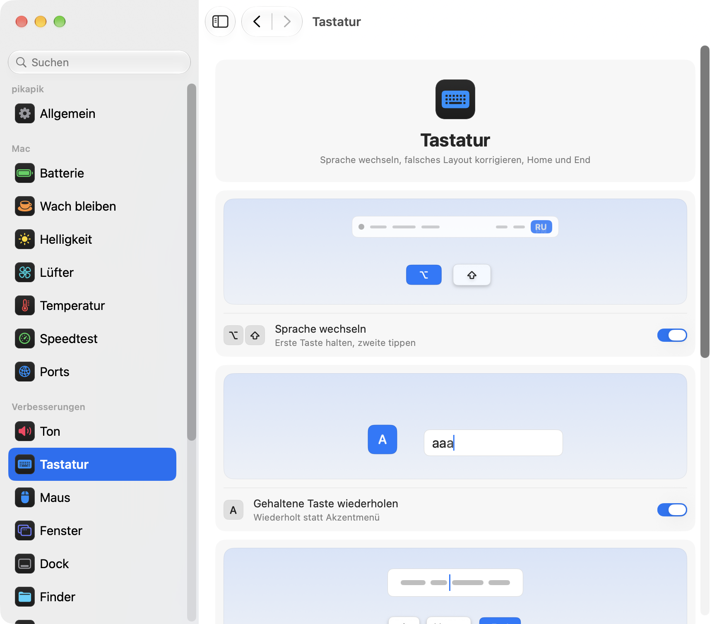

<p align="center"></p>
<h1 align="center">pikapik</h1>
<p align="center">Kleine Verbesserungen für Tastatur, Maus, Fenster und Finder, direkt in der Menüleiste deines Mac.</p>
<p align="center"><sub><a href="../../README.md">English</a> · <a href="README.ru.md">Русский</a> · <a href="README.uk.md">Українська</a> · <b>Deutsch</b> · <a href="README.fr.md">Français</a> · <a href="README.es.md">Español</a> · <a href="README.it.md">Italiano</a> · <a href="README.pt-BR.md">Português (Brasil)</a> · <a href="README.ja.md">日本語</a> · <a href="README.zh-Hans.md">简体中文</a> · <a href="README.ko.md">한국어</a> · <a href="README.ro.md">Română</a> · <a href="README.pl.md">Polski</a> · <a href="README.tr.md">Türkçe</a> · <a href="README.nl.md">Nederlands</a> · <a href="README.sv.md">Svenska</a> · <a href="README.cs.md">Čeština</a> · <a href="README.zh-Hant.md">繁體中文</a> · <a href="README.ar.md">العربية</a> · <a href="README.hi.md">हिन्दी</a> · <a href="README.id.md">Bahasa Indonesia</a> · <a href="README.vi.md">Tiếng Việt</a> · <a href="README.th.md">ไทย</a></sub></p>

<p align="center">
<picture>
<source media="(prefers-color-scheme: dark)" srcset="../media/settings-de-dark.png">

</picture>
</p>

## Installation

Öffne das Terminal, füge diese Zeile ein und drücke den Zeilenschalter (Return):

```bash
/bin/bash -c "$(curl -fsSL https://raw.githubusercontent.com/dev-pikapik/pika-tools/main/install.sh)"
```

Der Befehl lädt die neueste Version von GitHub herunter und installiert sie nur, wenn sie vom Entwickler signiert ist und die Prüfung von Apple auf Schadsoftware bestanden hat. pikapik erscheint oben in der Menüleiste. Alles bleibt aus, bis du es einschaltest.

<details>
<summary>Andere Wege: Homebrew oder eine dmg</summary>

Mit Homebrew:

```bash
brew install --cask dev-pikapik/pika-tools/pikapik && open -a pikapik
```

Oder lade [pikapik.dmg](https://github.com/dev-pikapik/pika-tools/releases/latest/download/pikapik.dmg) herunter, öffne die Datei und ziehe die App in den Ordner „Programme“.

Der obige Befehl und Homebrew legen die App in `/Applications` ab, starten sie, fragen nach den Berechtigungen und schalten „Beim Anmelden öffnen“ ein. Danach aktualisiert sich die App selbst, siehe **Updates**. Zum Entfernen siehe **Deinstallation**.

</details>

## Was es kann

<table>
<tbody><tr>
<td width="50%" valign="top">
<picture><source media="(prefers-color-scheme: dark)" srcset="../media/keep-awake-dark.png"></picture>
<br><b>Wach bleiben</b>
<br>Dein Mac bleibt wach, so lange du willst, auch mit zugeklapptem Deckel.
</td>
<td width="50%" valign="top">
<picture><source media="(prefers-color-scheme: dark)" srcset="../media/fans-dark.png"></picture>
<br><b>Lüfter</b>
<br>Sieh, wie schnell deine Lüfter drehen, und wähle ihre Geschwindigkeit.
</td>
</tr></tbody>
<tbody><tr>
<td width="50%" valign="top">
<picture><source media="(prefers-color-scheme: dark)" srcset="../media/battery-dark.png"></picture>
<br><b>Batterie</b>
<br>Sieh den Zustand deiner Batterie, ihre Kapazität und Anzahl der Zyklen, wie viel Strom hineinfließt und wie sie länger durchhält.
</td>
<td width="50%" valign="top">
<picture><source media="(prefers-color-scheme: dark)" srcset="../media/command-keys-dark.png"></picture>
<br><b>⌘Q und ⌘W schützen</b>
<br>Nichts wird aus Versehen beendet oder geschlossen. Mit ⇧ klappt es gewollt.
</td>
</tr></tbody>
<tbody><tr>
<td width="50%" valign="top">
<picture><source media="(prefers-color-scheme: dark)" srcset="../media/compress-dark.png"></picture>
<br><b>Kleinere Kopie</b>
<br>Rechtsklick auf ein Foto, PDF oder Video, und daneben liegt eine leichtere Kopie.
</td>
<td width="50%" valign="top">
<picture><source media="(prefers-color-scheme: dark)" srcset="../media/convert-dark.png"></picture>
<br><b>Umwandeln</b>
<br>Bilder, Videos und Musik per Rechtsklick in einem anderen Format sichern.
</td>
</tr></tbody>
<tbody><tr>
<td width="50%" valign="top">
<picture><source media="(prefers-color-scheme: dark)" srcset="../media/input-switch-dark.png"></picture>
<br><b>Sprache wechseln</b>
<br>Halte ⌥ gedrückt und tippe auf ⇧, um die Tastatursprache zu wechseln.
</td>
<td width="50%" valign="top">
<picture><source media="(prefers-color-scheme: dark)" srcset="../media/quit-on-close-dark.png"></picture>
<br><b>Mit dem letzten Fenster beenden</b>
<br>Schließt du das letzte Fenster einer App, wird auch die App beendet.
</td>
</tr></tbody>
<tbody><tr>
<td width="50%" valign="top">
<picture><source media="(prefers-color-scheme: dark)" srcset="../media/window-zoom-dark.png"></picture>
<br><b>Grüner Knopf vergrößert</b>
<br>Das Fenster füllt den Bildschirm, ohne in den Vollbildmodus zu wechseln.
</td>
<td width="50%" valign="top">
<picture><source media="(prefers-color-scheme: dark)" srcset="../media/dock-hide-dark.png"></picture>
<br><b>Per Klick im Dock ablegen</b>
<br>Klicke auf die App, in der du gerade bist, und sie macht Platz.
</td>
</tr></tbody>
<tbody><tr>
<td width="50%" valign="top">
<picture><source media="(prefers-color-scheme: dark)" srcset="../media/new-file-dark.png"></picture>
<br><b>Neue Datei</b>
<br>Rechtsklick im Finder, Namen eintippen, und eine leere Datei ist da.
</td>
<td width="50%" valign="top">
<picture><source media="(prefers-color-scheme: dark)" srcset="../media/finder-cut-dark.png"></picture>
<br><b>⌘X verschiebt Dateien</b>
<br>Dateien im Finder ausschneiden und dort einsetzen, wo du sie brauchst.
</td>
</tr></tbody>
<tbody><tr>
<td width="50%" valign="top">
<picture><source media="(prefers-color-scheme: dark)" srcset="../media/finder-open-dark.png"></picture>
<br><b>Eingabetaste öffnet Dateien</b>
<br>Wähle Dateien im Finder aus und drücke die Eingabetaste, um sie zu öffnen.
</td>
<td width="50%" valign="top">
<picture><source media="(prefers-color-scheme: dark)" srcset="../media/finder-delete-dark.png"></picture>
<br><b>Löschtaste in den Papierkorb</b>
<br>Drücke ⌫ im Finder, und die ausgewählten Dateien landen im Papierkorb.
</td>
</tr></tbody>
<tbody><tr>
<td width="50%" valign="top">
<picture><source media="(prefers-color-scheme: dark)" srcset="../media/desktop-icons-dark.png"></picture>
<br><b>Schreibtischsymbole ausblenden</b>
<br>Mit einem Klick ist der Schreibtisch leer, bereit für einen Anruf oder ein Bildschirmfoto.
</td>
<td width="50%" valign="top">
<picture><source media="(prefers-color-scheme: dark)" srcset="../media/hidden-files-dark.png"></picture>
<br><b>Versteckte Dateien einblenden</b>
<br>Sieh dir die Dateien und Ordner an, die macOS sonst versteckt.
</td>
</tr></tbody>
<tbody><tr>
<td width="50%" valign="top">
<picture><source media="(prefers-color-scheme: dark)" srcset="../media/game-mode-dark.png"></picture>
<br><b>Spielmodus</b>
<br>Während du spielst, springt nichts über das Spiel und nichts schließt es.
</td>
<td width="50%" valign="top">
<picture><source media="(prefers-color-scheme: dark)" srcset="../media/speed-test-dark.png"></picture>
<br><b>Speedtest</b>
<br>Wie schnell dein Internet ist und wofür es reicht.
</td>
</tr></tbody>
<tbody><tr>
<td width="50%" valign="top">
<picture><source media="(prefers-color-scheme: dark)" srcset="../media/side-buttons-dark.png"></picture>
<br><b>Seitentasten der Maus</b>
<br>Die Tasten 4 und 5 gehen zurück und vor, wie ein Wischen.
</td>
<td width="50%" valign="top">
<picture><source media="(prefers-color-scheme: dark)" srcset="../media/hide-app-dark.png"></picture>
<br><b>Per Maustaste ausblenden</b>
<br>Ein Druck blendet die App im Vordergrund aus, wie ⌘H. Sie läuft weiter.
</td>
</tr></tbody>
<tbody><tr>
<td width="50%" valign="top">
<picture><source media="(prefers-color-scheme: dark)" srcset="../media/wheel-lines-dark.png"></picture>
<br><b>Zeilenweise scrollen</b>
<br>Jeder Klick am Mausrad scrollt gleich weit, egal wie schnell du drehst.
</td>
<td width="50%" valign="top">
<picture><source media="(prefers-color-scheme: dark)" srcset="../media/wheel-direction-dark.png"></picture>
<br><b>Scrollrichtung</b>
<br>Eine Richtung fürs Trackpad, eine andere für die Maus.
</td>
</tr></tbody>
<tbody><tr>
<td width="50%" valign="top">
<picture><source media="(prefers-color-scheme: dark)" srcset="../media/linear-pointer-dark.png"></picture>
<br><b>Ohne Zeigerbeschleunigung</b>
<br>Der Zeiger bewegt sich genau so weit wie deine Hand.
</td>
<td width="50%" valign="top">
<picture><source media="(prefers-color-scheme: dark)" srcset="../media/key-repeat-dark.png"></picture>
<br><b>Gehaltene Taste wiederholen</b>
<br>Halte eine Taste, und sie tippt immer wieder, ohne Akzentmenü.
</td>
</tr></tbody>
<tbody><tr>
<td width="50%" valign="top">
<picture><source media="(prefers-color-scheme: dark)" srcset="../media/home-end-dark.png"></picture>
<br><b>Home und End</b>
<br>Beim Tippen an den Anfang oder das Ende der Zeile springen.
</td>
<td width="50%" valign="top">
<picture><source media="(prefers-color-scheme: dark)" srcset="../media/animations-dark.png"></picture>
<br><b>Animationen</b>
<br>Dock, Fenster und Übersicht werden schneller, auf Wunsch sofort.
</td>
</tr></tbody>
<tbody><tr>
<td width="50%" valign="top">
<picture><source media="(prefers-color-scheme: dark)" srcset="../media/leftover-permissions-dark.png"></picture>
<br><b>Berechtigungen gelöschter Apps</b>
<br>Entferne die Berechtigungen, die macOS für gelöschte Apps behält.
</td>
<td width="50%" valign="top">
<picture><source media="(prefers-color-scheme: dark)" srcset="../media/pet-dark.png"></picture>
<br><b>Haustier auf dem Schreibtisch</b>
<br>Ein kleiner Freund spaziert hinter deinen Fenstern. Heb ihn hoch und wirf ihn, oder drück die Leertaste, und er hüpft. Zieh ihm etwas aus seinem Kleiderschrank an und sammle Auszeichnungen, während ihr zusammen spielt. Er wird munter, während du tippst, und döst ein, wenn du weggehst.
</td>
</tr></tbody>
<tbody><tr>
<td width="50%" valign="top">
<picture><source media="(prefers-color-scheme: dark)" srcset="../media/uninstaller-dark.png"></picture>
<br><b>Apps entfernen</b>
<br>App samt Dateien entfernen. Alles lässt sich zurücklegen.
</td>
<td width="50%" valign="top">
<picture><source media="(prefers-color-scheme: dark)" srcset="../media/game-fps-dark.png"></picture>
<br><b>FPS anzeigen</b>
<br>Ein kleiner Zähler zeigt in der Ecke deiner Wahl, wie flüssig dein Spiel läuft.
</td>
</tr></tbody>
<tbody><tr>
<td width="50%" valign="top">
<picture><source media="(prefers-color-scheme: dark)" srcset="../media/archive-dark.png"></picture>
<br><b>Archive</b>
<br>RAR und andere Archive entpacken oder Dateien per Rechtsklick in ein ZIP packen.
</td>
<td width="50%" valign="top">
<picture><source media="(prefers-color-scheme: dark)" srcset="../media/dock-display-dark.png"></picture>
<br><b>Dock auf einem Display halten</b>
<br>Das Dock springt nicht mehr auf ein anderes Display. Mit gedrückter ⌥-Taste verschiebst du es gezielt.
</td>
<td width="50%" valign="top">
<picture><source media="(prefers-color-scheme: dark)" srcset="../media/layout-fix-dark.png"></picture>
<br><b>Falsches Layout korrigieren</b>
<br>ghbdtn statt привет getippt? Drück die Leertaste, und schon ist es korrigiert.
</td>
</tr></tbody>
<tbody><tr>
<td width="50%" valign="top">
<picture><source media="(prefers-color-scheme: dark)" srcset="../media/temperatures-dark.png"></picture>
<br><b>Temperatur</b>
<br>Sieh, wie warm dein Mac innen ist, vom Prozessor bis zum Akku.
</td>
<td width="50%" valign="top">
<picture><source media="(prefers-color-scheme: dark)" srcset="../media/background-dark.png"></picture>
<br><b>Hintergrundaufgaben</b>
<br>Sieh, was im Hintergrund läuft und woher es kommt.
</td>
</tr></tbody>
<tbody><tr>
<td width="50%" valign="top">
<picture><source media="(prefers-color-scheme: dark)" srcset="../media/ports-dark.png"></picture>
<br><b>Ports</b>
<br>Sieh, welches Programm einen Port belegt, und mach ihn frei.
</td>
<td width="50%" valign="top">
<picture><source media="(prefers-color-scheme: dark)" srcset="../media/app-volume-dark.png"></picture>
<br><b>App-Lautstärke</b>
<br>Jede App leiser stellen oder stummschalten, ohne die anderen zu verändern.
</td>
</tr></tbody>
</table>

## Mehr erfahren

<details>
<summary>Erster Start</summary>

pikapik braucht zwei Berechtigungen. Beim ersten Start öffnen sich die Einstellungen auf der Seite „Berechtigungen“, die dich Schritt für Schritt durchführt, und macOS zeigt eigene Abfragen an. Öffne **Systemeinstellungen › Datenschutz & Sicherheit** und aktiviere pikapik unter:

- **Bedienungshilfen**, damit die App einen Tastendruck oder Klick ändern kann, bevor er bei anderen Apps ankommt.
- **Eingabeüberwachung**, damit die App Tastendrücke und Klicks sehen kann, ohne sie zu ändern. So funktioniert das Wechseln der Sprache.

Die App erkennt die Änderung innerhalb von ein, zwei Sekunden, ein Neustart ist nicht nötig.

Manche Funktionen brauchen zusätzliche Berechtigungen: **Lüftersteuerung**, **Finder-Erweiterungen**, **iCloud Drive**, **Festplattenvollzugriff**, **Bildschirmaufnahme** und **Systemaudio-Aufnahme**. Alle stehen auf der Seite „Berechtigungen“ in den Einstellungen. Jede hat eine Zeile dazu, wofür sie da ist, einen grünen Haken oder ein orangefarbenes Kreuz und eine Taste: **Erlauben**, wenn sie fehlt, **Ausschalten**, wenn sie an ist. So kannst du jede Berechtigung gleich dort zurücknehmen.

pikapik zeichnet nichts auf, speichert nichts und sendet nichts von dem, was du tippst oder klickst. Ereignisse werden im Arbeitsspeicher verarbeitet und sofort weitergegeben. Um im falschen Layout getippte Wörter zu korrigieren, behält pikapik nur deine letzten paar Wörter im Arbeitsspeicher und vergisst sie, sobald du klickst oder die App wechselst. Gespeichert werden nur die Wörter, die pikapik auf deinen Wunsch in Ruhe lassen soll, und zwar nur auf diesem Mac, bis du sie in Einstellungen › Tastatur löschst. pikapik geht nur für Updates ins Netz (es fragt GitHub nach der neuesten Version und lädt sie nur herunter, wenn du dich fürs Aktualisieren entscheidest) und für den Speedtest, wenn du ihn startest (dabei werden die Server von Apple genutzt). Die Version aus dem Mac App Store wird vom App Store aktualisiert, und ihr Speedtest nutzt Cloudflare. Der Fortschritt deines Haustiers (Schritte, Würfe, Auszeichnungen und Ähnliches) wird nur auf diesem Mac gezählt und nie irgendwohin gesendet. Du kannst ihn in Einstellungen › Haustier löschen.

</details>

<details>
<summary>Alle Werkzeuge im Detail</summary>

**App-Lautstärke.** Öffne Einstellungen › Ton und schalte **App-Lautstärke** ein. Jede App, die Ton abspielt, bekommt einen eigenen Regler und eine Taste zum Stummschalten, in den Einstellungen und im Menü. Mach einen zu lauten Videoanruf leiser, schalte ein lärmendes Spiel stumm und lass deine Musik, wie sie ist: Die Lautstärke deines Macs und der anderen Apps bleibt gleich. pikapik merkt sich die Lautstärke jeder App, und eine App, die du auf voller Lautstärke lässt, bleibt unangetastet. Um die Lautstärke einer App zu ändern, leitet pikapik ihren Ton durch sich selbst. Dafür braucht es die Berechtigung **Systemaudio-Aufnahme**, die du auf der Seite „Berechtigungen“ erlaubst. Der Ton wird nur weitergeleitet: Er wird nicht aufgenommen, gespeichert oder irgendwohin gesendet, und das Mikrofon wird nicht benutzt. Erfordert macOS 14.2 oder neuer und ist unter macOS 14.0 und 14.1 ausgeblendet. Standardmäßig aus.

**⌘Q und ⌘W schützen.** ⌘Q und ⌘W allein bewirken nichts, damit du nicht aus Versehen eine App beendest oder ein Fenster schließt. Nimm Shift dazu, um es bewusst zu tun: ⇧⌘Q beendet, ⇧⌘W schließt. Funktioniert in jeder App. Jede Taste hat einen eigenen Schalter. Standardmäßig aus.

**Sprache mit Option+Shift wechseln.** Halte Option gedrückt und tippe auf Shift: macOS wechselt zur nächsten Eingabequelle. Halte Option weiter gedrückt und tippe erneut auf Shift, um weiterzugehen. Halte Shift gedrückt und tippe auf Option, um zurückzugehen. Drückst du zwischendurch eine andere Taste, klickst oder nimmst Cmd, Ctrl oder Fn dazu, wird nicht gewechselt, sodass Kurzbefehle wie Option+Shift+Pfeiltaste wie bisher funktionieren. Standardmäßig aus.

**Gehaltene Taste wiederholen.** Halte eine Taste gedrückt, und der Buchstabe wird immer wieder getippt, statt dass das Akzentmenü erscheint. Praktisch in Spielen und beim Schreiben. Bereits geöffnete Apps übernehmen das nach einem Neustart. Schaltest du es aus, verhält sich macOS wieder wie gewohnt. Standardmäßig aus.

**Home und End springen an Zeilenanfang und -ende.** Beim Tippen setzt Home den Cursor an den Anfang der Zeile und End an ihr Ende, statt die Seite zu scrollen. Mit ⇧ wählst du bis dorthin aus, mit ⌘ springst du an den Anfang oder das Ende des ganzen Textes. Außerhalb von Textfeldern und in Terminals, virtuellen Maschinen und Apps für entfernte Schreibtische funktionieren die Tasten wie bisher. Du kannst weitere Apps eintragen, in denen sie wie gewohnt funktionieren sollen. Standardmäßig aus.

**Im falschen Layout getippte Wörter korrigieren.** Wird aus einem Wort Kauderwelsch, etwa ghbdtn statt привет, tippt pikapik es im richtigen Layout neu, sobald du die Leertaste oder Return drückst, und wechselt das Layout, damit das nächste Wort gleich richtig herauskommt. Das funktioniert mit allen Tastaturlayouts, die du auf deinem Mac hinzugefügt hast. Ein Wort wird nur geändert, wenn es in keiner deiner Sprachen vorkommt und dieselben Tasten in einem anderen Layout ein gängiges Wort ergeben. Namen, Tippfehler und seltene Wörter bleiben deshalb so, wie du sie getippt hast, und auch in Passwortfeldern, im Terminal und in den Apps, die du auswählst, ändert sich nichts. Drück ⌃⇧Leertaste, um das letzte Wort oder den ausgewählten Text zu korrigieren, und drück noch einmal, um deine anderen Layouts auszuprobieren. Direkt nach einer Korrektur machen dieselben Tasten sie rückgängig, und pikapik korrigiert dieses Wort danach nicht mehr von selbst. Den Kurzbefehl kannst du in Einstellungen › Tastatur ändern. In der Version aus dem Mac App Store wählst du den Text aus und klickst im Menü „Dienste“ auf „Tastaturlayout korrigieren“. Standardmäßig aus.

**Zeigerbeschleunigung ausschalten.** Der Zeiger bewegt sich genau so weit wie die Maus, egal wie schnell du sie bewegst. Ein Regler **Zeigerbewegung** legt fest, wie schnell er sich bewegt. Funktioniert nur mit Mäusen, das Trackpad bleibt, wie es ist. Schalte es aus oder beende pikapik, und macOS bekommt seine eigenen Einstellungen zurück. Standardmäßig aus.

**Zeilenweise scrollen.** Jeder Klick des Mausrads scrollt gleich viele Zeilen, egal wie schnell du es drehst. Wähle 1 bis 10 Zeilen pro Klick, standardmäßig 3. Natürliches Scrollen bleibt so, wie du es in den Systemeinstellungen eingestellt hast. Funktioniert nur für Mäuse, das Trackpad bleibt, wie es ist. Standardmäßig aus. Neben dem Regler **Distanz pro Klick** scrollt eine kleine Seite um die gewählte Distanz, und ein Punkt markiert den Standardwert.

Manche Apps und Spiele zählen das Scrollen in genauen Pixeln: Stell dafür dieselbe Einstellung auf Pixel um und wähle 1 bis 200 Pixel pro Klick, standardmäßig 40. Der Regler zeigt auch, wie viel der Bildschirmhöhe das ist.

**Scrollrichtung für Trackpad und Maus.** macOS hat nur einen Schalter für natürliches Scrollen, für Trackpad und Maus zusammen. Schalte das hier ein und wähle für jedes eine Richtung: **Natürlich**, dann folgt die Seite deinen Fingern wie auf dem iPhone, oder **Klassisch**, bei dem sich die Seite andersherum bewegt. Die Wahl fürs Trackpad gilt auch fürs seitliche Scrollen und fürs Nachgleiten, wenn du die Finger hebst. Die Magic Mouse scrollt per Berührung und folgt deshalb der Wahl fürs Trackpad. Wählst du auf jedem deiner Macs dasselbe, fühlt sich Scrollen überall gleich an, auch wenn du die Maus mit „Universelle Steuerung“ auf einen anderen Mac bewegst. Standardmäßig aus. Beim Einschalten sind beide so wie in den Systemeinstellungen, es ändert sich also nichts, bis du etwas anderes wählst.

**Seitentasten für Zurück und Vorwärts.** Die Maustasten 4 und 5 gehen im Finder, in Safari und in anderen Apple-Apps sowie in vielen anderen Programmen zurück und vorwärts, genau wie eine Wischgeste auf dem Trackpad. Apps, die diese Tasten selbst verarbeiten, bekommen sie unverändert. Sind sie bei deiner Maus vertauscht, schalte **Seitentasten tauschen** ein. Standardmäßig aus.

**Eine Maustaste blendet die aktuelle App aus.** Schalte unter Einstellungen › Maus **Maustaste blendet die aktuelle App aus** ein und drücke die Taste, die du dafür nutzen willst, etwa die mittlere Taste oder eine Seitentaste. Danach blendet ein Druck die App im Vordergrund aus, genau wie ⌘H: Die App läuft weiter, und ein Klick auf ihr Symbol im Dock holt sie zurück. Während du mit eingeschaltetem Spielmodus spielst, funktioniert die Taste im Spiel wie gewohnt. Standardmäßig aus.

**Beenden, wenn das letzte Fenster geschlossen wird.** Schließt du das letzte Fenster einer App, wird die App beendet. Der Finder bleibt offen, ebenso Apps mit Fenstern auf anderen Schreibtischen oder im Dock. Du kannst Apps festlegen, die so nie beendet werden sollen. Standardmäßig aus.

**Mit einem Klick im Dock ablegen oder ausblenden.** Klicke im Dock auf das Symbol der App, in der du gerade arbeitest, und alle ihre Fenster wandern ins Dock. Ein weiterer Klick holt sie alle zurück. Du kannst auch einstellen, dass der Klick die ganze App ausblendet, wie ⌘H. Standardmäßig aus.

**Dock auf einem Display halten.** Bei mehreren Displays verschiebt macOS das Dock auf ein anderes Display, sobald der Zeiger gegen dessen unteren Rand drückt, oder gegen den linken oder rechten Rand, wenn das Dock seitlich liegt. Ist die Funktion an, bleibt das Dock, wo es ist, und die aktiven Ecken funktionieren weiter. Um es gezielt zu verschieben, halte ⌥ gedrückt und drücke den Zeiger gegen den Rand des anderen Displays. Dafür ist keine Erlaubnis nötig. **Dock zurückholen** bringt das Dock nach dem Ruhezustand oder wenn sich Displays ändern auf sein Display zurück. Das braucht die Erlaubnis **Bedienungshilfen** und fehlt in der Version aus dem Mac App Store. Beide Schalter sind standardmäßig aus.

**Grüner Knopf vergrößert das Fenster.** Klicke auf den grünen Knopf eines Fensters, und es füllt den Bildschirm, ohne in den Vollbildmodus zu wechseln. Noch ein Klick bringt die vorherige Größe zurück. Halte ⌥ gedrückt, dann funktioniert der Knopf wie immer. Vollbild bleibt im Menü des Knopfs und auf ⌃⌘F. Du kannst Apps auflisten, in denen der grüne Knopf wie gewohnt funktionieren soll. Standardmäßig aus.

**Neue Datei im Finder.** Rechtsklick in ein Finder-Fenster oder auf den Schreibtisch, **Neue Datei** wählen, Namen eingeben – schon ist eine leere Datei da. Standardmäßig .txt. Standardmäßig aus.

**Eingabetaste öffnet Dateien im Finder.** Wähle Dateien in einem Finder-Fenster oder auf dem Schreibtisch aus und drücke Return oder Enter, dann öffnen sie sich. F2 oder fn F2 benennt die ausgewählte Datei um. In Textfeldern, zum Beispiel beim Eingeben eines Namens, funktionieren die Tasten wie gewohnt. Standardmäßig aus.

**⌘X schneidet Dateien im Finder aus.** Wähle Dateien aus und drücke ⌘X, öffne den gewünschten Ordner und drücke ⌘V: Die Dateien werden dorthin verschoben statt kopiert. ⌘C bricht das Ausschneiden ab. In der Version aus dem Mac App Store setzt ⌘V weiterhin eine Kopie ein: Um die Dateien zu verschieben, klicke auf das pikapik-Symbol in der Menüleiste und wähle **Objekte hierherbewegen** oder drücke ⌥⌘V. Standardmäßig aus.

**Löschtaste löscht Dateien im Finder.** Wähle Dateien aus und drücke ⌫ oder ⌦ (fn ⌫ am Laptop), dann kommen sie in den Papierkorb, genau wie mit ⌘⌫. Während du eine Datei umbenennst, suchst oder in einem anderen Feld tippst, löschen die Tasten wie gewohnt Buchstaben. Standardmäßig aus.

**Kleinere Kopie im Finder.** Rechtsklick auf eine Datei im Finder und **Kleinere Kopie erstellen** wählen. Daneben landet eine leichtere Version eines Fotos, GIFs, PDFs oder Videos, oft um ein Vielfaches kleiner. Unkomprimierter Ton wie WAV oder AIFF wird zu einer kompakten M4A. Lässt sich eine Datei nicht weiter verkleinern, entsteht keine Kopie, und pikapik sagt dir Bescheid. Das Original bleibt, wie es ist, und nichts verlässt deinen Mac. Standardmäßig aus.

**Umwandeln im Finder.** Rechtsklick auf eine Datei im Finder und **Umwandeln in** wählen, um sie in einem anderen Format zu speichern: Bilder als JPEG, PNG, HEIC, GIF, TIFF oder PDF, Videos als MP4, MOV oder nur den Ton, Musik als M4A, WAV oder AIFF. Das Original bleibt, wie es ist, und nichts verlässt deinen Mac. Lässt sich getrennt von der kleineren Kopie einschalten. Standardmäßig aus.

**Archive im Finder.** Rechtsklick auf ein Archiv im Finder und **Entpacken** wählen, und die Dateien erscheinen daneben. Rechtsklick auf eine andere Datei oder einen Ordner und **Archiv erstellen …** wählen, um ein ZIP, 7Z, TAR.GZ oder TAR.XZ anzulegen. ZIP und 7Z können ein Passwort haben, und jedes Archiv lässt sich in Teile aufteilen, zum Beispiel in 15 MB große für E-Mail oder 4 GB große für einen USB-Stick. Das Passwort gibst du zweimal ein, damit dich ein Tippfehler nicht aus deinen eigenen Dateien aussperrt. Ein so erstelltes ZIP enthält keine versteckten Hilfsdateien, hält Namen in jeder Sprache lesbar und kommt auch mit Dateien über 4 GB zurecht. Standardmäßig aus. Nicht in der Version aus dem Mac App Store.

pikapik öffnet auch, was macOS nicht kann: RAR, auch auf mehrere Dateien verteilt, 7Z mit Passwort, Teilsätze wie .001, .z01, .r00 und .part1.rar sowie ZIPX, CAB, LZH, ARJ, ZST, LZMA, WIM und mehr. Ein Doppelklick öffnet sie in pikapik. Dateinamen in alten ZIPs, etwa auf Kyrillisch, Japanisch oder Chinesisch, erscheinen lesbar. Der Schalter **Archive in dieser App öffnen** unter Einstellungen › Finder übergibt pikapik auch ZIP und 7Z, während TAR und GZ bei der eingebauten Archiv-App bleiben, die damit ohnehin gut zurechtkommt. RAR kann pikapik nur öffnen, nicht erstellen: Die RAR-Lizenz erlaubt nur das Entpacken.

Ein Fenster fragt nach dem Passwort, **Stopp** bricht jede Aufgabe ab, und aus einem beschädigten oder unvollständigen Archiv holt pikapik heraus, was sich noch lesen lässt. Würde ein Archiv beim Entpacken riesig anschwellen, fragt pikapik vorher nach, und wird der Platz auf dem Datenträger knapp, hält es rechtzeitig an. Archive, die außerhalb ihres eigenen Ordners schreiben wollen, werden blockiert. Wähle ein Archiv im Finder aus und drücke die Leertaste, um zu sehen, was darin ist.

**Schreibtischsymbole ausblenden.** Schalte es vor einem Anruf, einer Bildschirmaufnahme oder einem Bildschirmfoto ein, und die Dateien und Ordner auf dem Schreibtisch verschwinden. Schalte es aus, und sie sind wieder an ihrem Platz. Nichts wird verschoben: Die Dateien bleiben im Ordner „Schreibtisch“ im Finder. Es ist die Einstellung **Objekte einblenden › Auf dem Schreibtisch** aus Systemeinstellungen › Schreibtisch & Dock, nur griffbereit, deshalb stimmen beide immer überein. In der Version aus dem Mac App Store öffnet diese Zeile stattdessen genau diese Seite der Systemeinstellungen.

**Versteckte Dateien einblenden.** Dateien und Ordner, die macOS versteckt, etwa die Library in deinem Benutzerordner oder Dateien, deren Name mit einem Punkt beginnt, erscheinen abgeblendet im Finder und auf dem Schreibtisch. Es ist dasselbe wie ⇧⌘. im Finder, nur siehst du auf einen Blick, ob es an ist. Beide findest du unter Einstellungen › Finder. Um sie im Fenster der Menüleiste zu haben, klicke unten auf den Stift und setze bei ihnen einen Haken. In der Version aus dem Mac App Store zeigt Einstellungen › Finder stattdessen die Tasten ⇧⌘. für den Finder.

**Spielmodus.** Füg deine Spiele hinzu, und solange du spielst, reißt dich dein Mac nicht aus dem Spiel. Spotlight, Siri, ⌘Tab, Mission Control und Wischen zwischen Schreibtischen öffnen sich nicht über dem Spiel, ⌘Q und ⌘W schließen es nicht aus Versehen, der Zeiger rutscht nicht ins Dock, in die Menüleiste oder auf einen anderen Bildschirm, und der Bildschirm bleibt an. Jeder dieser Punkte hat einen eigenen Schalter auf der Seite „Spiele“, und pikapik schlägt Spiele vor, die es auf deinem Mac findet. Im Spiel bleibt Ctrl-Klick ein Klick, und Ctrl mit Pfeiltasten wechselt den Schreibtisch nicht. Auch Minecraft wird erkannt: Füge den Minecraft Launcher oder CurseForge hinzu, dann schaltet sich der Modus in Minecraft selbst ein. Um ein Spiel zu beenden, drück ⇧⌘Q, um sein Fenster zu schließen, ⇧⌘W. ⌥⌘Esc funktioniert immer. Sobald du das Spiel verlässt, funktioniert alles wie gewohnt. Standardmäßig aus.

Schalte den Spielmodus ein und spiele. Weitere Spieleinstellungen enthält den Katalog deines Macs mit aktuellen Tasten und einer animierten Vorschau für jede Aktion.

Automatisch pausiert Aktionen, die Fenster öffnen oder den Fokus wechseln. Ein kurzes bewusstes Sprachkürzel wechselt die Eingabequelle ohne Systemfenster. Gehaltene Bewegungstasten haben Vorrang, damit Rennen und Springen nicht versehentlich die Sprache ändern.

Unter Einstellungen → Spiele → Weitere Spieleinstellungen gibt es die Gruppe „Maus und Trackpad“. Sie zeigt nur, was in macOS auf deinem Mac eingeschaltet ist, mit den Namen von Apple und einer kleinen Zeichnung zu jedem Eintrag: Kurzbefehle auf einer Maustaste, Wischen zwischen Schreibtischen und Apps im Vollbildmodus, Mission Control und App Exposé, Zusammenziehen der Finger für Apps und Spreizen für den Schreibtisch, das Wischen vom rechten Rand für die Mitteilungszentrale und jede aktive Ecke mit ihrer Aktion. Solange ein Spiel vorn ist, sind sie pausiert. Eine versehentliche Wischgeste oder ein Streifen über eine Bildschirmecke holt dich dann nicht aus dem Spiel. Gesten innerhalb des Spiels funktionieren weiter. Jeder Eintrag lässt sich auf normales Verhalten stellen.

Öffne Einstellungen → Spiele → Spiel hinzufügen und klicke auf dein laufendes Spiel. Auch Spiele über Java und andere Laufzeitumgebungen erscheinen hier, selbst ohne .app. Minecraft heißt Minecraft statt java. Suche den Spielprozess und ziehe seine Zeile auf Deine Spiele unter Einstellungen → Spiele.

**FPS anzeigen.** FPS heißt Bilder pro Sekunde: wie viele Bilder das Spiel jede Sekunde zeichnet. Schalte **FPS anzeigen** auf der Seite „Spiele“ ein, und solange der Spielmodus an ist, sitzt in einer Ecke jedes Spiels eine kleine dunkle Anzeige mit dieser Zahl. Die Ecke wählst du per Klick auf das Bild über dem Schalter. Ein Strich bedeutet, dass die ersten Bilder noch nicht da sind, eine blasse 0, dass das Spiel nichts mehr zeichnet. Unter macOS 27 zählt macOS die meisten Spiele selbst, ganz ohne Erlaubnis. Ein Spiel, das macOS nicht zählen kann, meist ein älteres, zählt pikapik über die Bildschirmaufnahme: Dann erscheint auf der Seite „Berechtigungen“ die Zeile **Bildschirmaufnahme**, pikapik fragt nie mitten im Spiel danach, und die Zahl kann nicht höher sein als die Bildwiederholrate des Bildschirms. Unter macOS 14 bis 26 und in der Version aus dem Mac App Store wird jedes Spiel so gezählt, deshalb erscheint die Zeile gleich nach dem Einschalten von **FPS anzeigen**, und die Taste **Erlauben** unter dem Schalter führt dich dorthin. Es wird kein Bild gespeichert oder gesendet. Standardmäßig aus.

**Kleiderschrank und Auszeichnungen fürs Haustier.** Öffne Einstellungen › Haustier, um dein Haustier anzuziehen: mehr als 30 Teile, von Hüten und Brillen bis zu Umhängen und Flügeln, dazu fertige Outfits wie Zauberer, Pirat oder Astronaut. Ein paar Teile sind von Anfang an frei. Die übrigen sind Auszeichnungen, die ihr beim gemeinsamen Spielen sammelt: Heb dein Haustier hoch und wirf es, kick den Ball herum, sieh zu, wie es auf Fenster klettert und plaudert, oder leiste ihm einfach Tag für Tag Gesellschaft. Wenn du eine neue Auszeichnung verdient hast, sagt dir dein Haustier Bescheid.

Damit pikapik weiß, wann eine Auszeichnung fällig ist, zählt es nur, was du und dein Haustier tun: Schritte, wie oft du es hochhebst und wirfst, seine Sprünge, Kletterpartien, Ballspiele und Gespräche, die gemeinsamen Tage, ob ihr früh am Morgen, nach Mitternacht oder am Wochenende zusammen wart, welche Seiten der Einstellungen du geöffnet und was du anprobiert hast. Außerhalb des Mac App Store merkt sich pikapik außerdem, ob du aus den Einstellungen heraus unsere GitHub-Seite geöffnet hast. Diese Zahlen, das Datum jeder Auszeichnung und das, was dein Haustier trägt, bleiben auf diesem Mac. Nichts wird irgendwohin gesendet, und nichts davon landet in der exportierten Einstellungsdatei oder in der iCloud-Synchronisierung. Du kannst alles jederzeit in Einstellungen › Haustier löschen, dann fängt dein Haustier von vorn an.

**Apps entfernen.** Öffne Einstellungen › Apps entfernen, such dir eine App aus der Liste aus oder zieh eine auf das Bild, und pikapik zeigt alles, was die App auf deinem Mac aufbewahrt: die App selbst, ihre gespeicherten Daten, Einstellungen, temporäre Dateien, Hintergrundhelfer und mehr, jeweils mit dem Grund, warum sie in der Liste steht. Dateien, die eindeutig zur App gehören, sind angehakt, Dateien, die nur vielleicht dazugehören, nicht, und Dateien, die auch andere Apps nutzen, sind markiert. Wähle aus, was weg soll, und klicke auf **In den Papierkorb legen**. Nichts wird endgültig gelöscht: Alles kommt in den Papierkorb. Ist die App geöffnet, bittet pikapik sie zuerst, sich zu beenden, und brauchen manche Dateien einen Administrator, fragt dein Mac einmal nach deinem Passwort.

Doch anders überlegt? Klicke auf **Zurücklegen**, dann ist alles wieder da, wo es war, und die Hintergrundhelfer starten wieder. Die letzten zehn Entfernungen warten unter „Zuletzt entfernt“, solange ihre Dateien im Papierkorb liegen. **App zurücksetzen** behält die App und entfernt nur ihre gespeicherten Daten, Einstellungen und temporären Dateien, was helfen kann, wenn eine App spinnt. Apps, die du selbst in den Papierkorb gelegt hast, erscheinen unter „Im Papierkorb“ samt den Dateien, die sie hinterlassen haben, und „Reste entfernter Apps“ findet Dateien von Apps, die schon weg sind. Der Schalter „Aufräumen anbieten, wenn eine App in den Papierkorb kommt“ ist standardmäßig aus, und nichts wird entfernt, bevor du wählst. Damit die Seite alles sehen kann, was eine App aufbewahrt, braucht sie den **Festplattenvollzugriff**. Dieses Werkzeug gibt es nicht in der Version aus dem Mac App Store.

**Temperatur.** Öffne Einstellungen › Temperatur, um zu sehen, wie warm dein Mac innen ist. Oben fasst ein Wort alles zusammen, von „Normal“ bis „Sehr heiß“, und eine Zeile darunter sagt, ob dein Mac mit voller Geschwindigkeit läuft oder langsamer wird, um abzukühlen. Darunter hat jedes Bauteil eine eigene Zeile mit einem verständlichen Namen statt eines Sensorcodes: Prozessor, Grafik, Arbeitsspeicher, SSD, WLAN und Akku, je nachdem, wofür dein Mac Sensoren hat. Jede Zeile zeigt die Grad und einen kurzen Balken, der grün, gelb oder orange wird, gemessen am normalen Bereich für dieses Bauteil. Die Werte werden alle zwei Sekunden aktualisiert und nur, solange du hinsiehst, deshalb belasten sie deinen Mac kaum. Du brauchst weder ein Passwort noch eine Berechtigung. Du kannst auch eine Zeile „Temperatur“ zum Fenster der Menüleiste hinzufügen. Die Version aus dem Mac App Store zeigt nur, wie warm der Mac insgesamt ist.

Unter **Hintergrundaufgaben** siehst du alles, was auf deinem Mac von selbst startet: Apps, die sich beim Anmelden öffnen, Hintergrunddienste, Helfer, die in Apps stecken, und Reste von Apps, die du schon entfernt hast. Bei jeder Aufgabe steht, welche App sie hinzugefügt hat, ob sie gerade läuft und wo ihre Datei liegt; ein Klick zeigt die Datei im Finder. Deine eigenen Aufgaben schaltest du per Knopfdruck aus und genauso leicht wieder ein, gelöscht wird dabei nichts. Aufgaben für alle Benutzer und für den ganzen Mac gehören zu macOS, deshalb öffnet die Taste bei ihnen die Anmeldeobjekte in den Systemeinstellungen. In der Version aus dem Mac App Store zeigt die Seite die Aufgaben nur an: Du gibst ihr einmal im gewohnten Öffnen-Fenster Zugriff auf deinen Home-Ordner, und die Tasten öffnen die Anmeldeobjekte.

**Ports.** Meldet ein Programm, dass sein Port schon belegt ist, öffne Einstellungen › Ports. Dort siehst du jedes Programm, das auf deinem Mac einen Port belegt, mit seinem Symbol, den Portnummern und der Angabe, ob sich andere Geräte in deinem Netzwerk verbinden können. Gib eine Nummer ein, um herauszufinden, wer diesen Port belegt, oder um sicherzugehen, dass er frei ist. Klicke auf eine Zeile, um die Adressen zu sehen, die sich im Browser öffnen lassen, die Datei des Programms, den Befehl, mit dem es gestartet wurde, seinen Ordner und seine Prozessnummer. **Freimachen** bittet das Programm, sich zu beenden, damit es seine Arbeit sichern kann, und bietet an, es sofort zu beenden, falls es sich nicht schließt. Vor jedem Schritt fragt pikapik dich zuerst. Teile von macOS und Programme anderer Benutzer beendet pikapik nie: Bei „AirPlay-Empfänger“, „Dateifreigabe“, „Bildschirmfreigabe“ und „Entfernte Anmeldung“ sagt es dir, welcher Schalter in den Systemeinstellungen den Port freigibt. In der Version aus dem Mac App Store zeigt **Freimachen** das Programm, kopiert einen Befehl, der es im Terminal beendet, oder öffnet die Aktivitätsanzeige.

Jedes Werkzeug hat einen eigenen Schalter im Menü und in den Einstellungen.

Das Symbol in der Menüleiste zeigt den Status auf einen Blick: das pikapik-Zeichen, wenn die Werkzeuge arbeiten, dasselbe Zeichen blass, wenn alles aus ist, und ein Warndreieck, wenn ein Werkzeug an ist, aber Berechtigungen fehlen.

Das Fenster der Menüleiste startet mit nur wenigen Zeilen. Welche es zeigt, bestimmst du selbst: Klicke unten auf den Stift, setze einen Haken bei allem, was du sehen willst, und klicke auf **Fertig**. Ausgeblendete Zeilen funktionieren weiter und bleiben in den Einstellungen. Passt das Fenster nicht auf den Bildschirm, lässt es sich scrollen.

Die App folgt deiner Systemsprache oder der Sprache, die du in den Einstellungen wählst. Verfügbar sind alle 23 Sprachen aus der Liste oben auf dieser Seite.

</details>

<details>
<summary>Wach bleiben</summary>

Verhindert, dass dein Mac einschläft, während du nicht an der Tastatur bist: für eine beliebige Zeit von 1 Sekunde bis 365 Tagen oder bis du es ausschaltest. Schalte es im Menü ein und lege die Dauer in den Einstellungen fest: Gib Tage, Stunden, Minuten und Sekunden ein, nutze ↑ und ↓ oder klicke auf eine Vorgabe von 15 Minuten bis 8 Stunden. Das Menü zeigt, wie viel Zeit noch bleibt und wann es endet. Beim **Display** gibt es zwei Möglichkeiten. **Immer an**: Es wird nicht dunkel, ohne Bildschirmschoner und Sperrbildschirm. **Geht wie gewohnt aus**: Es geht nach eigenem Timer aus, während dein Mac weiterarbeitet. **Display jetzt ausschalten** (auch im Menü) schaltet es sofort aus, der Mac arbeitet weiter: Bewege die Maus oder drücke eine Taste, um es zurückzuholen. Wenn du pikapik beendest, endet auch „Wach bleiben“.

Auf einem MacBook kannst du außerdem **Mit geschlossenem Deckel arbeiten** einschalten. macOS hat dafür keinen Schalter, deshalb führt pikapik `pmset -a disablesleep 1` aus und fragt nach einem Administratorpasswort: Nur ein Administrator darf ändern, wie der Mac in den Ruhezustand geht. Die Einstellung wird automatisch zurückgesetzt, wenn „Wach bleiben“ endet, wenn du die App beendest oder wenn sie abstürzt. Gibst du kein Passwort ein, ändert sich nichts. Achte bei geschlossenem Deckel auf ausreichende Belüftung. **Bei Akku unter 20 % beenden** beendet die Sitzung, bevor der Akku leer ist.

Wach bleiben, der Display-Modus und der Modus bei geschlossenem Deckel lassen sich über die App Kurzbefehle auf eine Taste im Kontrollzentrum, in der Menüleiste oder auf ein Widget auf dem Schreibtisch legen, mit Links, die du unter Einstellungen › Wach bleiben kopierst.

</details>

<details>
<summary>Speedtest</summary>

Zeigt, wie schnell dein Internet gerade ist. Klick auf **Geschwindigkeit prüfen** unter Einstellungen › Speedtest oder auf **Prüfen** im Menü, sobald du die Zeile mit dem Stiftknopf hinzugefügt hast. Nach etwa einer halben Minute siehst du Download, Upload, Ping und Reaktionsfähigkeit: wie schnell alles reagiert, während die Leitung ausgelastet ist. Darunter steht in einfachen Worten, wofür es reicht: Filme in 4K, Videoanrufe, Onlinespiele und große Downloads. Die Messung nutzt networkQuality aus macOS und die Server von Apple. Das letzte Ergebnis bleibt bis zur nächsten Messung, und ein Link für Kurzbefehle startet sie aus dem Kontrollzentrum.

</details>

<details>
<summary>Einstellungen</summary>

Öffne die Einstellungen im Menü mit **Einstellungen …** oder ⌘, – oder starte pikapik einfach erneut über den Finder, das Launchpad oder Spotlight. Solange das Fenster offen ist, erscheint die App im Dock und bei ⌘Tab.

- **Allgemein**: Beim Anmelden öffnen, Erscheinungsbild (System, Hell oder Dunkel), Sprache, Updates und Sicherung: Einstellungen als Datei exportieren und importieren oder über iCloud Drive synchronisieren.
- **Batterie**: Ladestand, Zeit bis zur vollen Ladung oder verbleibende Zeit, Zustand, maximale Kapazität, Anzahl der Zyklen, Netzteil und Leistung in Watt sowie Tipps, damit die Batterie lange durchhält. Die Seite zeigt nur Informationen an: Das Ladelimit bleibt in **Systemeinstellungen › Batterie**. Sie erscheint nur auf einem Mac mit Batterie.
- **Wach bleiben**: Dauer, Display- und Deckeloptionen.
- **Lüfter**: Geschwindigkeit jedes Lüfters sehen, Automatisch oder eine eigene Geschwindigkeit wählen, sobald die Lüftersteuerung erlaubt ist.
- **Temperatur**: wie warm dein Mac ist, insgesamt und für jedes Bauteil, etwa Prozessor, Arbeitsspeicher und Akku.
- **Speedtest**: Internetgeschwindigkeit messen und sehen, wofür sie reicht.
- **Ports**: welches Programm welchen Port belegt, seine Adressen und Details sowie eine Taste, die den Port freimacht.
- **Ton**: App-Lautstärke, ein Regler und eine Taste zum Stummschalten für jede App, die Ton abspielt.
- **Tastatur**: Sprachwechsel, Tastenwiederholung, Home und End, Korrektur des falschen Layouts.
- **Maus**: Zeigerbeschleunigung und Zeigerbewegung, zeilenweises Scrollen, Scrollrichtung, Seitentasten, eine Taste zum Ausblenden der aktuellen App.
- **Fenster**: Vergrößern mit dem grünen Knopf (mit einer Liste von Ausnahmen), Schutz für ⌘Q und ⌘W und Beenden nach dem letzten Fenster (ebenfalls mit einer Liste von Ausnahmen).
- **Dock**: Mit einem Klick im Dock ablegen oder ausblenden, Dock auf einem Display halten und Dock zurückholen.
- **Finder**: neue Datei, kleinere Kopie, Umwandeln und Archive, Öffnen mit der Eingabetaste, Ausschneiden mit ⌘X, Löschen mit ⌫, Ausblenden der Schreibtischsymbole und Einblenden versteckter Dateien.
- **Apps entfernen**: eine App samt Dateien entfernen, alles später zurücklegen und aufräumen, was entfernte Apps hinterlassen haben.
- **Hintergrundaufgaben**: alles, was im Hintergrund läuft, welche App es hinzugefügt hat, und eine Taste, mit der du deine eigenen Aufgaben aus- und wieder einschaltest.
- **Spiele**: deine Spiele und die Einstellungen des Spielmodus.
- **Haustier**: an- und ausschalten, Plaudern, Leben in deinem Rhythmus und Ball, Kleiderschrank und Auszeichnungen.
- **Berechtigungen**: alle Berechtigungen, die pikapik nutzt, jeweils mit Status und einer Taste zum Erlauben oder Ausschalten. Ein Tool, dem eine Berechtigung fehlt, wirkt halb ausgegraut; ein Klick darauf öffnet diese Seite bei der passenden Zeile.
- **Über**: Version, Links zum Änderungsprotokoll und zum Melden eines Problems.

Viele Einstellungen haben ein kleines Bild, das zeigt, was sie tun, etwa einen Mac, der wach bleibt, oder ein Fenster, das sich hinter dem Dock versteckt. Das Bild ändert sich mit dem Schalter und steht still, wenn in den Systemeinstellungen „Bewegung reduzieren“ aktiviert ist.

Jede Seite hat unten eine Taste **Standard wiederherstellen…**. Sie fragt zuerst nach, schaltet dann die Werkzeuge auf dieser Seite aus und setzt ihre Optionen zurück, als hätte pikapik sie nie angefasst.

**Einstellungen mit iCloud synchronisieren** hält pikapik auf all deinen Macs gleich. Die Einstellungen liegen im Ordner pikapik in iCloud Drive, und die jüngste Änderung gewinnt. Standardmäßig aus, und iCloud Drive muss eingeschaltet sein. Berechtigungen werden nicht synchronisiert: Jeder Mac fragt selbst danach.

</details>

<details>
<summary>Updates</summary>

pikapik sucht beim Start und alle 6 Stunden nach neuen Versionen. Das kannst du unter Einstellungen › Allgemein ausschalten. Wenn eine neue Version erscheint, zeigt das Menü die Taste **Auf … aktualisieren**: Ein Klick, und die App lädt das Update, installiert es und startet neu. Von Hand suchen kannst du mit **Jetzt suchen** unter Einstellungen › Allgemein.

Mit Homebrew kannst du auch `brew upgrade --cask pikapik` ausführen.

Seit Version 1.3 bleiben die Berechtigungen nach Updates erhalten.

</details>

<details>
<summary>Deinstallation</summary>

```bash
/bin/bash -c "$(curl -fsSL https://raw.githubusercontent.com/dev-pikapik/pika-tools/main/uninstall.sh)"
```

Wenn du mit Homebrew installiert hast: `brew uninstall --cask --zap pikapik`.

Beide beenden die App, entfernen sie aus den Anmeldeobjekten und löschen sie. Das Skript setzt zusätzlich ihre Berechtigungen zurück.

</details>

<details>
<summary>Häufige Fragen</summary>

**Warum braucht die App zwei Berechtigungen?**
macOS teilt den Zugriff auf Tastatur und Maus in zwei Teile. Die Bedienungshilfen erlauben der App, einen Tastendruck oder Klick zu ändern, und die meisten Funktionen brauchen nur das. Die Eingabeüberwachung erlaubt ihr nur zuzusehen, und zum Wechseln der Sprache reicht das.

**macOS meldet, dass die App von einem nicht verifizierten Entwickler stammt.**
pikapik ist vom Entwickler signiert und besteht die Prüfung von Apple auf Schadsoftware, deshalb sollte diese Meldung nicht erscheinen. Falls doch, öffne **Systemeinstellungen › Datenschutz & Sicherheit** und klicke auf **Dennoch öffnen**.

**Funktioniert die App auf Intel-Macs?**
Ja. Es ist eine universelle App für Apple Silicon und Intel, ab macOS 14 Sonoma.

**Die Berechtigung ist an, aber nichts funktioniert.**
Entferne pikapik unter **Systemeinstellungen › Datenschutz & Sicherheit** mit der Taste − aus beiden Listen und füge die App dann wieder hinzu. Oder mach es in pikapik: Drücke auf der Seite „Berechtigungen“ bei jeder Berechtigung auf **Ausschalten** und danach wieder auf **Erlauben**.

</details>

<p align="center">☕ Wenn dir pikapik gefällt, kannst du mir <a href="https://buymeacoffee.com/pikapik">einen Kaffee spendieren</a> – alles fließt in die Entwicklung und Pflege der App.</p>

<p align="center"><sub><a href="../whats-new/README.de.md">Neuigkeiten</a> · <a href="https://github.com/dev-pikapik/homebrew-pika-tools">Homebrew-Tap</a> · <a href="../../CONTRIBUTING.md">Selbst bauen</a> · <a href="../../LICENSE">MIT-Lizenz</a> · © 2026 pikapik</sub></p>
