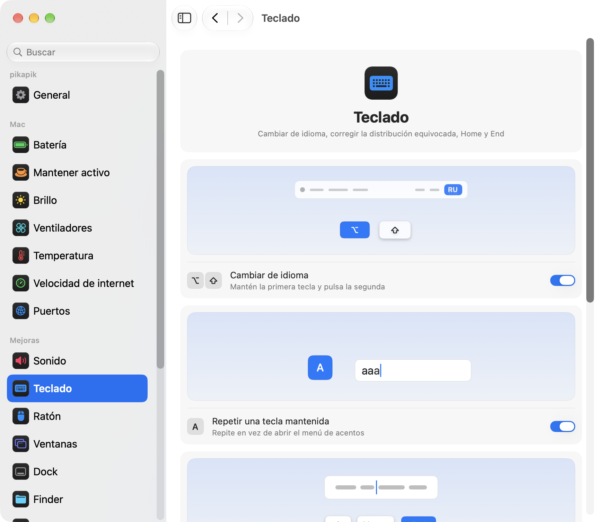

<p align="center"></p>
<h1 align="center">pikapik</h1>
<p align="center"><b>Tu Mac entiende lo que quieres decir.</b><br>Pequeñas mejoras para el teclado, el ratón, las ventanas y el Finder, directamente en la barra de menús de tu Mac.</p>
<p align="center"><sub><a href="../../README.md">English</a> · <a href="README.ru.md">Русский</a> · <a href="README.uk.md">Українська</a> · <a href="README.de.md">Deutsch</a> · <a href="README.fr.md">Français</a> · <b>Español</b> · <a href="README.it.md">Italiano</a> · <a href="README.pt-BR.md">Português (Brasil)</a> · <a href="README.ja.md">日本語</a> · <a href="README.zh-Hans.md">简体中文</a> · <a href="README.ko.md">한국어</a> · <a href="README.ro.md">Română</a> · <a href="README.pl.md">Polski</a> · <a href="README.tr.md">Türkçe</a> · <a href="README.nl.md">Nederlands</a> · <a href="README.sv.md">Svenska</a> · <a href="README.cs.md">Čeština</a> · <a href="README.zh-Hant.md">繁體中文</a> · <a href="README.ar.md">العربية</a> · <a href="README.hi.md">हिन्दी</a> · <a href="README.id.md">Bahasa Indonesia</a> · <a href="README.vi.md">Tiếng Việt</a> · <a href="README.th.md">ไทย</a></sub></p>

<p align="center">
<picture>
<source media="(prefers-color-scheme: dark)" srcset="../media/settings-es-dark.png">

</picture>
</p>

## Instalación

Abre Terminal, pega esta línea y pulsa Retorno:

```bash
/bin/bash -c "$(curl -fsSL https://raw.githubusercontent.com/dev-pikapik/pika-tools/main/install.sh)"
```

El comando descarga la última versión desde GitHub y solo la instala si está firmada por su desarrollador y ha superado la revisión de Apple en busca de software malicioso. pikapik aparece en la barra de menús, arriba en la pantalla. Todo está apagado hasta que tú lo enciendas.

<details>
<summary>Otras formas: Homebrew o un dmg</summary>

Con Homebrew:

```bash
brew install --cask dev-pikapik/pika-tools/pikapik && open -a pikapik
```

O descarga [pikapik.dmg](https://github.com/dev-pikapik/pika-tools/releases/latest/download/pikapik.dmg), ábrelo y arrastra la app a la carpeta Aplicaciones.

Tanto el comando anterior como Homebrew colocan la app en `/Applications`, la abren, piden los permisos y activan la apertura al iniciar sesión. Después, la app se actualiza sola; consulta **Actualizaciones**. Para eliminarla, consulta **Desinstalación**.

</details>

## Qué hace

<table>
<tbody><tr>
<td width="50%" valign="top">
<picture><source media="(prefers-color-scheme: dark)" srcset="../media/keep-awake-dark.png"></picture>
<br><b>Mantener activo</b>
<br>Tu Mac no se duerme durante el tiempo que necesites, incluso con la tapa cerrada.
</td>
<td width="50%" valign="top">
<picture><source media="(prefers-color-scheme: dark)" srcset="../media/fans-dark.png"></picture>
<br><b>Ventiladores</b>
<br>Mira la velocidad de tus ventiladores y elige cuánto giran.
</td>
</tr></tbody>
<tbody><tr>
<td width="50%" valign="top">
<picture><source media="(prefers-color-scheme: dark)" srcset="../media/battery-dark.png"></picture>
<br><b>Batería</b>
<br>Mira el estado de tu batería, su capacidad y su número de ciclos, cuánta energía le entra y cómo hacer que dure más.
</td>
<td width="50%" valign="top">
<picture><source media="(prefers-color-scheme: dark)" srcset="../media/command-keys-dark.png"></picture>
<br><b>Proteger ⌘Q y ⌘W</b>
<br>Nada se cierra por accidente. Añade ⇧ cuando quieras hacerlo.
</td>
</tr></tbody>
<tbody><tr>
<td width="50%" valign="top">
<picture><source media="(prefers-color-scheme: dark)" srcset="../media/compress-dark.png"></picture>
<br><b>Copia más ligera</b>
<br>Clic derecho en una foto, un PDF o un vídeo, y aparece una copia más ligera.
</td>
<td width="50%" valign="top">
<picture><source media="(prefers-color-scheme: dark)" srcset="../media/convert-dark.png"></picture>
<br><b>Conversión</b>
<br>Guarda una imagen, un vídeo o una canción en otro formato con un clic derecho.
</td>
</tr></tbody>
<tbody><tr>
<td width="50%" valign="top">
<picture><source media="(prefers-color-scheme: dark)" srcset="../media/input-switch-dark.png"></picture>
<br><b>Cambiar de idioma</b>
<br>Mantén ⌥ y pulsa ⇧ para cambiar el idioma del teclado.
</td>
<td width="50%" valign="top">
<picture><source media="(prefers-color-scheme: dark)" srcset="../media/quit-on-close-dark.png"></picture>
<br><b>Salir con la última ventana</b>
<br>Cierra la última ventana de una app y la app también se cierra.
</td>
</tr></tbody>
<tbody><tr>
<td width="50%" valign="top">
<picture><source media="(prefers-color-scheme: dark)" srcset="../media/window-zoom-dark.png"></picture>
<br><b>El botón verde amplía</b>
<br>La ventana llena la pantalla sin pasar a pantalla completa.
</td>
<td width="50%" valign="top">
<picture><source media="(prefers-color-scheme: dark)" srcset="../media/dock-hide-dark.png"></picture>
<br><b>Minimizar con un clic en el Dock</b>
<br>Haz clic en la app que estás usando y se aparta.
</td>
</tr></tbody>
<tbody><tr>
<td width="50%" valign="top">
<picture><source media="(prefers-color-scheme: dark)" srcset="../media/new-file-dark.png"></picture>
<br><b>Archivo nuevo</b>
<br>Clic derecho en el Finder, escribe un nombre y listo: un archivo vacío.
</td>
<td width="50%" valign="top">
<picture><source media="(prefers-color-scheme: dark)" srcset="../media/finder-cut-dark.png"></picture>
<br><b>⌘X mueve archivos</b>
<br>Corta archivos en el Finder y pégalos donde quieras.
</td>
</tr></tbody>
<tbody><tr>
<td width="50%" valign="top">
<picture><source media="(prefers-color-scheme: dark)" srcset="../media/finder-open-dark.png"></picture>
<br><b>Intro abre archivos</b>
<br>Selecciona archivos en el Finder y pulsa Intro para abrirlos.
</td>
<td width="50%" valign="top">
<picture><source media="(prefers-color-scheme: dark)" srcset="../media/finder-delete-dark.png"></picture>
<br><b>Borrar a la Papelera</b>
<br>Pulsa ⌫ en el Finder y los archivos seleccionados van a la Papelera.
</td>
</tr></tbody>
<tbody><tr>
<td width="50%" valign="top">
<picture><source media="(prefers-color-scheme: dark)" srcset="../media/desktop-icons-dark.png"></picture>
<br><b>Ocultar iconos del escritorio</b>
<br>Un clic y el escritorio queda limpio para una llamada o una captura de pantalla.
</td>
<td width="50%" valign="top">
<picture><source media="(prefers-color-scheme: dark)" srcset="../media/hidden-files-dark.png"></picture>
<br><b>Mostrar archivos ocultos</b>
<br>Mira los archivos y carpetas que macOS esconde.
</td>
</tr></tbody>
<tbody><tr>
<td width="50%" valign="top">
<picture><source media="(prefers-color-scheme: dark)" srcset="../media/game-mode-dark.png"></picture>
<br><b>Modo de juego</b>
<br>Mientras juegas, nada se abre encima del juego ni lo cierra.
</td>
<td width="50%" valign="top">
<picture><source media="(prefers-color-scheme: dark)" srcset="../media/speed-test-dark.png"></picture>
<br><b>Velocidad de internet</b>
<br>Lo rápida que es tu conexión y para qué te alcanza.
</td>
</tr></tbody>
<tbody><tr>
<td width="50%" valign="top">
<picture><source media="(prefers-color-scheme: dark)" srcset="../media/side-buttons-dark.png"></picture>
<br><b>Botones laterales</b>
<br>Los botones 4 y 5 van atrás y adelante, como un deslizamiento.
</td>
<td width="50%" valign="top">
<picture><source media="(prefers-color-scheme: dark)" srcset="../media/hide-app-dark.png"></picture>
<br><b>Ocultar con un botón del ratón</b>
<br>Una pulsación oculta la app en primer plano, como ⌘H. Sigue en marcha.
</td>
</tr></tbody>
<tbody><tr>
<td width="50%" valign="top">
<picture><source media="(prefers-color-scheme: dark)" srcset="../media/wheel-lines-dark.png"></picture>
<br><b>Desplazarse por líneas</b>
<br>Cada clic de la rueda desplaza lo mismo, la gires tan rápido como la gires.
</td>
<td width="50%" valign="top">
<picture><source media="(prefers-color-scheme: dark)" srcset="../media/wheel-direction-dark.png"></picture>
<br><b>Dirección de desplazamiento</b>
<br>Una dirección para el trackpad y otra para el ratón.
</td>
</tr></tbody>
<tbody><tr>
<td width="50%" valign="top">
<picture><source media="(prefers-color-scheme: dark)" srcset="../media/linear-pointer-dark.png"></picture>
<br><b>Sin aceleración del puntero</b>
<br>El puntero recorre exactamente lo mismo que tu mano.
</td>
<td width="50%" valign="top">
<picture><source media="(prefers-color-scheme: dark)" srcset="../media/key-repeat-dark.png"></picture>
<br><b>Repetir una tecla mantenida</b>
<br>Mantén una tecla para repetirla, sin el menú de acentos.
</td>
</tr></tbody>
<tbody><tr>
<td width="50%" valign="top">
<picture><source media="(prefers-color-scheme: dark)" srcset="../media/home-end-dark.png"></picture>
<br><b>Home y End</b>
<br>Ve al inicio o al final de la línea mientras escribes.
</td>
<td width="50%" valign="top">
<picture><source media="(prefers-color-scheme: dark)" srcset="../media/animations-dark.png"></picture>
<br><b>Animaciones</b>
<br>Acelera el Dock, las ventanas y Vista Rápida, hasta que sean instantáneos.
</td>
</tr></tbody>
<tbody><tr>
<td width="50%" valign="top">
<picture><source media="(prefers-color-scheme: dark)" srcset="../media/leftover-permissions-dark.png"></picture>
<br><b>Permisos de apps eliminadas</b>
<br>Quita los permisos que macOS guarda para las apps que ya eliminaste.
</td>
<td width="50%" valign="top">
<picture><source media="(prefers-color-scheme: dark)" srcset="../media/pet-dark.png"></picture>
<br><b>Mascota en el escritorio</b>
<br>Un amiguito pasea detrás de tus ventanas. Agárralo y lánzalo, o pulsa Espacio para que salte. Vístelo con ropa de su armario y consigue premios mientras jugáis juntos. Se anima mientras escribes y dormita cuando te alejas.
</td>
</tr></tbody>
<tbody><tr>
<td width="50%" valign="top">
<picture><source media="(prefers-color-scheme: dark)" srcset="../media/uninstaller-dark.png"></picture>
<br><b>Eliminar apps</b>
<br>Elimina una app y sus archivos. Puedes devolver todo.
</td>
<td width="50%" valign="top">
<picture><source media="(prefers-color-scheme: dark)" srcset="../media/game-fps-dark.png"></picture>
<br><b>Mostrar FPS</b>
<br>Un pequeño contador muestra lo fluido que va tu juego, en la esquina que elijas.
</td>
</tr></tbody>
<tbody><tr>
<td width="50%" valign="top">
<picture><source media="(prefers-color-scheme: dark)" srcset="../media/archive-dark.png"></picture>
<br><b>Archivos comprimidos</b>
<br>Abre RAR y otros archivos comprimidos, o reúne archivos en un ZIP, con un clic derecho.
</td>
<td width="50%" valign="top">
<picture><source media="(prefers-color-scheme: dark)" srcset="../media/dock-display-dark.png"></picture>
<br><b>Mantener el Dock en una sola pantalla</b>
<br>El Dock ya no salta a otra pantalla. Para moverlo, haz que otra pantalla sea la principal.
</td>
</tr></tbody>
<tbody><tr>
<td width="50%" valign="top">
<picture><source media="(prefers-color-scheme: dark)" srcset="../media/temperatures-dark.png"></picture>
<br><b>Temperatura</b>
<br>Mira lo caliente que está tu Mac por dentro, del procesador a la batería.
</td>
<td width="50%" valign="top">
<picture><source media="(prefers-color-scheme: dark)" srcset="../media/background-dark.png"></picture>
<br><b>Tareas en segundo plano</b>
<br>Mira qué se ejecuta en segundo plano y de dónde viene.
</td>
</tr></tbody>
<tbody><tr>
<td width="50%" valign="top">
<picture><source media="(prefers-color-scheme: dark)" srcset="../media/ports-dark.png"></picture>
<br><b>Puertos</b>
<br>Mira qué programa ocupa un puerto y libéralo.
</td>
<td width="50%" valign="top">
<picture><source media="(prefers-color-scheme: dark)" srcset="../media/app-volume-dark.png"></picture>
<br><b>Volumen de las apps</b>
<br>Baja el volumen de cualquier app o silénciala sin tocar las demás.
</td>
</tr></tbody>
<tbody><tr>
<td width="50%" valign="top">
<picture><source media="(prefers-color-scheme: dark)" srcset="../media/brightness-dark.png"></picture>
<br><b>Brillo de los monitores</b>
<br>Baja o sube el brillo de un monitor que macOS no puede ajustar por sí solo, con un control deslizante o las teclas de brillo.
</td>
<td width="50%" valign="top">
<picture><source media="(prefers-color-scheme: dark)" srcset="../media/layout-fix-dark.png"></picture>
<br><b>Corregir la distribución equivocada</b>
<br>¿Escribiste ghbdtn en vez de привет? Pulsa Espacio y se corrige.
</td>
</tr></tbody>
<tbody><tr>
<td width="50%" valign="top">
<picture><source media="(prefers-color-scheme: dark)" srcset="../media/middle-click-dark.png"></picture>
<br><b>Clic central en el trackpad</b>
<br>Toca con tres dedos para abrir un enlace en una pestaña nueva, como con el botón central del ratón.
</td>
</tr></tbody>
</table>

## Más detalles

<details>
<summary>Primer inicio</summary>

pikapik necesita dos permisos. La primera vez que se abre, muestra los ajustes en la página Permisos, que te guía paso a paso, y macOS muestra sus propios avisos. Ve a **Ajustes del Sistema › Privacidad y seguridad** y activa pikapik en:

- **Accesibilidad**, para que la app pueda cambiar una pulsación o un clic antes de que llegue a otras apps.
- **Monitorización de entrada**, para que la app pueda ver las pulsaciones y los clics sin cambiarlos. Así funciona el cambio de idioma.

La app detecta el cambio en un par de segundos, sin necesidad de reiniciar.

Algunas funciones piden algo más cuando las usas: **Acceso de administrador**, **Extensiones de Finder**, **iCloud Drive**, **Acceso total al disco**, **Grabación de pantalla** y **Grabación de audio del sistema**. Todo está en la página Permisos de los ajustes: cada permiso tiene una línea que dice para qué sirve, una marca verde o una cruz naranja y un solo botón: **Permitir** cuando falta, **Apagar** cuando está activo. Así puedes retirar cualquier permiso ahí mismo.

pikapik no graba, no guarda ni envía nada de lo que escribes o pulsas. Los eventos se procesan en memoria y se transmiten al instante. Para corregir palabras escritas con la distribución equivocada, pikapik mantiene en memoria solo las últimas palabras que escribiste y las olvida en cuanto haces clic o cambias de app. Las únicas palabras que guarda son las que le pediste que dejara como estaban, solo en este Mac, hasta que las borres en Ajustes › Teclado. pikapik solo se conecta a internet para las actualizaciones (pregunta a GitHub cuál es la última versión y solo la descarga si decides actualizar) y para la prueba de velocidad cuando tú la inicias (usa los servidores de Apple). La versión de la Mac App Store la actualiza la App Store, y su prueba de velocidad usa Cloudflare. El progreso de tu mascota (pasos, lanzamientos, premios y similares) se cuenta solo en este Mac y nunca se envía a ninguna parte. Puedes borrarlo en Ajustes › Mascota.

</details>

<details>
<summary>Cada herramienta en detalle</summary>

**Reproductor.** Los vídeos que QuickTime no puede abrir, como MKV, WebM, AVI, WMV y FLV, se reproducen en su propia ventana. Abre Ajustes › Reproductor y haz clic en **Abrir vídeo…**, o haz clic derecho en un vídeo y elige **Abrir con › pikapik Player**. La barra espaciadora reproduce y pausa, ← y → avanzan o retroceden un fotograma en pausa y saltan 5 segundos al reproducir, J y L saltan 10, ↑ y ↓ cambian el volumen y F pasa a pantalla completa. El menú **Velocidad** va de 0,5× a 2×, **Guardar fotograma…** guarda un PNG y el reproductor continúa donde se quedó el vídeo. El panel de control es de cristal esmerilado y se oculta mientras se reproduce el vídeo; al pasar el puntero por la barra de tiempo aparece una imagen pequeña de ese momento. La ventana no tiene barra de título: el vídeo la llena por completo y los tres botones de la ventana aparecen y se ocultan junto con el panel de control. Un vídeo que ya está abierto pasa al frente en lugar de abrirse dos veces. El reproductor no tiene acceso a la red y no pide ningún permiso. Cada formato de esa página es un botón que muestra la app que lo abre ahora: al hacer clic, pikapik Player pasa a ser la app predeterminada de ese formato, y con otro clic vuelve a la app que lo abría antes. **Abrir todo en pikapik** lo hace con todos los formatos, uno tras otro, y se convierte en **Restaurar las apps anteriores** (macOS pide confirmar cada uno). Las canciones se reproducen en la misma ventana con la portada, el título y el artista: MP3, AAC, FLAC, ALAC, WAV, AIFF, Ogg, Opus, WMA y más. Una carpeta se reproduce desde su primera canción; N y P (**Siguiente de la carpeta**, **Anterior de la carpeta**) recorren las canciones, la siguiente empieza sola y macOS pregunta una vez si se permite la carpeta. También funcionan «En reproducción» del Mac y las teclas multimedia. Las licencias de FFmpeg y dav1d y su código fuente están en la misma página. Los subtítulos aún no son compatibles. No está en la versión de la Mac App Store.

**Imágenes.** El mismo reproductor abre imágenes en casi cualquier formato, JPEG, PNG, HEIC, AVIF, WebP, JPEG XL, RAW de cámara, PSD, TIFF, GIF y SVG, con zoom, giro, imagen siguiente y anterior, presentación y GIF animados. El grupo **Imágenes** de la página Reproductor le da cada formato igual que los botones de vídeo. No está en la versión de la Mac App Store.

**Volumen de las apps.** Abre Ajustes › Sonido y activa **Volumen de las apps**. Cada app que reproduce sonido tiene su propio control deslizante y un botón para silenciarla, en Ajustes y en el menú. Baja el volumen de una videollamada que suena demasiado fuerte, silencia un juego ruidoso y deja tu música como está: el volumen de tu Mac y el de las demás apps no cambia. pikapik recuerda el volumen de cada app, y una app que dejas a todo volumen no se toca nunca. Una app que has ajustado sigue en la lista, también tras reiniciar, atenuada mientras está cerrada, así que puedes fijar su volumen antes de que se abra: haz clic en **Añadir app…** o arrastra una app desde el Finder. La ✕ junto a una app la olvida y la devuelve a todo volumen. Para cambiar el volumen de una app, pikapik hace pasar su sonido por sí mismo, así que necesita el permiso **Grabación de audio del sistema**, que concedes en la página Permisos. El sonido solo se hace pasar: no se graba, no se guarda ni se envía a ningún sitio, y no se usa el micrófono. Requiere macOS 14.2 o posterior y está oculto en macOS 14.0 y 14.1. Desactivado por omisión.

**Brillo de los monitores.** macOS cambia el brillo de la pantalla integrada y de las pantallas de Apple, pero no el de la mayoría de los demás monitores. Abre Ajustes › Brillo: cada monitor que macOS no puede ajustar por sí solo tiene su propio control deslizante, y también puedes añadir una fila «Brillo» al panel de la barra de menús. pikapik cambia el brillo del propio monitor, el mismo ajuste que sus botones. Si un monitor no responde, activa **Oscurecer la imagen en su lugar**: la imagen se oscurece, pero nunca llega al negro. Activa **Teclas de brillo** y las teclas de brillo ajustarán el monitor donde está el puntero y mostrarán un pequeño indicador; mantén pulsadas ⌥⇧ para pasos más finos. Las teclas necesitan el permiso **Accesibilidad**, que concedes en la página Permisos, y los controles deslizantes funcionan sin él. pikapik recuerda el brillo de cada monitor y lo vuelve a poner tras el reposo. La versión de la Mac App Store solo oscurece la imagen. Las teclas de brillo están desactivadas por omisión.

**Proteger ⌘Q y ⌘W.** ⌘Q y ⌘W por sí solos no hacen nada, así que no cerrarás una app ni una ventana por accidente. Añade Mayúsculas para hacerlo a propósito: ⇧⌘Q sale de la app y ⇧⌘W cierra la ventana. Funciona en todas las apps. Cada tecla tiene su propio interruptor. Desactivado por omisión.

**Cambiar de idioma con Opción+Mayúsculas.** Mantén pulsada Opción y toca Mayúsculas: macOS pasa a la siguiente fuente de entrada. Sigue manteniendo Opción y vuelve a tocar Mayúsculas para avanzar más. Mantén pulsada Mayúsculas y toca Opción para retroceder. Si entre medias pulsas otra tecla, haces clic o añades Comando, Control o Fn, no cambia nada, así que atajos como Opción+Mayúsculas+flecha siguen funcionando como antes. Desactivado por omisión.

**Repetir una tecla mantenida.** Mantén pulsada una tecla y la letra se escribe una y otra vez, en lugar de abrir el menú de acentos. Viene genial en juegos y al escribir. Las apps que ya están abiertas lo aplican tras reiniciarlas. Si lo desactivas, macOS vuelve a funcionar como siempre. Desactivado por omisión.

**Home y End van al inicio y al final de la línea.** Mientras escribes, Home lleva el cursor al inicio de la línea y End a su final, en lugar de desplazar la página. Con ⇧ seleccionan hasta ahí, con ⌘ van al inicio o al final de todo el texto. Fuera de los campos de texto, y en terminales, máquinas virtuales y apps de escritorio remoto, las teclas funcionan como antes. En la versión de la Mac App Store también actúan fuera de los campos de texto, salvo en navegadores, Finder y Música. Puedes añadir otras apps donde deban funcionar como siempre. Desactivado por omisión.

**Corregir palabras escritas con la distribución equivocada.** Si una palabra sale hecha un galimatías, por ejemplo ghbdtn en vez de привет, pikapik la vuelve a escribir con la distribución correcta en cuanto pulsas Espacio o Retorno, y cambia de distribución para que la siguiente palabra salga bien. Funciona con todas las distribuciones de teclado que hayas añadido en tu Mac. Una palabra solo cambia si no existe en ninguno de tus idiomas y las mismas teclas en otra distribución dan una palabra habitual, así que los nombres, las erratas y las palabras poco comunes se quedan como las escribiste, igual que el texto de los campos de contraseña, de Terminal y de las apps que elijas. Pulsa ⌃⇧Espacio para corregir la última palabra o el texto seleccionado, y vuelve a pulsarlo para probar tus otras distribuciones. Justo después de una corrección, las mismas teclas la deshacen, y pikapik ya no corregirá esa palabra por su cuenta. Puedes cambiar el atajo en Ajustes › Teclado. En la versión de la Mac App Store, selecciona el texto y pulsa ⌃⇧Espacio, o elige «Corregir distribución de teclado» en el menú «Servicios». **Corregir palabras mientras escribes** y el atajo están desactivados hasta que los actives en Ajustes › Teclado, y necesitan Accesibilidad, que te pide la página Permisos. Desactivado por omisión. Si solo tienes una distribución, la nota de la página te deja añadir la de tu idioma allí mismo, sin pasar por Ajustes del Sistema (versión de la web).

**Desactivar la aceleración del puntero.** El puntero se mueve exactamente lo mismo que el ratón, por rápido que lo muevas. Un regulador **Velocidad del cursor** ajusta lo rápido que va. Solo funciona con ratones; el trackpad se queda como está. Desactívalo o sal de pikapik y macOS recupera sus propios ajustes. Desactivado por omisión.

**Desplazarse por líneas.** Cada clic de la rueda del ratón desplaza el mismo número de líneas, por rápido que la gires. Elige de 1 a 10 líneas por clic, 3 por omisión. El desplazamiento natural se queda como lo hayas ajustado en Ajustes del Sistema. Solo funciona con ratones, el trackpad no cambia. Desactivado por omisión. Junto al control deslizante **Distancia por clic**, una página pequeña se desplaza la distancia que elijas, y un punto marca el valor predeterminado.

Algunas apps y juegos cuentan el desplazamiento en píxeles exactos: para ellos, cambia este mismo ajuste a píxeles y elige de 1 a 200 píxeles por clic, 40 por omisión. El control también indica qué parte de la altura de la pantalla supone.

**Dirección de desplazamiento para el trackpad y el ratón.** macOS tiene un solo interruptor de desplazamiento natural para el trackpad y el ratón a la vez. Actívalo y elige una dirección para cada uno: **Natural**, donde la página sigue a tus dedos como en el iPhone, o **Clásica**, donde la página va en sentido contrario. La opción del trackpad también vale para el desplazamiento lateral y para la inercia al levantar los dedos. El Magic Mouse se desplaza al tacto, así que sigue la opción del trackpad. Elige lo mismo en cada uno de tus Mac y el desplazamiento será igual en todos, incluso cuando pasas el ratón a otro Mac con Control universal. Desactivado por omisión. Al activarlo, los dos empiezan como en Ajustes del Sistema, así que nada cambia hasta que elijas otra cosa.

**Botones laterales para atrás y adelante.** Los botones 4 y 5 del ratón van atrás y adelante en el Finder, Safari y otras apps de Apple y en muchas otras apps, igual que deslizar el dedo en el trackpad. Las apps que gestionan estos botones por su cuenta los reciben tal cual. Si tu ratón los tiene al revés, activa **Intercambiar los botones laterales**. Desactivado por omisión.

**Un botón del ratón oculta la app actual.** Activa **Ocultar la app actual con un botón del ratón** en Ajustes › Ratón y pulsa el botón que quieras usar, por ejemplo el botón central o uno lateral. A partir de ahí, una pulsación oculta la app en primer plano, igual que ⌘H: la app sigue en marcha, y un clic en su icono del Dock la trae de vuelta. Mientras juegas con el Modo de juego activado, el botón funciona en el juego como siempre. Desactivado por omisión.

**Clic central en el trackpad.** Toca o haz clic con tres dedos y el trackpad funciona como el botón central del ratón: en la mayoría de los navegadores, así se abre un enlace en una pestaña nueva o se cierra una pestaña. También puedes elegir cuatro dedos. Para tocar hay que activar **Tocar para hacer clic** en Ajustes del Sistema › Trackpad. Si ahí «Detectores de datos y Consultar» está en tocar con tres dedos, con tres dedos solo se puede hacer clic, y si «Arrastrar con 3 dedos» está activado, elige cuatro dedos. La fila **Dedos** de Ajustes te dice qué funciona en tu Mac. El ratón se queda como está. Necesita los permisos **Accesibilidad** y **Monitorización de entrada**, y no está en la versión de la Mac App Store. Desactivado por omisión.

**Salir al cerrar la última ventana.** Cierra la última ventana de una app y la app se cierra. El Finder sigue abierto, igual que las apps con ventanas en otros escritorios o en el Dock. Puedes hacer una lista de apps que nunca deben cerrarse así. Desactivado por omisión.

**Minimizar u ocultar con un clic en el Dock.** Haz clic en el icono del Dock de la app que estás usando y todas sus ventanas bajarán al Dock. Vuelve a hacer clic para que reaparezcan todas. También puedes hacer que el clic oculte toda la app, como ⌘H. Desactivado por omisión.

**Mantener el Dock en una sola pantalla.** Con varias pantallas, macOS mueve el Dock a otra pantalla en cuanto el puntero empuja contra su borde inferior. Con el interruptor activado, eso ya no ocurre, por muy rápido que muevas el puntero: pikapik desactiva ese cambio con el propio ajuste del Dock y nunca toca el puntero. Para mover el Dock a propósito, haz que otra pantalla sea la principal: en **Ajustes del Sistema › Pantallas**, haz clic en esa pantalla y elige **Pantalla principal** en **Usar como**, y el Dock se va con ella. La fila **Pantalla principal** bajo el interruptor lo hace ahí mismo, y al desactivar el interruptor las pantallas vuelven a estar como estaban. El Dock solo lee su ajuste al arrancar, así que al activar o desactivar el interruptor se reinicia una vez. No hace falta ningún permiso. El interruptor está desactivado por omisión y no está en la versión de la Mac App Store.

**El botón verde amplía la ventana.** Haz clic en el botón verde de una ventana y esta crece hasta llenar la pantalla, sin pasar a pantalla completa. Otro clic devuelve el tamaño anterior. Si mantienes pulsado ⌥, el botón funciona como siempre. La pantalla completa sigue en el menú del botón y con ⌃⌘F. Puedes indicar las apps en las que el botón verde debe funcionar como siempre. Desactivado por omisión.

**Archivo nuevo en el Finder.** Haz clic derecho en una ventana del Finder o en el escritorio, elige **Archivo nuevo**, escribe un nombre y aparece un archivo vacío. .txt por omisión. Desactivado por omisión.

**Intro abre los archivos en el Finder.** Selecciona archivos en una ventana del Finder o en el escritorio y pulsa Retorno o Intro: se abren. F2 o fn F2 renombra el archivo seleccionado. En los campos de texto, por ejemplo mientras escribes un nombre, las teclas funcionan como siempre. Desactivado por omisión.

**⌘X corta archivos en el Finder.** Selecciona archivos y pulsa ⌘X, abre la carpeta de destino y pulsa ⌘V: los archivos se mueven allí en lugar de copiarse. ⌘C cancela el corte. Desactivado por omisión.

**Borrar elimina archivos en el Finder.** Selecciona archivos y pulsa ⌫ o ⌦ (fn ⌫ en un portátil): van a la Papelera, igual que con ⌘⌫. Mientras renombras un archivo, buscas o escribes en cualquier otro campo, las teclas borran letras como siempre. Desactivado por omisión.

**Copia más ligera en el Finder.** Haz clic derecho en un archivo en el Finder y elige **Crear copia más ligera**. Al lado aparece una versión más ligera de una foto, un GIF, un PDF o un vídeo, a menudo varias veces más pequeña. El sonido sin comprimir, como WAV o AIFF, pasa a un M4A compacto. Si el archivo no puede ser más ligero, no se crea ninguna copia y pikapik te lo dice. El original se queda tal cual y nada sale de tu Mac. Desactivado por omisión.

**Conversión en el Finder.** Haz clic derecho en un archivo en el Finder y elige **Convertir a** para guardarlo en otro formato: una imagen como JPEG, PNG, HEIC, GIF, TIFF o PDF, un vídeo como MP4, MOV o solo su sonido, la música como M4A, WAV o AIFF. El original se queda tal cual y nada sale de tu Mac. Se activa por separado de la copia más ligera. Desactivado por omisión.

**Archivos comprimidos en el Finder.** Haz clic derecho en un archivo comprimido en el Finder y elige **Extraer**, y sus archivos aparecen a su lado. Haz clic derecho en cualquier otro archivo o carpeta y elige **Crear archivo comprimido…** para obtener un ZIP, 7Z, TAR.GZ o TAR.XZ. Un ZIP o un 7Z puede llevar contraseña, y cualquier archivo comprimido se puede dividir en partes, por ejemplo de 15 MB para el correo o de 4 GB para una memoria USB. La contraseña se escribe dos veces, para que una errata no te deje sin acceso a tus propios archivos. Un ZIP creado así no lleva archivos ocultos de servicio, conserva legibles los nombres en cualquier idioma y admite archivos de más de 4 GB. Desactivado por omisión. La versión de la Mac App Store tiene algunos límites, descritos abajo.

pikapik también abre lo que macOS no puede: RAR, incluso dividido en partes, 7Z protegido con contraseña, conjuntos de partes como .001, .z01, .r00 y .part1.rar, y además ZIPX, CAB, LZH, ARJ, ZST, LZMA, WIM y más. Un doble clic los abre en pikapik. Los nombres de archivo de ZIP antiguos, por ejemplo en cirílico, japonés o chino, se leen bien. El interruptor **Abrir archivos comprimidos con esta app**, en Ajustes › Finder, también pasa los ZIP y 7Z a pikapik, mientras que los TAR y GZ se quedan con la app de archivos comprimidos integrada, que ya los maneja bien. pikapik puede abrir RAR, pero no crearlo: la licencia de RAR solo permite extraer.

Una ventana pide la contraseña, **Detener** cancela cualquier tarea, y de un archivo comprimido dañado o incompleto pikapik saca lo que aún se puede leer. Si un archivo comprimido se hinchara hasta un tamaño enorme, pikapik pregunta antes de extraerlo, y si el disco está a punto de llenarse, se detiene a tiempo. Los archivos comprimidos que intentan escribir fuera de su propia carpeta quedan bloqueados. Selecciona un archivo comprimido en el Finder y pulsa Espacio para ver lo que contiene.
**Archivos comprimidos en la versión de la Mac App Store.** También funcionan allí, pero con las herramientas integradas en macOS en lugar del 7-Zip incluido, así que tienen límites: solo el ZIP puede llevar contraseña, no el 7Z; un archivo no se puede dividir en partes, y los archivos en varias partes (.001, .part1.rar, .z01 y similares) no se pueden abrir; los archivos sueltos .xz, .lzma y .zst no se pueden abrir (los .gz y .bz2 sí); los 7Z y RAR con contraseña no se pueden abrir; y no existe el interruptor **Abrir archivos comprimidos con esta app**. La primera vez pide acceso a tu carpeta de inicio, igual que Archivo nuevo y Copia más ligera, porque esta versión solo puede escribir donde le has permitido. Activa la extensión del Finder en Ajustes del Sistema › General › Ítems de inicio y extensiones; pikapik te enseña dónde pulsar.


**Ocultar iconos del escritorio.** Actívalo antes de una llamada, una grabación de pantalla o una captura, y los archivos y carpetas del escritorio desaparecen. Desactívalo y vuelven a su sitio. No se mueve nada: los archivos siguen en la carpeta Escritorio del Finder. Es el ajuste **Mostrar ítems › En el escritorio** de Ajustes del Sistema › Escritorio y Dock, pero más a mano, así que los dos siempre coinciden. En la versión de la Mac App Store, esta fila cubre en su lugar los iconos con tu fondo de pantalla en cada pantalla, o con un color liso si tu fondo de pantalla se mueve, y los clics siguen llegando al escritorio. En Ajustes, el botón **Abrir** de debajo sigue abriendo esa página de Ajustes del Sistema.

**Mostrar archivos ocultos.** Los archivos y carpetas que macOS oculta, como Biblioteca en tu carpeta de inicio o los archivos cuyo nombre empieza por un punto, aparecen atenuados en el Finder y en el escritorio. Es lo mismo que pulsar ⇧⌘. en el Finder, solo que ves de un vistazo si está activado. Para aplicar el cambio, el Finder se reinicia un momento y vuelve a abrir sus ventanas y pestañas. Si el Finder está copiando o moviendo archivos, se reiniciará cuando termine. Los dos están en Ajustes › Finder. Para tenerlos en el panel de la barra de menús, haz clic en el botón del lápiz de abajo y márcalos. En la versión de la Mac App Store, Ajustes › Finder muestra en su lugar las teclas ⇧⌘. del Finder.

**Modo de juego.** Añade tus juegos y, mientras juegas, tu Mac no te saca del juego. Spotlight, Siri, ⌘Tab, Mission Control y los deslizamientos entre escritorios no se abren encima del juego, ⌘Q y ⌘W no lo cierran por accidente, el puntero no se escapa al Dock, a la barra de menús ni a otra pantalla, y la pantalla se mantiene encendida. Cada una de estas opciones tiene su propio interruptor en la página Juegos, y pikapik te sugiere los juegos que encuentra en tu Mac. En el juego, Control-clic sigue siendo un clic, y Control con flechas no cambia de escritorio. También reconoce Minecraft: añade Minecraft Launcher o CurseForge, y el modo se activa dentro del propio Minecraft. Para salir de un juego, pulsa ⇧⌘Q; para cerrar su ventana, ⇧⌘W. ⌥⌘Esc siempre funciona. En cuanto sales del juego, todo funciona como siempre. Desactivado por omisión.

Activa el modo Juego y juega. Más ajustes del juego contiene el catálogo de tu Mac con las teclas actuales y una vista animada de cada acción.

Automático pausa las acciones que abren ventanas o cambian el foco. Un atajo de idioma breve e intencionado cambia la fuente sin una ventana del sistema. Las teclas de movimiento mantenidas tienen prioridad para que correr y saltar no cambien el idioma por accidente.

En Ajustes → Juegos → Más ajustes del juego hay un grupo llamado «Ratón y trackpad». Muestra solo lo que está activado en macOS en tu Mac, con los nombres de Apple y un pequeño dibujo para cada uno: atajos en un botón del ratón, deslizar entre escritorios y apps a pantalla completa, Mission Control y App Exposé, pellizcar para las apps y separar los dedos para el escritorio, deslizar desde el borde derecho para el Centro de notificaciones y cada esquina activa con su acción. Mientras un juego está al frente, quedan en pausa, así que un deslizamiento accidental o un roce con la esquina de la pantalla no te sacará del juego. Los gestos dentro del juego siguen funcionando. Cada uno se puede dejar funcionando como siempre. En la versión de la web, **Cambiar…** en una esquina activa elige allí mismo otra acción, y **Devolver a su sitio** recupera la primera; cada cambio reinicia el Dock una vez.

Abre Ajustes → Juegos → Añadir un juego y haz clic en el juego abierto. También aparecen los juegos que usan Java u otros entornos, incluso sin archivo .app. Minecraft se muestra como Minecraft en lugar de java. Busca el proceso del juego y arrastra su fila a Tus juegos en Ajustes → Juegos.

**Mostrar FPS.** FPS son los fotogramas por segundo: cuántas imágenes dibuja el juego cada segundo. Activa **Mostrar FPS** en la página Juegos y, mientras el Modo de juego esté activado, una pequeña etiqueta oscura con ese número aparece en una esquina de cualquier juego. Haz clic en una esquina de la imagen que hay sobre el interruptor para elegirla. Un guion significa que aún no han llegado los primeros fotogramas, y un 0 atenuado, que el juego ha dejado de dibujar. En macOS 27, macOS cuenta por sí mismo la mayoría de los juegos, sin permiso. Un juego que macOS no puede contar, casi siempre uno antiguo, se cuenta mediante la grabación de pantalla: entonces aparece en la página Permisos la fila **Grabación de pantalla**, pikapik nunca la pide durante una partida y la cifra no puede superar la frecuencia de actualización de la pantalla. En macOS 14 a 26 y en la versión de la Mac App Store todos los juegos se cuentan así, por eso la fila aparece en cuanto activas **Mostrar FPS**, y el botón **Permitir** que hay bajo el interruptor te lleva hasta ella. No se guarda ni se envía ninguna imagen. Desactivado por defecto.

**Armario y premios de la mascota.** Abre Ajustes › Mascota para vestir a tu mascota: más de 30 prendas, desde gorros y gafas hasta capas y alas, y disfraces ya preparados, como mago, pirata o astronauta. Unas pocas son gratis desde el principio. El resto son premios que llegan mientras jugáis juntos: coge a tu mascota y lánzala, dale patadas a la pelota, mírala trepar por las ventanas y charlar, o simplemente hazle compañía día tras día. Cuando consigas un premio nuevo, tu mascota te lo dirá.

Para saber cuándo toca un premio, pikapik solo cuenta lo que hacéis tú y tu mascota: pasos, las veces que la coges y la lanzas, sus saltos, trepadas, partidas de pelota y charlas, los días juntos, si estuvisteis juntos de madrugada, pasada la medianoche o en fin de semana, las páginas de Ajustes que abriste y las prendas que probaste. Fuera de la Mac App Store, pikapik también anota si abriste nuestra página de GitHub desde Ajustes. Estos números, la fecha de cada premio y lo que lleva puesto tu mascota se quedan en este Mac. No se envía nada a ninguna parte y nada de esto entra en el archivo de ajustes exportado ni en la sincronización con iCloud. Puedes borrarlo todo cuando quieras en Ajustes › Mascota, y tu mascota empezará de cero.

**Eliminar apps.** Abre Ajustes › Eliminar apps, elige una app de la lista o suelta una sobre la imagen, y pikapik muestra todo lo que esa app guarda en tu Mac: la app en sí, sus datos guardados, ajustes, archivos temporales, ayudantes en segundo plano y más, cada cosa con el motivo por el que aparece. Los archivos que claramente pertenecen a la app vienen marcados, los que solo quizá estén relacionados no, y los que también usan otras apps están señalados. Elige qué quitar y haz clic en **Mover a la Papelera**. Nada se borra para siempre: todo va a la Papelera. Si la app está abierta, pikapik le pide primero que se cierre, y si algunos archivos necesitan un administrador, tu Mac pedirá tu contraseña una sola vez.

¿Has cambiado de idea? Haz clic en **Devolver a su sitio** y todo vuelve donde estaba, y los ayudantes en segundo plano arrancan de nuevo. Las diez últimas eliminaciones esperan en «Eliminado recientemente» mientras sus archivos sigan en la Papelera. **Restablecer app** conserva la app y quita solo sus datos guardados, ajustes y archivos temporales, lo que puede ayudar cuando una app falla. Las apps que moviste tú a la Papelera aparecen en «En la Papelera», con los archivos que dejaron, y «Restos de apps eliminadas» encuentra archivos de apps que ya no están. El interruptor «Ofrecer limpiar cuando una app va a la Papelera» viene desactivado, y no se quita nada hasta que elijas. Para ver todo lo que guarda una app, la página necesita **Acceso total al disco**. Esta herramienta no está en la versión de la Mac App Store.

**Temperatura.** Abre Ajustes › Temperatura para ver lo caliente que está tu Mac por dentro. Arriba, una sola palabra lo resume, de «Normal» a «Muy caliente», con una línea que dice si tu Mac funciona a toda velocidad o va más lento para enfriarse. Debajo, cada pieza tiene su propia fila con un nombre sencillo en lugar de un código de sensor: procesador, gráficos, memoria, almacenamiento, Wi-Fi y batería, según los sensores que tenga tu Mac. Cada fila muestra los grados y una barra corta que se pone verde, amarilla o naranja según el rango normal de esa pieza. Los números se actualizan cada dos segundos y solo mientras los miras, así que a tu Mac casi no le cuestan nada. No hace falta contraseña ni permisos. También puedes añadir una fila «Temperatura» al panel de la barra de menús. La versión de la Mac App Store muestra el nivel general y, en un Mac con batería, la temperatura de la batería.

La página **Tareas en segundo plano** muestra todo lo que arranca solo en tu Mac: apps que se abren al iniciar sesión, servicios en segundo plano, ayudantes metidos dentro de las apps y restos de apps que ya eliminaste. Cada tarea indica qué app la añadió, si está en marcha ahora mismo y dónde está su archivo, y con un clic ves ese archivo en el Finder. Las tareas que arrancan agentes, también las de todos los usuarios, y los ítems de inicio antiguos se apagan directamente en pikapik con un botón, sin contraseña, y vuelven a encenderse igual de fácil; no se borra nada. Los servicios en segundo plano de la carpeta Library compartida, Sesión remota y Compartir pantalla se apagan igual en cuanto permites el acceso de administrador en la página Permisos. Los ayudantes que una app registró por su cuenta y los servicios de otros sitios son cosa de macOS, así que su botón abre Ítems de inicio en Ajustes del Sistema y una línea bajo la fila explica por qué. En la versión de la Mac App Store, la página solo muestra las tareas: le das acceso a tu carpeta de inicio una vez en la ventana Abrir de siempre, y los botones abren Ítems de inicio.

**Puertos.** Cuando un programa dice que su puerto ya está en uso, abre Ajustes › Puertos. Verás cada programa que ocupa un puerto en tu Mac, con su icono, los números de puerto y si otros dispositivos de tu red pueden conectarse. Escribe un número para saber quién ocupa ese puerto o para asegurarte de que está libre. Haz clic en una fila para ver las direcciones que se abren en el navegador, el archivo del programa, el comando que lo inició, su carpeta y su número de proceso. **Liberar** le pide al programa que se cierre, para que pueda guardar su trabajo, y si no se cierra, te ofrece forzar la salida. Antes de cada paso, pikapik te lo pregunta. Nunca cierra partes de macOS ni programas de otros usuarios: con Receptor AirPlay y Compartir archivos, te indica qué interruptor de Ajustes del Sistema libera el puerto, y Sesión remota y Compartir pantalla se apagan allí mismo con el botón Apagar. La página Puertos no está en la versión de la Mac App Store: allí macOS no permite que una app vea qué programa ocupa un puerto.

Cada herramienta tiene su propio interruptor en el menú y en los ajustes.

El icono de la barra de menús muestra el estado de un vistazo: la marca de pikapik cuando las herramientas funcionan, la misma marca más pálida cuando todo está desactivado y un triángulo de aviso cuando una herramienta está activada pero faltan permisos.

El panel de la barra de menús empieza con solo unas pocas filas. Tú eliges cuáles muestra: haz clic en el botón del lápiz de abajo, marca lo que quieras ver y haz clic en **Hecho**. Las filas ocultas siguen funcionando y se quedan en Ajustes. Si el panel no cabe en la pantalla, se desplaza.

La app usa el idioma del sistema o el que elijas en los ajustes. Están disponibles los 23 idiomas de la lista al principio de esta página.

</details>

<details>
<summary>Mantener activo</summary>

Evita que tu Mac entre en reposo mientras no estás frente al teclado: durante cualquier tiempo de 1 segundo a 365 días, o hasta que lo desactives. Actívalo desde el menú y define la duración en los ajustes: escribe días, horas, minutos y segundos, usa ↑ y ↓ o haz clic en una opción rápida de 15 minutos a 8 horas. El menú muestra cuánto tiempo queda y cuándo termina. Para la **Pantalla** hay dos opciones. **Siempre encendida**: no se apaga, sin salvapantallas ni pantalla de bloqueo. **Se apaga como siempre**: se apaga con su propio temporizador mientras tu Mac sigue funcionando. **Apagar la pantalla ahora** (también en el menú) la apaga al instante y el Mac sigue funcionando: mueve el ratón o pulsa una tecla para volver a verla. Al salir de pikapik, Mantener activo termina.

En un MacBook también puedes activar **Funcionar con la tapa cerrada**. macOS no tiene un ajuste para esto, así que pikapik ejecuta `pmset -a disablesleep 1` y pide una contraseña de administrador: solo un administrador puede cambiar cómo entra en reposo el Mac. El ajuste vuelve a la normalidad por sí solo cuando termina Mantener activo, cuando sales de la app o si se cierra inesperadamente. Si no introduces la contraseña, no cambia nada. Mantén el Mac bien ventilado con la tapa cerrada. **Detener con la batería por debajo del 20 %** termina la sesión antes de que se agote la batería.

Mantener activo, el modo de pantalla y el de tapa cerrada se pueden poner en un botón del Centro de control, de la barra de menús o en un widget del escritorio con la app Atajos, con enlaces que copias en Ajustes › Mantener activo.

</details>

<details>
<summary>Velocidad de internet</summary>

Muestra lo rápido que va tu internet ahora mismo. Haz clic en **Comprobar velocidad** en Ajustes › Velocidad de internet, o en **Comprobar** en el menú si añades la fila con el botón del lápiz. En medio minuto verás la velocidad de descarga y de subida, el ping y la capacidad de respuesta: lo rápido que responde todo mientras la conexión está ocupada. Debajo, en palabras sencillas, para qué sirve: películas en 4K, videollamadas, juegos en línea y descargas grandes. La prueba usa networkQuality, que viene con macOS, y los servidores de Apple. El último resultado se guarda hasta la siguiente prueba, y un enlace para Atajos la lanza desde el Centro de control.

</details>

<details>
<summary>Ajustes</summary>

Abre los ajustes desde el menú con **Ajustes…** o ⌘, o vuelve a abrir pikapik desde el Finder, Launchpad o Spotlight. Mientras la ventana está abierta, la app aparece en el Dock y en ⌘Tab.

- **General**: abrir al iniciar sesión, aspecto (Sistema, Claro u Oscuro), idioma, actualizaciones y copia de seguridad: exportar e importar los ajustes como archivo, o sincronizarlos con iCloud Drive.
- **Batería**: carga, tiempo hasta la carga completa o tiempo restante, estado, capacidad máxima, número de ciclos, adaptador de corriente y potencia en vatios, y consejos para que dure más. Solo muestra información: el límite de carga sigue en **Ajustes del Sistema › Batería**. Solo aparece en un Mac con batería.
- **Mantener activo**: duración y opciones de pantalla y de tapa.
- **Brillo**: un control deslizante para cada monitor que macOS no puede ajustar por sí solo, las teclas de brillo y la opción de oscurecer la imagen en su lugar.
- **Ventiladores**: velocidad de cada ventilador, modo Auto o velocidad manual cuando el acceso de administrador está permitido.
- **Temperatura**: lo caliente que está tu Mac, en general y por piezas, como el procesador, la memoria y la batería.
- **Velocidad de internet**: comprueba la velocidad y para qué te sirve.
- **Puertos**: qué programa ocupa cada puerto, sus direcciones y detalles, y un botón para liberar el puerto.
- **Sonido**: volumen de las apps, con un control deslizante y un botón de silencio para cada app que reproduce sonido.
- **Teclado**: cambio de idioma, repetición de teclas, Home y End, corrección de la distribución equivocada.
- **Ratón**: aceleración del puntero y velocidad del cursor, desplazamiento por líneas, dirección de desplazamiento, botones laterales, un botón que oculta la app actual, clic central en el trackpad.
- **Ventanas**: ampliar con el botón verde (con una lista de excepciones), protección de ⌘Q y ⌘W, y salir al cerrar la última ventana (con una lista de excepciones).
- **Dock**: minimizar u ocultar con un clic en el Dock y mantener el Dock en una sola pantalla.
- **Finder**: archivo nuevo, copia más ligera, conversión y archivos comprimidos, abrir con Intro, cortar con ⌘X, borrar con ⌫, ocultar iconos del escritorio y mostrar archivos ocultos.
- **Reproductor**: abrir un vídeo en su propia ventana, los formatos que reproduce, un interruptor que lo convierte en el reproductor de vídeo predeterminado y las licencias de FFmpeg y dav1d.
- **Eliminar apps**: eliminar una app con sus archivos, devolverlo todo a su sitio más tarde y limpiar lo que dejaron las apps eliminadas.
- **Tareas en segundo plano**: todo lo que se ejecuta en segundo plano, qué app lo añadió y un botón para apagarlas y volver a encenderlas sin abrir Ajustes del Sistema.
- **Juegos**: tu lista de juegos y las opciones del Modo de juego.
- **Mascota**: actívala o desactívala, deja que charle, siga tu ritmo y juegue con la pelota, vístela y mira tus premios.
- **Permisos**: todos los permisos que usa pikapik, cada uno con su estado y un botón para permitirlo o apagarlo. Una herramienta a la que le falta un permiso aparece en gris; al hacer clic en ella se abre esta página en la fila correcta.
- **Acerca de**: versión, enlaces al historial de cambios y para informar de un problema.

Muchos ajustes incluyen una imagen pequeña que muestra lo que hacen, como un Mac que no se duerme o una ventana que se oculta tras el Dock. La imagen cambia junto con el interruptor y se queda quieta cuando «Reducir movimiento» está activado en Ajustes del Sistema.

Cada página tiene abajo un botón **Restaurar valores por omisión…**. Primero pregunta y luego desactiva las herramientas de esa página y devuelve sus opciones a como estaban, como si pikapik nunca las hubiera tocado.

**Sincronizar ajustes con iCloud** mantiene pikapik igual en todos tus Mac. Los ajustes viven en la carpeta pikapik de iCloud Drive y gana el cambio más reciente. Está desactivado por omisión y necesita iCloud Drive activado. Los permisos no se sincronizan: cada Mac los pide por su cuenta.

**Una sola copia principal.** Si hay dos copias de pikapik abiertas a la vez, por ejemplo la del sitio web y la de la App Store, solo la que abriste en último lugar cambia algo en tu Mac. La otra muestra una nota breve con el botón **Convertir esta copia en la principal** y toma el relevo cuando la copia principal se cierra. Una copia que deja de ser la principal devuelve lo que había cambiado.

</details>

<details>
<summary>Actualizaciones</summary>

pikapik busca nuevas versiones al abrirse y cada 6 horas. Puedes desactivarlo en Ajustes › General. Cuando sale una nueva, aparece en el menú un botón **Actualizar a …**: con un clic, la app descarga la actualización, la instala y se reinicia. También puedes comprobarlo tú con **Buscar ahora** en Ajustes › General.

Con Homebrew también puedes ejecutar `brew upgrade --cask pikapik`.

Desde la versión 1.3, los permisos se conservan tras las actualizaciones.

</details>

<details>
<summary>Desinstalación</summary>

```bash
/bin/bash -c "$(curl -fsSL https://raw.githubusercontent.com/dev-pikapik/pika-tools/main/uninstall.sh)"
```

Si instalaste con Homebrew: `brew uninstall --cask --zap pikapik`.

Ambos cierran la app, la quitan de los ítems de inicio y la eliminan. El script además restablece sus permisos.

</details>

<details>
<summary>Preguntas frecuentes</summary>

**¿Por qué necesita dos permisos?**
macOS divide el acceso al teclado y al ratón en dos. La accesibilidad permite a la app cambiar una pulsación o un clic, y la mayoría de las funciones solo necesitan eso. La monitorización de entrada solo le permite observar, y eso basta para cambiar de idioma.

**macOS dice que la app es de un desarrollador no identificado.**
pikapik está firmada por su desarrollador y supera la revisión de Apple en busca de software malicioso, así que este mensaje no debería aparecer. Si aparece, abre **Ajustes del Sistema › Privacidad y seguridad** y haz clic en **Abrir igualmente**.

**¿Funciona en Mac con Intel?**
Sí. Es una app universal para Apple Silicon e Intel, con macOS 14 Sonoma o posterior.

**El permiso está activado, pero nada funciona.**
En **Ajustes del Sistema › Privacidad y seguridad**, elimina pikapik de ambas listas con el botón − y vuelve a añadirla. O hazlo desde pikapik: en la página Permisos, pulsa **Apagar** en cada permiso y luego **Permitir** de nuevo.

</details>

<p align="center">☕ Si te gusta pikapik, puedes <a href="https://buymeacoffee.com/pikapik">invitarme a un café</a>: todo va al desarrollo y el mantenimiento de la app.</p>

<p align="center"><sub><a href="../whats-new/README.es.md">Novedades</a> · <a href="https://github.com/dev-pikapik/homebrew-pika-tools">Tap de Homebrew</a> · <a href="../../CONTRIBUTING.md">Compilarlo tú mismo</a> · <a href="../../LICENSE">Licencia MIT</a> · © 2026 pikapik</sub></p>
