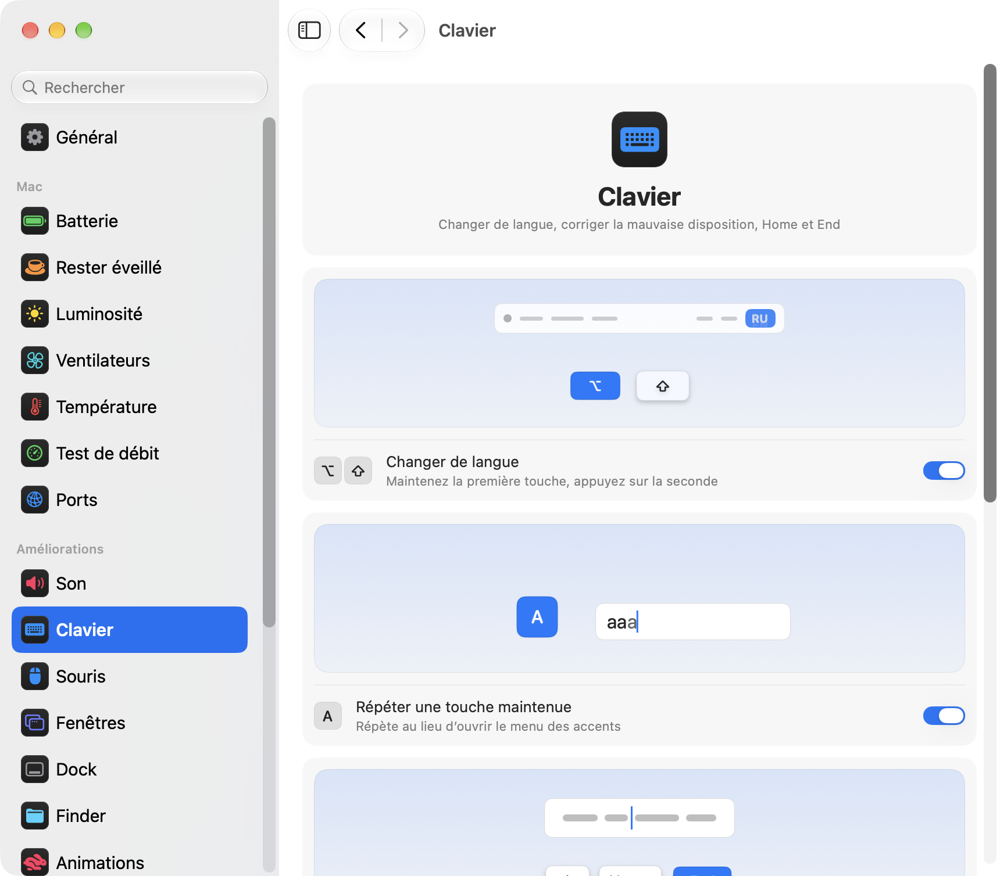

<p align="center"></p>
<h1 align="center">pikapik</h1>
<p align="center"><b>Votre Mac comprend à demi-mot.</b><br>De petites améliorations pour le clavier, la souris, les fenêtres et le Finder, directement dans la barre des menus de votre Mac.</p>
<p align="center"><sub><a href="../../README.md">English</a> · <a href="README.ru.md">Русский</a> · <a href="README.uk.md">Українська</a> · <a href="README.de.md">Deutsch</a> · <b>Français</b> · <a href="README.es.md">Español</a> · <a href="README.it.md">Italiano</a> · <a href="README.pt-BR.md">Português (Brasil)</a> · <a href="README.ja.md">日本語</a> · <a href="README.zh-Hans.md">简体中文</a> · <a href="README.ko.md">한국어</a> · <a href="README.ro.md">Română</a> · <a href="README.pl.md">Polski</a> · <a href="README.tr.md">Türkçe</a> · <a href="README.nl.md">Nederlands</a> · <a href="README.sv.md">Svenska</a> · <a href="README.cs.md">Čeština</a> · <a href="README.zh-Hant.md">繁體中文</a> · <a href="README.ar.md">العربية</a> · <a href="README.hi.md">हिन्दी</a> · <a href="README.id.md">Bahasa Indonesia</a> · <a href="README.vi.md">Tiếng Việt</a> · <a href="README.th.md">ไทย</a></sub></p>

<p align="center">
<picture>
<source media="(prefers-color-scheme: dark)" srcset="../media/settings-fr-dark.png">

</picture>
</p>

## Installation

Ouvrez Terminal, collez cette ligne et appuyez sur Retour :

```bash
/bin/bash -c "$(curl -fsSL https://raw.githubusercontent.com/dev-pikapik/pika-tools/main/install.sh)"
```

La commande télécharge la dernière version depuis GitHub et ne l’installe que si elle est signée par son développeur et a réussi la vérification d’Apple contre les logiciels malveillants. pikapik apparaît dans la barre des menus, en haut de l’écran. Tout reste éteint tant que vous ne l’activez pas.

<details>
<summary>Autres façons : Homebrew ou un dmg</summary>

Avec Homebrew :

```bash
brew install --cask dev-pikapik/pika-tools/pikapik && open -a pikapik
```

Ou téléchargez [pikapik.dmg](https://github.com/dev-pikapik/pika-tools/releases/latest/download/pikapik.dmg), ouvrez-le et faites glisser l’app dans le dossier Applications.

La commande ci-dessus et Homebrew placent tous deux l’app dans `/Applications`, la lancent, demandent les autorisations et activent l’ouverture à la connexion. Ensuite, l’app se met à jour toute seule, voir **Mises à jour**. Pour la supprimer, voir **Désinstallation**.

</details>

## Ce qu’il fait

<table>
<tbody><tr>
<td width="50%" valign="top">
<picture><source media="(prefers-color-scheme: dark)" srcset="../media/keep-awake-dark.png"></picture>
<br><b>Rester éveillé</b>
<br>Votre Mac reste éveillé aussi longtemps qu’il le faut, même écran rabattu.
</td>
<td width="50%" valign="top">
<picture><source media="(prefers-color-scheme: dark)" srcset="../media/fans-dark.png"></picture>
<br><b>Ventilateurs</b>
<br>Voyez la vitesse de vos ventilateurs et choisissez-la.
</td>
</tr></tbody>
<tbody><tr>
<td width="50%" valign="top">
<picture><source media="(prefers-color-scheme: dark)" srcset="../media/battery-dark.png"></picture>
<br><b>Batterie</b>
<br>Voyez l’état de votre batterie, sa capacité et son nombre de cycles, la puissance qui y entre et comment la faire durer.
</td>
<td width="50%" valign="top">
<picture><source media="(prefers-color-scheme: dark)" srcset="../media/command-keys-dark.png"></picture>
<br><b>Protéger ⌘Q et ⌘W</b>
<br>Rien ne se ferme par erreur. Ajoutez ⇧ quand c’est voulu.
</td>
</tr></tbody>
<tbody><tr>
<td width="50%" valign="top">
<picture><source media="(prefers-color-scheme: dark)" srcset="../media/compress-dark.png"></picture>
<br><b>Copie allégée</b>
<br>Clic droit sur une photo, un PDF ou une vidéo, et une copie plus légère apparaît.
</td>
<td width="50%" valign="top">
<picture><source media="(prefers-color-scheme: dark)" srcset="../media/convert-dark.png"></picture>
<br><b>Conversion</b>
<br>Enregistrez une image, une vidéo ou un morceau dans un autre format d’un clic droit.
</td>
</tr></tbody>
<tbody><tr>
<td width="50%" valign="top">
<picture><source media="(prefers-color-scheme: dark)" srcset="../media/input-switch-dark.png"></picture>
<br><b>Changer de langue</b>
<br>Maintenez ⌥ et touchez ⇧ pour changer la langue du clavier.
</td>
<td width="50%" valign="top">
<picture><source media="(prefers-color-scheme: dark)" srcset="../media/quit-on-close-dark.png"></picture>
<br><b>Quitter avec la dernière fenêtre</b>
<br>Fermez la dernière fenêtre d’une app, et l’app se ferme aussi.
</td>
</tr></tbody>
<tbody><tr>
<td width="50%" valign="top">
<picture><source media="(prefers-color-scheme: dark)" srcset="../media/window-zoom-dark.png"></picture>
<br><b>Le bouton vert agrandit</b>
<br>La fenêtre remplit l’écran sans passer en plein écran.
</td>
<td width="50%" valign="top">
<picture><source media="(prefers-color-scheme: dark)" srcset="../media/dock-hide-dark.png"></picture>
<br><b>Réduire d’un clic dans le Dock</b>
<br>Cliquez sur l’app que vous utilisez, et elle s’efface.
</td>
</tr></tbody>
<tbody><tr>
<td width="50%" valign="top">
<picture><source media="(prefers-color-scheme: dark)" srcset="../media/new-file-dark.png"></picture>
<br><b>Nouveau fichier</b>
<br>Clic droit dans le Finder, un nom, et le fichier vide est prêt.
</td>
<td width="50%" valign="top">
<picture><source media="(prefers-color-scheme: dark)" srcset="../media/finder-cut-dark.png"></picture>
<br><b>⌘X déplace les fichiers</b>
<br>Coupez des fichiers dans le Finder et collez-les où vous voulez.
</td>
</tr></tbody>
<tbody><tr>
<td width="50%" valign="top">
<picture><source media="(prefers-color-scheme: dark)" srcset="../media/finder-open-dark.png"></picture>
<br><b>Entrée ouvre les fichiers</b>
<br>Sélectionnez des fichiers dans le Finder et appuyez sur Entrée pour les ouvrir.
</td>
<td width="50%" valign="top">
<picture><source media="(prefers-color-scheme: dark)" srcset="../media/finder-delete-dark.png"></picture>
<br><b>Supprimer vers la Corbeille</b>
<br>Appuyez sur ⌫ dans le Finder, et les fichiers sélectionnés vont à la Corbeille.
</td>
</tr></tbody>
<tbody><tr>
<td width="50%" valign="top">
<picture><source media="(prefers-color-scheme: dark)" srcset="../media/desktop-icons-dark.png"></picture>
<br><b>Masquer les icônes du bureau</b>
<br>Un clic, et le bureau est vide pour un appel ou une capture d’écran.
</td>
<td width="50%" valign="top">
<picture><source media="(prefers-color-scheme: dark)" srcset="../media/hidden-files-dark.png"></picture>
<br><b>Afficher les fichiers masqués</b>
<br>Voyez les fichiers et dossiers que macOS garde hors de vue.
</td>
</tr></tbody>
<tbody><tr>
<td width="50%" valign="top">
<picture><source media="(prefers-color-scheme: dark)" srcset="../media/game-mode-dark.png"></picture>
<br><b>Mode Jeu</b>
<br>Pendant que vous jouez, rien ne s’ouvre par-dessus le jeu ni ne le ferme.
</td>
<td width="50%" valign="top">
<picture><source media="(prefers-color-scheme: dark)" srcset="../media/speed-test-dark.png"></picture>
<br><b>Test de débit</b>
<br>La vitesse de votre connexion, et ce qu’elle permet.
</td>
</tr></tbody>
<tbody><tr>
<td width="50%" valign="top">
<picture><source media="(prefers-color-scheme: dark)" srcset="../media/side-buttons-dark.png"></picture>
<br><b>Boutons latéraux</b>
<br>Les boutons 4 et 5 reculent et avancent, comme un balayage.
</td>
<td width="50%" valign="top">
<picture><source media="(prefers-color-scheme: dark)" srcset="../media/hide-app-dark.png"></picture>
<br><b>Masquer avec un bouton de la souris</b>
<br>Un appui masque l’app au premier plan, comme ⌘H. Elle continue de tourner.
</td>
</tr></tbody>
<tbody><tr>
<td width="50%" valign="top">
<picture><source media="(prefers-color-scheme: dark)" srcset="../media/wheel-lines-dark.png"></picture>
<br><b>Défiler par lignes</b>
<br>Chaque cran de la molette fait défiler d’autant, quelle que soit la vitesse.
</td>
<td width="50%" valign="top">
<picture><source media="(prefers-color-scheme: dark)" srcset="../media/wheel-direction-dark.png"></picture>
<br><b>Sens de défilement</b>
<br>Un sens pour le trackpad, un autre pour la souris.
</td>
</tr></tbody>
<tbody><tr>
<td width="50%" valign="top">
<picture><source media="(prefers-color-scheme: dark)" srcset="../media/linear-pointer-dark.png"></picture>
<br><b>Sans accélération du pointeur</b>
<br>Le pointeur parcourt exactement la distance de votre main.
</td>
<td width="50%" valign="top">
<picture><source media="(prefers-color-scheme: dark)" srcset="../media/key-repeat-dark.png"></picture>
<br><b>Répéter une touche maintenue</b>
<br>Maintenez une touche pour la répéter, sans menu des accents.
</td>
</tr></tbody>
<tbody><tr>
<td width="50%" valign="top">
<picture><source media="(prefers-color-scheme: dark)" srcset="../media/home-end-dark.png"></picture>
<br><b>Home et End</b>
<br>Allez au début ou à la fin de la ligne pendant la saisie.
</td>
<td width="50%" valign="top">
<picture><source media="(prefers-color-scheme: dark)" srcset="../media/animations-dark.png"></picture>
<br><b>Animations</b>
<br>Accélérez le Dock, les fenêtres et Coup d’œil, jusqu’à l’instantané.
</td>
</tr></tbody>
<tbody><tr>
<td width="50%" valign="top">
<picture><source media="(prefers-color-scheme: dark)" srcset="../media/leftover-permissions-dark.png"></picture>
<br><b>Autorisations des apps supprimées</b>
<br>Retirez les autorisations que macOS garde pour les apps déjà supprimées.
</td>
<td width="50%" valign="top">
<picture><source media="(prefers-color-scheme: dark)" srcset="../media/pet-dark.png"></picture>
<br><b>Compagnon sur le bureau</b>
<br>Un petit ami se promène derrière vos fenêtres. Attrapez-le et lancez-le, ou appuyez sur Espace pour le faire sauter. Habillez-le avec les vêtements de sa garde-robe et gagnez des récompenses en jouant ensemble. Il s’anime quand vous tapez et somnole quand vous vous éloignez.
</td>
</tr></tbody>
<tbody><tr>
<td width="50%" valign="top">
<picture><source media="(prefers-color-scheme: dark)" srcset="../media/uninstaller-dark.png"></picture>
<br><b>Supprimer des apps</b>
<br>Supprimez une app et ses fichiers. Tout est récupérable.
</td>
<td width="50%" valign="top">
<picture><source media="(prefers-color-scheme: dark)" srcset="../media/game-fps-dark.png"></picture>
<br><b>Afficher les FPS</b>
<br>Un petit compteur indique la fluidité de votre jeu, dans le coin que vous choisissez.
</td>
</tr></tbody>
<tbody><tr>
<td width="50%" valign="top">
<picture><source media="(prefers-color-scheme: dark)" srcset="../media/archive-dark.png"></picture>
<br><b>Archives</b>
<br>Ouvrez les RAR et d’autres archives, ou regroupez des fichiers dans un ZIP, d’un clic droit.
</td>
<td width="50%" valign="top">
<picture><source media="(prefers-color-scheme: dark)" srcset="../media/dock-display-dark.png"></picture>
<br><b>Garder le Dock sur un seul écran</b>
<br>Le Dock ne saute plus sur un autre écran. Pour le déplacer, faites d’un autre écran l’écran principal.
</td>
</tr></tbody>
<tbody><tr>
<td width="50%" valign="top">
<picture><source media="(prefers-color-scheme: dark)" srcset="../media/temperatures-dark.png"></picture>
<br><b>Température</b>
<br>Voyez à quel point votre Mac chauffe à l’intérieur, du processeur à la batterie.
</td>
<td width="50%" valign="top">
<picture><source media="(prefers-color-scheme: dark)" srcset="../media/background-dark.png"></picture>
<br><b>Tâches en arrière-plan</b>
<br>Découvrez ce qui tourne en arrière-plan et d’où cela vient.
</td>
</tr></tbody>
<tbody><tr>
<td width="50%" valign="top">
<picture><source media="(prefers-color-scheme: dark)" srcset="../media/ports-dark.png"></picture>
<br><b>Ports</b>
<br>Voyez quel programme occupe un port, et libérez-le.
</td>
<td width="50%" valign="top">
<picture><source media="(prefers-color-scheme: dark)" srcset="../media/app-volume-dark.png"></picture>
<br><b>Volume des apps</b>
<br>Baissez le volume de n’importe quelle app ou coupez-en le son, sans toucher aux autres.
</td>
</tr></tbody>
<tbody><tr>
<td width="50%" valign="top">
<picture><source media="(prefers-color-scheme: dark)" srcset="../media/brightness-dark.png"></picture>
<br><b>Luminosité des écrans</b>
<br>Assombrissez ou éclaircissez un écran que macOS ne peut pas régler lui-même, avec un curseur ou les touches de luminosité.
</td>
<td width="50%" valign="top">
<picture><source media="(prefers-color-scheme: dark)" srcset="../media/layout-fix-dark.png"></picture>
<br><b>Corriger la mauvaise disposition</b>
<br>Vous avez tapé ghbdtn au lieu de привет ? Appuyez sur Espace, et c’est corrigé.
</td>
</tr></tbody>
<tbody><tr>
<td width="50%" valign="top">
<picture><source media="(prefers-color-scheme: dark)" srcset="../media/middle-click-dark.png"></picture>
<br><b>Clic du milieu sur le trackpad</b>
<br>Touchez avec trois doigts pour ouvrir un lien dans un nouvel onglet, comme avec le bouton du milieu de la souris.
</td>
</tr></tbody>
</table>

## En savoir plus

<details>
<summary>Premier lancement</summary>

pikapik a besoin de deux autorisations. Au premier lancement, elle ouvre les réglages sur la page Autorisations, qui vous guide pas à pas, et macOS affiche ses propres demandes. Allez dans **Réglages Système › Confidentialité et sécurité** et activez pikapik dans :

- **Accessibilité**, pour que l’app puisse modifier une frappe ou un clic avant qu’il n’atteigne les autres apps.
- **Surveillance de l’entrée**, pour que l’app puisse voir les frappes et les clics sans les modifier. C’est ainsi que fonctionne le changement de langue.

L’app détecte le changement en une ou deux secondes, sans redémarrage.

Certaines fonctions demandent davantage : **Accès administrateur**, **Extensions du Finder**, **iCloud Drive**, **Accès complet au disque**, **Enregistrement de l’écran** et **Enregistrement de l’audio système**. Tout se trouve sur la page Autorisations des réglages : chaque autorisation a une ligne qui dit à quoi elle sert, une coche verte ou une croix orange, et un seul bouton : **Autoriser** quand elle manque, **Éteindre** quand elle est active. Vous pouvez ainsi reprendre n’importe quelle autorisation sur place.

pikapik n’enregistre, ne conserve et n’envoie rien de ce que vous tapez ou cliquez. Les évènements sont traités en mémoire et transmis immédiatement. Pour corriger les mots tapés avec la mauvaise disposition, pikapik ne garde en mémoire que vos tout derniers mots et les oublie dès que vous cliquez ou changez d’app. Les seuls mots qu’il enregistre sont ceux que vous lui avez demandé de laisser tels quels, sur ce Mac uniquement, jusqu’à ce que vous les effaciez dans Réglages › Clavier. pikapik ne se connecte à internet que pour les mises à jour (il demande à GitHub la dernière version et ne la télécharge que si vous choisissez de mettre à jour) et pour le test de débit, quand vous le lancez (avec les serveurs d’Apple). La version du Mac App Store est mise à jour par l’App Store, et son test de débit utilise Cloudflare. La progression de votre compagnon (pas, lancers, récompenses et le reste) est comptée uniquement sur ce Mac et n’est jamais envoyée nulle part. Vous pouvez l’effacer dans Réglages › Compagnon.

</details>

<details>
<summary>Chaque outil en détail</summary>

**Lecteur.** Les vidéos que QuickTime ne peut pas ouvrir, comme MKV, WebM, AVI, WMV et FLV, se lisent dans leur propre fenêtre. Ouvre Réglages › Lecteur et clique sur **Ouvrir une vidéo…**, ou fais un clic droit sur une vidéo, puis **Ouvrir avec › pikapik Player**. La barre d’espace lance la lecture et la met en pause, ← et → avancent ou reculent d’une image en pause et sautent de 5 secondes pendant la lecture, J et L de 10, ↑ et ↓ règlent le volume, et F passe en plein écran. Le menu **Vitesse** va de 0,5× à 2×, **Enregistrer l’image…** enregistre un PNG, et le lecteur reprend là où vous vous étiez arrêté. Le panneau de commandes en verre dépoli se masque pendant la lecture, et survoler la barre de temps affiche une petite image de cet instant. Une vidéo déjà ouverte revient au premier plan au lieu de s’ouvrir deux fois. Le lecteur n’a pas accès au réseau, ne demande aucune autorisation et ne change pas l’app qui ouvre tes vidéos. Les licences de FFmpeg et dav1d et leur code source sont accessibles depuis la même page. Les sous-titres ne sont pas encore pris en charge. Il n’existe pas dans la version du Mac App Store.

**Volume des apps.** Ouvre Réglages › Son et active **Volume des apps**. Chaque app qui joue du son a son propre curseur et un bouton pour couper le son, dans les Réglages et dans le menu. Baisse le volume d’un appel vidéo trop fort, coupe le son d’un jeu bruyant et laisse ta musique comme elle est : le volume de ton Mac et celui des autres apps ne change pas. pikapik retient le volume de chaque app, et une app que tu laisses à fond n’est jamais touchée. Une app que tu as réglée reste dans la liste, même après un redémarrage, grisée tant qu’elle est fermée : tu peux donc fixer son volume avant qu’elle démarre. Clique sur **Ajouter une app…** ou glisse une app depuis le Finder. La ✕ à côté d’une app l’oublie et la remet à fond. Pour changer le volume d’une app, pikapik fait passer son son par lui-même, il a donc besoin de l’autorisation **Enregistrement de l’audio système**, que tu accordes sur la page Autorisations. Le son est seulement transmis : il n’est ni enregistré, ni conservé, ni envoyé nulle part, et le micro n’est pas utilisé. Il faut macOS 14.2 ou plus récent ; sous macOS 14.0 et 14.1, la fonction est masquée. Désactivé par défaut.

**Luminosité des écrans.** macOS règle la luminosité de l’écran intégré et des écrans Apple, mais pas celle de la plupart des autres écrans. Ouvrez Réglages › Luminosité : chaque écran que macOS ne peut pas régler lui-même a son propre curseur, et vous pouvez aussi ajouter une ligne « Luminosité » au panneau de la barre des menus. pikapik change la luminosité de l’écran lui-même, comme le font ses propres boutons. Si un écran ne réagit pas, activez **Assombrir plutôt l’image** : l’image devient plus sombre, mais jamais noire. Activez **Touches de luminosité**, et les touches de luminosité règlent l’écran sous le pointeur et affichent un petit indicateur ; maintenez ⌥⇧ pour un réglage plus fin. Les touches ont besoin de l’autorisation **Accessibilité**, que vous accordez sur la page Autorisations ; les curseurs fonctionnent sans elle. pikapik retient le niveau de chaque écran et le rétablit après la veille. La version du Mac App Store se contente d’assombrir l’image. Les touches de luminosité sont désactivées par défaut.

**Protéger ⌘Q et ⌘W.** ⌘Q et ⌘W seuls ne font rien, vous ne quittez donc pas une app ni ne fermez une fenêtre par accident. Ajoutez Maj pour le faire exprès : ⇧⌘Q quitte, ⇧⌘W ferme. Fonctionne dans toutes les apps. Chaque touche a son propre interrupteur. Désactivé par défaut.

**Changer de langue avec Option+Maj.** Maintenez Option et touchez Maj : macOS passe à la source de saisie suivante. Gardez Option enfoncée et touchez de nouveau Maj pour continuer. Maintenez Maj et touchez Option pour revenir en arrière. Si vous appuyez entre-temps sur une autre touche, cliquez ou ajoutez Commande, Contrôle ou Fn, rien ne change, donc les raccourcis comme Option+Maj+flèche fonctionnent comme avant. Désactivé par défaut.

**Répéter une touche maintenue.** Maintenez une touche et la lettre se tape encore et encore au lieu d’afficher le menu des accents. Pratique dans les jeux et pour écrire. Les apps déjà ouvertes en tiennent compte après un redémarrage. Désactivez-le et macOS retrouve son comportement habituel. Désactivé par défaut.

**Home et End vont au début et à la fin de la ligne.** Pendant la saisie, Home place le curseur au début de la ligne et End à la fin, au lieu de faire défiler la page. Avec ⇧, elles sélectionnent jusque-là, avec ⌘, elles vont au début ou à la fin du texte entier. Hors des champs de texte, ainsi que dans les terminaux, les machines virtuelles et les apps de bureau à distance, les touches fonctionnent comme avant. Dans la version du Mac App Store, elles agissent aussi hors des champs de texte, sauf dans les navigateurs, le Finder et Musique. Vous pouvez ajouter d’autres apps où elles doivent fonctionner comme d’habitude. Désactivé par défaut.

**Corriger les mots tapés avec la mauvaise disposition.** Si un mot s’affiche en charabia, comme ghbdtn au lieu de привет, pikapik le retape dans la bonne disposition dès que vous appuyez sur Espace ou Retour, et change de disposition pour que le mot suivant s’écrive correctement. Fonctionne avec toutes les dispositions de clavier ajoutées sur votre Mac. Un mot n’est modifié que s’il n’existe dans aucune de vos langues et que les mêmes touches donnent un mot courant dans une autre disposition : les noms, les fautes de frappe et les mots rares restent donc tels que vous les avez tapés, tout comme le texte des champs de mot de passe, de Terminal et des apps que vous choisissez. Appuyez sur ⌃⇧Espace pour corriger le dernier mot ou le texte sélectionné, et appuyez encore pour essayer vos autres dispositions. Juste après une correction, les mêmes touches l’annulent, et pikapik ne corrigera plus ce mot de lui-même. Vous pouvez changer le raccourci dans Réglages › Clavier. Dans la version du Mac App Store, sélectionnez le texte et appuyez sur ⌃⇧Espace, ou choisissez « Corriger la disposition du clavier » dans le menu « Services ». **Corriger les mots pendant la frappe** et le raccourci sont désactivés tant que vous ne les activez pas dans Réglages › Clavier, et ils ont besoin d’Accessibilité, que demande la page Autorisations. Désactivé par défaut. Si vous n’avez qu’une seule disposition, la note de la page vous permet d’ajouter celle de votre langue sur place, sans passer par Réglages Système (version du site).

**Désactiver l’accélération du pointeur.** Le pointeur se déplace exactement autant que la souris, quelle que soit la vitesse de votre geste. Un curseur **Vitesse de déplacement** règle sa rapidité. Fonctionne uniquement avec les souris, le trackpad reste tel quel. Désactivez l’option ou quittez pikapik, et macOS retrouve ses propres réglages. Désactivé par défaut.

**Défiler par lignes.** Chaque cran de la molette de la souris fait défiler le même nombre de lignes, quelle que soit la vitesse à laquelle vous la tournez. Choisissez de 1 à 10 lignes par cran, 3 par défaut. Le défilement naturel reste tel que vous l’avez réglé dans Réglages Système. Ne concerne que les souris, le trackpad reste comme il est. Désactivé par défaut. À côté du curseur **Distance par cran**, une petite page défile de la distance choisie, et un point marque la valeur par défaut.

Certaines apps et certains jeux comptent le défilement en pixels exacts : pour eux, passez ce même réglage en pixels et choisissez de 1 à 200 pixels par cran, 40 par défaut. Le curseur indique aussi quelle part de la hauteur de l’écran cela représente.

**Sens de défilement pour le trackpad et la souris.** macOS n’a qu’un seul réglage de défilement naturel pour le trackpad et la souris à la fois. Active cette fonction et choisis un sens pour chacun : **Naturel**, la page suit tes doigts comme sur iPhone, ou **Classique**, où la page va dans l’autre sens. Le choix du trackpad vaut aussi pour le défilement horizontal et pour l’élan après avoir levé les doigts. La Magic Mouse défile au toucher, elle suit donc le choix du trackpad. Choisis la même chose sur chacun de tes Mac et le défilement sera le même partout, même quand tu passes la souris sur un autre Mac avec Commande universelle. Désactivé par défaut. À l’activation, les deux sont réglés comme dans Réglages Système, donc rien ne change tant que tu ne choisis pas autre chose.

**Boutons latéraux pour Précédent et Suivant.** Les boutons 4 et 5 de la souris font précédent et suivant dans le Finder, Safari et les autres apps Apple, ainsi que dans de nombreuses autres apps, comme un balayage sur le trackpad. Les apps qui gèrent elles-mêmes ces boutons les reçoivent tels quels. Si votre souris les a dans l’autre sens, activez **Inverser les boutons latéraux**. Désactivé par défaut.

**Un bouton de la souris masque l’app active.** Activez **Masquer l’app active avec un bouton de la souris** dans Réglages › Souris et appuyez sur le bouton que vous voulez utiliser, par exemple le bouton du milieu ou un bouton latéral. Ensuite, un appui masque l’app au premier plan, exactement comme ⌘H : l’app continue de tourner, et un clic sur son icône dans le Dock la fait revenir. Quand vous jouez avec le Mode Jeu activé, le bouton fonctionne normalement dans le jeu. Désactivé par défaut.

**Clic du milieu sur le trackpad.** Touchez ou cliquez avec trois doigts, et le trackpad agit comme le bouton du milieu de la souris : dans la plupart des navigateurs, cela ouvre un lien dans un nouvel onglet ou ferme un onglet. Vous pouvez aussi choisir quatre doigts. Pour que le toucher fonctionne, activez **Toucher pour cliquer** dans Réglages Système › Trackpad. Si « Recherche et détection de données » y est réglé sur un toucher avec 3 doigts, trois doigts ne peuvent que cliquer, et si « Faire glisser avec 3 doigts » est activé, choisissez quatre doigts. La ligne **Doigts** dans Réglages indique ce qui fonctionne sur votre Mac. La souris ne change pas. Cette fonction nécessite les autorisations **Accessibilité** et **Surveillance de l’entrée**, et n’existe pas dans la version du Mac App Store. Désactivé par défaut.

**Quitter à la fermeture de la dernière fenêtre.** Fermez la dernière fenêtre d’une app et l’app se ferme. Le Finder reste ouvert, tout comme les apps qui ont des fenêtres sur d’autres bureaux ou dans le Dock. Vous pouvez dresser la liste des apps qui ne doivent jamais se fermer ainsi. Désactivé par défaut.

**Réduire ou masquer d’un clic dans le Dock.** Cliquez sur l’icône de l’app que vous utilisez dans le Dock, et toutes ses fenêtres rejoignent le Dock. Cliquez de nouveau pour les faire toutes revenir. Vous pouvez aussi faire en sorte que le clic masque l’app entière, comme ⌘H. Désactivé par défaut.

**Garder le Dock sur un seul écran.** Avec plusieurs écrans, macOS déplace le Dock sur un autre écran dès que le pointeur pousse contre son bord inférieur. Avec l’interrupteur activé, cela n’arrive plus, même si vous déplacez le pointeur très vite : pikapik désactive ce déplacement avec un réglage du Dock lui-même et ne touche jamais au pointeur. Pour déplacer le Dock volontairement, faites d’un autre écran l’écran principal : dans **Réglages Système › Moniteurs**, cliquez sur cet écran et choisissez **Écran principal** dans **Utiliser comme**, et le Dock le suit. La ligne **Écran principal** sous l’interrupteur le fait directement, et désactiver l’interrupteur remet les écrans comme ils étaient. Le Dock ne lit son réglage qu’au démarrage, donc activer ou désactiver l’interrupteur redémarre le Dock une fois. Aucune autorisation n’est nécessaire. L’interrupteur est désactivé par défaut et n’existe pas dans la version du Mac App Store.

**Le bouton vert agrandit la fenêtre.** Cliquez sur le bouton vert d’une fenêtre : elle remplit l’écran sans passer en plein écran. Un autre clic rétablit la taille précédente. Si vous maintenez ⌥, le bouton fonctionne comme d’habitude. Le plein écran reste dans le menu du bouton et sur ⌃⌘F. Vous pouvez lister les apps où le bouton vert doit fonctionner comme d’habitude. Désactivé par défaut.

**Nouveau fichier dans le Finder.** Clic droit dans une fenêtre du Finder ou sur le bureau, choisissez **Nouveau fichier**, tapez un nom, et un fichier vide apparaît. En .txt par défaut. Désactivé par défaut.

**Entrée ouvre les fichiers dans le Finder.** Sélectionnez des fichiers dans une fenêtre du Finder ou sur le bureau et appuyez sur Retour ou Entrée : ils s’ouvrent. F2 ou fn F2 renomme le fichier sélectionné. Dans les champs de texte, par exemple quand vous saisissez un nom, les touches fonctionnent comme d’habitude. Désactivé par défaut.

**⌘X coupe les fichiers dans le Finder.** Sélectionnez des fichiers et appuyez sur ⌘X, ouvrez le dossier voulu et appuyez sur ⌘V : les fichiers y sont déplacés au lieu d’être copiés. ⌘C annule la coupe. Désactivé par défaut.

**Supprimer efface les fichiers dans le Finder.** Sélectionnez des fichiers et appuyez sur ⌫ ou ⌦ (fn ⌫ sur un portable) : ils vont à la Corbeille, comme avec ⌘⌫. Quand vous renommez un fichier, faites une recherche ou tapez dans un autre champ, les touches effacent les lettres comme d’habitude. Désactivé par défaut.

**Copie allégée dans le Finder.** Clic droit sur un fichier dans le Finder, puis **Créer une copie allégée**. Une version plus légère d’une photo, d’un GIF, d’un PDF ou d’une vidéo apparaît juste à côté, souvent plusieurs fois plus petite. Le son non compressé, comme WAV ou AIFF, devient un M4A compact. Si le fichier ne peut pas être plus léger, aucune copie n’est créée et pikapik vous le dit. L’original reste intact, et rien ne quitte votre Mac. Désactivé par défaut.

**Conversion dans le Finder.** Clic droit sur un fichier dans le Finder, puis **Convertir en** pour l’enregistrer dans un autre format : une image en JPEG, PNG, HEIC, GIF, TIFF ou PDF, une vidéo en MP4, MOV ou seulement le son, de la musique en M4A, WAV ou AIFF. L’original reste intact, et rien ne quitte votre Mac. S’active séparément de la copie allégée. Désactivé par défaut.

**Archives dans le Finder.** Clic droit sur une archive dans le Finder, puis **Extraire** : ses fichiers apparaissent à côté. Clic droit sur tout autre fichier ou dossier, puis **Créer une archive…** pour obtenir un ZIP, un 7Z, un TAR.GZ ou un TAR.XZ. Un ZIP ou un 7Z peut avoir un mot de passe, et toute archive peut être divisée en parties, par exemple de 15 Mo pour l’e-mail ou de 4 Go pour une clé USB. Le mot de passe se tape deux fois, pour qu’une faute de frappe ne vous empêche pas d’ouvrir vos propres fichiers. Un ZIP créé ainsi ne contient aucun fichier système caché, garde lisibles les noms dans toutes les langues et accepte les fichiers de plus de 4 Go. Désactivé par défaut. La version du Mac App Store a quelques limites, décrites plus bas.

pikapik ouvre aussi ce que macOS ne sait pas ouvrir : les RAR, même répartis en plusieurs parties, les 7Z protégés par mot de passe, les jeux de parties comme .001, .z01, .r00 et .part1.rar, ainsi que les ZIPX, CAB, LZH, ARJ, ZST, LZMA, WIM et bien d’autres. Un double-clic les ouvre dans pikapik. Les noms de fichiers des anciens ZIP, par exemple en cyrillique, en japonais ou en chinois, s’affichent correctement. L’interrupteur **Ouvrir les archives avec cette app**, dans Réglages › Finder, confie aussi les ZIP et les 7Z à pikapik, tandis que les TAR et les GZ restent à l’app d’archives intégrée, qui s’en occupe déjà très bien. pikapik sait ouvrir le RAR, mais pas le créer : la licence du RAR n’autorise que l’extraction.

Une fenêtre demande le mot de passe, **Arrêter** interrompt n’importe quelle tâche, et d’une archive endommagée ou incomplète, pikapik récupère ce qui est encore lisible. Si une archive gonflait jusqu’à une taille énorme, pikapik vous demande confirmation avant de l’extraire, et il s’arrête à temps quand le disque est sur le point d’être plein. Les archives qui tentent d’écrire en dehors de leur propre dossier sont bloquées. Sélectionnez une archive dans le Finder et appuyez sur Espace pour voir ce qu’elle contient.
**Archives dans la version du Mac App Store.** Elles y fonctionnent aussi, mais avec les outils intégrés à macOS au lieu du 7-Zip fourni, d’où des limites : seul le ZIP peut avoir un mot de passe, pas le 7Z ; une archive ne peut pas être découpée en parties, et les archives en plusieurs parties (.001, .part1.rar, .z01 et similaires) ne peuvent pas être ouvertes ; les fichiers seuls .xz, .lzma et .zst ne peuvent pas être ouverts (les .gz et .bz2 le peuvent) ; les 7Z et RAR protégés par mot de passe ne peuvent pas être ouverts ; et le commutateur **Ouvrir les archives avec cette app** n’existe pas. La première fois, pikapik demande l’accès à votre dossier personnel, comme pour Nouveau fichier et Copie allégée, car cette version ne peut écrire que là où vous l’avez autorisée. Activez l’extension du Finder dans Réglages Système › Général › Ouverture et extensions ; pikapik montre où cliquer.


**Masquer les icônes du bureau.** Activez-le avant un appel, un enregistrement de l’écran ou une capture d’écran, et les fichiers et dossiers du bureau disparaissent. Désactivez-le, et ils reviennent à leur place. Rien n’est déplacé : les fichiers restent dans le dossier Bureau du Finder. C’est le réglage **Afficher les éléments › Sur le bureau** de Réglages Système › Bureau et Dock, en plus accessible, donc les deux sont toujours d’accord. Dans la version du Mac App Store, cette ligne recouvre plutôt les icônes avec votre fond d’écran sur chaque écran, ou avec une couleur unie si votre fond d’écran est animé, et les clics atteignent toujours le bureau. Dans Réglages, le bouton **Ouvrir** en dessous ouvre toujours cette page des Réglages Système.

**Afficher les fichiers masqués.** Les fichiers et dossiers que macOS masque, comme Bibliothèque dans votre dossier de départ ou les fichiers dont le nom commence par un point, apparaissent en grisé dans le Finder et sur le bureau. C’est comme appuyer sur ⇧⌘. dans le Finder, sauf que vous voyez d’un coup d’œil si c’est activé. Pour appliquer le changement, le Finder redémarre un instant et rouvre ses fenêtres et ses onglets. Si le Finder copie ou déplace des fichiers, il redémarre une fois qu’il a terminé. Les deux se trouvent dans Réglages › Finder. Pour les avoir dans le panneau de la barre des menus, cliquez sur le bouton en forme de crayon en bas du panneau et cochez-les. Dans la version du Mac App Store, Réglages › Finder indique plutôt les touches ⇧⌘. du Finder.

**Mode Jeu.** Ajoutez vos jeux, et pendant que vous jouez, votre Mac ne vous fait pas sortir du jeu. Spotlight, Siri, ⌘Tab, Mission Control et les balayages entre bureaux ne s’ouvrent pas par-dessus le jeu, ⌘Q et ⌘W ne le ferment pas par accident, le pointeur ne glisse pas vers le Dock, la barre des menus ou un autre écran, et l’écran reste allumé. Chacun de ces réglages a son propre interrupteur sur la page Jeux, et pikapik vous propose les jeux qu’il trouve sur votre Mac. Dans un jeu, Contrôle-clic reste un simple clic, et Contrôle avec les flèches ne change pas de bureau. Minecraft est reconnu aussi : ajoutez Minecraft Launcher ou CurseForge, et le mode s’active dans Minecraft lui-même. Pour quitter un jeu, appuyez sur ⇧⌘Q ; pour fermer sa fenêtre, sur ⇧⌘W. ⌥⌘Esc fonctionne toujours. Dès que vous quittez le jeu, tout fonctionne comme d’habitude. Désactivé par défaut.

Activez le mode Jeu et jouez. Autres réglages de jeu contient le catalogue publié par votre Mac, avec les touches actuelles et un aperçu animé pour chaque action.

Automatique suspend les actions qui ouvrent des fenêtres ou déplacent le focus. Un raccourci de langue bref et volontaire change la source sans fenêtre système. Les touches de déplacement maintenues ont priorité pour éviter les changements de langue pendant la course et les sauts.

Dans Réglages → Jeux → Autres réglages de jeu, le groupe « Souris et trackpad » liste uniquement ce qui est activé dans macOS sur votre Mac, avec les noms d’Apple et un petit dessin pour chaque élément : raccourcis sur un bouton de la souris, balayage entre bureaux et apps en plein écran, Mission Control et App Exposé, pincement pour les apps et écartement pour le bureau, balayage depuis le bord droit pour le centre de notifications et chaque coin actif avec son action. Tant qu’un jeu est au premier plan, ils sont suspendus : un balayage involontaire ou un effleurement d’un coin de l’écran ne vous sortira pas du jeu. Les gestes à l’intérieur du jeu continuent de fonctionner. Chaque élément peut être réglé pour fonctionner comme d’habitude. Dans la version du site, **Modifier…** sur un coin actif choisit une autre action sur place, et **Remettre en place** rétablit la première ; chaque changement relance le Dock une fois.

Ouvrez Réglages → Jeux → Ajouter un jeu et cliquez sur votre jeu en cours. Les jeux utilisant Java ou d’autres environnements apparaissent aussi, même sans fichier .app. Minecraft s’appelle Minecraft au lieu de java. Trouvez le processus du jeu et glissez sa ligne sur Vos jeux dans Réglages → Jeux.

**Afficher les FPS.** Les FPS sont les images par seconde : le nombre d’images que le jeu dessine chaque seconde. Activez **Afficher les FPS** sur la page Jeux, et tant que le Mode Jeu est activé, une petite pastille sombre avec ce nombre s’affiche dans un coin de n’importe quel jeu. Cliquez sur un coin de l’image au-dessus de l’interrupteur pour le choisir. Un tiret signifie que les premières images ne sont pas encore arrivées, et un 0 grisé que le jeu ne dessine plus rien. Sous macOS 27, la plupart des jeux sont comptés par macOS lui-même, sans autorisation. Un jeu que macOS ne peut pas compter, le plus souvent un jeu ancien, est compté via l’enregistrement de l’écran : la ligne **Enregistrement de l’écran** apparaît alors sur la page Autorisations, pikapik ne la demande jamais pendant une partie, et le nombre ne peut pas dépasser la fréquence de rafraîchissement de l’écran. Sous macOS 14 à 26 et dans la version du Mac App Store, tous les jeux sont comptés ainsi, c’est pourquoi la ligne apparaît dès que vous activez **Afficher les FPS**, et le bouton **Autoriser** sous l’interrupteur vous y mène. Aucune image n’est conservée ni envoyée. Désactivé par défaut.

**Garde-robe et récompenses du compagnon.** Ouvrez Réglages › Compagnon pour habiller votre compagnon : plus de 30 vêtements et accessoires, des chapeaux et lunettes aux capes et aux ailes, et des tenues toutes prêtes comme le sorcier, le pirate ou l’astronaute. Quelques pièces sont offertes dès le départ. Les autres sont des récompenses qui arrivent quand vous jouez ensemble : attrapez votre compagnon et lancez-le, faites rouler le ballon, regardez-le grimper sur les fenêtres et bavarder, ou tenez-lui simplement compagnie jour après jour. Votre compagnon vous prévient quand vous avez gagné une nouvelle récompense.

Pour savoir quand une récompense est due, pikapik compte uniquement ce que vous et votre compagnon faites : les pas, les fois où vous le prenez et le lancez, ses sauts, ses escalades, les parties de ballon et les conversations, les jours passés ensemble, si vous étiez ensemble tôt le matin, après minuit ou le week-end, les pages des Réglages ouvertes et les pièces essayées. En dehors du Mac App Store, pikapik note aussi si vous avez ouvert notre page GitHub depuis les Réglages. Ces chiffres, la date de chaque récompense et la tenue de votre compagnon restent sur ce Mac. Rien n’est envoyé nulle part, et rien de tout cela n’entre dans le fichier de réglages exporté ni dans la synchronisation iCloud. Vous pouvez tout effacer à tout moment dans Réglages › Compagnon, et votre compagnon repart de zéro.

**Supprimer des apps.** Ouvrez Réglages › Supprimer des apps, choisissez une app dans la liste ou déposez-en une sur l’image, et pikapik affiche tout ce que cette app garde sur votre Mac : l’app elle-même, ses données enregistrées, ses réglages, ses fichiers temporaires, ses assistants en arrière-plan et plus encore, chaque élément avec la raison de sa présence. Les fichiers qui appartiennent clairement à l’app sont cochés, ceux qui n’y sont peut-être liés que de loin ne le sont pas, et ceux que d’autres apps utilisent aussi sont signalés. Choisissez ce qu’il faut supprimer et cliquez sur **Mettre à la Corbeille**. Rien n’est effacé définitivement : tout va à la Corbeille. Si l’app est ouverte, pikapik lui demande d’abord de se fermer, et si certains fichiers exigent un administrateur, votre Mac demandera une seule fois votre mot de passe.

Vous avez changé d’avis ? Cliquez sur **Remettre en place** : tout revient où c’était et les assistants en arrière-plan redémarrent. Les dix dernières suppressions restent sous « Supprimés récemment » tant que leurs fichiers sont dans la Corbeille. **Réinitialiser l’app** garde l’app et ne supprime que ses données enregistrées, ses réglages et ses fichiers temporaires, ce qui peut aider quand une app se comporte mal. Les apps que vous avez mises à la Corbeille vous-même apparaissent sous « Dans la Corbeille », avec les fichiers qu’elles ont laissés, et « Restes d’apps supprimées » retrouve les fichiers d’apps déjà disparues. L’interrupteur « Proposer de nettoyer quand une app va à la Corbeille » est désactivé par défaut, et rien n’est supprimé tant que vous n’avez pas choisi. Pour tout voir, la page a besoin de l’**Accès complet au disque**. Cet outil n’existe pas dans la version du Mac App Store.

**Température.** Ouvrez Réglages › Température pour voir à quel point votre Mac chauffe à l’intérieur. En haut, un seul mot résume tout, de « Normal » à « Très chaud », avec une ligne qui indique si votre Mac fonctionne à pleine vitesse ou ralentit pour refroidir. En dessous, chaque composant a sa propre ligne avec un nom simple au lieu d’un code de capteur : processeur, processeur graphique, mémoire, stockage, Wi-Fi et batterie, selon les capteurs de votre Mac. Chaque ligne affiche les degrés et une courte barre qui devient verte, jaune ou orange selon la plage normale de ce composant. Les valeurs se mettent à jour toutes les deux secondes, et seulement quand vous les regardez, si bien qu’elles ne coûtent presque rien à votre Mac. Aucun mot de passe ni aucune autorisation ne sont nécessaires. Vous pouvez aussi ajouter une ligne « Température » au panneau de la barre des menus. La version du Mac App Store affiche le niveau général et, sur un Mac avec batterie, la température de la batterie.

La page **Tâches en arrière-plan** affiche tout ce qui se lance tout seul sur votre Mac : les apps qui s’ouvrent à la connexion, les services en arrière-plan, les assistants cachés dans les apps et les restes d’apps que vous avez déjà supprimées. Pour chaque tâche, vous voyez quelle app l’a ajoutée, si elle tourne en ce moment et où se trouve son fichier, et un clic affiche ce fichier dans le Finder. Les tâches lancées par des agents, y compris celles pour tous les utilisateurs, et les anciens éléments d’ouverture s’éteignent directement dans pikapik d’un bouton, sans mot de passe, et se rallument tout aussi facilement ; rien n’est supprimé. Les services d’arrière-plan du dossier Library partagé, la Session à distance et le Partage d’écran s’éteignent de la même façon, dès que vous avez autorisé l’accès administrateur dans la page Autorisations. Les assistants qu’une app a enregistrés elle-même et les services venus d’ailleurs appartiennent à macOS : leur bouton ouvre donc la section Ouverture de Réglages Système, et une ligne sous la tâche explique pourquoi. Dans la version du Mac App Store, la page se contente d’afficher les tâches : vous lui donnez une fois l’accès à votre dossier personnel dans la fenêtre Ouvrir habituelle, et les boutons ouvrent la section Ouverture.

**Ports.** Quand un programme vous dit que son port est déjà utilisé, ouvrez Réglages › Ports. Vous y voyez chaque programme qui occupe un port sur votre Mac, avec son icône, les numéros de port et si d’autres appareils de votre réseau peuvent s’y connecter. Tapez un numéro pour savoir qui occupe ce port, ou pour vérifier qu’il est libre. Cliquez sur une ligne pour voir les adresses à ouvrir dans un navigateur, le fichier du programme, la commande qui l’a lancé, son dossier et son numéro de processus. **Libérer** demande au programme de quitter, pour qu’il puisse enregistrer son travail, et s’il ne se ferme pas, propose de le forcer à quitter. pikapik vous demande votre accord avant chaque étape. Il ne quitte jamais les éléments de macOS ni les programmes d’autres utilisateurs : pour Récepteur AirPlay et Partage de fichiers, il vous indique quel interrupteur de Réglages Système libère le port ; Session à distance et Partage d’écran s’éteignent directement avec le bouton Éteindre. La page Ports n’existe pas dans la version du Mac App Store : là, macOS ne permet pas à une app de voir quel programme occupe un port.

Chaque outil a son propre interrupteur dans le menu et dans les réglages.

L’icône dans la barre des menus montre l’état d’un coup d’œil : le symbole pikapik quand les outils fonctionnent, le même symbole plus pâle quand tout est désactivé et un triangle d’avertissement quand un outil est activé mais que des autorisations manquent.

Le panneau de la barre des menus démarre avec seulement quelques lignes. Vous choisissez celles qu’il affiche : cliquez sur le bouton en forme de crayon en bas, cochez ce que vous voulez voir, puis cliquez sur **Terminé**. Les lignes masquées continuent de fonctionner et restent dans les Réglages. Si le panneau ne tient pas à l’écran, il défile.

L’app suit la langue du système ou celle que vous choisissez dans les réglages. Les 23 langues de la liste en haut de cette page sont toutes disponibles.

</details>

<details>
<summary>Rester éveillé</summary>

Empêche votre Mac de se mettre en veille pendant que vous n’êtes pas devant le clavier : pour n’importe quelle durée de 1 seconde à 365 jours, ou jusqu’à ce que vous le désactiviez. Activez-le depuis le menu et réglez la durée dans les réglages : saisissez les jours, heures, minutes et secondes, utilisez ↑ et ↓, ou cliquez sur une durée prédéfinie de 15 minutes à 8 heures. Le menu indique le temps restant et l’heure de fin. Pour l’**Écran**, deux choix. **Toujours allumé** : il ne s’éteint pas, sans économiseur d’écran ni écran verrouillé. **S’éteint comme d’habitude** : il s’éteint selon son propre délai pendant que votre Mac continue de fonctionner. **Éteindre l’écran maintenant** (aussi dans le menu) l’éteint tout de suite et le Mac continue de fonctionner : bougez la souris ou appuyez sur une touche pour le rallumer. Quitter pikapik met fin à Rester éveillé.

Sur un MacBook, vous pouvez aussi activer **Fonctionner écran rabattu**. macOS n’a pas de réglage pour cela, donc pikapik exécute `pmset -a disablesleep 1` et demande un mot de passe administrateur : seul un administrateur peut modifier la mise en veille du Mac. Le réglage revient à la normale tout seul quand Rester éveillé se termine, quand vous quittez l’app ou si elle plante. Si vous ne saisissez pas le mot de passe, rien ne change. Veillez à ce que le Mac reste bien ventilé écran rabattu. **Arrêter sous 20 % de batterie** met fin à la session avant que la batterie ne soit vide.

Rester éveillé, les modes écran et capot fermé peuvent devenir un bouton du Centre de contrôle, de la barre des menus ou un widget du bureau grâce à l’app Raccourcis, avec des liens que tu copies dans Réglages › Rester éveillé.

</details>

<details>
<summary>Test de débit</summary>

Montre la vitesse de ta connexion en ce moment. Clique sur **Tester le débit** dans Réglages › Test de débit, ou sur **Tester** dans le menu une fois la ligne ajoutée avec le bouton crayon. En une demi-minute environ, tu vois le débit en téléchargement et en envoi, le ping et la réactivité : la rapidité de réaction quand la connexion est chargée. En dessous, en mots simples, ce qu’elle permet : films en 4K, appels vidéo, jeux en ligne et gros téléchargements. Le test utilise networkQuality, intégré à macOS, et les serveurs d’Apple. Le dernier résultat reste jusqu’au test suivant, et un lien pour Raccourcis le lance depuis le Centre de contrôle.

</details>

<details>
<summary>Réglages</summary>

Ouvrez les réglages depuis le menu avec **Réglages…** ou ⌘, ou relancez simplement pikapik depuis le Finder, Launchpad ou Spotlight. Tant que la fenêtre est ouverte, l’app apparaît dans le Dock et dans ⌘Tab.

- **Général** : ouverture à la connexion, apparence (Système, Clair ou Sombre), langue, mises à jour et sauvegarde : exporter et importer les réglages sous forme de fichier, ou les synchroniser avec iCloud Drive.
- **Batterie** : niveau de charge, temps avant la charge complète ou temps restant, état, capacité maximum, nombre de cycles, adaptateur secteur et puissance en watts, et conseils pour faire durer la batterie. La page se contente d’afficher des informations : la limite de recharge reste dans **Réglages Système › Batterie**. Elle n’apparaît que sur un Mac avec batterie.
- **Rester éveillé** : durée, options d’écran et de capot.
- **Luminosité** : un curseur pour chaque écran que macOS ne peut pas régler lui-même, les touches de luminosité et l’option pour assombrir plutôt l’image.
- **Ventilateurs** : vitesse de chaque ventilateur, mode Auto ou vitesse manuelle une fois l’accès administrateur autorisé.
- **Température** : la chaleur de votre Mac, au global et pour chaque composant, comme le processeur, la mémoire et la batterie.
- **Test de débit** : mesurer la connexion et voir ce qu’elle permet.
- **Ports** : quel programme occupe quel port, ses adresses et ses détails, et un bouton pour libérer le port.
- **Son** : volume des apps, avec un curseur et un bouton pour couper le son de chaque app qui joue du son.
- **Clavier** : changement de langue, répétition des touches, Home et End, correction de la mauvaise disposition.
- **Souris** : accélération du pointeur et vitesse de déplacement, défilement par lignes, sens de défilement, boutons latéraux, un bouton qui masque l’app active, clic du milieu sur le trackpad.
- **Fenêtres** : agrandir avec le bouton vert (avec une liste d’exceptions), protection de ⌘Q et ⌘W, et quitter à la dernière fenêtre (avec une liste d’exceptions).
- **Dock** : réduire ou masquer d’un clic dans le Dock et garder le Dock sur un seul écran.
- **Finder** : nouveau fichier, copie allégée, conversion et archives, ouvrir avec Entrée, couper avec ⌘X, supprimer avec ⌫, masquer les icônes du bureau et afficher les fichiers masqués.
- **Lecteur** : ouvrir une vidéo dans sa propre fenêtre, les formats lus et les licences de FFmpeg et dav1d.
- **Supprimer des apps** : supprimer une app avec ses fichiers, tout remettre en place plus tard et nettoyer ce que les apps supprimées ont laissé derrière elles.
- **Tâches en arrière-plan** : tout ce qui tourne en arrière-plan, l’app qui l’a ajouté et un bouton pour les éteindre et les rallumer sans ouvrir Réglages Système.
- **Jeux** : votre liste de jeux et les réglages du Mode Jeu.
- **Compagnon** : l’activer ou le désactiver, le laisser bavarder, vivre à votre rythme et jouer au ballon, l’habiller et voir vos récompenses.
- **Autorisations** : toutes les autorisations utilisées par pikapik, chacune avec son état et un bouton pour l’autoriser ou l’éteindre. Un outil auquel il manque une autorisation apparaît à moitié grisé ; un clic dessus ouvre cette page sur la bonne ligne.
- **À propos** : version, liens vers l’historique des changements et pour signaler un problème.

De nombreux réglages s’accompagnent d’une petite image qui montre ce qu’ils font, par exemple un Mac qui reste éveillé ou une fenêtre qui se cache derrière le Dock. L’image change avec l’interrupteur et reste fixe quand « Réduire les animations » est activé dans Réglages Système.

Chaque page comporte en bas un bouton **Rétablir les réglages par défaut…**. Il demande d’abord confirmation, puis désactive les outils de la page et rétablit leurs options, comme si pikapik n’y avait jamais touché.

**Synchroniser les réglages avec iCloud** garde pikapik identique sur tous vos Mac. Les réglages se trouvent dans le dossier pikapik d’iCloud Drive, et la modification la plus récente l’emporte. Désactivé par défaut, et iCloud Drive doit être activé. Les autorisations ne sont pas synchronisées : chaque Mac les demande lui-même.

**Une seule copie principale.** Si deux copies de pikapik sont ouvertes en même temps, par exemple celle du site web et celle de l’App Store, seule la dernière ouverte modifie quelque chose sur votre Mac. L’autre affiche une courte note avec un bouton **Faire de cette copie la copie principale** et reprend la main quand la copie principale se ferme. Une copie qui cesse d’être la principale remet en place ce qu’elle avait modifié.

</details>

<details>
<summary>Mises à jour</summary>

pikapik recherche les nouvelles versions au lancement et toutes les 6 heures. Vous pouvez désactiver cela dans Réglages › Général. Quand une nouvelle version sort, un bouton **Mettre à jour vers …** apparaît dans le menu : un clic, et l’app télécharge la mise à jour, l’installe et redémarre. Vous pouvez aussi vérifier vous-même avec **Rechercher** dans Réglages › Général.

Avec Homebrew, vous pouvez aussi lancer `brew upgrade --cask pikapik`.

Depuis la version 1.3, les autorisations sont conservées après les mises à jour.

</details>

<details>
<summary>Désinstallation</summary>

```bash
/bin/bash -c "$(curl -fsSL https://raw.githubusercontent.com/dev-pikapik/pika-tools/main/uninstall.sh)"
```

Si vous avez installé avec Homebrew : `brew uninstall --cask --zap pikapik`.

Les deux quittent l’app, la retirent des éléments d’ouverture et la suppriment. Le script réinitialise aussi ses autorisations.

</details>

<details>
<summary>Questions fréquentes</summary>

**Pourquoi faut-il deux autorisations ?**
macOS sépare l’accès au clavier et à la souris en deux. L’accessibilité permet à l’app de modifier une frappe ou un clic, et la plupart des fonctions n’ont besoin que de cela. La surveillance de l’entrée lui permet seulement d’observer, et cela suffit pour changer de langue.

**macOS indique que l’app provient d’un développeur non identifié.**
pikapik est signée par son développeur et réussit la vérification d’Apple contre les logiciels malveillants, ce message ne devrait donc pas apparaître. S’il apparaît quand même, ouvrez **Réglages Système › Confidentialité et sécurité** et cliquez sur **Ouvrir quand même**.

**Fonctionne-t-elle sur les Mac Intel ?**
Oui. C’est une app universelle pour Apple Silicon et Intel, à partir de macOS 14 Sonoma.

**L’autorisation est activée, mais rien ne fonctionne.**
Dans **Réglages Système › Confidentialité et sécurité**, retirez pikapik des deux listes avec le bouton −, puis ajoutez-la de nouveau. Ou faites-le dans pikapik : sur la page Autorisations, cliquez sur **Éteindre** pour chaque autorisation, puis de nouveau sur **Autoriser**.

</details>

<p align="center">☕ Si pikapik vous plaît, vous pouvez <a href="https://buymeacoffee.com/pikapik">m’offrir un café</a> : tout va au développement et au suivi de l’app.</p>

<p align="center"><sub><a href="../whats-new/README.fr.md">Nouveautés</a> · <a href="https://github.com/dev-pikapik/homebrew-pika-tools">Tap Homebrew</a> · <a href="../../CONTRIBUTING.md">Compiler soi-même</a> · <a href="../../LICENSE">Licence MIT</a> · © 2026 pikapik</sub></p>
