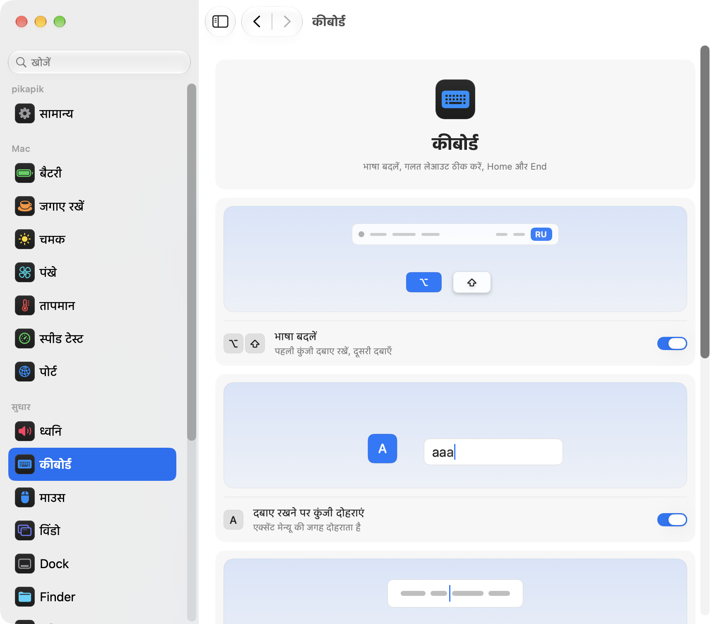

<p align="center"></p>
<h1 align="center">pikapik</h1>
<p align="center">कीबोर्ड, माउस, विंडो और Finder के लिए छोटे-छोटे सुधार, सीधे आपके Mac के मेन्यू बार में।</p>
<p align="center"><sub><a href="../../README.md">English</a> · <a href="README.ru.md">Русский</a> · <a href="README.uk.md">Українська</a> · <a href="README.de.md">Deutsch</a> · <a href="README.fr.md">Français</a> · <a href="README.es.md">Español</a> · <a href="README.it.md">Italiano</a> · <a href="README.pt-BR.md">Português (Brasil)</a> · <a href="README.ja.md">日本語</a> · <a href="README.zh-Hans.md">简体中文</a> · <a href="README.ko.md">한국어</a> · <a href="README.ro.md">Română</a> · <a href="README.pl.md">Polski</a> · <a href="README.tr.md">Türkçe</a> · <a href="README.nl.md">Nederlands</a> · <a href="README.sv.md">Svenska</a> · <a href="README.cs.md">Čeština</a> · <a href="README.zh-Hant.md">繁體中文</a> · <a href="README.ar.md">العربية</a> · <b>हिन्दी</b> · <a href="README.id.md">Bahasa Indonesia</a> · <a href="README.vi.md">Tiếng Việt</a> · <a href="README.th.md">ไทย</a></sub></p>

<p align="center">
<picture>
<source media="(prefers-color-scheme: dark)" srcset="../media/settings-hi-dark.png">

</picture>
</p>

## इंस्टॉल करें

टर्मिनल खोलें, यह लाइन पेस्ट करें और Return दबाएँ:

```bash
/bin/bash -c "$(curl -fsSL https://raw.githubusercontent.com/dev-pikapik/pika-tools/main/install.sh)"
```

यह कमांड GitHub से नवीनतम संस्करण डाउनलोड करती है और उसे तभी इंस्टॉल करती है, जब वह डेवलपर द्वारा साइन किया गया हो और Apple की हानिकारक सॉफ़्टवेयर की जाँच पास कर चुका हो। इंस्टॉल होने के बाद pikapik स्क्रीन के ऊपर मेन्यू बार में दिखेगा। जब तक आप ख़ुद चालू न करें, सब कुछ बंद रहता है।

<details>
<summary>दूसरे तरीके: Homebrew या dmg</summary>

Homebrew के साथ:

```bash
brew install --cask dev-pikapik/pika-tools/pikapik && open -a pikapik
```

या [pikapik.dmg](https://github.com/dev-pikapik/pika-tools/releases/latest/download/pikapik.dmg) डाउनलोड करें, उसे खोलें और ऐप को ऐप्लिकेशन फ़ोल्डर में ड्रैग करें।

ऊपर दी गई कमांड और Homebrew दोनों ऐप को `/Applications` में रखते हैं, उसे खोलते हैं, अनुमतियाँ माँगते हैं और “लॉगिन पर खोलें” चालू कर देते हैं। इसके बाद ऐप ख़ुद को अपडेट करती रहती है, देखें **अपडेट**। हटाने के लिए देखें **अनइंस्टॉल करें**।

</details>

## यह क्या करता है

<table>
<tbody><tr>
<td width="50%" valign="top">
<picture><source media="(prefers-color-scheme: dark)" srcset="../media/keep-awake-dark.png"></picture>
<br><b>जगाए रखें</b>
<br>जितनी देर चाहिए, Mac जागा रहता है, ढक्कन बंद होने पर भी।
</td>
<td width="50%" valign="top">
<picture><source media="(prefers-color-scheme: dark)" srcset="../media/fans-dark.png"></picture>
<br><b>पंखे</b>
<br>देखें कि आपके पंखे कितनी तेज़ घूम रहे हैं और उनकी गति चुनें।
</td>
</tr></tbody>
<tbody><tr>
<td width="50%" valign="top">
<picture><source media="(prefers-color-scheme: dark)" srcset="../media/battery-dark.png"></picture>
<br><b>बैटरी</b>
<br>देखें कि आपकी बैटरी की स्थिति, क्षमता और चक्र गणना क्या है, उसमें कितनी पावर जा रही है, और उसे ज़्यादा समय तक कैसे चलाएँ।
</td>
<td width="50%" valign="top">
<picture><source media="(prefers-color-scheme: dark)" srcset="../media/command-keys-dark.png"></picture>
<br><b>⌘Q और ⌘W सुरक्षित</b>
<br>गलती से कुछ बंद नहीं होगा। जानबूझकर करना हो तो ⇧ जोड़ें।
</td>
</tr></tbody>
<tbody><tr>
<td width="50%" valign="top">
<picture><source media="(prefers-color-scheme: dark)" srcset="../media/compress-dark.png"></picture>
<br><b>छोटी कॉपी</b>
<br>फ़ोटो, PDF या वीडियो पर राइट-क्लिक करें, और बगल में हल्की कॉपी बन जाएगी।
</td>
<td width="50%" valign="top">
<picture><source media="(prefers-color-scheme: dark)" srcset="../media/convert-dark.png"></picture>
<br><b>कन्वर्ट</b>
<br>राइट-क्लिक से तस्वीर, वीडियो या गाना दूसरे फ़ॉर्मैट में सेव करें।
</td>
</tr></tbody>
<tbody><tr>
<td width="50%" valign="top">
<picture><source media="(prefers-color-scheme: dark)" srcset="../media/input-switch-dark.png"></picture>
<br><b>भाषा बदलें</b>
<br>⌥ दबाए रखें और ⇧ टैप करें, कीबोर्ड की भाषा बदल जाएगी।
</td>
<td width="50%" valign="top">
<picture><source media="(prefers-color-scheme: dark)" srcset="../media/quit-on-close-dark.png"></picture>
<br><b>आख़िरी विंडो के साथ बंद</b>
<br>ऐप की आख़िरी विंडो बंद करें, और ऐप भी बंद हो जाएगा।
</td>
</tr></tbody>
<tbody><tr>
<td width="50%" valign="top">
<picture><source media="(prefers-color-scheme: dark)" srcset="../media/window-zoom-dark.png"></picture>
<br><b>हरा बटन बड़ा करता है</b>
<br>विंडो फ़ुल स्क्रीन मोड में गए बिना पूरी स्क्रीन भर देती है।
</td>
<td width="50%" valign="top">
<picture><source media="(prefers-color-scheme: dark)" srcset="../media/dock-hide-dark.png"></picture>
<br><b>Dock में क्लिक से मिनिमाइज़ करें</b>
<br>जिस ऐप में आप हैं, उस पर क्लिक करें, वह रास्ते से हट जाएगा।
</td>
</tr></tbody>
<tbody><tr>
<td width="50%" valign="top">
<picture><source media="(prefers-color-scheme: dark)" srcset="../media/new-file-dark.png"></picture>
<br><b>नई फ़ाइल</b>
<br>Finder में राइट-क्लिक करें, नाम लिखें, और ख़ाली फ़ाइल तैयार।
</td>
<td width="50%" valign="top">
<picture><source media="(prefers-color-scheme: dark)" srcset="../media/finder-cut-dark.png"></picture>
<br><b>⌘X से फ़ाइलें ले जाएँ</b>
<br>Finder में फ़ाइलें काटें और जहाँ चाहें पेस्ट करें।
</td>
</tr></tbody>
<tbody><tr>
<td width="50%" valign="top">
<picture><source media="(prefers-color-scheme: dark)" srcset="../media/finder-open-dark.png"></picture>
<br><b>Enter से फ़ाइलें खोलें</b>
<br>Finder में फ़ाइलें चुनें और खोलने के लिए Enter दबाएँ।
</td>
<td width="50%" valign="top">
<picture><source media="(prefers-color-scheme: dark)" srcset="../media/finder-delete-dark.png"></picture>
<br><b>Delete से ट्रैश में</b>
<br>Finder में ⌫ दबाएँ, और चुनी गई फ़ाइलें ट्रैश में चली जाएँगी।
</td>
</tr></tbody>
<tbody><tr>
<td width="50%" valign="top">
<picture><source media="(prefers-color-scheme: dark)" srcset="../media/game-mode-dark.png"></picture>
<br><b>गेम मोड</b>
<br>खेलते समय गेम के ऊपर कुछ नहीं खुलता और गेम बंद नहीं होता।
</td>
<td width="50%" valign="top">
<picture><source media="(prefers-color-scheme: dark)" srcset="../media/speed-test-dark.png"></picture>
<br><b>स्पीड टेस्ट</b>
<br>इंटरनेट कितना तेज़ है और किन कामों के लिए काफ़ी है।
</td>
</tr></tbody>
<tbody><tr>
<td width="50%" valign="top">
<picture><source media="(prefers-color-scheme: dark)" srcset="../media/side-buttons-dark.png"></picture>
<br><b>माउस के साइड बटन</b>
<br>बटन 4 और 5 पीछे और आगे ले जाते हैं, ट्रैकपैड पर स्वाइप की तरह।
</td>
<td width="50%" valign="top">
<picture><source media="(prefers-color-scheme: dark)" srcset="../media/wheel-lines-dark.png"></picture>
<br><b>पंक्तियों के हिसाब से स्क्रोल</b>
<br>व्हील कितनी भी तेज़ घुमाएँ, हर क्लिक बराबर स्क्रोल करता है।
</td>
</tr></tbody>
<tbody><tr>
<td width="50%" valign="top">
<picture><source media="(prefers-color-scheme: dark)" srcset="../media/wheel-direction-dark.png"></picture>
<br><b>स्क्रॉल दिशा</b>
<br>ट्रैकपैड के लिए एक दिशा, माउस के लिए दूसरी।
</td>
<td width="50%" valign="top">
<picture><source media="(prefers-color-scheme: dark)" srcset="../media/linear-pointer-dark.png"></picture>
<br><b>पॉइंटर ऐक्सलरेशन बंद</b>
<br>पॉइंटर ठीक उतना ही चलता है जितना आपका हाथ।
</td>
</tr></tbody>
<tbody><tr>
<td width="50%" valign="top">
<picture><source media="(prefers-color-scheme: dark)" srcset="../media/key-repeat-dark.png"></picture>
<br><b>दबाए रखने पर कुंजी दोहराएं</b>
<br>कुंजी दबाए रखें, वह बार-बार टाइप होगी, ऐक्सेंट मेन्यू के बिना।
</td>
<td width="50%" valign="top">
<picture><source media="(prefers-color-scheme: dark)" srcset="../media/home-end-dark.png"></picture>
<br><b>Home और End</b>
<br>टाइप करते हुए लाइन की शुरुआत या अंत पर जाएँ।
</td>
</tr></tbody>
<tbody><tr>
<td width="50%" valign="top">
<picture><source media="(prefers-color-scheme: dark)" srcset="../media/animations-dark.png"></picture>
<br><b>एनिमेशन</b>
<br>Dock, विंडो और क्विक लुक को तेज़ करें, चाहें तो तुरंत।
</td>
<td width="50%" valign="top">
<picture><source media="(prefers-color-scheme: dark)" srcset="../media/leftover-permissions-dark.png"></picture>
<br><b>डिलीट किए गए ऐप्स की अनुमतियाँ</b>
<br>जिन ऐप्स को आप डिलीट कर चुके हैं, उनके लिए macOS जो अनुमतियाँ रखे रहता है, उन्हें हटाएँ।
</td>
</tr></tbody>
<tbody><tr>
<td width="50%" valign="top">
<picture><source media="(prefers-color-scheme: dark)" srcset="../media/pet-dark.png"></picture>
<br><b>डेस्कटॉप पर नन्हा दोस्त</b>
<br>एक नन्हा दोस्त आपकी विंडो के पीछे टहलता है। उसे उठाकर उछालें, या स्पेस दबाएँ और वह कूदेगा। अलमारी से उसे सजाएँ और साथ खेलते हुए पुरस्कार जीतें। आप टाइप करते हैं तो वह फुर्तीला हो जाता है और आपके जाते ही ऊँघने लगता है।
</td>
<td width="50%" valign="top">
<picture><source media="(prefers-color-scheme: dark)" srcset="../media/uninstaller-dark.png"></picture>
<br><b>ऐप हटाएँ</b>
<br>ऐप और उसकी फ़ाइलें हटाएँ। सब वापस रख सकते हैं।
</td>
</tr></tbody>
<tbody><tr>
<td width="50%" valign="top">
<picture><source media="(prefers-color-scheme: dark)" srcset="../media/game-fps-dark.png"></picture>
<br><b>FPS दिखाएँ</b>
<br>एक छोटा काउंटर आपके चुने कोने में दिखाता है कि गेम कितनी सहजता से चल रहा है।
</td>
<td width="50%" valign="top">
<picture><source media="(prefers-color-scheme: dark)" srcset="../media/archive-dark.png"></picture>
<br><b>आर्काइव</b>
<br>राइट-क्लिक से RAR और दूसरे आर्काइव खोलें, या फ़ाइलों को ZIP में समेटें।
</td>
</tr></tbody>
<tbody><tr>
<td width="50%" valign="top">
<picture><source media="(prefers-color-scheme: dark)" srcset="../media/dock-display-dark.png"></picture>
<br><b>Dock को एक ही डिस्प्ले पर रखें</b>
<br>Dock अब दूसरे डिस्प्ले पर नहीं कूदता। जान-बूझकर हिलाने के लिए ⌥ दबाए रखें।
</td>
<td width="50%" valign="top">
<picture><source media="(prefers-color-scheme: dark)" srcset="../media/layout-fix-dark.png"></picture>
<br><b>गलत लेआउट ठीक करें</b>
<br>привет की जगह ghbdtn टाइप हो गया? स्पेस दबाएँ, शब्द ठीक हो जाएगा।
</td>
</tr></tbody>
<tbody><tr>
<td width="50%" valign="top">
<picture><source media="(prefers-color-scheme: dark)" srcset="../media/temperatures-dark.png"></picture>
<br><b>तापमान</b>
<br>देखें कि आपका Mac अंदर से कितना गर्म है, प्रोसेसर से बैटरी तक।
</td>
<td width="50%" valign="top">
<picture><source media="(prefers-color-scheme: dark)" srcset="../media/background-dark.png"></picture>
<br><b>बैकग्राउंड टास्क</b>
<br>देखें कि बैकग्राउंड में क्या चल रहा है और वह कहाँ से आया।
</td>
</tr></tbody>
<tbody><tr>
<td width="50%" valign="top">
<picture><source media="(prefers-color-scheme: dark)" srcset="../media/ports-dark.png"></picture>
<br><b>पोर्ट</b>
<br>देखें कि किस प्रोग्राम ने पोर्ट ले रखा है, और उसे खाली करें।
</td>
<td width="50%" valign="top">
<picture><source media="(prefers-color-scheme: dark)" srcset="../media/app-volume-dark.png"></picture>
<br><b>ऐप की आवाज़</b>
<br>दूसरे ऐप को छुए बिना किसी भी ऐप की आवाज़ घटाएँ या उसे म्यूट करें।
</td>
</tr></tbody>
</table>

## और जानकारी

<details>
<summary>पहली बार खोलना</summary>

pikapik को दो अनुमतियों की ज़रूरत है। पहली बार खोलने पर यह सेटिंग्ज़ में अनुमतियाँ पेज खोलती है, जो आपको हर क़दम बताता है, और macOS अपने संकेत दिखाता है। **सिस्टम सेटिंग्ज़ › गोपनीयता और सुरक्षा** में जाएँ और pikapik को इनमें चालू करें:

- **ऐक्सेसिबिलिटी**, ताकि ऐप किसी की-प्रेस या क्लिक को दूसरी ऐप्स तक पहुँचने से पहले बदल सके।
- **इनपुट मॉनिटरिंग**, ताकि ऐप की-प्रेस और क्लिक देख सके।

ऐप कुछ ही सेकंड में बदलाव पहचान लेती है, रीस्टार्ट की ज़रूरत नहीं।

कुछ सुविधाएँ इस्तेमाल करने पर और अनुमति माँगती हैं: **पंखा नियंत्रण**, **Finder एक्सटेंशन**, **iCloud Drive**, **पूर्ण डिस्क ऐक्सेस**, **स्क्रीन रिकॉर्डिंग** और **सिस्टम ऑडियो रिकॉर्डिंग**। ये सब सेटिंग्ज़ के अनुमतियाँ पेज पर हैं: हर अनुमति की एक पंक्ति बताती है कि वह किस काम की है, साथ में हरा सही का निशान या नारंगी क्रॉस और एक बटन होता है: अनुमति न होने पर **अनुमति दें**, चालू होने पर **बंद करें**। इसलिए आप किसी भी अनुमति को वहीं से वापस ले सकते हैं।

pikapik आपकी टाइप की गई या क्लिक की गई किसी भी चीज़ को रिकॉर्ड, स्टोर या कहीं नहीं भेजती। इवेंट मेमोरी में संभाले जाते हैं और तुरंत आगे भेज दिए जाते हैं। गलत लेआउट में टाइप किए शब्द ठीक करने के लिए pikapik सिर्फ़ आपके आख़िरी कुछ टाइप किए शब्द मेमोरी में रखती है, और जैसे ही आप क्लिक करते हैं या दूसरी ऐप पर जाते हैं, उन्हें भूल जाती है। वह सिर्फ़ वही शब्द सहेजती है जिन्हें आपने जैसे-के-तैसे छोड़ने को कहा है, वह भी सिर्फ़ इसी Mac पर, जब तक आप उन्हें सेटिंग › कीबोर्ड में मिटा न दें। pikapik इंटरनेट से केवल अपडेट के लिए जुड़ती है (GitHub से नवीनतम रिलीज़ पूछती है और अपडेट चुनने पर ही उसे डाउनलोड करती है) और स्पीड टेस्ट के लिए, जब आप उसे शुरू करें (यह Apple के सर्वर इस्तेमाल करता है)। Mac App Store वाला संस्करण App Store से अपडेट होता है, और उसका स्पीड टेस्ट Cloudflare इस्तेमाल करता है। आपके दोस्त की प्रगति (कदम, उछालें, पुरस्कार वगैरह) सिर्फ़ इसी Mac पर गिनी जाती है और कभी कहीं नहीं भेजी जाती। इसे आप सेटिंग › दोस्त में मिटा सकते हैं।

</details>

<details>
<summary>हर टूल विस्तार से</summary>

**ऐप की आवाज़।** सेटिंग › ध्वनि खोलें और **ऐप की आवाज़** चालू करें। आवाज़ चलाने वाले हर ऐप को अपना स्लाइडर और म्यूट बटन मिलता है, सेटिंग में भी और मेन्यू में भी। वीडियो कॉल की तेज़ आवाज़ घटाएँ, शोर वाले गेम को म्यूट करें और अपना संगीत वैसा ही रहने दें: आपके Mac और दूसरे ऐप की आवाज़ नहीं बदलती। pikapik हर ऐप का स्तर याद रखता है, और जिस ऐप को आप पूरी आवाज़ पर छोड़ते हैं, उसे वह कभी नहीं छूता। किसी ऐप की आवाज़ बदलने के लिए pikapik उसकी ध्वनि को अपने से होकर गुज़ारता है, इसलिए उसे **सिस्टम ऑडियो रिकॉर्डिंग** की अनुमति चाहिए, जो आप अनुमतियाँ पेज पर देते हैं। ध्वनि को बस आगे बढ़ा दिया जाता है: न उसे रिकॉर्ड किया जाता है, न सेव किया जाता है, न कहीं भेजा जाता है, और माइक्रोफ़ोन इस्तेमाल नहीं होता। इसके लिए macOS 14.2 या उसके बाद का संस्करण चाहिए, और macOS 14.0 व 14.1 पर यह छिपा रहता है। डिफ़ॉल्ट रूप से बंद।

**⌘Q और ⌘W को सुरक्षित रखें।** अकेले ⌘Q और ⌘W कुछ नहीं करते, इसलिए आप ग़लती से कोई ऐप बंद या विंडो बंद नहीं करते। जान-बूझकर करने के लिए Shift जोड़ें: ⇧⌘Q ऐप से बाहर निकलता है, ⇧⌘W विंडो बंद करता है। हर ऐप में काम करता है। हर की का अपना स्विच है। डिफ़ॉल्ट रूप से बंद।

**Option+Shift से भाषा बदलें।** Option दबाए रखें और Shift टैप करें: macOS अगले इनपुट स्रोत पर चला जाता है। Option दबाए रखते हुए Shift फिर से टैप करें, तो आगे बढ़ता जाता है। पीछे जाने के लिए Shift दबाए रखें और Option टैप करें। अगर बीच में आप कोई और की दबाते हैं, क्लिक करते हैं या Cmd, Ctrl या Fn जोड़ते हैं, तो भाषा नहीं बदलती, इसलिए Option+Shift+ऐरो जैसे शॉर्टकट पहले की तरह काम करते हैं। डिफ़ॉल्ट रूप से बंद।

**दबाए रखने पर कुंजी दोहराएं।** कोई कुंजी दबाए रखें तो अक्षर बार-बार टाइप होता है, एक्सेंट मेनू नहीं खुलता। गेम खेलते और टाइप करते समय काम आता है। पहले से खुले ऐप्स इसे रीस्टार्ट के बाद अपनाते हैं। इसे बंद करें तो macOS फिर से पहले जैसा काम करता है। डिफ़ॉल्ट रूप से बंद।

**Home और End से लाइन की शुरुआत और अंत पर जाएँ।** टाइप करते समय Home कर्सर को लाइन की शुरुआत पर और End उसके अंत पर ले जाता है, पेज स्क्रॉल नहीं होता। ⇧ के साथ ये वहाँ तक टेक्स्ट चुनते हैं, ⌘ के साथ पूरे टेक्स्ट की शुरुआत या अंत पर जाते हैं। टेक्स्ट फ़ील्ड के बाहर, और टर्मिनल, वर्चुअल मशीन और रिमोट डेस्कटॉप ऐप्स में ये कुंजियाँ पहले की तरह काम करती हैं। आप ऐसी दूसरी ऐप्स भी जोड़ सकते हैं जिनमें ये पहले की तरह काम करें। डिफ़ॉल्ट रूप से बंद।

**गलत लेआउट में टाइप किए शब्द ठीक करें।** अगर कोई शब्द बेमतलब अक्षरों में बदल जाए, जैसे привет की जगह ghbdtn, तो स्पेस या Return दबाते ही pikapik उसे सही लेआउट में दोबारा टाइप कर देती है और लेआउट भी बदल देती है, ताकि अगला शब्द सही टाइप हो। यह सुविधा आपके Mac में जोड़े गए हर कीबोर्ड लेआउट के साथ काम करती है। कोई शब्द तभी बदलता है जब वह आपकी किसी भी भाषा का शब्द न हो और वही कुंजियाँ किसी दूसरे लेआउट में कोई आम शब्द बनाती हों, इसलिए नाम, टाइपिंग की गलतियाँ और कम इस्तेमाल होने वाले शब्द वैसे ही रहते हैं जैसे आपने टाइप किए थे, और पासवर्ड फ़ील्ड, टर्मिनल और आपकी चुनी हुई ऐप्स में भी कुछ नहीं बदलता। आख़िरी शब्द या चुना हुआ टेक्स्ट ठीक करने के लिए ⌃⇧स्पेस दबाएँ, और दूसरे लेआउट आज़माने के लिए फिर से दबाएँ। सुधार के तुरंत बाद वही कुंजियाँ उसे पलट देती हैं, और pikapik उस शब्द को फिर कभी अपने-आप ठीक नहीं करती। शॉर्टकट आप सेटिंग › कीबोर्ड में बदल सकते हैं। Mac App Store वाले संस्करण में टेक्स्ट चुनें और “सेवाएँ” मेनू में “कीबोर्ड लेआउट ठीक करें” चुनें। डिफ़ॉल्ट रूप से बंद।

**पॉइंटर ऐक्सलरेशन बंद करें।** माउस को आप कितना भी तेज़ चलाएँ, पॉइंटर ठीक उतना ही चलता है जितना माउस। **ट्रैकिंग गति** स्लाइडर तय करता है कि वह कितना तेज़ चले। यह सिर्फ़ माउस के लिए काम करता है, ट्रैकपैड जैसा है वैसा ही रहता है। इसे बंद करें या pikapik से बाहर निकलें, और macOS को अपनी सेटिंग्स वापस मिल जाती हैं। डिफ़ॉल्ट रूप से बंद।

**पंक्तियों के हिसाब से स्क्रोल करें।** माउस व्हील का हर क्लिक उतनी ही पंक्तियाँ स्क्रोल करता है, चाहे आप उसे कितनी भी तेज़ घुमाएँ। हर क्लिक पर 1 से 10 पंक्तियाँ चुनें, डिफ़ॉल्ट 3 है। नैचुरल स्क्रोलिंग वैसी ही रहती है जैसी आपने सिस्टम सेटिंग्ज़ में रखी है। यह सिर्फ़ माउस पर चलता है, ट्रैकपैड जैसा है वैसा ही रहता है। डिफ़ॉल्ट रूप से बंद। **प्रति क्लिक दूरी** स्लाइडर के पास एक छोटा पन्ना चुनी हुई दूरी तक स्क्रॉल होता है, और एक बिंदु डिफ़ॉल्ट मान दिखाता है।

कुछ ऐप्स और गेम्स स्क्रॉल को सटीक पिक्सेल में गिनते हैं: उनके लिए इसी सेटिंग को पिक्सेल पर कर दें और हर क्लिक पर 1 से 200 पिक्सेल चुनें, डिफ़ॉल्ट 40। स्लाइडर यह भी बताता है कि यह स्क्रीन की ऊँचाई का कितना हिस्सा है।

**ट्रैकपैड और माउस के लिए स्क्रॉल दिशा।** macOS में सहज स्क्रॉलिंग का एक ही स्विच है, जो ट्रैकपैड और माउस दोनों पर लागू होता है। इसे चालू करें और हर एक के लिए दिशा चुनें: **सहज**, जिसमें पेज iPhone की तरह आपकी उँगलियों के साथ चलता है, या **क्लासिक**, जिसमें पेज उलटी दिशा में चलता है। ट्रैकपैड वाला चुनाव बगल में स्क्रॉल करने और उँगलियाँ उठाने के बाद पेज के खिसकते रहने पर भी लागू होता है। Magic Mouse छूकर स्क्रॉल करता है, इसलिए वह ट्रैकपैड वाले चुनाव पर चलता है। अपने हर Mac पर एक जैसा चुनें, तो स्क्रॉल हर जगह एक जैसा लगेगा, तब भी जब आप यूनिवर्सल कंट्रोल से माउस को दूसरे Mac पर ले जाएँ। डिफ़ॉल्ट रूप से बंद। चालू करने पर दोनों वैसे ही रहते हैं जैसे सिस्टम सेटिंग्ज़ में हैं, इसलिए जब तक आप कुछ और न चुनें, कुछ नहीं बदलता।

**साइड बटन से पीछे और आगे जाएँ।** माउस के बटन 4 और 5 Finder, Safari और Apple की दूसरी ऐप के साथ-साथ कई और ऐप में भी पीछे और आगे ले जाते हैं, बिल्कुल ट्रैकपैड पर स्वाइप की तरह। जो ऐप इन बटनों को खुद संभालती हैं, उन्हें ये बटन जस के तस मिलते हैं। अगर आपके माउस में ये उल्टे हैं, तो **साइड बटन आपस में बदलें** चालू करें। डिफ़ॉल्ट रूप से बंद।

**आख़िरी विंडो बंद होने पर बाहर निकलें।** किसी ऐप की आख़िरी विंडो बंद करें, और ऐप बंद हो जाती है। Finder खुला रहता है, और वे ऐप्स भी जिनकी विंडो दूसरे डेस्कटॉप पर या Dock में हैं। आप उन ऐप्स की सूची बना सकते हैं जिन्हें इस तरह कभी बंद नहीं होना चाहिए। डिफ़ॉल्ट रूप से बंद।

**Dock में एक क्लिक से मिनिमाइज़ करें या छिपाएँ।** जिस ऐप में आप काम कर रहे हैं, Dock में उसके आइकॉन पर क्लिक करें, और उसकी सारी विंडो Dock में चली जाती हैं। सबको वापस लाने के लिए फिर से क्लिक करें। आप चाहें तो क्लिक से पूरी ऐप भी छिपा सकते हैं, जैसे ⌘H से। डिफ़ॉल्ट रूप से बंद।

**Dock को एक ही डिस्प्ले पर रखें।** एक से ज़्यादा डिस्प्ले हों, तो जैसे ही पॉइंटर किसी दूसरे डिस्प्ले के निचले किनारे पर ज़ोर लगाता है (या Dock बगल में हो तो बाएँ या दाएँ किनारे पर), macOS Dock को उसी डिस्प्ले पर ले जाता है। स्विच चालू होने पर Dock अपनी जगह बना रहता है और हॉट कॉर्नर पहले की तरह काम करते रहते हैं। जान-बूझकर हिलाने के लिए ⌥ दबाए रखें और पॉइंटर को दूसरे डिस्प्ले के किनारे पर धकेलें। किसी अनुमति की ज़रूरत नहीं होती। **Dock को वापस लाएँ** स्विच स्लीप के बाद या डिस्प्ले बदलने पर Dock को उसके अपने डिस्प्ले पर लौटा देता है। इस स्विच के लिए **ऐक्सेसिबिलिटी** अनुमति चाहिए, और यह Mac App Store वाले संस्करण में नहीं है। दोनों स्विच डिफ़ॉल्ट रूप से बंद हैं।

**हरा बटन विंडो को बड़ा करता है।** किसी विंडो के हरे बटन पर क्लिक करें, तो वह फ़ुल स्क्रीन में गए बिना पूरी स्क्रीन भर देती है। पहले का आकार वापस पाने के लिए फिर से क्लिक करें। ⌥ दबाए रखने पर बटन हमेशा की तरह काम करता है। फ़ुल स्क्रीन बटन के मेनू में और ⌃⌘F पर बनी रहती है। आप उन ऐप्स की सूची बना सकते हैं जिनमें हरा बटन पहले की तरह ही काम करे। डिफ़ॉल्ट रूप से बंद।

**Finder में नई फ़ाइल।** Finder विंडो या डेस्कटॉप पर राइट-क्लिक करें, **नई फ़ाइल** चुनें, नाम लिखें — और एक ख़ाली फ़ाइल बन जाती है। डिफ़ॉल्ट रूप से .txt। डिफ़ॉल्ट रूप से बंद।

**Enter से Finder में फ़ाइलें खुलती हैं।** Finder विंडो या डेस्कटॉप पर फ़ाइलें चुनें और Return या Enter दबाएँ, फ़ाइलें खुल जाएँगी। F2 या fn F2 चुनी हुई फ़ाइल का नाम बदलता है। टेक्स्ट फ़ील्ड में, जैसे नाम लिखते समय, ये कुंजियाँ हमेशा की तरह काम करती हैं। डिफ़ॉल्ट रूप से बंद।

**⌘X से Finder में फ़ाइलें कट होती हैं।** फ़ाइलें चुनें और ⌘X दबाएँ, फिर मनचाहा फ़ोल्डर खोलकर ⌘V दबाएँ, फ़ाइलें कॉपी होने के बजाय वहाँ चली जाएँगी। ⌘C कट को रद्द कर देता है। डिफ़ॉल्ट रूप से बंद।

**Delete से Finder में फ़ाइलें हटाएँ।** फ़ाइलें चुनें और ⌫ या ⌦ (लैपटॉप पर fn ⌫) दबाएँ, फ़ाइलें ट्रैश में चली जाएँगी, ठीक ⌘⌫ की तरह। जब आप किसी फ़ाइल का नाम बदल रहे हों, खोज रहे हों या किसी दूसरे फ़ील्ड में टाइप कर रहे हों, तो ये कुंजियाँ पहले की तरह अक्षर मिटाती हैं। डिफ़ॉल्ट रूप से बंद।

**Finder में छोटी कॉपी।** Finder में किसी फ़ाइल पर राइट-क्लिक करें और **छोटी कॉपी बनाएँ** चुनें। फ़ोटो, GIF, PDF या वीडियो का हल्का वर्शन ठीक उसके पास सेव होता है, जो अक्सर कई गुना छोटा होता है। WAV या AIFF जैसी बिना कंप्रेस की आवाज़ छोटी M4A फ़ाइल बन जाती है। अगर फ़ाइल और छोटी नहीं हो सकती, तो कोई कॉपी नहीं बनती और pikapik आपको बता देता है। मूल फ़ाइल जैसी है वैसी ही रहती है, और कुछ भी आपके Mac से बाहर नहीं जाता। डिफ़ॉल्ट रूप से बंद।

**Finder में कन्वर्ट।** Finder में किसी फ़ाइल पर राइट-क्लिक करें और **कन्वर्ट करें** चुनें, फ़ाइल दूसरे फ़ॉर्मैट में सेव हो जाएगी: तस्वीर JPEG, PNG, HEIC, GIF, TIFF या PDF में, वीडियो MP4, MOV में या सिर्फ़ उसकी आवाज़, संगीत M4A, WAV या AIFF में। मूल फ़ाइल जैसी है वैसी ही रहती है, और कुछ भी आपके Mac से बाहर नहीं जाता। छोटी कॉपी से अलग चालू होता है। डिफ़ॉल्ट रूप से बंद।

**Finder में आर्काइव।** Finder में किसी आर्काइव पर राइट-क्लिक करें और **एक्सट्रैक्ट करें** चुनें, तो उसकी फ़ाइलें उसके बगल में दिख जाती हैं। किसी और फ़ाइल या फ़ोल्डर पर राइट-क्लिक करके **आर्काइव बनाएँ…** चुनें और ZIP, 7Z, TAR.GZ या TAR.XZ बनाएँ। ZIP और 7Z पर पासवर्ड लगाया जा सकता है, और कोई भी आर्काइव हिस्सों में बाँटा जा सकता है, जैसे ईमेल के लिए 15 MB के या USB ड्राइव के लिए 4 GB के हिस्से। पासवर्ड दो बार लिखा जाता है, ताकि टाइपिंग की एक गलती आपको अपनी ही फ़ाइलों से बाहर न कर दे। इस तरह बना ZIP सिस्टम की जोड़ी हुई छिपी फ़ाइलें नहीं रखता, किसी भी भाषा के नाम पढ़ने लायक रखता है और 4 GB से बड़ी फ़ाइलें भी संभालता है। डिफ़ॉल्ट रूप से बंद। Mac App Store वाले संस्करण में नहीं है।

pikapik वह भी खोलता है जो macOS नहीं खोल पाता: RAR, चाहे हिस्सों में बँटा हो, पासवर्ड वाला 7Z, .001, .z01, .r00 और .part1.rar जैसे बँटे हुए सेट, और ZIPX, CAB, LZH, ARJ, ZST, LZMA, WIM और बहुत कुछ। डबल-क्लिक करने पर वे pikapik में खुलते हैं। पुराने ZIP की फ़ाइलों के नाम, जैसे सिरिलिक, जापानी या चीनी में, पढ़ने लायक निकलते हैं। सेटिंग › Finder में स्विच **आर्काइव इस ऐप से खोलें** ZIP और 7Z को भी pikapik को सौंप देता है, जबकि TAR और GZ Mac में पहले से मौजूद आर्काइव ऐप के पास ही रहते हैं, जो उन्हें पहले से अच्छी तरह संभालता है। pikapik RAR खोल सकता है, पर बना नहीं सकता: RAR का लाइसेंस सिर्फ़ खोलने (एक्सट्रैक्ट करने) की इजाज़त देता है।

एक विंडो पासवर्ड पूछती है, **रोकें** किसी भी काम को रद्द कर देता है, और ख़राब या अधूरे आर्काइव में से pikapik वह निकाल लेता है जो अब भी पढ़ा जा सकता है। बहुत बड़े आकार तक फूल जाने वाले आर्काइव को निकालने से पहले वह पूछता है, डिस्क भरने वाली हो तो समय रहते रुक जाता है, और जो आर्काइव अपने ही फ़ोल्डर के बाहर लिखने की कोशिश करते हैं, उन्हें रोक देता है। Finder में किसी आर्काइव को चुनकर स्पेस दबाएँ और देखें कि उसके अंदर क्या है।

**गेम मोड।** अपने गेम जोड़ें, और जब आप खेल रहे हों, आपका Mac आपको गेम से बाहर नहीं खींचता। Spotlight, Siri, ⌘Tab, Mission Control और डेस्कटॉप के बीच स्वाइप गेम के ऊपर नहीं खुलते, ⌘Q और ⌘W गेम को गलती से बंद नहीं करते, पॉइंटर Dock, मेनू बार या दूसरी स्क्रीन पर नहीं फिसलता और स्क्रीन चालू रहती है। इनमें से हर एक का गेम पेज पर अपना स्विच है, और pikapik आपके Mac पर मिले गेम सुझाता है। गेम में Control-क्लिक साधारण क्लिक ही रहता है, और तीर कुंजियों के साथ Control डेस्कटॉप नहीं बदलता। Minecraft भी पहचाना जाता है: Minecraft Launcher या CurseForge जोड़ें, और मोड Minecraft के अंदर ही चालू हो जाएगा। गेम से बाहर निकलने के लिए ⇧⌘Q दबाएँ, और उसकी विंडो बंद करने के लिए ⇧⌘W। ⌥⌘Esc हमेशा काम करता है। गेम छोड़ते ही सब कुछ पहले की तरह काम करता है। डिफ़ॉल्ट रूप से बंद।

गेम मोड चालू करें और खेलें। और गेम सेटिंग्स में Mac का कैटलॉग, मौजूदा कुंजियाँ और हर कार्रवाई का एनिमेटेड पूर्वावलोकन है।

अपने आप मोड खिड़की खोलने या फ़ोकस बदलने वाली कार्रवाइयों को रोकता है। छोटा और जानबूझकर भाषा शॉर्टकट सिस्टम खिड़की के बिना स्रोत बदलता है। दबाई हुई चलने की कुंजियाँ पहले आती हैं, इसलिए दौड़ना और कूदना गलती से भाषा नहीं बदलते।

सेटिंग्स → गेम → और गेम सेटिंग्स में “माउस और ट्रैकपैड” नाम का एक समूह है। इसमें सिर्फ़ वही दिखता है जो आपके Mac पर macOS में चालू है। हर चीज़ के साथ Apple के अपने नाम और एक छोटा चित्र होता है: माउस बटन के शॉर्टकट, डेस्कटॉप और फ़ुल-स्क्रीन ऐप्स के बीच स्वाइप, Mission Control और App Exposé, ऐप्स के लिए पिंच और डेस्कटॉप के लिए उँगलियाँ फैलाना, सूचना केंद्र के लिए दाएँ किनारे से स्वाइप, और हर हॉट कॉर्नर अपनी क्रिया के साथ। जब तक गेम सामने है, ये रुके रहते हैं, इसलिए अनजाने में हुआ स्वाइप या स्क्रीन के कोने को छू जाना आपको गेम से बाहर नहीं ले जाएगा। गेम के अंदर के जेस्चर पहले की तरह काम करते रहते हैं। हर चीज़ को पहले की तरह काम करने के लिए भी सेट किया जा सकता है।

सेटिंग्स → गेम → गेम जोड़ें खोलें और चल रहे गेम पर क्लिक करें। Java और दूसरे परिवेशों से चलने वाले गेम भी दिखते हैं, बिना .app फ़ाइल के भी। Minecraft का नाम java की जगह Minecraft दिखता है। गेम की प्रक्रिया ढूँढें और उसकी पंक्ति को सेटिंग्स → गेम में आपके गेम पर खींचें।

**FPS दिखाएँ।** FPS का मतलब है फ़्रेम प्रति सेकंड: गेम हर सेकंड कितनी तस्वीरें बनाता है। “गेम” पेज पर **FPS दिखाएँ** चालू करें, और जब तक गेम मोड चालू है, किसी भी गेम के एक कोने में इस संख्या वाला एक छोटा गहरे रंग का लेबल दिखता है। कोना चुनने के लिए स्विच के ऊपर की तस्वीर में उस कोने पर क्लिक करें। डैश (—) का मतलब है कि पहले फ़्रेम अभी नहीं आए हैं, और धुँधले 0 का मतलब है कि गेम ने तस्वीरें बनाना बंद कर दिया है। macOS 27 में ज़्यादातर गेम macOS खुद गिनता है, किसी अनुमति की ज़रूरत नहीं होती। जिस गेम को macOS नहीं गिन पाता, आमतौर पर कोई पुराना गेम, उसे स्क्रीन रिकॉर्डिंग के ज़रिए गिना जाता है: तब अनुमतियाँ पेज पर **स्क्रीन रिकॉर्डिंग** की पंक्ति दिखती है, pikapik गेम के दौरान कभी अनुमति नहीं माँगता, और संख्या स्क्रीन की रिफ़्रेश दर से ज़्यादा नहीं हो सकती। macOS 14–26 में और Mac App Store वाले वर्ज़न में हर गेम इसी तरह गिना जाता है, इसलिए **FPS दिखाएँ** चालू करते ही वह पंक्ति दिखने लगती है, और स्विच के नीचे का **अनुमति दें** बटन आपको उस तक ले जाता है। कोई तस्वीर न सहेजी जाती है, न भेजी जाती है। डिफ़ॉल्ट रूप से बंद।

**नन्हे दोस्त की अलमारी और पुरस्कार।** अपने नन्हे दोस्त को सजाने के लिए सेटिंग › दोस्त खोलें: टोपियों और चश्मों से लेकर केप और पंखों तक 30 से ज़्यादा चीज़ें, और जादूगर, समुद्री डाकू या अंतरिक्ष यात्री जैसे तैयार लुक। कुछ चीज़ें शुरू से ही मुफ़्त हैं। बाकी पुरस्कार हैं, जो साथ खेलते हुए मिलते हैं: अपने दोस्त को उठाकर उछालें, गेंद को किक मारें, उसे खिड़कियों पर चढ़ते और बातें करते देखें, या बस रोज़ उसके साथ रहें। नया पुरस्कार मिलने पर आपका दोस्त आपको बता देता है।

पुरस्कार का समय कब आया, यह जानने के लिए pikapik सिर्फ़ वही गिनती है जो आप और आपका दोस्त करते हैं: कदम, आपने उसे कितनी बार उठाया और उछाला, उसकी छलाँगें, चढ़ाई, गेंद के खेल और बातें, साथ बिताए दिन, आप सुबह-सुबह, आधी रात के बाद या वीकेंड पर साथ थे या नहीं, आपने सेटिंग्ज़ के कौन-से पेज खोले और क्या-क्या पहनकर देखा। Mac App Store के बाहर pikapik यह भी नोट करती है कि आपने सेटिंग्ज़ से हमारा GitHub पेज खोला या नहीं। ये गिनतियाँ, हर पुरस्कार की तारीख़ और आपके दोस्त ने क्या पहना है, यह सब सिर्फ़ इसी Mac पर रहता है। कुछ भी कहीं नहीं भेजा जाता, और इनमें से कुछ भी एक्सपोर्ट की गई सेटिंग्ज़ फ़ाइल या iCloud सिंक में नहीं जाता। आप इसे कभी भी सेटिंग › दोस्त में मिटा सकते हैं, और आपका दोस्त फिर से शुरू करेगा।

**ऐप हटाएँ।** सेटिंग › ऐप हटाएँ खोलें, सूची से कोई ऐप चुनें या किसी ऐप को तस्वीर पर छोड़ें, और pikapik दिखाती है कि वह ऐप आपके Mac पर क्या-क्या रखता है: ऐप खुद, उसका सहेजा गया डेटा, सेटिंग्ज़, अस्थायी फ़ाइलें, बैकग्राउंड सहायक और बहुत कुछ, हर एक के साथ यह वजह कि वह सूची में क्यों है। जो फ़ाइलें साफ़ तौर पर ऐप की हैं उन पर निशान लगा होता है, जो सिर्फ़ शायद जुड़ी हैं उन पर नहीं, और जिन फ़ाइलों को दूसरे ऐप भी इस्तेमाल करते हैं उन पर अलग चिह्न होता है। चुनें कि क्या हटाना है और **ट्रैश में भेजें** पर क्लिक करें। कुछ भी हमेशा के लिए नहीं मिटता: सब ट्रैश में जाता है। अगर ऐप खुला है तो pikapik पहले उससे बंद होने को कहती है, और अगर कुछ फ़ाइलों के लिए एडमिनिस्ट्रेटर चाहिए तो आपका Mac एक बार पासवर्ड माँगेगा।

मन बदल गया? **वापस रखें** पर क्लिक करें, तो सब कुछ अपनी जगह लौट आता है और बैकग्राउंड सहायक फिर से चालू हो जाते हैं। पिछली दस बार हटाई गई चीज़ें तब तक “हाल ही में हटाए गए” में रहती हैं जब तक उनकी फ़ाइलें ट्रैश में हैं। **ऐप रीसेट करें** ऐप को रहने देता है और सिर्फ़ उसका सहेजा गया डेटा, सेटिंग्ज़ और अस्थायी फ़ाइलें हटाता है; जब कोई ऐप ठीक से काम न करे तो यह मदद कर सकता है। जिन ऐप को आपने खुद ट्रैश में डाला, वे अपनी छोड़ी हुई फ़ाइलों के साथ “ट्रैश में” में दिखते हैं, और “हटाए गए ऐप की बची फ़ाइलें” उन ऐप की फ़ाइलें ढूँढता है जो अब हैं ही नहीं। “ऐप ट्रैश में जाने पर सफ़ाई का सुझाव दें” स्विच शुरू में बंद रहता है, और आपके चुनने तक कुछ नहीं हटता। ऐप जो कुछ रखता है वह सब देखने के लिए पेज को **पूर्ण डिस्क ऐक्सेस** चाहिए। यह टूल Mac App Store वाले वर्ज़न में नहीं है।

**तापमान।** सेटिंग › तापमान खोलें और देखें कि आपका Mac अंदर से कितना गर्म है। सबसे ऊपर एक शब्द में पूरी बात होती है, “सामान्य” से “बहुत गर्म” तक, और उसके नीचे एक पंक्ति बताती है कि आपका Mac पूरी रफ़्तार से चल रहा है या ठंडा होने के लिए धीमा हो रहा है। नीचे हर हिस्से की अपनी पंक्ति है, सेंसर कोड की जगह आसान नाम के साथ: प्रोसेसर, ग्राफ़िक्स, मेमोरी, स्टोरेज, Wi-Fi और बैटरी, जिनके सेंसर आपके Mac में हैं। हर पंक्ति में डिग्री और एक छोटी पट्टी दिखती है, जो उस हिस्से की सामान्य सीमा के हिसाब से हरी, पीली या नारंगी होती है। आंकड़े हर दो सेकंड में और सिर्फ़ तब अपडेट होते हैं जब आप उन्हें देख रहे हों, इसलिए आपके Mac पर लगभग कोई बोझ नहीं पड़ता। कोई पासवर्ड या अनुमति नहीं चाहिए। आप मेनू बार पैनल में “तापमान” पंक्ति भी जोड़ सकते हैं। Mac App Store वाले वर्ज़न में सिर्फ़ कुल स्तर दिखता है।

**बैकग्राउंड टास्क** पेज आपके Mac पर अपने आप शुरू होने वाली हर चीज़ दिखाता है: लॉगिन पर खुलने वाले ऐप, बैकग्राउंड सेवाएँ, ऐप के अंदर छिपे सहायक, और उन ऐप की बची फ़ाइलें जिन्हें आप पहले ही हटा चुके हैं। हर टास्क के साथ दिखता है कि उसे किस ऐप ने जोड़ा, क्या वह अभी चल रहा है और उसकी फ़ाइल कहाँ है; एक क्लिक से वह फ़ाइल Finder में दिख जाती है। अपने टास्क आप एक बटन से बंद कर सकते हैं और उतनी ही आसानी से फिर से चालू कर सकते हैं, कुछ भी मिटता नहीं। सभी यूज़र्स और पूरे Mac के टास्क macOS के होते हैं, इसलिए उनका बटन सिस्टम सेटिंग में लॉगइन आइटम खोलता है। Mac App Store वाले वर्ज़न में यह पेज सिर्फ़ टास्क दिखाता है: आप एक बार जानी-पहचानी “खोलें” विंडो में अपने होम फ़ोल्डर का ऐक्सेस देते हैं, और बटन लॉगइन आइटम खोलते हैं।

**पोर्ट।** जब कोई प्रोग्राम कहे कि उसका पोर्ट पहले से इस्तेमाल में है, तो सेटिंग › पोर्ट खोलें। यहाँ हर वह प्रोग्राम दिखता है जिसने आपके Mac पर पोर्ट ले रखा है, साथ में उसका आइकन, पोर्ट नंबर और यह कि क्या आपके नेटवर्क के दूसरे डिवाइस उससे कनेक्ट हो सकते हैं। कोई नंबर टाइप करें और पता करें कि वह पोर्ट किसके पास है, या पक्का कर लें कि वह खाली है। किसी पंक्ति पर क्लिक करें तो ब्राउज़र में खुलने वाले पते, प्रोग्राम की फ़ाइल, उसे शुरू करने वाली कमांड, उसका फ़ोल्डर और प्रक्रिया नंबर दिखते हैं। **खाली करें** बटन पहले प्रोग्राम से बंद होने को कहता है, ताकि वह अपना काम सहेज सके, और अगर वह बंद न हो, तो उसे बलपूर्वक बंद करने का विकल्प देता है। हर कदम से पहले आपसे पूछा जाता है। pikapik कभी भी macOS के हिस्सों या दूसरे उपयोगकर्ताओं के प्रोग्राम को बंद नहीं करती: AirPlay रिसीवर, फ़ाइल शेयरिंग, स्क्रीन शेयरिंग और रिमोट लॉगइन के लिए वह बताती है कि सिस्टम सेटिंग्ज़ में कौन-सा स्विच पोर्ट खाली करता है। Mac App Store वाले वर्ज़न में **खाली करें** प्रोग्राम दिखाता है, उसे टर्मिनल में बंद करने वाली कमांड कॉपी करता है, या ऐक्टिविटी मॉनिटर खोलता है।

हर टूल का मेनू और सेटिंग्ज़ में अपना स्विच है।

मेनू बार आइकॉन एक नज़र में स्थिति दिखाता है: टूल काम कर रहे हों तो pikapik का निशान, सब कुछ बंद हो तो वही निशान फीका, और कोई टूल चालू हो पर अनुमतियाँ न हों तो चेतावनी वाला त्रिकोण।

मेनू बार पैनल में शुरुआत में बस कुछ ही पंक्तियाँ दिखती हैं। कौन-सी पंक्तियाँ दिखें, यह आप चुन सकते हैं: नीचे पेंसिल वाले बटन पर क्लिक करें, जो देखना चाहते हैं उस पर निशान लगाएँ और **पूर्ण** पर क्लिक करें। छिपी पंक्तियाँ काम करती रहती हैं और सेटिंग में बनी रहती हैं। पैनल स्क्रीन में न समाए, तो वह स्क्रॉल होता है।

ऐप सिस्टम की भाषा या सेटिंग्ज़ में चुनी गई भाषा में चलती है। इस पेज के ऊपर दी गई सभी 23 भाषाएँ उपलब्ध हैं।

</details>

<details>
<summary>जगाए रखें</summary>

जब आप कीबोर्ड से दूर हों, तब आपके Mac को स्लीप में जाने से रोकता है: 1 सेकंड से 365 दिन तक किसी भी समय के लिए, या जब तक आप इसे बंद न करें। इसे मेनू से चालू करें और सेटिंग्ज़ में अवधि सेट करें: दिन, घंटे, मिनट और सेकंड टाइप करें, ↑ और ↓ दबाएँ, या 15 मिनट से 8 घंटे तक का कोई तैयार विकल्प क्लिक करें। मेनू दिखाता है कि कितना समय बचा है और यह कब ख़त्म होगा। **डिस्प्ले** के लिए दो विकल्प हैं। **हमेशा चालू**: स्क्रीन बंद नहीं होती, न स्क्रीन सेवर आता है, न लॉक स्क्रीन। **हमेशा की तरह बंद होता है**: स्क्रीन अपने टाइमर से बंद होती है और Mac काम करता रहता है। **अभी डिस्प्ले बंद करें** (यह मेनू में भी है) स्क्रीन को तुरंत बंद कर देता है और Mac काम करता रहता है: वापस लाने के लिए माउस हिलाएँ या कोई कुंजी दबाएँ। pikapik से बाहर निकलने पर जगाए रखें भी बंद हो जाता है।

MacBook पर आप **ढक्कन बंद होने पर भी काम करें** भी चालू कर सकते हैं। macOS में इसके लिए कोई स्विच नहीं है, इसलिए pikapik `pmset -a disablesleep 1` चलाती है और एडमिनिस्ट्रेटर पासवर्ड माँगती है: Mac के स्लीप करने का तरीक़ा सिर्फ़ एडमिनिस्ट्रेटर बदल सकता है। जगाए रखें ख़त्म होने पर, ऐप से बाहर निकलने पर या ऐप के क्रैश होने पर यह सेटिंग अपने आप सामान्य हो जाती है। अगर आप पासवर्ड नहीं डालते, तो कुछ नहीं बदलता। ढक्कन बंद होने पर Mac में हवा का अच्छा प्रवाह बनाए रखें। **बैटरी 20% से कम होने पर रोकें** बैटरी ख़त्म होने से पहले सेशन बंद कर देता है।

Keep Awake, डिस्प्ले मोड और ढक्कन बंद मोड को शॉर्टकट ऐप के ज़रिए कंट्रोल सेंटर, मेन्यू बार या डेस्कटॉप विजेट के बटन पर रखा जा सकता है, इसके लिए लिंक सेटिंग › जगाए रखें से कॉपी करें।

</details>

<details>
<summary>स्पीड टेस्ट</summary>

दिखाता है कि अभी आपका इंटरनेट कितना तेज़ है। सेटिंग › स्पीड टेस्ट में **स्पीड जाँचें** दबाएँ, या पेंसिल बटन से पंक्ति जोड़ने के बाद मेन्यू में **जाँचें** दबाएँ। लगभग आधे मिनट में डाउनलोड और अपलोड की स्पीड, पिंग और प्रतिक्रिया दिखती है: कनेक्शन व्यस्त होने पर चीज़ें कितनी जल्दी प्रतिक्रिया देती हैं। नीचे आसान शब्दों में लिखा होता है कि यह किसके लिए ठीक है: 4K फ़िल्में, वीडियो कॉल, ऑनलाइन गेम और बड़े डाउनलोड। जाँच macOS में मौजूद networkQuality और Apple के सर्वर से होती है। आखिरी नतीजा अगली जाँच तक रहता है, और शॉर्टकट्स के लिए लिंक से इसे कंट्रोल सेंटर से शुरू किया जा सकता है।

</details>

<details>
<summary>सेटिंग्ज़</summary>

मेनू में **सेटिंग्ज़…** से या ⌘, दबाकर सेटिंग्ज़ खोलें, या Finder, Launchpad या Spotlight से pikapik को फिर से खोलें। जब तक विंडो खुली है, ऐप Dock और ⌘Tab में दिखती है।

- **सामान्य**: लॉगिन पर खोलें, रूप (सिस्टम, लाइट या डार्क), भाषा, अपडेट और बैकअप: सेटिंग्ज़ को फ़ाइल के रूप में एक्सपोर्ट और इंपोर्ट करें, या iCloud Drive से सिंक करें।
- **बैटरी**: चार्ज, पूरा चार्ज होने तक का समय या बचा हुआ समय, स्थिति, अधिकतम क्षमता, चक्र गणना, पावर अडैप्टर और वाट में पावर, और बैटरी को ज़्यादा समय तक चलाने के सुझाव। यह पेज सिर्फ़ जानकारी दिखाता है: चार्जिंग की सीमा **सिस्टम सेटिंग्ज़ › बैटरी** में ही रहती है। यह सिर्फ़ बैटरी वाले Mac पर दिखता है।
- **जगाए रखें**: अवधि, डिस्प्ले और ढक्कन के विकल्प।
- **पंखे**: हर पंखे की गति, पंखा नियंत्रण की अनुमति मिलने पर ऑटो या मैनुअल गति चुनना।
- **तापमान**: आपका Mac कितना गर्म है, कुल मिलाकर और हर हिस्से का, जैसे प्रोसेसर, मेमोरी और बैटरी।
- **स्पीड टेस्ट**: इंटरनेट की स्पीड जाँचें और देखें कि यह किसके लिए ठीक है।
- **पोर्ट**: किस प्रोग्राम ने कौन-सा पोर्ट ले रखा है, उसके पते और ब्योरा, और पोर्ट खाली करने का बटन।
- **ध्वनि**: ऐप की आवाज़, आवाज़ चलाने वाले हर ऐप के लिए स्लाइडर और म्यूट बटन।
- **कीबोर्ड**: भाषा बदलना, दबाए रखने पर कुंजी का दोहराव, Home और End, गलत लेआउट ठीक करना।
- **माउस**: पॉइंटर एक्सेलरेशन और ट्रैकिंग गति, पंक्तियों के हिसाब से स्क्रोल, स्क्रॉल दिशा, साइड बटन।
- **विंडो**: हरे बटन से विंडो बड़ी करना (अपवादों की सूची के साथ), ⌘Q और ⌘W से सुरक्षा, और आख़िरी विंडो पर बाहर निकलना (अपवादों की सूची के साथ)।
- **Dock**: Dock में एक क्लिक से मिनिमाइज़ करना या छिपाना, Dock को एक ही डिस्प्ले पर रखना और Dock को वापस लाना।
- **Finder**: नई फ़ाइल, छोटी कॉपी, कन्वर्ट और आर्काइव, Return से खोलना, ⌘X से काटना और ⌫ से हटाना।
- **ऐप हटाएँ**: किसी ऐप को उसकी फ़ाइलों समेत हटाना, बाद में सब वापस रखना, और हटाए गए ऐप की बची फ़ाइलें साफ़ करना।
- **बैकग्राउंड टास्क**: बैकग्राउंड में चलने वाली हर चीज़, उसे किस ऐप ने जोड़ा, और अपने टास्क को बंद करने और फिर से चालू करने का बटन।
- **गेम**: आपके गेम की सूची और गेम मोड के विकल्प।
- **दोस्त**: नन्हे दोस्त को चालू या बंद करें, उसे बात करने, आपकी लय में जीने और गेंद से खेलने दें, उसे सजाएँ और अपने पुरस्कार देखें।
- **अनुमतियाँ**: pikapik जो भी अनुमतियाँ इस्तेमाल करता है, हर एक की स्थिति और उसे देने या बंद करने वाला एक बटन। जिस टूल के लिए अनुमति नहीं है, वह आधा धूसर दिखता है, और उस पर क्लिक करने से यह पेज सही पंक्ति पर खुलता है।
- **परिचय**: वर्ज़न, बदलावों की सूची और समस्या रिपोर्ट करने के लिंक।

कई सेटिंग्ज़ के साथ एक छोटी तस्वीर होती है जो दिखाती है कि वे क्या करती हैं, जैसे जागा रहता Mac या Dock के पीछे छिपती विंडो। तस्वीर स्विच के साथ बदलती है और सिस्टम सेटिंग्ज़ में “गति कम करें” चालू होने पर स्थिर रहती है।

हर पेज के नीचे **डिफ़ॉल्ट पर रीस्टोर करें…** बटन है। यह पहले पूछता है, फिर उस पेज के टूल बंद करता है और उनके विकल्प पहले जैसे कर देता है, मानो pikapik ने उन्हें कभी छुआ ही न हो।

**iCloud के साथ सेटिंग्ज़ सिंक करें** आपके सभी Mac पर pikapik को एक जैसा रखता है। सेटिंग्ज़ iCloud Drive के pikapik फ़ोल्डर में रहती हैं, और सबसे ताज़ा बदलाव लागू होता है। यह डिफ़ॉल्ट रूप से बंद है और इसके लिए iCloud Drive चालू होना ज़रूरी है। अनुमतियाँ सिंक नहीं होतीं: हर Mac उन्हें अलग से माँगता है।

</details>

<details>
<summary>अपडेट</summary>

pikapik खुलते समय और हर 6 घंटे में नए वर्ज़न की जाँच करती है। आप इसे सेटिंग्ज़ › सामान्य में बंद कर सकते हैं। नया वर्ज़न आने पर मेनू में **… पर अपडेट करें** बटन दिखता है: एक क्लिक, और ऐप अपडेट डाउनलोड करती है, इंस्टॉल करती है और रीस्टार्ट हो जाती है। आप सेटिंग्ज़ › सामान्य में **अभी जाँचें** से ख़ुद भी जाँच सकते हैं।

Homebrew के साथ आप `brew upgrade --cask pikapik` भी चला सकते हैं।

1.3 से, अपडेट के बाद भी अनुमतियाँ बनी रहती हैं।

</details>

<details>
<summary>अनइंस्टॉल करें</summary>

```bash
/bin/bash -c "$(curl -fsSL https://raw.githubusercontent.com/dev-pikapik/pika-tools/main/uninstall.sh)"
```

अगर आपने Homebrew से इंस्टॉल किया था: `brew uninstall --cask --zap pikapik`।

दोनों ऐप से बाहर निकलते हैं, उसे लॉगिन आइटम से हटाते हैं और डिलीट कर देते हैं। स्क्रिप्ट उसकी अनुमतियाँ भी रीसेट कर देती है।

</details>

<details>
<summary>अक्सर पूछे जाने वाले सवाल</summary>

**इसे दो अनुमतियों की ज़रूरत क्यों है?**
macOS कीबोर्ड और माउस की पहुँच को दो हिस्सों में बाँटता है। इनपुट मॉनिटरिंग से ऐप इवेंट देख पाती है, और ऐक्सेसिबिलिटी से उन्हें बदल पाती है। किसी शॉर्टकट को रोकने के लिए दोनों चाहिए।

**macOS कहता है कि ऐप किसी अज्ञात डेवलपर की है।**
pikapik डेवलपर द्वारा साइन की हुई है और Apple की हानिकारक सॉफ़्टवेयर की जाँच पास करती है, इसलिए यह संदेश दिखना नहीं चाहिए। अगर फिर भी दिखे, तो **सिस्टम सेटिंग्ज़ › गोपनीयता और सुरक्षा** खोलें और **फिर भी खोलें** पर क्लिक करें।

**क्या यह Intel Mac पर चलती है?**
हाँ। यह Apple silicon और Intel के लिए यूनिवर्सल ऐप है, macOS 14 Sonoma या उसके बाद के वर्ज़न पर।

**अनुमति चालू है, फिर भी कुछ काम नहीं कर रहा।**
**सिस्टम सेटिंग्ज़ › गोपनीयता और सुरक्षा** में दोनों सूचियों से − बटन से pikapik हटाएँ, फिर उसे दोबारा जोड़ें। या यही pikapik में करें: अनुमतियाँ पेज पर हर अनुमति के लिए **बंद करें** दबाएँ, फिर दोबारा **अनुमति दें**।

</details>

<p align="center">☕ अगर pikapik आपको पसंद है, तो आप <a href="https://buymeacoffee.com/pikapik">मुझे एक कॉफ़ी पिला सकते हैं</a> — यह सब ऐप को बेहतर बनाने और चलाते रहने में लगता है।</p>

<p align="center"><sub><a href="../whats-new/README.hi.md">नया क्या है</a> · <a href="https://github.com/dev-pikapik/homebrew-pika-tools">Homebrew tap</a> · <a href="../../CONTRIBUTING.md">ख़ुद बिल्ड करें</a> · <a href="../../LICENSE">MIT लाइसेंस</a> · © 2026 pikapik</sub></p>
