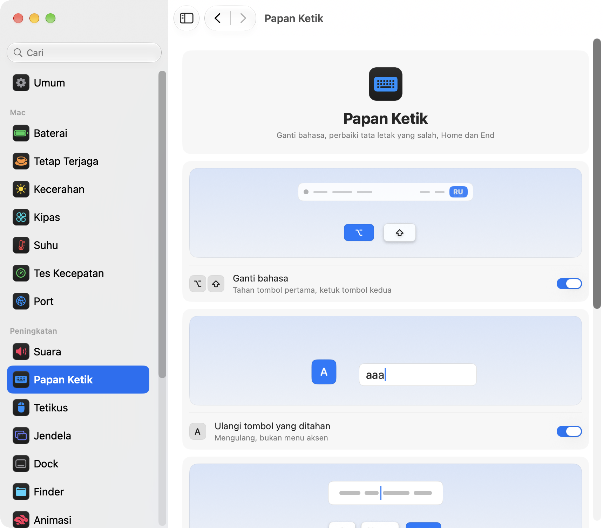

<p align="center"></p>
<h1 align="center">pikapik</h1>
<p align="center">Perbaikan kecil untuk keyboard, tetikus, jendela, dan Finder, langsung dari bar menu Mac Anda.</p>
<p align="center"><sub><a href="../../README.md">English</a> · <a href="README.ru.md">Русский</a> · <a href="README.uk.md">Українська</a> · <a href="README.de.md">Deutsch</a> · <a href="README.fr.md">Français</a> · <a href="README.es.md">Español</a> · <a href="README.it.md">Italiano</a> · <a href="README.pt-BR.md">Português (Brasil)</a> · <a href="README.ja.md">日本語</a> · <a href="README.zh-Hans.md">简体中文</a> · <a href="README.ko.md">한국어</a> · <a href="README.ro.md">Română</a> · <a href="README.pl.md">Polski</a> · <a href="README.tr.md">Türkçe</a> · <a href="README.nl.md">Nederlands</a> · <a href="README.sv.md">Svenska</a> · <a href="README.cs.md">Čeština</a> · <a href="README.zh-Hant.md">繁體中文</a> · <a href="README.ar.md">العربية</a> · <a href="README.hi.md">हिन्दी</a> · <b>Bahasa Indonesia</b> · <a href="README.vi.md">Tiếng Việt</a> · <a href="README.th.md">ไทย</a></sub></p>

<p align="center">
<picture>
<source media="(prefers-color-scheme: dark)" srcset="../media/settings-id-dark.png">

</picture>
</p>

## Instalasi

Buka Terminal, tempel baris ini, lalu tekan Return:

```bash
/bin/bash -c "$(curl -fsSL https://raw.githubusercontent.com/dev-pikapik/pika-tools/main/install.sh)"
```

Perintah ini mengunduh versi terbaru dari GitHub dan hanya memasangnya jika versi itu ditandatangani oleh pengembangnya dan lolos pemeriksaan Apple terhadap perangkat lunak berbahaya. pikapik muncul di bar menu di bagian atas layar. Semuanya tetap mati sampai Anda menyalakannya.

<details>
<summary>Cara lain: Homebrew atau dmg</summary>

Dengan Homebrew:

```bash
brew install --cask dev-pikapik/pika-tools/pikapik && open -a pikapik
```

Atau unduh [pikapik.dmg](https://github.com/dev-pikapik/pika-tools/releases/latest/download/pikapik.dmg), buka, lalu seret app ke folder Aplikasi.

Perintah di atas maupun Homebrew sama-sama menaruh app di `/Applications`, membukanya, meminta izin, dan menyalakan “Buka saat Masuk”. Setelah itu, app memperbarui dirinya sendiri, lihat **Pembaruan**. Untuk menghapusnya, lihat **Hapus instalasi**.

</details>

## Apa saja yang bisa dilakukan

<table>
<tbody><tr>
<td width="50%" valign="top">
<picture><source media="(prefers-color-scheme: dark)" srcset="../media/keep-awake-dark.png"></picture>
<br><b>Tetap Terjaga</b>
<br>Mac tetap terjaga selama yang Anda perlukan, bahkan saat penutupnya ditutup.
</td>
<td width="50%" valign="top">
<picture><source media="(prefers-color-scheme: dark)" srcset="../media/fans-dark.png"></picture>
<br><b>Kipas</b>
<br>Lihat seberapa cepat kipas berputar dan pilih kecepatannya.
</td>
</tr></tbody>
<tbody><tr>
<td width="50%" valign="top">
<picture><source media="(prefers-color-scheme: dark)" srcset="../media/command-keys-dark.png"></picture>
<br><b>Lindungi ⌘Q dan ⌘W</b>
<br>Tidak ada yang tertutup tanpa sengaja. Tambahkan ⇧ jika memang disengaja.
</td>
<td width="50%" valign="top">
<picture><source media="(prefers-color-scheme: dark)" srcset="../media/compress-dark.png"></picture>
<br><b>Salinan Lebih Kecil</b>
<br>Klik kanan foto, PDF, atau video, dan salinan yang lebih ringan muncul di sebelahnya.
</td>
</tr></tbody>
<tbody><tr>
<td width="50%" valign="top">
<picture><source media="(prefers-color-scheme: dark)" srcset="../media/convert-dark.png"></picture>
<br><b>Konversi</b>
<br>Simpan gambar, video, atau lagu dalam format lain lewat klik kanan.
</td>
<td width="50%" valign="top">
<picture><source media="(prefers-color-scheme: dark)" srcset="../media/input-switch-dark.png"></picture>
<br><b>Ganti bahasa</b>
<br>Tahan ⌥ lalu ketuk ⇧ untuk mengganti bahasa keyboard.
</td>
</tr></tbody>
<tbody><tr>
<td width="50%" valign="top">
<picture><source media="(prefers-color-scheme: dark)" srcset="../media/quit-on-close-dark.png"></picture>
<br><b>Keluar bersama jendela terakhir</b>
<br>Tutup jendela terakhir sebuah app, dan app itu ikut keluar.
</td>
<td width="50%" valign="top">
<picture><source media="(prefers-color-scheme: dark)" srcset="../media/window-zoom-dark.png"></picture>
<br><b>Tombol hijau memperbesar</b>
<br>Jendela memenuhi layar tanpa masuk mode layar penuh.
</td>
</tr></tbody>
<tbody><tr>
<td width="50%" valign="top">
<picture><source media="(prefers-color-scheme: dark)" srcset="../media/dock-hide-dark.png"></picture>
<br><b>Minimalkan dengan klik di Dock</b>
<br>Klik app yang sedang Anda pakai, dan app itu menyingkir.
</td>
<td width="50%" valign="top">
<picture><source media="(prefers-color-scheme: dark)" srcset="../media/new-file-dark.png"></picture>
<br><b>File Baru</b>
<br>Klik kanan di Finder, ketik nama, dan file kosong pun siap.
</td>
</tr></tbody>
<tbody><tr>
<td width="50%" valign="top">
<picture><source media="(prefers-color-scheme: dark)" srcset="../media/finder-cut-dark.png"></picture>
<br><b>⌘X memindahkan file</b>
<br>Potong file di Finder lalu tempel di mana saja.
</td>
<td width="50%" valign="top">
<picture><source media="(prefers-color-scheme: dark)" srcset="../media/finder-open-dark.png"></picture>
<br><b>Enter membuka file</b>
<br>Pilih file di Finder lalu tekan Enter untuk membukanya.
</td>
</tr></tbody>
<tbody><tr>
<td width="50%" valign="top">
<picture><source media="(prefers-color-scheme: dark)" srcset="../media/finder-delete-dark.png"></picture>
<br><b>Delete ke Tempat Sampah</b>
<br>Tekan ⌫ di Finder, dan file yang dipilih masuk ke Tempat Sampah.
</td>
<td width="50%" valign="top">
<picture><source media="(prefers-color-scheme: dark)" srcset="../media/game-mode-dark.png"></picture>
<br><b>Mode Game</b>
<br>Selama Anda bermain, tidak ada yang muncul di atas game atau menutupnya.
</td>
</tr></tbody>
<tbody><tr>
<td width="50%" valign="top">
<picture><source media="(prefers-color-scheme: dark)" srcset="../media/speed-test-dark.png"></picture>
<br><b>Tes Kecepatan</b>
<br>Seberapa cepat internet Anda dan cukup untuk apa saja.
</td>
<td width="50%" valign="top">
<picture><source media="(prefers-color-scheme: dark)" srcset="../media/side-buttons-dark.png"></picture>
<br><b>Tombol samping</b>
<br>Tombol 4 dan 5 untuk kembali dan maju, seperti usapan di trackpad.
</td>
</tr></tbody>
<tbody><tr>
<td width="50%" valign="top">
<picture><source media="(prefers-color-scheme: dark)" srcset="../media/wheel-lines-dark.png"></picture>
<br><b>Gulir per baris</b>
<br>Setiap klik roda menggulir sama jauh, secepat apa pun diputar.
</td>
<td width="50%" valign="top">
<picture><source media="(prefers-color-scheme: dark)" srcset="../media/wheel-direction-dark.png"></picture>
<br><b>Arah gulir</b>
<br>Satu arah untuk trackpad, arah lain untuk tetikus.
</td>
</tr></tbody>
<tbody><tr>
<td width="50%" valign="top">
<picture><source media="(prefers-color-scheme: dark)" srcset="../media/linear-pointer-dark.png"></picture>
<br><b>Tanpa akselerasi penunjuk</b>
<br>Penunjuk bergerak persis sejauh tangan Anda.
</td>
<td width="50%" valign="top">
<picture><source media="(prefers-color-scheme: dark)" srcset="../media/key-repeat-dark.png"></picture>
<br><b>Ulangi tombol yang ditahan</b>
<br>Tahan tombol untuk mengetiknya berulang kali, tanpa menu aksen.
</td>
</tr></tbody>
<tbody><tr>
<td width="50%" valign="top">
<picture><source media="(prefers-color-scheme: dark)" srcset="../media/home-end-dark.png"></picture>
<br><b>Home dan End</b>
<br>Lompat ke awal atau akhir baris saat mengetik.
</td>
<td width="50%" valign="top">
<picture><source media="(prefers-color-scheme: dark)" srcset="../media/animations-dark.png"></picture>
<br><b>Animasi</b>
<br>Percepat Dock, jendela, dan Lihat Cepat, bahkan sampai instan.
</td>
</tr></tbody>
<tbody><tr>
<td width="50%" valign="top">
<picture><source media="(prefers-color-scheme: dark)" srcset="../media/leftover-permissions-dark.png"></picture>
<br><b>Izin app yang sudah dihapus</b>
<br>Hapus izin yang masih disimpan macOS untuk app yang sudah Anda hapus.
</td>
<td width="50%" valign="top">
<picture><source media="(prefers-color-scheme: dark)" srcset="../media/pet-dark.png"></picture>
<br><b>Peliharaan di desktop</b>
<br>Teman kecil berjalan-jalan di belakang jendela Anda. Angkat dan lempar dia, atau tekan Spasi supaya ia melompat. Dandani dia dengan isi lemari pakaiannya dan raih penghargaan sambil bermain bersama. Ia bersemangat saat Anda mengetik dan terkantuk-kantuk saat Anda pergi.
</td>
</tr></tbody>
<tbody><tr>
<td width="50%" valign="top">
<picture><source media="(prefers-color-scheme: dark)" srcset="../media/uninstaller-dark.png"></picture>
<br><b>Hapus App</b>
<br>Hapus app beserta filenya. Semua bisa dikembalikan.
</td>
<td width="50%" valign="top">
<picture><source media="(prefers-color-scheme: dark)" srcset="../media/game-fps-dark.png"></picture>
<br><b>Tampilkan FPS</b>
<br>Penghitung kecil di sudut pilihan Anda menunjukkan seberapa mulus game berjalan.
</td>
</tr></tbody>
<tbody><tr>
<td width="50%" valign="top">
<picture><source media="(prefers-color-scheme: dark)" srcset="../media/archive-dark.png"></picture>
<br><b>Arsip</b>
<br>Ekstrak RAR dan arsip lain, atau kemas file jadi ZIP, dengan klik kanan.
</td>
<td width="50%" valign="top">
<picture><source media="(prefers-color-scheme: dark)" srcset="../media/dock-display-dark.png"></picture>
<br><b>Pertahankan Dock di satu layar</b>
<br>Dock tidak lagi melompat ke layar lain. Tahan ⌥ untuk memindahkannya dengan sengaja.
</td>
</tr></tbody>
</table>

## Detail lainnya

<details>
<summary>Pembukaan pertama</summary>

pikapik memerlukan dua izin. Saat pertama kali dibuka, app menampilkan pengaturan di halaman Izin yang memandu Anda langkah demi langkah, dan macOS menampilkan permintaannya sendiri. Buka **Pengaturan Sistem › Privasi & Keamanan** dan nyalakan pikapik di:

- **Aksesibilitas**, agar app bisa mengubah tekanan tombol atau klik sebelum sampai ke app lain.
- **Pemantauan Input**, agar app bisa melihat tekanan tombol dan klik.

App mendeteksi perubahan dalam satu atau dua detik, tanpa perlu memulai ulang.

Beberapa fitur meminta lebih saat Anda menggunakannya: **Kontrol kipas**, **Ekstensi Finder**, **iCloud Drive**, **Akses Disk Penuh**, dan **Perekaman Layar**. Semuanya ada di halaman Izin dalam pengaturan: setiap izin punya satu baris tentang kegunaannya, tanda centang hijau atau tanda silang oranye, dan satu tombol: **Izinkan** saat belum ada, **Matikan** saat sudah aktif. Jadi Anda bisa mencabut izin apa pun langsung di sana.

pikapik tidak merekam, menyimpan, atau mengirim apa pun yang Anda ketik atau klik. Peristiwa diproses di memori dan langsung diteruskan. pikapik hanya terhubung ke internet untuk pembaruan (menanyakan rilis terbaru ke GitHub dan mengunduhnya hanya jika Anda memilih memperbarui) serta untuk Tes Kecepatan saat Anda memulainya (memakai server Apple). Versi Mac App Store diperbarui oleh App Store, dan Tes Kecepatannya memakai Cloudflare. Kemajuan peliharaan (langkah, lemparan, penghargaan, dan sejenisnya) dihitung hanya di Mac ini dan tidak pernah dikirim ke mana pun. Anda bisa menghapusnya di Pengaturan › Peliharaan.

</details>

<details>
<summary>Setiap alat secara detail</summary>

**Lindungi ⌘Q dan ⌘W.** ⌘Q dan ⌘W saja tidak melakukan apa pun, jadi Anda tidak akan keluar dari app atau menutup jendela secara tidak sengaja. Tambahkan Shift untuk melakukannya dengan sengaja: ⇧⌘Q keluar, ⇧⌘W menutup. Berfungsi di semua app. Setiap tombol punya saklarnya sendiri. Mati secara default.

**Ganti bahasa dengan Option+Shift.** Tahan Option lalu ketuk Shift: macOS berpindah ke sumber input berikutnya. Tetap tahan Option dan ketuk Shift lagi untuk maju terus. Tahan Shift lalu ketuk Option untuk kembali. Jika di antaranya Anda menekan tombol lain, mengeklik, atau menambahkan Command, Control, atau Fn, bahasa tidak berganti, sehingga pintasan seperti Option+Shift+panah tetap bekerja seperti sebelumnya. Mati secara default.

**Ulangi tombol yang ditahan.** Tahan sebuah tombol dan hurufnya terketik berulang kali, bukan muncul menu aksen. Berguna saat bermain game dan mengetik. App yang sudah terbuka menerapkannya setelah dimulai ulang. Matikan, dan macOS kembali bekerja seperti biasa. Mati secara default.

**Home dan End ke awal dan akhir baris.** Saat Anda mengetik, Home memindahkan kursor ke awal baris dan End ke akhirnya, bukan menggulir halaman. Dengan ⇧ keduanya memilih sampai di sana, dengan ⌘ keduanya ke awal atau akhir seluruh teks. Di luar kolom teks, serta di terminal, mesin virtual, dan app desktop jarak jauh, tombolnya berfungsi seperti sebelumnya. Anda bisa menambahkan app lain tempat tombol ini harus berfungsi seperti biasa. Mati secara bawaan.

**Matikan akselerasi penunjuk.** Penunjuk bergerak persis sejauh gerakan tetikus, secepat apa pun Anda menggerakkannya. Penggeser **Kecepatan melacak** mengatur seberapa cepat penunjuk bergerak. Hanya berlaku untuk tetikus, trackpad tetap seperti semula. Matikan fitur ini atau keluar dari pikapik, dan macOS mendapatkan kembali pengaturannya sendiri. Mati secara default.

**Gulir per baris.** Setiap klik roda tetikus menggulir jumlah baris yang sama, secepat apa pun Anda memutarnya. Pilih 1 sampai 10 baris per klik, default-nya 3. Pengguliran alami tetap seperti yang Anda atur di Pengaturan Sistem. Hanya berlaku untuk tetikus, trackpad tidak berubah. Mati secara default. Di samping penggeser **Jarak per klik**, halaman kecil bergulir sejauh yang Anda pilih, dan titik menandai nilai bawaan.

Beberapa app dan game menghitung guliran dalam piksel yang tepat: untuk itu, ubah pengaturan yang sama ke piksel dan pilih 1 sampai 200 piksel per klik, bawaannya 40. Penggeser juga menunjukkan berapa bagian tinggi layar itu.

**Arah gulir untuk trackpad dan tetikus.** macOS hanya punya satu sakelar pengguliran alami untuk trackpad dan tetikus sekaligus. Nyalakan fitur ini dan pilih arah untuk masing-masing: **Alami**, halaman mengikuti jari Anda seperti di iPhone, atau **Klasik**, saat halaman bergerak ke arah sebaliknya. Pilihan untuk trackpad juga berlaku untuk gulir ke samping dan luncuran setelah jari diangkat. Magic Mouse menggulir dengan sentuhan, jadi mengikuti pilihan trackpad. Pilih yang sama di setiap Mac Anda agar pengguliran terasa sama di semuanya, bahkan saat Anda memindahkan tetikus ke Mac lain dengan Kontrol Universal. Mati secara bawaan. Saat dinyalakan, keduanya mulai seperti di Pengaturan Sistem, jadi tidak ada yang berubah sampai Anda memilih yang lain.

**Tombol samping untuk kembali dan maju.** Tombol tetikus 4 dan 5 berfungsi untuk mundur dan maju di Finder, Safari, dan app Apple lainnya, juga di banyak app lain, sama seperti usapan di trackpad. App yang menangani tombol ini sendiri menerimanya apa adanya. Jika posisi keduanya terbalik di tetikus Anda, nyalakan **Tukar tombol samping**. Mati secara default.

**Keluar saat jendela terakhir ditutup.** Tutup jendela terakhir sebuah app, dan app akan keluar. Finder tetap terbuka, begitu juga app yang punya jendela di desktop lain atau di Dock. Anda bisa membuat daftar app yang tidak boleh keluar dengan cara ini. Mati secara default.

**Minimalkan atau sembunyikan dengan klik di Dock.** Klik ikon Dock dari app yang sedang Anda gunakan, dan semua jendelanya turun ke Dock. Klik lagi untuk memunculkan semuanya kembali. Anda juga bisa membuat klik itu menyembunyikan seluruh app, seperti ⌘H. Mati secara default.

**Pertahankan Dock di satu layar.** Dengan beberapa layar, macOS memindahkan Dock ke layar lain begitu penunjuk menekan tepi bawah layar itu, atau tepi kiri atau kanannya jika Dock ada di samping. Saat dinyalakan, Dock tetap di tempatnya dan sudut aktif tetap berfungsi. Untuk memindahkannya dengan sengaja, tahan ⌥ dan dorong penunjuk ke tepi layar yang lain. Tidak perlu izin apa pun. Sakelar **Kembalikan Dock** membawa Dock kembali ke layarnya setelah tidur atau saat layar berubah. Sakelar ini memerlukan izin **Aksesibilitas** dan tidak ada di versi Mac App Store. Kedua sakelar mati secara default.

**Tombol hijau memperbesar jendela.** Klik tombol hijau pada jendela, dan jendela akan memenuhi layar tanpa masuk ke layar penuh. Klik lagi untuk mengembalikan ukuran sebelumnya. Tahan ⌥, dan tombol bekerja seperti biasa. Layar penuh tetap ada di menu tombol dan di ⌃⌘F. Anda bisa membuat daftar app yang tombol hijaunya harus bekerja seperti biasa. Mati secara default.

**File Baru di Finder.** Klik kanan di jendela Finder atau di desktop, pilih **File Baru**, ketik nama, dan file kosong langsung muncul. Bawaannya .txt. Mati secara bawaan.

**Enter Membuka File di Finder.** Pilih file di jendela Finder atau di desktop, lalu tekan Return atau Enter, dan file langsung terbuka. F2 atau fn F2 mengganti nama file yang dipilih. Di kolom teks, misalnya saat mengetik nama, tombol-tombol ini bekerja seperti biasa. Mati secara bawaan.

**⌘X Memotong File di Finder.** Pilih file lalu tekan ⌘X, buka folder tujuan dan tekan ⌘V, dan file dipindahkan ke sana, bukan disalin. ⌘C membatalkan pemotongan. Mati secara bawaan.

**Delete menghapus file di Finder.** Pilih file lalu tekan ⌫ atau ⌦ (fn ⌫ di laptop), dan file masuk ke Tong Sampah, sama seperti dengan ⌘⌫. Saat Anda mengganti nama file, mencari, atau mengetik di kolom lain, tombolnya menghapus huruf seperti biasa. Mati secara bawaan.

**Salinan Lebih Kecil di Finder.** Klik kanan file di Finder dan pilih **Buat Salinan Lebih Kecil**. Versi foto, GIF, PDF, atau video yang lebih ringan disimpan tepat di sebelahnya, sering kali beberapa kali lebih kecil. Suara tanpa kompresi seperti WAV atau AIFF menjadi M4A yang ringkas. Jika file tidak bisa lebih kecil lagi, salinan tidak dibuat dan pikapik memberi tahu Anda. File asli tetap seperti semula, dan tidak ada yang keluar dari Mac Anda. Mati secara bawaan.

**Konversi di Finder.** Klik kanan file di Finder dan pilih **Konversi ke** untuk menyimpannya dalam format lain: gambar sebagai JPEG, PNG, HEIC, GIF, TIFF, atau PDF, video sebagai MP4, MOV, atau suaranya saja, musik sebagai M4A, WAV, atau AIFF. File asli tetap seperti semula, dan tidak ada yang keluar dari Mac Anda. Dinyalakan terpisah dari Salinan Lebih Kecil. Mati secara bawaan.

**Arsip di Finder.** Klik kanan sebuah arsip di Finder dan pilih **Ekstrak**, lalu file-nya muncul di sebelahnya. Klik kanan file atau folder lain dan pilih **Buat Arsip…** untuk membuat ZIP, 7Z, TAR.GZ, atau TAR.XZ. ZIP dan 7Z bisa diberi kata sandi, dan arsip apa pun bisa dipisah menjadi beberapa bagian, misalnya 15 MB per bagian untuk email atau 4 GB per bagian untuk flash disk USB. Kata sandi diketik dua kali, agar salah ketik tidak membuat Anda terkunci dari file sendiri. ZIP yang dibuat dengan cara ini tidak berisi file tersembunyi yang ditambahkan sistem, menjaga nama dalam bahasa apa pun tetap terbaca, dan mampu menangani file di atas 4 GB. Mati secara bawaan. Tidak ada di versi Mac App Store.

pikapik juga membuka apa yang tidak bisa dibuka macOS: RAR, bahkan yang terpecah menjadi beberapa bagian, 7Z yang dikunci dengan kata sandi, rangkaian bagian seperti .001, .z01, .r00, dan .part1.rar, serta ZIPX, CAB, LZH, ARJ, ZST, LZMA, WIM, dan lainnya. Klik dua kali akan membukanya di pikapik. Nama file di ZIP lama, misalnya yang memakai aksara Sirilik, Jepang, atau Tionghoa, tampil terbaca. Sakelar **Buka arsip dengan app ini** di Pengaturan › Finder juga menyerahkan ZIP dan 7Z ke pikapik, sementara TAR dan GZ tetap ditangani app arsip bawaan, yang memang sudah menanganinya dengan baik. pikapik bisa mengekstrak RAR tetapi tidak bisa membuatnya: lisensi RAR hanya mengizinkan ekstraksi.

Sebuah jendela menanyakan kata sandi, **Berhenti** membatalkan pekerjaan apa pun, dan dari arsip yang rusak atau tidak lengkap pikapik mengambil apa yang masih bisa dibaca. pikapik bertanya dulu sebelum mengekstrak arsip yang akan membengkak menjadi ukuran sangat besar, berhenti tepat waktu jika disk akan penuh, dan memblokir arsip yang mencoba menulis di luar foldernya sendiri. Pilih sebuah arsip di Finder lalu tekan Spasi untuk melihat isinya.

**Mode Game.** Tambahkan game Anda, dan selama Anda bermain, Mac tidak menarik Anda keluar dari game. Spotlight, Siri, ⌘Tab, Mission Control, dan gesekan antar-desktop tidak terbuka di atas game, ⌘Q dan ⌘W tidak menutupnya tanpa sengaja, penunjuk tidak meluncur ke Dock, bar menu, atau layar lain, dan layar tetap menyala. Masing-masing punya saklarnya sendiri di halaman Game, dan pikapik menyarankan game yang ditemukannya di Mac Anda. Di dalam game, Control-klik tetap klik biasa, dan Control dengan panah tidak mengganti desktop. Minecraft juga dikenali: tambahkan Minecraft Launcher atau CurseForge, dan mode ini menyala di dalam Minecraft itu sendiri. Untuk keluar dari game, tekan ⇧⌘Q; untuk menutup jendelanya, ⇧⌘W. ⌥⌘Esc selalu berfungsi. Begitu Anda keluar dari game, semuanya berfungsi seperti biasa. Mati secara bawaan.

Nyalakan Mode Game dan bermain. Pengaturan game lainnya memuat katalog Mac, tombol saat ini dan pratinjau animasi untuk setiap tindakan.

Otomatis menjeda tindakan yang membuka jendela atau memindahkan fokus. Pintasan bahasa singkat yang disengaja mengganti sumber tanpa jendela sistem. Tombol gerak yang ditahan punya prioritas, jadi berlari dan melompat tidak mengganti bahasa tanpa sengaja.

Di Pengaturan → Game → Pengaturan game lainnya ada grup “Mouse dan trackpad”. Grup ini hanya menampilkan apa yang aktif di macOS pada Mac Anda, dengan nama dari Apple dan gambar kecil untuk setiap item: pintasan pada tombol mouse, geser antar desktop dan app layar penuh, Mission Control dan App Exposé, cubit untuk app dan rentangkan untuk Desktop, geser dari tepi kanan untuk Pusat Pemberitahuan, dan setiap sudut aktif beserta aksinya. Selama game berada di depan, semuanya dijeda, jadi geseran tak sengaja atau sentuhan di sudut layar tidak akan mengeluarkan Anda dari game. Gestur di dalam game tetap berfungsi. Setiap item bisa diatur agar bekerja seperti biasa.

Buka Pengaturan → Game → Tambahkan Game dan klik game yang berjalan. Game melalui Java dan lingkungan lain juga tampil, meski tanpa file .app. Minecraft tampil sebagai Minecraft, bukan java. Cari proses game lalu seret barisnya ke Game Anda di Pengaturan → Game.

**Tampilkan FPS.** FPS artinya frame per detik: berapa banyak gambar yang digambar game setiap detik. Nyalakan **Tampilkan FPS** di halaman Game, dan selama Mode Game aktif, label kecil gelap berisi angka itu muncul di sudut game mana pun. Klik sudut pada gambar di atas sakelar untuk memilihnya. Tanda hubung berarti frame pertama belum datang, dan angka 0 yang pudar berarti game berhenti menggambar. Di macOS 27, sebagian besar game dihitung oleh macOS sendiri, tanpa izin. Game yang tidak bisa dihitung macOS, biasanya game lama, dihitung lewat perekaman layar: baris **Perekaman Layar** lalu muncul di halaman Izin, pikapik tidak pernah memintanya saat Anda bermain, dan angkanya tidak bisa melebihi kecepatan refresh layar. Di macOS 14–26 dan di versi Mac App Store, semua game dihitung dengan cara ini, jadi baris itu muncul begitu **Tampilkan FPS** dinyalakan, dan tombol **Izinkan** di bawah sakelar membawa Anda ke sana. Tidak ada gambar yang disimpan atau dikirim. Mati secara default.

**Lemari pakaian dan penghargaan peliharaan.** Buka Pengaturan › Peliharaan untuk mendandani peliharaan Anda: lebih dari 30 barang, dari topi dan kacamata sampai jubah dan sayap, serta gaya siap pakai seperti penyihir, bajak laut, atau astronaut. Beberapa barang gratis sejak awal. Sisanya adalah penghargaan yang datang saat Anda bermain bersama: angkat peliharaan lalu lempar, tendang bolanya, lihat dia memanjat jendela dan mengobrol, atau sekadar temani dia hari demi hari. Saat Anda meraih penghargaan baru, peliharaan akan memberi tahu Anda.

Untuk tahu kapan penghargaan diberikan, pikapik hanya menghitung apa yang dilakukan Anda dan peliharaan: langkah, berapa kali Anda mengangkat dan melemparnya, lompatan, panjatan, permainan bola, obrolan, hari bersama, apakah kalian bersama pagi-pagi sekali, lewat tengah malam, atau di akhir pekan, halaman Pengaturan yang Anda buka, dan barang yang Anda coba. Di luar Mac App Store, pikapik juga mencatat apakah Anda membuka halaman GitHub kami dari Pengaturan. Angka-angka ini, tanggal tiap penghargaan, dan apa yang dikenakan peliharaan tetap ada di Mac ini. Tidak ada yang dikirim ke mana pun, dan tidak ada yang masuk ke berkas pengaturan yang diekspor atau sinkronisasi iCloud. Anda bisa menghapus semuanya kapan saja di Pengaturan › Peliharaan, lalu peliharaan mulai dari awal lagi.

**Hapus App.** Buka Pengaturan › Hapus App, pilih app dari daftar atau seret app ke gambar, dan pikapik menampilkan semua yang disimpan app itu di Mac Anda: app itu sendiri, data tersimpan, pengaturan, file sementara, pembantu latar belakang, dan lainnya, masing-masing dengan alasan mengapa ia ada di daftar. File yang jelas milik app diberi centang, file yang hanya mungkin terkait tidak, dan file yang juga dipakai app lain diberi tanda. Pilih apa yang mau dihapus, lalu klik **Pindahkan ke Tong Sampah**. Tidak ada yang dihapus permanen: semuanya masuk ke Tong Sampah. Jika app sedang terbuka, pikapik meminta app itu keluar lebih dulu, dan jika sebagian file memerlukan administrator, Mac akan meminta kata sandi Anda satu kali.

Berubah pikiran? Klik **Kembalikan**, dan semuanya kembali ke tempat semula, sementara pembantu latar belakang dijalankan lagi. Sepuluh penghapusan terakhir menunggu di “Baru dihapus” selama file-nya masih ada di Tong Sampah. **Reset app** mempertahankan app dan hanya menghapus data tersimpan, pengaturan, dan file sementara miliknya, yang bisa membantu saat sebuah app bermasalah. App yang Anda pindahkan sendiri ke Tong Sampah muncul di “Di Tong Sampah”, lengkap dengan file yang ditinggalkannya, dan “Sisa app yang sudah dihapus” menemukan file milik app yang sudah tidak ada. Sakelar “Tawarkan pembersihan saat app masuk ke Tong Sampah” mati secara bawaan, dan tidak ada yang dihapus sebelum Anda memilih. Agar bisa melihat semua yang disimpan sebuah app, halaman ini memerlukan **Akses Disk Penuh**. Alat ini tidak ada di versi Mac App Store.

Setiap alat punya saklarnya sendiri di menu dan di pengaturan.

Ikon di bar menu menunjukkan status sekilas: tanda pikapik saat alat bekerja, tanda yang sama tetapi pucat saat semuanya mati, dan segitiga peringatan saat sebuah alat menyala tetapi izinnya belum lengkap.

Panel bar menu awalnya hanya menampilkan beberapa baris. Anda bisa memilih baris yang tampil: klik tombol pensil di bagian bawah, centang yang ingin Anda lihat, lalu klik **Selesai**. Baris yang disembunyikan tetap berfungsi dan tetap ada di Pengaturan. Jika panel tidak muat di layar, panel bisa digulir.

App mengikuti bahasa sistem atau bahasa yang Anda pilih di pengaturan. Semua 23 bahasa dalam daftar di bagian atas halaman ini tersedia.

</details>

<details>
<summary>Tetap Terjaga</summary>

Mencegah Mac masuk mode tidur saat Anda jauh dari papan ketik: untuk waktu berapa pun dari 1 detik hingga 365 hari, atau sampai Anda mematikannya. Nyalakan dari menu, lalu atur durasinya di pengaturan: ketik hari, jam, menit, dan detik, gunakan ↑ dan ↓, atau klik pilihan siap pakai dari 15 menit hingga 8 jam. Menu menampilkan sisa waktu dan kapan berakhir. Untuk **Layar** ada dua pilihan. **Selalu menyala**: layar tidak mati, tanpa penghemat layar atau layar kunci. **Mati seperti biasa**: layar mati sesuai pewaktunya, sementara Mac tetap bekerja. **Matikan layar sekarang** (ada juga di menu) langsung mematikan layar dan Mac tetap bekerja: gerakkan mouse atau tekan tombol apa saja untuk menyalakannya lagi. Keluar dari pikapik akan mengakhiri Tetap Terjaga.

Di MacBook, Anda juga bisa menyalakan **Bekerja dengan penutup tertutup**. macOS tidak punya saklar untuk ini, jadi pikapik menjalankan `pmset -a disablesleep 1` dan meminta kata sandi administrator: hanya administrator yang bisa mengubah cara Mac tidur. Pengaturan ini kembali normal dengan sendirinya saat Tetap Terjaga berakhir, saat Anda keluar dari app, atau jika app mogok. Jika Anda tidak memasukkan kata sandi, tidak ada yang berubah. Pastikan Mac mendapat sirkulasi udara yang baik saat penutupnya tertutup. **Berhenti saat baterai di bawah 20%** mengakhiri sesi sebelum baterai habis.

Keep Awake, mode layar, dan mode layar tertutup bisa dipasang ke tombol di Pusat Kontrol, bilah menu, atau widget desktop lewat app Pintasan, dengan tautan yang kamu salin dari Pengaturan › Tetap Terjaga.

</details>

<details>
<summary>Tes Kecepatan</summary>

Menunjukkan seberapa cepat internetmu saat ini. Klik **Cek Kecepatan** di Pengaturan › Tes Kecepatan, atau **Cek** di menu setelah kamu menambahkan barisnya dengan tombol pensil. Dalam sekitar setengah menit kamu melihat kecepatan unduh dan unggah, ping, serta responsivitas: seberapa cepat semuanya merespons saat koneksi sedang sibuk. Di bawahnya tertulis dengan kata sederhana koneksi ini cocok untuk apa: film 4K, panggilan video, game online, dan unduhan besar. Pengecekan memakai networkQuality bawaan macOS dan server Apple. Hasil terakhir tetap tersimpan sampai pengecekan berikutnya, dan tautan untuk Pintasan menjalankannya dari Pusat Kontrol.

</details>

<details>
<summary>Pengaturan</summary>

Buka pengaturan dari menu dengan **Pengaturan…** atau ⌘, atau buka lagi pikapik dari Finder, Launchpad, atau Spotlight. Selama jendelanya terbuka, app muncul di Dock dan di ⌘Tab.

- **Umum**: buka saat masuk, tampilan (Sistem, Terang, atau Gelap), bahasa, pembaruan, dan pencadangan: ekspor dan impor pengaturan sebagai file, atau selaraskan lewat iCloud Drive.
- **Tetap Terjaga**: durasi, opsi layar dan penutup.
- **Kipas**: kecepatan setiap kipas, pilih Otomatis atau kecepatan manual setelah Kontrol kipas diizinkan.
- **Tes Kecepatan**: cek kecepatan internet dan lihat cocok untuk apa.
- **Papan Ketik**: penggantian bahasa, pengulangan tombol, Home dan End.
- **Tetikus**: akselerasi penunjuk dan kecepatan melacak, gulir per baris, arah gulir, tombol samping.
- **Jendela**: memperbesar jendela dengan tombol hijau (dengan daftar pengecualian), perlindungan ⌘Q dan ⌘W, serta keluar saat jendela terakhir ditutup (dengan daftar pengecualian).
- **Dock**: meminimalkan atau menyembunyikan dengan klik di Dock, mempertahankan Dock di satu layar, dan mengembalikan Dock.
- **Finder**: file baru, salinan lebih kecil, konversi, dan arsip, buka dengan Return, potong dengan ⌘X, dan hapus dengan ⌫.
- **Hapus App**: hapus app beserta filenya, kembalikan semuanya nanti, dan bersihkan sisa dari app yang sudah dihapus.
- **Game**: daftar game Anda dan opsi Mode Game.
- **Peliharaan**: nyalakan atau matikan peliharaan, biarkan ia mengobrol, mengikuti ritme Anda, dan bermain bola, dandani, dan lihat penghargaan Anda.
- **Izin**: semua izin yang dipakai pikapik, masing-masing dengan statusnya dan satu tombol untuk mengizinkan atau mematikannya. Alat yang kekurangan izin tampak setengah abu-abu, dan jika diklik, halaman ini terbuka di baris yang tepat.
- **Tentang**: versi, tautan ke catatan perubahan dan untuk melaporkan masalah.

Banyak pengaturan dilengkapi gambar kecil yang menunjukkan fungsinya, misalnya Mac yang tetap terjaga atau jendela yang bersembunyi di balik Dock. Gambar berubah bersama sakelar dan diam saja saat “Kurangi Gerakan” aktif di Pengaturan Sistem.

Setiap halaman memiliki tombol **Pulihkan Default…** di bagian bawah. Tombol ini bertanya terlebih dahulu, lalu mematikan alat di halaman tersebut dan mengembalikan pilihannya, seolah pikapik tidak pernah menyentuhnya.

**Selaraskan pengaturan dengan iCloud** menjaga pikapik tetap sama di semua Mac Anda. Pengaturan disimpan di folder pikapik di iCloud Drive, dan perubahan terbaru yang berlaku. Mati secara default dan memerlukan iCloud Drive yang menyala. Izin tidak ikut disinkronkan: setiap Mac memintanya sendiri.

</details>

<details>
<summary>Pembaruan</summary>

pikapik memeriksa versi baru saat dibuka dan setiap 6 jam. Anda bisa mematikannya di Pengaturan › Umum. Saat versi baru tersedia, tombol **Perbarui ke …** muncul di menu: satu klik, dan app mengunduh pembaruan, memasangnya, lalu memulai ulang. Anda juga bisa memeriksa sendiri dengan **Periksa Sekarang** di Pengaturan › Umum.

Dengan Homebrew, Anda juga bisa menjalankan `brew upgrade --cask pikapik`.

Mulai versi 1.3, izin tetap ada setelah pembaruan.

</details>

<details>
<summary>Hapus instalasi</summary>

```bash
/bin/bash -c "$(curl -fsSL https://raw.githubusercontent.com/dev-pikapik/pika-tools/main/uninstall.sh)"
```

Jika Anda memasang dengan Homebrew: `brew uninstall --cask --zap pikapik`.

Keduanya keluar dari app, menghapusnya dari item masuk, dan menghapus app. Skrip juga mengatur ulang izinnya.

</details>

<details>
<summary>Pertanyaan umum</summary>

**Mengapa perlu dua izin?**
macOS membagi akses ke papan ketik dan mouse menjadi dua. Pemantauan Input membuat app bisa melihat peristiwa, sedangkan Aksesibilitas membuatnya bisa mengubah peristiwa itu. Untuk memblokir pintasan, keduanya diperlukan.

**macOS mengatakan app berasal dari pengembang yang tidak dikenal.**
pikapik ditandatangani oleh pengembangnya dan lolos pemeriksaan Apple terhadap perangkat lunak berbahaya, jadi pesan ini seharusnya tidak muncul. Jika tetap muncul, buka **Pengaturan Sistem › Privasi & Keamanan** dan klik **Tetap Buka**.

**Apakah berjalan di Mac Intel?**
Ya. Ini adalah app universal untuk Apple silicon dan Intel, dengan macOS 14 Sonoma atau lebih baru.

**Izin sudah menyala, tetapi tidak ada yang bekerja.**
Di **Pengaturan Sistem › Privasi & Keamanan**, hapus pikapik dari kedua daftar dengan tombol −, lalu tambahkan lagi. Atau lakukan di pikapik: di halaman Izin, klik **Matikan** pada setiap izin, lalu **Izinkan** lagi.

</details>

<p align="center">☕ Jika Anda menyukai pikapik, Anda bisa <a href="https://buymeacoffee.com/pikapik">mentraktir saya kopi</a> — semuanya untuk pengembangan dan dukungan aplikasi.</p>

<p align="center"><sub><a href="../whats-new/README.id.md">Yang baru</a> · <a href="https://github.com/dev-pikapik/homebrew-pika-tools">Tap Homebrew</a> · <a href="../../CONTRIBUTING.md">Bangun sendiri</a> · <a href="../../LICENSE">Lisensi MIT</a> · © 2026 pikapik</sub></p>
