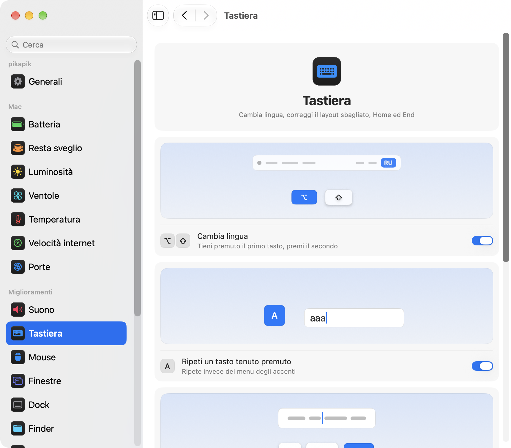

<p align="center"></p>
<h1 align="center">pikapik</h1>
<p align="center"><b>Il tuo Mac capisce al volo.</b><br>Piccoli ritocchi per tastiera, mouse, finestre e Finder, direttamente nella barra dei menu del tuo Mac.</p>
<p align="center"><sub><a href="../../README.md">English</a> · <a href="README.ru.md">Русский</a> · <a href="README.uk.md">Українська</a> · <a href="README.de.md">Deutsch</a> · <a href="README.fr.md">Français</a> · <a href="README.es.md">Español</a> · <b>Italiano</b> · <a href="README.pt-BR.md">Português (Brasil)</a> · <a href="README.ja.md">日本語</a> · <a href="README.zh-Hans.md">简体中文</a> · <a href="README.ko.md">한국어</a> · <a href="README.ro.md">Română</a> · <a href="README.pl.md">Polski</a> · <a href="README.tr.md">Türkçe</a> · <a href="README.nl.md">Nederlands</a> · <a href="README.sv.md">Svenska</a> · <a href="README.cs.md">Čeština</a> · <a href="README.zh-Hant.md">繁體中文</a> · <a href="README.ar.md">العربية</a> · <a href="README.hi.md">हिन्दी</a> · <a href="README.id.md">Bahasa Indonesia</a> · <a href="README.vi.md">Tiếng Việt</a> · <a href="README.th.md">ไทย</a></sub></p>

<p align="center">
<picture>
<source media="(prefers-color-scheme: dark)" srcset="../media/settings-it-dark.png">

</picture>
</p>

## Installazione

Apri Terminale, incolla questa riga e premi A capo:

```bash
/bin/bash -c "$(curl -fsSL https://raw.githubusercontent.com/dev-pikapik/pika-tools/main/install.sh)"
```

Il comando scarica l’ultima versione da GitHub e la installa solo se è firmata dal suo sviluppatore e ha superato il controllo di Apple per rilevare software dannoso. pikapik compare nella barra dei menu, in alto sullo schermo. Tutto resta spento finché non lo accendi tu.

<details>
<summary>Altri modi: Homebrew o un dmg</summary>

Con Homebrew:

```bash
brew install --cask dev-pikapik/pika-tools/pikapik && open -a pikapik
```

Oppure scarica [pikapik.dmg](https://github.com/dev-pikapik/pika-tools/releases/latest/download/pikapik.dmg), aprilo e trascina l’app nella cartella Applicazioni.

Sia il comando qui sopra sia Homebrew mettono l’app in `/Applications`, la avviano, chiedono i permessi e attivano l’apertura al login. Da quel momento l’app si aggiorna da sola, vedi **Aggiornamenti**. Per rimuoverla, vedi **Disinstallazione**.

</details>

## Cosa fa

<table>
<tbody><tr>
<td width="50%" valign="top">
<picture><source media="(prefers-color-scheme: dark)" srcset="../media/keep-awake-dark.png"></picture>
<br><b>Resta sveglio</b>
<br>Il Mac resta sveglio per tutto il tempo che serve, anche con il coperchio chiuso.
</td>
<td width="50%" valign="top">
<picture><source media="(prefers-color-scheme: dark)" srcset="../media/fans-dark.png"></picture>
<br><b>Ventole</b>
<br>Guarda quanto veloci girano le ventole e scegli la loro velocità.
</td>
</tr></tbody>
<tbody><tr>
<td width="50%" valign="top">
<picture><source media="(prefers-color-scheme: dark)" srcset="../media/battery-dark.png"></picture>
<br><b>Batteria</b>
<br>Guarda lo stato della batteria, la capacità e il conteggio cicli, quanta energia entra e come farla durare di più.
</td>
<td width="50%" valign="top">
<picture><source media="(prefers-color-scheme: dark)" srcset="../media/command-keys-dark.png"></picture>
<br><b>Proteggi ⌘Q e ⌘W</b>
<br>Niente si chiude per sbaglio. Aggiungi ⇧ quando lo vuoi davvero.
</td>
</tr></tbody>
<tbody><tr>
<td width="50%" valign="top">
<picture><source media="(prefers-color-scheme: dark)" srcset="../media/compress-dark.png"></picture>
<br><b>Copia più leggera</b>
<br>Clic destro su una foto, un PDF o un video, e accanto compare una copia più leggera.
</td>
<td width="50%" valign="top">
<picture><source media="(prefers-color-scheme: dark)" srcset="../media/convert-dark.png"></picture>
<br><b>Conversione</b>
<br>Salva un’immagine, un video o un brano in un altro formato con il clic destro.
</td>
</tr></tbody>
<tbody><tr>
<td width="50%" valign="top">
<picture><source media="(prefers-color-scheme: dark)" srcset="../media/input-switch-dark.png"></picture>
<br><b>Cambia lingua</b>
<br>Tieni premuto ⌥ e tocca ⇧ per cambiare la lingua della tastiera.
</td>
<td width="50%" valign="top">
<picture><source media="(prefers-color-scheme: dark)" srcset="../media/quit-on-close-dark.png"></picture>
<br><b>Esci con l’ultima finestra</b>
<br>Chiudi l’ultima finestra di un’app, e si chiude anche l’app.
</td>
</tr></tbody>
<tbody><tr>
<td width="50%" valign="top">
<picture><source media="(prefers-color-scheme: dark)" srcset="../media/window-zoom-dark.png"></picture>
<br><b>Il pulsante verde ingrandisce</b>
<br>La finestra riempie lo schermo senza passare a schermo intero.
</td>
<td width="50%" valign="top">
<picture><source media="(prefers-color-scheme: dark)" srcset="../media/dock-hide-dark.png"></picture>
<br><b>Riduci con un clic nel Dock</b>
<br>Fai clic sull’app che stai usando, e si toglie di mezzo.
</td>
</tr></tbody>
<tbody><tr>
<td width="50%" valign="top">
<picture><source media="(prefers-color-scheme: dark)" srcset="../media/new-file-dark.png"></picture>
<br><b>Nuovo file</b>
<br>Clic destro nel Finder, un nome, ed ecco un file vuoto.
</td>
<td width="50%" valign="top">
<picture><source media="(prefers-color-scheme: dark)" srcset="../media/finder-cut-dark.png"></picture>
<br><b>⌘X sposta i file</b>
<br>Taglia i file nel Finder e incollali dove vuoi.
</td>
</tr></tbody>
<tbody><tr>
<td width="50%" valign="top">
<picture><source media="(prefers-color-scheme: dark)" srcset="../media/finder-open-dark.png"></picture>
<br><b>Invio apre i file</b>
<br>Seleziona i file nel Finder e premi Invio per aprirli.
</td>
<td width="50%" valign="top">
<picture><source media="(prefers-color-scheme: dark)" srcset="../media/finder-delete-dark.png"></picture>
<br><b>Elimina nel Cestino</b>
<br>Premi ⌫ nel Finder, e i file selezionati finiscono nel Cestino.
</td>
</tr></tbody>
<tbody><tr>
<td width="50%" valign="top">
<picture><source media="(prefers-color-scheme: dark)" srcset="../media/desktop-icons-dark.png"></picture>
<br><b>Nascondi le icone della scrivania</b>
<br>Un clic e la scrivania è sgombra per una chiamata o un’istantanea dello schermo.
</td>
<td width="50%" valign="top">
<picture><source media="(prefers-color-scheme: dark)" srcset="../media/hidden-files-dark.png"></picture>
<br><b>Mostra i file nascosti</b>
<br>Vedi i file e le cartelle che macOS tiene nascosti.
</td>
</tr></tbody>
<tbody><tr>
<td width="50%" valign="top">
<picture><source media="(prefers-color-scheme: dark)" srcset="../media/game-mode-dark.png"></picture>
<br><b>Modalità gioco</b>
<br>Mentre giochi, niente si apre sopra il gioco né lo chiude.
</td>
<td width="50%" valign="top">
<picture><source media="(prefers-color-scheme: dark)" srcset="../media/speed-test-dark.png"></picture>
<br><b>Velocità internet</b>
<br>Quanto è veloce la tua connessione e a cosa basta.
</td>
</tr></tbody>
<tbody><tr>
<td width="50%" valign="top">
<picture><source media="(prefers-color-scheme: dark)" srcset="../media/side-buttons-dark.png"></picture>
<br><b>Tasti laterali</b>
<br>I tasti 4 e 5 vanno indietro e avanti, come uno swipe.
</td>
<td width="50%" valign="top">
<picture><source media="(prefers-color-scheme: dark)" srcset="../media/hide-app-dark.png"></picture>
<br><b>Nascondi con un tasto del mouse</b>
<br>Una pressione nasconde l’app in primo piano, come ⌘H. Resta in esecuzione.
</td>
</tr></tbody>
<tbody><tr>
<td width="50%" valign="top">
<picture><source media="(prefers-color-scheme: dark)" srcset="../media/wheel-lines-dark.png"></picture>
<br><b>Scorri per righe</b>
<br>Ogni scatto della rotella scorre allo stesso modo, a qualsiasi velocità.
</td>
<td width="50%" valign="top">
<picture><source media="(prefers-color-scheme: dark)" srcset="../media/wheel-direction-dark.png"></picture>
<br><b>Direzione di scorrimento</b>
<br>Una direzione per il trackpad, un’altra per il mouse.
</td>
</tr></tbody>
<tbody><tr>
<td width="50%" valign="top">
<picture><source media="(prefers-color-scheme: dark)" srcset="../media/linear-pointer-dark.png"></picture>
<br><b>Senza accelerazione del puntatore</b>
<br>Il puntatore si muove esattamente quanto la tua mano.
</td>
<td width="50%" valign="top">
<picture><source media="(prefers-color-scheme: dark)" srcset="../media/key-repeat-dark.png"></picture>
<br><b>Ripeti un tasto tenuto premuto</b>
<br>Tieni premuto un tasto per ripeterlo, senza il menu degli accenti.
</td>
</tr></tbody>
<tbody><tr>
<td width="50%" valign="top">
<picture><source media="(prefers-color-scheme: dark)" srcset="../media/home-end-dark.png"></picture>
<br><b>Home ed End</b>
<br>Vai a inizio o fine riga mentre scrivi.
</td>
<td width="50%" valign="top">
<picture><source media="(prefers-color-scheme: dark)" srcset="../media/animations-dark.png"></picture>
<br><b>Animazioni</b>
<br>Velocizza il Dock, le finestre e Visualizzazione rapida, fino a renderli istantanei.
</td>
</tr></tbody>
<tbody><tr>
<td width="50%" valign="top">
<picture><source media="(prefers-color-scheme: dark)" srcset="../media/leftover-permissions-dark.png"></picture>
<br><b>Permessi delle app eliminate</b>
<br>Togli i permessi che macOS conserva per le app già eliminate.
</td>
<td width="50%" valign="top">
<picture><source media="(prefers-color-scheme: dark)" srcset="../media/pet-dark.png"></picture>
<br><b>Animaletto sulla scrivania</b>
<br>Un piccolo amico passeggia dietro le tue finestre. Prendilo e lancialo, oppure premi Spazio per farlo saltare. Vestilo con i capi del suo guardaroba e vinci premi mentre giocate insieme. Si anima mentre scrivi e sonnecchia quando ti allontani.
</td>
</tr></tbody>
<tbody><tr>
<td width="50%" valign="top">
<picture><source media="(prefers-color-scheme: dark)" srcset="../media/uninstaller-dark.png"></picture>
<br><b>Rimuovi app</b>
<br>Rimuovi un’app e i suoi file. Puoi rimettere tutto.
</td>
<td width="50%" valign="top">
<picture><source media="(prefers-color-scheme: dark)" srcset="../media/game-fps-dark.png"></picture>
<br><b>Mostra FPS</b>
<br>Un piccolo contatore mostra quanto scorre bene il gioco, nell’angolo che scegli.
</td>
</tr></tbody>
<tbody><tr>
<td width="50%" valign="top">
<picture><source media="(prefers-color-scheme: dark)" srcset="../media/archive-dark.png"></picture>
<br><b>Archivi</b>
<br>Apri RAR e altri archivi, o riunisci i file in uno ZIP, con un clic destro.
</td>
<td width="50%" valign="top">
<picture><source media="(prefers-color-scheme: dark)" srcset="../media/dock-display-dark.png"></picture>
<br><b>Tieni il Dock su un solo schermo</b>
<br>Il Dock non salta più su un altro schermo. Per spostarlo, rendi principale un altro schermo.
</td>
</tr></tbody>
<tbody><tr>
<td width="50%" valign="top">
<picture><source media="(prefers-color-scheme: dark)" srcset="../media/temperatures-dark.png"></picture>
<br><b>Temperatura</b>
<br>Guarda quanto è caldo il Mac all’interno, dal processore alla batteria.
</td>
<td width="50%" valign="top">
<picture><source media="(prefers-color-scheme: dark)" srcset="../media/background-dark.png"></picture>
<br><b>Attività in background</b>
<br>Scopri cosa gira in background e da dove arriva.
</td>
</tr></tbody>
<tbody><tr>
<td width="50%" valign="top">
<picture><source media="(prefers-color-scheme: dark)" srcset="../media/ports-dark.png"></picture>
<br><b>Porte</b>
<br>Scopri quale programma occupa una porta e liberala.
</td>
<td width="50%" valign="top">
<picture><source media="(prefers-color-scheme: dark)" srcset="../media/app-volume-dark.png"></picture>
<br><b>Volume delle app</b>
<br>Abbassa il volume di qualsiasi app o silenziala senza toccare le altre.
</td>
</tr></tbody>
<tbody><tr>
<td width="50%" valign="top">
<picture><source media="(prefers-color-scheme: dark)" srcset="../media/brightness-dark.png"></picture>
<br><b>Luminosità dei monitor</b>
<br>Scurisci o schiarisci un monitor che macOS non sa regolare da solo, con un cursore o i tasti della luminosità.
</td>
<td width="50%" valign="top">
<picture><source media="(prefers-color-scheme: dark)" srcset="../media/layout-fix-dark.png"></picture>
<br><b>Correggi il layout sbagliato</b>
<br>Hai scritto ghbdtn invece di привет? Premi Spazio e la parola si corregge.
</td>
</tr></tbody>
<tbody><tr>
<td width="50%" valign="top">
<picture><source media="(prefers-color-scheme: dark)" srcset="../media/middle-click-dark.png"></picture>
<br><b>Clic centrale sul trackpad</b>
<br>Tocca con tre dita per aprire un link in una nuova scheda, come con il tasto centrale del mouse.
</td>
</tr></tbody>
</table>

## Più dettagli

<details>
<summary>Primo avvio</summary>

pikapik ha bisogno di due permessi. Al primo avvio apre le impostazioni sulla pagina Permessi, che ti guida passo passo, e macOS mostra le sue richieste. Vai in **Impostazioni di Sistema › Privacy e sicurezza** e attiva pikapik in:

- **Accessibilità**, così l’app può modificare la pressione di un tasto o un clic prima che arrivi alle altre app.
- **Monitoraggio input**, così l’app può vedere pressioni dei tasti e clic senza modificarli. È così che funziona il cambio di lingua.

L’app si accorge della modifica in un paio di secondi, senza bisogno di riavviare.

Alcune funzioni chiedono qualcosa in più quando le usi: **Accesso amministratore**, **Estensioni del Finder**, **iCloud Drive**, **Accesso completo al disco**, **Registrazione schermo** e **Registrazione dell’audio di sistema**. Sono tutte nella pagina Permessi delle impostazioni: ogni permesso ha una riga che dice a cosa serve, una spunta verde o una croce arancione e un solo pulsante: **Consenti** quando manca, **Spegni** quando è attivo. Così puoi revocare qualsiasi permesso proprio lì.

pikapik non registra, non conserva e non invia nulla di ciò che digiti o clicchi. Gli eventi vengono gestiti in memoria e inoltrati subito. Per correggere le parole scritte con il layout sbagliato, pikapik tiene in memoria solo le ultime parole che hai scritto e le dimentica appena fai clic o passi a un’altra app. Le uniche parole che salva sono quelle che gli hai chiesto di lasciare stare, solo su questo Mac, finché non le cancelli in Impostazioni › Tastiera. pikapik va online solo per gli aggiornamenti (chiede a GitHub qual è l’ultima versione e la scarica solo se scegli di aggiornare) e per la misura della velocità quando la avvii tu (usa i server di Apple). La versione del Mac App Store viene aggiornata dall’App Store, e la sua misura della velocità usa Cloudflare. I progressi del tuo animaletto (passi, lanci, premi e simili) vengono contati solo su questo Mac e non sono mai inviati da nessuna parte. Puoi cancellarli in Impostazioni › Animaletto.

</details>

<details>
<summary>Ogni strumento nel dettaglio</summary>

**Lettore.** I video che QuickTime non riesce ad aprire, come MKV, WebM, AVI, WMV e FLV, si riproducono in una finestra tutta loro. Apri Impostazioni › Lettore e fai clic su **Apri video…**, oppure clic destro su un video e scegli **Apri con › pikapik Player**. La barra spaziatrice avvia e mette in pausa, ← e → in pausa vanno avanti o indietro di un fotogramma e durante la riproduzione saltano di 5 secondi, J e L di 10, ↑ e ↓ cambiano il volume e F passa a schermo intero. Il menu **Velocità** va da 0,5× a 2×, **Salva fotogramma…** salva un PNG e il lettore riprende da dove si era fermato il video. Il pannello dei controlli è di vetro smerigliato e si nasconde durante la riproduzione, e passando il puntatore sulla barra del tempo compare una piccola immagine di quel momento. Un video già aperto torna in primo piano invece di aprirsi due volte. Il lettore non ha accesso alla rete e non chiede nessun permesso. Ogni formato in quella pagina è un pulsante che mostra l’app che lo apre adesso: con un clic pikapik Player diventa l’app predefinita di quel formato, con un altro clic torna all’app che lo apriva prima. **Apri tutto in pikapik** lo fa per tutti i formati, uno dopo l’altro, e diventa **Ripristina le app precedenti** (macOS chiede di confermare ciascuno). Le licenze di FFmpeg e dav1d e il loro codice sorgente si aprono dalla stessa pagina. I sottotitoli non sono ancora supportati. Non è nella versione del Mac App Store.

**Volume delle app.** Apri Impostazioni › Suono e attiva **Volume delle app**. Ogni app che riproduce suoni ha il suo cursore e un pulsante per silenziarla, nelle Impostazioni e nel menu. Abbassa il volume di una videochiamata troppo forte, silenzia un gioco rumoroso e lascia la tua musica com’è: il volume del Mac e delle altre app non cambia. pikapik ricorda il livello di ogni app, e un’app che lasci a volume pieno non viene mai toccata. Un’app che hai impostato resta nell’elenco, anche dopo un riavvio, in grigio finché è chiusa: così puoi fissarne il livello prima che si avvii. Fai clic su **Aggiungi app…** oppure trascina un’app dal Finder. La ✕ accanto a un’app la dimentica e la riporta a volume pieno. Per cambiare il volume di un’app, pikapik fa passare il suo suono attraverso se stesso, quindi serve il permesso **Registrazione dell’audio di sistema**, che consenti nella pagina Permessi. Il suono viene solo fatto passare: non viene registrato, salvato né inviato da nessuna parte, e il microfono non viene usato. Richiede macOS 14.2 o successivo ed è nascosto su macOS 14.0 e 14.1. Disattivato di default.

**Luminosità dei monitor.** macOS cambia la luminosità dello schermo integrato e dei monitor Apple, ma non quella della maggior parte degli altri monitor. Apri Impostazioni › Luminosità: ogni monitor che macOS non sa regolare da solo ha il suo cursore, e puoi anche aggiungere una riga «Luminosità» al pannello della barra dei menu. pikapik cambia la luminosità del monitor stesso, la stessa impostazione dei suoi pulsanti. Se un monitor non risponde, attiva **Scurisci invece l’immagine**: l’immagine diventa più scura, ma mai nera. Attiva **Tasti della luminosità** e i tasti della luminosità regolano il monitor sotto il puntatore e mostrano un piccolo indicatore; tieni premuti ⌥⇧ per passi più fini. I tasti hanno bisogno del permesso **Accessibilità**, che consenti nella pagina Permessi, mentre i cursori funzionano anche senza. pikapik ricorda il livello di ogni monitor e lo reimposta dopo lo stop. La versione del Mac App Store si limita a scurire l’immagine. I tasti della luminosità sono disattivati di default.

**Proteggi ⌘Q e ⌘W.** ⌘Q e ⌘W da soli non fanno nulla, così non chiudi un’app o una finestra per sbaglio. Aggiungi Maiuscole per farlo apposta: ⇧⌘Q esce, ⇧⌘W chiude. Funziona in tutte le app. Ogni tasto ha il suo interruttore. Disattivato di default.

**Cambia lingua con Opzione+Maiuscole.** Tieni premuto Opzione e tocca Maiuscole: macOS passa alla sorgente di input successiva. Continua a tenere premuto Opzione e tocca di nuovo Maiuscole per andare avanti. Tieni premuto Maiuscole e tocca Opzione per tornare indietro. Se nel frattempo premi un altro tasto, fai clic o aggiungi Comando, Control o Fn, non cambia nulla, quindi abbreviazioni come Opzione+Maiuscole+freccia funzionano come prima. Disattivato di default.

**Ripeti un tasto tenuto premuto.** Tieni premuto un tasto e la lettera viene scritta più e più volte, invece di aprire il menu degli accenti. Comodo nei giochi e quando scrivi. Le app già aperte lo applicano dopo il riavvio. Se lo disattivi, macOS torna a comportarsi come sempre. Disattivato di default.

**Home ed End vanno a inizio e fine riga.** Mentre scrivi, Home porta il cursore all’inizio della riga ed End alla fine, invece di scorrere la pagina. Con ⇧ selezionano fin lì, con ⌘ vanno all’inizio o alla fine di tutto il testo. Fuori dai campi di testo, e nei terminali, nelle macchine virtuali e nelle app di desktop remoto, i tasti funzionano come prima. Nella versione del Mac App Store agiscono anche fuori dai campi di testo, tranne che nei browser, nel Finder e in Musica. Puoi aggiungere altre app in cui devono funzionare come al solito. Disattivato di default.

**Correggi le parole scritte con il layout sbagliato.** Se una parola esce senza senso, come ghbdtn invece di привет, pikapik la riscrive nel layout giusto appena premi Spazio o Invio, e cambia layout perché la parola successiva venga giusta. Funziona con tutti i layout di tastiera che hai aggiunto sul Mac. Una parola cambia solo se non esiste in nessuna delle tue lingue e gli stessi tasti in un altro layout danno una parola comune, così nomi, refusi e parole rare restano come li hai scritti, e lo stesso vale per il testo nei campi delle password, in Terminale e nelle app che scegli tu. Premi ⌃⇧Spazio per correggere l’ultima parola o il testo selezionato, e premi di nuovo per provare gli altri layout. Subito dopo una correzione, gli stessi tasti la annullano, e pikapik non correggerà più quella parola da solo. Puoi cambiare la scorciatoia in Impostazioni › Tastiera. Nella versione del Mac App Store, seleziona il testo e premi ⌃⇧Spazio, oppure scegli «Correggi layout tastiera» nel menu «Servizi». **Correggi le parole mentre scrivi** e la scorciatoia sono disattivati finché non li attivi in Impostazioni › Tastiera, e richiedono Accessibilità, che ti viene chiesta nella pagina Permessi. Disattivato di default. Se hai un solo layout, la nota nella pagina ti permette di aggiungere subito quello della tua lingua, senza passare da Impostazioni di Sistema (versione dal sito).

**Disattiva l’accelerazione del puntatore.** Il puntatore si sposta esattamente quanto il mouse, a qualsiasi velocità lo muovi. Un cursore **Velocità puntatore** ne regola la velocità. Funziona solo con i mouse, il trackpad resta com’è. Disattivala o esci da pikapik e macOS riprende le sue impostazioni. Disattivato di default.

**Scorri per righe.** Ogni scatto della rotella del mouse scorre lo stesso numero di righe, per quanto veloce la giri. Scegli da 1 a 10 righe per scatto, 3 di default. Lo scorrimento naturale resta come l’hai impostato in Impostazioni di Sistema. Funziona solo con i mouse, il trackpad resta com’è. Disattivato di default. Accanto al cursore **Distanza per scatto**, una piccola pagina scorre della distanza scelta, e un punto indica il valore predefinito.

Alcune app e alcuni giochi contano lo scorrimento in pixel esatti: per loro, passa la stessa impostazione ai pixel e scegli da 1 a 200 pixel per scatto, 40 di base. Il cursore mostra anche quanta parte dell’altezza dello schermo corrisponde.

**Direzione di scorrimento per trackpad e mouse.** macOS ha un solo interruttore per lo scorrimento naturale, sia per il trackpad sia per il mouse. Attiva questa funzione e scegli una direzione per ciascuno: **Naturale**, con la pagina che segue le dita come su iPhone, oppure **Classica**, in cui la pagina va nel verso opposto. La scelta del trackpad vale anche per lo scorrimento laterale e per l’inerzia dopo aver sollevato le dita. Il Magic Mouse scorre al tocco, quindi segue la scelta del trackpad. Scegli lo stesso su ogni tuo Mac e lo scorrimento sarà uguale ovunque, anche quando sposti il mouse su un altro Mac con Controllo universale. Disattivata di default. Quando la attivi, entrambe partono come in Impostazioni di Sistema, quindi non cambia nulla finché non scegli altro.

**Tasti laterali per indietro e avanti.** I tasti 4 e 5 del mouse vanno indietro e avanti nel Finder, in Safari e in altre app Apple e in molte altre app, proprio come uno swipe sul trackpad. Le app che gestiscono questi tasti da sole li ricevono così come sono. Se il tuo mouse li ha invertiti, attiva **Inverti i tasti laterali**. Disattivato di default.

**Un tasto del mouse nasconde l’app corrente.** Attiva **Nascondi l’app corrente con un tasto del mouse** in Impostazioni › Mouse e premi il tasto che vuoi usare, per esempio il tasto centrale o uno laterale. Da quel momento basta premerlo una volta per nascondere l’app in primo piano, proprio come ⌘H: l’app resta in esecuzione, e un clic sulla sua icona nel Dock la fa ricomparire. Mentre giochi con la Modalità gioco attiva, il tasto funziona nel gioco come sempre. Disattivato di default.

**Clic centrale sul trackpad.** Tocca o fai clic con tre dita e il trackpad funziona come il tasto centrale del mouse: nella maggior parte dei browser così apri un link in una nuova scheda o chiudi una scheda. Puoi anche scegliere quattro dita. Per toccare devi attivare **Tocca per fare clic** in Impostazioni di Sistema › Trackpad. Se lì «Cerca info e rilevatori dati» è impostato sul tocco con tre dita, con tre dita puoi solo fare clic, e se «Trascina con tre dita» è attivo, scegli quattro dita. La riga **Dita** in Impostazioni ti dice cosa funziona sul tuo Mac. Il mouse resta com’è. Richiede i permessi **Accessibilità** e **Monitoraggio input**, e non è nella versione del Mac App Store. Disattivato di default.

**Esci quando si chiude l’ultima finestra.** Chiudi l’ultima finestra di un’app e l’app si chiude. Il Finder resta aperto, così come le app con finestre su altre scrivanie o nel Dock. Puoi indicare le app che non devono mai chiudersi in questo modo. Disattivato di default.

**Riduci o nascondi con un clic nel Dock.** Fai clic sull’icona nel Dock dell’app che stai usando e tutte le sue finestre scendono nel Dock. Fai di nuovo clic per riaverle tutte. Puoi anche fare in modo che il clic nasconda l’intera app, come ⌘H. Disattivato di default.

**Tieni il Dock su un solo schermo.** Con più schermi, macOS sposta il Dock su un altro schermo non appena il puntatore spinge contro il suo bordo inferiore. Con l’interruttore attivo, questo non succede più, per quanto velocemente tu muova il puntatore: pikapik disattiva lo spostamento con un’impostazione del Dock stesso e non tocca mai il puntatore. Per spostare il Dock apposta, rendi principale un altro schermo: in **Impostazioni di Sistema › Schermi**, fai clic su quello schermo e scegli **Schermo principale** in **Utilizza come**, e il Dock lo segue. La riga **Schermo principale** sotto l’interruttore lo fa direttamente lì, e disattivare l’interruttore rimette gli schermi com’erano. Il Dock legge la sua impostazione solo all’avvio, quindi quando attivi o disattivi l’interruttore si riavvia una volta. Non serve alcun permesso. L’interruttore è disattivato di default e non è nella versione del Mac App Store.

**Il pulsante verde ingrandisce la finestra.** Fai clic sul pulsante verde di una finestra e questa si allarga fino a riempire lo schermo, senza passare a schermo intero. Un altro clic riporta la misura precedente. Tieni premuto ⌥ e il pulsante funziona come sempre. Lo schermo intero resta nel menu del pulsante e con ⌃⌘F. Puoi elencare le app in cui il pulsante verde deve funzionare come sempre. Disattivato di default.

**Nuovo file nel Finder.** Clic destro in una finestra del Finder o sulla scrivania, scegli **Nuovo file**, scrivi un nome e compare un file vuoto. .txt di default. Disattivato di default.

**Invio apre i file nel Finder.** Seleziona dei file in una finestra del Finder o sulla scrivania e premi Invio o Enter: si aprono. F2 o fn F2 rinomina il file selezionato. Nei campi di testo, per esempio mentre scrivi un nome, i tasti funzionano come sempre. Disattivato di default.

**⌘X taglia i file nel Finder.** Seleziona dei file e premi ⌘X, apri la cartella di destinazione e premi ⌘V: i file vengono spostati lì invece di essere copiati. ⌘C annulla il taglio. Disattivato di default.

**Elimina cancella i file nel Finder.** Seleziona i file e premi ⌫ o ⌦ (fn ⌫ su un portatile): finiscono nel Cestino, proprio come con ⌘⌫. Mentre rinomini un file, cerchi o scrivi in un altro campo, i tasti cancellano le lettere come al solito. Disattivato di default.

**Copia più leggera nel Finder.** Clic destro su un file nel Finder e scegli **Crea copia più leggera**. Accanto compare una versione più leggera di una foto, una GIF, un PDF o un video, spesso molte volte più piccola. L’audio non compresso, come WAV o AIFF, diventa un M4A compatto. Se il file non può diventare più leggero, la copia non viene creata e pikapik te lo dice. L’originale resta com’è e niente lascia il tuo Mac. Disattivato di default.

**Conversione nel Finder.** Clic destro su un file nel Finder e scegli **Converti in** per salvarlo in un altro formato: un’immagine come JPEG, PNG, HEIC, GIF, TIFF o PDF, un video come MP4, MOV o solo l’audio, la musica come M4A, WAV o AIFF. L’originale resta com’è e niente lascia il tuo Mac. Si attiva separatamente dalla copia più leggera. Disattivato di default.

**Archivi nel Finder.** Clic destro su un archivio nel Finder e scegli **Estrai**, e i suoi file compaiono accanto. Clic destro su un altro file o cartella e scegli **Crea archivio…** per ottenere uno ZIP, un 7Z, un TAR.GZ o un TAR.XZ. Uno ZIP o un 7Z può avere una password, e qualsiasi archivio si può dividere in parti, per esempio da 15 MB per l’e-mail o da 4 GB per una chiavetta USB. La password si scrive due volte, così un errore di battitura non ti chiude fuori dai tuoi file. Uno ZIP creato così non contiene file di servizio nascosti, mantiene leggibili i nomi in qualsiasi lingua e accetta file oltre i 4 GB. Disattivato di default. La versione del Mac App Store ha alcuni limiti, descritti qui sotto.

pikapik apre anche ciò che macOS non sa aprire: RAR, anche diviso in parti, 7Z protetto da password, set di parti come .001, .z01, .r00 e .part1.rar, e inoltre ZIPX, CAB, LZH, ARJ, ZST, LZMA, WIM e altro ancora. Con un doppio clic si aprono in pikapik. I nomi dei file nei vecchi ZIP, per esempio in cirillico, giapponese o cinese, si leggono correttamente. L’interruttore **Apri gli archivi con questa app**, in Impostazioni › Finder, affida a pikapik anche ZIP e 7Z, mentre TAR e GZ restano all’app per archivi integrata, che li gestisce già bene. pikapik può aprire i RAR ma non crearli: la licenza RAR consente solo l’estrazione.

Una finestra chiede la password, **Interrompi** ferma qualsiasi operazione, e da un archivio danneggiato o incompleto pikapik recupera ciò che si può ancora leggere. Se un archivio si gonfiasse fino a una dimensione enorme, pikapik chiede conferma prima di estrarlo, e si ferma in tempo quando il disco sta per riempirsi. Gli archivi che cercano di scrivere fuori dalla propria cartella vengono bloccati. Seleziona un archivio nel Finder e premi Spazio per vedere cosa contiene.
**Archivi nella versione del Mac App Store.** Funzionano anche lì, ma con gli strumenti integrati in macOS al posto del 7-Zip incluso, quindi ci sono dei limiti: solo lo ZIP può avere una password, non il 7Z; un archivio non si può dividere in parti, e gli archivi in più parti (.001, .part1.rar, .z01 e simili) non si possono aprire; i singoli file .xz, .lzma e .zst non si possono aprire (i .gz e .bz2 sì); i 7Z e RAR protetti da password non si possono aprire; e manca l’interruttore **Apri gli archivi con questa app**. La prima volta chiede l’accesso alla tua cartella Home, come per Nuovo file e Copia più leggera, perché questa versione può scrivere solo dove l’hai permesso. Attiva l’estensione del Finder in Impostazioni di Sistema › Generali › Elementi login ed estensioni; pikapik ti mostra dove fare clic.


**Nascondi le icone della scrivania.** Attivalo prima di una chiamata, di una registrazione dello schermo o di un’istantanea, e i file e le cartelle sulla scrivania spariscono. Disattivalo e tornano al loro posto. Non si sposta nulla: i file restano nella cartella Scrivania del Finder. È l’impostazione **Mostra elementi › Sulla scrivania** di Impostazioni di Sistema › Scrivania e Dock, solo più a portata di mano, quindi le due vanno sempre d’accordo. Nella versione del Mac App Store, questa riga invece copre le icone con il tuo sfondo su ogni schermo, o con un colore a tinta unita se lo sfondo è in movimento, e i clic raggiungono ancora la scrivania. In Impostazioni, il pulsante **Apri** qui sotto apre comunque quella pagina di Impostazioni di Sistema.

**Mostra i file nascosti.** I file e le cartelle che macOS nasconde, come Libreria nella tua cartella Inizio o i file il cui nome inizia con un punto, appaiono attenuati nel Finder e sulla scrivania. È come premere ⇧⌘. nel Finder, solo che vedi a colpo d’occhio se è attivo. Per applicare la modifica, il Finder si riavvia per un attimo e riapre le sue finestre e le sue schede. Se il Finder sta copiando o spostando dei file, si riavvia solo quando ha finito. Entrambi si trovano in Impostazioni › Finder. Per averli nel pannello della barra dei menu, fai clic sul pulsante con la matita in basso e selezionali. Nella versione del Mac App Store, Impostazioni › Finder mostra invece i tasti ⇧⌘. del Finder.

**Modalità gioco.** Aggiungi i tuoi giochi e, mentre giochi, il Mac non ti tira fuori dal gioco. Spotlight, Siri, ⌘Tab, Mission Control e gli scorrimenti tra le scrivanie non si aprono sopra il gioco, ⌘Q e ⌘W non lo chiudono per sbaglio, il puntatore non scivola sul Dock, sulla barra dei menu o su un altro schermo e lo schermo resta acceso. Ognuna di queste opzioni ha il suo interruttore nella pagina Giochi, e pikapik ti suggerisce i giochi che trova sul tuo Mac. Nel gioco, Control-clic resta un semplice clic, e Control con le frecce non cambia scrivania. Riconosce anche Minecraft: aggiungi Minecraft Launcher o CurseForge, e la modalità si attiva dentro Minecraft stesso. Per uscire da un gioco, premi ⇧⌘Q; per chiuderne la finestra, ⇧⌘W. ⌥⌘Esc funziona sempre. Appena esci dal gioco, tutto funziona come al solito. Disattivato di default.

Attiva la modalità Gioco e gioca. Altre impostazioni di gioco contiene il catalogo del Mac con i tasti attuali e un’anteprima animata per ogni azione.

Automatico sospende le azioni che aprono finestre o spostano il focus. Un comando della lingua breve e intenzionale cambia la sorgente senza una finestra di sistema. I tasti di movimento tenuti premuti hanno priorità, così correre e saltare non cambiano lingua per sbaglio.

In Impostazioni → Giochi → Altre impostazioni di gioco c’è un gruppo chiamato «Mouse e trackpad». Mostra solo ciò che è attivo in macOS sul tuo Mac, con i nomi di Apple e un piccolo disegno per ciascuno: scorciatoie su un pulsante del mouse, scorrimento tra scrivanie e app a schermo intero, Mission Control e App Exposé, pizzico per le app e allargamento delle dita per la scrivania, scorrimento dal bordo destro per il Centro notifiche e ogni angolo attivo con la sua azione. Finché un gioco è in primo piano, sono sospesi, così uno scorrimento involontario o uno sfioramento di un angolo dello schermo non ti porta fuori dal gioco. I gesti all’interno del gioco continuano a funzionare. Ognuno si può impostare per funzionare come al solito. Nella versione dal sito, **Cambia…** su un angolo attivo sceglie subito un’altra azione e **Rimetti a posto** ripristina la prima; ogni modifica riavvia il Dock una volta.

Apri Impostazioni → Giochi → Aggiungi un gioco e fai clic sul gioco in esecuzione. Compaiono anche i giochi che usano Java o altri ambienti, senza un file .app. Minecraft si chiama Minecraft anziché java. Trova il processo del gioco e trascina la riga su I tuoi giochi in Impostazioni → Giochi.

**Mostra FPS.** FPS significa fotogrammi al secondo: quante immagini disegna il gioco ogni secondo. Attiva **Mostra FPS** nella pagina Giochi e, finché la Modalità gioco è attiva, una piccola etichetta scura con quel numero compare in un angolo di qualsiasi gioco. Fai clic su un angolo dell’immagine sopra l’interruttore per sceglierlo. Un trattino significa che i primi fotogrammi non sono ancora arrivati, e uno 0 sbiadito che il gioco ha smesso di disegnare. Con macOS 27 la maggior parte dei giochi viene contata da macOS stesso, senza permessi. Un gioco che macOS non riesce a contare, per lo più uno vecchio, viene contato tramite la registrazione dello schermo: nella pagina Permessi compare allora la riga **Registrazione schermo**, pikapik non la chiede mai durante una partita e il numero non può superare la frequenza di aggiornamento dello schermo. Con macOS da 14 a 26 e nella versione del Mac App Store ogni gioco viene contato così, perciò la riga compare appena attivi **Mostra FPS**, e il pulsante **Consenti** sotto l’interruttore ti ci porta. Nessuna immagine viene conservata o inviata. Disattivato di default.

**Guardaroba e premi dell’animaletto.** Apri Impostazioni › Animaletto per vestire il tuo animaletto: più di 50 capi, da cappelli e occhiali a mantelli e ali, e look già pronti come mago, pirata o astronauta. Alcuni sono gratis fin dall’inizio. Gli altri sono premi che arrivano mentre giocate insieme: prendi in mano il tuo animaletto e lancialo, calcia la palla, guardalo arrampicarsi sulle finestre e chiacchierare, oppure fagli semplicemente compagnia giorno dopo giorno. Quando ottieni un nuovo premio, te lo dice lui. Ora il tuo animaletto mostra anche le emozioni: in risposta a quello che fai, la sua faccia cambia e sopra la testa compare un piccolo segno quando è contento, timido, curioso, assonnato e altro ancora, e c’è un guardaroba da gentiluomo con baffi, monocolo, frac e bastone. Capisce le sue emozioni direttamente sul tuo Mac da ciò che già sa, e non viene letto né inviato nulla.

Per sapere quando spetta un premio, pikapik conta solo quello che fate tu e il tuo animaletto: passi, quante volte lo prendi e lo lanci, salti, arrampicate, partite con la palla e chiacchierate, giorni passati insieme, se eravate insieme all’alba, dopo mezzanotte o nel fine settimana, le pagine delle Impostazioni che hai aperto e i capi che hai provato. Fuori dal Mac App Store, pikapik annota anche se hai aperto la nostra pagina GitHub dalle Impostazioni. Questi numeri, la data di ogni premio e ciò che indossa il tuo animaletto restano su questo Mac. Non viene inviato nulla da nessuna parte e niente di tutto ciò finisce nel file delle impostazioni esportato o nella sincronizzazione iCloud. Puoi cancellare tutto quando vuoi in Impostazioni › Animaletto, e il tuo animaletto ricomincia da zero.

**Rimuovi app.** Apri Impostazioni › Rimuovi app, scegli un’app dall’elenco o trascinane una sull’immagine, e pikapik mostra tutto ciò che quell’app conserva sul tuo Mac: l’app stessa, i suoi dati salvati, le impostazioni, i file temporanei, gli aiutanti in background e altro, ognuno con il motivo per cui compare. I file che appartengono chiaramente all’app sono spuntati, quelli che forse c’entrano soltanto no, e quelli usati anche da altre app sono segnalati. Scegli cosa togliere e fai clic su **Sposta nel Cestino**. Niente viene eliminato per sempre: tutto va nel Cestino. Se l’app è aperta, pikapik le chiede prima di chiudersi e, se alcuni file richiedono un amministratore, il Mac chiederà la password una sola volta.

Hai cambiato idea? Fai clic su **Rimetti a posto** e tutto torna dov’era, mentre gli aiutanti in background ripartono. Le ultime dieci rimozioni restano in «Rimossi di recente» finché i loro file sono nel Cestino. **Reimposta app** tiene l’app e toglie solo i suoi dati salvati, le impostazioni e i file temporanei, e può servire quando un’app fa i capricci. Le app che hai spostato tu nel Cestino compaiono in «Nel Cestino», insieme ai file che hanno lasciato, e «Resti di app rimosse» trova i file di app ormai sparite. L’interruttore «Proponi di fare pulizia quando un’app va nel Cestino» è spento di default, e non viene rimosso nulla finché non scegli. Per vedere tutto ciò che un’app conserva, la pagina ha bisogno dell’**Accesso completo al disco**. Questo strumento non è nella versione del Mac App Store.

**Temperatura.** Apri Impostazioni › Temperatura per vedere quanto è caldo il Mac all’interno. In alto una sola parola riassume tutto, da «Normale» a «Molto caldo», con una riga che dice se il Mac funziona alla massima velocità o sta rallentando per raffreddarsi. Sotto, ogni componente ha la sua riga con un nome semplice al posto di un codice del sensore: processore, grafica, memoria, archiviazione, Wi-Fi e batteria, a seconda dei sensori del tuo Mac. Ogni riga mostra i gradi e una breve barra che diventa verde, gialla o arancione in base all’intervallo normale per quel componente. I valori si aggiornano ogni due secondi e solo mentre li guardi, quindi al Mac non costano quasi nulla. Non servono password né permessi. Puoi anche aggiungere una riga «Temperatura» al pannello della barra dei menu. La versione del Mac App Store mostra il livello generale e, su un Mac con batteria, la temperatura della batteria.

La pagina **Attività in background** mostra tutto ciò che parte da solo sul tuo Mac: le app che si aprono al login, i servizi in background, gli aiutanti nascosti dentro le app e i resti delle app che hai già rimosso. Per ogni attività vedi quale app l’ha aggiunta, se è in funzione proprio ora e dove si trova il suo file, e con un clic il file compare nel Finder. Le attività avviate da agenti, comprese quelle per tutti gli utenti, e i vecchi elementi login si spengono direttamente in pikapik con un pulsante, senza password, e si riaccendono con la stessa facilità; non viene eliminato nulla. I servizi in background della cartella Library condivisa, Login remoto e Condivisione schermo si spengono allo stesso modo, appena consenti l’accesso amministratore nella pagina Permessi. Gli assistenti che un’app ha registrato da sola e i servizi di altri posti appartengono a macOS, quindi il loro pulsante apre Elementi login in Impostazioni di Sistema e una riga sotto l’attività spiega perché. Nella versione del Mac App Store la pagina mostra soltanto le attività: le dai accesso alla tua cartella Home una volta nella solita finestra Apri, e i pulsanti aprono Elementi login.

**Porte.** Quando un programma dice che la sua porta è già in uso, apri Impostazioni › Porte. Vedi ogni programma che occupa una porta sul tuo Mac, con la sua icona, i numeri di porta e se altri dispositivi della tua rete possono connettersi. Digita un numero per scoprire chi occupa quella porta o per assicurarti che sia libera. Fai clic su una riga per vedere gli indirizzi da aprire nel browser, il file del programma, il comando che l’ha avviato, la sua cartella e il suo numero di processo. **Libera la porta** chiede al programma di chiudersi, così può salvare il suo lavoro, e se non si chiude ti propone l’uscita forzata. Prima di ogni passaggio ti chiede conferma. pikapik non chiude mai parti di macOS né programmi di altri utenti: per Ricevitore AirPlay e Condivisione file ti dice quale interruttore in Impostazioni di Sistema libera la porta, mentre Login remoto e Condivisione schermo si spengono subito con il pulsante Spegni. La pagina Porte non è nella versione del Mac App Store: lì macOS non permette a un’app di vedere quale programma occupa una porta.

Ogni strumento ha il suo interruttore nel menu e nelle impostazioni.

L’icona nella barra dei menu mostra lo stato a colpo d’occhio: il simbolo pikapik quando gli strumenti funzionano, lo stesso simbolo più chiaro quando è tutto spento e un triangolo di avviso quando uno strumento è attivo ma mancano i permessi.

Il pannello della barra dei menu parte con poche righe. Puoi scegliere quali mostrare: fai clic sul pulsante con la matita in basso, seleziona ciò che vuoi vedere e fai clic su **Fine**. Le righe nascoste continuano a funzionare e restano nelle Impostazioni. Se il pannello non sta nello schermo, scorre.

L’app usa la lingua del sistema o quella che scegli nelle impostazioni. Sono disponibili tutte le 23 lingue elencate in cima a questa pagina.

</details>

<details>
<summary>Resta sveglio</summary>

Impedisce al Mac di andare in stop mentre sei lontano dalla tastiera: per qualsiasi durata da 1 secondo a 365 giorni, o finché non lo disattivi. Attivalo dal menu e imposta la durata nelle impostazioni: digita giorni, ore, minuti e secondi, usa ↑ e ↓ oppure fai clic su una durata predefinita da 15 minuti a 8 ore. Il menu mostra quanto tempo resta e quando finisce. Per lo **Schermo** ci sono due scelte. **Sempre acceso**: non si spegne, niente salvaschermo né schermata di blocco. **Si spegne come al solito**: si spegne con il suo timer mentre il Mac continua a funzionare. **Spegni lo schermo ora** (anche nel menu) lo spegne subito e il Mac continua a funzionare: muovi il mouse o premi un tasto per riaccenderlo. Uscendo da pikapik, Resta sveglio termina.

Su un MacBook puoi anche attivare **Funziona con il coperchio chiuso**. macOS non ha un’opzione per farlo, quindi pikapik esegue `pmset -a disablesleep 1` e chiede una password da amministratore: solo un amministratore può cambiare il modo in cui il Mac va in stop. L’impostazione torna normale da sola quando Resta sveglio finisce, quando esci dall’app o se l’app si chiude in modo imprevisto. Se non inserisci la password, non cambia nulla. Tieni il Mac ben ventilato con il coperchio chiuso. **Interrompi con batteria sotto il 20%** termina la sessione prima che la batteria si esaurisca.

Keep Awake, la modalità schermo e quella a schermo chiuso si possono mettere su un pulsante nel Centro di Controllo, nella barra dei menu o in un widget sulla scrivania tramite l’app Comandi rapidi, con i link che copi da Impostazioni › Resta sveglio.

</details>

<details>
<summary>Velocità internet</summary>

Mostra quanto è veloce la tua connessione adesso. Fai clic su **Misura velocità** in Impostazioni › Velocità internet, oppure su **Misura** nel menu dopo aver aggiunto la riga con il pulsante a matita. In circa mezzo minuto vedi download, upload, ping e reattività: quanto velocemente reagisce tutto mentre la rete è occupata. Sotto, in parole semplici, a cosa basta: film in 4K, videochiamate, giochi online e download pesanti. La misura usa networkQuality, incluso in macOS, e i server di Apple. L’ultimo risultato resta fino alla misura successiva, e un link per Comandi Rapidi la avvia dal Centro di Controllo.

</details>

<details>
<summary>Impostazioni</summary>

Apri le impostazioni dal menu con **Impostazioni…** o ⌘, oppure avvia di nuovo pikapik dal Finder, da Launchpad o da Spotlight. Finché la finestra è aperta, l’app compare nel Dock e in ⌘Tab.

- **Generali**: apertura al login, aspetto (Sistema, Chiaro o Scuro), lingua, aggiornamenti e backup: esporta e importa le impostazioni come file, oppure sincronizzale con iCloud Drive.
- **Batteria**: carica, tempo alla carica completa o tempo rimasto, stato, capacità massima, conteggio cicli, alimentatore di corrente e potenza in watt, e consigli per far durare di più la batteria. Mostra solo informazioni: il limite di caricamento resta in **Impostazioni di Sistema › Batteria**. Compare solo su un Mac con batteria.
- **Resta sveglio**: durata, opzioni per schermo e coperchio.
- **Luminosità**: un cursore per ogni monitor che macOS non sa regolare da solo, i tasti della luminosità e l’opzione per scurire invece l’immagine.
- **Ventole**: velocità di ogni ventola, modalità Auto o velocità manuale quando l’accesso amministratore è consentito.
- **Temperatura**: quanto è caldo il Mac, nel complesso e per ogni componente, come processore, memoria e batteria.
- **Velocità internet**: misura la connessione e mostra a cosa basta.
- **Porte**: quale programma occupa quale porta, i suoi indirizzi e i dettagli, e un pulsante per liberare la porta.
- **Suono**: volume delle app, con un cursore e un pulsante per silenziare ogni app che riproduce suoni.
- **Tastiera**: cambio lingua, ripetizione dei tasti, Home ed End, correzione del layout sbagliato.
- **Mouse**: accelerazione del puntatore e velocità puntatore, scorrimento per righe, direzione di scorrimento, tasti laterali, un tasto che nasconde l’app corrente, clic centrale sul trackpad.
- **Finestre**: ingrandimento con il pulsante verde (con un elenco di eccezioni), protezione di ⌘Q e ⌘W, e uscita con l’ultima finestra (con un elenco di eccezioni).
- **Dock**: ridurre o nascondere con un clic nel Dock e tenere il Dock su un solo schermo.
- **Finder**: nuovo file, copia più leggera, conversione e archivi, apertura con Invio, taglio con ⌘X, eliminazione con ⌫, occultamento delle icone della scrivania e visualizzazione dei file nascosti.
- **Lettore**: aprire un video nella sua finestra, i formati che riproduce, un interruttore che lo rende il lettore video predefinito e le licenze di FFmpeg e dav1d.
- **Rimuovi app**: rimuovi un’app con i suoi file, rimetti tutto a posto in seguito e fai pulizia di ciò che le app rimosse hanno lasciato.
- **Attività in background**: tutto ciò che gira in background, quale app l’ha aggiunto e un pulsante per spegnerle e riaccenderle senza aprire Impostazioni di Sistema.
- **Giochi**: l’elenco dei tuoi giochi e le opzioni della Modalità gioco.
- **Animaletto**: accensione, chiacchiere, sintonia con il tuo ritmo e palla, guardaroba e premi.
- **Permessi**: tutti i permessi usati da pikapik, ciascuno con il suo stato e un pulsante per consentirlo o spegnerlo. Uno strumento a cui manca un permesso appare in grigio; un clic su di esso apre questa pagina sulla riga giusta.
- **Info**: versione, link alle novità e per segnalare un problema.

Molte impostazioni hanno una piccola immagine che mostra cosa fanno, per esempio un Mac che resta attivo o una finestra che si nasconde dietro il Dock. L’immagine cambia insieme all’interruttore e resta ferma quando “Riduci movimento” è attivo in Impostazioni di Sistema.

Ogni pagina ha in basso un pulsante **Ripristina default…**. Prima chiede conferma, poi disattiva gli strumenti di quella pagina e ne ripristina le opzioni, come se pikapik non le avesse mai toccate.

**Sincronizza le impostazioni con iCloud** mantiene pikapik uguale su tutti i tuoi Mac. Le impostazioni stanno nella cartella pikapik di iCloud Drive e vince la modifica più recente. È disattivato di default e richiede iCloud Drive attivo. I permessi non vengono sincronizzati: ogni Mac li chiede per conto suo.

**Una sola copia principale.** Se due copie di pikapik sono aperte insieme, per esempio quella del sito web e quella dell’App Store, solo l’ultima aperta cambia qualcosa sul tuo Mac. L’altra mostra una breve nota con il pulsante **Rendi questa copia quella principale** e subentra quando la copia principale si chiude. Una copia che smette di essere quella principale rimette a posto ciò che aveva cambiato.

</details>

<details>
<summary>Aggiornamenti</summary>

pikapik cerca nuove versioni all’avvio e ogni 6 ore. Puoi disattivarlo in Impostazioni › Generali. Quando ne esce una, nel menu compare il pulsante **Aggiorna a …**: un clic e l’app scarica l’aggiornamento, lo installa e si riavvia. Puoi anche controllare a mano con **Controlla ora** in Impostazioni › Generali.

Con Homebrew puoi anche eseguire `brew upgrade --cask pikapik`.

Dalla versione 1.3 i permessi restano attivi dopo gli aggiornamenti.

</details>

<details>
<summary>Disinstallazione</summary>

```bash
/bin/bash -c "$(curl -fsSL https://raw.githubusercontent.com/dev-pikapik/pika-tools/main/uninstall.sh)"
```

Se hai installato con Homebrew: `brew uninstall --cask --zap pikapik`.

Entrambi chiudono l’app, la tolgono dagli elementi login e la eliminano. Lo script ne reimposta anche i permessi.

</details>

<details>
<summary>Domande frequenti</summary>

**Perché servono due permessi?**
macOS divide l’accesso a tastiera e mouse in due. Accessibilità permette all’app di modificare la pressione di un tasto o un clic, e alla maggior parte delle funzioni basta questo. Monitoraggio input le permette solo di osservare, e per cambiare lingua è sufficiente.

**macOS dice che l’app proviene da uno sviluppatore non identificato.**
pikapik è firmata dal suo sviluppatore e supera il controllo di Apple per rilevare software dannoso, quindi questo messaggio non dovrebbe comparire. Se compare, apri **Impostazioni di Sistema › Privacy e sicurezza** e fai clic su **Apri comunque**.

**Funziona sui Mac con Intel?**
Sì. È un’app universale per Apple Silicon e Intel, con macOS 14 Sonoma o successivo.

**Il permesso è attivo, ma non funziona nulla.**
In **Impostazioni di Sistema › Privacy e sicurezza**, rimuovi pikapik da entrambi gli elenchi con il pulsante −, poi aggiungila di nuovo. Oppure fallo da pikapik: nella pagina Permessi, premi **Spegni** su ogni permesso e poi di nuovo **Consenti**.

</details>

<p align="center">☕ Se ti piace pikapik, puoi <a href="https://buymeacoffee.com/pikapik">offrirmi un caffè</a>: tutto va nello sviluppo e nel supporto dell’app.</p>

<p align="center"><sub><a href="../whats-new/README.it.md">Novità</a> · <a href="https://github.com/dev-pikapik/homebrew-pika-tools">Tap di Homebrew</a> · <a href="../../CONTRIBUTING.md">Compilalo da te</a> · <a href="../../LICENSE">Licenza MIT</a> · © 2026 pikapik</sub></p>
