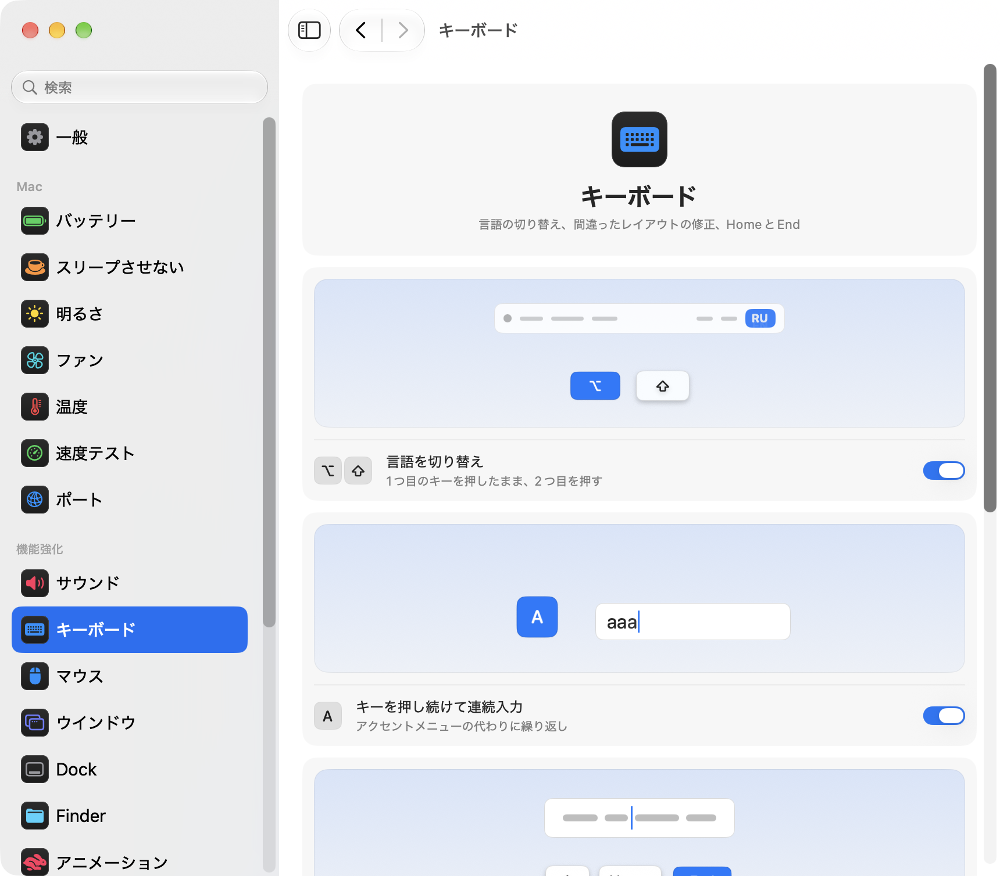

<p align="center"></p>
<h1 align="center">pikapik</h1>
<p align="center"><b>Macが、あなたの思いどおりに。</b><br>キーボード、マウス、ウインドウ、Finderをちょっと便利に。Macのメニューバーからすぐ使えます。</p>
<p align="center"><sub><a href="../../README.md">English</a> · <a href="README.ru.md">Русский</a> · <a href="README.uk.md">Українська</a> · <a href="README.de.md">Deutsch</a> · <a href="README.fr.md">Français</a> · <a href="README.es.md">Español</a> · <a href="README.it.md">Italiano</a> · <a href="README.pt-BR.md">Português (Brasil)</a> · <b>日本語</b> · <a href="README.zh-Hans.md">简体中文</a> · <a href="README.ko.md">한국어</a> · <a href="README.ro.md">Română</a> · <a href="README.pl.md">Polski</a> · <a href="README.tr.md">Türkçe</a> · <a href="README.nl.md">Nederlands</a> · <a href="README.sv.md">Svenska</a> · <a href="README.cs.md">Čeština</a> · <a href="README.zh-Hant.md">繁體中文</a> · <a href="README.ar.md">العربية</a> · <a href="README.hi.md">हिन्दी</a> · <a href="README.id.md">Bahasa Indonesia</a> · <a href="README.vi.md">Tiếng Việt</a> · <a href="README.th.md">ไทย</a></sub></p>

<p align="center">
<picture>
<source media="(prefers-color-scheme: dark)" srcset="../media/settings-ja-dark.png">

</picture>
</p>

## インストール

ターミナルを開いて次の行をペーストし、return キーを押します:

```bash
/bin/bash -c "$(curl -fsSL https://raw.githubusercontent.com/dev-pikapik/pika-tools/main/install.sh)"
```

このコマンドは、最新版を GitHub からダウンロードし、開発元の署名があり、Apple による悪質なソフトウェアのチェックに合格している場合にだけインストールします。インストールすると、画面上部のメニューバーにpikapikが表示されます。オンにするまで、どの機能もオフのままです。

<details>
<summary>ほかの方法: Homebrew または dmg</summary>

Homebrew を使う場合:

```bash
brew install --cask dev-pikapik/pika-tools/pikapik && open -a pikapik
```

または [pikapik.dmg](https://github.com/dev-pikapik/pika-tools/releases/latest/download/pikapik.dmg) をダウンロードして開き、アプリを「アプリケーション」フォルダにドラッグします。

上のコマンドでも Homebrew でも、アプリは `/Applications` に入り、起動して、許可を求め、「ログイン時に開く」をオンにします。その後はアプリが自動でアップデートされます。**アップデート**を参照してください。削除するときは**アンインストール**を参照してください。

</details>

## できること

<table>
<tbody><tr>
<td width="50%" valign="top">
<picture><source media="(prefers-color-scheme: dark)" srcset="../media/keep-awake-dark.png"></picture>
<br><b>スリープさせない</b>
<br>必要なあいだMacを起こしたまま。蓋を閉じていても大丈夫です。
</td>
<td width="50%" valign="top">
<picture><source media="(prefers-color-scheme: dark)" srcset="../media/fans-dark.png"></picture>
<br><b>ファン</b>
<br>ファンの回転の速さを確認し、速さを選べます。
</td>
</tr></tbody>
<tbody><tr>
<td width="50%" valign="top">
<picture><source media="(prefers-color-scheme: dark)" srcset="../media/battery-dark.png"></picture>
<br><b>バッテリー</b>
<br>バッテリーの状態、最大容量、充放電回数、バッテリーに入る電力、そして長持ちさせるコツを確認できます。
</td>
<td width="50%" valign="top">
<picture><source media="(prefers-color-scheme: dark)" srcset="../media/command-keys-dark.png"></picture>
<br><b>⌘Qと⌘Wを保護</b>
<br>うっかり終了したり閉じたりしません。意図して使うときは⇧を足します。
</td>
</tr></tbody>
<tbody><tr>
<td width="50%" valign="top">
<picture><source media="(prefers-color-scheme: dark)" srcset="../media/compress-dark.png"></picture>
<br><b>小さいコピー</b>
<br>写真やPDF、ビデオを右クリックすると、隣に軽いコピーができます。
</td>
<td width="50%" valign="top">
<picture><source media="(prefers-color-scheme: dark)" srcset="../media/convert-dark.png"></picture>
<br><b>変換</b>
<br>画像やビデオ、曲を右クリックから別の形式で保存できます。
</td>
</tr></tbody>
<tbody><tr>
<td width="50%" valign="top">
<picture><source media="(prefers-color-scheme: dark)" srcset="../media/input-switch-dark.png"></picture>
<br><b>言語を切り替え</b>
<br>⌥を押したまま⇧を押すと、キーボードの言語が切り替わります。
</td>
<td width="50%" valign="top">
<picture><source media="(prefers-color-scheme: dark)" srcset="../media/quit-on-close-dark.png"></picture>
<br><b>最後のウインドウで終了</b>
<br>アプリの最後のウインドウを閉じると、アプリも終了します。
</td>
</tr></tbody>
<tbody><tr>
<td width="50%" valign="top">
<picture><source media="(prefers-color-scheme: dark)" srcset="../media/window-zoom-dark.png"></picture>
<br><b>緑のボタンで拡大</b>
<br>フルスクリーンにせず、ウインドウを画面いっぱいに広げます。
</td>
<td width="50%" valign="top">
<picture><source media="(prefers-color-scheme: dark)" srcset="../media/dock-hide-dark.png"></picture>
<br><b>Dockのクリックでしまう</b>
<br>使っているアプリのアイコンをクリックすると、さっと隠れます。
</td>
</tr></tbody>
<tbody><tr>
<td width="50%" valign="top">
<picture><source media="(prefers-color-scheme: dark)" srcset="../media/new-file-dark.png"></picture>
<br><b>新規ファイル</b>
<br>Finderで右クリックして名前を入れるだけで、空のファイルができます。
</td>
<td width="50%" valign="top">
<picture><source media="(prefers-color-scheme: dark)" srcset="../media/finder-cut-dark.png"></picture>
<br><b>⌘Xでファイルを移動</b>
<br>Finderでファイルを切り取って、好きな場所にペーストできます。
</td>
</tr></tbody>
<tbody><tr>
<td width="50%" valign="top">
<picture><source media="(prefers-color-scheme: dark)" srcset="../media/finder-open-dark.png"></picture>
<br><b>Enterでファイルを開く</b>
<br>Finderでファイルを選んでEnterを押すと開きます。
</td>
<td width="50%" valign="top">
<picture><source media="(prefers-color-scheme: dark)" srcset="../media/finder-delete-dark.png"></picture>
<br><b>Deleteでゴミ箱へ</b>
<br>Finderで⌫を押すと、選んだファイルがゴミ箱に入ります。
</td>
</tr></tbody>
<tbody><tr>
<td width="50%" valign="top">
<picture><source media="(prefers-color-scheme: dark)" srcset="../media/desktop-icons-dark.png"></picture>
<br><b>デスクトップのアイコンを隠す</b>
<br>通話やスクリーンショットの前に、クリックひとつでデスクトップをすっきり。
</td>
<td width="50%" valign="top">
<picture><source media="(prefers-color-scheme: dark)" srcset="../media/hidden-files-dark.png"></picture>
<br><b>隠しファイルを表示</b>
<br>macOS が隠しているファイルやフォルダを表示します。
</td>
</tr></tbody>
<tbody><tr>
<td width="50%" valign="top">
<picture><source media="(prefers-color-scheme: dark)" srcset="../media/game-mode-dark.png"></picture>
<br><b>ゲームモード</b>
<br>プレイ中は、ゲームの上に何も開かず、うっかり閉じることもありません。
</td>
<td width="50%" valign="top">
<picture><source media="(prefers-color-scheme: dark)" srcset="../media/speed-test-dark.png"></picture>
<br><b>速度テスト</b>
<br>インターネットの速さと、それで何ができるかがわかります。
</td>
</tr></tbody>
<tbody><tr>
<td width="50%" valign="top">
<picture><source media="(prefers-color-scheme: dark)" srcset="../media/side-buttons-dark.png"></picture>
<br><b>サイドボタン</b>
<br>ボタン4と5で戻る/進む。トラックパッドのスワイプと同じです。
</td>
<td width="50%" valign="top">
<picture><source media="(prefers-color-scheme: dark)" srcset="../media/hide-app-dark.png"></picture>
<br><b>マウスボタンで隠す</b>
<br>1回押すと、⌘Hのように最前面のアプリが隠れます。アプリは動いたままです。
</td>
</tr></tbody>
<tbody><tr>
<td width="50%" valign="top">
<picture><source media="(prefers-color-scheme: dark)" srcset="../media/wheel-lines-dark.png"></picture>
<br><b>行単位でスクロール</b>
<br>ホイールをどれだけ速く回しても、1クリックで同じだけスクロールします。
</td>
<td width="50%" valign="top">
<picture><source media="(prefers-color-scheme: dark)" srcset="../media/wheel-direction-dark.png"></picture>
<br><b>スクロール方向</b>
<br>トラックパッドとマウスで、別々の方向を選べます。
</td>
</tr></tbody>
<tbody><tr>
<td width="50%" valign="top">
<picture><source media="(prefers-color-scheme: dark)" srcset="../media/linear-pointer-dark.png"></picture>
<br><b>ポインタの加速をオフ</b>
<br>手を動かしたぶんだけ、ポインタが正確に動きます。
</td>
<td width="50%" valign="top">
<picture><source media="(prefers-color-scheme: dark)" srcset="../media/key-repeat-dark.png"></picture>
<br><b>キーを押し続けて連続入力</b>
<br>キーを押し続けると、アクセントメニューの代わりに文字が繰り返されます。
</td>
</tr></tbody>
<tbody><tr>
<td width="50%" valign="top">
<picture><source media="(prefers-color-scheme: dark)" srcset="../media/home-end-dark.png"></picture>
<br><b>HomeとEnd</b>
<br>入力中に行頭や行末へジャンプします。
</td>
<td width="50%" valign="top">
<picture><source media="(prefers-color-scheme: dark)" srcset="../media/animations-dark.png"></picture>
<br><b>アニメーション</b>
<br>Dock、ウインドウ、クイックルックを速く。瞬時にもできます。
</td>
</tr></tbody>
<tbody><tr>
<td width="50%" valign="top">
<picture><source media="(prefers-color-scheme: dark)" srcset="../media/leftover-permissions-dark.png"></picture>
<br><b>削除したアプリの許可</b>
<br>削除したアプリのために macOS が残している許可を取り除けます。
</td>
<td width="50%" valign="top">
<picture><source media="(prefers-color-scheme: dark)" srcset="../media/pet-dark.png"></picture>
<br><b>デスクトップのペット</b>
<br>小さな友だちがウインドウの後ろをお散歩します。つかんで投げたり、スペースを押してジャンプさせたりできます。クローゼットで着せ替えをして、いっしょに遊びながらアワードを集められます。入力中は元気になり、席を離れるとうとうとします。
</td>
</tr></tbody>
<tbody><tr>
<td width="50%" valign="top">
<picture><source media="(prefers-color-scheme: dark)" srcset="../media/uninstaller-dark.png"></picture>
<br><b>アプリの削除</b>
<br>アプリとそのファイルを削除します。すべて元に戻せます。
</td>
<td width="50%" valign="top">
<picture><source media="(prefers-color-scheme: dark)" srcset="../media/game-fps-dark.png"></picture>
<br><b>FPSを表示</b>
<br>小さなカウンターが、選んだ角にゲームのなめらかさを表示します。
</td>
</tr></tbody>
<tbody><tr>
<td width="50%" valign="top">
<picture><source media="(prefers-color-scheme: dark)" srcset="../media/archive-dark.png"></picture>
<br><b>アーカイブ</b>
<br>右クリックで、RARなどのアーカイブを開いたり、ファイルをZIPにまとめたりします。
</td>
<td width="50%" valign="top">
<picture><source media="(prefers-color-scheme: dark)" srcset="../media/dock-display-dark.png"></picture>
<br><b>Dockを1台のディスプレイに固定</b>
<br>Dock が別のディスプレイに飛び移らなくなります。移動するには、別のディスプレイを主ディスプレイにします。
</td>
</tr></tbody>
<tbody><tr>
<td width="50%" valign="top">
<picture><source media="(prefers-color-scheme: dark)" srcset="../media/temperatures-dark.png"></picture>
<br><b>温度</b>
<br>プロセッサからバッテリーまで、Mac の内部がどのくらい熱くなっているかを確認できます。
</td>
<td width="50%" valign="top">
<picture><source media="(prefers-color-scheme: dark)" srcset="../media/background-dark.png"></picture>
<br><b>バックグラウンドタスク</b>
<br>バックグラウンドで動いているものと、その出どころがわかります。
</td>
</tr></tbody>
<tbody><tr>
<td width="50%" valign="top">
<picture><source media="(prefers-color-scheme: dark)" srcset="../media/ports-dark.png"></picture>
<br><b>ポート</b>
<br>ポートを使っているプログラムを確認して、ポートを空けられます。
</td>
<td width="50%" valign="top">
<picture><source media="(prefers-color-scheme: dark)" srcset="../media/app-volume-dark.png"></picture>
<br><b>アプリの音量</b>
<br>ほかのアプリはそのままで、好きなアプリの音量を下げたりミュートしたりできます。
</td>
</tr></tbody>
<tbody><tr>
<td width="50%" valign="top">
<picture><source media="(prefers-color-scheme: dark)" srcset="../media/brightness-dark.png"></picture>
<br><b>モニタの明るさ</b>
<br>macOS が自分で調節できないモニタを、スライダーや明るさキーで暗くしたり明るくしたりできます。
</td>
<td width="50%" valign="top">
<picture><source media="(prefers-color-scheme: dark)" srcset="../media/layout-fix-dark.png"></picture>
<br><b>間違ったレイアウトを修正</b>
<br>привет のつもりが ghbdtn に？スペースを押せば直ります。
</td>
</tr></tbody>
<tbody><tr>
<td width="50%" valign="top">
<picture><source media="(prefers-color-scheme: dark)" srcset="../media/middle-click-dark.png"></picture>
<br><b>トラックパッドで中央クリック</b>
<br>3本指でタップすると、マウスの中央ボタンと同じようにリンクを新しいタブで開けます。
</td>
</tr></tbody>
</table>

## 詳しく

<details>
<summary>初回起動</summary>

pikapik には 2 つの許可が必要です。初回起動時に設定の「許可」ページが開いて手順を案内し、macOS も独自の確認を表示します。**システム設定 › プライバシーとセキュリティ** を開き、次の項目で pikapik をオンにします:

- **アクセシビリティ**: キー入力やクリックがほかのアプリに届く前に、アプリがそれを変更できるようにします。
- **入力監視**: キー入力やクリックを変更せずに読み取れるようにします。言語の切り替えはこの仕組みで動きます。

変更は数秒以内に反映されます。再起動は不要です。

一部の機能は、使うときに追加の許可を求めます。**管理者アクセス**、**Finder機能拡張**、**iCloud Drive**、**フルディスクアクセス**、**画面収録**、**システムオーディオの録音**です。どれも設定の「許可」ページにまとまっていて、各項目には何のための許可かを示す一行、緑のチェックかオレンジの×、そしてボタンがひとつあります。許可がないときは **許可**、オンのときは **オフにする** です。そのため、どの許可もその場で取り消せます。

pikapik は、入力やクリックの内容を記録、保存、送信しません。イベントはメモリ上で処理され、すぐにそのまま渡されます。間違ったレイアウトで入力した単語を直すために、pikapik は最後に入力した数語だけをメモリ上に置き、クリックしたりアプリを切り替えたりするとすぐに忘れます。保存するのは、そのままにしておくよう指定した単語だけで、それもこの Mac の中だけに、設定 › キーボードで消去するまで残ります。pikapik がインターネットに接続するのは、アップデート（GitHub に最新リリースを問い合わせ、アップデートを選んだときだけダウンロードします）と、自分で始めたときの速度テスト（Apple のサーバを使います）だけです。Mac App Store 版のアップデートは App Store が行い、速度テストには Cloudflare を使います。ペットの記録（歩数、投げた回数、アワードなど）は、この Mac の中だけで数えられ、どこにも送信されません。設定 › ペットで消去できます。

</details>

<details>
<summary>すべての機能の詳細</summary>

**プレーヤー。** QuickTime で開けない MKV、WebM、AVI、WMV、FLV などのビデオを、専用のウインドウで再生します。設定 › プレーヤー を開いて **ビデオを開く…** をクリックするか、ビデオを右クリックして **このアプリケーションで開く › pikapik Player** を選びます。スペースキーで再生と一時停止、← と → は一時停止中は 1 コマ、再生中は 5 秒移動、J と L は 10 秒移動、↑ と ↓ で音量を変え、F でフルスクリーンにします。**速度**メニューは 0.5 倍から 2 倍まで、**フレームを保存…** は PNG を保存し、プレーヤーは前回やめた位置から再開します。ビデオのチャプターは時間バーの印と**チャプター**メニューに表示され、Page Down と Page Up でチャプター間を移動でき、A を 2 回押すと、その 2 回の間の部分を 3 回目に A を押すまで繰り返します。**ピクチャインピクチャ**（⌘⌥P）は、ビデオを他のウインドウの上の小さなウインドウに表示します。**サウンドの出力先**（再生メニュー）を使うと、Mac 本体の出力を変えずに、プレーヤーの音だけを別のスピーカーやヘッドフォンに送れます。操作パネルはすりガラス風で、再生中は自動で隠れ、時間バーにポインタを合わせるとその場面の小さな画像が表示されます。ウインドウにタイトルバーはなく、映像がウインドウ全体に広がり、3つのウインドウボタンも操作パネルと一緒に現れたり隠れたりします。すでに開いているビデオを開くと、2 つ目のウインドウは開かず、そのウインドウが手前に出ます。プレーヤーはネットワークに接続せず、許可も求めません。そのページの各フォーマットは、いま開くアプリを表示するボタンです。クリックすると pikapik Player がそのフォーマットの標準アプリになり、もう一度クリックすると以前のアプリに戻ります。**すべてを pikapik で開く** はすべてのフォーマットを順に処理し、**元のアプリに戻す** に変わります (macOS が 1 つずつ確認します)。曲も同じウインドウで、ジャケット、タイトル、アーティストとともに再生します。MP3、AAC、FLAC、ALAC、WAV、AIFF、Ogg、Opus、WMA などに対応しています。フォルダは最初の曲から再生され、N と P（**フォルダ内の次のファイル**、**フォルダ内の前のファイル**）で曲を移動し、次の曲は自動で始まります。macOS がフォルダの許可を 1 回だけ求めます。Mac の「再生中」とメディアキーも使えます。FFmpeg、dav1d、libass、FreeType、HarfBuzz、FriBidi のライセンスとソースコードは、同じページから開けます。**音声** メニューと **字幕** メニュー（とパネルのボタン）で、再生位置を失わずに音声トラックと字幕を切り替えられます。ファイル内のテキスト字幕と、隣にある同じ名前の .srt、.vtt、.ass ファイル（フォルダが許可されていれば）は自動で表示されます。字幕ファイルをウインドウにドロップするか、**字幕ファイルを追加…** を選ぶこともできます。画像字幕（Blu-ray、DVD、DVB）も表示され、ASS字幕はアニメーションやカラオケ、ビデオに含まれるフォントも含めてそのまま描画されます。Mac App Store 版にはありません。

**アプリの音量。** 設定 › サウンド を開き、**アプリの音量** をオンにします。音を出すアプリには、それぞれ専用のスライダーとミュートボタンが付き、設定でもメニューでも使えます。音が大きいビデオ通話は下げ、うるさいゲームはミュートし、音楽はそのまま。Mac 全体の音量やほかのアプリの音量は変わりません。pikapik は、アプリごとの音量を覚えていて、最大のままにしたアプリには手を加えません。設定したアプリは、再起動後もリストに残り、閉じている間は薄く表示されます。そのため、アプリが起動する前に音量を決めておけます。**アプリを追加…** をクリックするか、Finder からアプリをドラッグしてください。アプリの横の ✕ を押すと、そのアプリを忘れて最大音量に戻します。アプリの音量を変えるため、pikapik はそのアプリの音をいったん自分の中を通します。そのため **システムオーディオの録音** の許可が必要で、設定の「許可」ページで許可します。音は通すだけで、録音も保存も送信もされず、マイクも使いません。macOS 14.2 以降が必要で、macOS 14.0 と 14.1 では表示されません。初期設定はオフです。

**モニタの明るさ。** macOS は内蔵ディスプレイと Apple 製ディスプレイの明るさは変えられますが、ほかの多くのモニタの明るさは変えられません。設定 › 明るさ を開くと、macOS が自分で調節できないモニタにはそれぞれ専用のスライダーが付きます。メニューバーのパネルに「明るさ」の行を追加することもできます。pikapik が変えるのはモニタ本体の明るさで、モニタのボタンで変えるのと同じ設定です。反応しないモニタでは、**代わりに画面を暗くする** をオンにします。画面は暗くなりますが、真っ黒にはなりません。**明るさキー** をオンにすると、キーボードの明るさキーでポインタがあるモニタの明るさを変えられ、画面に小さなインジケータが表示されます。⌥⇧ を押しながら操作すると、より細かく調節できます。キーを使うには **アクセシビリティ** の許可が必要で、設定の「許可」ページで許可します。スライダーは許可なしでも使えます。pikapik はモニタごとの明るさを覚えていて、スリープ後に設定し直します。Mac App Store 版では画面を暗くするだけです。明るさキーの初期設定はオフです。

**⌘Q と ⌘W を保護。** ⌘Q や ⌘W だけを押しても何も起こらないので、うっかりアプリを終了したりウインドウを閉じたりしません。意図して操作するときは Shift を加えます。⇧⌘Q で終了、⇧⌘W で閉じます。すべてのアプリで使えます。キーごとにスイッチがあります。初期設定はオフです。

**Option+Shift で言語を切り替え。** Option を押したまま Shift を押すと、macOS が次の入力ソースに切り替わります。Option を押したまま Shift をもう一度押すと、さらに次に進みます。Shift を押したまま Option を押すと前に戻ります。途中でほかのキーを押したり、クリックしたり、Command、Control、Fn を加えたりすると切り替わらないので、Option+Shift+矢印キーのようなショートカットはこれまでどおり使えます。初期設定はオフです。

**キーを押し続けて連続入力。** キーを押し続けると、アクセントメニューが出る代わりに同じ文字が繰り返し入力されます。ゲームや文字入力で便利です。すでに開いているアプリには再起動後に反映されます。オフにすると macOS はいつもの動作に戻ります。初期設定はオフです。

**HomeとEndで行頭と行末へ。** 入力中にHomeを押すとカーソルが行頭へ、Endを押すと行末へ移動し、ページはスクロールしません。⇧と一緒に押すとそこまで選択し、⌘と一緒に押すとテキスト全体の先頭や末尾へ移動します。テキスト欄の外や、ターミナル、仮想マシン、リモートデスクトップのアプリでは、これまでどおり動作します。Mac App Store 版では、ブラウザ、Finder、ミュージックを除き、テキスト欄の外でもこの動作になります。通常どおり動作させたいほかのアプリも追加できます。初期設定はオフ。

**間違ったレイアウトで入力した単語を修正。** привет と打ったつもりが ghbdtn のような意味のない文字列になったら、スペースキーかReturnキーを押したとたんに pikapik が正しいレイアウトで打ち直し、次の単語が正しく入力されるようにレイアウトも切り替えます。Mac に追加したすべてのキーボードレイアウトで使えます。単語が変わるのは、お使いのどの言語にもない単語で、しかも同じキーを別のレイアウトで打つとよく使われる単語になるときだけです。そのため、名前やタイプミス、めったに使わない単語は入力したまま残ります。パスワード欄やターミナル、自分で選んだアプリでも修正されません。⌃⇧スペースを押すと最後の単語か選択したテキストを修正し、もう一度押すとほかのレイアウトを試せます。修正の直後に同じキーを押すと元に戻り、その単語は以後 pikapik が自動で修正しなくなります。ショートカットは設定 › キーボードで変更できます。Mac App Store 版では、テキストを選択して⌃⇧スペースを押すか、「サービス」メニューの「キーボードレイアウトを修正」を選びます。**入力中に単語を修正**とショートカットは、設定 › キーボードでオンにするまでオフです。どちらも、「許可」ページで求められるアクセシビリティが必要です。初期設定はオフ。 レイアウトが1つしかない場合は、ページ上の案内からお使いの言語のレイアウトをその場で追加でき、システム設定を開く必要はありません(Webサイト版)。

**ポインタの加速をオフにする。** マウスをどれだけ速く動かしても、ポインタはマウスを動かした分だけ正確に移動します。**軌跡の速さ** スライダで移動の速さを設定します。マウスにだけ効き、トラックパッドはそのままです。オフにするか pikapik を終了すると、macOS 本来の設定に戻ります。初期設定はオフです。

**行単位でスクロール。** マウスホイールを 1 クリックするたびに、どれだけ速く回しても同じ行数だけスクロールします。1 クリックあたり 1〜10 行から選べて、初期設定は 3 行です。ナチュラルなスクロールは、システム設定で選んだとおりのままです。対象はマウスだけで、トラックパッドは今までどおりです。初期設定はオフです。**1クリックの距離** のスライダーの横では、小さなページが選んだ距離だけスクロールし、点が初期値を示します。

スクロール量を正確なピクセル数で数えるアプリやゲームには、同じ設定をピクセルに切り替え、1 クリックあたり 1〜200 ピクセルを選べます（標準は 40）。スライダーには、それが画面の高さのどれくらいかも表示されます。

**トラックパッドとマウスのスクロール方向。** macOS のナチュラルなスクロールの設定は、トラックパッドとマウスで共通の 1 つだけです。これをオンにして、それぞれの方向を選びます。iPhone のようにページが指についてくる **ナチュラル** か、ページが逆方向に動く **クラシック** です。トラックパッドの選択は、横方向のスクロールや指を離したあとの惰性スクロールにも効きます。Magic Mouse はタッチでスクロールするので、トラックパッドの選択に従います。お使いのすべての Mac で同じものを選べば、ユニバーサルコントロールでマウスを別の Mac に移しても、どこでも同じ感覚でスクロールできます。初期設定はオフです。オンにすると、どちらもシステム設定と同じ状態から始まるので、別のものを選ぶまで何も変わりません。

**サイドボタンで戻る/進む。** マウスのボタン 4 と 5 で、Finder、Safari などの Apple のアプリや、ほかの多くのアプリで戻る／進むができます。トラックパッドでのスワイプと同じ操作です。これらのボタンを自分で扱うアプリには、ボタンがそのまま渡されます。マウスのボタンが逆の場合は、**サイドボタンを入れ替える** をオンにしてください。初期設定はオフです。

**マウスボタンで現在のアプリを隠す。** 設定 › マウスで **マウスボタンで現在のアプリを隠す** をオンにして、中央ボタンやサイドボタンなど、使いたいボタンを押してください。あとはボタンを 1 回押すだけで、最前面のアプリが ⌘H とまったく同じように隠れます。アプリは動いたままで、Dock のアイコンをクリックすると戻ってきます。ゲームモードをオンにして遊んでいる間は、ボタンはゲームの中でいつもどおりに動作します。初期設定はオフです。

**トラックパッドで中央クリック。** 3本指でタップかクリックすると、トラックパッドがマウスの中央ボタンと同じように働きます。ほとんどのブラウザでは、リンクを新しいタブで開いたり、タブを閉じたりできます。4本指に変えることもできます。タップで使うには、システム設定 › トラックパッドで **タップでクリック** をオンにしておく必要があります。そこで「調べる＆データ検出」が3本指のタップになっていると、3本指ではクリックしかできません。「3本指のドラッグ」がオンのときは、4本指を選んでください。設定の **指の本数** の行に、お使いの Mac で何が使えるかが表示されます。マウスはそのままです。**アクセシビリティ**と**入力監視**の許可が必要で、Mac App Store 版にはありません。初期設定はオフです。

**最後のウインドウを閉じたら終了。** アプリの最後のウインドウを閉じると、アプリが終了します。Finder は開いたままで、ほかのデスクトップや Dock にウインドウがあるアプリも終了しません。この方法で終了させたくないアプリをリストに登録できます。初期設定はオフです。

**Dockのクリックでしまう・隠す。** 使用中のアプリの Dock アイコンをクリックすると、そのアプリのウインドウがすべて Dock にしまわれます。もう一度クリックすると、すべて戻ります。⌘H のように、クリックでアプリ全体を隠す設定にもできます。初期設定はオフです。

**Dock を 1 台のディスプレイに固定。** ディスプレイが複数あると、ポインタを別のディスプレイの下端に押し当てた途端、macOS は Dock をそのディスプレイへ移してしまいます。オンにすると、ポインタをどんなに速く動かしても、そうならなくなります。pikapik は Dock 自身の設定でこの移動をオフにし、ポインタには一切触れません。Dock を意図して移動するには、別のディスプレイを主ディスプレイにします。**システム設定 › ディスプレイ**でそのディスプレイをクリックし、**使用形態**で**主ディスプレイ**を選ぶと、Dock も一緒に移ります。スイッチの下にある**主ディスプレイ**の行で、その場で切り替えられます。スイッチをオフにすると、ディスプレイの配置は元に戻ります。Dock は起動時にしか設定を読み込まないため、スイッチをオンまたはオフにすると Dock が 1 回再起動します。許可は要りません。このスイッチの初期設定はオフで、Mac App Store 版にはありません。

**緑のボタンでウインドウを拡大。** ウインドウの緑のボタンをクリックすると、フルスクリーンにはならずに画面いっぱいに広がります。もう一度クリックすると元の大きさに戻ります。⌥を押しながらクリックすると、ボタンはいつもどおりに動きます。フルスクリーンは、ボタンのメニューと⌃⌘Fで引き続き使えます。緑のボタンを通常どおり使いたいアプリは、リストに登録できます。初期設定はオフです。

**Finderで新規ファイル。** Finderのウインドウやデスクトップで右クリックして **新規ファイル** を選び、名前を入力すると空のファイルができます。標準は.txt。初期設定はオフ。

**FinderでEnterキーを押して開く。** Finderのウインドウやデスクトップでファイルを選び、ReturnキーまたはEnterキーを押すと開きます。F2またはfn F2で、選んだファイルの名前を変更できます。名前の入力中など、文字を入力する場所では、キーはいつもどおり使えます。初期設定はオフ。

**Finderで⌘Xを押して切り取る。** ファイルを選んで⌘Xを押し、移動先のフォルダを開いて⌘Vを押すと、ファイルはコピーされずに移動します。⌘Cで切り取りを取り消せます。初期設定はオフ。

**FinderでDeleteキーで削除。** ファイルを選んで⌫または⌦（ノートパソコンではfn ⌫）を押すと、⌘⌫と同じようにゴミ箱に入ります。名前の変更中や検索中、そのほかの入力欄に入力しているときは、通常どおり文字を消します。初期設定はオフ。

**Finderで小さいコピー。** Finderでファイルを右クリックして **小さいコピーを作成** を選びます。写真、GIF、PDF、ビデオの軽いバージョンがすぐ隣に保存され、サイズは数分の一になることもよくあります。WAVやAIFFなどの非圧縮サウンドはコンパクトなM4Aになります。これ以上小さくできないファイルの場合はコピーを作らず、pikapikがそのことを知らせます。元のファイルはそのまま残り、Macの外には何も送られません。初期設定はオフ。

**Finderで変換。** Finderでファイルを右クリックして **変換** を選ぶと、別のフォーマットで保存できます。画像はJPEG、PNG、HEIC、GIF、TIFF、PDFに、ビデオはMP4、MOV、または音声だけに、音楽はM4A、WAV、AIFFに。元のファイルはそのまま残り、Macの外には何も送られません。小さいコピーとは別にオン/オフできます。初期設定はオフ。

**Finderでアーカイブ。** Finderでアーカイブを右クリックして **展開** を選ぶと、中のファイルがアーカイブのすぐ隣に現れます。ほかのファイルやフォルダを右クリックして **アーカイブを作成…** を選ぶと、ZIP、7Z、TAR.GZ、TAR.XZ を作れます。ZIP と 7Z にはパスワードを付けられ、どのアーカイブも、たとえばメール用の 15 MB ずつや、USB メモリ用の 4 GB ずつの複数の部分に分けられます。パスワードは 2 回入力するので、打ち間違いで自分のファイルを開けなくなることはありません。この方法で作った ZIP には余分な隠しファイルが入らず、どの言語のファイル名も読める形のままで、4 GB を超えるファイルも扱えます。初期設定はオフ。Mac App Store 版にはいくつかの制限があります（下記）。

pikapik は、macOS では開けないものも開けます。複数の部分に分かれた RAR、パスワードで保護された 7Z、.001、.z01、.r00、.part1.rar のような分割セット、そして ZIPX、CAB、LZH、ARJ、ZST、LZMA、WIM など。ダブルクリックすると pikapik で開きます。古い ZIP に入っている、たとえばキリル文字や日本語、中国語のファイル名も、文字化けせずに読めます。設定 › Finder のスイッチ **アーカイブをこのアプリで開く** をオンにすると ZIP と 7Z も pikapik に任せられ、TAR と GZ は、これらをすでに問題なく扱える Mac 標準のアーカイブ用アプリのままです。pikapik は RAR を開けますが、作ることはできません。RAR のライセンスで認められているのは展開だけです。

パスワードが必要なときはウインドウで尋ね、**停止** を押すとどの作業も中止でき、壊れたり不完全だったりするアーカイブからは、読める部分を取り出します。展開すると途方もない大きさに膨らむアーカイブは展開前に確認し、ディスクがいっぱいになりそうなときは手前で止め、自分のフォルダの外に書き込もうとするアーカイブは止めます。Finderでアーカイブを選んでスペースキーを押すと、中身をプレビューできます。
**Mac App Store 版のアーカイブ。** こちらでも使えますが、同梱の 7-Zip ではなく macOS 内蔵のツールで処理するため、制限があります。パスワードを付けられるのは ZIP だけで、7Z には付けられません。アーカイブを分割することはできず、複数に分割されたアーカイブ（.001、.part1.rar、.z01 など）は開けません。単体の .xz、.lzma、.zst ファイルは開けません（.gz と .bz2 は開けます）。パスワード付きの 7Z と RAR も開けません。**アーカイブをこのアプリで開く**スイッチもありません。初回はホームフォルダへのアクセスを求められます。Finderで新規ファイルや小さいコピーを使うときと同じで、この版は許可された場所にしか書き込めないためです。Finder 機能拡張は「システム設定 › 一般 › ログイン項目と機能拡張」でオンにしてください。クリックする場所は pikapik が示します。


**デスクトップのアイコンを隠す。** 通話、画面収録、スクリーンショットの前にオンにすると、デスクトップのファイルとフォルダが消えます。オフにすると、元の場所に戻ります。何も移動しません。ファイルは Finder の「デスクトップ」フォルダにそのまま残ります。システム設定 › デスクトップとDock の **項目を表示 › デスクトップに** と同じ設定を手元に置いたものなので、両者は常に一致します。Mac App Store 版では、この行は代わりにすべてのディスプレイでアイコンを壁紙で覆い、壁紙が動くときは無地の色で覆います。クリックはそのままデスクトップに届きます。設定では、その下の **開く** ボタンから、システム設定のそのページを今までどおり開けます。

**隠しファイルを表示。** ホームフォルダの「ライブラリ」や、名前がドットで始まるファイルなど、macOS が隠しているファイルとフォルダが、Finder とデスクトップに薄く表示されます。Finder で ⇧⌘. を押すのと同じですが、オンかどうかがひと目でわかります。変更を反映するため、Finder がいったん再起動して、ウインドウとタブを開き直します。Finder がファイルをコピー中または移動中のときは、終わるまで待ってから再起動します。どちらも 設定 › Finder にあります。メニューバーのパネルに置くには、パネル下の鉛筆ボタンをクリックしてチェックを付けてください。Mac App Store 版では、代わりに 設定 › Finder に ⇧⌘. キーが表示されます。

**ゲームモード。** ゲームを追加しておくと、プレイ中にMacがあなたをゲームから引き離しません。Spotlight、Siri、⌘Tab、Mission Control、デスクトップ間のスワイプがゲームの上に開かず、⌘Qや⌘Wで誤ってゲームが閉じることも、ポインタがDock、メニューバー、別の画面へ出てしまうこともありません。画面も消えません。それぞれ「ゲーム」ページで個別にオン/オフでき、pikapikはMacで見つけたゲームを提案します。ゲーム中はControl-クリックもただのクリックのままで、Control+矢印でデスクトップが切り替わることもありません。Minecraftも認識します。Minecraft LauncherかCurseForgeを追加すると、Minecraft本体で遊んでいる間はモードがオンになります。ゲームを終了するには⇧⌘Q、ウインドウを閉じるには⇧⌘Wを押します。⌥⌘Escは必ず使えます。ゲームを離れると、すべていつもどおりに動きます。初期設定はオフ。

ゲームモードをオンにして遊んでください。その他のゲーム設定には、Macが公開する一覧と現在のキー割り当て、各操作のアニメーションプレビューがあります。

自動ではウインドウを開く操作やフォーカスを移す操作を一時停止します。意図した素早い言語切り替えはシステムのウインドウを出さずに実行します。移動キーを押し続けているときはゲーム操作を優先し、走ったり跳んだりしても言語が勝手に変わりません。

設定 → ゲーム → その他のゲーム設定に「マウスとトラックパッド」のグループがあります。MacのmacOSで有効にしているものだけが、Appleの名前と小さなイラスト付きで並びます。マウスボタンのショートカット、デスクトップやフルスクリーンAppの間のスワイプ、Mission ControlとApp Exposé、Appのためのピンチとデスクトップのための指を広げる操作、通知センターのための右端からのスワイプ、そして各ホットコーナーとその操作です。ゲームが最前面にある間はこれらが一時停止されるので、うっかりスワイプしたり画面の隅に触れたりしてもゲームから離れません。ゲーム内でのジェスチャは引き続き使えます。それぞれ、いつもどおり動作するように設定することもできます。 Webサイト版では、ホットコーナーの**変更…**でその場で別の操作を選べ、**元に戻す**で最初の操作に戻せます。変更のたびに Dock は1回再起動します。

設定 → ゲーム → ゲームを追加を開き、起動中のゲームをクリックしてください。Javaなどで動くゲームも、.appファイルがなくても表示されます。MinecraftはjavaではなくMinecraftと表示されます。 ゲームのプロセスを見つけ、設定 → ゲームの「あなたのゲーム」へ行をドラッグしてください。

**FPSを表示。** FPS は1秒あたりのフレーム数、つまりゲームが1秒間に描く絵の枚数です。「ゲーム」ページで**FPSを表示**をオンにすると、ゲームモード中は、どのゲームでも角に、この数字が入った小さな黒いラベルが表示されます。スイッチの上の絵で角をクリックすると、表示する角を選べます。「—」はまだ最初のフレームが届いていないこと、薄い「0」はゲームが描画を止めたことを表します。macOS 27 では、ほとんどのゲームを macOS 自身が数えるので、許可は要りません。macOS が数えられないゲーム、たいていは古いゲームは、画面収録で数えます。その場合は「許可」ページに**画面収録**の行が現れ、pikapik がゲーム中に許可を求めることはなく、数値は画面のリフレッシュレートを超えられません。macOS 14〜26 と Mac App Store 版では、すべてのゲームをこの方法で数えるため、**FPSを表示**をオンにするとすぐにその行が現れ、スイッチの下の**許可**ボタンからその行へ移動できます。画像が保存されたり送信されたりすることはありません。初期状態ではオフです。

**ペットのクローゼットとアワード。** 設定 › ペットを開くと、ペットに着せ替えができます。帽子やメガネからマントや翼まで30種類以上のアイテムと、魔法使い、海賊、宇宙飛行士のようなコーデが用意されています。最初から使えるのは少しだけで、残りはアワードです。ペットをつかんで投げたり、ボールを蹴って遊んだり、ウインドウをよじ登ったりおしゃべりしたりする様子を眺めたり、毎日そばにいてあげたりすると、少しずつ手に入ります。新しいアワードをもらうと、ペットが教えてくれます。

アワードの時期を知るため、pikapik はあなたとペットがしたことだけを数えます。Mac App Store 以外の版では、設定から GitHub のページを開いたかどうかも記録されます。歩数、つかんだ回数と投げた回数、ジャンプ、よじ登り、ボール遊び、おしゃべり、いっしょに過ごした日数、早朝・深夜・週末にいっしょにいたかどうか、開いた設定のページ、試着したアイテムです。これらの数、アワードをもらった日付、ペットが着ているものは、この Mac の中だけに残ります。どこにも送信されず、書き出した設定ファイルや iCloud の同期にも含まれません。設定 › ペットでいつでもすべて消去でき、ペットは最初からやり直しになります。

**アプリの削除。** 設定 › アプリの削除を開き、一覧からアプリを選ぶか、イラストにアプリをドロップすると、そのアプリが Mac に残しているものがすべて表示されます。アプリ本体、保存データ、設定、一時ファイル、バックグラウンドヘルパーなどが、一覧に載っている理由つきで並びます。アプリのものだとはっきり分かるファイルにはチェックが入り、関係があるかもしれない程度のファイルには入りません。ほかのアプリも使っているファイルには目印が付きます。削除するものを選んで、**ゴミ箱に入れる**をクリックしてください。完全に消えることはなく、すべてゴミ箱に入ります。アプリが開いている場合は、pikapik がまず終了をお願いします。管理者の権限が必要なファイルがあるときは、Mac がパスワードを1回だけ求めます。

気が変わったら、**元に戻す**をクリックしてください。すべてが元の場所に戻り、バックグラウンドヘルパーも再び動き出します。直近10件の削除は、ファイルがゴミ箱にあるあいだ「最近削除した項目」に残ります。**アプリをリセット**は、アプリ本体は残し、保存データ、設定、一時ファイルだけを削除します。アプリの調子が悪いときに役立ちます。自分でゴミ箱に入れたアプリは、残ったファイルといっしょに「ゴミ箱の中」に表示され、「削除したアプリの残りファイル」ではすでにないアプリのファイルが見つかります。「アプリをゴミ箱に入れたら、片づけを提案」のスイッチは初期状態ではオフで、あなたが選ぶまで何も削除されません。アプリが残しているものをすべて表示するには、**フルディスクアクセス**が必要です。このツールは Mac App Store 版にはありません。

**温度。** 設定 › 温度を開くと、Mac の内部がどのくらい熱くなっているかを確認できます。いちばん上には「正常」から「非常に高温」までのひとことで全体の状態が表示され、その下の 1 行で、Mac がフルスピードで動作しているか、温度を下げるために速度を落としているかがわかります。その下には部品ごとの行が並び、センサーのコードではなくわかりやすい名前で表示されます。プロセッサ、グラフィックス、メモリ、ストレージ、Wi-Fi、バッテリーのうち、お使いの Mac にセンサーがあるものが表示されます。各行には温度と短いバーが表示され、バーはその部品の通常の範囲に応じて緑、黄、オレンジに変わります。数値は 2 秒ごとに、しかも見ているあいだだけ更新されるので、Mac への負担はほとんどありません。パスワードや許可は必要ありません。メニューバーのパネルに「温度」の行を追加することもできます。Mac App Store 版では全体の状態が表示され、バッテリーを搭載した Mac ではバッテリーの温度も表示されます。

**バックグラウンドタスク**のページには、Mac で自動的に起動するものがすべて表示されます。ログイン時に開くアプリ、バックグラウンドサービス、アプリの中に組み込まれたヘルパー、すでに削除したアプリの残りファイルなどです。タスクごとに、追加したアプリ、いま実行中かどうか、ファイルの場所がわかり、クリック1回で Finder にファイルを表示できます。エージェントが起動するタスク（すべてのユーザ向けを含む）と古いログイン項目は、pikapik の中でボタン1つでオフにでき、パスワードは要らず、同じように簡単にオンに戻せます。何も削除されません。共有の Library フォルダにあるバックグラウンドサービス、リモートログイン、画面共有も、「許可」ページで管理者アクセスを許可すれば同じようにオフにできます。アプリが自分で登録したヘルパーとそれ以外の場所のサービスは macOS が管理しているため、そのボタンはシステム設定の「ログイン項目」を開き、行の下の一文で理由を説明します。Mac App Store 版では、このページはタスクを表示するだけです。いつもの「開く」ウインドウでホームフォルダへのアクセスを一度許可すれば表示され、ボタンは「ログイン項目」を開きます。

**ポート。** プログラムに「ポートはすでに使用されています」と表示されたら、設定 › ポートを開きます。Mac でポートを使っているすべてのプログラムが、アイコン、ポート番号、同じネットワーク上のほかのデバイスから接続できるかどうかとともに表示されます。番号を入力すると、そのポートを使っているプログラムを探したり、ポートが空いていることを確かめたりできます。行をクリックすると、ブラウザで開けるアドレス、プログラムのファイル、プログラムを起動したコマンド、フォルダ、プロセス番号が表示されます。**空ける**は、作業を保存できるようにまずプログラムに終了をお願いし、それでも終了しない場合は強制終了を提案します。どちらの操作も、実行する前に確認します。macOS の一部やほかのユーザのプログラムを pikapik が終了することはありません。「AirPlayレシーバー」と「ファイル共有」の場合は、システム設定のどのスイッチでポートが空くかを案内し、「リモートログイン」と「画面共有」は「オフにする」ボタンですぐにオフにできます。ポートは Mac App Store 版にはありません。この版では、どのプログラムがポートを使っているかを macOS がアプリに調べさせないためです。

各ツールには、メニューと設定にそれぞれスイッチがあります。

メニューバーのアイコンで状態がひと目でわかります。ツールが動作中なら pikapik のマーク、すべてオフなら同じマークが薄く、ツールがオンなのに許可が足りないときは警告の三角マークです。

メニューバーのパネルは、最初は少数の行だけを表示します。表示する行は自由に選べます。下の鉛筆ボタンをクリックし、表示したい項目にチェックを付けて「完了」をクリックしてください。非表示にした行も動作は続き、設定には残ります。パネルが画面に収まらないときはスクロールできます。

アプリはシステムの言語、または設定で選んだ言語で表示されます。このページの先頭に並んでいる 23 言語すべてに対応しています。

</details>

<details>
<summary>スリープさせない</summary>

キーボードから離れている間も Mac がスリープしないようにします。1 秒から 365 日までの好きな長さ、またはオフにするまで続けられます。メニューからオンにし、長さは設定で、日、時間、分、秒を入力するか、↑ と ↓ を押すか、15 分から 8 時間までの候補をクリックして指定します。メニューには残り時間と終了時刻が表示されます。**ディスプレイ** は 2 つから選べます。**常にオン** は画面が消えず、スクリーンセーバーもロック画面も出ません。**通常どおりオフ** はいつものタイマーで画面が消え、Mac は動き続けます。**今すぐディスプレイをオフ**（メニューにもあります）を使うとすぐに画面が消え、Mac は動き続けます。戻すにはマウスを動かすかキーを押してください。pikapik を終了すると「スリープさせない」も終わります。

MacBook では **蓋を閉じても動作** をオンにすることもできます。macOS にはこの設定がないため、pikapik は `pmset -a disablesleep 1` を実行して管理者パスワードを求めます。Mac のスリープ方法を変更できるのは管理者だけだからです。この設定は、「スリープさせない」が終わったとき、アプリを終了したとき、またはアプリがクラッシュしたときに自動で元に戻ります。パスワードを入力しなければ何も変わりません。蓋を閉じた状態では Mac の通気を確保してください。**バッテリーが 20% 未満で停止** を使うと、バッテリーが切れる前にセッションが終わります。

「スリープさせない」、画面オン、クラムシェルの各モードは、ショートカットアプリを使って、コントロールセンター、メニューバー、デスクトップのウィジェットのボタンに置けます。リンクは設定 › スリープさせないでコピーできます。

</details>

<details>
<summary>速度テスト</summary>

いまのインターネットの速さを表示します。設定 › 速度テストの**速度を測定**か、鉛筆ボタンで行を追加したメニューの**測定**をクリックします。30秒ほどで、ダウンロードとアップロードの速さ、Ping、応答性（回線が混んでいるときの反応の速さ）がわかります。その下に、4Kの映画、ビデオ通話、オンラインゲーム、大きなダウンロードに足りるかどうかがわかりやすく表示されます。測定にはmacOSに入っているnetworkQualityとAppleのサーバを使います。最後の結果は次の測定まで残り、ショートカット用のリンクでコントロールセンターから測定を始められます。

</details>

<details>
<summary>設定</summary>

メニューの **設定…** または ⌘, で設定を開けます。Finder、Launchpad、Spotlight から pikapik をもう一度起動しても開きます。ウインドウが開いている間は、アプリが Dock と ⌘Tab に表示されます。

- **一般**: ログイン時に開く、外観モード(システム、ライト、ダーク)、言語、アップデート、バックアップ(設定をファイルとして書き出し・読み込み、または iCloud Drive で同期)。
- **バッテリー**: 充電量、フル充電までの時間または残り時間、状態、最大容量、充放電回数、電源アダプタと電力(ワット)、長持ちさせるコツ。表示するだけで、充電上限は**システム設定 › バッテリー**のままです。バッテリーのある Mac にだけ表示されます。
- **スリープさせない**: 長さ、ディスプレイと蓋のオプション。
- **明るさ**: macOS が自分で調節できないモニタごとのスライダー、明るさキー、代わりに画面を暗くするオプション。
- **ファン**: 各ファンの回転数の表示、管理者アクセスを許可したあとは自動または手動の速さの選択。
- **温度**: Mac がどのくらい熱いかを、全体と、プロセッサ、メモリ、バッテリーなどの部品ごとに表示。
- **速度テスト**: インターネットの速さと、それで何ができるか。
- **ポート**: どのプログラムがどのポートを使っているか、アドレスと詳細、ポートを空けるボタン。
- **サウンド**: アプリの音量。音を出すアプリごとのスライダーとミュートボタン。
- **キーボード**: 言語の切り替え、キーのリピート、Home と End、間違ったレイアウトの修正。
- **マウス**: ポインタの加速と軌跡の速さ、行単位のスクロール、スクロール方向、サイドボタン、現在のアプリを隠すボタン、トラックパッドで中央クリック。
- **ウインドウ**: 緑のボタンでウインドウを拡大(例外リスト付き)、⌘Q と ⌘W の保護、最後のウインドウで終了(例外リスト付き)。
- **Dock**: Dockのクリックでしまう・隠す、Dock を 1 台のディスプレイに固定。
- **Finder**: 新規ファイル、小さいコピー、変換、アーカイブ、Return で開く、⌘X でカット、⌫ でゴミ箱へ、デスクトップのアイコンを隠す、隠しファイルを表示。
- **プレーヤー**: ビデオを専用ウインドウで開く、再生できるフォーマット、標準のビデオプレーヤーにするスイッチ、FFmpeg、dav1d、libass、FreeType、HarfBuzz、FriBidi のライセンス。
- **アプリの削除**: アプリをファイルごと削除し、あとからすべて元に戻し、削除したアプリの残りファイルを片づけます。
- **バックグラウンドタスク**: バックグラウンドで動いているすべてのもの、それを追加したアプリ、システム設定を開かずにオフにしたりオンに戻したりするボタン。
- **ゲーム**: あなたのゲームの一覧と、ゲームモードのオプション。
- **ペット**: ペットのオンとオフ、おしゃべりとボール、あなたのリズムに合わせる、クローゼットとアワード。
- **許可**: pikapik が使うすべての許可の状態と、許可またはオフにするボタンがひとつずつ。必要な許可がないツールは半分グレーで表示され、クリックするとこのページの該当する行が開きます。
- **情報**: バージョン、変更履歴へのリンク、問題を報告するリンク。

多くの設定には、その働きを示す小さな絵が付いています。たとえば、スリープしない Mac や、Dock の後ろに隠れるウインドウです。絵はスイッチに合わせて変わり、システム設定で「視差効果を減らす」がオンのときは動きません。

どのページにも、下部に **デフォルトに戻す…** ボタンがあります。最初に確認したうえで、そのページのツールをオフにしてオプションを元に戻し、pikapik が一度も触れなかった状態にします。

**iCloudで設定を同期** をオンにすると、すべての Mac で pikapik が同じ状態になります。設定は iCloud Drive の pikapik フォルダに保存され、いちばん新しい変更が優先されます。初期設定はオフで、iCloud Drive がオンになっている必要があります。許可は同期されません。Mac ごとに、それぞれで許可を求めます。

**メインのコピーは1つだけ。** pikapikのコピーが2つ同時に開いているとき（たとえばWebサイト版とApp Store版）、Macの設定を変えるのは最後に開いたほうだけです。もう一方は短い案内と**このコピーをメインにする**ボタンを表示し、メインのコピーが終了すると引き継ぎます。メインでなくなったコピーは、変更した内容を元に戻します。

</details>

<details>
<summary>アップデート</summary>

pikapik は起動時と 6 時間ごとに新しいバージョンを確認します。この確認は 設定 › 一般 でオフにできます。新しいバージョンが出ると、メニューに **… にアップデート** ボタンが表示されます。クリックするだけで、アプリがアップデートをダウンロードしてインストールし、再起動します。設定 › 一般 の **今すぐ確認** で手動で確認することもできます。

Homebrew を使っている場合は `brew upgrade --cask pikapik` も使えます。

バージョン 1.3 以降、アップデート後も許可はそのまま残ります。

</details>

<details>
<summary>アンインストール</summary>

```bash
/bin/bash -c "$(curl -fsSL https://raw.githubusercontent.com/dev-pikapik/pika-tools/main/uninstall.sh)"
```

Homebrew でインストールした場合: `brew uninstall --cask --zap pikapik`。

どちらもアプリを終了し、ログイン項目から外して削除します。スクリプトは許可のリセットも行います。

</details>

<details>
<summary>よくある質問</summary>

**なぜ 2 つの許可が必要なのですか?**
macOS はキーボードとマウスへのアクセスを 2 つに分けています。アクセシビリティではキー入力やクリックを変更でき、ほとんどの機能はこれだけで動きます。入力監視では読み取ることだけができ、言語の切り替えにはこれで十分です。

**「開発元が未確認」と表示されます。**
pikapik は開発元の署名があり、Apple の悪質なソフトウェアのチェックにも合格しているため、このメッセージは表示されないはずです。表示された場合は、**システム設定 › プライバシーとセキュリティ** を開いて **このまま開く** をクリックします。

**Intel 搭載の Mac で使えますか?**
はい。Apple シリコンと Intel の両方に対応したユニバーサルアプリで、macOS 14 Sonoma 以降で動作します。

**許可はオンなのに何も動きません。**
**システム設定 › プライバシーとセキュリティ** で、両方のリストから − ボタンで pikapik を削除し、もう一度追加します。pikapik の中でもできます。「許可」ページで各許可の **オフにする** を押し、もう一度 **許可** を押してください。

</details>

<p align="center">☕ pikapik を気に入っていただけたら、アプリの開発とサポートのために<a href="https://buymeacoffee.com/pikapik">コーヒーを一杯ごちそうしてください</a>。</p>

<p align="center"><sub><a href="../whats-new/README.ja.md">新機能</a> · <a href="https://github.com/dev-pikapik/homebrew-pika-tools">Homebrew tap</a> · <a href="../../CONTRIBUTING.md">ソースからビルド</a> · <a href="../../LICENSE">MITライセンス</a> · © 2026 pikapik</sub></p> ¶NL¶
