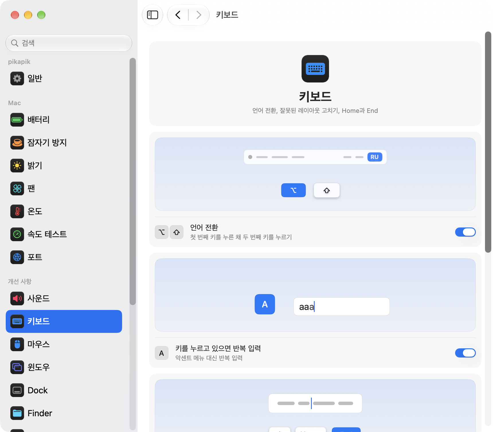

<p align="center"></p>
<h1 align="center">pikapik</h1>
<p align="center">키보드, 마우스, 윈도우, Finder를 위한 작은 개선. Mac 메뉴 막대에서 바로 쓸 수 있습니다.</p>
<p align="center"><sub><a href="../../README.md">English</a> · <a href="README.ru.md">Русский</a> · <a href="README.uk.md">Українська</a> · <a href="README.de.md">Deutsch</a> · <a href="README.fr.md">Français</a> · <a href="README.es.md">Español</a> · <a href="README.it.md">Italiano</a> · <a href="README.pt-BR.md">Português (Brasil)</a> · <a href="README.ja.md">日本語</a> · <a href="README.zh-Hans.md">简体中文</a> · <b>한국어</b> · <a href="README.ro.md">Română</a> · <a href="README.pl.md">Polski</a> · <a href="README.tr.md">Türkçe</a> · <a href="README.nl.md">Nederlands</a> · <a href="README.sv.md">Svenska</a> · <a href="README.cs.md">Čeština</a> · <a href="README.zh-Hant.md">繁體中文</a> · <a href="README.ar.md">العربية</a> · <a href="README.hi.md">हिन्दी</a> · <a href="README.id.md">Bahasa Indonesia</a> · <a href="README.vi.md">Tiếng Việt</a> · <a href="README.th.md">ไทย</a></sub></p>

<p align="center">
<picture>
<source media="(prefers-color-scheme: dark)" srcset="../media/settings-ko-dark.png">

</picture>
</p>

## 설치

```bash
brew install --cask dev-pikapik/pika-tools/pikapik && open -a pikapik
```

설치하면 화면 위쪽 메뉴 막대에 pikapik이 나타납니다. 직접 켜기 전까지 모든 기능은 꺼져 있습니다.

<details>
<summary>Homebrew가 없나요? 다른 방법 두 가지</summary>

Homebrew 없이 설치하려면 터미널을 열고 다음 줄을 붙여 넣은 후 Return 키를 누르십시오:

```bash
/bin/bash -c "$(curl -fsSL https://raw.githubusercontent.com/dev-pikapik/pika-tools/main/install.sh)"
```

또는 [pikapik.dmg](https://github.com/dev-pikapik/pika-tools/releases/latest/download/pikapik.dmg)를 다운로드하여 열고 앱을 응용 프로그램 폴더로 드래그하십시오.

Homebrew와 스크립트 모두 앱을 `/Applications`에 넣고, 실행하고, 권한을 요청하고, ‘로그인 시 열기’를 켭니다. 그 후에는 앱이 스스로 업데이트됩니다. **업데이트**를 참고하십시오. 제거하려면 **제거**를 참고하십시오.

</details>

## 할 수 있는 일

<table>
<tbody><tr>
<td width="50%" valign="top">
<picture><source media="(prefers-color-scheme: dark)" srcset="../media/keep-awake-dark.png"></picture>
<br><b>잠자기 방지</b>
<br>필요한 만큼 Mac이 깨어 있습니다. 덮개를 닫아도요.
</td>
<td width="50%" valign="top">
<picture><source media="(prefers-color-scheme: dark)" srcset="../media/fans-dark.png"></picture>
<br><b>팬</b>
<br>팬이 얼마나 빠르게 도는지 보고 속도를 선택하세요.
</td>
</tr></tbody>
<tbody><tr>
<td width="50%" valign="top">
<picture><source media="(prefers-color-scheme: dark)" srcset="../media/command-keys-dark.png"></picture>
<br><b>⌘Q와 ⌘W 보호</b>
<br>실수로 종료하거나 닫는 일이 없습니다. 원할 때는 ⇧를 함께 누르세요.
</td>
<td width="50%" valign="top">
<picture><source media="(prefers-color-scheme: dark)" srcset="../media/compress-dark.png"></picture>
<br><b>작은 사본</b>
<br>사진, PDF, 비디오를 오른쪽 클릭하면 옆에 더 가벼운 사본이 생깁니다.
</td>
</tr></tbody>
<tbody><tr>
<td width="50%" valign="top">
<picture><source media="(prefers-color-scheme: dark)" srcset="../media/convert-dark.png"></picture>
<br><b>변환</b>
<br>이미지, 비디오, 노래를 오른쪽 클릭으로 다른 포맷으로 저장합니다.
</td>
<td width="50%" valign="top">
<picture><source media="(prefers-color-scheme: dark)" srcset="../media/input-switch-dark.png"></picture>
<br><b>언어 전환</b>
<br>⌥를 누른 채 ⇧를 탭하면 키보드 언어가 바뀝니다.
</td>
</tr></tbody>
<tbody><tr>
<td width="50%" valign="top">
<picture><source media="(prefers-color-scheme: dark)" srcset="../media/quit-on-close-dark.png"></picture>
<br><b>마지막 윈도우와 함께 종료</b>
<br>앱의 마지막 윈도우를 닫으면 앱도 종료됩니다.
</td>
<td width="50%" valign="top">
<picture><source media="(prefers-color-scheme: dark)" srcset="../media/window-zoom-dark.png"></picture>
<br><b>녹색 버튼으로 확대</b>
<br>전체 화면으로 바꾸지 않고 윈도우가 화면을 채웁니다.
</td>
</tr></tbody>
<tbody><tr>
<td width="50%" valign="top">
<picture><source media="(prefers-color-scheme: dark)" srcset="../media/dock-hide-dark.png"></picture>
<br><b>Dock 클릭으로 가리기</b>
<br>사용 중인 앱을 클릭하면 살짝 비켜 줍니다.
</td>
<td width="50%" valign="top">
<picture><source media="(prefers-color-scheme: dark)" srcset="../media/new-file-dark.png"></picture>
<br><b>새 파일</b>
<br>Finder에서 오른쪽 클릭하고 이름만 입력하면 빈 파일이 생깁니다.
</td>
</tr></tbody>
<tbody><tr>
<td width="50%" valign="top">
<picture><source media="(prefers-color-scheme: dark)" srcset="../media/finder-cut-dark.png"></picture>
<br><b>⌘X로 파일 이동</b>
<br>Finder에서 파일을 잘라내고 원하는 곳에 붙여 넣으세요.
</td>
<td width="50%" valign="top">
<picture><source media="(prefers-color-scheme: dark)" srcset="../media/finder-open-dark.png"></picture>
<br><b>Enter로 파일 열기</b>
<br>Finder에서 파일을 선택하고 Enter를 누르면 열립니다.
</td>
</tr></tbody>
<tbody><tr>
<td width="50%" valign="top">
<picture><source media="(prefers-color-scheme: dark)" srcset="../media/finder-delete-dark.png"></picture>
<br><b>Delete로 휴지통에</b>
<br>Finder에서 ⌫를 누르면 선택한 파일이 휴지통으로 갑니다.
</td>
<td width="50%" valign="top">
<picture><source media="(prefers-color-scheme: dark)" srcset="../media/game-mode-dark.png"></picture>
<br><b>게임 모드</b>
<br>게임하는 동안 그 위로 아무것도 뜨지 않고, 게임이 닫히지도 않습니다.
</td>
</tr></tbody>
<tbody><tr>
<td width="50%" valign="top">
<picture><source media="(prefers-color-scheme: dark)" srcset="../media/speed-test-dark.png"></picture>
<br><b>속도 테스트</b>
<br>인터넷이 얼마나 빠른지, 무엇을 하기에 충분한지 알려 줍니다.
</td>
<td width="50%" valign="top">
<picture><source media="(prefers-color-scheme: dark)" srcset="../media/side-buttons-dark.png"></picture>
<br><b>측면 버튼</b>
<br>4번, 5번 버튼으로 뒤로, 앞으로. 트랙패드에서 쓸어넘기듯이요.
</td>
</tr></tbody>
<tbody><tr>
<td width="50%" valign="top">
<picture><source media="(prefers-color-scheme: dark)" srcset="../media/wheel-lines-dark.png"></picture>
<br><b>줄 단위로 스크롤</b>
<br>휠을 얼마나 빨리 돌려도 한 칸에 같은 만큼 스크롤됩니다.
</td>
<td width="50%" valign="top">
<picture><source media="(prefers-color-scheme: dark)" srcset="../media/wheel-direction-dark.png"></picture>
<br><b>스크롤 방향</b>
<br>트랙패드와 마우스에 각각 다른 방향을 고를 수 있습니다.
</td>
</tr></tbody>
<tbody><tr>
<td width="50%" valign="top">
<picture><source media="(prefers-color-scheme: dark)" srcset="../media/linear-pointer-dark.png"></picture>
<br><b>포인터 가속 끄기</b>
<br>손을 움직인 만큼 포인터가 정확히 움직입니다.
</td>
<td width="50%" valign="top">
<picture><source media="(prefers-color-scheme: dark)" srcset="../media/key-repeat-dark.png"></picture>
<br><b>키를 누르고 있으면 반복 입력</b>
<br>키를 누르고 있으면 악센트 메뉴 대신 글자가 반복됩니다.
</td>
</tr></tbody>
<tbody><tr>
<td width="50%" valign="top">
<picture><source media="(prefers-color-scheme: dark)" srcset="../media/home-end-dark.png"></picture>
<br><b>Home과 End</b>
<br>입력하는 중에 줄의 처음이나 끝으로 이동합니다.
</td>
<td width="50%" valign="top">
<picture><source media="(prefers-color-scheme: dark)" srcset="../media/animations-dark.png"></picture>
<br><b>애니메이션</b>
<br>Dock, 윈도우, 훑어보기를 더 빠르게, 원하면 즉시 움직이게 합니다.
</td>
</tr></tbody>
<tbody><tr>
<td width="50%" valign="top">
<picture><source media="(prefers-color-scheme: dark)" srcset="../media/leftover-permissions-dark.png"></picture>
<br><b>삭제한 앱의 권한</b>
<br>삭제한 앱을 위해 macOS가 남겨 둔 권한을 지웁니다.
</td>
<td width="50%" valign="top">
<picture><source media="(prefers-color-scheme: dark)" srcset="../media/pet-dark.png"></picture>
<br><b>데스크탑 펫</b>
<br>작은 친구가 윈도우 뒤를 산책해요. 집어서 던지거나 스페이스를 눌러 점프시켜 보세요. 옷장에서 옷을 골라 입히고, 함께 놀면서 상을 받아 보세요.
</td>
</tr></tbody>
<tbody><tr>
<td width="50%" valign="top">
<picture><source media="(prefers-color-scheme: dark)" srcset="../media/uninstaller-dark.png"></picture>
<br><b>앱 제거</b>
<br>앱과 앱의 파일을 제거합니다. 모두 되돌릴 수 있습니다.
</td>
<td width="50%" valign="top">
<picture><source media="(prefers-color-scheme: dark)" srcset="../media/game-fps-dark.png"></picture>
<br><b>FPS 표시</b>
<br>작은 카운터가 고른 모서리에서 게임이 얼마나 부드럽게 실행되는지 보여 줍니다.
</td>
</tr></tbody>
<tbody><tr>
<td width="50%" valign="top">
<picture><source media="(prefers-color-scheme: dark)" srcset="../media/archive-dark.png"></picture>
<br><b>압축 파일</b>
<br>오른쪽 클릭으로 RAR 등의 압축 파일을 풀거나 파일을 ZIP으로 묶습니다.
</td>
<td width="50%" valign="top"></td>
</tr></tbody>
</table>

## 자세히

<details>
<summary>처음 실행할 때</summary>

pikapik에는 두 가지 권한이 필요합니다. 처음 실행하면 설정의 ‘권한’ 페이지가 열려 단계별로 안내하고, macOS도 자체 요청을 표시합니다. **시스템 설정 › 개인정보 보호 및 보안**으로 이동하여 다음 항목에서 pikapik을 켜십시오:

- **손쉬운 사용**: 키 입력이나 클릭이 다른 앱에 전달되기 전에 앱이 이를 바꿀 수 있도록 합니다.
- **입력 모니터링**: 앱이 키 입력과 클릭을 볼 수 있도록 합니다.

변경 사항은 몇 초 안에 반영되며, 다시 시작할 필요가 없습니다.

일부 기능은 사용할 때 권한이 더 필요합니다: **팬 제어**, **Finder 확장 프로그램**, **iCloud Drive**, **전체 디스크 접근 권한**, **화면 기록**. 모두 설정의 ‘권한’ 페이지에 모여 있으며, 각 권한에는 용도를 알려 주는 한 줄, 초록색 체크 또는 주황색 엑스, 버튼 하나가 있습니다. 권한이 없으면 **허용**, 켜져 있으면 **끄기**입니다. 그래서 어떤 권한이든 그 자리에서 바로 해제할 수 있습니다.

pikapik은 입력하거나 클릭한 내용을 기록하거나 저장하거나 전송하지 않습니다. 이벤트는 메모리에서만 처리되어 바로 전달됩니다. pikapik은 업데이트(GitHub에 최신 릴리스를 묻고, 업데이트를 선택했을 때만 내려받습니다)와 직접 시작한 속도 테스트(Apple 서버를 사용합니다)에서만 인터넷에 연결합니다. Mac App Store 버전은 App Store가 업데이트하며, 속도 테스트에는 Cloudflare를 사용합니다. 펫의 진행 상황(걸음 수, 던진 횟수, 상 등)은 이 Mac에서만 집계되며 어디로도 전송되지 않습니다. 설정 › 펫에서 지울 수 있습니다.

</details>

<details>
<summary>모든 기능 자세히 보기</summary>

**⌘Q와 ⌘W 보호.** ⌘Q와 ⌘W만 눌러서는 아무 일도 일어나지 않으므로 실수로 앱을 종료하거나 윈도우를 닫지 않습니다. 의도적으로 하려면 Shift를 함께 누르십시오. ⇧⌘Q는 종료, ⇧⌘W는 닫기입니다. 모든 앱에서 작동합니다. 키마다 별도의 스위치가 있습니다. 기본값은 꺼짐입니다.

**Option+Shift로 언어 전환.** Option을 누른 채 Shift를 누르면 macOS가 다음 입력 소스로 전환합니다. Option을 계속 누른 채 Shift를 다시 누르면 그다음으로 넘어갑니다. Shift를 누른 채 Option을 누르면 이전으로 돌아갑니다. 중간에 다른 키를 누르거나, 클릭하거나, Command, Control, Fn을 함께 누르면 전환되지 않으므로 Option+Shift+화살표 같은 단축키는 이전처럼 작동합니다. 기본값은 꺼짐입니다.

**키를 누르고 있으면 반복 입력.** 키를 누르고 있으면 악센트 메뉴 대신 같은 글자가 계속 입력됩니다. 게임을 하거나 글을 쓸 때 편리합니다. 이미 열려 있는 앱은 다시 시작한 후에 적용됩니다. 끄면 macOS가 원래대로 작동합니다. 기본값은 꺼짐입니다.

**Home과 End로 줄의 처음과 끝으로 이동.** 입력하는 동안 Home은 커서를 줄의 처음으로, End는 줄의 끝으로 옮기며 페이지를 스크롤하지 않습니다. ⇧와 함께 누르면 그곳까지 선택하고, ⌘와 함께 누르면 전체 텍스트의 처음이나 끝으로 이동합니다. 텍스트 필드 밖이나 터미널, 가상 머신, 원격 데스크톱 앱에서는 예전처럼 작동합니다. 평소대로 작동해야 하는 다른 앱을 추가할 수도 있습니다. 기본적으로 꺼져 있습니다.

**포인터 가속 끄기.** 마우스를 얼마나 빠르게 움직이든 포인터는 마우스가 움직인 만큼 정확히 움직입니다. **이동 속도** 슬라이더로 포인터의 빠르기를 설정합니다. 마우스에서만 작동하며, 트랙패드는 그대로입니다. 기능을 끄거나 pikapik를 종료하면 macOS가 원래 설정을 되찾습니다. 기본값은 꺼짐입니다.

**줄 단위로 스크롤.** 마우스 휠을 한 칸 돌릴 때마다, 아무리 빨리 돌려도 같은 줄 수만큼 스크롤됩니다. 한 칸당 1줄에서 10줄까지 고를 수 있고, 기본값은 3줄입니다. 자연스러운 스크롤은 시스템 설정에서 정한 그대로 유지됩니다. 마우스에만 적용되며 트랙패드는 그대로입니다. 기본값은 꺼짐입니다. **한 칸당 거리** 슬라이더 옆에서는 작은 페이지가 선택한 거리만큼 스크롤되고, 점이 기본값을 표시합니다.

스크롤을 정확한 픽셀로 세는 앱과 게임에서는 같은 설정을 픽셀로 바꾸고 한 칸당 1~200픽셀 중에서 고르세요. 기본값은 40입니다. 슬라이더에는 그것이 화면 높이의 얼마인지도 표시됩니다.

**트랙패드와 마우스의 스크롤 방향.** macOS에는 트랙패드와 마우스에 함께 적용되는 자연스러운 스크롤 스위치가 하나뿐입니다. 이 기능을 켜고 각각의 방향을 고르세요. iPhone처럼 페이지가 손가락을 따라오는 **자연스러운 스크롤**, 또는 페이지가 반대 방향으로 움직이는 **클래식 스크롤**입니다. 트랙패드 선택은 가로 스크롤과 손가락을 뗀 뒤 이어지는 관성 스크롤에도 적용됩니다. Magic Mouse는 터치로 스크롤하므로 트랙패드 선택을 따릅니다. 모든 Mac에서 똑같이 고르면 유니버설 컨트롤로 마우스를 다른 Mac으로 옮겨도 어디서나 같은 느낌으로 스크롤됩니다. 기본값은 꺼짐입니다. 켜면 둘 다 시스템 설정과 같은 상태로 시작하므로 다른 것을 고르기 전에는 아무것도 바뀌지 않습니다.

**측면 버튼으로 뒤로 및 앞으로 이동.** 마우스 버튼 4와 5로 Finder, Safari 같은 Apple 앱과 그 밖의 많은 앱에서 뒤로/앞으로 이동합니다. 트랙패드에서 쓸어 넘기는 것과 똑같아요. 이 버튼을 직접 처리하는 앱에는 버튼이 그대로 전달됩니다. 마우스의 버튼이 반대로 되어 있다면 **측면 버튼 서로 바꾸기** 옵션을 켜세요. 기본값은 꺼짐입니다.

**마지막 윈도우를 닫으면 종료.** 앱의 마지막 윈도우를 닫으면 앱이 종료됩니다. Finder는 계속 열려 있고, 다른 데스크탑이나 Dock에 윈도우가 있는 앱도 종료되지 않습니다. 이 방식으로 절대 종료되지 않아야 할 앱 목록을 만들 수 있습니다. 기본값은 꺼짐입니다.

**Dock 클릭으로 가리기.** 사용 중인 앱의 Dock 아이콘을 클릭하면 앱이 가려집니다. 다시 클릭하면 돌아옵니다. 기본값은 꺼짐입니다.

**녹색 버튼으로 윈도우 확대.** 윈도우의 녹색 버튼을 클릭하면 전체 화면으로 들어가지 않고 화면을 가득 채웁니다. 다시 클릭하면 이전 크기로 돌아옵니다. ⌥를 누른 채 클릭하면 버튼이 평소대로 작동합니다. 전체 화면은 버튼 메뉴와 ⌃⌘F로 계속 사용할 수 있습니다. 녹색 버튼이 평소대로 작동해야 하는 앱 목록을 만들 수 있습니다. 기본값은 꺼짐입니다.

**Finder에서 새 파일.** Finder 윈도우나 데스크탑에서 오른쪽 클릭하고 **새 파일**을 고른 뒤 이름을 입력하면 빈 파일이 생깁니다. 기본은 .txt. 기본적으로 꺼져 있습니다.

**Finder에서 Enter로 파일 열기.** Finder 윈도우나 데스크탑에서 파일을 선택하고 Return이나 Enter를 누르면 파일이 열립니다. F2 또는 fn F2는 선택한 파일의 이름을 바꿉니다. 이름을 입력할 때처럼 텍스트 입력란에서는 키가 평소처럼 동작합니다. 기본적으로 꺼져 있습니다.

**Finder에서 ⌘X로 파일 잘라내기.** 파일을 선택하고 ⌘X를 누른 다음, 원하는 폴더를 열고 ⌘V를 누르면 파일이 복사되지 않고 그 폴더로 이동합니다. ⌘C를 누르면 잘라내기가 취소됩니다. 기본적으로 꺼져 있습니다.

**Finder에서 Delete로 파일 삭제.** 파일을 선택하고 ⌫나 ⌦(노트북에서는 fn ⌫)를 누르면 ⌘⌫처럼 휴지통으로 이동합니다. 파일 이름을 바꾸거나 검색하거나 다른 입력란에 입력하는 동안에는 평소대로 글자를 지웁니다. 기본적으로 꺼져 있습니다.

**Finder에서 작은 사본.** Finder에서 파일을 오른쪽 클릭하고 **작은 사본 만들기**를 선택하세요. 사진, GIF, PDF, 비디오의 가벼운 버전이 바로 옆에 저장되며, 크기가 몇 배 작아지는 경우가 많습니다. WAV나 AIFF 같은 압축되지 않은 사운드는 작은 M4A가 됩니다. 더 줄일 수 없는 파일이면 사본을 만들지 않고 pikapik이 알려 줍니다. 원본은 그대로 남고, 아무것도 Mac 밖으로 나가지 않습니다. 기본적으로 꺼져 있습니다.

**Finder에서 변환.** Finder에서 파일을 오른쪽 클릭하고 **변환**을 선택하면 다른 포맷으로 저장됩니다. 이미지는 JPEG, PNG, HEIC, GIF, TIFF, PDF로, 비디오는 MP4, MOV 또는 소리만, 음악은 M4A, WAV, AIFF로 저장합니다. 원본은 그대로 남고, 아무것도 Mac 밖으로 나가지 않습니다. 작은 사본과 따로 켜고 끌 수 있습니다. 기본적으로 꺼져 있습니다.

**Finder의 압축 파일.** Finder에서 압축 파일을 오른쪽 클릭하고 **압축 풀기**를 선택하면 파일이 바로 옆에 나타납니다. 다른 파일이나 폴더를 오른쪽 클릭하고 ‘**압축 파일 만들기…**’를 선택하면 ZIP, 7Z, TAR.GZ, TAR.XZ를 만들 수 있습니다. ZIP과 7Z에는 암호를 걸 수 있고, 어떤 압축 파일이든 여러 부분으로 나눌 수 있습니다. 예를 들어 이메일용 15 MB씩, USB 드라이브용 4 GB씩으로 나눌 수 있습니다. 이렇게 만든 ZIP에는 숨겨진 서비스 파일이 들어가지 않고, 어떤 언어의 이름이든 읽을 수 있게 유지되며, 4 GB가 넘는 파일도 담을 수 있습니다. 기본적으로 꺼져 있습니다. Mac App Store 버전에는 없습니다.

pikapik은 macOS가 열지 못하는 것도 엽니다. 여러 부분으로 나뉜 RAR, 암호가 걸린 7Z, .001, .z01, .r00, .part1.rar 같은 분할 묶음, 그리고 ZIPX, CAB, LZH, ARJ, ZST, LZMA, WIM 등입니다. 더블 클릭하면 pikapik에서 열립니다. 오래된 ZIP 안의 파일 이름도, 예를 들어 키릴 문자나 일본어, 중국어라도 제대로 읽힙니다. 설정 › Finder의 스위치 **압축 파일을 이 앱으로 열기**를 켜면 ZIP과 7Z도 pikapik이 맡고, TAR와 GZ는 이미 잘 처리하는 Mac 기본 압축 앱에 그대로 남습니다. pikapik은 RAR을 풀 수는 있지만 만들 수는 없습니다. RAR 라이선스가 허용하는 것은 압축 풀기뿐입니다.

암호는 창에서 물어보고, **중단**을 누르면 어떤 작업이든 취소되며, 손상되었거나 불완전한 압축 파일에서도 아직 읽을 수 있는 부분을 꺼내 옵니다. 풀면 엄청난 크기로 부풀어 오르는 압축 파일은 풀기 전에 먼저 묻고, 디스크가 가득 찰 것 같으면 제때 멈추며, 자기 폴더 밖에 쓰려는 압축 파일은 막습니다. Finder에서 압축 파일을 선택하고 스페이스 바를 누르면 안에 무엇이 들어 있는지 미리 볼 수 있습니다.

**게임 모드.** 게임을 추가해 두면, 플레이하는 동안 Mac이 게임에서 끌어내지 않습니다. Spotlight, Siri, ⌘Tab, Mission Control, 데스크탑 간 쓸어넘기기가 게임 위에 열리지 않고, ⌘Q와 ⌘W로 게임이 실수로 닫히지 않으며, 포인터가 Dock, 메뉴 막대, 다른 화면으로 빠져나가지 않으며, 화면이 꺼지지 않습니다. 각 항목은 게임 페이지에서 따로 켜고 끌 수 있고, pikapik이 Mac에서 찾은 게임을 추천합니다. 게임 중에는 Control-클릭이 그냥 클릭으로 남고 Control+화살표로 데스크탑이 바뀌지 않습니다. Minecraft도 알아봅니다. Minecraft Launcher나 CurseForge를 추가하면 Minecraft 안에서 모드가 켜집니다. 게임을 끝내려면 ⇧⌘Q를, 창을 닫으려면 ⇧⌘W를 누르세요. ⌥⌘Esc는 항상 작동합니다. 게임에서 나오면 모든 것이 평소처럼 작동합니다. 기본적으로 꺼져 있습니다.

게임 모드를 켜고 플레이하세요. 추가 게임 설정에는 Mac이 공개하는 목록, 현재 키 지정, 동작별 애니메이션 미리보기가 있어요.

자동 모드는 창을 열거나 포커스를 옮기는 동작을 일시 중지해요. 빠르고 의도적인 언어 단축키는 시스템 창 없이 입력 소스를 바꿔요. 누르고 있는 이동 키가 우선하므로 달리기와 점프가 실수로 언어를 바꾸지 않아요.

설정 → 게임 → 추가 게임 설정에 ‘마우스 및 트랙패드’ 그룹이 있습니다. macOS에서 켜져 있는 항목만 Apple의 이름과 작은 그림과 함께 보여 줍니다. 마우스 버튼 단축키, 데스크탑 및 전체 화면 앱 사이 쓸어넘기기, Mission Control과 App Exposé, 앱을 위한 핀치와 데스크탑을 위한 벌리기, 알림 센터를 위한 오른쪽 가장자리에서 쓸어넘기기, 그리고 각 핫 코너와 그 동작입니다. 게임이 맨 앞에 있는 동안에는 이 동작들이 일시 중지되어, 실수로 쓸어넘기거나 화면 모서리를 스치더라도 게임에서 벗어나지 않습니다. 게임 안의 제스처는 계속 작동합니다. 각 항목은 평소처럼 작동하도록 설정할 수도 있습니다.

설정 → 게임 → 게임 추가에서 실행 중인 게임을 클릭하세요. Java나 다른 실행 환경을 사용하는 게임도 .app 파일 없이 표시돼요. Minecraft는 java 대신 Minecraft로 표시돼요. 게임 프로세스를 찾아 설정 → 게임의 내 게임으로 행을 드래그하세요.

**FPS 표시.** FPS는 초당 프레임 수, 즉 게임이 1초에 그리는 그림의 수입니다. ‘게임’ 페이지에서 **FPS 표시**를 켜면, 게임 모드가 켜져 있는 동안 어떤 게임이든 한쪽 모서리에 이 숫자가 담긴 작고 어두운 표시가 나타납니다. 스위치 위의 그림에서 모서리를 클릭해 위치를 고르세요. 줄표(—)는 첫 프레임이 아직 오지 않았다는 뜻이고, 흐린 0은 게임이 그리기를 멈췄다는 뜻입니다. macOS 27에서는 대부분의 게임을 macOS가 직접 세므로 권한이 필요 없습니다. macOS가 셀 수 없는 게임, 주로 오래된 게임은 화면 기록으로 셉니다. 이때 ‘권한’ 페이지에 **화면 기록** 항목이 나타나고, pikapik은 게임 중에는 절대 권한을 요청하지 않으며, 숫자는 화면 주사율보다 높아질 수 없습니다. macOS 14–26과 Mac App Store 버전에서는 모든 게임을 이 방식으로 세기 때문에, **FPS 표시**를 켜자마자 그 항목이 나타나고, 스위치 아래의 **허용** 버튼을 누르면 그곳으로 이동합니다. 어떤 이미지도 저장하거나 전송하지 않습니다. 기본값은 꺼짐입니다.

**펫 옷장과 상.** 설정 › 펫을 열어 펫에게 옷을 입혀 보세요. 모자와 안경부터 망토와 날개까지 30가지가 넘는 아이템과, 마법사·해적·우주비행사 같은 완성된 코디가 준비되어 있습니다. 처음부터 쓸 수 있는 건 몇 개뿐이고, 나머지는 함께 놀면서 받는 상입니다. 펫을 집어 던져 보고, 공을 차며 놀고, 창 위로 올라가거나 수다 떠는 모습을 지켜보거나, 그저 매일 곁에 있어 주세요. 새 상을 받으면 펫이 알려 줍니다.

상을 줄 때를 알기 위해 pikapik은 사용자와 펫이 한 일만 셉니다. Mac App Store 밖에서 받은 버전은 설정에서 GitHub 페이지를 열었는지도 기록합니다. 걸음 수, 펫을 집어 올리고 던진 횟수, 점프, 오르기, 공놀이, 수다, 함께한 날짜 수, 이른 아침이나 자정 이후, 주말에 함께했는지, 열어 본 설정 페이지와 입어 본 아이템입니다. 이 숫자와 각 상을 받은 날짜, 펫이 입고 있는 옷은 이 Mac에만 남습니다. 어디로도 전송되지 않으며 내보낸 설정 파일이나 iCloud 동기화에도 들어가지 않습니다. 설정 › 펫에서 언제든 모두 지울 수 있고, 펫은 처음부터 다시 시작합니다.

**앱 제거.** 설정 › 앱 제거를 열고 목록에서 앱을 고르거나 그림 위에 앱을 끌어다 놓으면, pikapik이 그 앱이 Mac에 남겨 둔 모든 것을 보여 줍니다. 앱 자체, 저장된 데이터, 설정, 임시 파일, 백그라운드 도우미 등이 목록에 있는 이유와 함께 나옵니다. 앱의 것이 분명한 파일은 체크되어 있고, 관련이 있을지도 모르는 파일은 체크되어 있지 않으며, 다른 앱도 쓰는 파일에는 표시가 붙습니다. 제거할 것을 고르고 **휴지통으로 이동**을 클릭하세요. 영구적으로 삭제되는 것은 없고, 모두 휴지통으로 갑니다. 앱이 열려 있으면 pikapik이 먼저 종료해 달라고 요청하고, 관리자 권한이 필요한 파일이 있으면 Mac에서 암호를 한 번 요청합니다.

마음이 바뀌었나요? **되돌리기**를 클릭하면 모든 것이 원래 자리로 돌아가고, 백그라운드 도우미도 다시 시작됩니다. 최근 제거한 10건은 파일이 휴지통에 있는 동안 ‘최근 제거됨’에 남습니다. **앱 초기화**는 앱은 그대로 두고, 저장된 데이터와 설정, 임시 파일만 제거하므로 앱이 제대로 동작하지 않을 때 도움이 될 수 있습니다. 직접 휴지통으로 옮긴 앱은 남은 파일과 함께 ‘휴지통에 있음’에 나타나고, ‘제거한 앱의 남은 파일’은 이미 없어진 앱의 파일을 찾아 줍니다. ‘앱을 휴지통으로 옮기면 정리 제안’ 스위치는 기본적으로 꺼져 있으며, 직접 선택하기 전에는 아무것도 제거되지 않습니다. 앱이 남긴 것을 모두 보려면 **전체 디스크 접근 권한**이 필요합니다. 이 도구는 Mac App Store 버전에는 없습니다.

각 도구에는 메뉴와 설정에 별도의 스위치가 있습니다.

메뉴 막대 아이콘으로 상태를 한눈에 알 수 있습니다. 도구가 작동 중이면 pikapik 마크, 모두 꺼져 있으면 같은 마크가 흐리게, 도구는 켜져 있지만 권한이 없으면 경고 삼각형이 표시됩니다.

메뉴 막대 패널은 처음에 몇 개의 행만 보여 줍니다. 표시할 행은 직접 고를 수 있습니다. 아래의 연필 버튼을 클릭하고, 보고 싶은 항목을 체크한 다음 **완료**를 클릭하세요. 숨긴 행도 계속 작동하며 설정에 그대로 남아 있습니다. 패널이 화면에 다 들어가지 않으면 스크롤됩니다.

앱은 시스템 언어 또는 설정에서 선택한 언어로 표시됩니다. 이 페이지 맨 위에 있는 23개 언어를 모두 지원합니다.

</details>

<details>
<summary>잠자기 방지</summary>

키보드를 떠나 있는 동안 Mac이 잠자기에 들어가지 않게 합니다. 1초부터 365일까지 원하는 시간 동안, 또는 직접 끌 때까지 유지됩니다. 메뉴에서 켜고, 설정에서 일, 시간, 분, 초를 입력하거나 ↑와 ↓를 누르거나 15분부터 8시간까지의 기본 옵션을 클릭하여 기간을 지정하십시오. 메뉴에 남은 시간과 종료 시각이 표시됩니다. **디스플레이**는 두 가지 중에서 고를 수 있습니다. **항상 켜짐**은 화면이 꺼지지 않고 화면 보호기나 잠금 화면도 나오지 않습니다. **평소처럼 꺼짐**은 자체 타이머에 따라 화면이 꺼지고 Mac은 계속 작동합니다. **지금 디스플레이 끄기**(메뉴에도 있음)를 누르면 화면이 바로 꺼지고 Mac은 계속 작동합니다. 다시 켜려면 마우스를 움직이거나 아무 키나 누르세요. pikapik을 종료하면 잠자기 방지도 끝납니다.

MacBook에서는 **덮개를 닫아도 작동**을 켤 수도 있습니다. macOS에는 이런 설정이 없기 때문에 pikapik이 `pmset -a disablesleep 1`을 실행하고 관리자 암호를 요청합니다. Mac의 잠자기 방식은 관리자만 바꿀 수 있기 때문입니다. 이 설정은 잠자기 방지가 끝날 때, 앱을 종료할 때, 앱이 비정상적으로 종료될 때 자동으로 원래대로 돌아갑니다. 암호를 입력하지 않으면 아무것도 바뀌지 않습니다. 덮개를 닫은 상태에서는 Mac의 통풍에 신경 써 주십시오. **배터리가 20% 미만이면 중지**를 사용하면 배터리가 다 닳기 전에 세션이 끝납니다.

잠자기 방지, 화면 켜짐 모드, 덮개 닫음 모드는 단축어 앱을 통해 제어 센터, 메뉴 막대 또는 데스크탑 위젯의 버튼으로 둘 수 있으며, 링크는 설정 › 잠자기 방지에서 복사하세요.

</details>

<details>
<summary>속도 테스트</summary>

지금 인터넷 속도를 보여 줍니다. 설정 › 속도 테스트에서 **속도 측정**을 누르거나, 연필 버튼으로 메뉴에 행을 추가했다면 **측정**을 클릭하세요. 30초 정도 지나면 다운로드와 업로드 속도, 핑, 응답성(연결이 바쁠 때 반응하는 속도)이 표시됩니다. 그 아래에는 4K 영화, 영상 통화, 온라인 게임, 대용량 다운로드에 충분한지 쉬운 말로 알려 줍니다. 측정에는 macOS에 들어 있는 networkQuality와 Apple 서버를 사용합니다. 마지막 결과는 다음 측정까지 남아 있으며, 단축어용 링크로 제어 센터에서 측정을 시작할 수 있습니다.

</details>

<details>
<summary>설정</summary>

메뉴에서 **설정…** 항목을 선택하거나 ⌘,를 눌러 설정을 여십시오. Finder, Launchpad, Spotlight에서 pikapik을 다시 실행해도 열립니다. 윈도우가 열려 있는 동안에는 앱이 Dock과 ⌘Tab에 나타납니다.

- **일반**: 로그인 시 열기, 모양(시스템, 라이트, 다크), 언어, 업데이트, 백업(설정을 파일로 내보내고 가져오기, 또는 iCloud Drive로 동기화).
- **잠자기 방지**: 기간, 디스플레이 및 덮개 옵션.
- **팬**: 각 팬의 속도 확인, 팬 제어를 허용하면 자동 또는 수동 속도 선택.
- **속도 테스트**: 인터넷 속도와 그 속도로 할 수 있는 일.
- **키보드**: 언어 전환, 키 반복, Home과 End.
- **마우스**: 포인터 가속과 이동 속도, 줄 단위 스크롤, 스크롤 방향, 측면 버튼.
- **윈도우**: 녹색 버튼으로 윈도우 확대(예외 목록 포함), ⌘Q와 ⌘W 보호, 마지막 윈도우를 닫으면 종료(예외 목록 포함).
- **Dock**: Dock 클릭으로 가리기.
- **Finder**: 새 파일, 작은 사본, 변환, 압축 파일, Return으로 열기, ⌘X로 오려두기, ⌫로 휴지통에 버리기.
- **앱 제거**: 앱을 파일째 제거하고, 나중에 모두 되돌리고, 이미 제거한 앱이 남긴 파일을 정리합니다.
- **게임**: 내 게임 목록과 게임 모드 옵션.
- **펫**: 켜기와 끄기, 말하기와 공놀이, 옷장과 상.
- **권한**: pikapik이 쓰는 모든 권한의 상태와, 허용하거나 끄는 버튼. 필요한 권한이 없는 도구는 반쯤 회색으로 보이며, 클릭하면 이 페이지가 해당 줄에서 열립니다.
- **정보**: 버전, 변경 기록 링크, 문제 신고 링크.

많은 설정에는 기능을 보여 주는 작은 그림이 함께 나옵니다. 예를 들어 잠들지 않는 Mac이나 Dock 뒤로 숨는 윈도우를 보여 줍니다. 그림은 스위치와 함께 바뀌며, 시스템 설정에서 ‘동작 줄이기’가 켜져 있으면 움직이지 않습니다.

모든 페이지 하단에 **기본값으로 복원…** 버튼이 있습니다. 먼저 확인을 받은 다음, 해당 페이지의 도구를 끄고 옵션을 원래대로 되돌립니다. pikapik이 한 번도 건드리지 않은 것처럼요.

**iCloud로 설정 동기화** 를 켜면 모든 Mac에서 pikapik이 똑같이 유지됩니다. 설정은 iCloud Drive의 pika-tools 폴더에 저장되며, 가장 최근에 바꾼 내용이 적용됩니다. 기본값은 꺼짐이고, iCloud Drive가 켜져 있어야 합니다. 권한은 동기화되지 않으며, Mac마다 각자 요청합니다.

</details>

<details>
<summary>업데이트</summary>

pikapik은 실행할 때와 6시간마다 새 버전을 확인합니다. 설정 › 일반에서 이 기능을 끌 수 있습니다. 새 버전이 나오면 메뉴에 **… (으)로 업데이트** 버튼이 나타납니다. 한 번 클릭하면 앱이 업데이트를 다운로드하고 설치한 후 다시 시작합니다. 설정 › 일반의 **지금 확인**으로 직접 확인할 수도 있습니다.

Homebrew를 사용한다면 `brew upgrade --cask pikapik`을 실행해도 됩니다.

1.3 버전부터는 업데이트 후에도 권한이 그대로 유지됩니다.

</details>

<details>
<summary>제거</summary>

```bash
/bin/bash -c "$(curl -fsSL https://raw.githubusercontent.com/dev-pikapik/pika-tools/main/uninstall.sh)"
```

Homebrew로 설치했다면: `brew uninstall --cask --zap pikapik`.

두 방법 모두 앱을 종료하고 로그인 항목에서 제거한 후 삭제합니다. 스크립트는 권한도 재설정합니다.

</details>

<details>
<summary>자주 묻는 질문</summary>

**왜 권한이 두 개나 필요한가요?**
macOS는 키보드와 마우스에 대한 접근을 둘로 나눕니다. 입력 모니터링은 앱이 이벤트를 볼 수 있게 하고, 손쉬운 사용은 이벤트를 바꿀 수 있게 합니다. 단축키를 차단하려면 둘 다 필요합니다.

**macOS에서 확인되지 않은 개발자의 앱이라고 표시됩니다.**
pikapik은 서명되어 있지만 Apple의 공증은 받지 않았습니다. Homebrew와 설치 스크립트가 이 문제를 알아서 처리합니다. dmg를 사용했다면 **시스템 설정 › 개인정보 보호 및 보안**을 열고 **그래도 열기**를 클릭하거나, 다음을 실행하십시오:

```bash
xattr -dr com.apple.quarantine /Applications/pikapik.app
```

**Intel 기반 Mac에서도 작동하나요?**
네. Apple 실리콘과 Intel을 모두 지원하는 유니버설 앱이며, macOS 14 Sonoma 이상에서 작동합니다.

**권한을 켰는데 아무것도 작동하지 않습니다.**
**시스템 설정 › 개인정보 보호 및 보안**에서 − 버튼으로 두 목록 모두에서 pikapik을 제거한 다음 다시 추가하십시오. pikapik 안에서도 할 수 있습니다. ‘권한’ 페이지에서 각 권한의 **끄기**를 누른 다음 다시 **허용**을 누르십시오.

</details>

<p align="center">☕ pikapik이 마음에 드셨다면 앱 개발과 지원에 쓰일 <a href="https://buymeacoffee.com/pikapik">커피 한 잔을 사 주세요</a>.</p>

<p align="center"><sub><a href="../whats-new/README.ko.md">새로운 기능</a> · <a href="https://github.com/dev-pikapik/homebrew-pika-tools">Homebrew tap</a> · <a href="../../CONTRIBUTING.md">소스에서 빌드</a> · <a href="../../LICENSE">MIT 라이선스</a> · © 2026 pikapik</sub></p>
