<p align="center"></p>
<h1 align="center">pikapik</h1>
<p align="center">Kleine verbeteringen voor toetsenbord, muis, vensters en Finder, gewoon in de menubalk van je Mac.</p>
<p align="center"><sub><a href="../../README.md">English</a> · <a href="README.ru.md">Русский</a> · <a href="README.uk.md">Українська</a> · <a href="README.de.md">Deutsch</a> · <a href="README.fr.md">Français</a> · <a href="README.es.md">Español</a> · <a href="README.it.md">Italiano</a> · <a href="README.pt-BR.md">Português (Brasil)</a> · <a href="README.ja.md">日本語</a> · <a href="README.zh-Hans.md">简体中文</a> · <a href="README.ko.md">한국어</a> · <a href="README.ro.md">Română</a> · <a href="README.pl.md">Polski</a> · <a href="README.tr.md">Türkçe</a> · <b>Nederlands</b> · <a href="README.sv.md">Svenska</a> · <a href="README.cs.md">Čeština</a> · <a href="README.zh-Hant.md">繁體中文</a> · <a href="README.ar.md">العربية</a> · <a href="README.hi.md">हिन्दी</a> · <a href="README.id.md">Bahasa Indonesia</a> · <a href="README.vi.md">Tiếng Việt</a> · <a href="README.th.md">ไทย</a></sub></p>

<p align="center">
<picture>
<source media="(prefers-color-scheme: dark)" srcset="../media/settings-nl-dark.png">
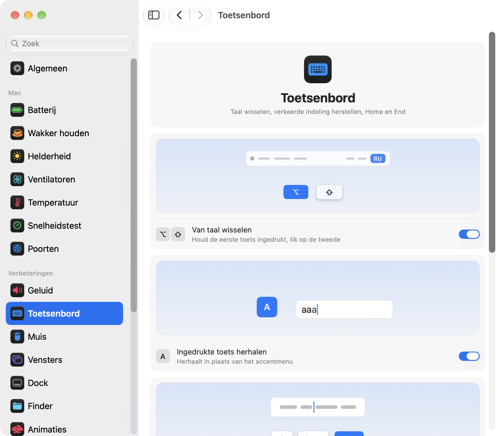
</picture>
</p>

## Installeren

Open Terminal, plak deze regel en druk op Return:

```bash
/bin/bash -c "$(curl -fsSL https://raw.githubusercontent.com/dev-pikapik/pika-tools/main/install.sh)"
```

De opdracht downloadt de nieuwste versie van GitHub en installeert die alleen als die door de ontwikkelaar is ondertekend en de controle van Apple op schadelijke software heeft doorstaan. pikapik staat daarna in de menubalk bovenaan het scherm. Alles blijft uit tot je het zelf aanzet.

<details>
<summary>Andere manieren: Homebrew of een dmg</summary>

Met Homebrew:

```bash
brew install --cask dev-pikapik/pika-tools/pikapik && open -a pikapik
```

Of download [pikapik.dmg](https://github.com/dev-pikapik/pika-tools/releases/latest/download/pikapik.dmg), open het bestand en sleep de app naar de map Apps.

Zowel de opdracht hierboven als Homebrew zetten de app in `/Applications`, openen hem, vragen om de toestemmingen en zetten ‘Open bij inloggen’ aan. Daarna werkt de app zichzelf bij, zie **Updates**. Verwijderen staat bij **Verwijderen**.

</details>

## Wat het doet

<table>
<tbody><tr>
<td width="50%" valign="top">
<picture><source media="(prefers-color-scheme: dark)" srcset="../media/keep-awake-dark.png"></picture>
<br><b>Wakker houden</b>
<br>Je Mac blijft wakker zolang je wilt, zelfs met de klep dicht.
</td>
<td width="50%" valign="top">
<picture><source media="(prefers-color-scheme: dark)" srcset="../media/fans-dark.png"></picture>
<br><b>Ventilatoren</b>
<br>Zie hoe snel je ventilatoren draaien en kies hun snelheid.
</td>
</tr></tbody>
<tbody><tr>
<td width="50%" valign="top">
<picture><source media="(prefers-color-scheme: dark)" srcset="../media/battery-dark.png">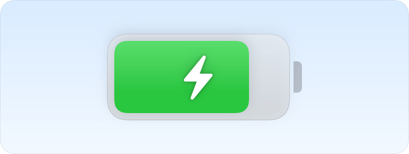</picture>
<br><b>Batterij</b>
<br>Zie de conditie, capaciteit en het aantal cycli van je batterij, hoeveel stroom erin gaat en hoe je hem langer laat meegaan.
</td>
<td width="50%" valign="top">
<picture><source media="(prefers-color-scheme: dark)" srcset="../media/command-keys-dark.png"></picture>
<br><b>⌘Q en ⌘W beschermen</b>
<br>Niets stopt of sluit per ongeluk. Voeg ⇧ toe als je het echt wilt.
</td>
</tr></tbody>
<tbody><tr>
<td width="50%" valign="top">
<picture><source media="(prefers-color-scheme: dark)" srcset="../media/compress-dark.png">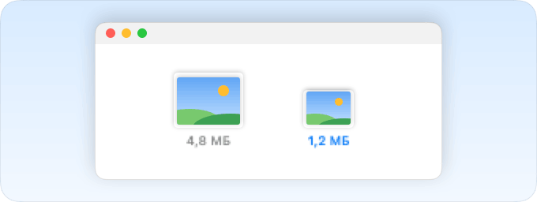</picture>
<br><b>Kleinere kopie</b>
<br>Klik met rechts op een foto, pdf of video, en je krijgt er een lichtere kopie naast.
</td>
<td width="50%" valign="top">
<picture><source media="(prefers-color-scheme: dark)" srcset="../media/convert-dark.png">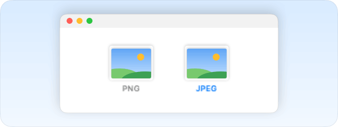</picture>
<br><b>Omzetten</b>
<br>Bewaar een afbeelding, video of nummer in een ander formaat via de rechtermuisknop.
</td>
</tr></tbody>
<tbody><tr>
<td width="50%" valign="top">
<picture><source media="(prefers-color-scheme: dark)" srcset="../media/input-switch-dark.png">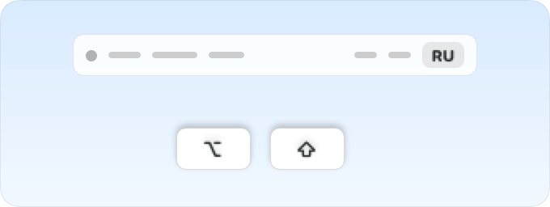</picture>
<br><b>Van taal wisselen</b>
<br>Houd ⌥ ingedrukt en tik op ⇧ om de toetsenbordtaal te wisselen.
</td>
<td width="50%" valign="top">
<picture><source media="(prefers-color-scheme: dark)" srcset="../media/quit-on-close-dark.png">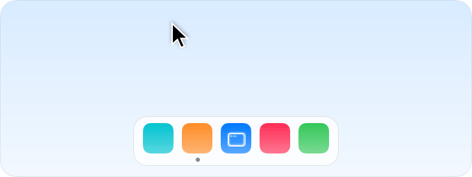</picture>
<br><b>Stoppen met het laatste venster</b>
<br>Sluit het laatste venster van een app, en de app stopt ook.
</td>
</tr></tbody>
<tbody><tr>
<td width="50%" valign="top">
<picture><source media="(prefers-color-scheme: dark)" srcset="../media/window-zoom-dark.png">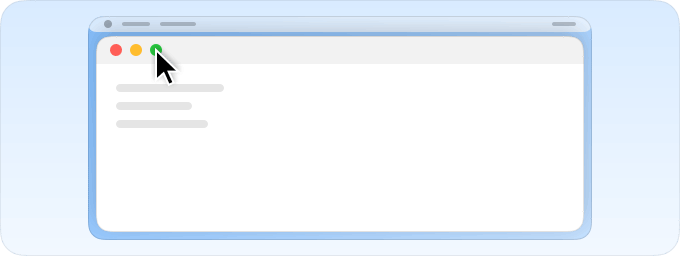</picture>
<br><b>Groene knop vergroot</b>
<br>Het venster vult het scherm zonder schermvullende modus.
</td>
<td width="50%" valign="top">
<picture><source media="(prefers-color-scheme: dark)" srcset="../media/dock-hide-dark.png">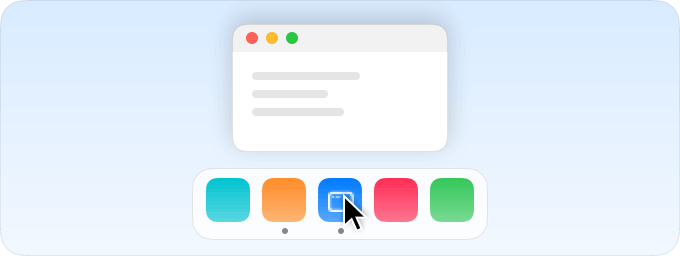</picture>
<br><b>Minimaliseren met een klik in het Dock</b>
<br>Klik op de app waarin je zit, en hij gaat opzij.
</td>
</tr></tbody>
<tbody><tr>
<td width="50%" valign="top">
<picture><source media="(prefers-color-scheme: dark)" srcset="../media/new-file-dark.png">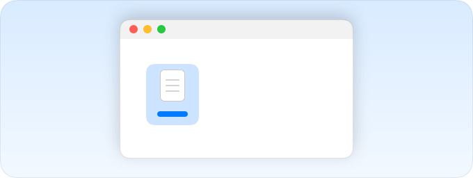</picture>
<br><b>Nieuw bestand</b>
<br>Klik met rechts in de Finder, typ een naam, en er staat een leeg bestand.
</td>
<td width="50%" valign="top">
<picture><source media="(prefers-color-scheme: dark)" srcset="../media/finder-cut-dark.png">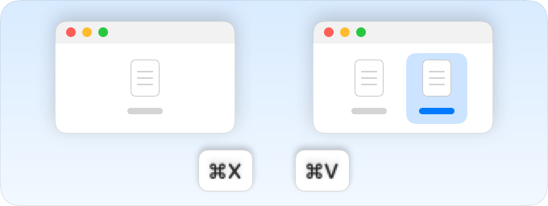</picture>
<br><b>⌘X verplaatst bestanden</b>
<br>Knip bestanden in de Finder en plak ze waar je wilt.
</td>
</tr></tbody>
<tbody><tr>
<td width="50%" valign="top">
<picture><source media="(prefers-color-scheme: dark)" srcset="../media/finder-open-dark.png">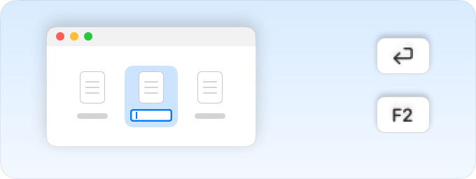</picture>
<br><b>Enter opent bestanden</b>
<br>Selecteer bestanden in de Finder en druk op Enter om ze te openen.
</td>
<td width="50%" valign="top">
<picture><source media="(prefers-color-scheme: dark)" srcset="../media/finder-delete-dark.png">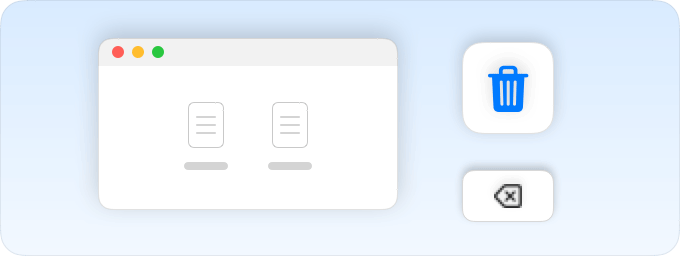</picture>
<br><b>Delete naar de prullenmand</b>
<br>Druk op ⌫ in de Finder, en de geselecteerde bestanden gaan naar de prullenmand.
</td>
</tr></tbody>
<tbody><tr>
<td width="50%" valign="top">
<picture><source media="(prefers-color-scheme: dark)" srcset="../media/desktop-icons-dark.png"></picture>
<br><b>Bureaubladsymbolen verbergen</b>
<br>Met één klik is je bureaublad leeg voor een gesprek of een schermafbeelding.
</td>
<td width="50%" valign="top">
<picture><source media="(prefers-color-scheme: dark)" srcset="../media/hidden-files-dark.png">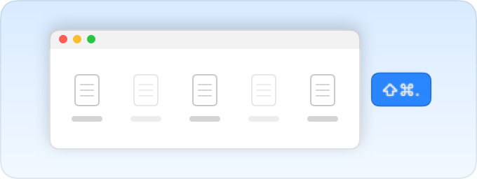</picture>
<br><b>Verborgen bestanden tonen</b>
<br>Zie de bestanden en mappen die macOS verborgen houdt.
</td>
</tr></tbody>
<tbody><tr>
<td width="50%" valign="top">
<picture><source media="(prefers-color-scheme: dark)" srcset="../media/game-mode-dark.png"></picture>
<br><b>Gamemodus</b>
<br>Terwijl je speelt, opent niets zich over het spel en sluit niets het af.
</td>
<td width="50%" valign="top">
<picture><source media="(prefers-color-scheme: dark)" srcset="../media/speed-test-dark.png">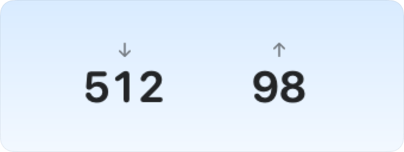</picture>
<br><b>Snelheidstest</b>
<br>Hoe snel je internet is, en waar het goed voor is.
</td>
</tr></tbody>
<tbody><tr>
<td width="50%" valign="top">
<picture><source media="(prefers-color-scheme: dark)" srcset="../media/side-buttons-dark.png">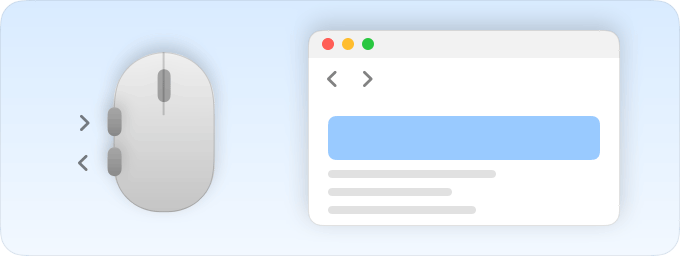</picture>
<br><b>Zijknoppen</b>
<br>Knop 4 en 5 gaan terug en vooruit, net als vegen op het trackpad.
</td>
<td width="50%" valign="top">
<picture><source media="(prefers-color-scheme: dark)" srcset="../media/hide-app-dark.png">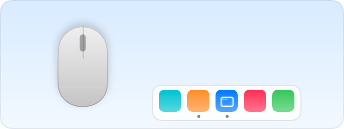</picture>
<br><b>Verbergen met een muisknop</b>
<br>Eén druk verbergt de app op de voorgrond, net als ⌘H. De app blijft draaien.
</td>
</tr></tbody>
<tbody><tr>
<td width="50%" valign="top">
<picture><source media="(prefers-color-scheme: dark)" srcset="../media/wheel-lines-dark.png">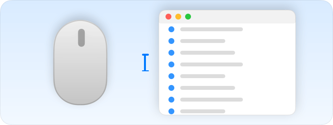</picture>
<br><b>Per regel scrollen</b>
<br>Elke klik van het scrollwiel scrolt even ver, hoe snel je ook draait.
</td>
<td width="50%" valign="top">
<picture><source media="(prefers-color-scheme: dark)" srcset="../media/wheel-direction-dark.png">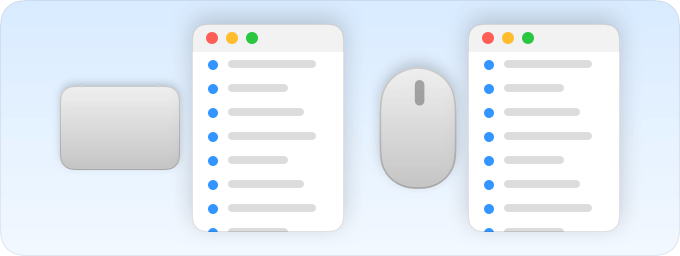</picture>
<br><b>Scrollrichting</b>
<br>Eén richting voor het trackpad, een andere voor de muis.
</td>
</tr></tbody>
<tbody><tr>
<td width="50%" valign="top">
<picture><source media="(prefers-color-scheme: dark)" srcset="../media/linear-pointer-dark.png">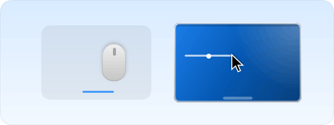</picture>
<br><b>Zonder aanwijzerversnelling</b>
<br>De aanwijzer gaat precies zo ver als je hand.
</td>
<td width="50%" valign="top">
<picture><source media="(prefers-color-scheme: dark)" srcset="../media/key-repeat-dark.png"></picture>
<br><b>Ingedrukte toets herhalen</b>
<br>Houd een toets ingedrukt om hem te herhalen, zonder accentmenu.
</td>
</tr></tbody>
<tbody><tr>
<td width="50%" valign="top">
<picture><source media="(prefers-color-scheme: dark)" srcset="../media/home-end-dark.png">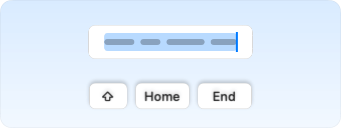</picture>
<br><b>Home en End</b>
<br>Spring tijdens het typen naar het begin of einde van de regel.
</td>
<td width="50%" valign="top">
<picture><source media="(prefers-color-scheme: dark)" srcset="../media/animations-dark.png">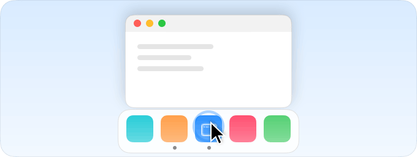</picture>
<br><b>Animaties</b>
<br>Maak het Dock, vensters en Snel bekijken sneller, tot direct aan toe.
</td>
</tr></tbody>
<tbody><tr>
<td width="50%" valign="top">
<picture><source media="(prefers-color-scheme: dark)" srcset="../media/leftover-permissions-dark.png"></picture>
<br><b>Toestemmingen van verwijderde apps</b>
<br>Haal de toestemmingen weg die macOS bewaart voor apps die je al hebt verwijderd.
</td>
<td width="50%" valign="top">
<picture><source media="(prefers-color-scheme: dark)" srcset="../media/pet-dark.png">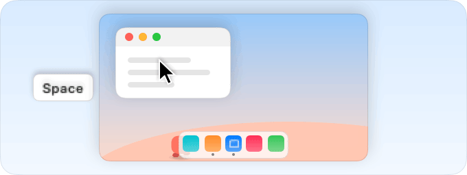</picture>
<br><b>Huisdiertje op het bureaublad</b>
<br>Een klein vriendje wandelt achter je vensters. Pak het op en gooi het, of druk op de spatiebalk en het springt. Kleed het aan met kleren uit zijn kledingkast en verdien onderscheidingen terwijl jullie samen spelen. Het wordt levendig als je typt en dommelt in als je wegloopt.
</td>
</tr></tbody>
<tbody><tr>
<td width="50%" valign="top">
<picture><source media="(prefers-color-scheme: dark)" srcset="../media/uninstaller-dark.png"></picture>
<br><b>Apps verwijderen</b>
<br>Verwijder een app met alle bestanden. Alles kan terug.
</td>
<td width="50%" valign="top">
<picture><source media="(prefers-color-scheme: dark)" srcset="../media/game-fps-dark.png">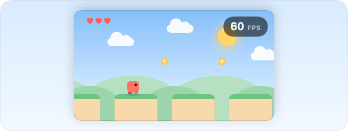</picture>
<br><b>FPS tonen</b>
<br>Een kleine teller laat in de hoek van je keuze zien hoe soepel je game loopt.
</td>
</tr></tbody>
<tbody><tr>
<td width="50%" valign="top">
<picture><source media="(prefers-color-scheme: dark)" srcset="../media/archive-dark.png">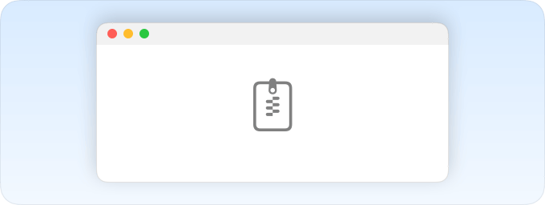</picture>
<br><b>Archieven</b>
<br>Pak RAR en andere archieven uit, of verpak bestanden in een ZIP, met een rechtsklik.
</td>
<td width="50%" valign="top">
<picture><source media="(prefers-color-scheme: dark)" srcset="../media/dock-display-dark.png">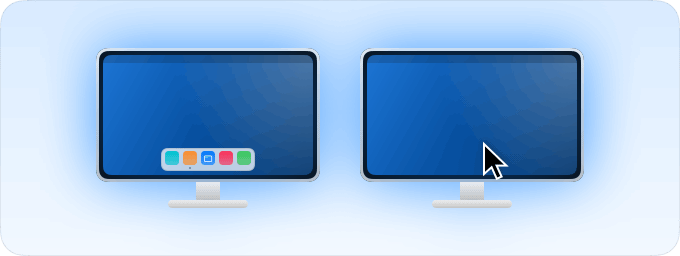</picture>
<br><b>Houd het Dock op één scherm</b>
<br>Het Dock springt niet meer naar een ander scherm. Maak een ander scherm het hoofdbeeldscherm om het te verplaatsen.
</td>
</tr></tbody>
<tbody><tr>
<td width="50%" valign="top">
<picture><source media="(prefers-color-scheme: dark)" srcset="../media/temperatures-dark.png"></picture>
<br><b>Temperatuur</b>
<br>Zie hoe warm je Mac vanbinnen is, van de processor tot de batterij.
</td>
<td width="50%" valign="top">
<picture><source media="(prefers-color-scheme: dark)" srcset="../media/background-dark.png">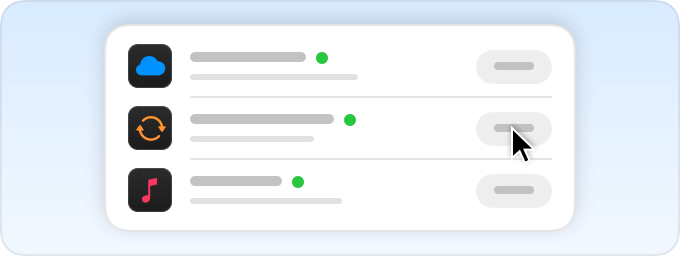</picture>
<br><b>Achtergrondtaken</b>
<br>Bekijk wat er op de achtergrond draait en waar het vandaan komt.
</td>
</tr></tbody>
<tbody><tr>
<td width="50%" valign="top">
<picture><source media="(prefers-color-scheme: dark)" srcset="../media/ports-dark.png">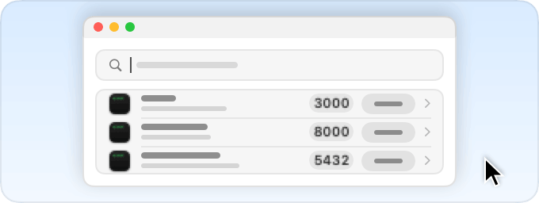</picture>
<br><b>Poorten</b>
<br>Zie welk programma een poort bezet houdt, en maak hem vrij.
</td>
<td width="50%" valign="top">
<picture><source media="(prefers-color-scheme: dark)" srcset="../media/app-volume-dark.png"></picture>
<br><b>App-volume</b>
<br>Zet een app zachter of demp hem, zonder de andere aan te raken.
</td>
</tr></tbody>
<tbody><tr>
<td width="50%" valign="top">
<picture><source media="(prefers-color-scheme: dark)" srcset="../media/brightness-dark.png">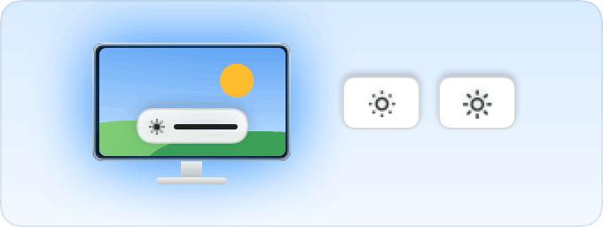</picture>
<br><b>Monitorhelderheid</b>
<br>Maak een monitor die macOS niet zelf kan regelen donkerder of lichter, met een schuifregelaar of de helderheidstoetsen.
</td>
<td width="50%" valign="top">
<picture><source media="(prefers-color-scheme: dark)" srcset="../media/layout-fix-dark.png"></picture>
<br><b>Corrigeer de verkeerde indeling</b>
<br>ghbdtn getypt in plaats van привет? Druk op de spatiebalk en het woord staat goed.
</td>
</tr></tbody>
</table>

## Meer weten

<details>
<summary>Eerste keer openen</summary>

pikapik heeft twee toestemmingen nodig. De eerste keer opent de app de instellingen op de pagina Toestemmingen, die je stap voor stap helpt, en macOS toont zijn eigen meldingen. Ga naar **Systeeminstellingen › Privacy en beveiliging** en zet pikapik aan bij:

- **Toegankelijkheid**, zodat de app een toetsaanslag of klik kan aanpassen voordat die bij andere apps aankomt.
- **Invoerbewaking**, zodat de app toetsaanslagen en klikken kan zien zonder ze aan te passen. Zo werkt het wisselen van taal.

De app merkt de wijziging binnen een paar seconden op, opnieuw opstarten is niet nodig.

Sommige functies vragen om meer als je ze gebruikt: **Ventilatorbeheer**, **Finder-extensies**, **iCloud Drive**, **Volledige schijftoegang**, **Schermopname** en **Opname van systeemaudio**. Alles staat op de pagina Toestemmingen in de instellingen: elke toestemming heeft een regel over waarvoor ze dient, een groen vinkje of een oranje kruisje en één knop: **Toestaan** als ze ontbreekt, **Zet uit** als ze aan staat. Zo trek je elke toestemming meteen terug.

pikapik legt niets vast, bewaart niets en verstuurt niets van wat je typt of aanklikt. Gebeurtenissen worden in het geheugen verwerkt en meteen doorgegeven. Om woorden te corrigeren die je in de verkeerde indeling typt, houdt pikapik alleen je laatste paar woorden in het geheugen en vergeet het die zodra je klikt of naar een andere app gaat. Het bewaart alleen de woorden die het op jouw verzoek met rust moet laten, en alleen op deze Mac, tot je ze wist in Instellingen › Toetsenbord. pikapik gaat alleen online voor updates (het vraagt GitHub om de nieuwste versie en downloadt die alleen als je ervoor kiest om bij te werken) en voor de snelheidstest als je die start (daarbij worden servers van Apple gebruikt). De versie uit de Mac App Store wordt door de App Store bijgewerkt, en de snelheidstest daarvan gebruikt Cloudflare. De voortgang van je huisdiertje (stappen, worpen, onderscheidingen en dergelijke) wordt alleen op deze Mac geteld en nooit ergens naartoe verstuurd. Je kunt die wissen in Instellingen › Huisdiertje.

</details>

<details>
<summary>Elk hulpmiddel in detail</summary>

**App-volume.** Open Instellingen › Geluid en zet **App-volume** aan. Elke app die geluid afspeelt krijgt een eigen schuifregelaar en een dempknop, in Instellingen en in het menu. Zet een te luid videogesprek zachter, demp een lawaaierige game en laat je muziek zoals die is: het volume van je Mac en van de andere apps verandert niet. pikapik onthoudt het niveau van elke app, en een app die je op vol volume laat staan, wordt nooit aangeraakt. Een app die je hebt ingesteld blijft ook na een herstart in de lijst staan, gedimd zolang hij gesloten is. Zo kun je het niveau instellen voordat de app start: klik op **Voeg app toe…** of sleep een app vanuit de Finder. Met de ✕ naast een app vergeet pikapik de app en staat hij weer op vol volume. Om het volume van een app te wijzigen, leidt pikapik het geluid ervan door zichzelf heen. Daarvoor heeft het de toestemming **Opname van systeemaudio** nodig, die je toestaat op de pagina Toestemmingen. Het geluid wordt alleen doorgegeven: het wordt niet opgenomen, bewaard of ergens naartoe gestuurd, en de microfoon wordt niet gebruikt. Vereist macOS 14.2 of nieuwer en is verborgen op macOS 14.0 en 14.1. Standaard uit.

**Monitorhelderheid.** macOS wijzigt de helderheid van het ingebouwde scherm en van Apple-schermen, maar niet van de meeste andere monitors. Open Instellingen › Helderheid: elke monitor die macOS niet zelf kan regelen krijgt een eigen schuifregelaar, en je kunt ook een rij ‘Helderheid’ toevoegen aan het paneel in de menubalk. pikapik wijzigt de helderheid van de monitor zelf, dezelfde instelling als de knoppen op de monitor. Reageert een monitor niet, zet dan **In plaats daarvan het beeld dimmen** aan: het beeld wordt donkerder, maar nooit zwart. Zet **Helderheidstoetsen** aan, dan regelen de helderheidstoetsen de monitor waar de aanwijzer staat en tonen ze een kleine indicator; houd ⌥⇧ ingedrukt voor fijnere stappen. De toetsen hebben de toestemming **Toegankelijkheid** nodig, die je toestaat op de pagina Toestemmingen; de schuifregelaars werken ook zonder. pikapik onthoudt de helderheid van elke monitor en stelt die na de sluimerstand opnieuw in. De versie uit de Mac App Store dimt alleen het beeld. Helderheidstoetsen staan standaard uit.

**⌘Q en ⌘W beschermen.** ⌘Q en ⌘W alleen doen niets, zodat je niet per ongeluk een app stopt of een venster sluit. Voeg Shift toe om het bewust te doen: ⇧⌘Q stopt, ⇧⌘W sluit. Werkt in elke app. Elke toets heeft een eigen schakelaar. Standaard uit.

**Van taal wisselen met Option+Shift.** Houd Option ingedrukt en tik op Shift: macOS gaat naar de volgende invoerbron. Houd Option ingedrukt en tik nog eens op Shift om verder te gaan. Houd Shift ingedrukt en tik op Option om terug te gaan. Druk je tussendoor op een andere toets, klik je of voeg je Command, Control of Fn toe, dan wordt er niet gewisseld, zodat combinaties zoals Option+Shift+pijltoets blijven werken zoals voorheen. Standaard uit.

**Ingedrukte toets herhalen.** Houd een toets ingedrukt en de letter wordt steeds opnieuw getypt, in plaats van dat het accentmenu verschijnt. Handig in games en bij het typen. Apps die al open zijn nemen dit over na een herstart. Zet je het uit, dan werkt macOS weer zoals altijd. Standaard uit.

**Home en End naar begin en einde van de regel.** Terwijl je typt, zet Home de cursor aan het begin van de regel en End aan het einde, in plaats van de pagina te scrollen. Met ⇧ selecteren ze tot daar, met ⌘ gaan ze naar het begin of einde van de hele tekst. Buiten tekstvelden, en in terminals, virtuele machines en apps voor extern bureaublad, werken de toetsen zoals voorheen. In de versie uit de Mac App Store werken ze ook buiten tekstvelden zo, behalve in browsers, Finder en Muziek. Je kunt andere apps toevoegen waarin ze gewoon moeten werken. Standaard uit.

**Woorden corrigeren die je in de verkeerde indeling typt.** Komt een woord eruit als koeterwaals, zoals ghbdtn in plaats van привет, dan typt pikapik het opnieuw in de juiste indeling zodra je op de spatiebalk of Return drukt, en wisselt het van indeling zodat het volgende woord meteen goed komt. Het werkt met elke toetsenbordindeling die je op je Mac hebt toegevoegd. Een woord verandert alleen als het in geen van je talen bestaat en dezelfde toetsen in een andere indeling een veelgebruikt woord geven. Namen, typfouten en zeldzame woorden blijven dus zoals je ze typte, en ook in wachtwoordvelden, Terminal en de apps die je kiest verandert er niets. Druk op ⌃⇧Spatie om het laatste woord of de geselecteerde tekst te corrigeren, en druk nog eens om je andere indelingen te proberen. Direct na een correctie maken dezelfde toetsen die ongedaan, en pikapik corrigeert dat woord daarna niet meer uit zichzelf. Je kunt de toetscombinatie wijzigen in Instellingen › Toetsenbord. In de versie uit de Mac App Store selecteer je de tekst en druk je op ⌃⇧Spatie, of kies je ‘Corrigeer toetsenbordindeling’ in het menu ‘Voorzieningen’. **Corrigeer woorden tijdens het typen** en de toetscombinatie staan uit totdat je ze aanzet in Instellingen › Toetsenbord, en hebben Toegankelijkheid nodig, waar de pagina Toestemmingen om vraagt. Standaard uit.

**Aanwijzerversnelling uitschakelen.** De aanwijzer beweegt precies zo ver als de muis, hoe snel je hem ook beweegt. Met een schuifknop **Snelheid aanwijzer** stel je in hoe snel hij gaat. Werkt alleen met muizen, het trackpad blijft zoals het is. Zet het uit of stop pikapik, en macOS krijgt zijn eigen instellingen terug. Standaard uit.

**Per regel scrollen.** Elke klik van het muiswieltje scrolt evenveel regels, hoe snel je het ook draait. Kies van 1 tot 10 regels per klik, standaard 3. Natuurlijk scrollen blijft zoals je het in Systeeminstellingen hebt ingesteld. Werkt alleen voor muizen, het trackpad blijft zoals het is. Standaard uit. Naast de schuifregelaar **Afstand per klik** scrolt een kleine pagina de gekozen afstand, en een stip markeert de standaardwaarde.

Sommige apps en games tellen scrollen in exacte pixels: zet daarvoor dezelfde instelling op pixels en kies 1 tot 200 pixels per klik, standaard 40. De regelaar laat ook zien welk deel van de schermhoogte dat is.

**Scrollrichting voor trackpad en muis.** macOS heeft één schakelaar voor natuurlijk scrollen, voor het trackpad en de muis tegelijk. Zet dit aan en kies voor elk een richting: **Natuurlijk**, waarbij de pagina je vingers volgt zoals op een iPhone, of **Klassiek**, waarbij de pagina de andere kant op gaat. De keuze voor het trackpad geldt ook voor zijwaarts scrollen en voor het uitglijden nadat je je vingers optilt. De Magic Mouse scrollt met aanraking en volgt daarom de keuze voor het trackpad. Kies op elke Mac hetzelfde en scrollen voelt overal gelijk, ook als je de muis met Universele bediening naar een andere Mac beweegt. Standaard uit. Als je het aanzet, staan beide zoals in Systeeminstellingen, dus er verandert niets tot je iets anders kiest.

**Zijknoppen voor terug en vooruit.** Muisknoppen 4 en 5 gaan terug en vooruit in de Finder, Safari en andere Apple-apps en in veel andere apps, net als een veeg op het trackpad. Apps die deze knoppen zelf afhandelen, krijgen ze ongewijzigd. Zitten ze op je muis andersom, zet dan **Zijknoppen omwisselen** aan. Standaard uit.

**Een muisknop verbergt de huidige app.** Zet **Verberg de huidige app met een muisknop** aan in Instellingen › Muis en druk op de knop die je wilt gebruiken, bijvoorbeeld de middelste knop of een zijknop. Daarna verbergt één druk de app op de voorgrond, precies zoals ⌘H: de app blijft draaien, en een klik op zijn symbool in het Dock haalt hem terug. Terwijl je met de Gamemodus aan speelt, werkt de knop in de game zoals altijd. Standaard uit.

**Stoppen als het laatste venster sluit.** Sluit het laatste venster van een app en de app stopt. De Finder blijft open, net als apps met vensters op andere bureaubladen of in het Dock. Je kunt apps opgeven die nooit op deze manier mogen stoppen. Standaard uit.

**Minimaliseer of verberg met een klik in het Dock.** Klik in het Dock op het symbool van de app waarin je werkt, en al zijn vensters gaan naar het Dock. Klik nog eens om ze allemaal terug te halen. Je kunt de klik ook de hele app laten verbergen, zoals ⌘H. Standaard uit.

**Houd het Dock op één scherm.** Bij meerdere schermen verplaatst macOS het Dock naar een ander scherm zodra de aanwijzer tegen de onderrand van dat scherm duwt. Staat de schakelaar aan, dan gebeurt dat niet meer, hoe snel je de aanwijzer ook beweegt: pikapik zet het verplaatsen uit met de eigen instelling van het Dock en komt nooit aan de aanwijzer. Wil je het Dock bewust verplaatsen, maak dan een ander scherm het hoofdbeeldscherm: klik in **Systeeminstellingen › Beeldschermen** op dat scherm en kies **Hoofdbeeldscherm** bij **Gebruik als**, en het Dock gaat mee. De regel **Hoofdbeeldscherm** onder de schakelaar opent die pagina. Het Dock leest zijn instelling alleen bij het opstarten, dus als je de schakelaar aan- of uitzet, start het Dock één keer opnieuw. Er is geen toestemming nodig. De schakelaar staat standaard uit en zit niet in de versie uit de Mac App Store.

**Groene knop vergroot het venster.** Klik op de groene knop van een venster en het vult het scherm, zonder naar volledig scherm te gaan. Klik nogmaals om de vorige grootte terug te krijgen. Houd ⌥ ingedrukt en de knop werkt zoals altijd. Volledig scherm blijft beschikbaar in het menu van de knop en met ⌃⌘F. Je kunt apps opgeven waarin de groene knop gewoon moet blijven werken. Standaard uit.

**Nieuw bestand in de Finder.** Klik met rechts in een Finder-venster of op het bureaublad, kies **Nieuw bestand**, typ een naam en er verschijnt een leeg bestand. Standaard .txt. Standaard uit.

**Enter opent bestanden in de Finder.** Selecteer bestanden in een Finder-venster of op het bureaublad en druk op Return of Enter: ze worden geopend. F2 of fn F2 wijzigt de naam van het geselecteerde bestand. In tekstvelden, bijvoorbeeld terwijl je een naam typt, werken de toetsen zoals altijd. Standaard uit.

**⌘X knipt bestanden in de Finder.** Selecteer bestanden en druk op ⌘X, open de map waar je ze wilt hebben en druk op ⌘V: de bestanden worden daarheen verplaatst in plaats van gekopieerd. ⌘C annuleert het knippen. Standaard uit.

**Delete verwijdert bestanden in de Finder.** Selecteer bestanden en druk op ⌫ of ⌦ (fn ⌫ op een laptop): ze gaan naar de Prullenmand, net als met ⌘⌫. Terwijl je een bestand een nieuwe naam geeft, zoekt of in een ander veld typt, wissen de toetsen gewoon letters. Standaard uit.

**Kleinere kopie in de Finder.** Klik met rechts op een bestand in de Finder en kies **Maak kleinere kopie**. Ernaast verschijnt een lichtere versie van een foto, GIF, pdf of video, vaak vele malen kleiner. Ongecomprimeerd geluid zoals WAV of AIFF wordt een compacte M4A. Kan een bestand niet kleiner, dan komt er geen kopie en laat pikapik dat weten. Het origineel blijft zoals het is en niets verlaat je Mac. Standaard uit.

**Omzetten in de Finder.** Klik met rechts op een bestand in de Finder en kies **Zet om naar** om het in een ander formaat te bewaren: een afbeelding als JPEG, PNG, HEIC, GIF, TIFF of PDF, een video als MP4, MOV of alleen het geluid, muziek als M4A, WAV of AIFF. Het origineel blijft zoals het is en niets verlaat je Mac. Los van de kleinere kopie aan te zetten. Standaard uit.

**Archieven in de Finder.** Klik met rechts op een archief in de Finder en kies **Uitpakken**, en de bestanden verschijnen ernaast. Klik met rechts op een ander bestand of een map en kies **Maak archief…** om een ZIP, 7Z, TAR.GZ of TAR.XZ te maken. ZIP en 7Z kunnen een wachtwoord hebben, en elk archief kan in delen worden opgesplitst, bijvoorbeeld van 15 MB voor e-mail of van 4 GB voor een USB-stick. Het wachtwoord typ je twee keer, zodat een tikfout je niet buitensluit van je eigen bestanden. Een ZIP die zo is gemaakt bevat geen verborgen bestanden die het systeem toevoegt, houdt namen in elke taal leesbaar en kan bestanden van meer dan 4 GB aan. Standaard uit. De versie uit de Mac App Store heeft een paar beperkingen, hieronder beschreven.

pikapik opent ook wat macOS niet kan openen: RAR, zelfs verdeeld over delen, 7Z met een wachtwoord, reeksen zoals .001, .z01, .r00 en .part1.rar, en ZIPX, CAB, LZH, ARJ, ZST, LZMA, WIM en meer. Dubbelklikken opent ze in pikapik. Bestandsnamen in oude ZIP-bestanden, bijvoorbeeld in Cyrillisch, Japans of Chinees, komen leesbaar uit de bus. Met de schakelaar **Open archieven met deze app** in Instellingen › Finder neemt pikapik ook ZIP en 7Z over, terwijl TAR en GZ bij de ingebouwde archiefapp blijven, die daar al goed mee overweg kan. pikapik kan RAR uitpakken maar niet maken: de RAR-licentie staat alleen uitpakken toe.

Een venster vraagt om het wachtwoord, **Stop** breekt elke taak af, en uit een beschadigd of onvolledig archief haalt pikapik wat nog te lezen is. Het vraagt eerst om bevestiging voordat het een archief uitpakt dat tot een enorme omvang zou opzwellen, stopt op tijd als de schijf vol dreigt te raken en blokkeert archieven die buiten hun eigen map proberen te schrijven. Selecteer een archief in de Finder en druk op de spatiebalk om te zien wat erin zit.
**Archieven in de versie uit de Mac App Store.** Ze werken daar ook, maar met de tools die in macOS zitten in plaats van het meegeleverde 7-Zip, dus er zijn beperkingen: alleen ZIP kan een wachtwoord hebben, 7Z niet; een archief kan niet in delen worden gesplitst, en archieven in meerdere delen (.001, .part1.rar, .z01 en dergelijke) kunnen niet worden geopend; losse .xz-, .lzma- en .zst-bestanden kunnen niet worden geopend (.gz en .bz2 wel); 7Z en RAR met wachtwoord kunnen niet worden geopend; en de schakelaar **Open archieven met deze app** ontbreekt. De eerste keer vraagt pikapik toegang tot je thuismap, net als bij Nieuw bestand en Kleinere kopie, omdat deze versie alleen mag schrijven waar jij dat hebt toegestaan. Zet de Finder-extensie aan in Systeeminstellingen › Algemeen › Inlogonderdelen en extensies; pikapik laat zien waar je moet klikken.


**Bureaubladsymbolen verbergen.** Zet het aan voor een gesprek, een schermopname of een schermafbeelding, en de bestanden en mappen op het bureaublad verdwijnen. Zet het uit, en ze staan weer op hun plek. Er wordt niets verplaatst: de bestanden blijven in de map ‘Bureaublad’ in de Finder. Het is de instelling **Toon onderdelen › Op bureaublad** uit Systeeminstellingen › Bureaublad en Dock, alleen dichter bij de hand, dus de twee komen altijd overeen. In de versie uit de Mac App Store bedekt deze rij in plaats daarvan de symbolen op elk scherm met de bureaubladachtergrond, of met een effen kleur als de achtergrond beweegt, en klikken komen nog steeds op het bureaublad aan. In Instellingen opent de knop **Open** eronder nog steeds die pagina van Systeeminstellingen.

**Verborgen bestanden tonen.** Bestanden en mappen die macOS verbergt, zoals Bibliotheek in je thuismap of bestanden waarvan de naam met een punt begint, verschijnen gedimd in de Finder en op het bureaublad. Het is hetzelfde als ⇧⌘. indrukken in de Finder, alleen zie je in één oogopslag of het aanstaat. Om de wijziging toe te passen, herstart de Finder even en opent hij zijn vensters en tabbladen weer. Is de Finder bestanden aan het kopiëren of verplaatsen, dan herstart hij pas als hij klaar is. Beide staan in Instellingen › Finder. Wil je ze in het paneel in de menubalk, klik dan onderaan op de potloodknop en vink ze aan. In de versie uit de Mac App Store toont Instellingen › Finder in plaats daarvan de toetsen ⇧⌘. voor de Finder.

**Gamemodus.** Voeg je games toe, en zolang je speelt, haalt je Mac je niet uit de game. Spotlight, Siri, ⌘Tab, Mission Control en vegen tussen bureaubladen openen niet boven de game, ⌘Q en ⌘W sluiten hem niet per ongeluk, de aanwijzer glipt niet naar het Dock, de menubalk of een ander scherm, en het scherm blijft aan. Elk hiervan heeft een eigen schakelaar op de pagina Games, en pikapik stelt games voor die het op je Mac vindt. In een game blijft Control-klik een klik, en Control met pijltjes wisselt niet van bureaublad. Ook Minecraft wordt herkend: voeg Minecraft Launcher of CurseForge toe, en de modus gaat aan in Minecraft zelf. Druk op ⇧⌘Q om een game te verlaten en op ⇧⌘W om het venster te sluiten. ⌥⌘Esc werkt altijd. Zodra je de game verlaat, werkt alles weer zoals gewoonlijk. Standaard uit.

Zet Spelmodus aan en speel. Meer spelinstellingen bevat de catalogus van je Mac, actuele toetsen en een bewegende preview voor elke actie.

Automatisch pauzeert acties die vensters openen of focus verplaatsen. Een kort bewust taalkortcommando wisselt de bron zonder systeemvenster. Vastgehouden bewegingstoetsen hebben voorrang, zodat rennen en springen niet per ongeluk de taal wisselen.

In Instellingen → Spellen → Meer spelinstellingen staat een groep ‘Muis en trackpad’. Daarin staat alleen wat in macOS op je Mac is ingeschakeld, met de namen van Apple en een kleine tekening bij elk onderdeel: toetscombinaties op een muisknop, vegen tussen bureaubladen en apps in volledig scherm, Mission Control en App Exposé, knijpen voor apps en spreiden voor het bureaublad, vegen vanaf de rechterrand voor het Berichtencentrum en elke actieve hoek met de actie die erbij hoort. Zolang een game vooraan staat, zijn ze gepauzeerd, zodat een onbedoelde veeg of een aanraking van een hoek van het scherm je niet uit de game haalt. Gebaren in de game blijven gewoon werken. Elk onderdeel kan zo worden ingesteld dat het werkt zoals gewoonlijk.

Open Instellingen → Spellen → Spel toevoegen en klik op je draaiende spel. Ook spellen via Java en andere omgevingen verschijnen hier, zelfs zonder .app-bestand. Minecraft heet Minecraft in plaats van java. Zoek het spelproces en sleep de rij naar Je spellen in Instellingen → Spellen.

**FPS tonen.** FPS betekent beelden per seconde: hoeveel beelden de game elke seconde tekent. Zet **FPS tonen** aan op de pagina Games, en zolang de Gamemodus aanstaat, staat er in een hoek van elke game een klein donker labeltje met dat getal. Kies de hoek door erop te klikken in het plaatje boven de schakelaar. Een streepje betekent dat de eerste beelden er nog niet zijn, en een vervaagde 0 dat de game niets meer tekent. Onder macOS 27 telt macOS de meeste games zelf, zonder toestemming. Een game die macOS niet kan tellen, meestal een oudere game, wordt geteld via schermopname: dan verschijnt op de pagina Toestemmingen de rij **Schermopname**, vraagt pikapik er nooit om tijdens een game en kan het getal niet hoger zijn dan de verversingssnelheid van het scherm. Onder macOS 14 tot en met 26 en in de versie uit de Mac App Store wordt elke game zo geteld, dus de rij verschijnt zodra je **FPS tonen** aanzet, en de knop **Toestaan** onder de schakelaar brengt je erheen. Er wordt geen beeld bewaard of verstuurd. Standaard uit.

**Kledingkast en onderscheidingen van je huisdiertje.** Open Instellingen › Huisdiertje om je huisdiertje aan te kleden: meer dan 30 dingen, van hoeden en brillen tot capes en vleugels, en kant-en-klare outfits zoals tovenaar, piraat of astronaut. Een paar dingen zijn vanaf het begin gratis. De rest zijn onderscheidingen die je onder het spelen krijgt: pak je huisdiertje op en gooi het omhoog, schop tegen de bal, kijk hoe het op ramen klimt en kletst, of houd het gewoon dag na dag gezelschap. Als je een nieuwe onderscheiding hebt verdiend, vertelt je huisdiertje het je.

Om te weten wanneer een onderscheiding toekomt, telt pikapik alleen wat jij en je huisdiertje doen: stappen, hoe vaak je het oppakt en gooit, sprongen, klimpartijen, balspelletjes en praatjes, dagen samen, of jullie vroeg in de ochtend, na middernacht of in het weekend samen waren, welke pagina’s van Instellingen je opende en wat je hebt gepast. Buiten de Mac App Store noteert pikapik ook of je vanuit Instellingen onze GitHub-pagina hebt geopend. Deze aantallen, de datum van elke onderscheiding en wat je huisdiertje draagt blijven op deze Mac. Er wordt niets ergens naartoe verstuurd en niets hiervan komt in het geëxporteerde instellingenbestand of in de iCloud-synchronisatie. Je kunt alles op elk moment wissen in Instellingen › Huisdiertje, en je huisdiertje begint opnieuw.

**Apps verwijderen.** Open Instellingen › Apps verwijderen, kies een app uit de lijst of sleep er een op het plaatje, en pikapik toont alles wat die app op je Mac bewaart: de app zelf, de bewaarde gegevens, instellingen, tijdelijke bestanden, achtergrondhulpjes en meer, elk met de reden waarom het in de lijst staat. Bestanden die duidelijk bij de app horen zijn aangevinkt, bestanden die er misschien mee te maken hebben niet, en bestanden die ook andere apps gebruiken zijn gemarkeerd. Kies wat weg moet en klik op **Verplaats naar Prullenmand**. Er wordt niets definitief gewist: alles gaat naar de Prullenmand. Staat de app open, dan vraagt pikapik de app eerst om te stoppen, en hebben sommige bestanden een beheerder nodig, dan vraagt je Mac één keer om je wachtwoord.

Bedacht je je? Klik op **Zet terug** en alles staat weer waar het stond, terwijl de achtergrondhulpjes opnieuw starten. De laatste tien verwijderingen blijven onder ‘Onlangs verwijderd’ staan zolang hun bestanden in de Prullenmand liggen. **App resetten** houdt de app en verwijdert alleen de bewaarde gegevens, instellingen en tijdelijke bestanden, wat kan helpen als een app raar doet. Apps die je zelf in de Prullenmand hebt gezet staan onder ‘In de Prullenmand’, samen met de bestanden die ze achterlieten, en ‘Resten van verwijderde apps’ vindt bestanden van apps die al weg zijn. De schakelaar ‘Bied opruimen aan als een app in de Prullenmand komt’ staat standaard uit, en er wordt niets verwijderd voordat jij kiest. Om alles te kunnen zien wat een app bewaart, heeft de pagina **Volledige schijftoegang** nodig. Deze tool zit niet in de versie uit de Mac App Store.

**Temperatuur.** Open Instellingen › Temperatuur om te zien hoe warm je Mac vanbinnen is. Bovenaan vat één woord het samen, van ‘Normaal’ tot ‘Erg heet’, met een regel die zegt of je Mac op volle snelheid werkt of trager wordt om af te koelen. Daaronder heeft elk onderdeel een eigen rij met een gewone naam in plaats van een sensorcode: processor, grafische chip, geheugen, opslag, wifi en batterij, afhankelijk van de sensoren in je Mac. Elke rij toont de graden en een korte balk die groen, geel of oranje wordt, afgemeten aan het normale bereik van dat onderdeel. De waarden worden elke twee seconden bijgewerkt, en alleen terwijl je kijkt, dus ze kosten je Mac bijna niets. Je hebt geen wachtwoord of toestemming nodig. Je kunt ook een rij ‘Temperatuur’ toevoegen aan het paneel in de menubalk. De versie uit de Mac App Store toont het algemene niveau en, op een Mac met batterij, de temperatuur van de batterij.

De pagina **Achtergrondtaken** toont alles wat vanzelf start op je Mac: apps die openen bij het inloggen, achtergronddiensten, hulpjes die in apps verstopt zitten en resten van apps die je al hebt verwijderd. Bij elke taak zie je welke app hem heeft toegevoegd, of hij nu draait en waar het bestand staat, en één klik toont dat bestand in de Finder. Je eigen taken zet je met één knop uit en net zo makkelijk weer aan, en er wordt niets verwijderd. Taken voor alle gebruikers en voor de hele Mac horen bij macOS, dus hun knop opent Inlogonderdelen in Systeeminstellingen. In de versie uit de Mac App Store laat de pagina de taken alleen zien: je geeft één keer in het gewone Open-venster toegang tot je thuismap, en de knoppen openen Inlogonderdelen.

**Poorten.** Zegt een programma dat zijn poort al in gebruik is, open dan Instellingen › Poorten. Je ziet elk programma dat op je Mac een poort bezet houdt, met zijn symbool, de poortnummers en of andere apparaten in je netwerk verbinding kunnen maken. Typ een nummer om te zien wie die poort bezet houdt, of om zeker te weten dat hij vrij is. Klik op een rij voor de adressen die je in een browser kunt openen, het bestand van het programma, het commando waarmee het is gestart, de map en het procesnummer. **Maak vrij** vraagt het programma om te stoppen, zodat het zijn werk kan bewaren. Sluit het niet, dan kun je het geforceerd laten stoppen. Bij beide stappen vraagt pikapik het je eerst. Onderdelen van macOS en programma’s van andere gebruikers stopt pikapik nooit: bij AirPlay-ontvanger, Bestandsdeling, Schermdeling en Extern inloggen vertelt het je welke schakelaar in Systeeminstellingen de poort vrijmaakt. De pagina Poorten zit niet in de versie uit de Mac App Store: daar laat macOS een app niet zien welk programma een poort bezet houdt.

Elke tool heeft een eigen schakelaar in het menu en in de instellingen.

Het symbool in de menubalk laat in één oogopslag de status zien: het pikapik-teken als de tools werken, hetzelfde teken maar bleek als alles uit staat en een waarschuwingsdriehoek als een tool aan staat maar er toestemmingen ontbreken.

Het paneel in de menubalk begint met maar een paar rijen. Welke rijen het toont, bepaal je zelf: klik onderaan op de potloodknop, vink aan wat je wilt zien en klik op **Gereed**. Verborgen rijen blijven werken en blijven staan in Instellingen. Past het paneel niet op het scherm, dan kun je scrollen.

De app volgt de taal van je systeem of de taal die je in de instellingen kiest. Alle 23 talen uit de lijst bovenaan deze pagina zijn beschikbaar.

</details>

<details>
<summary>Wakker houden</summary>

Voorkomt dat je Mac in de sluimerstand gaat terwijl je niet achter het toetsenbord zit: voor elke duur van 1 seconde tot 365 dagen, of totdat je het uitzet. Zet het aan in het menu en stel de duur in de instellingen in: typ dagen, uren, minuten en seconden, gebruik ↑ en ↓ of klik op een voorinstelling van 15 minuten tot 8 uur. Het menu laat zien hoeveel tijd er nog over is en wanneer het eindigt. Voor het **Scherm** zijn er twee keuzes. **Altijd aan**: het gaat niet uit, zonder schermbeveiliging of toegangsscherm. **Gaat uit zoals gewoonlijk**: het gaat uit volgens de eigen timer terwijl je Mac blijft werken. **Zet het scherm nu uit** (ook in het menu) zet het meteen uit en je Mac blijft werken: beweeg de muis of druk op een toets om het terug te krijgen. Als je pikapik stopt, stopt Wakker houden ook.

Op een MacBook kun je ook **Werken met de klep dicht** aanzetten. macOS heeft daar geen schakelaar voor, dus pikapik voert `pmset -a disablesleep 1` uit en vraagt om een beheerderswachtwoord: alleen een beheerder mag wijzigen hoe de Mac sluimert. De instelling gaat vanzelf terug naar normaal als Wakker houden eindigt, als je de app stopt of als hij vastloopt. Voer je het wachtwoord niet in, dan verandert er niets. Zorg voor goede ventilatie als de klep dicht is. **Stoppen als de batterij onder 20% komt** beëindigt de sessie voordat de batterij leeg is.

Keep Awake, de beeldschermmodus en de modus met gesloten deksel kun je via de app Opdrachten op een knop zetten in het Bedieningscentrum, de menubalk of een widget op het bureaublad, met links die je kopieert in Instellingen › Wakker houden.

</details>

<details>
<summary>Snelheidstest</summary>

Laat zien hoe snel je internet nu is. Klik op **Test snelheid** in Instellingen › Snelheidstest, of op **Test** in het menu als je de rij met de potloodknop hebt toegevoegd. Na ongeveer een halve minuut zie je download, upload, ping en reactiesnelheid: hoe snel alles reageert terwijl de verbinding bezig is. Daaronder staat in gewone woorden waar het geschikt voor is: films in 4K, videogesprekken, onlinegames en grote downloads. De test gebruikt networkQuality uit macOS en servers van Apple. Het laatste resultaat blijft staan tot de volgende test, en een link voor Opdrachten start hem vanuit het bedieningspaneel.

</details>

<details>
<summary>Instellingen</summary>

Open de instellingen vanuit het menu met **Instellingen…** of ⌘, of open pikapik gewoon opnieuw vanuit de Finder, Launchpad of Spotlight. Zolang het venster open is, staat de app in het Dock en in ⌘Tab.

- **Algemeen**: open bij inloggen, weergave (Systeem, Licht of Donker), taal, updates en reservekopie: exporteer en importeer instellingen als bestand, of synchroniseer ze via iCloud Drive.
- **Batterij**: oplaadniveau, tijd tot vol of resterende tijd, conditie, maximumcapaciteit, aantal cycli, lichtnetadapter en vermogen in watt, plus tips om je batterij langer mee te laten gaan. De pagina toont alleen informatie: de oplaadlimiet blijft in **Systeeminstellingen › Batterij**. Alleen te zien op een Mac met een batterij.
- **Wakker houden**: duur, opties voor het scherm en de klep.
- **Helderheid**: een schuifregelaar voor elke monitor die macOS niet zelf kan regelen, de helderheidstoetsen en de optie om in plaats daarvan het beeld te dimmen.
- **Ventilatoren**: de snelheid van elke ventilator, Auto of een handmatige snelheid zodra Ventilatorbeheer is toegestaan.
- **Temperatuur**: hoe warm je Mac is, in het algemeen en per onderdeel, zoals de processor, het geheugen en de batterij.
- **Snelheidstest**: meet je internet en zie waar het geschikt voor is.
- **Poorten**: welk programma welke poort bezet houdt, de adressen en details, en een knop om de poort vrij te maken.
- **Geluid**: app-volume, een schuifregelaar en een dempknop voor elke app die geluid afspeelt.
- **Toetsenbord**: van taal wisselen, toetsherhaling, Home en End, verkeerde indeling corrigeren.
- **Muis**: aanwijzerversnelling en snelheid aanwijzer, scrollen per regel, scrollrichting, zijknoppen, een knop die de huidige app verbergt.
- **Vensters**: vergroten met de groene knop (met een lijst met uitzonderingen), bescherming van ⌘Q en ⌘W, en stoppen bij het laatste venster (met een lijst met uitzonderingen).
- **Dock**: minimaliseren of verbergen met een klik in het Dock en het Dock op één scherm houden.
- **Finder**: nieuw bestand, kleinere kopie, omzetten en archieven, openen met Return, knippen met ⌘X, verwijderen met ⌫, bureaubladsymbolen verbergen en verborgen bestanden tonen.
- **Apps verwijderen**: verwijder een app met al zijn bestanden, zet later alles terug en ruim op wat verwijderde apps hebben achtergelaten.
- **Achtergrondtaken**: alles wat op de achtergrond draait, welke app het heeft toegevoegd en een knop om je eigen taken uit en weer aan te zetten.
- **Games**: je lijst met games en de opties van de Gamemodus.
- **Huisdiertje**: zet het aan of uit, laat het kletsen, op jouw ritme leven en met de bal spelen, kleed het aan en bekijk je onderscheidingen.
- **Toestemmingen**: alle toestemmingen die pikapik gebruikt, elk met zijn status en één knop om ze toe te staan of uit te zetten. Een functie waarvoor een toestemming ontbreekt, ziet er half grijs uit; een klik erop opent deze pagina bij de juiste regel.
- **Over**: versie, links naar het wijzigingslogboek en om een probleem te melden.

Veel instellingen hebben een klein plaatje dat laat zien wat ze doen, zoals een Mac die wakker blijft of een venster dat zich achter het Dock verbergt. Het plaatje verandert mee met de schakelaar en staat stil als ‘Verminder beweging’ aan staat in Systeeminstellingen.

Elke pagina heeft onderaan een knop **Herstel standaardinstellingen…**. Die vraagt eerst om bevestiging, zet daarna de tools op die pagina uit en zet hun opties terug, alsof pikapik er nooit aan heeft gezeten.

**Instellingen synchroniseren met iCloud** houdt pikapik op al je Macs hetzelfde. De instellingen staan in de map pikapik in iCloud Drive, en de meest recente wijziging wint. Standaard uit, en iCloud Drive moet aanstaan. Toestemmingen worden niet gesynchroniseerd: elke Mac vraagt er zelf om.

</details>

<details>
<summary>Updates</summary>

pikapik zoekt bij het openen en elke 6 uur naar nieuwe versies. Je kunt dat uitzetten bij Instellingen › Algemeen. Is er een nieuwe versie, dan verschijnt in het menu de knop **Werk bij naar …**: één klik en de app downloadt de update, installeert hem en start opnieuw op. Je kunt ook zelf controleren met **Controleer nu** bij Instellingen › Algemeen.

Met Homebrew kun je ook `brew upgrade --cask pikapik` uitvoeren.

Sinds versie 1.3 blijven de toestemmingen na updates behouden.

</details>

<details>
<summary>Verwijderen</summary>

```bash
/bin/bash -c "$(curl -fsSL https://raw.githubusercontent.com/dev-pikapik/pika-tools/main/uninstall.sh)"
```

Als je met Homebrew hebt geïnstalleerd: `brew uninstall --cask --zap pikapik`.

Beide stoppen de app, halen hem uit de inlogonderdelen en verwijderen hem. Het script zet ook de toestemmingen van de app terug.

</details>

<details>
<summary>Veelgestelde vragen</summary>

**Waarom zijn er twee toestemmingen nodig?**
macOS splitst de toegang tot toetsenbord en muis in tweeën. Met Toegankelijkheid kan de app een toetsaanslag of klik aanpassen, en de meeste functies hebben alleen dat nodig. Met Invoerbewaking kan hij alleen meekijken, en dat is genoeg om van taal te wisselen.

**macOS zegt dat de app van een onbekende ontwikkelaar komt.**
pikapik is ondertekend door de ontwikkelaar en doorstaat de controle van Apple op schadelijke software, dus deze melding hoort niet te verschijnen. Verschijnt de melding toch, open dan **Systeeminstellingen › Privacy en beveiliging** en klik op **Toch openen**.

**Werkt het op Macs met Intel?**
Ja. Het is een universele app voor Apple Silicon en Intel, voor macOS 14 Sonoma of nieuwer.

**De toestemming staat aan, maar niets werkt.**
Verwijder pikapik in **Systeeminstellingen › Privacy en beveiliging** met de knop − uit beide lijsten en voeg de app daarna opnieuw toe. Of doe het in pikapik zelf: klik op de pagina Toestemmingen bij elke toestemming op **Zet uit** en daarna weer op **Toestaan**.

</details>

<p align="center">☕ Vind je pikapik fijn, dan kun je me <a href="https://buymeacoffee.com/pikapik">trakteren op een koffie</a> — alles gaat naar de ontwikkeling en ondersteuning van de app.</p>

<p align="center"><sub><a href="../whats-new/README.nl.md">Wat is er nieuw</a> · <a href="https://github.com/dev-pikapik/homebrew-pika-tools">Homebrew-tap</a> · <a href="../../CONTRIBUTING.md">Zelf bouwen</a> · <a href="../../LICENSE">MIT-licentie</a> · © 2026 pikapik</sub></p>
