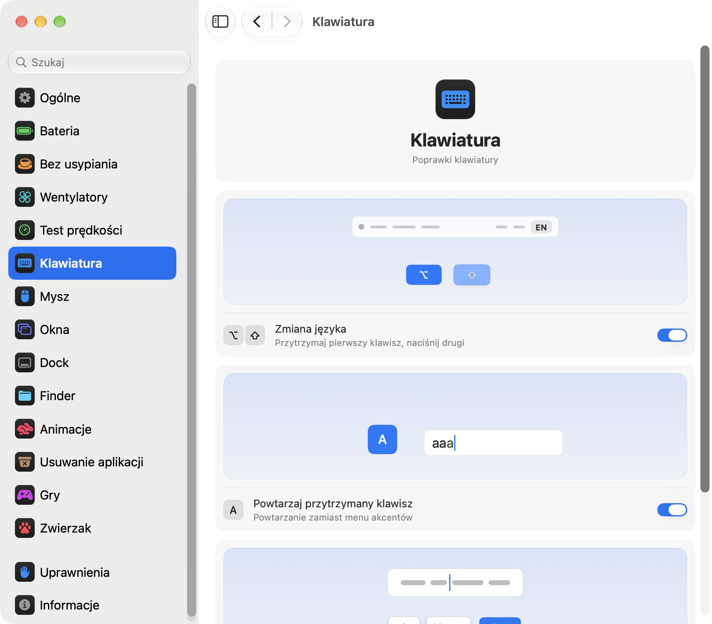

<p align="center"></p>
<h1 align="center">pikapik</h1>
<p align="center"><b>Twój Mac rozumie Cię w pół słowa.</b><br>Drobne usprawnienia klawiatury, myszy, okien i Findera, prosto z paska menu Twojego Maca.</p>
<p align="center"><sub><a href="../../README.md">English</a> · <a href="README.ru.md">Русский</a> · <a href="README.uk.md">Українська</a> · <a href="README.de.md">Deutsch</a> · <a href="README.fr.md">Français</a> · <a href="README.es.md">Español</a> · <a href="README.it.md">Italiano</a> · <a href="README.pt-BR.md">Português (Brasil)</a> · <a href="README.ja.md">日本語</a> · <a href="README.zh-Hans.md">简体中文</a> · <a href="README.ko.md">한국어</a> · <a href="README.ro.md">Română</a> · <b>Polski</b> · <a href="README.tr.md">Türkçe</a> · <a href="README.nl.md">Nederlands</a> · <a href="README.sv.md">Svenska</a> · <a href="README.cs.md">Čeština</a> · <a href="README.zh-Hant.md">繁體中文</a> · <a href="README.ar.md">العربية</a> · <a href="README.hi.md">हिन्दी</a> · <a href="README.id.md">Bahasa Indonesia</a> · <a href="README.vi.md">Tiếng Việt</a> · <a href="README.th.md">ไทย</a></sub></p>

<p align="center">
<picture>
<source media="(prefers-color-scheme: dark)" srcset="../media/settings-pl-dark.png">

</picture>
</p>

## Instalacja

Otwórz Terminal, wklej ten wiersz i naciśnij Return:

```bash
/bin/bash -c "$(curl -fsSL https://raw.githubusercontent.com/dev-pikapik/pika-tools/main/install.sh)"
```

Polecenie pobiera najnowszą wersję z serwisu GitHub i instaluje ją tylko wtedy, gdy jest podpisana przez dewelopera i przeszła kontrolę Apple pod kątem złośliwego oprogramowania. pikapik pojawi się na pasku menu u góry ekranu. Wszystko jest wyłączone, dopóki sam tego nie włączysz.

<details>
<summary>Inne sposoby: Homebrew lub dmg</summary>

Z Homebrew:

```bash
brew install --cask dev-pikapik/pika-tools/pikapik && open -a pikapik
```

Możesz też pobrać [pikapik.dmg](https://github.com/dev-pikapik/pika-tools/releases/latest/download/pikapik.dmg), otworzyć go i przeciągnąć aplikację do folderu Aplikacje.

Zarówno powyższe polecenie, jak i Homebrew umieszczają aplikację w `/Applications`, uruchamiają ją, proszą o uprawnienia i włączają otwieranie po zalogowaniu. Potem aplikacja uaktualnia się sama, zobacz **Uaktualnienia**. Jak ją usunąć, opisano w sekcji **Odinstalowanie**.

</details>

## Co potrafi

<table>
<tbody><tr>
<td width="50%" valign="top">
<picture><source media="(prefers-color-scheme: dark)" srcset="../media/keep-awake-dark.png"></picture>
<br><b>Nie usypiaj</b>
<br>Mac nie zaśnie, dopóki tego potrzebujesz, nawet z zamkniętą klapą.
</td>
<td width="50%" valign="top">
<picture><source media="(prefers-color-scheme: dark)" srcset="../media/fans-dark.png"></picture>
<br><b>Wentylatory</b>
<br>Zobacz, jak szybko kręcą się wentylatory, i wybierz ich prędkość.
</td>
</tr></tbody>
<tbody><tr>
<td width="50%" valign="top">
<picture><source media="(prefers-color-scheme: dark)" srcset="../media/battery-dark.png"></picture>
<br><b>Bateria</b>
<br>Zobacz stan baterii, jej pojemność i liczbę cykli, ile energii do niej płynie i jak sprawić, by działała dłużej.
</td>
<td width="50%" valign="top">
<picture><source media="(prefers-color-scheme: dark)" srcset="../media/command-keys-dark.png"></picture>
<br><b>Ochrona ⌘Q i ⌘W</b>
<br>Nic nie zamknie się przypadkiem. Dodaj ⇧, gdy naprawdę chcesz.
</td>
</tr></tbody>
<tbody><tr>
<td width="50%" valign="top">
<picture><source media="(prefers-color-scheme: dark)" srcset="../media/compress-dark.png"></picture>
<br><b>Mniejsza kopia</b>
<br>Kliknij prawym przyciskiem zdjęcie, PDF lub wideo, a obok pojawi się lżejsza kopia.
</td>
<td width="50%" valign="top">
<picture><source media="(prefers-color-scheme: dark)" srcset="../media/convert-dark.png"></picture>
<br><b>Konwersja</b>
<br>Zapisz obraz, wideo lub utwór w innym formacie z menu pod prawym przyciskiem.
</td>
</tr></tbody>
<tbody><tr>
<td width="50%" valign="top">
<picture><source media="(prefers-color-scheme: dark)" srcset="../media/input-switch-dark.png"></picture>
<br><b>Zmiana języka</b>
<br>Przytrzymaj ⌥ i stuknij ⇧, by zmienić język klawiatury.
</td>
<td width="50%" valign="top">
<picture><source media="(prefers-color-scheme: dark)" srcset="../media/quit-on-close-dark.png"></picture>
<br><b>Zakończ z ostatnim oknem</b>
<br>Zamknij ostatnie okno aplikacji, a aplikacja też się zakończy.
</td>
</tr></tbody>
<tbody><tr>
<td width="50%" valign="top">
<picture><source media="(prefers-color-scheme: dark)" srcset="../media/window-zoom-dark.png"></picture>
<br><b>Zielony przycisk powiększa</b>
<br>Okno wypełnia ekran bez przechodzenia na pełny ekran.
</td>
<td width="50%" valign="top">
<picture><source media="(prefers-color-scheme: dark)" srcset="../media/dock-hide-dark.png"></picture>
<br><b>Minimalizowanie kliknięciem w Docku</b>
<br>Kliknij aplikację, w której jesteś, a zejdzie z drogi.
</td>
</tr></tbody>
<tbody><tr>
<td width="50%" valign="top">
<picture><source media="(prefers-color-scheme: dark)" srcset="../media/new-file-dark.png"></picture>
<br><b>Nowy plik</b>
<br>Prawy przycisk w Finderze, nazwa i pusty plik gotowy.
</td>
<td width="50%" valign="top">
<picture><source media="(prefers-color-scheme: dark)" srcset="../media/finder-cut-dark.png"></picture>
<br><b>⌘X przenosi pliki</b>
<br>Wytnij pliki w Finderze i wklej je tam, gdzie chcesz.
</td>
</tr></tbody>
<tbody><tr>
<td width="50%" valign="top">
<picture><source media="(prefers-color-scheme: dark)" srcset="../media/finder-open-dark.png"></picture>
<br><b>Enter otwiera pliki</b>
<br>Zaznacz pliki w Finderze i naciśnij Enter, by je otworzyć.
</td>
<td width="50%" valign="top">
<picture><source media="(prefers-color-scheme: dark)" srcset="../media/finder-delete-dark.png"></picture>
<br><b>Delete do Kosza</b>
<br>Naciśnij ⌫ w Finderze, a zaznaczone pliki trafią do Kosza.
</td>
</tr></tbody>
<tbody><tr>
<td width="50%" valign="top">
<picture><source media="(prefers-color-scheme: dark)" srcset="../media/desktop-icons-dark.png"></picture>
<br><b>Ukryj ikony na biurku</b>
<br>Jedno kliknięcie i biurko jest puste przed rozmową lub zrzutem ekranu.
</td>
<td width="50%" valign="top">
<picture><source media="(prefers-color-scheme: dark)" srcset="../media/hidden-files-dark.png"></picture>
<br><b>Pokaż ukryte pliki</b>
<br>Zobacz pliki i foldery, które macOS ukrywa.
</td>
</tr></tbody>
<tbody><tr>
<td width="50%" valign="top">
<picture><source media="(prefers-color-scheme: dark)" srcset="../media/game-mode-dark.png"></picture>
<br><b>Tryb gry</b>
<br>Gdy grasz, nic nie wyskoczy nad grą ani jej nie zamknie.
</td>
<td width="50%" valign="top">
<picture><source media="(prefers-color-scheme: dark)" srcset="../media/speed-test-dark.png"></picture>
<br><b>Test prędkości</b>
<br>Jak szybki jest Twój internet i do czego wystarczy.
</td>
</tr></tbody>
<tbody><tr>
<td width="50%" valign="top">
<picture><source media="(prefers-color-scheme: dark)" srcset="../media/side-buttons-dark.png"></picture>
<br><b>Boczne przyciski</b>
<br>Przyciski 4 i 5 cofają i przechodzą dalej, jak przesunięcie palcami.
</td>
<td width="50%" valign="top">
<picture><source media="(prefers-color-scheme: dark)" srcset="../media/hide-app-dark.png"></picture>
<br><b>Ukrywanie przyciskiem myszy</b>
<br>Jedno naciśnięcie ukrywa aplikację na pierwszym planie, jak ⌘H. Aplikacja działa dalej.
</td>
</tr></tbody>
<tbody><tr>
<td width="50%" valign="top">
<picture><source media="(prefers-color-scheme: dark)" srcset="../media/wheel-lines-dark.png"></picture>
<br><b>Przewijanie o wiersze</b>
<br>Każdy ząbek kółka przewija tyle samo, niezależnie od tempa.
</td>
<td width="50%" valign="top">
<picture><source media="(prefers-color-scheme: dark)" srcset="../media/wheel-direction-dark.png"></picture>
<br><b>Kierunek przewijania</b>
<br>Jeden kierunek dla gładzika, drugi dla myszy.
</td>
</tr></tbody>
<tbody><tr>
<td width="50%" valign="top">
<picture><source media="(prefers-color-scheme: dark)" srcset="../media/linear-pointer-dark.png"></picture>
<br><b>Bez przyspieszenia wskaźnika</b>
<br>Wskaźnik przesuwa się dokładnie tyle, co Twoja ręka.
</td>
<td width="50%" valign="top">
<picture><source media="(prefers-color-scheme: dark)" srcset="../media/key-repeat-dark.png"></picture>
<br><b>Powtarzaj przytrzymany klawisz</b>
<br>Przytrzymaj klawisz, by pisał raz za razem, bez menu akcentów.
</td>
</tr></tbody>
<tbody><tr>
<td width="50%" valign="top">
<picture><source media="(prefers-color-scheme: dark)" srcset="../media/home-end-dark.png"></picture>
<br><b>Home i End</b>
<br>Skacz na początek lub koniec wiersza podczas pisania.
</td>
<td width="50%" valign="top">
<picture><source media="(prefers-color-scheme: dark)" srcset="../media/animations-dark.png"></picture>
<br><b>Animacje</b>
<br>Przyspiesz Dock, okna i Szybki przegląd, nawet do natychmiastowych.
</td>
</tr></tbody>
<tbody><tr>
<td width="50%" valign="top">
<picture><source media="(prefers-color-scheme: dark)" srcset="../media/leftover-permissions-dark.png"></picture>
<br><b>Uprawnienia usuniętych aplikacji</b>
<br>Usuń uprawnienia, które macOS zachowuje dla już usuniętych aplikacji.
</td>
<td width="50%" valign="top">
<picture><source media="(prefers-color-scheme: dark)" srcset="../media/pet-dark.png"></picture>
<br><b>Zwierzak na biurku</b>
<br>Mały przyjaciel spaceruje za twoimi oknami. Podnieś go i rzuć albo naciśnij spację, a podskoczy. Ubieraj go w rzeczy z jego garderoby i zdobywaj nagrody, kiedy bawicie się razem. Ożywia się, gdy piszesz, i drzemie, gdy odchodzisz.
</td>
</tr></tbody>
<tbody><tr>
<td width="50%" valign="top">
<picture><source media="(prefers-color-scheme: dark)" srcset="../media/uninstaller-dark.png"></picture>
<br><b>Usuwanie aplikacji</b>
<br>Usuń aplikację z plikami. Wszystko można przywrócić.
</td>
<td width="50%" valign="top">
<picture><source media="(prefers-color-scheme: dark)" srcset="../media/game-fps-dark.png"></picture>
<br><b>Pokaż FPS</b>
<br>Mały licznik w wybranym rogu pokazuje, jak płynnie działa gra.
</td>
</tr></tbody>
<tbody><tr>
<td width="50%" valign="top">
<picture><source media="(prefers-color-scheme: dark)" srcset="../media/archive-dark.png"></picture>
<br><b>Archiwa</b>
<br>Wypakuj RAR i inne archiwa albo spakuj pliki do archiwum ZIP, klikając prawym przyciskiem.
</td>
<td width="50%" valign="top">
<picture><source media="(prefers-color-scheme: dark)" srcset="../media/dock-display-dark.png"></picture>
<br><b>Trzymaj Dock na jednym ekranie</b>
<br>Dock nie skacze już na inny ekran. Aby go przenieść, ustaw inny ekran jako główny.
</td>
</tr></tbody>
<tbody><tr>
<td width="50%" valign="top">
<picture><source media="(prefers-color-scheme: dark)" srcset="../media/temperatures-dark.png"></picture>
<br><b>Temperatura</b>
<br>Zobacz, jak bardzo Mac nagrzał się w środku, od procesora po baterię.
</td>
<td width="50%" valign="top">
<picture><source media="(prefers-color-scheme: dark)" srcset="../media/background-dark.png"></picture>
<br><b>Zadania w tle</b>
<br>Zobacz, co działa w tle i skąd się wzięło.
</td>
</tr></tbody>
<tbody><tr>
<td width="50%" valign="top">
<picture><source media="(prefers-color-scheme: dark)" srcset="../media/ports-dark.png"></picture>
<br><b>Porty</b>
<br>Zobacz, który program zajął port, i zwolnij go.
</td>
<td width="50%" valign="top">
<picture><source media="(prefers-color-scheme: dark)" srcset="../media/app-volume-dark.png"></picture>
<br><b>Głośność aplikacji</b>
<br>Ścisz lub wycisz dowolną aplikację, nie ruszając pozostałych.
</td>
</tr></tbody>
<tbody><tr>
<td width="50%" valign="top">
<picture><source media="(prefers-color-scheme: dark)" srcset="../media/brightness-dark.png"></picture>
<br><b>Jasność monitorów</b>
<br>Przyciemnij lub rozjaśnij monitor, którego macOS nie umie ustawić sam, suwakiem albo klawiszami jasności.
</td>
<td width="50%" valign="top">
<picture><source media="(prefers-color-scheme: dark)" srcset="../media/layout-fix-dark.png"></picture>
<br><b>Popraw zły układ</b>
<br>Wyszło ghbdtn zamiast привет? Naciśnij spację, a słowo się poprawi.
</td>
</tr></tbody>
</table>

## Więcej szczegółów

<details>
<summary>Pierwsze uruchomienie</summary>

pikapik potrzebuje dwóch uprawnień. Przy pierwszym uruchomieniu otwiera ustawienia na stronie Uprawnienia, która prowadzi krok po kroku, a macOS pokazuje własne prośby. Przejdź do **Ustawienia systemowe › Prywatność i ochrona** i włącz pikapik w sekcjach:

- **Dostępność**, aby aplikacja mogła zmienić naciśnięcie klawisza lub kliknięcie, zanim dotrze ono do innych aplikacji.
- **Monitorowanie wprowadzania**, aby aplikacja widziała naciśnięcia klawiszy i kliknięcia, nie zmieniając ich. Tak działa zmiana języka.

Aplikacja zauważy zmianę w ciągu kilku sekund, bez ponownego uruchamiania.

Niektóre funkcje proszą o więcej, kiedy z nich korzystasz: **Dostęp administratora**, **Rozszerzenia Findera**, **iCloud Drive**, **Pełny dostęp do dysku**, **Nagrywanie ekranu** i **Nagrywanie dźwięku systemowego**. Wszystko jest na stronie Uprawnienia w ustawieniach: każde uprawnienie ma wiersz z opisem, do czego służy, zielony ptaszek albo pomarańczowy krzyżyk i jeden przycisk: **Zezwól**, gdy go brakuje, **Wyłącz**, gdy jest włączone. Dzięki temu każde uprawnienie cofniesz od razu na miejscu.

pikapik nie nagrywa, nie przechowuje i nie wysyła niczego, co piszesz lub klikasz. Zdarzenia są obsługiwane w pamięci i od razu przekazywane dalej. Aby poprawiać słowa wpisane w złym układzie, pikapik trzyma w pamięci tylko kilka ostatnich wpisanych słów i zapomina o nich, gdy tylko klikniesz lub przełączysz się na inną aplikację. Zapisuje tylko słowa, które na twoją prośbę ma zostawiać bez zmian, i to wyłącznie na tym Macu, dopóki nie wyczyścisz ich w Ustawieniach › Klawiatura. pikapik łączy się z internetem tylko po uaktualnienia (pyta GitHub o najnowsze wydanie i pobiera je tylko wtedy, gdy zdecydujesz się uaktualnić) oraz do testu prędkości, gdy go uruchomisz (korzysta z serwerów Apple). Wersję z Mac App Store uaktualnia App Store, a jej test prędkości korzysta z Cloudflare. Postępy zwierzaka (kroki, rzuty, nagrody i tym podobne) są liczone tylko na tym Macu i nigdy nigdzie nie są wysyłane. Możesz je wymazać w Ustawieniach › Zwierzak.

</details>

<details>
<summary>Każde narzędzie dokładnie</summary>

**Odtwarzacz.** Pliki wideo, których QuickTime nie otworzy, takie jak MKV, WebM, AVI, WMV i FLV, odtwarzają się we własnym oknie. Otwórz Ustawienia › Odtwarzacz i kliknij **Otwórz wideo…** albo kliknij prawym przyciskiem plik wideo i wybierz **Otwórz w programie › pikapik Player**. Spacja włącza i wstrzymuje odtwarzanie, ← i → przewijają o 5 sekund, ↑ i ↓ zmieniają głośność, a F włącza pełny ekran. Plik, który jest już otwarty, wraca na wierzch zamiast otwierać się drugi raz. Odtwarzacz nie ma dostępu do sieci, nie prosi o żadne uprawnienia i nie zmienia, która aplikacja otwiera Twoje pliki wideo. Licencje FFmpeg i dav1d oraz ich kod źródłowy otworzysz z tej samej strony. Napisy nie są jeszcze obsługiwane. Nie ma go w wersji z Mac App Store.

**Głośność aplikacji.** Otwórz Ustawienia › Dźwięk i włącz **Głośność aplikacji**. Każda aplikacja, która odtwarza dźwięk, dostaje własny suwak i przycisk wyciszenia, w Ustawieniach i w menu. Ścisz zbyt głośną rozmowę wideo, wycisz hałaśliwą grę i zostaw muzykę, jak jest: głośność Maca i pozostałych aplikacji się nie zmienia. pikapik zapamiętuje poziom każdej aplikacji, a aplikacji, którą zostawisz na pełnej głośności, nigdy nie rusza. Aplikacja, którą ustawisz, zostaje na liście także po restarcie, przyciemniona, gdy jest zamknięta, więc poziom możesz ustawić, zanim aplikacja się uruchomi: kliknij **Dodaj aplikację…** albo przeciągnij aplikację z Findera. Krzyżyk ✕ obok aplikacji ją zapomina i przywraca pełną głośność. Aby zmienić głośność aplikacji, pikapik przepuszcza jej dźwięk przez siebie, dlatego potrzebuje uprawnienia **Nagrywanie dźwięku systemowego**, które włączasz na stronie Uprawnienia. Dźwięk jest tylko przekazywany dalej: nie jest nagrywany, zapisywany ani nigdzie wysyłany, a mikrofon nie jest używany. Wymaga macOS 14.2 lub nowszego, a w macOS 14.0 i 14.1 funkcja jest ukryta. Domyślnie wyłączone.

**Jasność monitorów.** macOS zmienia jasność wbudowanego ekranu i monitorów Apple, ale nie większości innych monitorów. Otwórz Ustawienia › Jasność: każdy monitor, którego macOS nie umie ustawić sam, dostaje własny suwak, a wiersz „Jasność” możesz też dodać do panelu na pasku menu. pikapik zmienia jasność samego monitora, to samo ustawienie co jego przyciski. Jeśli monitor nie reaguje, włącz **Zamiast tego przyciemniaj obraz**: obraz robi się ciemniejszy, ale nigdy czarny. Włącz **Klawisze jasności**, a klawisze jasności będą zmieniać jasność monitora, na którym jest wskaźnik, i pokazywać mały pasek jasności; przytrzymaj ⌥⇧, aby zmieniać ją drobniejszymi krokami. Klawisze potrzebują uprawnienia **Dostępność**, które włączasz na stronie Uprawnienia, a suwaki działają i bez niego. pikapik zapamiętuje jasność każdego monitora i ustawia ją ponownie po uśpieniu. Wersja z Mac App Store tylko przyciemnia obraz. Klawisze jasności są domyślnie wyłączone.

**Ochrona ⌘Q i ⌘W.** Same ⌘Q i ⌘W nic nie robią, więc nie zamkniesz przypadkiem aplikacji ani okna. Dodaj Shift, aby zrobić to celowo: ⇧⌘Q kończy aplikację, ⇧⌘W zamyka okno. Działa we wszystkich aplikacjach. Każdy klawisz ma własny przełącznik. Domyślnie wyłączone.

**Zmiana języka skrótem Option+Shift.** Przytrzymaj Option i stuknij Shift: macOS przełączy na następne źródło wprowadzania. Trzymaj dalej Option i stuknij Shift ponownie, aby przejść dalej. Przytrzymaj Shift i stuknij Option, aby wrócić. Jeśli w międzyczasie naciśniesz inny klawisz, klikniesz lub dodasz Command, Control albo Fn, nic się nie przełączy, więc skróty takie jak Option+Shift+strzałka działają jak wcześniej. Domyślnie wyłączone.

**Powtarzaj przytrzymany klawisz.** Przytrzymaj klawisz, a litera będzie się pisać raz za razem, zamiast pokazywać menu akcentów. Przydaje się w grach i przy pisaniu. Już otwarte aplikacje przejmą to po ponownym uruchomieniu. Gdy to wyłączysz, macOS znowu działa po swojemu. Domyślnie wyłączone.

**Home i End na początek i koniec wiersza.** Gdy piszesz, Home przenosi kursor na początek wiersza, a End na jego koniec, zamiast przewijać stronę. Z ⇧ zaznaczają tekst do tego miejsca, z ⌘ przechodzą na początek lub koniec całego tekstu. Poza polami tekstowymi oraz w terminalach, maszynach wirtualnych i aplikacjach pulpitu zdalnego klawisze działają jak dotąd. W wersji z Mac App Store działają tak również poza polami tekstowymi, z wyjątkiem przeglądarek, Findera i Muzyki. Możesz dodać inne aplikacje, w których mają działać jak zwykle. Domyślnie wyłączone.

**Poprawianie słów wpisanych w złym układzie.** Jeśli słowo wyjdzie jako bełkot, na przykład ghbdtn zamiast привет, pikapik przepisze je we właściwym układzie, gdy tylko naciśniesz spację lub Return, i przełączy układ, żeby następne słowo wyszło dobrze. Działa ze wszystkimi układami klawiatury dodanymi na twoim Macu. Słowo zmienia się tylko wtedy, gdy nie ma go w żadnym z twoich języków, a te same klawisze w innym układzie dają popularne słowo, więc imiona, literówki i rzadkie słowa zostają takie, jak je wpisano, podobnie jak tekst w polach haseł, w Terminalu i w wybranych przez ciebie aplikacjach. Naciśnij ⌃⇧Spacja, aby poprawić ostatnie słowo lub zaznaczony tekst, i naciśnij jeszcze raz, aby wypróbować inne układy. Zaraz po poprawce te same klawisze ją cofają, a pikapik nie będzie już sam poprawiać tego słowa. Skrót możesz zmienić w Ustawieniach › Klawiatura. W wersji z Mac App Store zaznacz tekst i naciśnij ⌃⇧Spacja albo wybierz „Popraw układ klawiatury” w menu „Usługi”. **Poprawiaj słowa podczas pisania** i skrót są wyłączone, dopóki nie włączysz ich w Ustawieniach › Klawiatura, i wymagają uprawnienia Dostępność, o które prosi strona Uprawnienia. Domyślnie wyłączone. Jeśli masz tylko jeden układ, uwaga na stronie pozwala od razu dodać układ dla Twojego języka, bez przechodzenia do Ustawień systemowych (wersja ze strony).

**Wyłącz przyspieszenie wskaźnika.** Wskaźnik przesuwa się dokładnie o tyle, o ile mysz, niezależnie od tego, jak szybko nią ruszasz. Suwak **Szybkość ruchu** ustala, jak szybko się porusza. Działa tylko z myszami, gładzik zostaje bez zmian. Wyłącz tę funkcję lub zakończ pikapik, a macOS odzyska własne ustawienia. Domyślnie wyłączone.

**Przewijaj o wiersze.** Każde kliknięcie kółka myszy przewija tyle samo wierszy, bez względu na to, jak szybko nim kręcisz. Wybierz od 1 do 10 wierszy na kliknięcie, domyślnie 3. Naturalne przewijanie zostaje takie, jakie ustawisz w Ustawieniach systemowych. Działa tylko dla myszy, gładzik zostaje bez zmian. Domyślnie wyłączone. Obok suwaka **Odległość na kliknięcie** mała strona przewija się o wybraną odległość, a kropka oznacza wartość domyślną.

Niektóre aplikacje i gry liczą przewijanie w dokładnych pikselach: dla nich przełącz to samo ustawienie na piksele i wybierz od 1 do 200 pikseli na kliknięcie, domyślnie 40. Suwak pokazuje też, jaką część wysokości ekranu to stanowi.

**Kierunek przewijania dla gładzika i myszy.** macOS ma jeden przełącznik przewijania naturalnego wspólny dla gładzika i myszy. Włącz tę funkcję i wybierz kierunek dla każdego: **Naturalny**, gdy strona podąża za palcami jak na iPhonie, albo **Klasyczny**, w którym strona przesuwa się w przeciwną stronę. Wybór dla gładzika działa też na przewijanie w bok i na rozpęd po podniesieniu palców. Magic Mouse przewija dotykiem, więc podąża za wyborem dla gładzika. Wybierz to samo na każdym swoim Macu, a przewijanie będzie wszędzie takie samo, nawet gdy przenosisz mysz na inny Mac przez Uniwersalne sterowanie. Domyślnie wyłączone. Po włączeniu oba wybory są takie jak w Ustawieniach systemowych, więc nic się nie zmienia, dopóki nie wybierzesz czegoś innego.

**Boczne przyciski: wstecz i dalej.** Przyciski myszy 4 i 5 cofają i przechodzą dalej w Finderze, Safari i innych aplikacjach Apple oraz w wielu innych programach, tak jak machnięcie na gładziku. Aplikacje, które same obsługują te przyciski, dostają je bez zmian. Jeśli twoja mysz ma je odwrotnie, włącz **Zamień boczne przyciski**. Domyślnie wyłączone.

**Przycisk myszy ukrywa bieżącą aplikację.** Włącz **Przycisk myszy ukrywa bieżącą aplikację** w Ustawieniach › Mysz i naciśnij przycisk, którego chcesz używać, na przykład środkowy albo boczny. Odtąd jedno naciśnięcie ukrywa aplikację na pierwszym planie, tak jak ⌘H: aplikacja działa dalej, a kliknięcie jej ikony w Docku ją przywraca. Gdy grasz z włączonym trybem gry, przycisk działa w grze jak zwykle. Domyślnie wyłączone.

**Zakończenie po zamknięciu ostatniego okna.** Zamknij ostatnie okno aplikacji, a aplikacja się zakończy. Finder pozostaje otwarty, podobnie jak aplikacje z oknami na innych biurkach lub w Docku. Możesz utworzyć listę aplikacji, które nigdy nie mają się tak kończyć. Domyślnie wyłączone.

**Minimalizuj lub ukrywaj kliknięciem w Docku.** Kliknij ikonę w Docku aplikacji, której używasz, a wszystkie jej okna trafią do Docka. Kliknij ponownie, aby przywrócić je wszystkie. Możesz też sprawić, by kliknięcie ukrywało całą aplikację, jak ⌘H. Domyślnie wyłączone.

**Trzymaj Dock na jednym ekranie.** Przy kilku ekranach macOS przenosi Dock na inny ekran, gdy tylko wskaźnik zacznie napierać na dolną krawędź tego ekranu. Gdy przełącznik jest włączony, to się już nie dzieje, niezależnie od tego, jak szybko przesuwasz wskaźnik: pikapik wyłącza przenoszenie własnym ustawieniem Docka i nigdy nie dotyka wskaźnika. Aby celowo przenieść Dock, ustaw inny ekran jako główny: w **Ustawieniach systemowych › Wyświetlacze** kliknij ten ekran i w menu **Używaj jako** wybierz **Wyświetlacz główny**, a Dock przeniesie się razem z nim. Wiersz **Wyświetlacz główny** pod przełącznikiem robi to od razu, a wyłączenie przełącznika przywraca wyświetlacze tak, jak były. Dock odczytuje swoje ustawienie tylko przy uruchomieniu, więc po włączeniu lub wyłączeniu przełącznika raz uruchamia się ponownie. Nie są potrzebne żadne uprawnienia. Przełącznik jest domyślnie wyłączony i nie ma go w wersji z Mac App Store.

**Zielony przycisk powiększa okno.** Kliknij zielony przycisk okna, a okno wypełni ekran, nie przechodząc w pełny ekran. Kliknij ponownie, aby wrócić do poprzedniego rozmiaru. Przytrzymaj ⌥, a przycisk zadziała jak zawsze. Pełny ekran nadal jest w menu przycisku i pod ⌃⌘F. Możesz wypisać aplikacje, w których zielony przycisk ma działać jak zwykle. Domyślnie wyłączone.

**Nowy plik w Finderze.** Kliknij prawym w oknie Findera lub na biurku, wybierz **Nowy plik**, wpisz nazwę i gotowe – pojawi się pusty plik. Domyślnie .txt. Domyślnie wyłączone.

**Enter otwiera pliki w Finderze.** Zaznacz pliki w oknie Findera lub na biurku i naciśnij Return albo Enter – pliki się otworzą. F2 lub fn F2 zmienia nazwę zaznaczonego pliku. W polach tekstowych, na przykład podczas wpisywania nazwy, klawisze działają jak zwykle. Domyślnie wyłączone.

**⌘X wycina pliki w Finderze.** Zaznacz pliki i naciśnij ⌘X, otwórz folder docelowy i naciśnij ⌘V – pliki zostaną tam przeniesione zamiast skopiowane. ⌘C anuluje wycinanie. Domyślnie wyłączone.

**Delete usuwa pliki w Finderze.** Zaznacz pliki i naciśnij ⌫ lub ⌦ (fn ⌫ na laptopie) – trafią do Kosza, tak jak po ⌘⌫. Gdy zmieniasz nazwę pliku, szukasz lub piszesz w innym polu, klawisze kasują litery jak zwykle. Domyślnie wyłączone.

**Mniejsza kopia w Finderze.** Kliknij prawym plik w Finderze i wybierz **Utwórz mniejszą kopię**. Obok pojawi się lżejsza wersja zdjęcia, GIF-a, PDF-a lub wideo, często kilka razy mniejsza. Nieskompresowany dźwięk, np. WAV lub AIFF, zmienia się w zgrabny M4A. Jeśli pliku nie da się już zmniejszyć, kopia nie powstaje, a pikapik o tym mówi. Oryginał zostaje bez zmian i nic nie opuszcza Twojego Maca. Domyślnie wyłączone.

**Konwersja w Finderze.** Kliknij prawym plik w Finderze i wybierz **Konwertuj na**, aby zapisać go w innym formacie: obraz jako JPEG, PNG, HEIC, GIF, TIFF lub PDF, wideo jako MP4, MOV albo sam dźwięk, muzykę jako M4A, WAV lub AIFF. Oryginał zostaje bez zmian i nic nie opuszcza Twojego Maca. Włącza się osobno od mniejszej kopii. Domyślnie wyłączone.

**Archiwa w Finderze.** Kliknij prawym archiwum w Finderze i wybierz **Wypakuj**, a jego pliki pojawią się obok. Kliknij prawym dowolny inny plik lub folder i wybierz **Utwórz archiwum…**, aby powstał ZIP, 7Z, TAR.GZ lub TAR.XZ. ZIP i 7Z mogą mieć hasło, a każde archiwum można podzielić na części, na przykład po 15 MB do poczty albo po 4 GB na pendrive. Hasło wpisuje się dwa razy, więc literówka nie odetnie cię od własnych plików. ZIP zrobiony w ten sposób nie zawiera ukrytych plików dodawanych przez system, zachowuje czytelne nazwy w każdym języku i obsługuje pliki większe niż 4 GB. Domyślnie wyłączone. Wersja z Mac App Store ma pewne ograniczenia, opisane poniżej.

pikapik otwiera też to, czego nie otworzy macOS: RAR, nawet podzielony na części, 7Z zabezpieczony hasłem, zestawy części takie jak .001, .z01, .r00 i .part1.rar oraz ZIPX, CAB, LZH, ARJ, ZST, LZMA, WIM i inne. Po dwukrotnym kliknięciu otwiera je pikapik. Nazwy plików w starych archiwach ZIP, na przykład zapisane cyrylicą, po japońsku lub po chińsku, wyświetlają się czytelnie. Przełącznik **Otwieraj archiwa w tej aplikacji** w Ustawieniach › Finder sprawia, że pikapik przejmuje także ZIP i 7Z, a TAR i GZ zostają przy wbudowanej aplikacji do archiwów, która już dobrze sobie z nimi radzi. pikapik potrafi otworzyć RAR, ale nie stworzyć go: licencja RAR pozwala tylko na wypakowywanie.

Okno pyta o hasło, **Zatrzymaj** przerywa każde zadanie, a z uszkodzonego lub niekompletnego archiwum pikapik wyciąga to, co da się jeszcze odczytać. Pyta, zanim wypakuje archiwum, które rozrosłoby się do ogromnego rozmiaru, zatrzymuje się na czas, gdy dysk miałby się zapełnić, i blokuje archiwa próbujące zapisywać poza własnym folderem. Zaznacz archiwum w Finderze i naciśnij spację, aby podejrzeć, co jest w środku.
**Archiwa w wersji z Mac App Store.** Działają także tam, ale z narzędziami wbudowanymi w macOS zamiast dołączonego 7-Zip, więc mają ograniczenia: hasło można ustawić tylko dla ZIP, nie dla 7Z; archiwum nie da się podzielić na części, a archiwów wieloczęściowych (.001, .part1.rar, .z01 i podobnych) nie da się otworzyć; pojedynczych plików .xz, .lzma i .zst nie da się otworzyć (.gz i .bz2 się da); 7Z i RAR z hasłem nie da się otworzyć; nie ma też przełącznika **Otwieraj archiwa w tej aplikacji**. Za pierwszym razem pikapik poprosi o dostęp do twojego folderu domowego, tak jak przy Nowym pliku i Mniejszej kopii, bo ta wersja może zapisywać tylko tam, gdzie jej na to pozwolisz. Włącz rozszerzenie Findera w Ustawieniach systemowych › Ogólne › Rzeczy otwierane podczas logowania i rozszerzenia; pikapik pokaże, gdzie kliknąć.


**Ukryj ikony na biurku.** Włącz to przed rozmową, nagrywaniem ekranu albo zrzutem ekranu, a pliki i foldery z biurka znikną. Wyłącz, a wrócą na swoje miejsca. Nic się nie przenosi: pliki zostają w folderze Biurko w Finderze. To ustawienie **Pokaż rzeczy › Na Biurku** w Ustawieniach systemowych › Biurko i Dock, tylko bardziej pod ręką, więc oba zawsze się zgadzają. W wersji z Mac App Store ten wiersz zamiast tego zakrywa ikony tapetą na każdym ekranie, a jeśli tapeta jest ruchoma, jednolitym kolorem, a kliknięcia nadal trafiają na biurko. W Ustawieniach przycisk **Otwórz** pod spodem nadal otwiera tę stronę Ustawień systemowych.

**Pokaż ukryte pliki.** Pliki i foldery, które macOS ukrywa, na przykład folder Biblioteki w twoim folderze domowym albo pliki, których nazwa zaczyna się od kropki, pojawią się w Finderze i na biurku jako przygaszone. To to samo co naciśnięcie ⇧⌘. w Finderze, tylko od razu widać, czy jest włączone. Aby zastosować zmianę, Finder na chwilę uruchomi się ponownie i znów otworzy swoje okna i karty. Jeśli Finder właśnie kopiuje lub przenosi pliki, uruchomi się ponownie dopiero, gdy skończy. Oba są w Ustawieniach › Finder. Żeby mieć je w panelu na pasku menu, kliknij przycisk z ołówkiem na dole panelu i zaznacz je. W wersji z Mac App Store Ustawienia › Finder pokazują zamiast tego klawisze ⇧⌘. dla Findera.

**Tryb gry.** Dodaj swoje gry, a gdy grasz, Mac nie wyrywa Cię z gry. Spotlight, Siri, ⌘Tab, Mission Control i przesunięcia między biurkami nie otwierają się nad grą, ⌘Q i ⌘W nie zamykają jej przypadkiem, wskaźnik nie ucieka na Dock, pasek menu ani inny ekran, a ekran nie gaśnie. Każda z tych opcji ma własny przełącznik na stronie Gry, a pikapik podpowiada gry, które znajdzie na Twoim Macu. W grze Control-kliknięcie pozostaje zwykłym kliknięciem, a Control ze strzałkami nie zmienia biurka. Rozpoznaje też Minecrafta: dodaj Minecraft Launcher lub CurseForge, a tryb włączy się w samym Minecrafcie. Aby wyjść z gry, naciśnij ⇧⌘Q, a żeby zamknąć jej okno – ⇧⌘W. ⌥⌘Esc działa zawsze. Gdy tylko wyjdziesz z gry, wszystko działa jak zwykle. Domyślnie wyłączone.

Włącz tryb gry i graj. Więcej ustawień gry zawiera katalog publikowany przez Maca, bieżące klawisze i animowany podgląd każdej akcji.

Automatycznie wstrzymuje akcje otwierające okna lub przenoszące fokus. Krótki, celowy skrót języka zmienia źródło bez okna systemowego. Trzymane klawisze ruchu mają priorytet, więc bieganie i skoki nie zmieniają języka przypadkiem.

W ustawieniach (Ustawienia → Gry → Więcej ustawień gry) jest grupa „Mysz i gładzik”. Pokazuje tylko to, co jest włączone w macOS na twoim Macu, z nazwami od Apple i małym rysunkiem przy każdej pozycji: skróty na przycisku myszy, przesuwanie między biurkami i aplikacjami pełnoekranowymi, Mission Control i App Exposé, szczypnięcie dla aplikacji i rozsunięcie palców dla biurka, przesunięcie od prawej krawędzi dla Centrum powiadomień i każdy aktywny róg z jego działaniem. Gdy gra jest na wierzchu, wszystko to jest wstrzymane, więc przypadkowe przesunięcie palców albo muśnięcie rogu ekranu nie wyrzuci cię z gry. Gesty w samej grze nadal działają. Każdą pozycję można ustawić tak, by działała jak zwykle. W wersji ze strony **Zmień…** przy aktywnym rogu pozwala od razu wybrać inną akcję, a **Przywróć** wraca do pierwszej; każda zmiana raz uruchamia Dock ponownie.

Otwórz Ustawienia → Gry → Dodaj grę i kliknij uruchomioną grę. Gry korzystające z Javy i innych środowisk też się pojawiają, nawet bez pliku .app. Minecraft ma nazwę Minecraft zamiast java. Znajdź proces gry i przeciągnij jego wiersz na Twoje gry w Ustawieniach → Gry.

**Pokaż FPS.** FPS to klatki na sekundę: ile obrazów gra rysuje w ciągu sekundy. Włącz **Pokaż FPS** na stronie Gry, a gdy Tryb gry jest włączony, w rogu każdej gry pojawi się mała ciemna plakietka z tą liczbą. Wybierz róg, klikając go na obrazku nad przełącznikiem. Kreska oznacza, że pierwsze klatki jeszcze nie dotarły, a przygaszone 0 — że gra przestała rysować. W macOS 27 większość gier liczy sam macOS, bez żadnego uprawnienia. Grę, której macOS nie potrafi policzyć, zwykle starszą, pikapik liczy przez nagrywanie ekranu: wtedy na stronie Uprawnienia pojawia się wiersz **Nagrywanie ekranu**, pikapik nigdy nie prosi o uprawnienie w trakcie gry, a liczba nie może być wyższa niż częstotliwość odświeżania ekranu. W macOS 14–26 i w wersji z Mac App Store każda gra jest liczona w ten sposób, dlatego wiersz pojawia się zaraz po włączeniu **Pokaż FPS**, a przycisk **Zezwól** pod przełącznikiem prowadzi do niego. Żaden obraz nie jest zapisywany ani wysyłany. Domyślnie wyłączone.

**Garderoba i nagrody zwierzaka.** Otwórz Ustawienia › Zwierzak, żeby ubrać zwierzaka: ponad 30 rzeczy, od czapek i okularów po peleryny i skrzydła, oraz gotowe przebrania, takie jak czarodziej, pirat czy astronauta. Kilka rzeczy jest za darmo od początku. Reszta to nagrody, które przychodzą podczas wspólnej zabawy: podnieś zwierzaka i rzuć nim, pokop piłkę, patrz, jak wspina się na okna i gada, albo po prostu dotrzymuj mu towarzystwa dzień po dniu. Kiedy zdobędziesz nową nagrodę, zwierzak ci o tym powie.

Żeby wiedzieć, kiedy należy się nagroda, pikapik liczy tylko to, co robicie ty i zwierzak: kroki, ile razy go podnosisz i rzucasz, skoki, wspinaczki, zabawy piłką i rozmowy, wspólne dni, czy byliście razem wcześnie rano, po północy albo w weekend, które strony ustawień otwierasz i co przymierzasz. Poza Mac App Store pikapik zapisuje też, czy z Ustawień otwarto naszą stronę na GitHubie. Te liczby, data każdej nagrody i to, w co zwierzak jest ubrany, zostają na tym Macu. Nic nie jest nigdzie wysyłane i nic z tego nie trafia do wyeksportowanego pliku ustawień ani do synchronizacji przez iCloud. Wszystko możesz w każdej chwili wymazać w Ustawieniach › Zwierzak, a zwierzak zacznie od zera.

**Usuwanie aplikacji.** Otwórz Ustawienia › Usuwanie aplikacji, wybierz aplikację z listy albo upuść ją na obrazek, a pikapik pokaże wszystko, co ta aplikacja trzyma na twoim Macu: samą aplikację, jej zapisane dane, ustawienia, pliki tymczasowe, pomocników w tle i nie tylko, każdą pozycję z powodem, dla którego jest na liście. Pliki, które wyraźnie należą do aplikacji, są zaznaczone, te tylko możliwe powiązane nie są, a pliki używane także przez inne aplikacje mają oznaczenie. Wybierz, co usunąć, i kliknij **Przenieś do Kosza**. Nic nie jest kasowane na zawsze: wszystko trafia do Kosza. Jeśli aplikacja jest otwarta, pikapik najpierw prosi ją o zamknięcie, a jeśli jakieś pliki wymagają administratora, Mac zapyta o hasło tylko raz.

Jeśli zmienisz zdanie, kliknij **Przywróć**: wszystko wróci na swoje miejsce, a pomocnicy w tle znów ruszą. Ostatnie dziesięć usunięć czeka w sekcji „Ostatnio usunięte”, dopóki ich pliki są w Koszu. **Zresetuj aplikację** zostawia aplikację i usuwa tylko jej zapisane dane, ustawienia i pliki tymczasowe, co może pomóc, gdy aplikacja szwankuje. Aplikacje przeniesione przez ciebie do Kosza pojawiają się w sekcji „W Koszu” razem z plikami, które po sobie zostawiły, a sekcja „Pozostałości po usuniętych aplikacjach” znajduje pliki aplikacji, których już nie ma. Przełącznik „Proponuj sprzątanie, gdy aplikacja trafi do Kosza” jest domyślnie wyłączony i nic nie jest usuwane, dopóki nie wybierzesz. Żeby zobaczyć wszystko, co trzyma aplikacja, strona potrzebuje uprawnienia **Pełny dostęp do dysku**. Tego narzędzia nie ma w wersji z Mac App Store.

**Temperatura.** Otwórz Ustawienia › Temperatura, aby zobaczyć, jak bardzo Mac nagrzał się w środku. Na górze jedno słowo podsumowuje wszystko, od „W normie” po „Bardzo gorąco”, a wiersz pod nim mówi, czy Mac działa z pełną prędkością, czy zwalnia, aby ostygnąć. Niżej każda część ma własny wiersz ze zrozumiałą nazwą zamiast kodu czujnika: procesor, grafika, pamięć, dysk, Wi-Fi i bateria, zależnie od tego, jakie czujniki ma twój Mac. Każdy wiersz pokazuje stopnie i krótki pasek, który robi się zielony, żółty lub pomarańczowy w zależności od normalnego zakresu dla tej części. Wartości odświeżają się co dwie sekundy i tylko wtedy, gdy na nie patrzysz, więc prawie nie obciążają Maca. Nie trzeba hasła ani pozwoleń. Wiersz „Temperatura” możesz też dodać do panelu na pasku menu. Wersja z Mac App Store pokazuje ogólny poziom, a na Macu z baterią także temperaturę baterii.

Strona **Zadania w tle** pokazuje wszystko, co samo uruchamia się na twoim Macu: aplikacje otwierane po zalogowaniu, usługi w tle, pomocników ukrytych w aplikacjach i pozostałości po już usuniętych aplikacjach. Przy każdym zadaniu widać, która aplikacja je dodała, czy działa w tej chwili i gdzie leży jego plik, a jedno kliknięcie pokazuje ten plik w Finderze. Zadania uruchamiane przez agenty, także te dla wszystkich użytkowników, oraz stare rzeczy otwierane podczas logowania wyłączasz od razu w pikapik jednym przyciskiem, bez hasła, i równie łatwo włączasz z powrotem. Nic przy tym nie jest usuwane. Usługi w tle ze wspólnego folderu Library, „Zdalne logowanie” i „Udostępnianie ekranu” wyłączysz tak samo, gdy tylko na stronie Uprawnienia zezwolisz na dostęp administratora. Pomocniki, które aplikacja zarejestrowała sama, i usługi z innych miejsc należą do macOS, więc ich przycisk otwiera Rzeczy otwierane podczas logowania w Ustawieniach systemowych, a wiersz pod zadaniem wyjaśnia dlaczego. W wersji z Mac App Store strona tylko pokazuje zadania: dostęp do folderu domowego dajesz jej raz w zwykłym oknie otwierania, a przyciski otwierają Rzeczy otwierane podczas logowania.

**Porty.** Gdy program pisze, że jego port jest już zajęty, otwórz Ustawienia › Porty. Zobaczysz każdy program, który zajął port na twoim Macu, z jego ikoną, numerami portów i informacją, czy mogą się z nim łączyć inne urządzenia w twojej sieci. Wpisz numer, aby sprawdzić, kto trzyma ten port, albo upewnić się, że jest wolny. Kliknij wiersz, aby zobaczyć adresy, które otworzysz w przeglądarce, plik programu, polecenie, które go uruchomiło, jego folder i numer procesu. **Zwolnij port** prosi program o zakończenie, żeby zdążył zapisać swoją pracę, a jeśli się nie zamknie, proponuje wymuszenie zakończenia. Przed każdym krokiem pikapik pyta cię o zgodę. Części macOS ani programów innych użytkowników pikapik nigdy nie zamyka: przy usługach „Odbiornik AirPlay” i „Udostępnianie plików” podpowiada, który przełącznik w Ustawieniach systemowych zwalnia port, a „Zdalne logowanie” i „Udostępnianie ekranu” wyłączysz od razu przyciskiem Wyłącz. Porty nie są dostępne w wersji z Mac App Store: macOS nie pozwala tam aplikacji zobaczyć, który program zajmuje port.

Każde narzędzie ma własny przełącznik w menu i w ustawieniach.

Ikona na pasku menu od razu pokazuje stan: znak pikapik, gdy narzędzia działają, ten sam znak, ale blady, gdy wszystko jest wyłączone, i trójkąt ostrzegawczy, gdy narzędzie jest włączone, ale brakuje uprawnień.

Panel na pasku menu na początku pokazuje tylko kilka wierszy. Które wiersze są widoczne, wybierasz sam: kliknij przycisk z ołówkiem na dole, zaznacz to, co chcesz widzieć, i kliknij **Gotowe**. Ukryte wiersze nadal działają i zostają w Ustawieniach. Jeśli panel nie mieści się na ekranie, można go przewijać.

Aplikacja używa języka systemu lub tego, który wybierzesz w ustawieniach. Dostępne są wszystkie 23 języki z listy na początku tej strony.

</details>

<details>
<summary>Nie usypiaj</summary>

Nie pozwala Macowi przejść w stan uśpienia, gdy nie ma Cię przy klawiaturze: na dowolny czas od 1 sekundy do 365 dni lub do momentu wyłączenia. Włącz to w menu, a czas trwania ustaw w ustawieniach: wpisz dni, godziny, minuty i sekundy, użyj ↑ i ↓ albo kliknij gotową opcję od 15 minut do 8 godzin. Menu pokazuje, ile czasu zostało i kiedy się skończy. Dla opcji **Ekran** są dwa warianty. **Zawsze włączony**: nie gaśnie, bez wygaszacza i ekranu blokady. **Gaśnie jak zwykle**: gaśnie według własnego licznika, a Mac dalej pracuje. **Wyłącz ekran teraz** (jest też w menu) od razu wygasza ekran, a Mac dalej pracuje: aby go przywrócić, rusz myszą lub naciśnij dowolny klawisz. Zakończenie pikapik kończy także Nie usypiaj.

Na MacBooku możesz też włączyć **Pracuj z zamkniętą pokrywą**. macOS nie ma takiego przełącznika, więc pikapik uruchamia `pmset -a disablesleep 1` i prosi o hasło administratora: tylko administrator może zmienić sposób usypiania Maca. Ustawienie samo wraca do normy, gdy Nie usypiaj się skończy, gdy zakończysz aplikację lub gdy ta ulegnie awarii. Jeśli nie podasz hasła, nic się nie zmieni. Zadbaj o dobrą wentylację Maca z zamkniętą pokrywą. **Zatrzymaj, gdy bateria spadnie poniżej 20%** kończy sesję, zanim bateria się wyczerpie.

Keep Awake oraz tryby wyświetlacza i zamkniętej klapy można umieścić na przycisku w Centrum sterowania, na pasku menu lub w widżecie na pulpicie przez aplikację Skróty, z linkami skopiowanymi z Ustawień › Bez usypiania.

</details>

<details>
<summary>Test prędkości</summary>

Pokazuje, jak szybki jest teraz twój internet. Kliknij **Sprawdź prędkość** w Ustawieniach › Test prędkości albo **Sprawdź** w menu, jeśli dodasz tam wiersz przyciskiem z ołówkiem. Po mniej więcej pół minucie widzisz pobieranie, wysyłanie, ping i responsywność, czyli jak szybko wszystko reaguje, gdy łącze jest zajęte. Niżej prostymi słowami jest napisane, do czego wystarczy: filmy w 4K, rozmowy wideo, gry online i duże pliki. Test korzysta z wbudowanego w macOS narzędzia networkQuality i serwerów Apple. Ostatni wynik zostaje do następnego testu, a link do Skrótów uruchamia go z centrum sterowania.

</details>

<details>
<summary>Ustawienia</summary>

Otwórz ustawienia z menu poleceniem **Ustawienia…** lub skrótem ⌘, albo po prostu uruchom pikapik ponownie z Findera, Launchpada lub Spotlight. Gdy okno jest otwarte, aplikacja pojawia się w Docku i w ⌘Tab.

- **Ogólne**: otwieranie po zalogowaniu, wygląd (Systemowy, Jasny lub Ciemny), język, uaktualnienia i kopia zapasowa: eksport i import ustawień jako pliku albo synchronizacja przez iCloud Drive.
- **Bateria**: poziom naładowania, czas do pełnego naładowania lub pozostały czas, stan, maksymalna pojemność, liczba cykli, zasilacz i moc w watach oraz wskazówki, jak dbać o baterię. Strona tylko pokazuje informacje: limit ładowania nadal znajdziesz w **Ustawienia systemowe › Bateria**. Widać ją tylko na Macu z baterią.
- **Bez usypiania**: czas trwania, opcje ekranu i pokrywy.
- **Jasność**: suwak dla każdego monitora, którego macOS nie umie ustawić sam, klawisze jasności i przyciemnianie obrazu zamiast monitora.
- **Wentylatory**: prędkość każdego wentylatora, tryb Auto lub prędkość ustawiana ręcznie, gdy zezwolono na Dostęp administratora.
- **Temperatura**: jak bardzo nagrzał się Mac, ogólnie i dla każdej części, na przykład procesora, pamięci i baterii.
- **Test prędkości**: sprawdzenie internetu i tego, do czego wystarczy.
- **Porty**: który program zajął który port, jego adresy i szczegóły oraz przycisk, który zwalnia port.
- **Dźwięk**: głośność aplikacji, suwak i przycisk wyciszenia dla każdej aplikacji, która odtwarza dźwięk.
- **Klawiatura**: zmiana języka, powtarzanie klawisza, Home i End, poprawianie złego układu.
- **Mysz**: przyspieszenie wskaźnika i szybkość ruchu, przewijanie o wiersze, kierunek przewijania, boczne przyciski, przycisk ukrywający bieżącą aplikację.
- **Okna**: powiększanie zielonym przyciskiem (z listą wyjątków), ochrona ⌘Q i ⌘W oraz zakończenie po ostatnim oknie (z listą wyjątków).
- **Dock**: minimalizowanie lub ukrywanie kliknięciem w Docku i trzymanie Docka na jednym ekranie.
- **Finder**: nowy plik, mniejsza kopia, konwersja i archiwa, otwieranie klawiszem Return, wycinanie przez ⌘X, usuwanie klawiszem ⌫, ukrywanie ikon na biurku i pokazywanie ukrytych plików.
- **Odtwarzacz**: otwieranie wideo we własnym oknie, obsługiwane formaty oraz licencje FFmpeg i dav1d.
- **Usuwanie aplikacji**: usuń aplikację razem z plikami, później przywróć wszystko na miejsce i posprzątaj to, co zostało po usuniętych aplikacjach.
- **Zadania w tle**: wszystko, co działa w tle, która aplikacja to dodała, i przycisk, by wyłączyć zadania i włączyć je z powrotem bez otwierania Ustawień systemowych.
- **Gry**: lista twoich gier i ustawienia Trybu gry.
- **Zwierzak**: włączanie i wyłączanie, rozmowy, życie w twoim rytmie i piłka, garderoba i nagrody.
- **Uprawnienia**: wszystkie uprawnienia, których używa pikapik, każde z własnym stanem i przyciskiem do zezwolenia lub wyłączenia. Narzędzie, któremu brakuje uprawnienia, wygląda na wyszarzone, a kliknięcie go otwiera tę stronę przy właściwym wierszu.
- **Informacje**: wersja, łącza do listy zmian i do zgłaszania problemów.

Wiele ustawień ma mały obrazek pokazujący, co robią, na przykład Maca, który nie zasypia, albo okno chowające się za Dociem. Obrazek zmienia się razem z przełącznikiem i stoi w miejscu, gdy w Ustawieniach systemowych jest włączone „Ogranicz ruch”.

Na dole każdej strony jest przycisk **Przywróć domyślne…**. Najpierw pyta o potwierdzenie, potem wyłącza narzędzia z tej strony i przywraca ich opcje, jakby pikapik nigdy ich nie dotykał.

**Synchronizuj ustawienia przez iCloud** sprawia, że pikapik jest taki sam na wszystkich twoich Macach. Ustawienia leżą w folderze pikapik w iCloud Drive, a wygrywa ostatnia zmiana. Domyślnie wyłączone i wymaga włączonego iCloud Drive. Uprawnienia nie są synchronizowane: każdy Mac prosi o nie osobno.

</details>

<details>
<summary>Uaktualnienia</summary>

pikapik sprawdza nowe wersje przy uruchomieniu i co 6 godzin. Możesz to wyłączyć w Ustawienia › Ogólne. Gdy pojawi się nowa wersja, w menu pokaże się przycisk **Uaktualnij do …**: jedno kliknięcie i aplikacja pobierze uaktualnienie, zainstaluje je i uruchomi się ponownie. Możesz też sprawdzić ręcznie przyciskiem **Sprawdź teraz** w Ustawienia › Ogólne.

Z Homebrew możesz też uruchomić `brew upgrade --cask pikapik`.

Od wersji 1.3 uprawnienia zostają zachowane po uaktualnieniach.

</details>

<details>
<summary>Odinstalowanie</summary>

```bash
/bin/bash -c "$(curl -fsSL https://raw.githubusercontent.com/dev-pikapik/pika-tools/main/uninstall.sh)"
```

Jeśli instalacja była przez Homebrew: `brew uninstall --cask --zap pikapik`.

Oba sposoby kończą aplikację, usuwają ją z rzeczy otwieranych podczas logowania i kasują. Skrypt dodatkowo resetuje jej uprawnienia.

</details>

<details>
<summary>Najczęstsze pytania</summary>

**Dlaczego potrzebne są dwa uprawnienia?**
macOS dzieli dostęp do klawiatury i myszy na dwie części. Dostępność pozwala aplikacji zmienić naciśnięcie klawisza lub kliknięcie i większości funkcji wystarcza tylko ona. Monitorowanie wprowadzania pozwala jej tylko patrzeć i to wystarcza do zmiany języka.

**macOS informuje, że aplikacja pochodzi od niezidentyfikowanego dewelopera.**
pikapik jest podpisana przez dewelopera i przechodzi kontrolę Apple pod kątem złośliwego oprogramowania, więc ten komunikat nie powinien się pojawiać. Jeśli jednak się pojawi, otwórz **Ustawienia systemowe › Prywatność i ochrona** i kliknij **Otwórz mimo to**.

**Czy działa na Macach z procesorem Intel?**
Tak. To aplikacja uniwersalna dla Apple Silicon i Intel, wymaga macOS 14 Sonoma lub nowszego.

**Uprawnienie jest włączone, ale nic nie działa.**
W **Ustawieniach systemowych › Prywatność i ochrona** usuń pikapik z obu list przyciskiem −, a potem dodaj ją ponownie. Możesz też zrobić to w pikapik: na stronie Uprawnienia kliknij **Wyłącz** przy każdym uprawnieniu, a potem znowu **Zezwól**.

</details>

<p align="center">☕ Jeśli pikapik się przydaje, możesz <a href="https://buymeacoffee.com/pikapik">postawić mi kawę</a> – wszystko idzie na rozwój i wsparcie aplikacji.</p>

<p align="center"><sub><a href="../whats-new/README.pl.md">Co nowego</a> · <a href="https://github.com/dev-pikapik/homebrew-pika-tools">Tap Homebrew</a> · <a href="../../CONTRIBUTING.md">Zbuduj samodzielnie</a> · <a href="../../LICENSE">Licencja MIT</a> · © 2026 pikapik</sub></p>
