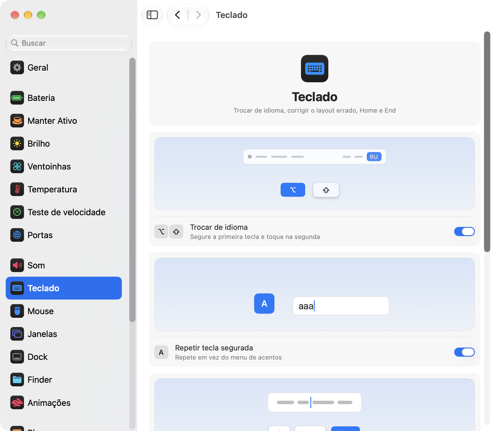
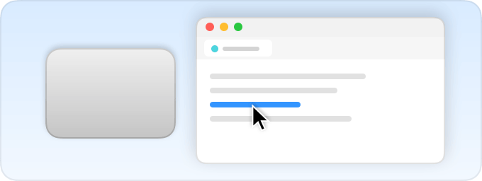

<p align="center"></p>
<h1 align="center">pikapik</h1>
<p align="center"><b>Seu Mac entende o que você quer dizer.</b><br>Pequenos ajustes para o teclado, o mouse, as janelas e o Finder, direto na barra de menus do seu Mac.</p>
<p align="center"><sub><a href="../../README.md">English</a> · <a href="README.ru.md">Русский</a> · <a href="README.uk.md">Українська</a> · <a href="README.de.md">Deutsch</a> · <a href="README.fr.md">Français</a> · <a href="README.es.md">Español</a> · <a href="README.it.md">Italiano</a> · <b>Português (Brasil)</b> · <a href="README.ja.md">日本語</a> · <a href="README.zh-Hans.md">简体中文</a> · <a href="README.ko.md">한국어</a> · <a href="README.ro.md">Română</a> · <a href="README.pl.md">Polski</a> · <a href="README.tr.md">Türkçe</a> · <a href="README.nl.md">Nederlands</a> · <a href="README.sv.md">Svenska</a> · <a href="README.cs.md">Čeština</a> · <a href="README.zh-Hant.md">繁體中文</a> · <a href="README.ar.md">العربية</a> · <a href="README.hi.md">हिन्दी</a> · <a href="README.id.md">Bahasa Indonesia</a> · <a href="README.vi.md">Tiếng Việt</a> · <a href="README.th.md">ไทย</a></sub></p>

<p align="center">
<picture>
<source media="(prefers-color-scheme: dark)" srcset="../media/settings-pt-BR-dark.png">

</picture>
</p>

## Instalação

Abra o Terminal, cole esta linha e pressione Return:

```bash
/bin/bash -c "$(curl -fsSL https://raw.githubusercontent.com/dev-pikapik/pika-tools/main/install.sh)"
```

O comando baixa a versão mais recente do GitHub e só a instala se ela estiver assinada pelo desenvolvedor e tiver passado pela verificação da Apple contra software malicioso. O pikapik aparece na barra de menus, no alto da tela. Tudo fica desligado até você ligar.

<details>
<summary>Outros jeitos: Homebrew ou um dmg</summary>

Com o Homebrew:

```bash
brew install --cask dev-pikapik/pika-tools/pikapik && open -a pikapik
```

Ou baixe o [pikapik.dmg](https://github.com/dev-pikapik/pika-tools/releases/latest/download/pikapik.dmg), abra-o e arraste o app para a pasta Aplicativos.

Tanto o comando acima quanto o Homebrew colocam o app em `/Applications`, abrem o app, pedem as permissões e ativam a abertura ao iniciar sessão. Depois disso, o app se atualiza sozinho; veja **Atualizações**. Para removê-lo, veja **Desinstalação**.

</details>

## O que ele faz

<table>
<tbody><tr>
<td width="50%" valign="top">
<picture><source media="(prefers-color-scheme: dark)" srcset="../media/keep-awake-dark.png"></picture>
<br><b>Manter Ativo</b>
<br>Seu Mac fica acordado pelo tempo que precisar, até com a tampa fechada.
</td>
<td width="50%" valign="top">
<picture><source media="(prefers-color-scheme: dark)" srcset="../media/fans-dark.png"></picture>
<br><b>Ventoinhas</b>
<br>Veja a velocidade das suas ventoinhas e escolha quanto elas giram.
</td>
</tr></tbody>
<tbody><tr>
<td width="50%" valign="top">
<picture><source media="(prefers-color-scheme: dark)" srcset="../media/battery-dark.png"></picture>
<br><b>Bateria</b>
<br>Veja a condição da sua bateria, a capacidade e o número de ciclos, quanta energia entra e como fazer com que ela dure mais.
</td>
<td width="50%" valign="top">
<picture><source media="(prefers-color-scheme: dark)" srcset="../media/command-keys-dark.png"></picture>
<br><b>Proteger ⌘Q e ⌘W</b>
<br>Nada fecha sem querer. Adicione ⇧ quando for de propósito.
</td>
</tr></tbody>
<tbody><tr>
<td width="50%" valign="top">
<picture><source media="(prefers-color-scheme: dark)" srcset="../media/compress-dark.png"></picture>
<br><b>Cópia menor</b>
<br>Clique com o botão direito em uma foto, PDF ou vídeo e ganhe uma cópia mais leve.
</td>
<td width="50%" valign="top">
<picture><source media="(prefers-color-scheme: dark)" srcset="../media/convert-dark.png"></picture>
<br><b>Conversão</b>
<br>Salve uma imagem, um vídeo ou uma música em outro formato pelo botão direito.
</td>
</tr></tbody>
<tbody><tr>
<td width="50%" valign="top">
<picture><source media="(prefers-color-scheme: dark)" srcset="../media/input-switch-dark.png"></picture>
<br><b>Trocar de idioma</b>
<br>Segure ⌥ e toque em ⇧ para trocar o idioma do teclado.
</td>
<td width="50%" valign="top">
<picture><source media="(prefers-color-scheme: dark)" srcset="../media/quit-on-close-dark.png"></picture>
<br><b>Encerrar com a última janela</b>
<br>Feche a última janela de um app, e o app também é encerrado.
</td>
</tr></tbody>
<tbody><tr>
<td width="50%" valign="top">
<picture><source media="(prefers-color-scheme: dark)" srcset="../media/window-zoom-dark.png"></picture>
<br><b>O botão verde amplia</b>
<br>A janela ocupa a tela toda sem entrar em tela cheia.
</td>
<td width="50%" valign="top">
<picture><source media="(prefers-color-scheme: dark)" srcset="../media/dock-hide-dark.png"></picture>
<br><b>Minimizar com um clique no Dock</b>
<br>Clique no app que você está usando, e ele sai da frente.
</td>
</tr></tbody>
<tbody><tr>
<td width="50%" valign="top">
<picture><source media="(prefers-color-scheme: dark)" srcset="../media/new-file-dark.png"></picture>
<br><b>Novo arquivo</b>
<br>Botão direito no Finder, um nome, e o arquivo vazio está pronto.
</td>
<td width="50%" valign="top">
<picture><source media="(prefers-color-scheme: dark)" srcset="../media/finder-cut-dark.png"></picture>
<br><b>⌘X move arquivos</b>
<br>Recorte arquivos no Finder e cole onde quiser.
</td>
</tr></tbody>
<tbody><tr>
<td width="50%" valign="top">
<picture><source media="(prefers-color-scheme: dark)" srcset="../media/finder-open-dark.png"></picture>
<br><b>Enter abre arquivos</b>
<br>Selecione arquivos no Finder e pressione Enter para abri-los.
</td>
<td width="50%" valign="top">
<picture><source media="(prefers-color-scheme: dark)" srcset="../media/finder-delete-dark.png"></picture>
<br><b>Delete manda para o Lixo</b>
<br>Pressione ⌫ no Finder, e os arquivos selecionados vão para o Lixo.
</td>
</tr></tbody>
<tbody><tr>
<td width="50%" valign="top">
<picture><source media="(prefers-color-scheme: dark)" srcset="../media/desktop-icons-dark.png"></picture>
<br><b>Ocultar ícones da Mesa</b>
<br>Um clique e a Mesa fica limpa para uma chamada ou captura de tela.
</td>
<td width="50%" valign="top">
<picture><source media="(prefers-color-scheme: dark)" srcset="../media/hidden-files-dark.png"></picture>
<br><b>Mostrar arquivos ocultos</b>
<br>Veja os arquivos e pastas que o macOS esconde.
</td>
</tr></tbody>
<tbody><tr>
<td width="50%" valign="top">
<picture><source media="(prefers-color-scheme: dark)" srcset="../media/game-mode-dark.png"></picture>
<br><b>Modo Jogo</b>
<br>Enquanto você joga, nada abre por cima do jogo nem o fecha.
</td>
<td width="50%" valign="top">
<picture><source media="(prefers-color-scheme: dark)" srcset="../media/speed-test-dark.png"></picture>
<br><b>Teste de velocidade</b>
<br>A velocidade da sua internet e para que ela dá.
</td>
</tr></tbody>
<tbody><tr>
<td width="50%" valign="top">
<picture><source media="(prefers-color-scheme: dark)" srcset="../media/side-buttons-dark.png"></picture>
<br><b>Botões laterais</b>
<br>Os botões 4 e 5 voltam e avançam, como um gesto no trackpad.
</td>
<td width="50%" valign="top">
<picture><source media="(prefers-color-scheme: dark)" srcset="../media/hide-app-dark.png"></picture>
<br><b>Ocultar com um botão do mouse</b>
<br>Basta pressionar uma vez para ocultar o app em primeiro plano, como ⌘H. Ele continua rodando.
</td>
</tr></tbody>
<tbody><tr>
<td width="50%" valign="top">
<picture><source media="(prefers-color-scheme: dark)" srcset="../media/wheel-lines-dark.png"></picture>
<br><b>Rolar por linhas</b>
<br>Cada clique da roda rola o mesmo tanto, não importa a velocidade.
</td>
<td width="50%" valign="top">
<picture><source media="(prefers-color-scheme: dark)" srcset="../media/wheel-direction-dark.png"></picture>
<br><b>Direção de rolagem</b>
<br>Uma direção para o trackpad e outra para o mouse.
</td>
</tr></tbody>
<tbody><tr>
<td width="50%" valign="top">
<picture><source media="(prefers-color-scheme: dark)" srcset="../media/linear-pointer-dark.png"></picture>
<br><b>Sem aceleração do cursor</b>
<br>O cursor anda exatamente o quanto a sua mão anda.
</td>
<td width="50%" valign="top">
<picture><source media="(prefers-color-scheme: dark)" srcset="../media/key-repeat-dark.png"></picture>
<br><b>Repetir tecla segurada</b>
<br>Segure uma tecla para repeti-la, sem o menu de acentos.
</td>
</tr></tbody>
<tbody><tr>
<td width="50%" valign="top">
<picture><source media="(prefers-color-scheme: dark)" srcset="../media/home-end-dark.png"></picture>
<br><b>Home e End</b>
<br>Vá ao início ou ao fim da linha enquanto digita.
</td>
<td width="50%" valign="top">
<picture><source media="(prefers-color-scheme: dark)" srcset="../media/animations-dark.png"></picture>
<br><b>Animações</b>
<br>Acelere o Dock, as janelas e a Visualização Rápida, até ficarem instantâneos.
</td>
</tr></tbody>
<tbody><tr>
<td width="50%" valign="top">
<picture><source media="(prefers-color-scheme: dark)" srcset="../media/leftover-permissions-dark.png"></picture>
<br><b>Permissões de apps apagados</b>
<br>Remova as permissões que o macOS guarda para apps que você já apagou.
</td>
<td width="50%" valign="top">
<picture><source media="(prefers-color-scheme: dark)" srcset="../media/pet-dark.png"></picture>
<br><b>Bichinho na mesa</b>
<br>Um amiguinho passeia atrás das suas janelas. Pegue e jogue ele para o alto, ou aperte Espaço para ele pular. Escolha as roupas dele no guarda-roupa e ganhe prêmios enquanto vocês brincam juntos. Ele fica animado enquanto você digita e cochila quando você se afasta.
</td>
</tr></tbody>
<tbody><tr>
<td width="50%" valign="top">
<picture><source media="(prefers-color-scheme: dark)" srcset="../media/uninstaller-dark.png"></picture>
<br><b>Remover apps</b>
<br>Remova um app e seus arquivos. Dá para devolver tudo.
</td>
<td width="50%" valign="top">
<picture><source media="(prefers-color-scheme: dark)" srcset="../media/game-fps-dark.png"></picture>
<br><b>Mostrar FPS</b>
<br>Um pequeno contador mostra a fluidez do seu jogo, no canto que você escolher.
</td>
</tr></tbody>
<tbody><tr>
<td width="50%" valign="top">
<picture><source media="(prefers-color-scheme: dark)" srcset="../media/archive-dark.png"></picture>
<br><b>Arquivos compactados</b>
<br>Abra RAR e outros arquivos compactados, ou junte arquivos em um ZIP, com o botão direito.
</td>
<td width="50%" valign="top">
<picture><source media="(prefers-color-scheme: dark)" srcset="../media/dock-display-dark.png"></picture>
<br><b>Manter o Dock em uma só tela</b>
<br>O Dock não pula mais para outra tela. Para movê-lo, torne outra tela a principal.
</td>
</tr></tbody>
<tbody><tr>
<td width="50%" valign="top">
<picture><source media="(prefers-color-scheme: dark)" srcset="../media/temperatures-dark.png"></picture>
<br><b>Temperatura</b>
<br>Veja o quanto o Mac está quente por dentro, do processador à bateria.
</td>
<td width="50%" valign="top">
<picture><source media="(prefers-color-scheme: dark)" srcset="../media/background-dark.png"></picture>
<br><b>Tarefas em Segundo Plano</b>
<br>Veja o que roda em segundo plano e de onde veio.
</td>
</tr></tbody>
<tbody><tr>
<td width="50%" valign="top">
<picture><source media="(prefers-color-scheme: dark)" srcset="../media/ports-dark.png"></picture>
<br><b>Portas</b>
<br>Veja qual programa está usando uma porta e libere-a.
</td>
<td width="50%" valign="top">
<picture><source media="(prefers-color-scheme: dark)" srcset="../media/app-volume-dark.png"></picture>
<br><b>Volume dos apps</b>
<br>Diminua o volume de qualquer app ou silencie-o sem mexer nos outros.
</td>
</tr></tbody>
<tbody><tr>
<td width="50%" valign="top">
<picture><source media="(prefers-color-scheme: dark)" srcset="../media/brightness-dark.png"></picture>
<br><b>Brilho dos monitores</b>
<br>Escureça ou clareie um monitor que o macOS não consegue ajustar sozinho, com um controle deslizante ou as teclas de brilho.
</td>
<td width="50%" valign="top">
<picture><source media="(prefers-color-scheme: dark)" srcset="../media/layout-fix-dark.png"></picture>
<br><b>Corrigir o layout errado</b>
<br>Digitou ghbdtn em vez de привет? Aperte Espaço e a palavra se corrige.
</td>
</tr></tbody>
<tbody><tr>
<td width="50%" valign="top">
<picture><source media="(prefers-color-scheme: dark)" srcset="../media/middle-click-dark.png"></picture>
<br><b>Clique do meio no trackpad</b>
<br>Toque com três dedos para abrir um link em uma nova aba, como com o botão do meio do mouse.
</td>
</tr></tbody>
</table>

## Mais detalhes

<details>
<summary>Primeira abertura</summary>

O pikapik precisa de duas permissões. Na primeira vez, ele abre os ajustes na página Permissões, que guia você passo a passo, e o macOS mostra os próprios avisos. Vá em **Ajustes do Sistema › Privacidade e Segurança** e ative o pikapik em:

- **Acessibilidade**, para que o app possa alterar um toque de tecla ou um clique antes que ele chegue a outros apps.
- **Monitoração de Entrada**, para que o app possa ver os toques de tecla e os cliques sem alterá-los. É assim que funciona a troca de idioma.

O app percebe a mudança em um ou dois segundos, sem precisar reiniciar.

Alguns recursos pedem algo a mais quando você os usa: **Acesso de administrador**, **Extensões do Finder**, **iCloud Drive**, **Acesso Total ao Disco**, **Gravação de Tela** e **Gravação do áudio do sistema**. Tudo fica na página Permissões dos ajustes: cada permissão tem uma linha dizendo para que serve, uma marca de seleção verde ou uma cruz laranja e um só botão: **Permitir** quando falta, **Desligar** quando está ativa. Assim você retira qualquer permissão ali mesmo.

O pikapik não grava, não guarda e não envia nada do que você digita ou clica. Os eventos são tratados na memória e repassados na hora. Para corrigir palavras digitadas no layout errado, o pikapik mantém na memória só as últimas palavras que você digitou e as esquece quando você clica ou muda de app. As únicas palavras que ele salva são as que você pediu para deixar como estão, só neste Mac, até você limpá-las em Ajustes › Teclado. O pikapik só acessa a internet para atualizações (pergunta ao GitHub qual é a versão mais recente e só a baixa se você escolher atualizar) e para o teste de velocidade, quando você o inicia (usa os servidores da Apple). A versão da Mac App Store é atualizada pela App Store, e o teste de velocidade dela usa a Cloudflare. O progresso do bichinho (passos, arremessos, prêmios e coisas assim) é contado só neste Mac e nunca é enviado para lugar nenhum. Você pode apagá-lo em Ajustes › Bichinho.

</details>

<details>
<summary>Cada ferramenta em detalhes</summary>

**Player.** Os vídeos que o QuickTime não abre, como MKV, WebM, AVI, WMV e FLV, tocam em uma janela própria. Abra Ajustes › Player e clique em **Abrir vídeo…**, ou clique com o botão direito num vídeo e escolha **Abrir com › pikapik Player**. A barra de espaço reproduz e pausa, ← e → avançam ou voltam um quadro na pausa e pulam 5 segundos durante a reprodução, J e L pulam 10, ↑ e ↓ mudam o volume e F entra em tela inteira. O menu **Velocidade** vai de 0,5× a 2×, **Salvar quadro…** salva um PNG e o player continua de onde você parou. Os capítulos de um vídeo aparecem como marcas na barra de tempo e no menu **Capítulos**, Page Down e Page Up pulam entre eles, e apertar A duas vezes repete o trecho entre os dois toques até você apertar A uma terceira vez. O painel de controles é de vidro fosco e se esconde durante a reprodução, e ao passar o ponteiro pela barra de tempo aparece uma pequena imagem daquele momento. Um vídeo que já está aberto vai para a frente em vez de abrir duas vezes. O player não tem acesso à rede e não pede nenhuma permissão. Cada formato dessa página é um botão que mostra o app que o abre agora: um clique torna o pikapik Player o app padrão desse formato, e outro clique o devolve ao app que o abria antes. **Abrir tudo no pikapik** faz isso com todos os formatos, um após o outro, e vira **Restaurar apps anteriores** (o macOS pede para confirmar cada um). As licenças do FFmpeg e do dav1d e o código-fonte deles abrem na mesma página. As legendas ainda não são compatíveis. Ele não está na versão da Mac App Store.

**Volume dos apps.** Abra Ajustes › Som e ative **Volume dos apps**. Cada app que toca som ganha seu próprio controle deslizante e um botão para silenciar, nos Ajustes e no menu. Diminua o volume de uma videochamada alta demais, silencie um jogo barulhento e deixe sua música como está: o volume do seu Mac e dos outros apps não muda. O pikapik lembra o volume de cada app, e um app que você deixa no volume máximo nunca é tocado. Um app que você ajustou continua na lista, também depois de reiniciar, esmaecido enquanto está fechado, então dá para definir o volume antes de ele abrir: clique em **Adicionar app…** ou arraste um app do Finder. O ✕ ao lado de um app faz o pikapik esquecê-lo e o devolve ao volume máximo. Para alterar o volume de um app, o pikapik faz o som dele passar por ele mesmo, por isso precisa da permissão **Gravação do áudio do sistema**, que você concede na página Permissões. O som só é repassado: não é gravado, salvo nem enviado a lugar nenhum, e o microfone não é usado. Exige macOS 14.2 ou posterior e fica oculto no macOS 14.0 e 14.1. Desativado por padrão.

**Brilho dos monitores.** O macOS muda o brilho da tela integrada e dos monitores da Apple, mas não o da maioria dos outros monitores. Abra Ajustes › Brilho: cada monitor que o macOS não consegue ajustar sozinho ganha seu próprio controle deslizante, e você também pode adicionar uma linha “Brilho” ao painel da barra de menus. O pikapik muda o brilho do próprio monitor, o mesmo ajuste dos botões dele. Se um monitor não responder, ative **Escurecer a imagem em vez disso**: a imagem fica mais escura, mas nunca preta. Ative **Teclas de brilho**, e as teclas de brilho ajustam o monitor onde está o cursor e mostram um pequeno indicador; segure ⌥⇧ para passos menores. As teclas precisam da permissão **Acessibilidade**, que você concede na página Permissões, e os controles deslizantes funcionam sem ela. O pikapik lembra o brilho de cada monitor e volta a aplicá-lo depois do repouso. A versão da Mac App Store só escurece a imagem. As teclas de brilho vêm desativadas por padrão.

**Proteger ⌘Q e ⌘W.** ⌘Q e ⌘W sozinhos não fazem nada, então você não encerra um app nem fecha uma janela sem querer. Adicione Shift para fazer isso de propósito: ⇧⌘Q encerra, ⇧⌘W fecha. Funciona em todos os apps. Cada tecla tem a própria chave. Desativado por padrão.

**Trocar de idioma com Option+Shift.** Mantenha Option pressionada e toque em Shift: o macOS passa para a próxima fonte de entrada. Continue segurando Option e toque em Shift de novo para avançar. Mantenha Shift pressionada e toque em Option para voltar. Se nesse meio-tempo você pressionar outra tecla, clicar ou adicionar Command, Control ou Fn, nada muda, então atalhos como Option+Shift+seta funcionam como antes. Desativado por padrão.

**Repetir tecla segurada.** Segure uma tecla e a letra é digitada várias e várias vezes, em vez de aparecer o menu de acentos. Ótimo em jogos e na hora de digitar. Os apps que já estão abertos aplicam isso depois de reiniciados. Desative e o macOS volta ao comportamento de sempre. Desativado por padrão.

**Home e End vão ao início e ao fim da linha.** Enquanto você digita, Home leva o cursor ao início da linha e End ao fim, em vez de rolar a página. Com ⇧ selecionam até ali, com ⌘ vão ao início ou ao fim do texto inteiro. Fora dos campos de texto, e em terminais, máquinas virtuais e apps de área de trabalho remota, as teclas funcionam como antes. Na versão da Mac App Store, elas também agem fora dos campos de texto, exceto em navegadores, no Finder e em Música. Você pode adicionar outros apps em que elas devem funcionar como sempre. Desativado por padrão.

**Corrigir palavras digitadas no layout errado.** Se uma palavra sai sem sentido, como ghbdtn em vez de привет, o pikapik a digita de novo no layout certo assim que você aperta Espaço ou Return, e troca o layout para que a próxima palavra já saia certa. Funciona com todos os layouts de teclado que você adicionou no Mac. Uma palavra só muda quando não existe em nenhum dos seus idiomas e as mesmas teclas em outro layout formam uma palavra comum, então nomes, erros de digitação e palavras raras ficam como você digitou, assim como o texto em campos de senha, no Terminal e nos apps que você escolher. Aperte ⌃⇧Espaço para corrigir a última palavra ou o texto selecionado, e aperte de novo para tentar seus outros layouts. Logo após uma correção, as mesmas teclas a desfazem, e o pikapik não corrige mais essa palavra sozinho. Você pode mudar o atalho em Ajustes › Teclado. Na versão da Mac App Store, selecione o texto e aperte ⌃⇧Espaço, ou escolha “Corrigir layout do teclado” no menu “Serviços”. **Corrigir palavras enquanto digita** e o atalho ficam desativados até você ativá-los em Ajustes › Teclado, e precisam de Acessibilidade, que a página Permissões pede. Desativado por padrão. Se você tem só um layout, o aviso na página permite adicionar ali mesmo o do seu idioma, sem passar pelos Ajustes do Sistema (versão do site).

**Desativar a aceleração do cursor.** O ponteiro se move exatamente o quanto o mouse se move, não importa a velocidade. Um controle **Velocidade do rastreamento** define a rapidez dele. Funciona só com mouses; o trackpad fica como está. Desative a opção ou encerre o pikapik e o macOS volta aos próprios ajustes. Desativado por padrão.

**Rolar por linhas.** Cada clique da roda do mouse rola o mesmo número de linhas, por mais rápido que você a gire. Escolha de 1 a 10 linhas por clique, 3 por padrão. A rolagem natural continua como você definiu nos Ajustes do Sistema. Funciona só para mouses, o trackpad continua como está. Desativado por padrão. Ao lado do controle deslizante **Distância por clique**, uma página pequena rola a distância escolhida, e um ponto marca o valor padrão.

Alguns apps e jogos contam a rolagem em pixels exatos: para eles, mude a mesma opção para pixels e escolha de 1 a 200 pixels por clique, 40 por padrão. O controle também mostra que parte da altura da tela isso representa.

**Direção de rolagem para o trackpad e o mouse.** O macOS tem um só ajuste de rolagem natural para o trackpad e o mouse ao mesmo tempo. Ative este recurso e escolha uma direção para cada um: **Natural**, em que a página acompanha os dedos como no iPhone, ou **Clássica**, em que a página vai no sentido oposto. A escolha do trackpad também vale para a rolagem lateral e para o deslize depois que você tira os dedos. O Magic Mouse rola pelo toque, por isso segue a escolha do trackpad. Escolha o mesmo em cada Mac e a rolagem fica igual em todos, mesmo quando você leva o mouse para outro Mac com o Universal Control. Desativado por padrão. Ao ativar, os dois começam como em Ajustes do Sistema, então nada muda até você escolher outra coisa.

**Botões laterais para voltar e avançar.** Os botões 4 e 5 do mouse voltam e avançam no Finder, no Safari e em outros apps da Apple, além de muitos outros apps, como um gesto de deslizar no trackpad. Os apps que tratam esses botões por conta própria os recebem do jeito que são. Se o seu mouse tem esses botões ao contrário, ative **Inverter os botões laterais**. Desativado por padrão.

**Um botão do mouse oculta o app atual.** Ative **Ocultar o app atual com um botão do mouse** em Ajustes › Mouse e pressione o botão que você quer usar, como o botão do meio ou um botão lateral. Depois disso, basta pressioná-lo uma vez para ocultar o app em primeiro plano, igual a ⌘H: o app continua rodando, e um clique no ícone dele no Dock traz o app de volta. Enquanto você joga com o Modo Jogo ligado, o botão funciona normalmente no jogo. Desativado por padrão.

**Clique do meio no trackpad.** Toque ou clique com três dedos, e o trackpad funciona como o botão do meio do mouse: na maioria dos navegadores, isso abre um link em uma nova aba ou fecha uma aba. Se preferir, escolha quatro dedos. Para tocar, ative **Tocar para clicar** em Ajustes do Sistema › Trackpad. Se lá a opção “Pesquisa e detectores de dados” estiver definida como toque com três dedos, três dedos só podem clicar, e se Arrastar com três dedos estiver ativado, escolha quatro dedos. A linha **Dedos** em Ajustes mostra o que funciona no seu Mac. O mouse continua como está. Precisa das permissões **Acessibilidade** e **Monitoração de Entrada** e não está na versão da Mac App Store. Desativado por padrão.

**Encerrar ao fechar a última janela.** Feche a última janela de um app e o app é encerrado. O Finder continua aberto, assim como os apps com janelas em outras mesas ou no Dock. Você pode listar os apps que nunca devem ser encerrados assim. Desativado por padrão.

**Minimizar ou ocultar com um clique no Dock.** Clique no ícone do Dock do app que você está usando e todas as janelas dele descem para o Dock. Clique de novo para trazer todas de volta. Você também pode fazer o clique ocultar o app inteiro, como ⌘H. Desativado por padrão.

**Manter o Dock em uma só tela.** Com várias telas, o macOS move o Dock para outra tela assim que o ponteiro empurra a borda inferior dela. Com a chave ligada, isso não acontece mais, por mais rápido que você mova o ponteiro: o pikapik desativa essa mudança com um ajuste do próprio Dock e nunca mexe no ponteiro. Para mover o Dock de propósito, torne outra tela a principal: em **Ajustes do Sistema › Telas**, clique nessa tela e escolha **Tela principal** em **Usar como**, e o Dock vai junto. A linha **Tela principal** abaixo da chave faz isso ali mesmo, e desligar a chave deixa as telas como estavam. O Dock só lê o ajuste dele ao iniciar, por isso ligar ou desligar a chave reinicia o Dock uma vez. Não é preciso nenhuma permissão. A chave vem desativada por padrão e não está na versão da Mac App Store.

**O botão verde amplia a janela.** Clique no botão verde de uma janela e ela cresce até ocupar a tela, sem entrar em tela inteira. Clique de novo para voltar ao tamanho anterior. Segure ⌥ e o botão funciona como sempre. A tela inteira continua no menu do botão e em ⌃⌘F. Você pode listar os apps em que o botão verde deve funcionar como sempre. Desativado por padrão.

**Novo arquivo no Finder.** Clique com o botão direito numa janela do Finder ou na mesa, escolha **Novo arquivo**, digite um nome e aparece um arquivo vazio. .txt por padrão. Desativado por padrão.

**Enter abre arquivos no Finder.** Selecione arquivos numa janela do Finder ou na mesa e pressione Return ou Enter: eles abrem. F2 ou fn F2 renomeia o arquivo selecionado. Em campos de texto, por exemplo enquanto você digita um nome, as teclas funcionam como sempre. Desativado por padrão.

**⌘X corta arquivos no Finder.** Selecione arquivos e pressione ⌘X, abra a pasta de destino e pressione ⌘V: os arquivos são movidos para lá em vez de copiados. ⌘C cancela o corte. Desativado por padrão.

**Delete apaga arquivos no Finder.** Selecione arquivos e pressione ⌫ ou ⌦ (fn ⌫ no notebook): eles vão para o Lixo, como com ⌘⌫. Enquanto você renomeia um arquivo, pesquisa ou digita em qualquer outro campo, as teclas apagam letras como sempre. Desativado por padrão.

**Cópia menor no Finder.** Clique com o botão direito num arquivo no Finder e escolha **Criar cópia menor**. Ao lado aparece uma versão mais leve de uma foto, GIF, PDF ou vídeo, muitas vezes várias vezes menor. Som sem compressão, como WAV ou AIFF, vira um M4A compacto. Se o arquivo não puder ficar menor, nenhuma cópia é criada e o pikapik avisa. O original continua igual e nada sai do seu Mac. Desativado por padrão.

**Conversão no Finder.** Clique com o botão direito num arquivo no Finder e escolha **Converter para** para salvá-lo em outro formato: uma imagem como JPEG, PNG, HEIC, GIF, TIFF ou PDF, um vídeo como MP4, MOV ou só o som, música como M4A, WAV ou AIFF. O original continua igual e nada sai do seu Mac. Liga separadamente da cópia menor. Desativado por padrão.

**Arquivos compactados no Finder.** Clique com o botão direito num arquivo compactado no Finder e escolha **Extrair**, e os arquivos dele aparecem ao lado. Clique com o botão direito em qualquer outro arquivo ou pasta e escolha **Criar arquivo compactado…** para gerar um ZIP, 7Z, TAR.GZ ou TAR.XZ. ZIP e 7Z podem ter senha, e qualquer arquivo compactado pode ser dividido em partes, por exemplo de 15 MB para e-mail ou de 4 GB para um pen drive. A senha é digitada duas vezes, para que um erro de digitação não tranque você fora dos seus próprios arquivos. Um ZIP criado assim não tem arquivos de serviço ocultos, mantém legíveis os nomes em qualquer idioma e aceita arquivos com mais de 4 GB. Desativado por padrão. A versão da Mac App Store tem alguns limites, descritos abaixo.

O pikapik também abre o que o macOS não abre: RAR, até dividido em partes, 7Z protegido por senha, conjuntos de partes como .001, .z01, .r00 e .part1.rar, além de ZIPX, CAB, LZH, ARJ, ZST, LZMA, WIM e mais. Clicar duas vezes neles os abre no pikapik. Os nomes de arquivos em ZIPs antigos, por exemplo em cirílico, japonês ou chinês, aparecem legíveis. A opção **Abrir arquivos compactados com este app**, em Ajustes › Finder, também entrega ZIP e 7Z ao pikapik, enquanto TAR e GZ ficam com o app de arquivos compactados do sistema, que já cuida bem deles. O pikapik sabe abrir RAR, mas não criar: a licença do RAR só permite extrair.

Uma janela pede a senha, **Parar** cancela qualquer tarefa e, de um arquivo compactado danificado ou incompleto, o pikapik tira o que ainda dá para ler. Se um arquivo compactado crescesse até um tamanho enorme, o pikapik pergunta antes de extrair, e para a tempo quando o disco está prestes a encher. Arquivos compactados que tentam gravar fora da própria pasta são bloqueados. Selecione um arquivo compactado no Finder e aperte Espaço para ver o que há dentro.
**Arquivos compactados na versão da Mac App Store.** Eles funcionam lá também, mas com as ferramentas embutidas no macOS em vez do 7-Zip incluído, então há limites: só o ZIP pode ter senha, o 7Z não; um arquivo não pode ser dividido em partes, e arquivos em várias partes (.001, .part1.rar, .z01 e semelhantes) não podem ser abertos; arquivos únicos .xz, .lzma e .zst não podem ser abertos (.gz e .bz2 podem); 7Z e RAR com senha não podem ser abertos; e não existe a chave **Abrir arquivos compactados com este app**. Na primeira vez, pikapik pede acesso à sua pasta pessoal, como em Novo arquivo e Cópia menor, porque esta versão só pode gravar onde você permitiu. Ative a extensão do Finder em Ajustes do Sistema › Geral › Itens de Início e Extensões; pikapik mostra onde clicar.


**Ocultar ícones da Mesa.** Ative antes de uma chamada, uma gravação ou uma captura de tela, e os arquivos e pastas da Mesa somem. Desative e eles voltam para os mesmos lugares. Nada é movido: os arquivos continuam na pasta Mesa do Finder. É o ajuste **Mostrar itens › Na Mesa** de Ajustes do Sistema › Mesa e Dock, só que mais à mão, então os dois sempre combinam. Na versão da Mac App Store, esta linha cobre os ícones com o seu papel de parede em todas as telas, ou com uma cor lisa se o papel de parede for animado, e os cliques continuam chegando à Mesa. Em Ajustes, o botão **Abrir** logo abaixo continua abrindo essa página dos Ajustes do Sistema.

**Mostrar arquivos ocultos.** Arquivos e pastas que o macOS oculta, como a Biblioteca na sua pasta pessoal ou arquivos cujo nome começa com um ponto, aparecem esmaecidos no Finder e na Mesa. É o mesmo que pressionar ⇧⌘. no Finder, só que você vê de relance se está ativado. Para aplicar a mudança, o Finder reinicia por um instante e abre as janelas e abas de novo. Se o Finder estiver copiando ou movendo arquivos, ele só reinicia quando terminar. Os dois ficam em Ajustes › Finder. Para tê-los no painel da barra de menus, clique no botão de lápis na parte de baixo e marque-os. Na versão da Mac App Store, Ajustes › Finder mostra no lugar as teclas ⇧⌘. do Finder.

**Modo Jogo.** Adicione seus jogos e, enquanto você joga, o Mac não tira você do jogo. Spotlight, Siri, ⌘Tab, Mission Control e os gestos entre mesas não abrem por cima do jogo, ⌘Q e ⌘W não o fecham sem querer, o ponteiro não escapa para o Dock, a barra de menus ou outra tela, e a tela continua ligada. Cada uma dessas opções tem a própria chave na página Jogos, e o pikapik sugere os jogos que encontra no seu Mac. No jogo, Control-clique continua sendo um clique, e Control com as setas não troca de mesa. O Minecraft também é reconhecido: adicione o Minecraft Launcher ou o CurseForge, e o modo liga dentro do próprio Minecraft. Para sair de um jogo, pressione ⇧⌘Q; para fechar a janela dele, ⇧⌘W. ⌥⌘Esc sempre funciona. Assim que você sai do jogo, tudo funciona como sempre. Desativado por padrão.

Ligue o Modo Jogo e jogue. Mais ajustes do jogo tem o catálogo publicado pelo Mac, com teclas atuais e uma prévia animada para cada ação.

Automático pausa ações que abrem janelas ou mudam o foco. Um atalho de idioma rápido e intencional troca a fonte sem janela do sistema. Teclas de movimento mantidas têm prioridade para que correr e pular não troquem o idioma por acidente.

Em Ajustes → Jogos → Mais ajustes do jogo há um grupo chamado “Mouse e trackpad”. Ele mostra só o que está ativado no macOS no seu Mac, com os nomes da Apple e um pequeno desenho para cada item: atalhos em um botão do mouse, deslizar entre mesas e apps em tela inteira, Mission Control e App Exposé, pinça para apps e afastar os dedos para a mesa, deslizar a partir da borda direita para a Central de Notificações e cada canto ativo com a ação que ele executa. Enquanto um jogo está em primeiro plano, eles ficam pausados, então um deslize acidental ou um toque no canto da tela não tira você do jogo. Os gestos dentro do jogo continuam funcionando. Cada item pode ser configurado para funcionar como de costume. Na versão do site, **Alterar…** em um canto ativo escolhe ali mesmo outra ação, e **Devolver** traz de volta a primeira; cada alteração reinicia o Dock uma vez.

Abra Ajustes → Jogos → Adicionar um jogo e clique no jogo em execução. Jogos que usam Java e outros ambientes também aparecem, mesmo sem arquivo .app. Minecraft aparece como Minecraft em vez de java. Encontre o processo do jogo e arraste a linha para Seus jogos em Ajustes → Jogos.

**Mostrar FPS.** FPS significa quadros por segundo: quantas imagens o jogo desenha a cada segundo. Ative **Mostrar FPS** na página Jogos e, enquanto o Modo Jogo estiver ligado, uma pequena etiqueta escura com esse número aparece em um canto de qualquer jogo. Clique em um canto da imagem acima da chave para escolhê-lo. Um traço significa que os primeiros quadros ainda não chegaram, e um 0 esmaecido, que o jogo parou de desenhar. No macOS 27, o próprio macOS conta a maioria dos jogos, sem permissão. Um jogo que o macOS não consegue contar, em geral um mais antigo, é contado pela gravação de tela: a linha **Gravação de Tela** aparece então na página Permissões, o pikapik nunca a pede durante uma partida e o número não pode passar da taxa de atualização da tela. No macOS 14 a 26 e na versão da Mac App Store todos os jogos são contados assim, por isso a linha aparece assim que você liga **Mostrar FPS**, e o botão **Permitir** abaixo da chave leva você até ela. Nenhuma imagem é guardada nem enviada. Desligado por padrão.

**Guarda-roupa e prêmios do bichinho.** Abra Ajustes › Bichinho para vestir o seu bichinho: mais de 30 peças, de chapéus e óculos a capas e asas, e looks prontos como mago, pirata ou astronauta. Algumas peças são grátis desde o começo. O resto são prêmios que chegam enquanto vocês brincam juntos: pegue o bichinho e jogue para o alto, chute a bola, veja ele subir nas janelas e conversar, ou simplesmente faça companhia a ele dia após dia. Quando você ganhar um prêmio novo, o bichinho avisa.

Para saber quando um prêmio é devido, o pikapik conta só o que você e o bichinho fazem: passos, quantas vezes você o pega e o joga, pulos, subidas, partidas de bola e conversas, dias juntos, se vocês estiveram juntos de manhã cedo, depois da meia-noite ou no fim de semana, as páginas dos Ajustes que você abriu e as peças que experimentou. Fora da Mac App Store, o pikapik também anota se você abriu a nossa página do GitHub nos Ajustes. Esses números, a data de cada prêmio e o que o bichinho está vestindo ficam neste Mac. Nada é enviado para lugar nenhum, e nada disso entra no arquivo de ajustes exportado nem na sincronização do iCloud. Você pode apagar tudo quando quiser em Ajustes › Bichinho, e o bichinho recomeça do zero.

**Remover apps.** Abra Ajustes › Remover apps, escolha um app na lista ou solte um sobre a imagem, e o pikapik mostra tudo o que esse app guarda no seu Mac: o próprio app, seus dados salvos, ajustes, arquivos temporários, ajudantes em segundo plano e mais, cada item com o motivo de estar na lista. Os arquivos que claramente pertencem ao app vêm marcados, os que só talvez tenham relação não, e os que outros apps também usam ficam sinalizados. Escolha o que remover e clique em **Mover para o Lixo**. Nada é apagado de vez: tudo vai para o Lixo. Se o app estiver aberto, o pikapik pede primeiro que ele se feche e, se alguns arquivos precisarem de um administrador, o Mac vai pedir sua senha uma vez.

Mudou de ideia? Clique em **Devolver** e tudo volta para onde estava, e os ajudantes em segundo plano começam de novo. As dez últimas remoções ficam em “Removidos recentemente” enquanto os arquivos delas estiverem no Lixo. **Redefinir app** mantém o app e remove só os dados salvos, os ajustes e os arquivos temporários dele, o que pode ajudar quando um app dá problema. Os apps que você mesmo moveu para o Lixo aparecem em “No Lixo”, com os arquivos que deixaram, e “Sobras de apps removidos” encontra arquivos de apps que já se foram. A chave “Oferecer limpeza quando um app for para o Lixo” vem desligada, e nada é removido até você escolher. Para ver tudo o que um app guarda, a página precisa do **Acesso Total ao Disco**. Esta ferramenta não está na versão da Mac App Store.

**Temperatura.** Abra Ajustes › Temperatura para ver o quanto o Mac está quente por dentro. No topo, uma só palavra resume tudo, de “Normal” a “Muito quente”, com uma linha que diz se o Mac está funcionando na velocidade máxima ou ficando mais lento para esfriar. Abaixo, cada peça tem sua própria linha com um nome simples em vez de um código de sensor: processador, gráficos, memória, armazenamento, Wi-Fi e bateria, conforme os sensores do seu Mac. Cada linha mostra os graus e uma barra curta que fica verde, amarela ou laranja de acordo com a faixa normal daquela peça. Os números são atualizados a cada dois segundos e só enquanto você está olhando, então quase não pesam no Mac. Não é preciso senha nem permissão. Você também pode adicionar uma linha “Temperatura” ao painel da barra de menus. A versão da Mac App Store mostra o nível geral e, em um Mac com bateria, a temperatura da bateria.

A página **Tarefas em Segundo Plano** mostra tudo o que começa sozinho no seu Mac: apps que abrem ao iniciar sessão, serviços em segundo plano, ajudantes guardados dentro de apps e sobras de apps que você já removeu. Em cada tarefa você vê qual app a adicionou, se ela está rodando agora mesmo e onde fica o arquivo dela; um clique mostra o arquivo no Finder. As tarefas iniciadas por agentes, inclusive as de todos os usuários, e os itens de início antigos desligam direto no pikapik com um botão, sem senha, e religam com a mesma facilidade; nada é apagado. Os serviços em segundo plano da pasta Library compartilhada, o Acesso Remoto e o Compartilhar Tela se desligam do mesmo jeito, assim que você permite o acesso de administrador na página Permissões. Os ajudantes que um app registrou sozinho e os serviços de outros lugares são do macOS, então o botão deles abre Itens de Início em Ajustes do Sistema e uma linha abaixo da tarefa explica o motivo. Na versão da Mac App Store, a página só mostra as tarefas: você dá acesso à sua pasta pessoal uma vez na janela Abrir de sempre, e os botões abrem Itens de Início.

**Portas.** Quando um programa diz que a porta dele já está em uso, abra Ajustes › Portas. Você vê cada programa que ocupou uma porta no seu Mac, com o ícone, os números das portas e se outros dispositivos da sua rede podem se conectar. Digite um número para descobrir quem está usando essa porta ou para ter certeza de que ela está livre. Clique em uma linha para ver os endereços que abrem no navegador, o arquivo do programa, o comando que o iniciou, a pasta dele e o número do processo. **Liberar** pede ao programa que se feche, para que ele possa salvar o trabalho, e, se ele não fechar, oferece forçar o encerramento. Cada passo pede sua confirmação antes. O pikapik nunca encerra partes do macOS nem programas de outros usuários: para Receptor de AirPlay e Compartilhar Arquivos, ele mostra qual chave nos Ajustes do Sistema libera a porta, e o Acesso Remoto e o Compartilhar Tela se desligam na hora com o botão Desligar. A página Portas não está na versão da Mac App Store: lá o macOS não deixa um app ver qual programa está usando uma porta.

Cada ferramenta tem a própria chave no menu e nos ajustes.

O ícone na barra de menus mostra o estado num relance: a marca do pikapik quando as ferramentas estão funcionando, a mesma marca mais clara quando tudo está desativado e um triângulo de aviso quando uma ferramenta está ativada, mas faltam permissões.

O painel da barra de menus começa com poucas linhas. Você escolhe quais ele mostra: clique no botão de lápis na parte de baixo, marque o que quer ver e clique em **Concluir**. As linhas ocultas continuam funcionando e ficam nos Ajustes. Se o painel não couber na tela, ele rola.

O app segue o idioma do sistema ou o que você escolher nos ajustes. Estão disponíveis os 23 idiomas da lista no topo desta página.

</details>

<details>
<summary>Manter Ativo</summary>

Impede que o Mac entre em repouso enquanto você está longe do teclado: por qualquer tempo de 1 segundo a 365 dias, ou até você desativar. Ative no menu e defina a duração nos ajustes: digite dias, horas, minutos e segundos, use ↑ e ↓ ou clique em uma opção pronta de 15 minutos a 8 horas. O menu mostra quanto tempo falta e quando termina. Para a **Tela** há duas opções. **Sempre ligada**: não desliga, sem protetor de tela nem tela bloqueada. **Desliga como sempre**: desliga no próprio temporizador enquanto o Mac continua funcionando. **Desligar a tela agora** (também no menu) desliga a tela na hora e o Mac continua funcionando: mova o mouse ou pressione uma tecla para trazê-la de volta. Ao encerrar o pikapik, o Manter Ativo termina.

Em um MacBook você também pode ativar **Funcionar com a tampa fechada**. O macOS não tem um ajuste para isso, então o pikapik executa `pmset -a disablesleep 1` e pede uma senha de administrador: só um administrador pode mudar como o Mac entra em repouso. O ajuste volta ao normal sozinho quando o Manter Ativo termina, quando você encerra o app ou se ele travar. Se você não digitar a senha, nada muda. Mantenha o Mac bem ventilado com a tampa fechada. **Parar com bateria abaixo de 20%** termina a sessão antes que a bateria acabe.

Manter ativo, os modos de tela e de tampa fechada podem virar um botão na Central de Controle, na barra de menus ou em um widget na mesa pelo app Atalhos, com links que você copia em Ajustes › Manter Ativo.

</details>

<details>
<summary>Teste de velocidade</summary>

Mostra a velocidade da sua internet agora. Clique em **Testar velocidade** em Ajustes › Teste de velocidade, ou em **Testar** no menu depois de adicionar a linha pelo botão de lápis. Em cerca de meio minuto você vê download, upload, ping e responsividade: a rapidez com que tudo responde enquanto a conexão está ocupada. Abaixo, em palavras simples, para que ela serve: filmes em 4K, videochamadas, jogos online e downloads grandes. O teste usa o networkQuality, que vem no macOS, e servidores da Apple. O último resultado fica salvo até o próximo teste, e um link para o Atalhos o inicia pela Central de Controle.

</details>

<details>
<summary>Ajustes</summary>

Abra os ajustes pelo menu com **Ajustes…** ou ⌘, ou abra o pikapik de novo pelo Finder, Launchpad ou Spotlight. Enquanto a janela estiver aberta, o app aparece no Dock e no ⌘Tab.

- **Geral**: abrir ao iniciar sessão, aparência (Sistema, Claro ou Escuro), idioma, atualizações e backup: exportar e importar os ajustes como arquivo, ou sincronizá-los pelo iCloud Drive.
- **Bateria**: carga, tempo até a carga completa ou tempo restante, condição, capacidade máxima, número de ciclos, adaptador de energia e potência em watts, além de dicas para a bateria durar mais. A página só mostra informações: o limite de carga continua em **Ajustes do Sistema › Bateria**. Aparece apenas em um Mac com bateria.
- **Manter Ativo**: duração e opções de tela e de tampa.
- **Brilho**: um controle deslizante para cada monitor que o macOS não consegue ajustar sozinho, as teclas de brilho e a opção de escurecer a imagem em vez disso.
- **Ventoinhas**: velocidade de cada ventoinha, modo Auto ou velocidade manual quando o acesso de administrador está permitido.
- **Temperatura**: o quanto o Mac está quente, no geral e por peça, como o processador, a memória e a bateria.
- **Teste de velocidade**: mede a internet e mostra para que ela serve.
- **Portas**: qual programa ocupou qual porta, os endereços e detalhes dele e um botão para liberar a porta.
- **Som**: volume dos apps, com controle deslizante e botão de silenciar para cada app que toca som.
- **Teclado**: troca de idioma, repetição de teclas, Home e End, correção do layout errado.
- **Mouse**: aceleração do ponteiro e velocidade do rastreamento, rolagem por linhas, direção de rolagem, botões laterais, um botão que oculta o app atual, clique do meio no trackpad.
- **Janelas**: ampliar com o botão verde (com uma lista de exceções), proteção de ⌘Q e ⌘W, e encerrar ao fechar a última janela (com uma lista de exceções).
- **Dock**: minimizar ou ocultar com um clique no Dock e manter o Dock em uma só tela.
- **Finder**: novo arquivo, cópia menor, conversão e arquivos compactados, abrir com Return, recortar com ⌘X, apagar com ⌫, ocultar ícones da Mesa e mostrar arquivos ocultos.
- **Player**: abrir um vídeo em uma janela própria, os formatos que ele reproduz, uma chave que o torna o player de vídeo padrão e as licenças do FFmpeg e do dav1d.
- **Remover apps**: remova um app com seus arquivos, devolva tudo depois e limpe o que os apps removidos deixaram para trás.
- **Tarefas em Segundo Plano**: tudo o que roda em segundo plano, qual app adicionou e um botão para desligá-las e religá-las sem abrir Ajustes do Sistema.
- **Jogos**: a lista dos seus jogos e as opções do Modo Jogo.
- **Bichinho**: ligar ou desligar o bichinho, conversas e bola, seguir o seu ritmo, guarda-roupa e prêmios.
- **Permissões**: todas as permissões que o pikapik usa, cada uma com seu estado e um botão para permitir ou desligar. Uma ferramenta sem a permissão de que precisa aparece em cinza; clicar nela abre esta página na linha certa.
- **Sobre**: versão, links para o histórico de mudanças e para relatar um problema.

Muitos ajustes vêm com uma imagem pequena que mostra o que eles fazem, como um Mac que continua ativo ou uma janela que se esconde atrás do Dock. A imagem muda junto com o interruptor e fica parada quando “Reduzir movimento” está ativado em Ajustes do Sistema.

Cada página tem um botão **Restaurar Padrões…** na parte de baixo. Ele pergunta antes, depois desativa as ferramentas da página e devolve as opções ao que eram, como se o pikapik nunca tivesse mexido nelas.

**Sincronizar ajustes com o iCloud** mantém o pikapik igual em todos os seus Macs. Os ajustes ficam na pasta pikapik do iCloud Drive, e vale a alteração mais recente. Vem desativado por padrão e precisa do iCloud Drive ligado. As permissões não são sincronizadas: cada Mac pede as suas.

**Uma única cópia principal.** Se duas cópias do pikapik estiverem abertas ao mesmo tempo, como a do site e a da App Store, só a que foi aberta por último altera algo no seu Mac. A outra mostra um aviso curto com o botão **Tornar esta cópia a principal** e assume o controle quando a cópia principal for encerrada. Uma cópia que deixa de ser a principal devolve o que tinha alterado.

</details>

<details>
<summary>Atualizações</summary>

O pikapik procura novas versões ao abrir e a cada 6 horas. Você pode desativar isso em Ajustes › Geral. Quando sai uma nova versão, aparece no menu o botão **Atualizar para …**: um clique e o app baixa a atualização, instala e reinicia. Você também pode verificar manualmente com **Verificar Agora** em Ajustes › Geral.

Com o Homebrew, você também pode executar `brew upgrade --cask pikapik`.

A partir da versão 1.3, as permissões continuam valendo depois das atualizações.

</details>

<details>
<summary>Desinstalação</summary>

```bash
/bin/bash -c "$(curl -fsSL https://raw.githubusercontent.com/dev-pikapik/pika-tools/main/uninstall.sh)"
```

Se você instalou com o Homebrew: `brew uninstall --cask --zap pikapik`.

Os dois encerram o app, removem o app dos itens de início e o apagam. O script também redefine as permissões dele.

</details>

<details>
<summary>Perguntas frequentes</summary>

**Por que são necessárias duas permissões?**
O macOS divide o acesso ao teclado e ao mouse em dois. A Acessibilidade permite que o app altere um toque de tecla ou um clique, e a maioria dos recursos só precisa disso. A Monitoração de Entrada permite apenas observar, e isso basta para trocar de idioma.

**O macOS diz que o app é de um desenvolvedor não identificado.**
O pikapik é assinado pelo desenvolvedor e passa pela verificação da Apple contra software malicioso, então esta mensagem não deveria aparecer. Se ela aparecer, abra **Ajustes do Sistema › Privacidade e Segurança** e clique em **Abrir Mesmo Assim**.

**Funciona em Macs com Intel?**
Sim. É um app universal para Apple Silicon e Intel, com macOS 14 Sonoma ou posterior.

**A permissão está ativada, mas nada funciona.**
Em **Ajustes do Sistema › Privacidade e Segurança**, remova o pikapik das duas listas com o botão − e adicione-o de novo. Ou faça isso no próprio pikapik: na página Permissões, clique em **Desligar** em cada permissão e depois em **Permitir** de novo.

</details>

<p align="center">☕ Se você gosta do pikapik, pode <a href="https://buymeacoffee.com/pikapik">me pagar um café</a> — tudo vai para o desenvolvimento e o suporte do app.</p>

<p align="center"><sub><a href="../whats-new/README.pt-BR.md">Novidades</a> · <a href="https://github.com/dev-pikapik/homebrew-pika-tools">Tap do Homebrew</a> · <a href="../../CONTRIBUTING.md">Compilar você mesmo</a> · <a href="../../LICENSE">Licença MIT</a> · © 2026 pikapik</sub></p>
