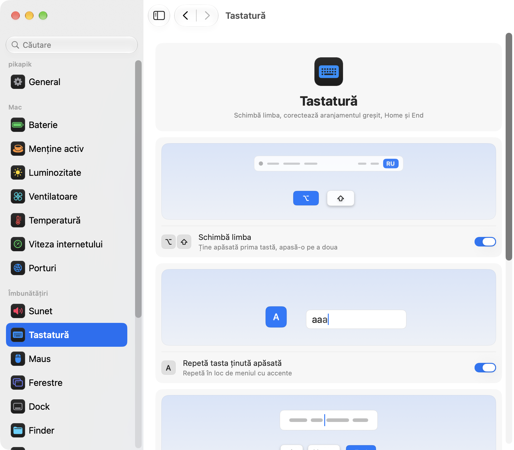

<p align="center"></p>
<h1 align="center">pikapik</h1>
<p align="center"><b>Mac-ul tău înțelege ce vrei să spui.</b><br>Mici îmbunătățiri pentru tastatură, maus, ferestre și Finder, direct în bara de meniu a Mac-ului tău.</p>
<p align="center"><sub><a href="../../README.md">English</a> · <a href="README.ru.md">Русский</a> · <a href="README.uk.md">Українська</a> · <a href="README.de.md">Deutsch</a> · <a href="README.fr.md">Français</a> · <a href="README.es.md">Español</a> · <a href="README.it.md">Italiano</a> · <a href="README.pt-BR.md">Português (Brasil)</a> · <a href="README.ja.md">日本語</a> · <a href="README.zh-Hans.md">简体中文</a> · <a href="README.ko.md">한국어</a> · <b>Română</b> · <a href="README.pl.md">Polski</a> · <a href="README.tr.md">Türkçe</a> · <a href="README.nl.md">Nederlands</a> · <a href="README.sv.md">Svenska</a> · <a href="README.cs.md">Čeština</a> · <a href="README.zh-Hant.md">繁體中文</a> · <a href="README.ar.md">العربية</a> · <a href="README.hi.md">हिन्दी</a> · <a href="README.id.md">Bahasa Indonesia</a> · <a href="README.vi.md">Tiếng Việt</a> · <a href="README.th.md">ไทย</a></sub></p>

<p align="center">
<picture>
<source media="(prefers-color-scheme: dark)" srcset="../media/settings-ro-dark.png">

</picture>
</p>

## Instalare

Deschide Terminal, lipește această linie și apasă Retur:

```bash
/bin/bash -c "$(curl -fsSL https://raw.githubusercontent.com/dev-pikapik/pika-tools/main/install.sh)"
```

Comanda descarcă cea mai recentă versiune de pe GitHub și o instalează doar dacă este semnată de dezvoltator și a trecut de verificarea Apple pentru software rău intenționat. pikapik apare în bara de meniu, sus pe ecran. Totul rămâne oprit până îl pornești tu.

<details>
<summary>Alte variante: Homebrew sau un dmg</summary>

Cu Homebrew:

```bash
brew install --cask dev-pikapik/pika-tools/pikapik && open -a pikapik
```

Sau descarcă [pikapik.dmg](https://github.com/dev-pikapik/pika-tools/releases/latest/download/pikapik.dmg), deschide-l și trage aplicația în dosarul Aplicații.

Atât comanda de mai sus, cât și Homebrew pun aplicația în `/Applications`, o pornesc, cer permisiunile și activează deschiderea la autentificare. După aceea, aplicația se actualizează singură, vezi **Actualizări**. Pentru a o elimina, vezi **Dezinstalare**.

</details>

## Ce face

<table>
<tbody><tr>
<td width="50%" valign="top">
<picture><source media="(prefers-color-scheme: dark)" srcset="../media/keep-awake-dark.png"></picture>
<br><b>Rămâi treaz</b>
<br>Mac-ul rămâne treaz cât ai nevoie, chiar și cu capacul închis.
</td>
<td width="50%" valign="top">
<picture><source media="(prefers-color-scheme: dark)" srcset="../media/fans-dark.png"></picture>
<br><b>Ventilatoare</b>
<br>Vezi cât de repede se rotesc ventilatoarele și alege viteza lor.
</td>
</tr></tbody>
<tbody><tr>
<td width="50%" valign="top">
<picture><source media="(prefers-color-scheme: dark)" srcset="../media/battery-dark.png"></picture>
<br><b>Baterie</b>
<br>Vezi starea bateriei, capacitatea și numărul de cicluri, cât curent intră în ea și cum o poți face să țină mai mult.
</td>
<td width="50%" valign="top">
<picture><source media="(prefers-color-scheme: dark)" srcset="../media/command-keys-dark.png"></picture>
<br><b>Protejarea ⌘Q și ⌘W</b>
<br>Nimic nu se închide din greșeală. Adaugă ⇧ când chiar vrei.
</td>
</tr></tbody>
<tbody><tr>
<td width="50%" valign="top">
<picture><source media="(prefers-color-scheme: dark)" srcset="../media/compress-dark.png"></picture>
<br><b>Copie mai mică</b>
<br>Clic dreapta pe o poză, un PDF sau un video, și alături apare o copie mai ușoară.
</td>
<td width="50%" valign="top">
<picture><source media="(prefers-color-scheme: dark)" srcset="../media/convert-dark.png"></picture>
<br><b>Conversie</b>
<br>Salvează o imagine, un video sau o melodie în alt format din meniul de clic dreapta.
</td>
</tr></tbody>
<tbody><tr>
<td width="50%" valign="top">
<picture><source media="(prefers-color-scheme: dark)" srcset="../media/input-switch-dark.png"></picture>
<br><b>Schimbă limba</b>
<br>Ține apăsat ⌥ și apasă ⇧ ca să schimbi limba tastaturii.
</td>
<td width="50%" valign="top">
<picture><source media="(prefers-color-scheme: dark)" srcset="../media/quit-on-close-dark.png"></picture>
<br><b>Ieșire cu ultima fereastră</b>
<br>Închide ultima fereastră a unei aplicații, și se închide și aplicația.
</td>
</tr></tbody>
<tbody><tr>
<td width="50%" valign="top">
<picture><source media="(prefers-color-scheme: dark)" srcset="../media/window-zoom-dark.png"></picture>
<br><b>Butonul verde mărește</b>
<br>Fereastra umple ecranul fără să treacă pe ecran complet.
</td>
<td width="50%" valign="top">
<picture><source media="(prefers-color-scheme: dark)" srcset="../media/dock-hide-dark.png"></picture>
<br><b>Minimizare cu un clic în Dock</b>
<br>Dă clic pe aplicația în care ești, și se dă la o parte.
</td>
</tr></tbody>
<tbody><tr>
<td width="50%" valign="top">
<picture><source media="(prefers-color-scheme: dark)" srcset="../media/new-file-dark.png"></picture>
<br><b>Fișier nou</b>
<br>Clic dreapta în Finder, un nume, și fișierul gol e gata.
</td>
<td width="50%" valign="top">
<picture><source media="(prefers-color-scheme: dark)" srcset="../media/finder-cut-dark.png"></picture>
<br><b>⌘X mută fișiere</b>
<br>Decupează fișiere în Finder și lipește-le unde vrei.
</td>
</tr></tbody>
<tbody><tr>
<td width="50%" valign="top">
<picture><source media="(prefers-color-scheme: dark)" srcset="../media/finder-open-dark.png"></picture>
<br><b>Enter deschide fișiere</b>
<br>Selectează fișiere în Finder și apasă Enter ca să le deschizi.
</td>
<td width="50%" valign="top">
<picture><source media="(prefers-color-scheme: dark)" srcset="../media/finder-delete-dark.png"></picture>
<br><b>Delete în Coș</b>
<br>Apasă ⌫ în Finder, și fișierele selectate ajung în Coș.
</td>
</tr></tbody>
<tbody><tr>
<td width="50%" valign="top">
<picture><source media="(prefers-color-scheme: dark)" srcset="../media/desktop-icons-dark.png"></picture>
<br><b>Ascunde pictogramele de pe desktop</b>
<br>Un clic și desktopul e curat pentru un apel sau o captură de ecran.
</td>
<td width="50%" valign="top">
<picture><source media="(prefers-color-scheme: dark)" srcset="../media/hidden-files-dark.png"></picture>
<br><b>Afișează fișierele ascunse</b>
<br>Vezi fișierele și folderele pe care macOS le ascunde.
</td>
</tr></tbody>
<tbody><tr>
<td width="50%" valign="top">
<picture><source media="(prefers-color-scheme: dark)" srcset="../media/game-mode-dark.png"></picture>
<br><b>Modul Joc</b>
<br>Cât timp te joci, nimic nu apare peste joc și nimic nu-l închide.
</td>
<td width="50%" valign="top">
<picture><source media="(prefers-color-scheme: dark)" srcset="../media/speed-test-dark.png"></picture>
<br><b>Viteza internetului</b>
<br>Cât de rapid e internetul tău și la ce îți ajunge.
</td>
</tr></tbody>
<tbody><tr>
<td width="50%" valign="top">
<picture><source media="(prefers-color-scheme: dark)" srcset="../media/side-buttons-dark.png"></picture>
<br><b>Butoanele laterale</b>
<br>Butoanele 4 și 5 merg înapoi și înainte, ca un gest pe trackpad.
</td>
<td width="50%" valign="top">
<picture><source media="(prefers-color-scheme: dark)" srcset="../media/hide-app-dark.png"></picture>
<br><b>Ascundere cu un buton al mausului</b>
<br>O apăsare ascunde aplicația din prim-plan, ca ⌘H. Aplicația rulează în continuare.
</td>
</tr></tbody>
<tbody><tr>
<td width="50%" valign="top">
<picture><source media="(prefers-color-scheme: dark)" srcset="../media/wheel-lines-dark.png"></picture>
<br><b>Derulare pe rânduri</b>
<br>Fiecare clic al rotiței derulează la fel, oricât de repede o învârți.
</td>
<td width="50%" valign="top">
<picture><source media="(prefers-color-scheme: dark)" srcset="../media/wheel-direction-dark.png"></picture>
<br><b>Direcția de derulare</b>
<br>O direcție pentru trackpad, alta pentru maus.
</td>
</tr></tbody>
<tbody><tr>
<td width="50%" valign="top">
<picture><source media="(prefers-color-scheme: dark)" srcset="../media/linear-pointer-dark.png"></picture>
<br><b>Fără accelerarea cursorului</b>
<br>Cursorul merge exact cât mâna ta.
</td>
<td width="50%" valign="top">
<picture><source media="(prefers-color-scheme: dark)" srcset="../media/key-repeat-dark.png"></picture>
<br><b>Repetă tasta ținută apăsată</b>
<br>Ține o tastă apăsată ca s-o repeți, fără meniul de accente.
</td>
</tr></tbody>
<tbody><tr>
<td width="50%" valign="top">
<picture><source media="(prefers-color-scheme: dark)" srcset="../media/home-end-dark.png"></picture>
<br><b>Home și End</b>
<br>Sari la începutul sau la sfârșitul rândului în timp ce scrii.
</td>
<td width="50%" valign="top">
<picture><source media="(prefers-color-scheme: dark)" srcset="../media/animations-dark.png"></picture>
<br><b>Animații</b>
<br>Grăbește Dock-ul, ferestrele și Privirea rapidă, până la instantaneu.
</td>
</tr></tbody>
<tbody><tr>
<td width="50%" valign="top">
<picture><source media="(prefers-color-scheme: dark)" srcset="../media/leftover-permissions-dark.png"></picture>
<br><b>Permisiunile aplicațiilor șterse</b>
<br>Elimină permisiunile pe care macOS le păstrează pentru aplicațiile deja șterse.
</td>
<td width="50%" valign="top">
<picture><source media="(prefers-color-scheme: dark)" srcset="../media/pet-dark.png"></picture>
<br><b>Animăluț pe birou</b>
<br>Un mic prieten se plimbă în spatele ferestrelor. Ia-l și aruncă-l sau apasă Spațiu ca să sară. Îmbracă-l cu haine din garderoba lui și câștigă premii cât vă jucați împreună. Se înviorează cât timp tastezi și ațipește când te îndepărtezi.
</td>
</tr></tbody>
<tbody><tr>
<td width="50%" valign="top">
<picture><source media="(prefers-color-scheme: dark)" srcset="../media/uninstaller-dark.png"></picture>
<br><b>Eliminare aplicații</b>
<br>Elimină o aplicație și fișierele ei. Poți pune totul la loc.
</td>
<td width="50%" valign="top">
<picture><source media="(prefers-color-scheme: dark)" srcset="../media/game-fps-dark.png"></picture>
<br><b>Afișează FPS</b>
<br>Un mic contor arată cât de fluid rulează jocul, în colțul pe care îl alegi.
</td>
</tr></tbody>
<tbody><tr>
<td width="50%" valign="top">
<picture><source media="(prefers-color-scheme: dark)" srcset="../media/archive-dark.png"></picture>
<br><b>Arhive</b>
<br>Extrage RAR și alte arhive sau împachetează fișiere într-un ZIP, cu un clic dreapta.
</td>
<td width="50%" valign="top">
<picture><source media="(prefers-color-scheme: dark)" srcset="../media/dock-display-dark.png"></picture>
<br><b>Ține Dock-ul pe un singur ecran</b>
<br>Dock-ul nu mai sare pe alt ecran. Ca să-l muți, setează alt ecran ca principal.
</td>
</tr></tbody>
<tbody><tr>
<td width="50%" valign="top">
<picture><source media="(prefers-color-scheme: dark)" srcset="../media/temperatures-dark.png"></picture>
<br><b>Temperatură</b>
<br>Vezi cât de cald este Mac-ul în interior, de la procesor la baterie.
</td>
<td width="50%" valign="top">
<picture><source media="(prefers-color-scheme: dark)" srcset="../media/background-dark.png"></picture>
<br><b>Sarcini în fundal</b>
<br>Vezi ce rulează în fundal și de unde a venit.
</td>
</tr></tbody>
<tbody><tr>
<td width="50%" valign="top">
<picture><source media="(prefers-color-scheme: dark)" srcset="../media/ports-dark.png"></picture>
<br><b>Porturi</b>
<br>Vezi ce program a ocupat un port și eliberează-l.
</td>
<td width="50%" valign="top">
<picture><source media="(prefers-color-scheme: dark)" srcset="../media/app-volume-dark.png"></picture>
<br><b>Volumul aplicațiilor</b>
<br>Redu volumul sau oprește sunetul oricărei aplicații, fără să le afectezi pe celelalte.
</td>
</tr></tbody>
<tbody><tr>
<td width="50%" valign="top">
<picture><source media="(prefers-color-scheme: dark)" srcset="../media/brightness-dark.png"></picture>
<br><b>Luminozitatea monitoarelor</b>
<br>Întunecă sau luminează un monitor pe care macOS nu îl poate regla singur, cu un glisor sau cu tastele de luminozitate.
</td>
<td width="50%" valign="top">
<picture><source media="(prefers-color-scheme: dark)" srcset="../media/layout-fix-dark.png"></picture>
<br><b>Corectează aranjamentul greșit</b>
<br>Ai scris ghbdtn în loc de привет? Apasă Spațiu și cuvântul se corectează.
</td>
</tr></tbody>
<tbody><tr>
<td width="50%" valign="top">
<picture><source media="(prefers-color-scheme: dark)" srcset="../media/middle-click-dark.png"></picture>
<br><b>Clic de mijloc pe trackpad</b>
<br>Atinge cu trei degete ca să deschizi un link într-o filă nouă, ca și cu butonul din mijloc al mausului.
</td>
</tr></tbody>
</table>

## Mai multe detalii

<details>
<summary>Prima pornire</summary>

pikapik are nevoie de două permisiuni. La prima pornire, deschide configurările pe pagina Permisiuni, care te ghidează pas cu pas, iar macOS afișează propriile solicitări. Mergi la **Configurări sistem › Confidențialitate și securitate** și activează pikapik în:

- **Accesibilitate**, ca aplicația să poată modifica o apăsare de tastă sau un clic înainte să ajungă la alte aplicații.
- **Monitorizare intrare**, ca aplicația să poată vedea apăsările de taste și clicurile fără să le modifice. Așa funcționează schimbarea limbii.

Aplicația observă schimbarea în câteva secunde, fără repornire.

Unele funcții cer mai mult atunci când le folosești: **Acces de administrator**, **Extensii Finder**, **iCloud Drive**, **Acces complet la disc**, **Înregistrare ecran** și **Înregistrarea audio a sistemului**. Toate sunt pe pagina Permisiuni din configurări: fiecare permisiune are un rând care spune la ce servește, o bifă verde sau o cruce portocalie și un singur buton: **Permite** când lipsește, **Stinge** când e activă. Așa poți retrage orice permisiune chiar acolo.

pikapik nu înregistrează, nu păstrează și nu trimite nimic din ce tastezi sau pe ce dai clic. Evenimentele sunt procesate în memorie și transmise imediat mai departe. Ca să corecteze cuvintele scrise în aranjamentul greșit, pikapik ține în memorie doar ultimele câteva cuvinte tastate și le uită imediat ce dai clic sau treci în altă aplicație. Singurele cuvinte pe care le salvează sunt cele pe care i-ai cerut să le lase neschimbate, doar pe acest Mac, până când le ștergi din Configurări › Tastatură. pikapik se conectează la internet doar pentru actualizări (întreabă GitHub care este cea mai nouă versiune și o descarcă numai dacă alegi să actualizezi) și pentru testul de viteză, când îl pornești (folosește serverele Apple). Versiunea din Mac App Store este actualizată de App Store, iar testul ei de viteză folosește Cloudflare. Progresul animăluțului (pași, aruncări, premii și altele asemenea) este numărat doar pe acest Mac și nu este trimis nicăieri. Îl poți șterge din Configurări › Animăluț.

</details>

<details>
<summary>Fiecare unealtă în detaliu</summary>

**Player.** Fișierele video pe care QuickTime nu le poate deschide, precum MKV, WebM, AVI, WMV și FLV, se redau într-o fereastră proprie. Deschide Setări › Player și apasă **Deschide video…**, sau fă clic dreapta pe un fișier video și alege **Deschide cu › pikapik Player**. Bara de spațiu redă și pune pe pauză, ← și → merg un cadru înainte sau înapoi pe pauză și sar 5 secunde la redare, J și L sar 10, ↑ și ↓ schimbă volumul, iar F trece pe ecran complet. Meniul **Viteză** merge de la 0,5× la 2×, **Salvează cadrul…** salvează un PNG, iar playerul continuă de unde ați rămas. Un fișier video deja deschis vine în față în loc să se deschidă a doua oară. Playerul nu are acces la rețea și nu cere nicio permisiune. Fiecare format de pe acea pagină este un buton care arată aplicația ce îl deschide acum: un clic face din pikapik Player aplicația implicită pentru acel format, iar un alt clic îl dă înapoi aplicației care îl deschidea înainte. **Deschide tot în pikapik** face asta pentru toate formatele, pe rând, și devine **Restabilește aplicațiile anterioare** (macOS cere confirmarea fiecăruia). Licențele FFmpeg și dav1d și codul lor sursă se deschid de pe aceeași pagină. Subtitrările nu sunt încă acceptate. Nu există în versiunea din Mac App Store.

**Volumul aplicațiilor.** Deschide Setări › Sunet și pornește **Volumul aplicațiilor**. Fiecare aplicație care redă sunet primește propriul cursor și un buton pentru oprirea sunetului, în Setări și în meniu. Redu volumul unui apel video prea tare, oprește sunetul unui joc zgomotos și lasă muzica așa cum este: volumul Mac-ului și al celorlalte aplicații rămâne neschimbat. pikapik reține nivelul fiecărei aplicații, iar o aplicație pe care o lași la volum maxim nu este atinsă niciodată. O aplicație pe care ai reglat-o rămâne în listă, chiar și după repornire, estompată cât timp este închisă, așa că poți stabili volumul înainte să pornească: apasă **Adaugă aplicație…** sau trage o aplicație din Finder. ✕ de lângă o aplicație o uită și o readuce la volum maxim. Ca să schimbe volumul unei aplicații, pikapik trece sunetul ei prin el însuși, de aceea are nevoie de permisiunea **Înregistrarea audio a sistemului**, pe care o permiți în pagina Permisiuni. Sunetul este doar trecut mai departe: nu este înregistrat, salvat sau trimis nicăieri, iar microfonul nu este folosit. Necesită macOS 14.2 sau mai nou și este ascuns pe macOS 14.0 și 14.1. Dezactivat implicit.

**Luminozitatea monitoarelor.** macOS schimbă luminozitatea ecranului integrat și a monitoarelor Apple, dar nu și pe a majorității celorlalte monitoare. Deschide Setări › Luminozitate: fiecare monitor pe care macOS nu îl poate regla singur primește propriul glisor, iar în panoul din bara de meniu poți adăuga un rând „Luminozitate”. pikapik schimbă luminozitatea monitorului însuși, aceeași setare pe care o schimbă butoanele lui. Dacă un monitor nu răspunde, pornește **Întunecă imaginea în schimb**: imaginea devine mai întunecată, dar niciodată neagră. Pornește **Tastele de luminozitate** și tastele de luminozitate vor regla monitorul pe care se află cursorul și vor afișa un mic indicator; ține apăsate ⌥⇧ pentru pași mai fini. Tastele au nevoie de permisiunea **Accesibilitate**, pe care o permiți în pagina Permisiuni, iar glisoarele funcționează și fără ea. pikapik reține nivelul fiecărui monitor și îl setează din nou după repaus. Versiunea din Mac App Store doar întunecă imaginea. Tastele de luminozitate sunt dezactivate implicit.

**Protejarea ⌘Q și ⌘W.** ⌘Q și ⌘W singure nu fac nimic, așa că nu închizi din greșeală o aplicație sau o fereastră. Adaugă Shift ca să o faci intenționat: ⇧⌘Q închide aplicația, ⇧⌘W închide fereastra. Funcționează în toate aplicațiile. Fiecare tastă are propriul comutator. Dezactivat implicit.

**Schimbarea limbii cu Opțiune+Shift.** Ține apăsat Opțiune și atinge Shift: macOS trece la următoarea sursă de introducere. Ține în continuare Opțiune și atinge din nou Shift ca să mergi mai departe. Ține apăsat Shift și atinge Opțiune ca să revii. Dacă între timp apeși altă tastă, dai clic sau adaugi Comandă, Control sau Fn, limba nu se schimbă, așa că scurtături precum Opțiune+Shift+săgeată funcționează ca înainte. Dezactivat implicit.

**Repetă tasta ținută apăsată.** Ține apăsată o tastă și litera se scrie din nou și din nou, în loc să apară meniul cu accente. Util în jocuri și când scrii. Aplicațiile deja deschise preiau asta după repornire. Dacă o dezactivezi, macOS se poartă din nou ca de obicei. Dezactivat implicit.

**Home și End la începutul și sfârșitul rândului.** Cât timp scrii, Home duce cursorul la începutul rândului, iar End la sfârșitul lui, în loc să deruleze pagina. Cu ⇧ selectează până acolo, cu ⌘ merg la începutul sau sfârșitul întregului text. În afara câmpurilor de text, precum și în terminale, mașini virtuale și aplicații de desktop la distanță, tastele funcționează ca înainte. În versiunea din Mac App Store, funcționează astfel și în afara câmpurilor de text, în afară de browsere, Finder și Muzică. Poți adăuga și alte aplicații în care să funcționeze ca de obicei. Implicit dezactivat.

**Corectarea cuvintelor scrise în aranjamentul greșit.** Dacă un cuvânt iese fără niciun sens, cum ar fi ghbdtn în loc de привет, pikapik îl rescrie în aranjamentul corect imediat ce apeși Spațiu sau Return și schimbă aranjamentul, ca următorul cuvânt să iasă bine. Funcționează cu toate aranjamentele de tastatură pe care le-ai adăugat pe Mac. Un cuvânt se schimbă doar dacă nu există în niciuna dintre limbile tale, iar aceleași taste dau într-un alt aranjament un cuvânt obișnuit, așa că numele, greșelile de tastare și cuvintele rare rămân cum le-ai scris, la fel ca textul din câmpurile pentru parole, din Terminal și din aplicațiile pe care le alegi. Apasă ⌃⇧Spațiu ca să corectezi ultimul cuvânt sau textul selectat și apasă din nou ca să încerci celelalte aranjamente. Imediat după o corectare, aceleași taste o anulează, iar pikapik nu mai corectează singur acel cuvânt. Poți schimba scurtătura în Configurări › Tastatură. În versiunea din Mac App Store, selectează textul și apasă ⌃⇧Spațiu, sau alege „Corectează aranjamentul tastaturii” din meniul „Servicii”. **Corectează cuvintele în timp ce scrii** și scurtătura sunt dezactivate până când le activezi în Configurări › Tastatură, și au nevoie de Accesibilitate, pe care o cere pagina Permisiuni. Implicit dezactivat. Dacă ai un singur aranjament, nota din pagină îți permite să îl adaugi chiar acolo pe cel pentru limba ta, fără să mergi în Configurări sistem (versiunea de pe site).

**Dezactivează accelerarea cursorului.** Cursorul se mișcă exact cât mausul, oricât de repede l-ai mișca. Un glisor **Viteză urmărire** stabilește cât de repede merge. Funcționează doar cu mausuri, trackpadul rămâne cum este. Dezactiveaz-o sau închide pikapik, iar macOS își recapătă propriile setări. Dezactivat implicit.

**Derulare pe rânduri.** Fiecare clic al rotiței mausului derulează același număr de rânduri, oricât de repede o rotești. Alege de la 1 la 10 rânduri per clic, implicit 3. Derularea naturală rămâne așa cum ai setat-o în Configurări sistem. Funcționează doar pentru mausuri, trackpadul rămâne cum este. Dezactivat implicit. Lângă cursorul **Distanța per clic**, o pagină mică se derulează pe distanța aleasă, iar un punct marchează valoarea implicită.

Unele aplicații și jocuri măsoară derularea în pixeli exacți: pentru ele, comută aceeași setare pe pixeli și alege între 1 și 200 de pixeli per clic, implicit 40. Cursorul arată și ce parte din înălțimea ecranului reprezintă.

**Direcția de derulare pentru trackpad și maus.** macOS are un singur comutator de derulare naturală, comun pentru trackpad și maus. Activează funcția și alege o direcție pentru fiecare: **Naturală**, în care pagina îți urmează degetele ca pe iPhone, sau **Clasică**, în care pagina se mișcă în sens invers. Alegerea pentru trackpad se aplică și derulării laterale și alunecării după ce ridici degetele. Magic Mouse derulează prin atingere, așa că urmează alegerea pentru trackpad. Alege la fel pe fiecare Mac și derularea va fi la fel peste tot, chiar și când muți mausul pe alt Mac cu Control universal. Dezactivat implicit. Când îl activezi, ambele pornesc ca în Configurări sistem, deci nimic nu se schimbă până nu alegi altceva.

**Butoanele laterale merg înapoi și înainte.** Butoanele 4 și 5 ale mausului merg înapoi și înainte în Finder, Safari și alte aplicații Apple, precum și în multe alte aplicații, la fel ca o glisare pe trackpad. Aplicațiile care tratează singure aceste butoane le primesc așa cum sunt. Dacă mausul tău le are invers, activează **Inversează butoanele laterale**. Dezactivat implicit.

**Un buton al mausului ascunde aplicația curentă.** Activează **Un buton al mausului ascunde aplicația curentă** din Setări › Maus și apasă butonul pe care vrei să-l folosești, de exemplu butonul din mijloc sau un buton lateral. Apoi o singură apăsare ascunde aplicația din prim-plan, exact ca ⌘H: aplicația rulează în continuare, iar un clic pe pictograma ei din Dock o aduce înapoi. Cât timp joci cu Modul Joc pornit, butonul funcționează în joc ca de obicei. Dezactivat implicit.

**Clic de mijloc pe trackpad.** Atinge sau fă clic cu trei degete, iar trackpadul funcționează ca butonul din mijloc al mausului: în majoritatea browserelor, așa deschizi un link într-o filă nouă sau închizi o filă. Poți alege și patru degete în loc de trei. Ca atingerea să funcționeze, activează **Atingere pentru clic** în Configurări sistem › Trackpad. Dacă acolo „Căutare referințe și detectoare de date” e setată pe atingerea cu trei degete, cu trei degete poți doar să faci clic, iar dacă tragerea cu trei degete e activată, alege patru degete. Rândul **Degete** din Configurări arată ce funcționează pe acest Mac. Mausul rămâne cum era. Are nevoie de permisiunile **Accesibilitate** și **Monitorizare intrare** și nu există în versiunea din Mac App Store. Dezactivat implicit.

**Ieșire la închiderea ultimei ferestre.** Închide ultima fereastră a unei aplicații, iar aplicația se închide. Finder rămâne deschis, la fel ca aplicațiile cu ferestre pe alte spații de lucru sau în Dock. Poți face o listă de aplicații care nu trebuie să se închidă niciodată așa. Dezactivat implicit.

**Minimizează sau ascunde cu un clic în Dock.** Dă clic pe pictograma din Dock a aplicației în care lucrezi și toate ferestrele ei coboară în Dock. Dă clic din nou ca să le readuci pe toate. Poți alege și ca un clic să ascundă toată aplicația, ca ⌘H. Dezactivat implicit.

**Ține Dock-ul pe un singur ecran.** Cu mai multe ecrane, macOS mută Dock-ul pe alt ecran de îndată ce indicatorul apasă pe marginea de jos a acelui ecran. Cu comutatorul pornit, asta nu se mai întâmplă, oricât de repede ai mișca indicatorul: pikapik oprește mutarea printr-o setare a Dock-ului însuși și nu atinge niciodată indicatorul. Ca să muți Dock-ul intenționat, setează alt ecran ca principal: în **Configurări sistem › Afișaje**, fă clic pe acel ecran și alege **Afișaj principal** la **Utilizați ca**, iar Dock-ul se mută odată cu el. Rândul **Afișaj principal** de sub comutator face asta chiar acolo, iar oprirea comutatorului readuce afișajele așa cum erau. Dock-ul își citește setarea doar când pornește, așa că, atunci când pornești sau oprești comutatorul, Dock-ul repornește o dată. Nu este nevoie de nicio permisiune. Comutatorul este dezactivat implicit și nu există în versiunea din Mac App Store.

**Butonul verde mărește fereastra.** Dă clic pe butonul verde al unei ferestre, iar ea se mărește până umple ecranul, fără să treacă în ecran complet. Dă clic din nou ca să revii la mărimea de dinainte. Ține apăsat ⌥, iar butonul funcționează ca de obicei. Ecranul complet rămâne în meniul butonului și pe ⌃⌘F. Poți face o listă cu aplicațiile în care butonul verde să funcționeze ca de obicei. Dezactivat implicit.

**Fișier nou în Finder.** Clic dreapta într-o fereastră Finder sau pe birou, alege **Fișier nou**, scrie un nume și apare un fișier gol. Implicit .txt. Implicit dezactivat.

**Enter deschide fișierele în Finder.** Selectează fișiere într-o fereastră Finder sau pe birou și apasă Return sau Enter: se deschid. F2 sau fn F2 redenumește fișierul selectat. În câmpurile de text, de exemplu când scrii un nume, tastele funcționează ca de obicei. Implicit dezactivat.

**⌘X decupează fișierele în Finder.** Selectează fișiere și apasă ⌘X, deschide folderul dorit și apasă ⌘V: fișierele sunt mutate acolo în loc să fie copiate. ⌘C anulează decuparea. Implicit dezactivat.

**Delete șterge fișierele în Finder.** Selectează fișierele și apasă ⌫ sau ⌦ (fn ⌫ pe laptop): ajung în Coș, la fel ca la ⌘⌫. Cât timp redenumești un fișier, cauți sau scrii în alt câmp, tastele șterg literele ca de obicei. Implicit dezactivat.

**Copie mai mică în Finder.** Clic dreapta pe un fișier în Finder și alege **Creează o copie mai mică**. Alături apare o versiune mai ușoară a unei fotografii, a unui GIF, PDF sau video, adesea de câteva ori mai mică. Sunetul necomprimat, ca WAV sau AIFF, devine un M4A compact. Dacă fișierul nu poate fi mai mic, nu se face nicio copie, iar pikapik îți spune asta. Originalul rămâne neschimbat și nimic nu pleacă de pe Mac. Implicit dezactivat.

**Conversie în Finder.** Clic dreapta pe un fișier în Finder și alege **Convertește în** ca să-l salvezi în alt format: o imagine ca JPEG, PNG, HEIC, GIF, TIFF sau PDF, un video ca MP4, MOV sau doar sunetul, muzica ca M4A, WAV sau AIFF. Originalul rămâne neschimbat și nimic nu pleacă de pe Mac. Se activează separat de copia mai mică. Implicit dezactivat.

**Arhive în Finder.** Clic dreapta pe o arhivă în Finder și alege **Extrage**, iar fișierele ei apar alături. Clic dreapta pe orice alt fișier sau folder și alege **Creează arhivă…** ca să obții un ZIP, 7Z, TAR.GZ sau TAR.XZ. ZIP și 7Z pot avea parolă, iar orice arhivă poate fi împărțită în părți, de exemplu de câte 15 MB pentru e-mail sau de câte 4 GB pentru o unitate USB. Parola se scrie de două ori, ca o greșeală de tastare să nu te lase fără acces la propriile fișiere. Un ZIP făcut așa nu are fișiere de serviciu ascunse, păstrează lizibile numele în orice limbă și acceptă fișiere de peste 4 GB. Implicit dezactivat. Versiunea din Mac App Store are câteva limite, descrise mai jos.

pikapik deschide și ce nu poate deschide macOS: RAR, chiar împărțit în părți, 7Z cu parolă, seturi de părți ca .001, .z01, .r00 și .part1.rar, plus ZIPX, CAB, LZH, ARJ, ZST, LZMA, WIM și altele. Un dublu clic le deschide în pikapik. Numele fișierelor din ZIP-urile vechi, de exemplu în chirilică, japoneză sau chineză, ies lizibile. Comutatorul **Deschide arhivele cu această aplicație**, din Setări › Finder, face ca pikapik să preia și ZIP-urile, și 7Z-urile, iar TAR și GZ rămân la aplicația de arhive integrată, care le tratează deja bine. pikapik extrage RAR, dar nu creează RAR: licența RAR permite doar extragerea.

O fereastră cere parola, **Oprește** anulează orice lucrare, iar dintr-o arhivă deteriorată sau neterminată pikapik scoate ce se mai poate citi. Te întreabă înainte să extragă o arhivă care ar ajunge la o dimensiune uriașă, se oprește la timp dacă discul s-ar umple și blochează arhivele care încearcă să scrie în afara propriului folder. Apasă Spațiu pe o arhivă în Finder ca să vezi ce conține.
**Arhive în versiunea din Mac App Store.** Funcționează și acolo, dar cu uneltele încorporate în macOS în loc de 7-Zip-ul inclus, așa că are limite: doar ZIP poate avea parolă, nu și 7Z; o arhivă nu poate fi împărțită în părți, iar arhivele în mai multe părți (.001, .part1.rar, .z01 și altele asemănătoare) nu pot fi deschise; fișierele singure .xz, .lzma și .zst nu pot fi deschise (.gz și .bz2 pot); 7Z și RAR cu parolă nu pot fi deschise; și nu există comutatorul **Deschide arhivele cu această aplicație**. Prima dată, pikapik cere acces la folderul tău principal, ca la Fișier nou și Copie mai mică, pentru că această versiune poate scrie doar unde ai permis. Pornește extensia Finder din Configurări sistem › General › Articole de autentificare și extensii; pikapik arată unde să dai clic.


**Ascunde pictogramele de pe desktop.** Pornește-l înainte de un apel, o înregistrare a ecranului sau o captură de ecran, iar fișierele și folderele de pe desktop dispar. Oprește-l, iar ele revin la aceleași locuri. Nu se mută nimic: fișierele rămân în folderul Desktop din Finder. E configurarea **Afișare articole › Pe desktop** din Configurări sistem › Desktop și Dock, doar mai la îndemână, așa că cele două se potrivesc mereu. În versiunea din Mac App Store, acest rând acoperă în schimb pictogramele cu imaginea ta de fundal pe fiecare ecran, sau cu o culoare simplă dacă imaginea de fundal este animată, iar clicurile ajung în continuare pe desktop. În Setări, butonul **Deschide** de dedesubt deschide în continuare acea pagină din Configurări sistem.

**Afișează fișierele ascunse.** Fișierele și folderele pe care macOS le ascunde, cum ar fi Bibliotecă din folderul tău principal sau fișierele al căror nume începe cu un punct, apar estompate în Finder și pe desktop. E la fel ca apăsarea ⇧⌘. în Finder, doar că vezi dintr-o privire dacă e pornit. Pentru a aplica modificarea, Finder repornește pentru o clipă și își redeschide ferestrele și filele. Dacă Finder copiază sau mută fișiere, repornește abia după ce termină. Ambele sunt în Setări › Finder. Ca să le ai în panoul din bara de meniu, apasă butonul cu creion din partea de jos și bifează-le. În versiunea din Mac App Store, Setări › Finder arată în schimb tastele ⇧⌘. pentru Finder.

**Modul Joc.** Adaugă-ți jocurile și, cât timp joci, Mac-ul nu te scoate din joc. Spotlight, Siri, ⌘Tab, Mission Control și glisările între birouri nu se deschid peste joc, ⌘Q și ⌘W nu îl închid din greșeală, cursorul nu alunecă spre Dock, bara de meniu sau alt ecran, iar ecranul rămâne aprins. Fiecare dintre acestea are propriul comutator pe pagina Jocuri, iar pikapik îți sugerează jocurile pe care le găsește pe Mac. În joc, Control-clic rămâne un clic obișnuit, iar Control cu săgețile nu schimbă desktopul. Recunoaște și Minecraft: adaugă Minecraft Launcher sau CurseForge, iar modul pornește chiar în Minecraft. Ca să ieși dintr-un joc, apasă ⇧⌘Q, iar ca să-i închizi fereastra, ⇧⌘W. ⌥⌘Esc merge mereu. Imediat ce ieși din joc, totul merge ca de obicei. Implicit dezactivat.

Activează modul Joc și joacă. Configurările suplimentare au catalogul publicat de Mac, tastele actuale și o previzualizare animată pentru fiecare acțiune.

Automat oprește acțiunile care deschid ferestre sau mută focalizarea. O scurtătură de limbă rapidă și intenționată schimbă sursa fără fereastra sistemului. Tastele de mișcare ținute au prioritate, astfel că alergarea și salturile nu schimbă limba accidental.

În Configurări → Jocuri → Mai multe configurări de joc există grupul „Mouse și trackpad”. Arată doar ce este activat în macOS pe Mac-ul tău, cu numele date de Apple și un desen mic pentru fiecare: scurtături pe un buton al mouse-ului, glisarea între desktopuri și aplicații pe tot ecranul, Mission Control și App Exposé, ciupirea pentru aplicații și îndepărtarea degetelor pentru desktop, glisarea de la marginea dreaptă pentru Centrul de notificări și fiecare colț activ cu acțiunea lui. Cât timp un joc este în prim-plan, acestea sunt oprite, așa că o glisare accidentală sau o atingere a unui colț al ecranului nu te scoate din joc. Gesturile din interiorul jocului continuă să funcționeze. Fiecare poate fi setat să funcționeze ca de obicei. În versiunea de pe site, **Modifică…** la un colț activ alege chiar acolo altă acțiune, iar **Pune la loc** o readuce pe prima; fiecare modificare repornește Dock-ul o dată.

Deschide Configurări → Jocuri → Adaugă un joc și apasă pe jocul pornit. Apar și jocurile care folosesc Java sau alte medii, chiar fără un fișier .app. Minecraft apare ca Minecraft, nu java. Găsește procesul jocului și trage rândul pe Jocurile tale în Configurări → Jocuri.

**Afișează FPS.** FPS înseamnă cadre pe secundă: câte imagini desenează jocul în fiecare secundă. Activează **Afișează FPS** pe pagina Jocuri și, cât timp Modul Joc este pornit, o mică etichetă închisă la culoare, cu acest număr, apare într-un colț al oricărui joc. Apasă pe un colț în imaginea de deasupra comutatorului ca să-l alegi. O liniuță înseamnă că primele cadre nu au ajuns încă, iar un 0 estompat înseamnă că jocul a încetat să deseneze. Pe macOS 27, cele mai multe jocuri sunt numărate chiar de macOS, fără nicio permisiune. Un joc pe care macOS nu-l poate număra, de obicei unul mai vechi, este numărat prin înregistrarea ecranului: atunci apare pe pagina Permisiuni rândul **Înregistrare ecran**, pikapik nu cere niciodată permisiunea în timpul unui joc, iar numărul nu poate depăși rata de reîmprospătare a ecranului. Pe macOS 14–26 și în versiunea din Mac App Store toate jocurile sunt numărate astfel, de aceea rândul apare imediat ce pornești **Afișează FPS**, iar butonul **Permite** de sub comutator te duce la el. Nicio imagine nu este păstrată sau trimisă. Oprit implicit.

**Garderoba și premiile animăluțului.** Deschide Configurări › Animăluț ca să-ți îmbraci animăluțul: peste 50 de piese, de la pălării și ochelari până la pelerine și aripi, plus ținute gata făcute, cum ar fi vrăjitor, pirat sau astronaut. Câteva piese sunt gratuite de la început. Restul sunt premii care vin cât vă jucați împreună: ridică animăluțul și aruncă-l, dă cu piciorul în minge, uită-te cum urcă pe ferestre și vorbește sau pur și simplu ține-i companie zi de zi. Când câștigi un premiu nou, animăluțul îți spune. Animăluțul arată acum și emoții: ca răspuns la ce faci, i se schimbă fața și deasupra capului apare un semn mic când e vesel, timid, curios, somnoros și altele, și există o garderobă de gentleman cu mustăți, monoclu, frac și baston. Își stabilește emoțiile direct pe Mac, din ceea ce știe deja, și nu se citește și nu se trimite nimic.

Ca să știe când se cuvine un premiu, pikapik numără doar ce faceți tu și animăluțul: pașii, de câte ori l-ai ridicat și l-ai aruncat, săriturile, cățărările, jocurile cu mingea și discuțiile, zilele petrecute împreună, dacă ați fost împreună dimineața devreme, după miezul nopții sau în weekend, paginile din Configurări pe care le-ai deschis și piesele pe care le-ai probat. În afara Mac App Store, pikapik notează și dacă ai deschis din Configurări pagina noastră de GitHub. Aceste numere, data fiecărui premiu și ce poartă animăluțul rămân pe acest Mac. Nimic nu este trimis nicăieri și nimic din toate acestea nu intră în fișierul de configurări exportat sau în sincronizarea iCloud. Poți șterge totul oricând din Configurări › Animăluț, iar animăluțul o ia de la zero.

**Eliminare aplicații.** Deschide Configurări › Eliminare aplicații, alege o aplicație din listă sau trage una peste imagine, iar pikapik arată tot ce păstrează aplicația pe Mac-ul tău: aplicația în sine, datele ei salvate, setările, fișierele temporare, ajutoarele din fundal și altele, fiecare cu motivul pentru care apare. Fișierele care aparțin clar aplicației sunt bifate, cele care poate au legătură nu sunt, iar cele pe care le folosesc și alte aplicații sunt marcate. Alege ce vrei să elimini și apasă **Mută în Coș**. Nimic nu se șterge definitiv: totul ajunge în Coș. Dacă aplicația este deschisă, pikapik îi cere mai întâi să se închidă, iar dacă unele fișiere cer un administrator, Mac-ul îți va cere parola o singură dată.

Te-ai răzgândit? Apasă **Pune la loc** și totul revine unde a fost, iar ajutoarele din fundal pornesc din nou. Ultimele zece eliminări așteaptă la „Eliminate recent” cât timp fișierele lor sunt în Coș. **Resetează aplicația** păstrează aplicația și elimină doar datele ei salvate, setările și fișierele temporare, ceea ce poate ajuta când o aplicație se poartă ciudat. Aplicațiile pe care le-ai mutat tu în Coș apar la „În Coș”, împreună cu fișierele rămase, iar „Resturi de la aplicații eliminate” găsește fișierele unor aplicații care nu mai există. Comutatorul „Oferă curățarea când o aplicație ajunge în Coș” este oprit implicit și nu se elimină nimic până nu alegi tu. Ca să vadă tot ce păstrează o aplicație, pagina are nevoie de **Acces complet la disc**. Acest instrument nu există în versiunea din Mac App Store.

**Temperatură.** Deschide Configurări › Temperatură ca să vezi cât de cald este Mac-ul în interior. Sus, un singur cuvânt spune totul, de la „Normal” la „Foarte fierbinte”, iar un rând dedesubt arată dacă Mac-ul funcționează la viteză maximă sau încetinește ca să se răcească. Mai jos, fiecare componentă are rândul ei, cu un nume simplu în loc de un cod de senzor: procesor, grafică, memorie, stocare, Wi-Fi și baterie, după senzorii pe care îi are Mac-ul tău. Fiecare rând arată gradele și o bară scurtă care devine verde, galbenă sau portocalie, după intervalul normal pentru acea componentă. Valorile se actualizează la fiecare două secunde și doar cât timp te uiți la ele, așa că aproape nu încarcă Mac-ul. Nu e nevoie de parolă sau de permisiuni. Poți adăuga și un rând „Temperatură” în panoul din bara de meniu. Versiunea din Mac App Store arată nivelul general și, pe un Mac cu baterie, temperatura bateriei.

Pagina **Sarcini în fundal** arată tot ce pornește singur pe Mac-ul tău: aplicații care se deschid la autentificare, servicii din fundal, ajutoare ascunse în aplicații și resturi de la aplicații pe care le-ai eliminat deja. La fiecare sarcină vezi ce aplicație a adăugat-o, dacă rulează chiar acum și unde se află fișierul ei, iar un clic arată fișierul în Finder. Sarcinile pornite de agenți, inclusiv cele pentru toți utilizatorii, și vechile articole de autentificare se opresc direct în pikapik dintr-un buton, fără parolă, și pornesc din nou la fel de ușor; nu se șterge nimic. Serviciile din fundal din folderul Library partajat, Login de la distanță și Partajare ecran se opresc la fel, imediat ce permiți accesul de administrator în pagina Permisiuni. Ajutoarele pe care o aplicație le-a înregistrat singură și serviciile din alte locuri țin de macOS, așa că butonul lor deschide Articole de autentificare în Configurări sistem, iar o linie sub sarcină explică de ce. În versiunea din Mac App Store, pagina doar arată sarcinile: îi dai o singură dată acces la folderul tău principal în fereastra obișnuită Deschide, iar butoanele deschid Articole de autentificare.

**Porturi.** Când un program spune că portul lui e deja folosit, deschide Setări › Porturi. Vezi fiecare program care a ocupat un port pe Mac-ul tău, cu pictograma lui, numerele porturilor și dacă alte dispozitive din rețeaua ta se pot conecta. Scrie un număr ca să afli cine ține acel port sau ca să te asiguri că e liber. Apasă pe un rând ca să vezi adresele pe care le poți deschide în browser, fișierul programului, comanda care l-a pornit, dosarul lui și numărul procesului. **Eliberează** îi cere programului să se închidă, ca să-și poată salva munca, iar dacă nu se închide, îți propune închiderea forțată. Pentru fiecare pas îți cere mai întâi acordul. pikapik nu închide niciodată părți din macOS sau programe ale altor utilizatori: pentru Receptor AirPlay și Partajare fișiere îți spune ce comutator din Configurări sistem eliberează portul, iar Login de la distanță și Partajare ecran le oprești direct cu butonul Oprește. Pagina Porturi nu există în versiunea din Mac App Store: acolo macOS nu lasă o aplicație să vadă ce program ține un port.

Fiecare instrument are propriul comutator în meniu și în configurări.

Pictograma din bara de meniu arată starea dintr-o privire: semnul pikapik când instrumentele funcționează, același semn, dar palid, când totul este dezactivat și un triunghi de avertizare când un instrument este activat, dar lipsesc permisiuni.

Panoul din bara de meniu începe cu doar câteva rânduri. Poți alege ce rânduri arată: apasă butonul cu creion din partea de jos, bifează ce vrei să vezi și apasă **Gata**. Rândurile ascunse continuă să funcționeze și rămân în Configurări. Dacă panoul nu încape pe ecran, poate fi derulat.

Aplicația folosește limba sistemului sau pe cea aleasă în configurări. Sunt disponibile toate cele 23 de limbi din lista de la începutul acestei pagini.

</details>

<details>
<summary>Rămâi treaz</summary>

Împiedică Mac-ul să intre în repaus cât timp nu ești la tastatură: pentru orice durată între 1 secundă și 365 de zile sau până când îl dezactivezi. Activează-l din meniu și setează durata în configurări: scrie zilele, orele, minutele și secundele, folosește ↑ și ↓ sau apasă pe o variantă gata făcută, de la 15 minute la 8 ore. Meniul arată cât timp a mai rămas și când se termină. Pentru **Ecran** sunt două variante. **Mereu aprins**: nu se stinge, fără protector de ecran sau ecran de blocare. **Se stinge ca de obicei**: se stinge după propriul cronometru, iar Mac-ul continuă să lucreze. **Stinge ecranul acum** (și din meniu) stinge ecranul imediat, iar Mac-ul continuă să lucreze: mișcă mouse-ul sau apasă o tastă ca să-l aprinzi la loc. Dacă închizi pikapik, se oprește și Rămâi treaz.

Pe un MacBook poți activa și **Funcționează cu capacul închis**. macOS nu are o opțiune pentru asta, așa că pikapik rulează `pmset -a disablesleep 1` și cere o parolă de administrator: doar un administrator poate schimba modul în care Mac-ul intră în repaus. Configurarea revine singură la normal când se termină Rămâi treaz, când închizi aplicația sau dacă aceasta se blochează. Dacă nu introduci parola, nu se schimbă nimic. Asigură-te că Mac-ul are o ventilație bună cu capacul închis. **Oprește când bateria scade sub 20%** încheie sesiunea înainte să se descarce bateria.

Keep Awake, modurile ecran și capac închis pot fi puse pe un buton în Centrul de control, în bara de meniu sau într-un widget pe desktop prin aplicația Comenzi rapide, cu linkuri copiate din Setări › Menține activ.

</details>

<details>
<summary>Viteza internetului</summary>

Arată cât de rapid e internetul tău acum. Apasă **Verifică viteza** în Setări › Viteza internetului sau **Verifică** în meniu, după ce adaugi rândul cu butonul creion. În circa jumătate de minut vezi descărcarea, încărcarea, ping-ul și reactivitatea: cât de repede răspunde totul când conexiunea e ocupată. Dedesubt scrie simplu la ce e bună: filme în 4K, apeluri video, jocuri online și descărcări mari. Testul folosește networkQuality, inclus în macOS, și serverele Apple. Ultimul rezultat rămâne până la testul următor, iar un link pentru Comenzi rapide îl pornește din Centrul de control.

</details>

<details>
<summary>Configurări</summary>

Deschide configurările din meniu cu **Configurări…** sau ⌘, ori pornește din nou pikapik din Finder, Launchpad sau Spotlight. Cât timp fereastra este deschisă, aplicația apare în Dock și în ⌘Tab.

- **General**: deschidere la autentificare, aspect (Sistem, Luminos sau Întunecat), limbă, actualizări și copie de siguranță: exportă și importă configurările ca fișier sau sincronizează-le prin iCloud Drive.
- **Baterie**: nivel de încărcare, timp până la încărcarea completă sau timp rămas, stare, capacitate maximă, număr de cicluri, adaptor alimentare și putere în wați, plus sfaturi ca bateria să țină mai mult. Pagina doar arată informații: limita de încărcare rămâne în **Configurări sistem › Baterie**. Apare doar pe un Mac cu baterie.
- **Menține activ**: durată, opțiuni pentru ecran și capac.
- **Luminozitate**: un glisor pentru fiecare monitor pe care macOS nu îl poate regla singur, tastele de luminozitate și opțiunea de a întuneca imaginea în schimb.
- **Ventilatoare**: viteza fiecărui ventilator, modul Auto sau o viteză manuală, după ce Accesul de administrator este permis.
- **Temperatură**: cât de cald este Mac-ul, per total și pentru fiecare componentă, cum ar fi procesorul, memoria și bateria.
- **Viteza internetului**: măsoară conexiunea și arată la ce e bună.
- **Porturi**: ce program a ocupat fiecare port, adresele și detaliile lui și un buton care eliberează portul.
- **Sunet**: volumul aplicațiilor, cu un cursor și un buton de oprire a sunetului pentru fiecare aplicație care redă sunet.
- **Tastatură**: schimbarea limbii, repetarea tastelor, Home și End, corectarea aranjamentului greșit.
- **Maus**: accelerarea cursorului și viteza de urmărire, derularea pe rânduri, direcția de derulare, butoanele laterale, un buton care ascunde aplicația curentă, clicul de mijloc pe trackpad.
- **Ferestre**: mărire cu butonul verde (cu o listă de excepții), protecție pentru ⌘Q și ⌘W, și ieșire la ultima fereastră (cu o listă de excepții).
- **Dock**: minimizare sau ascundere cu un clic în Dock și ținerea Dock-ului pe un singur ecran.
- **Finder**: fișier nou, copie mai mică, conversie și arhive, deschidere cu Return, decupare cu ⌘X, ștergere cu ⌫, ascunderea pictogramelor de pe desktop și afișarea fișierelor ascunse.
- **Player**: deschiderea unui video într-o fereastră proprie, formatele pe care le redă, un comutator care îl face playerul video implicit și licențele FFmpeg și dav1d.
- **Eliminare aplicații**: elimină o aplicație împreună cu fișierele ei, pune totul la loc mai târziu și curăță ce au lăsat în urmă aplicațiile eliminate.
- **Sarcini în fundal**: tot ce rulează în fundal, ce aplicație l-a adăugat și un buton ca să le oprești și să le pornești din nou fără să deschizi Configurări sistem.
- **Jocuri**: lista jocurilor tale și opțiunile Modulului Joc.
- **Animăluț**: pornit sau oprit, vorbit, viață în ritmul tău și minge, garderoba și premiile.
- **Permisiuni**: toate permisiunile pe care le folosește pikapik, fiecare cu starea ei și cu un buton pentru a o permite sau a o stinge. Un instrument căruia îi lipsește o permisiune apare în gri, iar un clic pe el deschide această pagină la rândul potrivit.
- **Despre**: versiune, linkuri către lista de modificări și pentru raportarea unei probleme.

Multe setări au o imagine mică ce arată ce fac, de exemplu un Mac care rămâne treaz sau o fereastră care se ascunde în spatele Dock-ului. Imaginea se schimbă odată cu comutatorul și stă pe loc când „Reducere mișcare” este activată în Configurări sistem.

Fiecare pagină are jos un buton **Restaurează valorile implicite…**. Întreabă mai întâi, apoi dezactivează instrumentele de pe pagina respectivă și le readuce opțiunile, ca și cum pikapik nu le-ar fi atins niciodată.

**Sincronizează configurările cu iCloud** ține pikapik la fel pe toate Mac-urile tale. Configurările stau în folderul pikapik din iCloud Drive, iar cea mai recentă modificare câștigă. Este dezactivat implicit și are nevoie de iCloud Drive pornit. Permisiunile nu se sincronizează: fiecare Mac le cere separat.

**O singură copie principală.** Dacă sunt deschise în același timp două copii pikapik, de exemplu cea de pe site și cea din App Store, doar cea deschisă ultima schimbă ceva pe Mac. Cealaltă arată o notă scurtă cu butonul **Fă din această copie copia principală** și preia controlul când copia principală se închide. O copie care nu mai este principală pune la loc ce a schimbat.

</details>

<details>
<summary>Actualizări</summary>

pikapik caută versiuni noi la pornire și la fiecare 6 ore. Poți dezactiva asta în Configurări › General. Când apare o versiune nouă, în meniu apare butonul **Actualizează la …**: un clic, iar aplicația descarcă actualizarea, o instalează și repornește. Poți verifica și manual cu **Verifică acum** în Configurări › General.

Cu Homebrew poți rula și `brew upgrade --cask pikapik`.

Începând cu versiunea 1.3, permisiunile rămân valabile după actualizări.

</details>

<details>
<summary>Dezinstalare</summary>

```bash
/bin/bash -c "$(curl -fsSL https://raw.githubusercontent.com/dev-pikapik/pika-tools/main/uninstall.sh)"
```

Dacă ai instalat cu Homebrew: `brew uninstall --cask --zap pikapik`.

Ambele închid aplicația, o scot din articolele de autentificare și o șterg. Scriptul îi resetează și permisiunile.

</details>

<details>
<summary>Întrebări frecvente</summary>

**De ce are nevoie de două permisiuni?**
macOS împarte accesul la tastatură și mouse în două. Accesibilitatea îi permite aplicației să modifice o apăsare de tastă sau un clic, iar majorității funcțiilor doar asta le trebuie. Monitorizarea intrării îi permite doar să urmărească, iar pentru schimbarea limbii e de ajuns.

**macOS spune că aplicația provine de la un dezvoltator neidentificat.**
pikapik este semnată de dezvoltator și trece de verificarea Apple pentru software rău intenționat, așa că acest mesaj nu ar trebui să apară. Dacă apare totuși, deschide **Configurări sistem › Confidențialitate și securitate** și dă clic pe **Deschide oricum**.

**Funcționează pe Mac-uri cu Intel?**
Da. Este o aplicație universală pentru Apple Silicon și Intel, cu macOS 14 Sonoma sau mai nou.

**Permisiunea este activată, dar nu funcționează nimic.**
În **Configurări sistem › Confidențialitate și securitate**, elimină pikapik din ambele liste cu butonul −, apoi adaug-o din nou. Sau fă-o din pikapik: pe pagina Permisiuni, apasă **Stinge** pentru fiecare permisiune, apoi din nou **Permite**.

</details>

<p align="center">☕ Dacă îți place pikapik, poți să <a href="https://buymeacoffee.com/pikapik">îmi cumperi o cafea</a> — totul merge în dezvoltarea și întreținerea aplicației.</p>

<p align="center"><sub><a href="../whats-new/README.ro.md">Noutăți</a> · <a href="https://github.com/dev-pikapik/homebrew-pika-tools">Tap Homebrew</a> · <a href="../../CONTRIBUTING.md">Compilează singur</a> · <a href="../../LICENSE">Licență MIT</a> · © 2026 pikapik</sub></p>
