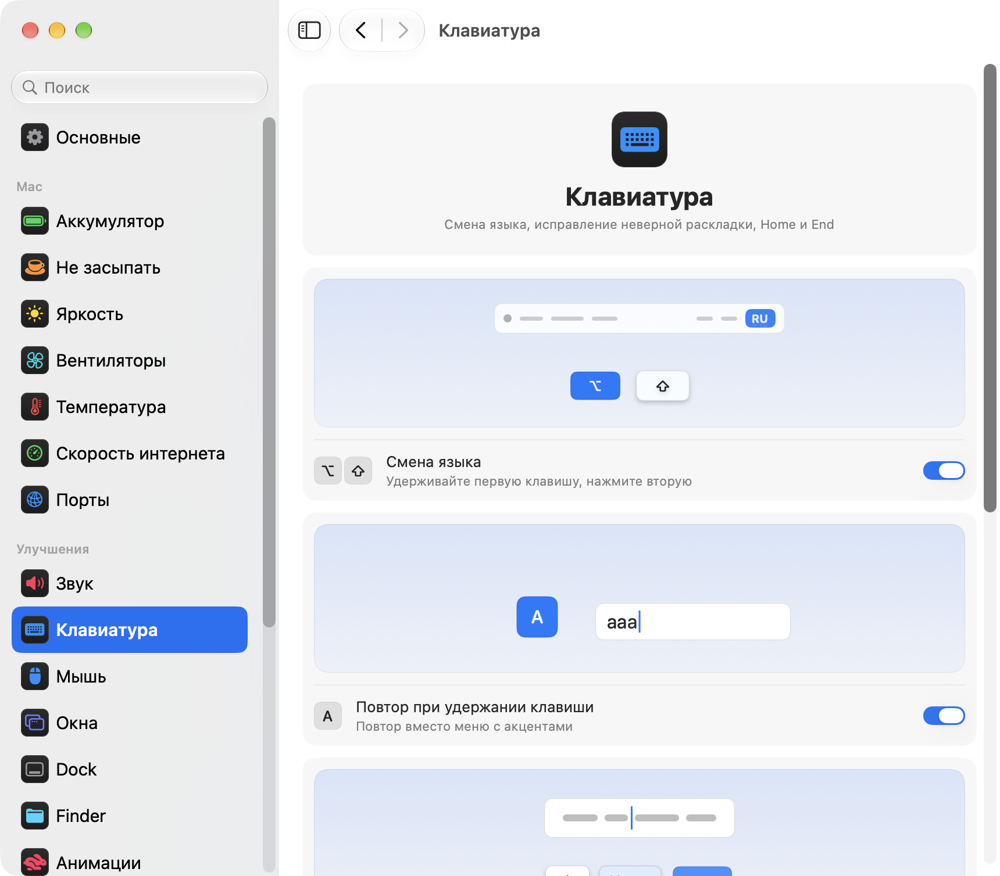

<p align="center"></p>
<h1 align="center">pikapik</h1>
<p align="center">Небольшие улучшения для клавиатуры, мыши, окон и Finder — прямо в строке меню вашего Mac.</p>
<p align="center"><sub><a href="../../README.md">English</a> · <b>Русский</b> · <a href="README.uk.md">Українська</a> · <a href="README.de.md">Deutsch</a> · <a href="README.fr.md">Français</a> · <a href="README.es.md">Español</a> · <a href="README.it.md">Italiano</a> · <a href="README.pt-BR.md">Português (Brasil)</a> · <a href="README.ja.md">日本語</a> · <a href="README.zh-Hans.md">简体中文</a> · <a href="README.ko.md">한국어</a> · <a href="README.ro.md">Română</a> · <a href="README.pl.md">Polski</a> · <a href="README.tr.md">Türkçe</a> · <a href="README.nl.md">Nederlands</a> · <a href="README.sv.md">Svenska</a> · <a href="README.cs.md">Čeština</a> · <a href="README.zh-Hant.md">繁體中文</a> · <a href="README.ar.md">العربية</a> · <a href="README.hi.md">हिन्दी</a> · <a href="README.id.md">Bahasa Indonesia</a> · <a href="README.vi.md">Tiếng Việt</a> · <a href="README.th.md">ไทย</a></sub></p>

<p align="center">
<picture>
<source media="(prefers-color-scheme: dark)" srcset="../media/settings-ru-dark.png">

</picture>
</p>

## Установка

Откройте Терминал, вставьте эту строку и нажмите Return:

```bash
/bin/bash -c "$(curl -fsSL https://raw.githubusercontent.com/dev-pikapik/pika-tools/main/install.sh)"
```

Команда скачивает последнюю версию с GitHub и устанавливает её, только если она подписана разработчиком и прошла проверку Apple на вредоносные программы. pikapik появится в строке меню вверху экрана. Всё выключено, пока вы сами не включите.

<details>
<summary>Другие способы: Homebrew или dmg</summary>

С Homebrew:

```bash
brew install --cask dev-pikapik/pika-tools/pikapik && open -a pikapik
```

Или скачайте [pikapik.dmg](https://github.com/dev-pikapik/pika-tools/releases/latest/download/pikapik.dmg), откройте его и перетащите приложение в папку «Программы».

Команда выше и Homebrew сами кладут приложение в `/Applications`, запускают его, запрашивают разрешения и включают открытие при входе. Дальше приложение обновляется само, см. **Обновления**. Как удалить — в разделе **Удаление**.

</details>

## Что умеет

<table>
<tbody><tr>
<td width="50%" valign="top">
<picture><source media="(prefers-color-scheme: dark)" srcset="../media/keep-awake-dark.png"></picture>
<br><b>Не засыпать</b>
<br>Mac не уснёт, сколько нужно, даже с закрытой крышкой.
</td>
<td width="50%" valign="top">
<picture><source media="(prefers-color-scheme: dark)" srcset="../media/fans-dark.png"></picture>
<br><b>Вентиляторы</b>
<br>Смотрите, как быстро крутятся вентиляторы, и выбирайте их скорость.
</td>
</tr></tbody>
<tbody><tr>
<td width="50%" valign="top">
<picture><source media="(prefers-color-scheme: dark)" srcset="../media/battery-dark.png"></picture>
<br><b>Аккумулятор</b>
<br>Смотрите состояние аккумулятора, его ёмкость и количество циклов, сколько энергии в него поступает и как продлить его срок службы.
</td>
<td width="50%" valign="top">
<picture><source media="(prefers-color-scheme: dark)" srcset="../media/command-keys-dark.png"></picture>
<br><b>Защита ⌘Q и ⌘W</b>
<br>Ничего не закроется случайно. Когда нужно, добавьте ⇧.
</td>
</tr></tbody>
<tbody><tr>
<td width="50%" valign="top">
<picture><source media="(prefers-color-scheme: dark)" srcset="../media/compress-dark.png"></picture>
<br><b>Копия поменьше</b>
<br>Правый клик по фото, PDF или видео — и рядом появится лёгкая копия.
</td>
<td width="50%" valign="top">
<picture><source media="(prefers-color-scheme: dark)" srcset="../media/convert-dark.png"></picture>
<br><b>Конвертация</b>
<br>Сохраните картинку, видео или песню в другом формате прямо из меню правого клика.
</td>
</tr></tbody>
<tbody><tr>
<td width="50%" valign="top">
<picture><source media="(prefers-color-scheme: dark)" srcset="../media/input-switch-dark.png"></picture>
<br><b>Смена языка</b>
<br>Держите ⌥ и нажмите ⇧ — язык клавиатуры сменится.
</td>
<td width="50%" valign="top">
<picture><source media="(prefers-color-scheme: dark)" srcset="../media/quit-on-close-dark.png"></picture>
<br><b>Выход с последним окном</b>
<br>Закрыли последнее окно — приложение тоже закрылось.
</td>
</tr></tbody>
<tbody><tr>
<td width="50%" valign="top">
<picture><source media="(prefers-color-scheme: dark)" srcset="../media/window-zoom-dark.png"></picture>
<br><b>Зелёная кнопка увеличивает</b>
<br>Окно растягивается на весь экран без полноэкранного режима.
</td>
<td width="50%" valign="top">
<picture><source media="(prefers-color-scheme: dark)" srcset="../media/dock-hide-dark.png"></picture>
<br><b>Свернуть кликом в Dock</b>
<br>Кликните по значку приложения, в котором вы сейчас, и оно уйдёт с глаз.
</td>
</tr></tbody>
<tbody><tr>
<td width="50%" valign="top">
<picture><source media="(prefers-color-scheme: dark)" srcset="../media/new-file-dark.png"></picture>
<br><b>Новый файл</b>
<br>Правый клик в Finder, имя — и пустой файл готов.
</td>
<td width="50%" valign="top">
<picture><source media="(prefers-color-scheme: dark)" srcset="../media/finder-cut-dark.png"></picture>
<br><b>⌘X переносит файлы</b>
<br>Вырежьте файлы в Finder и вставьте туда, куда нужно.
</td>
</tr></tbody>
<tbody><tr>
<td width="50%" valign="top">
<picture><source media="(prefers-color-scheme: dark)" srcset="../media/finder-open-dark.png"></picture>
<br><b>Return открывает файлы</b>
<br>Выберите файлы в Finder и нажмите Return, чтобы открыть.
</td>
<td width="50%" valign="top">
<picture><source media="(prefers-color-scheme: dark)" srcset="../media/finder-delete-dark.png"></picture>
<br><b>Delete — в Корзину</b>
<br>Нажмите ⌫ в Finder, и выбранные файлы уйдут в Корзину.
</td>
</tr></tbody>
<tbody><tr>
<td width="50%" valign="top">
<picture><source media="(prefers-color-scheme: dark)" srcset="../media/desktop-icons-dark.png"></picture>
<br><b>Скрыть значки на рабочем столе</b>
<br>Одно нажатие — и рабочий стол чист перед звонком или снимком экрана.
</td>
<td width="50%" valign="top">
<picture><source media="(prefers-color-scheme: dark)" srcset="../media/hidden-files-dark.png"></picture>
<br><b>Показать скрытые файлы</b>
<br>Покажите файлы и папки, которые macOS прячет от глаз.
</td>
</tr></tbody>
<tbody><tr>
<td width="50%" valign="top">
<picture><source media="(prefers-color-scheme: dark)" srcset="../media/game-mode-dark.png"></picture>
<br><b>Игровой режим</b>
<br>Пока вы играете, ничто не всплывёт поверх игры и не закроет её.
</td>
<td width="50%" valign="top">
<picture><source media="(prefers-color-scheme: dark)" srcset="../media/speed-test-dark.png"></picture>
<br><b>Скорость интернета</b>
<br>Насколько быстрый у вас интернет и на что его хватит.
</td>
</tr></tbody>
<tbody><tr>
<td width="50%" valign="top">
<picture><source media="(prefers-color-scheme: dark)" srcset="../media/side-buttons-dark.png"></picture>
<br><b>Боковые кнопки мыши</b>
<br>Кнопки 4 и 5 листают назад и вперёд, как свайп.
</td>
<td width="50%" valign="top">
<picture><source media="(prefers-color-scheme: dark)" srcset="../media/hide-app-dark.png"></picture>
<br><b>Скрыть кнопкой мыши</b>
<br>Одно нажатие скрывает активное приложение, как ⌘H. Оно продолжает работать.
</td>
</tr></tbody>
<tbody><tr>
<td width="50%" valign="top">
<picture><source media="(prefers-color-scheme: dark)" srcset="../media/wheel-lines-dark.png"></picture>
<br><b>Прокрутка по строкам</b>
<br>Каждый щелчок колёсика прокручивает одинаково, как быстро ни крутите.
</td>
<td width="50%" valign="top">
<picture><source media="(prefers-color-scheme: dark)" srcset="../media/wheel-direction-dark.png"></picture>
<br><b>Направление прокрутки</b>
<br>Одно направление для трекпада, другое для мыши.
</td>
</tr></tbody>
<tbody><tr>
<td width="50%" valign="top">
<picture><source media="(prefers-color-scheme: dark)" srcset="../media/linear-pointer-dark.png"></picture>
<br><b>Без ускорения курсора</b>
<br>Курсор проходит ровно столько, сколько ваша рука.
</td>
<td width="50%" valign="top">
<picture><source media="(prefers-color-scheme: dark)" srcset="../media/key-repeat-dark.png"></picture>
<br><b>Повтор клавиши</b>
<br>Удерживайте клавишу — буква повторяется, без меню с акцентами.
</td>
</tr></tbody>
<tbody><tr>
<td width="50%" valign="top">
<picture><source media="(prefers-color-scheme: dark)" srcset="../media/home-end-dark.png"></picture>
<br><b>Home и End</b>
<br>Переход в начало или конец строки, пока вы печатаете.
</td>
<td width="50%" valign="top">
<picture><source media="(prefers-color-scheme: dark)" srcset="../media/animations-dark.png"></picture>
<br><b>Анимации</b>
<br>Dock, окна и Быстрый просмотр станут быстрее — вплоть до мгновенных.
</td>
</tr></tbody>
<tbody><tr>
<td width="50%" valign="top">
<picture><source media="(prefers-color-scheme: dark)" srcset="../media/leftover-permissions-dark.png"></picture>
<br><b>Разрешения удалённых приложений</b>
<br>Уберите разрешения, которые macOS хранит для уже удалённых приложений.
</td>
<td width="50%" valign="top">
<picture><source media="(prefers-color-scheme: dark)" srcset="../media/pet-dark.png"></picture>
<br><b>Питомец на рабочем столе</b>
<br>Маленький друг гуляет за окнами внизу экрана. Возьмите его и подбросьте или нажмите пробел — он подпрыгнет. Подбирайте ему наряды в гардеробе и получайте награды, пока играете вместе. Он бодрится, пока вы печатаете, и дремлет, когда вы отходите.
</td>
</tr></tbody>
<tbody><tr>
<td width="50%" valign="top">
<picture><source media="(prefers-color-scheme: dark)" srcset="../media/uninstaller-dark.png"></picture>
<br><b>Удаление программ</b>
<br>Удаление программы и её файлов. Всё можно вернуть.
</td>
<td width="50%" valign="top">
<picture><source media="(prefers-color-scheme: dark)" srcset="../media/game-fps-dark.png"></picture>
<br><b>Показывать FPS</b>
<br>Маленький счётчик в выбранном вами углу показывает, насколько плавно идёт игра.
</td>
</tr></tbody>
<tbody><tr>
<td width="50%" valign="top">
<picture><source media="(prefers-color-scheme: dark)" srcset="../media/archive-dark.png"></picture>
<br><b>Архивы</b>
<br>Распаковка RAR и других архивов и упаковка файлов в ZIP по правому клику.
</td>
<td width="50%" valign="top">
<picture><source media="(prefers-color-scheme: dark)" srcset="../media/dock-display-dark.png"></picture>
<br><b>Dock на одном экране</b>
<br>Dock больше не прыгает на другой экран. Чтобы перенести его, сделайте основным другой экран.
</td>
</tr></tbody>
<tbody><tr>
<td width="50%" valign="top">
<picture><source media="(prefers-color-scheme: dark)" srcset="../media/temperatures-dark.png"></picture>
<br><b>Температура</b>
<br>Смотрите, насколько Mac нагрелся внутри, от процессора до аккумулятора.
</td>
<td width="50%" valign="top">
<picture><source media="(prefers-color-scheme: dark)" srcset="../media/background-dark.png"></picture>
<br><b>Фоновые задачи</b>
<br>Что работает в фоне и откуда оно взялось.
</td>
</tr></tbody>
<tbody><tr>
<td width="50%" valign="top">
<picture><source media="(prefers-color-scheme: dark)" srcset="../media/ports-dark.png"></picture>
<br><b>Порты</b>
<br>Узнайте, какая программа заняла порт, и освободите его.
</td>
<td width="50%" valign="top">
<picture><source media="(prefers-color-scheme: dark)" srcset="../media/app-volume-dark.png"></picture>
<br><b>Громкость приложений</b>
<br>Уменьшайте громкость или выключайте звук любого приложения, не затрагивая остальные.
</td>
</tr></tbody>
<tbody><tr>
<td width="50%" valign="top">
<picture><source media="(prefers-color-scheme: dark)" srcset="../media/brightness-dark.png"></picture>
<br><b>Яркость мониторов</b>
<br>Делайте темнее или ярче монитор, яркостью которого macOS не управляет сама, — ползунком или клавишами яркости.
</td>
<td width="50%" valign="top">
<picture><source media="(prefers-color-scheme: dark)" srcset="../media/layout-fix-dark.png"></picture>
<br><b>Исправление раскладки</b>
<br>Набрали ghbdtn вместо привет? Нажмите пробел, и слово исправится.
</td>
</tr></tbody>
</table>

## Подробности

<details>
<summary>Первый запуск</summary>

pikapik нужны два разрешения. При первом запуске откроются настройки на странице «Разрешения», где всё объясняется по шагам, а macOS покажет свои запросы. Откройте **Системные настройки › Конфиденциальность и безопасность** и включите pikapik в двух списках:

- **Универсальный доступ** — чтобы менять нажатие или клик, пока они не дошли до других приложений.
- **Мониторинг ввода** — чтобы видеть нажатия и клики, не меняя их. Так работает смена языка.

Приложение заметит изменения через пару секунд, перезапускать ничего не надо.

Некоторым функциям нужны дополнительные разрешения: **Управление вентиляторами**, **Расширения Finder**, **iCloud Drive**, **Полный доступ к диску**, **Запись экрана** и **Запись системного звука**. Все они собраны на странице «Разрешения» в настройках. У каждого разрешения есть строка с пояснением, зачем оно нужно, зелёная галочка или оранжевый крестик и одна кнопка: **Разрешить**, если его нет, и **Выключить**, если оно есть. Так любое разрешение можно забрать обратно прямо там.

pikapik не записывает, не хранит и никуда не отправляет то, что вы печатаете и нажимаете. События обрабатываются в памяти и сразу передаются дальше. Чтобы исправлять слова, набранные не в той раскладке, pikapik держит в памяти только несколько последних набранных слов и забывает их, как только вы щёлкнете мышью или перейдёте в другую программу. Сохраняет он только слова, которые вы попросили не исправлять, и только на этом Mac, пока вы не очистите их в «Настройки › Клавиатура». pikapik обращается к интернету только для обновлений (спрашивает у GitHub, какая версия последняя, и скачивает её, только если вы решите обновиться) и для проверки скорости, когда вы её запускаете (используются серверы Apple). Версию из Mac App Store обновляет App Store, а проверка скорости в ней идёт через Cloudflare. Прогресс питомца (шаги, броски, награды и тому подобное) считается только на этом Mac и никуда не отправляется. Стереть его можно в разделе «Настройки › Питомец».

</details>

<details>
<summary>Каждая функция подробно</summary>

**Громкость приложений.** Откройте «Настройки › Звук» и включите **Громкость приложений**. У каждого приложения, которое воспроизводит звук, есть свой ползунок и кнопка отключения звука — и в настройках, и в меню. Сделайте тише слишком громкий видеозвонок, выключите звук шумной игре, а музыку оставьте как есть: громкость вашего Mac и остальных приложений не меняется. pikapik запоминает громкость каждого приложения, а приложение, которое вы оставили на полной громкости, не трогает вообще. Приложение, для которого вы задали громкость, остаётся в списке и после перезапуска, а пока оно закрыто, выглядит приглушённым, поэтому громкость можно задать до запуска приложения: нажмите **Добавить…** или перетащите приложение из Finder. Крестик ✕ рядом с приложением забывает его и возвращает полную громкость. Чтобы менять громкость приложения, pikapik пропускает его звук через себя, поэтому ему нужно разрешение **Запись системного звука**, которое вы даёте на странице «Разрешения». Звук только передаётся дальше: он не записывается, не сохраняется и никуда не отправляется, а микрофон не используется. Нужна macOS 14.2 или новее, а в macOS 14.0 и 14.1 функция скрыта. По умолчанию выключено.

**Яркость мониторов.** macOS меняет яркость встроенного экрана и мониторов Apple, но не большинства других мониторов. Откройте «Настройки › Яркость»: у каждого монитора, яркостью которого macOS не управляет сама, есть свой ползунок, а строку «Яркость» можно добавить и в панель в строке меню. pikapik меняет яркость самого монитора — ту же, что и кнопки на нём. Если монитор не отзывается, включите **Затемнять картинку, а не сам монитор**: картинка станет темнее, но никогда не станет чёрной. Включите **Клавиши яркости**, и клавиши яркости будут менять яркость монитора, на котором стоит указатель, и показывать небольшой индикатор; удерживайте ⌥⇧, чтобы шаг был мельче. Клавишам нужно разрешение **Универсальный доступ**, которое вы даёте на странице «Разрешения», а ползунки работают и без него. pikapik запоминает яркость каждого монитора и снова выставляет её после сна. Версия из Mac App Store только затемняет картинку. Клавиши яркости по умолчанию выключены.

**Защита ⌘Q и ⌘W.** Сами по себе ⌘Q и ⌘W ничего не делают, так что вы не закроете приложение или окно случайно. Чтобы сделать это нарочно, добавьте Shift: ⇧⌘Q завершает приложение, ⇧⌘W закрывает окно. Работает во всех приложениях. У каждой клавиши свой переключатель. По умолчанию выключено.

**Смена языка по Option+Shift.** Держите Option и нажмите Shift — macOS включит следующий источник ввода. Не отпуская Option, нажмите Shift ещё раз, чтобы идти дальше. Держите Shift и нажимайте Option, чтобы вернуться назад. Если в это время нажать другую клавишу, кликнуть или добавить Cmd, Ctrl или Fn, язык не сменится, так что сочетания вроде Option+Shift+стрелка работают как раньше. По умолчанию выключено.

**Повтор при удержании клавиши.** Держите клавишу — буква печатается снова и снова, а не всплывает меню с акцентами. Удобно в играх и при наборе текста. Уже открытые программы подхватят это после перезапуска. Выключите — и macOS снова ведёт себя как обычно. По умолчанию выключено.

**Home и End — к началу и концу строки.** Пока вы печатаете, Home ставит курсор в начало строки, а End — в конец, а не прокручивает страницу. С ⇧ они выделяют текст до этого места, с ⌘ переходят к началу или концу всего текста. Вне текстовых полей, а также в терминалах, виртуальных машинах и программах удалённого доступа клавиши работают как раньше. В версии из Mac App Store они работают так и вне текстовых полей, кроме браузеров, Finder и приложения «Музыка». Можно указать и другие приложения, где они должны работать как обычно. По умолчанию выключено.

**Исправление слов, набранных не в той раскладке.** Если слово вышло абракадаброй, например ghbdtn вместо привет, pikapik перепечатает его в нужной раскладке, как только вы нажмёте Пробел или Return, и переключит раскладку, чтобы следующее слово набралось правильно. Работают все раскладки, которые вы добавили на Mac. Слово меняется, только если такого слова нет ни в одном из ваших языков, а те же клавиши в другой раскладке дают частое слово, поэтому имена, опечатки и редкие слова остаются такими, как вы их набрали, как и поля для паролей, Терминал и программы, которые вы выберете. Нажмите ⌃⇧Пробел, чтобы исправить последнее слово или выделенный текст, и нажмите ещё раз, чтобы попробовать другие раскладки. Сразу после исправления эти же клавиши отменяют его, и это слово pikapik больше не будет исправлять сам. Сочетание клавиш можно поменять в «Настройки › Клавиатура». В версии из Mac App Store выделите текст и нажмите ⌃⇧Пробел или выберите «Исправить раскладку» в меню «Службы». **Исправлять слова при наборе** и сочетание клавиш выключены, пока вы не включите их в «Настройки › Клавиатура». Им нужен «Универсальный доступ» — его запрашивает страница «Разрешения». По умолчанию выключено. Если у вас одна раскладка, заметка на странице позволит сразу добавить раскладку для вашего языка, без перехода в Системные настройки (версия с сайта).

**Выключить ускорение указателя.** Указатель проходит ровно столько, сколько мышь, как бы быстро вы её ни двигали. Ползунок **Скорость перемещения** задаёт, насколько быстро он движется. Работает только с мышью, трекпад остаётся как есть. Выключите функцию или закройте pikapik — и macOS вернёт свои настройки. По умолчанию выключено.

**Прокрутка по строкам.** Каждый щелчок колесика мыши прокручивает одно и то же число строк, как бы быстро вы ни крутили колесо. Выберите от 1 до 10 строк на щелчок, по умолчанию 3. Естественная прокрутка остаётся такой, как вы задали в Системных настройках. Работает только для мышей, трекпад остаётся как есть. По умолчанию выключено. Рядом с ползунком **Расстояние за щелчок** маленькая страница прокручивается на выбранное расстояние, а точка отмечает значение по умолчанию.

Некоторые приложения и игры считают прокрутку в точных пикселях: для них переключите эту же настройку на пиксели и выберите от 1 до 200 пикселей за щелчок, по умолчанию 40. Ползунок ещё показывает, какую долю высоты экрана это составляет.

**Направление прокрутки для трекпада и мыши.** В macOS один переключатель естественной прокрутки сразу для трекпада и мыши. Включите эту функцию и выберите направление для каждого: **Естественное**, когда страница идёт за пальцами, как на iPhone, или **Классическое**, где страница движется в обратную сторону. Выбор для трекпада действует и на прокрутку вбок, и на докат страницы после того, как вы отпустили пальцы. Magic Mouse прокручивает касанием, поэтому идёт по выбору для трекпада. Выберите одно и то же на всех своих Mac, и прокрутка будет одинаковой везде, даже когда вы переводите мышь на другой Mac через Универсальное управление. По умолчанию выключено. При включении оба выбора такие же, как в Системных настройках, так что ничего не меняется, пока вы не выберете другое.

**Боковые кнопки — назад и вперёд.** Кнопки мыши 4 и 5 работают как «назад» и «вперёд» в Finder, Safari и других приложениях Apple и во многих других программах, как смахивание на трекпаде. Приложения, которые сами обрабатывают эти кнопки, получают их без изменений. Если на вашей мыши они перепутаны, включите **Поменять боковые кнопки местами**. По умолчанию выключено.

**Кнопка мыши скрывает текущее приложение.** Включите **Кнопка мыши скрывает текущее приложение** в разделе «Настройки › Мышь» и нажмите кнопку, которой хотите пользоваться, например среднюю или боковую. После этого одно нажатие скрывает активное приложение, совсем как ⌘H: оно продолжает работать, а клик по его значку в Dock возвращает его. Пока вы играете и включён «Игровой режим», кнопка работает в игре как обычно. По умолчанию выключено.

**Выход после закрытия последнего окна.** Закрыли последнее окно приложения — приложение завершается. Finder остаётся открытым, как и приложения, у которых есть окна на других рабочих столах или в Dock. Можно составить список приложений, которые так никогда не завершаются. По умолчанию выключено.

**Свернуть или скрыть кликом в Dock.** Кликните по значку в Dock того приложения, в котором работаете, — все его окна свернутся в Dock. Ещё клик — все вернутся. А можно сделать так, чтобы клик скрывал всё приложение целиком, как ⌘H. По умолчанию выключено.

**Dock на одном экране.** Если экранов несколько, macOS переносит Dock на другой экран, как только указатель упирается в его нижний край. Когда переключатель включён, этого больше не происходит, как бы быстро ни двигался указатель: pikapik выключает перенос собственной настройкой Dock и не трогает указатель. Чтобы перенести Dock намеренно, сделайте основным другой экран: в **Системных настройках › Дисплеи** нажмите на этот экран и выберите **Основной дисплей** в списке **Использовать как**, и Dock переедет вместе с ним. Строка **Основной дисплей** под переключателем делает это сразу, а при выключении переключателя дисплеи возвращаются как были. Dock читает свою настройку только при запуске, поэтому при включении и выключении переключателя он один раз перезапускается. Разрешения не нужны. Переключатель по умолчанию выключен, и в версии из Mac App Store его нет.

**Зелёная кнопка увеличивает окно.** Кликните по зелёной кнопке окна — оно заполнит экран, не переходя в полный экран. Ещё клик — вернётся прежний размер. Если держать ⌥, кнопка работает как обычно. Полный экран остаётся в меню кнопки и на ⌃⌘F. Можно составить список приложений, где зелёная кнопка должна работать как обычно. По умолчанию выключено.

**Новый файл в Finder.** Правый клик в окне Finder или на рабочем столе › **Новый файл**, введите имя — и появится пустой файл. По умолчанию .txt. По умолчанию выключено.

**Enter открывает файлы в Finder.** Выделите файлы в окне Finder или на рабочем столе и нажмите Return или Enter — они откроются. F2 или fn F2 переименовывает выделенный файл. В текстовых полях, например когда вы вводите имя, клавиши работают как обычно. По умолчанию выключено.

**⌘X вырезает файлы в Finder.** Выделите файлы и нажмите ⌘X, откройте нужную папку и нажмите ⌘V — файлы переместятся туда, а не скопируются. ⌘C отменяет вырезание. По умолчанию выключено.

**Delete и ⌫ удаляют файлы в Finder.** Выделите файлы и нажмите ⌫ или ⌦ (fn ⌫ на ноутбуке) — они уйдут в Корзину, как по ⌘⌫. Пока вы переименовываете файл, ищете или печатаете в любом другом поле, клавиши стирают буквы как обычно. По умолчанию выключено.

**Копия поменьше в Finder.** Правый клик по файлу в Finder › **Сделать копию поменьше** — рядом появится облегчённая версия фото, GIF, PDF или видео, часто в разы меньше. Несжатый звук вроде WAV или AIFF станет компактным M4A. Если файл меньше уже не сделать, копия не появится, и pikapik об этом скажет. Оригинал остаётся как был, ничего не уходит с вашего Mac. По умолчанию выключено.

**Конвертация в Finder.** Правый клик по файлу в Finder › **Конвертировать в** — файл сохранится в другом формате: картинка в JPEG, PNG, HEIC, GIF, TIFF или PDF, видео в MP4, MOV или только звук, музыка в M4A, WAV или AIFF. Оригинал остаётся как был, ничего не уходит с вашего Mac. Включается отдельно от копии поменьше. По умолчанию выключено.

**Архивы в Finder.** Правый клик по архиву в Finder › **Распаковать** — файлы появятся рядом с ним. Правый клик по любому другому файлу или папке › **Создать архив…** — получится ZIP, 7Z, TAR.GZ или TAR.XZ. У ZIP и 7Z может быть пароль, а любой архив можно разделить на части, например по 15 МБ для почты или по 4 ГБ для флешки. Пароль вводится дважды, чтобы опечатка не закрыла вам доступ к вашим же файлам. В таком ZIP нет скрытых служебных файлов, имена на любом языке читаются правильно, а файлы больше 4 ГБ не помеха. По умолчанию выключено. У версии из Mac App Store есть ограничения, они описаны ниже.

pikapik открывает и то, что macOS не умеет: RAR, в том числе из нескольких частей, 7Z с паролем, наборы частей вроде .001, .z01, .r00 и .part1.rar, а также ZIPX, CAB, LZH, ARJ, ZST, LZMA, WIM и многое другое. Двойной щелчок открывает их в pikapik. Имена файлов в старых ZIP, например на кириллице, японском или китайском, читаются правильно. Переключатель **Открывать архивы в этом приложении** в «Настройки › Finder» отдаёт pikapik также ZIP и 7Z, а TAR и GZ остаются за встроенной программой для архивов, которая и так хорошо с ними справляется. RAR pikapik умеет только открывать, но не создавать: лицензия RAR разрешает лишь распаковку.

Окно спросит пароль, кнопка **Остановить** прервёт любую работу, а из повреждённого или недокачанного архива pikapik достанет всё, что ещё читается. Если архив раздулся бы до огромного размера, pikapik спросит вас до распаковки, а если на диске закончится место, остановится вовремя. Архивы, которые пытаются записать файлы за пределы своей папки, блокируются. Нажмите пробел на архиве в Finder, чтобы посмотреть, что внутри.
**Архивы в версии из Mac App Store.** Они работают и там, но на инструментах, встроенных в macOS, а не на 7-Zip из комплекта, поэтому есть ограничения: пароль можно задать только для ZIP, не для 7Z; архив нельзя разбить на части, а архивы из нескольких частей (.001, .part1.rar, .z01 и подобные) не открываются; отдельные файлы .xz, .lzma и .zst не открываются (.gz и .bz2 открываются); 7Z и RAR с паролем не открываются; переключателя **Открывать архивы в этом приложении** нет. В первый раз pikapik попросит доступ к вашей домашней папке, как для «Нового файла» и «Копии поменьше», потому что эта версия может записывать только туда, куда вы разрешили. Включите расширение Finder в «Системные настройки › Основные › Объекты входа и расширения»; pikapik покажет, куда нажать.


**Скрыть значки на рабочем столе.** Включите перед звонком, записью экрана или снимком экрана — и файлы с папками исчезнут с рабочего стола. Выключите — и они вернутся на свои места. Ничего никуда не переносится: файлы остаются в папке «Рабочий стол» в Finder. Это та же настройка, что **Показывать объекты › На Рабочем столе** в «Системные настройки › Рабочий стол и Dock», только под рукой, поэтому они всегда совпадают. В версии из Mac App Store эта строка вместо этого закрывает значки вашими обоями на каждом экране, а если обои движутся, — однотонным цветом, и нажатия по-прежнему доходят до рабочего стола. В Настройках кнопка **Открыть** под ней по-прежнему открывает нужную страницу Системных настроек.

**Показать скрытые файлы.** Файлы и папки, которые macOS прячет, например «Библиотека» в вашей домашней папке или файлы, чьи имена начинаются с точки, появятся в Finder и на рабочем столе полупрозрачными. Это то же самое, что нажать ⇧⌘. в Finder, только сразу видно, включено ли. Чтобы применить изменение, Finder ненадолго перезапустится и снова откроет свои окна и вкладки. Если Finder копирует или перемещает файлы, он перезапустится, когда закончит. Оба переключателя — в «Настройки › Finder». Чтобы они были в панели в строке меню, нажмите кнопку с карандашом внизу панели и отметьте их галочками. В версии из Mac App Store вместо переключателя в «Настройки › Finder» есть подсказка про ⇧⌘. в Finder.

**Игровой режим.** Добавьте свои игры — и пока вы играете, Mac не выдёргивает вас из игры. Spotlight, Siri, ⌘Tab, Mission Control и смахивания между рабочими столами не открываются поверх игры, ⌘Q и ⌘W не закрывают её случайно, курсор не уезжает на Dock, строку меню или другой экран, а экран не гаснет. У каждого из этих пунктов свой переключатель на странице «Игры», а ещё pikapik подскажет игры, которые нашёл на вашем Mac. В игре Ctrl-клик остаётся простым кликом, а Ctrl со стрелками не переключает рабочий стол. Minecraft тоже узнаётся: добавьте Minecraft Launcher или CurseForge, и режим будет включаться в самом Minecraft. Чтобы выйти из игры, нажмите ⇧⌘Q, а чтобы закрыть её окно — ⇧⌘W. ⌥⌘Esc работает всегда. Как только вы вышли из игры, всё работает как обычно. По умолчанию выключено.

Включите игровой режим и играйте. В дополнительных настройках находится каталог, который публикует ваш Mac: текущие сочетания и анимированное превью для каждого действия.

Автоматический режим приостанавливает действия, которые открывают окна или уводят фокус. Короткое намеренное сочетание смены языка переключает раскладку без системного окна. Зажатые клавиши движения имеют приоритет, поэтому бег и прыжки не меняют язык случайно.

В разделе Настройки → Игры → «Дополнительные настройки игры» есть группа «Мышь и трекпад». В ней только то, что включено в macOS на вашем Mac, с названиями от Apple и небольшим рисунком у каждого пункта: сочетания на кнопке мыши, смахивание между рабочими столами и полноэкранными приложениями, Mission Control и App Exposé, сведение пальцев для приложений и разведение для рабочего стола, смахивание от правого края для Центра уведомлений и каждый активный угол с его действием. Пока игра на переднем плане, всё это приостановлено, поэтому случайное смахивание или касание угла экрана не выдернет вас из игры. Жесты внутри игры продолжают работать. Любой пункт можно вернуть в обычную работу. В версии с сайта кнопка **Изменить…** у горячего угла сразу выбирает для него другое действие, а **Вернуть на место** возвращает первое; каждое изменение один раз перезапускает Dock.

Откройте Настройки → Игры → Добавить игру и нажмите на запущенную игру. Здесь видны и игры через Java и другие среды, даже без файла .app. Minecraft называется Minecraft, а не java. Найдите процесс игры и перетащите его строку в «Ваши игры» в Настройках → Игры.

**Показывать FPS.** FPS — это кадры в секунду: сколько картинок игра рисует за секунду. Включите **Показывать FPS** на странице «Игры», и пока работает «Игровой режим», в углу любой игры появится маленькая тёмная плашка с этим числом. Угол выбирается нажатием на картинку над переключателем. Прочерк означает, что первые кадры ещё не пришли, а тусклый 0 — что игра перестала рисовать. В macOS 27 большинство игр считает сама macOS, разрешение не нужно. Игру, которую macOS посчитать не может, чаще всего старую, pikapik считает через запись экрана: тогда на странице «Разрешения» появляется строка **Запись экрана**, во время игры pikapik разрешение никогда не просит, а число не бывает выше частоты обновления экрана. В macOS 14–26 и в версии из Mac App Store так считаются все игры, поэтому строка появляется сразу после включения **Показывать FPS**, а кнопка **Разрешить** под переключателем ведёт к ней. Изображение не сохраняется и никуда не отправляется. По умолчанию выключено.

**Гардероб и награды питомца.** Откройте «Настройки › Питомец», чтобы нарядить питомца: больше 30 вещей, от шляп и очков до плащей и крыльев, и готовые образы вроде волшебника, пирата или астронавта. Несколько вещей доступны сразу. Остальные — награды, которые приходят, пока вы играете вместе: поднимите питомца и подбросьте, погоняйте мяч, посмотрите, как он лазает по окнам и болтает, или просто день за днём составляйте ему компанию. Когда вы получите новую награду, питомец сам об этом скажет.

Чтобы знать, когда пора выдать награду, pikapik считает только то, что делаете вы и питомец: шаги, сколько раз вы поднимали и подбрасывали питомца, его прыжки, подъёмы на окна, игры с мячом и разговоры, дни вместе, были ли вы вместе рано утром, после полуночи или в выходные, какие страницы настроек вы открывали и что примеряли. Вне Mac App Store pikapik также отмечает, открывали ли вы нашу страницу на GitHub из настроек. Эти числа, дата каждой награды и наряд питомца остаются на этом Mac. Ничего никуда не отправляется, и в выгруженный файл настроек или синхронизацию через iCloud они не попадают. Всё это можно стереть в любой момент в разделе «Настройки › Питомец», и питомец начнёт с нуля.

**Удаление программ.** Откройте «Настройки › Удаление программ», выберите программу в списке или перетащите её на картинку, и pikapik покажет всё, что она хранит на вашем Mac: саму программу, её сохранённые данные, настройки, временные файлы, фоновых помощников и не только, и у каждого пункта указана причина, по которой он в списке. Файлы, которые явно относятся к программе, отмечены галочкой; файлы, которые лишь возможно с ней связаны, не отмечены, а файлы, которыми пользуются и другие программы, помечены особо. Выберите, что убрать, и нажмите **Переместить в Корзину**. Ничего не удаляется навсегда: всё попадает в Корзину. Если программа открыта, pikapik сначала попросит её закрыться, а если для каких-то файлов нужны права администратора, Mac один раз запросит ваш пароль.

Передумали? Нажмите **Вернуть на место**: всё окажется там, где было, а фоновые помощники снова запустятся. Последние десять удалений ждут в разделе «Недавно удалённые», пока их файлы лежат в Корзине. **Сбросить программу** оставляет саму программу и убирает только её сохранённые данные, настройки и временные файлы; это может помочь, если программа ведёт себя странно. Программы, которые вы сами переместили в Корзину, видны в разделе «В Корзине» вместе с оставленными ими файлами, а «Остатки удалённых программ» находят файлы программ, которых уже нет. Переключатель «Предлагать очистку, когда программа попадает в Корзину» по умолчанию выключен, и ничего не удаляется, пока вы не выберете. Чтобы увидеть всё, что хранит программа, странице нужен **Полный доступ к диску**. В версии из Mac App Store этого инструмента нет.

**Температура.** Откройте «Настройки › Температура», чтобы увидеть, насколько Mac нагрелся внутри. Вверху главное сказано одним словом, от «В норме» до «Очень горячо», а строка под ним объясняет, работает ли Mac на полной скорости или замедляется, чтобы остыть. Ниже у каждой части своя строка с понятным названием вместо кода датчика: процессор, графика, память, диск, Wi-Fi и аккумулятор, если в вашем Mac есть для них датчики. В каждой строке градусы и короткая полоска, зелёная, жёлтая или оранжевая, смотря по тому, что нормально именно для этой части. Цифры обновляются каждые две секунды и только пока вы на них смотрите, так что Mac этого почти не замечает. Пароль и разрешения не нужны. Строку «Температура» можно добавить и в панель в строке меню. В версии из Mac App Store виден общий уровень, а на Mac с аккумулятором ещё и температура аккумулятора.

**Фоновые задачи** показывают всё, что запускается на Mac само: программы при входе, фоновые службы, помощники внутри программ и остатки уже удалённых программ. У каждой задачи видно, какая программа её добавила, работает ли она прямо сейчас и где лежит её файл; один щелчок показывает его в Finder. Свои задачи выключаются одной кнопкой и так же легко возвращаются, ничего не удаляется. Задачами для всех пользователей и для всего Mac управляет macOS, поэтому их кнопка открывает «Объекты входа» в Системных настройках. В версии из Mac App Store страница только показывает задачи: доступ к домашней папке даётся один раз в обычном окне открытия, а кнопки открывают «Объекты входа».

**Порты.** Если программа пишет, что её порт уже занят, откройте «Настройки › Порты». Там видна каждая программа, которая заняла порт на вашем Mac: её значок, номера портов и то, могут ли к ней подключиться другие устройства в вашей сети. Введите номер, чтобы узнать, кто держит этот порт, или убедиться, что он свободен. Нажмите на строку, и появятся подробности: адреса, которые открываются в браузере, файл программы, команда, которой её запустили, её папка и номер процесса. **Освободить** просит программу завершиться, чтобы она успела сохранить работу, а если она не закрывается, предлагает завершить её принудительно. Перед каждым шагом pikapik спрашивает вас. Части macOS и программы других пользователей pikapik никогда не завершает: для служб «Ресивер AirPlay», «Общий доступ к файлам», «Общий экран» и «Удаленный вход» он подскажет, какой переключатель в Системных настройках освобождает порт. Раздела «Порты» нет в версии из Mac App Store: там macOS не позволяет приложению увидеть, какая программа занимает порт.

У каждого инструмента свой переключатель в меню и в настройках.

Значок в строке меню сразу показывает состояние: знак pikapik — инструменты работают, тот же знак, но бледный — всё выключено, предупреждающий треугольник — инструмент включён, но не хватает разрешений.

Панель в строке меню сначала показывает всего несколько строк. Какие именно, выбираете вы сами: нажмите кнопку с карандашом внизу, отметьте галочками нужное и нажмите **Готово**. Скрытые строки продолжают работать и остаются в Настройках. Если панель не помещается на экране, её можно прокручивать.

Приложение говорит на языке системы или на том, который вы выберете в настройках. Доступны все 23 языка из списка в начале этой страницы.

</details>

<details>
<summary>Не засыпать</summary>

Не даёт Mac уснуть, пока вас нет за клавиатурой: на любое время от 1 секунды до 365 суток или пока вы не выключите. Включается в меню, а длительность задаётся в настройках: введите дни, часы, минуты и секунды, нажимайте ↑ и ↓ или выберите готовый вариант от 15 минут до 8 часов. В меню видно, сколько осталось и когда закончится. В строке **Экран** два варианта. **Всегда включён**: экран не гаснет, без заставки и экрана блокировки. **Гаснет как обычно**: экран гаснет по своему таймеру, а Mac работает. Кнопка **Выключить экран сейчас** (она есть и в меню) сразу гасит экран, а Mac продолжает работать: чтобы вернуть экран, подвигайте мышью или нажмите любую клавишу. Если завершить pikapik, режим тоже выключится.

На MacBook можно включить и **Работать с закрытой крышкой**. В macOS нет такого переключателя, поэтому pikapik выполняет `pmset -a disablesleep 1` и просит пароль администратора: менять режим сна Mac может только администратор. Настройка сама возвращается в обычное состояние, когда режим заканчивается, когда вы завершаете приложение или если оно аварийно закроется. Если не ввести пароль, ничего не изменится. Следите, чтобы Mac с закрытой крышкой не перегревался. **Остановить при заряде ниже 20 %** выключает режим раньше, чем сядет аккумулятор.

«Не засыпать», режимы дисплея и закрытой крышки можно вынести на кнопку в Пункте управления, строке меню или виджет на рабочем столе через приложение «Быстрые команды»; ссылки можно скопировать в Настройках › Не засыпать.

</details>

<details>
<summary>Скорость интернета</summary>

Показывает, насколько быстрый интернет прямо сейчас. Нажмите **Проверить скорость** в Настройках › Скорость интернета или **Проверить** в меню, если добавили туда строку кнопкой с карандашом. Примерно через полминуты видно скорость загрузки и отдачи, пинг и отзывчивость: как быстро всё откликается, пока интернет занят. Ниже простыми словами сказано, для чего его хватит: фильмы в 4K, видеозвонки, онлайн-игры и большие файлы. Проверка идёт через встроенную в macOS программу networkQuality и серверы Apple. Последний результат сохраняется до следующей проверки, а ссылка для «Быстрых команд» запускает её из Пункта управления.

</details>

<details>
<summary>Настройки</summary>

Откройте настройки из меню кнопкой **Настройки…** или сочетанием ⌘, — либо просто запустите pikapik ещё раз из Finder, Launchpad или Spotlight. Пока окно открыто, приложение видно в Dock и в ⌘Tab.

- **Основные**: открытие при входе, оформление (как в системе, светлое или тёмное), язык, обновления и резервная копия: экспорт и импорт настроек файлом или синхронизация через iCloud Drive.
- **Аккумулятор**: заряд, время до полной зарядки или остаток времени работы, состояние, максимальная ёмкость, количество циклов перезарядки, сетевой адаптер и мощность в ваттах, а также советы, как беречь аккумулятор. Страница только показывает данные: лимит зарядки остаётся в «**Системные настройки › Аккумулятор**». Она есть только на Mac с аккумулятором.
- **Не засыпать**: длительность, экран и крышка.
- **Яркость**: ползунок для каждого монитора, яркостью которого macOS не управляет сама, клавиши яркости и затемнение картинки вместо самого монитора.
- **Вентиляторы**: скорость каждого вентилятора, режим «Авто» или ручная скорость, когда разрешено «Управление вентиляторами».
- **Температура**: насколько нагрелся Mac, в целом и по частям, например процессор, память и аккумулятор.
- **Скорость интернета**: проверка скорости и для чего её хватит.
- **Порты**: какая программа заняла какой порт, её адреса и подробности, а также кнопка, которая освобождает порт.
- **Звук**: громкость приложений, ползунок и кнопка отключения звука для каждого приложения, которое воспроизводит звук.
- **Клавиатура**: смена языка, повтор клавиш, Home и End, исправление раскладки.
- **Мышь**: ускорение указателя и скорость перемещения, прокрутка по строкам, направление прокрутки, боковые кнопки, кнопка для скрытия текущего приложения.
- **Окна**: увеличение окна зелёной кнопкой (со списком исключений), защита ⌘Q и ⌘W и выход после последнего окна (со списком исключений).
- **Dock**: сворачивание или скрытие кликом в Dock и закрепление Dock на одном экране.
- **Finder**: новый файл, копия поменьше, конвертация и архивы, открытие клавишей Return, вырезание клавишами ⌘X, удаление в Корзину клавишей ⌫, скрытие значков на рабочем столе и показ скрытых файлов.
- **Удаление программ**: убрать программу вместе с файлами, потом вернуть всё на место и очистить остатки уже удалённых программ.
- **Фоновые задачи**: всё, что работает в фоне, какая программа это добавила, и кнопка, чтобы выключить свою задачу и вернуть её.
- **Игры**: список ваших игр и настройки Игрового режима.
- **Питомец**: включение питомца, его разговоры, жизнь в вашем ритме и мяч, гардероб и награды.
- **Разрешения**: все разрешения pikapik, у каждого своё состояние и одна кнопка, чтобы разрешить или выключить его. Инструмент, которому не хватает разрешения, выглядит серым, а нажатие на него открывает эту страницу на нужной строке.
- **О программе**: версия, ссылки на список изменений и на сообщение о проблеме.

У многих настроек есть небольшая картинка, которая показывает, что они делают: например, Mac, который не засыпает, или окно, прячущееся за Dock. Картинка меняется вместе с переключателем и замирает, если в Системных настройках включено «Уменьшить движение».

На каждой странице внизу есть кнопка **Восстановить настройки по умолчанию…**. Сначала она спросит, а затем выключит инструменты на этой странице и вернёт их параметры, как будто pikapik их и не трогал.

**Синхронизировать настройки через iCloud** делает pikapik одинаковым на всех ваших Mac. Настройки лежат в папке pikapik в iCloud Drive, и побеждает самое свежее изменение. По умолчанию выключено, нужен включённый iCloud Drive. Разрешения не синхронизируются: каждый Mac запрашивает их сам.

</details>

<details>
<summary>Обновления</summary>

pikapik проверяет новые версии при запуске и каждые 6 часов. Это можно выключить в «Настройки › Основные». Когда выходит новая версия, в меню появляется кнопка **Обновить до …**: один клик — и приложение скачает обновление, установит его и перезапустится. Проверить вручную можно кнопкой **Проверить** в «Настройки › Основные».

Если вы ставили через Homebrew, можно также выполнить `brew upgrade --cask pikapik`.

Начиная с версии 1.3 разрешения сохраняются после обновлений.

</details>

<details>
<summary>Удаление</summary>

```bash
/bin/bash -c "$(curl -fsSL https://raw.githubusercontent.com/dev-pikapik/pika-tools/main/uninstall.sh)"
```

Если ставили через Homebrew: `brew uninstall --cask --zap pikapik`.

Обе команды завершают приложение, убирают его из объектов входа и удаляют. Скрипт ещё и сбрасывает его разрешения.

</details>

<details>
<summary>Вопросы и ответы</summary>

**Зачем два разрешения?**
macOS делит доступ к клавиатуре и мыши на две части. Универсальный доступ позволяет менять нажатия и клики, и большинству функций нужен только он. Мониторинг ввода позволяет только смотреть, и для смены языка этого достаточно.

**macOS пишет, что приложение от неустановленного разработчика.**
pikapik подписано разработчиком и проходит проверку Apple на вредоносные программы, поэтому это сообщение не должно появляться. Если оно всё же появилось, откройте **Системные настройки › Конфиденциальность и безопасность** и нажмите **Все равно открыть**.

**Работает ли на Mac с Intel?**
Да. Это универсальное приложение для Apple Silicon и Intel, нужна macOS 14 Sonoma или новее.

**Разрешение включено, но ничего не работает.**
В **Системных настройках › Конфиденциальность и безопасность** удалите pikapik из обоих списков кнопкой −, затем добавьте снова. Или сделайте это в pikapik: на странице «Разрешения» нажмите **Выключить** у каждого разрешения, а затем снова **Разрешить**.

</details>

<p align="center">☕ Если pikapik вам нравится, можете <a href="https://buymeacoffee.com/pikapik">угостить меня кофе</a> — всё пойдёт на развитие и поддержку приложения.</p>

<p align="center"><sub><a href="../whats-new/README.ru.md">Что нового</a> · <a href="https://github.com/dev-pikapik/homebrew-pika-tools">Тап Homebrew</a> · <a href="../../CONTRIBUTING.md">Сборка из исходников</a> · <a href="../../LICENSE">Лицензия MIT</a> · © 2026 pikapik</sub></p>
