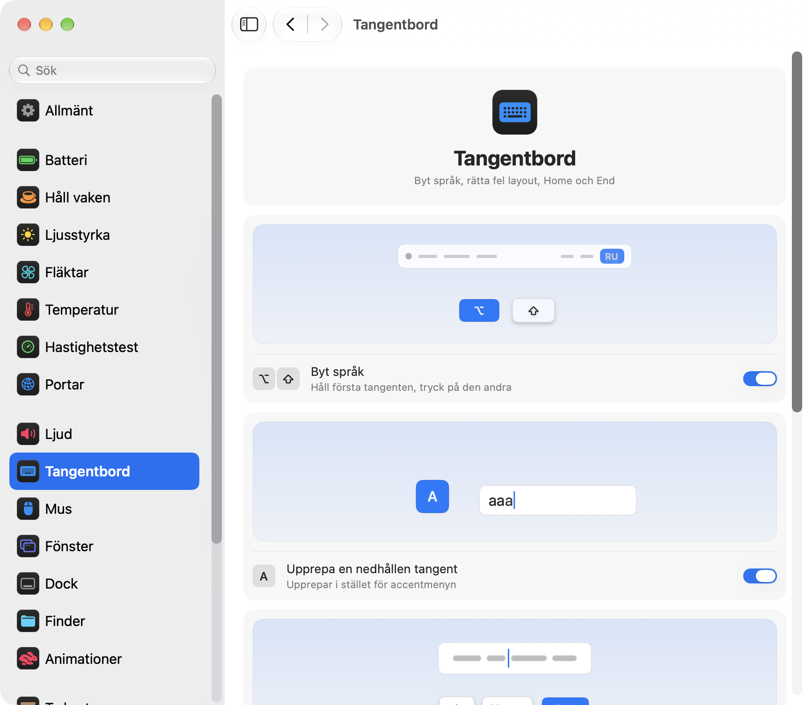

<p align="center"></p>
<h1 align="center">pikapik</h1>
<p align="center"><b>Din Mac förstår vad du menar.</b><br>Små förbättringar för tangentbord, mus, fönster och Finder, direkt i menyraden på din Mac.</p>
<p align="center"><sub><a href="../../README.md">English</a> · <a href="README.ru.md">Русский</a> · <a href="README.uk.md">Українська</a> · <a href="README.de.md">Deutsch</a> · <a href="README.fr.md">Français</a> · <a href="README.es.md">Español</a> · <a href="README.it.md">Italiano</a> · <a href="README.pt-BR.md">Português (Brasil)</a> · <a href="README.ja.md">日本語</a> · <a href="README.zh-Hans.md">简体中文</a> · <a href="README.ko.md">한국어</a> · <a href="README.ro.md">Română</a> · <a href="README.pl.md">Polski</a> · <a href="README.tr.md">Türkçe</a> · <a href="README.nl.md">Nederlands</a> · <b>Svenska</b> · <a href="README.cs.md">Čeština</a> · <a href="README.zh-Hant.md">繁體中文</a> · <a href="README.ar.md">العربية</a> · <a href="README.hi.md">हिन्दी</a> · <a href="README.id.md">Bahasa Indonesia</a> · <a href="README.vi.md">Tiếng Việt</a> · <a href="README.th.md">ไทย</a></sub></p>

<p align="center">
<picture>
<source media="(prefers-color-scheme: dark)" srcset="../media/settings-sv-dark.png">

</picture>
</p>

## Installera

Öppna Terminal, klistra in den här raden och tryck på returtangenten:

```bash
/bin/bash -c "$(curl -fsSL https://raw.githubusercontent.com/dev-pikapik/pika-tools/main/install.sh)"
```

Kommandot hämtar den senaste versionen från GitHub och installerar den bara om den är signerad av utvecklaren och har klarat Apples kontroll av skadlig programvara. pikapik syns i menyraden högst upp på skärmen. Allt är avstängt tills du själv slår på det.

<details>
<summary>Andra sätt: Homebrew eller en dmg-fil</summary>

Med Homebrew:

```bash
brew install --cask dev-pikapik/pika-tools/pikapik && open -a pikapik
```

Eller hämta [pikapik.dmg](https://github.com/dev-pikapik/pika-tools/releases/latest/download/pikapik.dmg), öppna filen och dra appen till mappen Program.

Både kommandot ovan och Homebrew lägger appen i `/Applications`, öppnar den, ber om behörigheterna och slår på ”Öppna vid inloggning”. Därefter uppdaterar appen sig själv, se **Uppdateringar**. Hur du tar bort den står under **Avinstallera**.

</details>

## Vad den gör

<table>
<tbody><tr>
<td width="50%" valign="top">
<picture><source media="(prefers-color-scheme: dark)" srcset="../media/keep-awake-dark.png"></picture>
<br><b>Håll vaken</b>
<br>Din Mac håller sig vaken så länge du vill, även med locket stängt.
</td>
<td width="50%" valign="top">
<picture><source media="(prefers-color-scheme: dark)" srcset="../media/fans-dark.png"></picture>
<br><b>Fläktar</b>
<br>Se hur snabbt fläktarna snurrar och välj deras hastighet.
</td>
</tr></tbody>
<tbody><tr>
<td width="50%" valign="top">
<picture><source media="(prefers-color-scheme: dark)" srcset="../media/battery-dark.png"></picture>
<br><b>Batteri</b>
<br>Se batteriets skick, kapacitet och cykelantal, hur mycket ström som går in och hur du får det att räcka längre.
</td>
<td width="50%" valign="top">
<picture><source media="(prefers-color-scheme: dark)" srcset="../media/command-keys-dark.png"></picture>
<br><b>Skydda ⌘Q och ⌘W</b>
<br>Inget avslutas eller stängs av misstag. Lägg till ⇧ när du menar det.
</td>
</tr></tbody>
<tbody><tr>
<td width="50%" valign="top">
<picture><source media="(prefers-color-scheme: dark)" srcset="../media/compress-dark.png"></picture>
<br><b>Mindre kopia</b>
<br>Högerklicka på ett foto, en PDF eller en video, så får du en lättare kopia.
</td>
<td width="50%" valign="top">
<picture><source media="(prefers-color-scheme: dark)" srcset="../media/convert-dark.png"></picture>
<br><b>Konvertering</b>
<br>Spara en bild, en video eller en låt i ett annat format med ett högerklick.
</td>
</tr></tbody>
<tbody><tr>
<td width="50%" valign="top">
<picture><source media="(prefers-color-scheme: dark)" srcset="../media/input-switch-dark.png"></picture>
<br><b>Byt språk</b>
<br>Håll ned ⌥ och tryck på ⇧ för att byta tangentbordsspråk.
</td>
<td width="50%" valign="top">
<picture><source media="(prefers-color-scheme: dark)" srcset="../media/quit-on-close-dark.png"></picture>
<br><b>Avsluta med sista fönstret</b>
<br>Stäng en apps sista fönster, så avslutas appen också.
</td>
</tr></tbody>
<tbody><tr>
<td width="50%" valign="top">
<picture><source media="(prefers-color-scheme: dark)" srcset="../media/window-zoom-dark.png"></picture>
<br><b>Gröna knappen förstorar</b>
<br>Fönstret fyller skärmen utan att gå till helskärm.
</td>
<td width="50%" valign="top">
<picture><source media="(prefers-color-scheme: dark)" srcset="../media/dock-hide-dark.png"></picture>
<br><b>Minimera med ett klick i Dock</b>
<br>Klicka på appen du använder, så kliver den åt sidan.
</td>
</tr></tbody>
<tbody><tr>
<td width="50%" valign="top">
<picture><source media="(prefers-color-scheme: dark)" srcset="../media/new-file-dark.png"></picture>
<br><b>Ny fil</b>
<br>Högerklicka i Finder, skriv ett namn, så finns en tom fil där.
</td>
<td width="50%" valign="top">
<picture><source media="(prefers-color-scheme: dark)" srcset="../media/finder-cut-dark.png"></picture>
<br><b>⌘X flyttar filer</b>
<br>Klipp ut filer i Finder och klistra in dem där du vill.
</td>
</tr></tbody>
<tbody><tr>
<td width="50%" valign="top">
<picture><source media="(prefers-color-scheme: dark)" srcset="../media/finder-open-dark.png"></picture>
<br><b>Enter öppnar filer</b>
<br>Markera filer i Finder och tryck på Enter för att öppna dem.
</td>
<td width="50%" valign="top">
<picture><source media="(prefers-color-scheme: dark)" srcset="../media/finder-delete-dark.png"></picture>
<br><b>Delete till papperskorgen</b>
<br>Tryck på ⌫ i Finder, så hamnar de markerade filerna i papperskorgen.
</td>
</tr></tbody>
<tbody><tr>
<td width="50%" valign="top">
<picture><source media="(prefers-color-scheme: dark)" srcset="../media/desktop-icons-dark.png"></picture>
<br><b>Göm skrivbordssymboler</b>
<br>Ett klick, och skrivbordet är tomt inför ett samtal eller en skärmbild.
</td>
<td width="50%" valign="top">
<picture><source media="(prefers-color-scheme: dark)" srcset="../media/hidden-files-dark.png"></picture>
<br><b>Visa gömda filer</b>
<br>Se filerna och mapparna som macOS håller undan.
</td>
</tr></tbody>
<tbody><tr>
<td width="50%" valign="top">
<picture><source media="(prefers-color-scheme: dark)" srcset="../media/game-mode-dark.png"></picture>
<br><b>Spelläge</b>
<br>Medan du spelar dyker inget upp över spelet och inget stänger det.
</td>
<td width="50%" valign="top">
<picture><source media="(prefers-color-scheme: dark)" srcset="../media/speed-test-dark.png"></picture>
<br><b>Hastighetstest</b>
<br>Hur snabbt ditt internet är och vad det räcker till.
</td>
</tr></tbody>
<tbody><tr>
<td width="50%" valign="top">
<picture><source media="(prefers-color-scheme: dark)" srcset="../media/side-buttons-dark.png"></picture>
<br><b>Sidoknappar</b>
<br>Knapp 4 och 5 går bakåt och framåt, som ett svep.
</td>
<td width="50%" valign="top">
<picture><source media="(prefers-color-scheme: dark)" srcset="../media/hide-app-dark.png"></picture>
<br><b>Göm med en musknapp</b>
<br>Ett tryck gömmer appen i förgrunden, som ⌘H. Den fortsätter att köras.
</td>
</tr></tbody>
<tbody><tr>
<td width="50%" valign="top">
<picture><source media="(prefers-color-scheme: dark)" srcset="../media/wheel-lines-dark.png"></picture>
<br><b>Rulla per rad</b>
<br>Varje klick på hjulet rullar lika långt, hur snabbt du än snurrar.
</td>
<td width="50%" valign="top">
<picture><source media="(prefers-color-scheme: dark)" srcset="../media/wheel-direction-dark.png"></picture>
<br><b>Rullningsriktning</b>
<br>En riktning för styrplattan, en annan för musen.
</td>
</tr></tbody>
<tbody><tr>
<td width="50%" valign="top">
<picture><source media="(prefers-color-scheme: dark)" srcset="../media/linear-pointer-dark.png"></picture>
<br><b>Ingen pekaracceleration</b>
<br>Pekaren rör sig exakt lika långt som din hand.
</td>
<td width="50%" valign="top">
<picture><source media="(prefers-color-scheme: dark)" srcset="../media/key-repeat-dark.png"></picture>
<br><b>Upprepa en nedhållen tangent</b>
<br>Håll ned en tangent för att skriva den om och om igen, utan accentmeny.
</td>
</tr></tbody>
<tbody><tr>
<td width="50%" valign="top">
<picture><source media="(prefers-color-scheme: dark)" srcset="../media/home-end-dark.png"></picture>
<br><b>Home och End</b>
<br>Hoppa till början eller slutet av raden medan du skriver.
</td>
<td width="50%" valign="top">
<picture><source media="(prefers-color-scheme: dark)" srcset="../media/animations-dark.png"></picture>
<br><b>Animationer</b>
<br>Snabba upp Dock, fönster och Snabbtitt, ända till direkt.
</td>
</tr></tbody>
<tbody><tr>
<td width="50%" valign="top">
<picture><source media="(prefers-color-scheme: dark)" srcset="../media/leftover-permissions-dark.png"></picture>
<br><b>Behörigheter för raderade appar</b>
<br>Ta bort behörigheterna som macOS sparar för appar du redan har raderat.
</td>
<td width="50%" valign="top">
<picture><source media="(prefers-color-scheme: dark)" srcset="../media/pet-dark.png"></picture>
<br><b>Husdjur på skrivbordet</b>
<br>En liten vän promenerar bakom dina fönster. Lyft upp och kasta den, eller tryck på mellanslag så hoppar den. Klä på den med kläder ur dess garderob och samla utmärkelser medan ni leker tillsammans. Den piggnar till när du skriver och slumrar när du går iväg.
</td>
</tr></tbody>
<tbody><tr>
<td width="50%" valign="top">
<picture><source media="(prefers-color-scheme: dark)" srcset="../media/uninstaller-dark.png"></picture>
<br><b>Ta bort appar</b>
<br>Ta bort en app med filer. Allt kan läggas tillbaka.
</td>
<td width="50%" valign="top">
<picture><source media="(prefers-color-scheme: dark)" srcset="../media/game-fps-dark.png"></picture>
<br><b>Visa FPS</b>
<br>En liten räknare visar hur smidigt spelet går, i det hörn du väljer.
</td>
</tr></tbody>
<tbody><tr>
<td width="50%" valign="top">
<picture><source media="(prefers-color-scheme: dark)" srcset="../media/archive-dark.png"></picture>
<br><b>Arkiv</b>
<br>Packa upp RAR och andra arkiv, eller packa ihop filer till en ZIP, med ett högerklick.
</td>
<td width="50%" valign="top">
<picture><source media="(prefers-color-scheme: dark)" srcset="../media/dock-display-dark.png"></picture>
<br><b>Håll Dock på en skärm</b>
<br>Dock hoppar inte längre till en annan skärm. Gör en annan skärm till huvudbildskärm för att flytta den.
</td>
</tr></tbody>
<tbody><tr>
<td width="50%" valign="top">
<picture><source media="(prefers-color-scheme: dark)" srcset="../media/temperatures-dark.png"></picture>
<br><b>Temperatur</b>
<br>Se hur varm din Mac är inuti, från processorn till batteriet.
</td>
<td width="50%" valign="top">
<picture><source media="(prefers-color-scheme: dark)" srcset="../media/background-dark.png"></picture>
<br><b>Bakgrundsuppgifter</b>
<br>Se vad som körs i bakgrunden och var det kommer ifrån.
</td>
</tr></tbody>
<tbody><tr>
<td width="50%" valign="top">
<picture><source media="(prefers-color-scheme: dark)" srcset="../media/ports-dark.png"></picture>
<br><b>Portar</b>
<br>Se vilket program som har tagit en port, och frigör den.
</td>
<td width="50%" valign="top">
<picture><source media="(prefers-color-scheme: dark)" srcset="../media/app-volume-dark.png"></picture>
<br><b>Appvolym</b>
<br>Sänk volymen eller stäng av ljudet för valfri app utan att påverka de andra.
</td>
</tr></tbody>
<tbody><tr>
<td width="50%" valign="top">
<picture><source media="(prefers-color-scheme: dark)" srcset="../media/brightness-dark.png"></picture>
<br><b>Ljusstyrka för bildskärmar</b>
<br>Gör en bildskärm som macOS inte kan justera själv mörkare eller ljusare, med ett reglage eller ljusstyrketangenterna.
</td>
<td width="50%" valign="top">
<picture><source media="(prefers-color-scheme: dark)" srcset="../media/layout-fix-dark.png"></picture>
<br><b>Rätta fel layout</b>
<br>Skrev du ghbdtn i stället för привет? Tryck på mellanslag så blir det rätt.
</td>
</tr></tbody>
<tbody><tr>
<td width="50%" valign="top">
<picture><source media="(prefers-color-scheme: dark)" srcset="../media/middle-click-dark.png"></picture>
<br><b>Mittklick på styrplattan</b>
<br>Tryck med tre fingrar för att öppna en länk i en ny flik, som med mittknappen på en mus.
</td>
</tr></tbody>
</table>

## Mer information

<details>
<summary>Första start</summary>

pikapik behöver två behörigheter. Första gången öppnas inställningarna på sidan Behörigheter, som guidar dig steg för steg, och macOS visar sina egna frågor. Gå till **Systeminställningar › Integritet och säkerhet** och slå på pikapik under:

- **Hjälpmedel**, så att appen kan ändra en tangenttryckning eller ett klick innan det når andra appar.
- **Indataövervakning**, så att appen kan se tangenttryckningar och klick utan att ändra dem. Så fungerar språkbytet.

Appen märker ändringen inom ett par sekunder, ingen omstart behövs.

Vissa funktioner ber om mer när du använder dem: **Administratörsåtkomst**, **Finder-tillägg**, **iCloud Drive**, **Full skivåtkomst**, **Skärminspelning** och **Inspelning av systemljud**. Allt finns på sidan Behörigheter i inställningarna: varje behörighet har en rad om vad den är till för, en grön bock eller ett orange kryss och en enda knapp: **Tillåt** när den saknas, **Stäng av** när den är på. Så du kan ta tillbaka vilken behörighet som helst direkt där.

pikapik spelar inte in, sparar inte och skickar inte något av det du skriver eller klickar på. Händelser hanteras i minnet och skickas vidare direkt. För att kunna rätta ord som skrivits med fel layout håller pikapik bara de senaste orden du har skrivit i minnet och glömmer dem så fort du klickar eller byter app. De enda ord som sparas är de som du har bett pikapik att låta vara, och bara på den här Mac-datorn, tills du rensar dem i Inställningar › Tangentbord. pikapik går bara online för uppdateringar (den frågar GitHub efter den senaste versionen och laddar bara ner den om du väljer att uppdatera) och för hastighetstestet när du startar det (då används Apples servrar). Versionen från Mac App Store uppdateras av App Store, och dess hastighetstest använder Cloudflare. Husdjurets framsteg (steg, kast, utmärkelser och liknande) räknas bara på den här Mac-datorn och skickas aldrig någonstans. Du kan radera dem i Inställningar › Husdjur.

</details>

<details>
<summary>Varje verktyg i detalj</summary>

**Spelare.** Videor som QuickTime inte kan öppna, som MKV, WebM, AVI, WMV och FLV, spelas upp i ett eget fönster. Öppna Inställningar › Spelare och klicka på **Öppna video…**, eller högerklicka på en video och välj **Öppna med › pikapik Player**. Mellanslag spelar upp och pausar, ← och → går en bildruta framåt eller bakåt vid paus och hoppar 5 sekunder vid uppspelning, J och L hoppar 10, ↑ och ↓ ändrar volymen och F går till helskärm. Menyn **Hastighet** går från 0,5× till 2×, **Spara bildruta…** sparar en PNG och spelaren fortsätter där du slutade. En video som redan är öppen kommer fram i stället för att öppnas två gånger. Spelaren har ingen nätverksåtkomst och ber inte om några behörigheter. Varje format på den sidan är en knapp som visar appen som öppnar det nu: ett klick gör pikapik Player till standardapp för formatet, och ett till klick lämnar tillbaka det till appen som öppnade det förut. **Öppna alla i pikapik** gör det för alla format ett i taget och blir **Återställ tidigare appar** (macOS ber om bekräftelse för varje format). Licenserna för FFmpeg och dav1d och deras källkod öppnar du från samma sida. Undertexter stöds inte än. Den finns inte i versionen från Mac App Store.

**Appvolym.** Öppna Inställningar › Ljud och slå på **Appvolym**. Varje app som spelar upp ljud får ett eget reglage och en knapp för att stänga av ljudet, i Inställningar och i menyn. Sänk volymen på ett högljutt videosamtal, stäng av ljudet för ett bullrigt spel och låt musiken vara som den är: volymen på din Mac och på de andra apparna ändras inte. pikapik kommer ihåg nivån för varje app, och en app som du lämnar på full volym rörs aldrig. En app som du har ställt in finns kvar i listan, även efter en omstart, och är dämpad medan den är stängd, så du kan välja nivå innan appen startar: klicka på **Lägg till app…** eller dra in en app från Finder. ✕ bredvid en app glömmer den och återställer full volym. För att ändra en apps volym leder pikapik dess ljud genom sig själv, så det behöver behörigheten **Inspelning av systemljud**, som du tillåter på sidan Behörigheter. Ljudet leds bara vidare: det spelas inte in, sparas inte och skickas ingenstans, och mikrofonen används inte. Kräver macOS 14.2 eller senare och är dold i macOS 14.0 och 14.1. Av som standard.

**Ljusstyrka för bildskärmar.** macOS ändrar ljusstyrkan på den inbyggda skärmen och på Apple-skärmar, men inte på de flesta andra bildskärmar. Öppna Inställningar › Ljusstyrka: varje bildskärm som macOS inte kan justera själv får ett eget reglage, och du kan också lägga till en rad ”Ljusstyrka” i panelen i menyraden. pikapik ändrar bildskärmens egen ljusstyrka, samma inställning som knapparna på bildskärmen. Om en bildskärm inte reagerar slår du på **Dämpa bilden i stället**: bilden blir mörkare, men aldrig svart. Slå på **Ljusstyrketangenter**, så justerar ljusstyrketangenterna bildskärmen där pekaren är och visar en liten indikator; håll ned ⌥⇧ för finare steg. Tangenterna behöver behörigheten **Hjälpmedel**, som du tillåter på sidan Behörigheter, och reglagen fungerar utan den. pikapik kommer ihåg ljusstyrkan för varje bildskärm och ställer in den igen efter vila. Versionen från Mac App Store dämpar bara bilden. Ljusstyrketangenter är av som standard.

**Skydda ⌘Q och ⌘W.** ⌘Q och ⌘W ensamma gör ingenting, så du avslutar inte en app eller stänger ett fönster av misstag. Lägg till skift för att göra det med flit: ⇧⌘Q avslutar, ⇧⌘W stänger. Fungerar i alla appar. Varje tangent har en egen reglage. Av som standard.

**Byt språk med alternativ+skift.** Håll ned alternativ och tryck på skift: macOS går till nästa inmatningskälla. Fortsätt hålla ned alternativ och tryck på skift igen för att gå vidare. Håll ned skift och tryck på alternativ för att gå tillbaka. Om du under tiden trycker på en annan tangent, klickar eller lägger till kommando, kontroll eller Fn byts inget språk, så kortkommandon som alternativ+skift+pil fungerar som förut. Av som standard.

**Upprepa en nedhållen tangent.** Håll ned en tangent så skrivs bokstaven om och om igen i stället för att accentmenyn visas. Smidigt i spel och när du skriver. Appar som redan är öppna använder det efter en omstart. Stänger du av det fungerar macOS som vanligt igen. Av som standard.

**Home och End till början och slutet av raden.** Medan du skriver flyttar Home markören till början av raden och End till slutet, i stället för att rulla sidan. Med ⇧ markerar de fram dit, med ⌘ går de till början eller slutet av hela texten. Utanför textfält, och i terminaler, virtuella maskiner och appar för fjärrskrivbord, fungerar tangenterna som förut. I versionen från Mac App Store fungerar de så även utanför textfält, utom i webbläsare, Finder och Musik. Du kan lägga till fler appar där de ska fungera som vanligt. Av som standard.

**Rätta ord som skrivits med fel layout.** Om ett ord blir rena rappakaljan, som ghbdtn i stället för привет, skriver pikapik om det med rätt layout så fort du trycker på mellanslag eller Return, och byter layout så att nästa ord blir rätt. Det fungerar med alla tangentbordslayouter som du har lagt till på din Mac. Ett ord ändras bara om det inte finns på något av dina språk och samma tangenter i en annan layout ger ett vanligt ord, så namn, skrivfel och ovanliga ord blir kvar som du skrev dem, och detsamma gäller lösenordsfält, Terminal och de appar du väljer. Tryck på ⌃⇧Mellanslag för att rätta det senaste ordet eller markerad text, och tryck igen för att prova dina andra layouter. Direkt efter en rättning ångrar samma tangenter den, och pikapik rättar inte det ordet av sig självt igen. Du kan ändra kortkommandot i Inställningar › Tangentbord. I versionen från Mac App Store markerar du texten och trycker på ⌃⇧Mellanslag eller väljer ”Rätta tangentbordslayout” i menyn ”Tjänster”. **Rätta ord medan du skriver** och kortkommandot är avstängda tills du slår på dem i Inställningar › Tangentbord, och de behöver Hjälpmedel, som sidan Behörigheter ber om. Av som standard. Har du bara en layout kan du lägga till layouten för ditt språk direkt i anteckningen på sidan, utan omväg via Systeminställningar (versionen från webbplatsen).

**Stäng av pekaracceleration.** Pekaren rör sig exakt lika långt som musen, hur snabbt du än rör den. Reglaget **Pekarhastighet** ställer in hur snabbt pekaren rör sig. Fungerar bara med möss, styrplattan förblir som den är. Stäng av funktionen eller avsluta pikapik så får macOS tillbaka sina egna inställningar. Av som standard.

**Rulla per rad.** Varje klick med mushjulet rullar lika många rader, hur snabbt du än snurrar på det. Välj från 1 till 10 rader per klick, 3 som standard. Naturlig rullning är kvar som du ställt in den i Systeminställningar. Fungerar bara för möss, styrplattan förblir som den är. Av som standard. Bredvid skjutreglaget **Avstånd per klick** rullar en liten sida det avstånd du väljer, och en prick markerar standardvärdet.

Vissa appar och spel räknar rullning i exakta pixlar: för dem byter du samma inställning till pixlar och väljer 1 till 200 pixlar per klick, 40 som standard. Reglaget visar också hur stor del av skärmhöjden det motsvarar.

**Rullningsriktning för styrplatta och mus.** macOS har en enda inställning för naturlig rullning, både för styrplattan och musen. Slå på det här och välj en riktning för var och en: **Naturlig**, där sidan följer fingrarna som på iPhone, eller **Klassisk**, där sidan rör sig åt andra hållet. Valet för styrplattan gäller också rullning i sidled och glidet efter att du lyft fingrarna. Magic Mouse rullar med beröring och följer därför valet för styrplattan. Välj samma på alla dina Mac så känns rullningen likadan överallt, även när du flyttar musen till en annan Mac med Universell kontroll. Av som standard. När du slår på det börjar båda som i Systeminställningar, så inget ändras förrän du väljer något annat.

**Sidoknapparna går bakåt och framåt.** Musknapp 4 och 5 går bakåt och framåt i Finder, Safari och andra Apple-appar och i många andra appar, som en svepning på styrplattan. Appar som själva hanterar de här knapparna får dem som de är. Sitter de åt andra hållet på din mus slår du på **Byt plats på sidoknapparna**. Av som standard.

**En musknapp gömmer den aktuella appen.** Slå på **Göm den aktuella appen med en musknapp** i Inställningar › Mus och tryck på knappen du vill använda, till exempel mittknappen eller en sidoknapp. Sedan gömmer ett tryck appen i förgrunden, precis som ⌘H: appen fortsätter att köras, och ett klick på dess symbol i Dock tar tillbaka den. När du spelar med Spelläge på fungerar knappen som vanligt i spelet. Av som standard.

**Mittklick på styrplattan.** Tryck eller klicka med tre fingrar, så fungerar styrplattan som mittknappen på en mus: i de flesta webbläsare öppnar det en länk i en ny flik eller stänger en flik. Du kan välja fyra fingrar i stället. För att trycka behöver du **Tryck för att klicka** i Systeminställningar › Styrplatta. Om ”Slå upp och dataavkännare” där är inställt på tryck med tre fingrar kan tre fingrar bara klicka, och om trefingersdragning är på väljer du fyra fingrar. Raden **Fingrar** i Inställningar visar vad som fungerar på din Mac. Musen förblir som den är. Det kräver behörigheterna **Hjälpmedel** och **Indataövervakning** och finns inte i versionen från Mac App Store. Av som standard.

**Avsluta när det sista fönstret stängs.** Stäng det sista fönstret i en app så avslutas appen. Finder förblir öppen, liksom appar med fönster på andra skrivbord eller i Dock. Du kan lista appar som aldrig ska avslutas på det här sättet. Av som standard.

**Minimera eller göm med ett klick i Dock.** Klicka på Dock-symbolen för appen du använder så hamnar alla dess fönster i Dock. Klicka igen för att ta fram dem alla. Du kan också låta klicket gömma hela appen, som ⌘H. Av som standard.

**Håll Dock på en skärm.** Med flera skärmar flyttar macOS Dock till en annan skärm så fort pekaren trycker mot dess nederkant. När reglaget är på händer det inte längre, hur snabbt du än rör pekaren: pikapik stänger av flytten med Docks egen inställning och påverkar aldrig pekaren. Vill du flytta Dock med flit, gör en annan skärm till huvudbildskärm: klicka på den skärmen i **Systeminställningar › Bildskärmar** och välj **Huvudbildskärm** vid **Använd som**, så följer Dock med. Raden **Huvudbildskärm** under reglaget gör det direkt, och när du slår av reglaget återgår skärmarna som de var. Dock läser sin inställning bara när den startar, så när du slår på eller av reglaget startas Dock om en gång. Ingen behörighet behövs. Reglaget är av som standard och finns inte i versionen från Mac App Store.

**Gröna knappen förstorar fönstret.** Klicka på fönstrets gröna knapp så fyller det skärmen, utan att gå till helskärm. Klicka igen för att få tillbaka den förra storleken. Håll ned ⌥ så fungerar knappen som vanligt. Helskärm finns kvar i knappens meny och på ⌃⌘F. Du kan göra en lista över appar där gröna knappen ska fungera som vanligt. Av som standard.

**Ny fil i Finder.** Högerklicka i ett Finder-fönster eller på skrivbordet, välj **Ny fil**, skriv ett namn och en tom fil dyker upp. .txt som standard. Av som standard.

**Enter öppnar filer i Finder.** Markera filer i ett Finder-fönster eller på skrivbordet och tryck på Return eller Enter, så öppnas de. F2 eller fn F2 byter namn på den markerade filen. I textfält, till exempel när du skriver ett namn, fungerar tangenterna som vanligt. Av som standard.

**⌘X klipper ut filer i Finder.** Markera filer och tryck på ⌘X, öppna mappen du vill ha dem i och tryck på ⌘V, så flyttas filerna dit i stället för att kopieras. ⌘C avbryter utklippningen. Av som standard.

**Delete raderar filer i Finder.** Markera filer och tryck på ⌫ eller ⌦ (fn ⌫ på en bärbar dator), så hamnar de i papperskorgen, precis som med ⌘⌫. Medan du byter namn på en fil, söker eller skriver i något annat fält raderar tangenterna bokstäver som vanligt. Av som standard.

**Mindre kopia i Finder.** Högerklicka på en fil i Finder och välj **Skapa mindre kopia**. Bredvid hamnar en lättare version av ett foto, en GIF, en PDF eller en video, ofta flera gånger mindre. Okomprimerat ljud som WAV eller AIFF blir en kompakt M4A. Om filen inte kan bli mindre skapas ingen kopia, och pikapik säger till. Originalet förblir som det är och inget lämnar din Mac. Av som standard.

**Konvertering i Finder.** Högerklicka på en fil i Finder och välj **Konvertera till** för att spara den i ett annat format: en bild som JPEG, PNG, HEIC, GIF, TIFF eller PDF, en video som MP4, MOV eller bara ljudet, musik som M4A, WAV eller AIFF. Originalet förblir som det är och inget lämnar din Mac. Slås på separat från mindre kopia. Av som standard.

**Arkiv i Finder.** Högerklicka på ett arkiv i Finder och välj **Packa upp**, så dyker filerna upp bredvid det. Högerklicka på en annan fil eller mapp och välj **Skapa arkiv…** för att göra en ZIP, 7Z, TAR.GZ eller TAR.XZ. ZIP och 7Z kan ha lösenord, och varje arkiv kan delas upp i delar, till exempel på 15 MB för e-post eller på 4 GB för ett USB-minne. Lösenordet skriver du två gånger, så att ett stavfel inte låser ute dig från dina egna filer. En ZIP som görs så har inga dolda filer som systemet lägger till, behåller namn på alla språk läsbara och klarar filer över 4 GB. Av som standard. Versionen från Mac App Store har vissa begränsningar, beskrivna nedan.

pikapik öppnar också sådant som macOS inte kan: RAR, även uppdelat i delar, 7Z med lösenord, delade uppsättningar som .001, .z01, .r00 och .part1.rar, samt ZIPX, CAB, LZH, ARJ, ZST, LZMA, WIM och fler. Dubbelklicka så öppnas de i pikapik. Filnamn i gamla ZIP-filer, till exempel på kyrilliska, japanska eller kinesiska, blir läsbara. Med reglaget **Öppna arkiv med den här appen** i Inställningar › Finder tar pikapik också över ZIP och 7Z, medan TAR och GZ stannar hos den inbyggda arkivappen, som redan hanterar dem bra. pikapik kan packa upp RAR men inte skapa det: RAR-licensen tillåter bara uppackning.

Ett fönster frågar efter lösenordet, **Stoppa** avbryter vilket jobb som helst, och ur ett skadat eller ofullständigt arkiv plockar pikapik ut det som fortfarande går att läsa. Det frågar innan ett arkiv packas upp som skulle svälla till en enorm storlek, stoppar i tid om disken skulle bli full och blockerar arkiv som försöker skriva utanför sin egen mapp. Markera ett arkiv i Finder och tryck på mellanslag för att se vad som finns i det.
**Arkiv i versionen från Mac App Store.** De fungerar även där, men med verktygen som är inbyggda i macOS i stället för det medföljande 7-Zip, så det finns begränsningar: bara ZIP kan ha lösenord, inte 7Z; ett arkiv kan inte delas upp i delar, och arkiv i flera delar (.001, .part1.rar, .z01 och liknande) kan inte öppnas; enstaka .xz-, .lzma- och .zst-filer kan inte öppnas (.gz och .bz2 kan); 7Z och RAR med lösenord kan inte öppnas; och reglaget **Öppna arkiv med den här appen** finns inte. Första gången ber pikapik om åtkomst till din hemmapp, som för Ny fil och Mindre kopia, eftersom den här versionen bara får skriva där du har tillåtit det. Slå på Finder-tillägget i Systeminställningar › Allmänt › Startobjekt och tillägg; pikapik visar var du ska klicka.


**Göm skrivbordssymboler.** Slå på det före ett samtal, en skärminspelning eller en skärmbild, så försvinner filerna och mapparna från skrivbordet. Slå av det, så kommer de tillbaka till samma platser. Inget flyttas: filerna ligger kvar i mappen Skrivbord i Finder. Det är inställningen **Visa objekt › På skrivbordet** i Systeminställningar › Skrivbord och Dock, fast närmare till hands, så de två stämmer alltid överens. I versionen från Mac App Store täcker den här raden i stället symbolerna med bakgrundsbilden på varje skärm, eller med en enfärgad yta om bakgrundsbilden rör sig, och klick når fortfarande skrivbordet. I Inställningar öppnar knappen **Öppna** under den fortfarande den sidan i Systeminställningar.

**Visa gömda filer.** Filer och mappar som macOS gömmer, som Bibliotek i din hemmapp eller filer vars namn börjar med en punkt, visas nedtonade i Finder och på skrivbordet. Det är samma sak som att trycka på ⇧⌘. i Finder, fast du ser direkt om det är på. För att ändringen ska gälla startar Finder om snabbt och öppnar sina fönster och flikar igen. Om Finder kopierar eller flyttar filer startar den om först när den är klar. Båda finns i Inställningar › Finder. Vill du ha dem i panelen i menyraden klickar du på pennknappen längst ned i panelen och markerar dem. I versionen från Mac App Store visar Inställningar › Finder i stället tangenterna ⇧⌘. för Finder.

**Spelläge.** Lägg till dina spel, så drar din Mac inte ut dig ur spelet medan du spelar. Spotlight, Siri, ⌘Tab, Mission Control och svep mellan skrivbord öppnas inte ovanpå spelet, ⌘Q och ⌘W stänger det inte av misstag, pekaren glider inte till Dock, menyraden eller en annan skärm, och skärmen förblir på. Var och en av dessa har ett eget reglage på sidan Spel, och pikapik föreslår spel som det hittar på din Mac. I ett spel förblir kontroll-klick ett vanligt klick, och kontroll med pilar byter inte skrivbord. Minecraft känns också igen: lägg till Minecraft Launcher eller CurseForge, så slås läget på i själva Minecraft. Tryck på ⇧⌘Q för att lämna ett spel och på ⇧⌘W för att stänga dess fönster. ⌥⌘Esc fungerar alltid. Så fort du lämnar spelet fungerar allt som vanligt. Av som standard.

Slå på Spelläge och spela. Fler spelinställningar innehåller Macens katalog med aktuella tangenter och en animerad förhandsvisning för varje åtgärd.

Automatiskt pausar åtgärder som öppnar fönster eller flyttar fokus. En kort avsiktlig språkgenväg byter källa utan systemfönster. Nedhållna rörelsetangenter går först, så att springa och hoppa inte byter språk av misstag.

Under Inställningar → Spel → Fler spelinställningar finns gruppen ”Mus och styrplatta”. Den visar bara det som är aktiverat i macOS på din Mac, med Apples egna namn och en liten teckning för varje: kortkommandon på en musknapp, svep mellan skrivbord och appar i helskärm, Mission Control och App Exposé, nyp för appar och sprid fingrarna för skrivbordet, svep från högerkanten för Aviseringscenter och varje aktivt hörn med sin åtgärd. Medan ett spel är i förgrunden är de pausade, så ett oavsiktligt svep eller en snabb beröring av ett skärmhörn tar dig inte ut ur spelet. Gester inne i spelet fungerar som vanligt. Var och en kan ställas in så att den fungerar som vanligt. I versionen från webbplatsen väljer du med **Ändra…** vid ett hörn en annan åtgärd direkt där, och **Lägg tillbaka** ger tillbaka den första; varje ändring startar om Dock en gång.

Öppna Inställningar → Spel → Lägg till ett spel och klicka på spelet som körs. Spel via Java och andra miljöer visas också, även utan en .app-fil. Minecraft heter Minecraft i stället för java. Hitta spelets process och dra raden till Dina spel i Inställningar → Spel.

**Visa FPS.** FPS betyder bilder per sekund: hur många bilder spelet ritar varje sekund. Slå på **Visa FPS** på sidan Spel, så visas en liten mörk etikett med det talet i ett hörn av alla spel så länge Spelläge är på. Välj hörn genom att klicka på det i bilden ovanför reglaget. Ett streck betyder att de första bilderna inte har kommit ännu, och en blek 0 att spelet har slutat rita. På macOS 27 räknar macOS själv de flesta spel, utan behörighet. Ett spel som macOS inte kan räkna, oftast ett äldre, räknas via skärminspelning: då dyker raden **Skärminspelning** upp på sidan Behörigheter, pikapik ber aldrig om den under ett spel och siffran kan inte bli högre än skärmens uppdateringsfrekvens. På macOS 14–26 och i versionen från Mac App Store räknas alla spel så, så raden dyker upp så fort du slår på **Visa FPS**, och knappen **Tillåt** under reglaget tar dig dit. Ingen bild sparas eller skickas. Av som standard.

**Husdjurets garderob och utmärkelser.** Öppna Inställningar › Husdjur för att klä på ditt husdjur: över 30 plagg och tillbehör, från hattar och glasögon till kappor och vingar, och färdiga outfits som trollkarl, pirat eller astronaut. Några få är gratis från start. Resten är utmärkelser som kommer medan ni leker tillsammans: lyft upp husdjuret och kasta det, sparka runt bollen, titta på när det klättrar på fönster och pratar, eller håll det helt enkelt sällskap dag efter dag. När du har fått en ny utmärkelse säger husdjuret till.

För att veta när en utmärkelse är på väg räknar pikapik bara det du och ditt husdjur gör: steg, hur ofta du lyfter upp och kastar det, hopp, klättringar, bollspel och pratstunder, dagar tillsammans, om ni var tillsammans tidigt på morgonen, efter midnatt eller på en helg, vilka sidor i Inställningar du har öppnat och vad du har provat. Utanför Mac App Store noterar pikapik också om du har öppnat vår GitHub-sida från Inställningar. Siffrorna, datumet för varje utmärkelse och vad husdjuret har på sig stannar på den här Mac-datorn. Ingenting skickas någonstans, och inget av det hamnar i den exporterade inställningsfilen eller i iCloud-synkroniseringen. Du kan radera allt när som helst i Inställningar › Husdjur, och då börjar husdjuret om från början.

**Ta bort appar.** Öppna Inställningar › Ta bort appar, välj en app i listan eller släpp en på bilden, så visar pikapik allt som appen sparar på din Mac: själva appen, dess sparade data, inställningar, tillfälliga filer, bakgrundshjälpare och mer, var och en med skälet till att den finns med. Filer som tydligt hör till appen är ikryssade, filer som bara kanske hör ihop med den är det inte, och filer som även andra appar använder är markerade. Välj vad som ska bort och klicka på **Flytta till papperskorgen**. Inget raderas för gott: allt hamnar i papperskorgen. Om appen är öppen ber pikapik den först att avsluta sig, och om några filer kräver en administratör frågar din Mac efter ditt lösenord en gång.

Ångrade du dig? Klicka på **Lägg tillbaka** så hamnar allt där det låg och bakgrundshjälparna startar igen. De tio senaste borttagningarna väntar under ”Nyligen borttagna” så länge deras filer ligger kvar i papperskorgen. **Återställ appen** behåller appen och tar bara bort dess sparade data, inställningar och tillfälliga filer, vilket kan hjälpa när en app krånglar. Appar som du själv flyttat till papperskorgen visas under ”I papperskorgen”, tillsammans med filerna de lämnade kvar, och ”Rester av borttagna appar” hittar filer från appar som redan är borta. Reglaget ”Erbjud städning när en app hamnar i papperskorgen” är avstängt från början, och inget tas bort förrän du väljer. För att se allt som en app sparar behöver sidan **Full skivåtkomst**. Det här verktyget finns inte i versionen från Mac App Store.

**Temperatur.** Öppna Inställningar › Temperatur för att se hur varm din Mac är inuti. Överst sammanfattar ett ord allt, från ”Normal” till ”Mycket het”, med en rad som säger om din Mac går för full fart eller går långsammare för att svalna. Under det har varje del en egen rad med ett begripligt namn i stället för en sensorkod: processor, grafik, minne, lagring, Wi-Fi och batteri, beroende på vilka sensorer din Mac har. Varje rad visar graderna och en kort stapel som blir grön, gul eller orange utifrån det normala intervallet för den delen. Siffrorna uppdateras varannan sekund och bara medan du tittar, så de kostar din Mac nästan ingenting. Inget lösenord eller tillstånd behövs. Du kan också lägga till en rad ”Temperatur” i panelen i menyraden. Versionen från Mac App Store visar den övergripande nivån och, på en Mac med batteri, batteriets temperatur.

Sidan **Bakgrundsuppgifter** visar allt som startar av sig självt på din Mac: appar som öppnas vid inloggning, bakgrundstjänster, hjälpare som gömmer sig inuti appar och rester av appar som du redan har tagit bort. Vid varje uppgift ser du vilken app som lade till den, om den körs just nu och var dess fil ligger, och med ett klick visas filen i Finder. Uppgifter som startas av agenter, även de för alla användare, och de gamla startobjekten stänger du av direkt i pikapik med en knapp, utan lösenord, och slår på igen lika enkelt; ingenting raderas. Bakgrundstjänster från den delade mappen Library, Fjärrinloggning och Skärmdelning stänger du av på samma sätt, så snart du har tillåtit administratörsåtkomst på sidan Behörigheter. Hjälpare som en app har lagt till själv och tjänster från andra platser hör till macOS, så deras knapp öppnar Startobjekt i Systeminställningar och en rad under uppgiften förklarar varför. I versionen från Mac App Store visar sidan bara uppgifterna: du ger den åtkomst till din hemmapp en gång i det vanliga Öppna-fönstret, och knapparna öppnar Startobjekt.

**Portar.** När ett program säger att porten redan används öppnar du Inställningar › Portar. Där ser du varje program som har tagit en port på din Mac, med dess symbol, portnumren och om andra enheter i ditt nätverk kan ansluta. Skriv ett nummer för att se vem som håller den porten, eller för att försäkra dig om att den är ledig. Klicka på en rad för att se adresserna som öppnas i en webbläsare, programmets fil, kommandot som startade det, dess mapp och dess processnummer. **Frigör** ber programmet att avsluta, så att det hinner spara sitt arbete, och om det inte stängs kan du tvångsavsluta det. Du får frågan före varje steg. Delar av macOS och program som tillhör andra användare avslutar pikapik aldrig: för AirPlay-mottagare och Fildelning får du i stället veta vilket reglage i Systeminställningar som frigör porten, medan Fjärrinloggning och Skärmdelning stänger du av direkt med knappen Stäng av. Portar finns inte i versionen från Mac App Store: där låter macOS inte en app se vilket program som håller en port.

Varje verktyg har ett eget reglage i menyn och i inställningarna.

Symbolen i menyraden visar läget med en blick: pikapik-märket när verktygen arbetar, samma märke fast blekt när allt är avstängt och en varningstriangel när ett verktyg är på men behörigheter saknas.

Panelen i menyraden visar först bara några få rader. Du väljer själv vilka som visas: klicka på pennknappen längst ned, markera det du vill se och klicka på **Klar**. Dolda rader fortsätter fungera och finns kvar i Inställningar. Om panelen inte ryms på skärmen går den att scrolla.

Appen följer systemets språk eller det språk du väljer i inställningarna. Appen finns på alla 23 språk i listan högst upp på den här sidan.

</details>

<details>
<summary>Håll vaken</summary>

Hindrar din Mac från att gå i vila medan du är borta från tangentbordet: under valfri tid från 1 sekund till 365 dagar, eller tills du stänger av det. Slå på det i menyn och ställ in tiden i inställningarna: skriv dagar, timmar, minuter och sekunder, använd ↑ och ↓ eller klicka på ett färdigt val från 15 minuter till 8 timmar. Menyn visar hur lång tid som är kvar och när det tar slut. För **Skärm** finns två val. **Alltid på**: den släcks inte, ingen skärmsläckare eller låsskärm. **Stängs av som vanligt**: den stängs av enligt sin egen timer medan din Mac fortsätter arbeta. **Stäng av skärmen nu** (finns även i menyn) släcker skärmen direkt och din Mac fortsätter arbeta: flytta musen eller tryck på en tangent för att få tillbaka den. När du avslutar pikapik avslutas även Håll vaken.

På en MacBook kan du också slå på **Arbeta med locket stängt**. macOS har inget reglage för det, så pikapik kör `pmset -a disablesleep 1` och ber om ett administratörslösenord: bara en administratör kan ändra hur datorn går i vila. Inställningen återställs automatiskt när Håll vaken tar slut, när du avslutar appen eller om den kraschar. Om du inte anger lösenordet ändras ingenting. Se till att datorn har god ventilation med locket stängt. **Stoppa när batteriet är under 20 %** avslutar sessionen innan batteriet tar slut.

Keep Awake, skärmläget och läget med stängt lock kan läggas på en knapp i Kontrollcenter, menyraden eller en widget på skrivbordet via appen Genvägar, med länkar du kopierar från Inställningar › Håll vaken.

</details>

<details>
<summary>Hastighetstest</summary>

Visar hur snabbt ditt internet är just nu. Klicka på **Testa hastigheten** under Inställningar › Hastighetstest, eller på **Testa** i menyn när du har lagt till raden med pennknappen. Efter ungefär en halv minut ser du nedladdning, uppladdning, ping och responsivitet: hur snabbt allt svarar medan anslutningen är upptagen. Under det står med enkla ord vad den räcker till: filmer i 4K, videosamtal, onlinespel och stora nedladdningar. Testet använder networkQuality som finns i macOS och Apples servrar. Det senaste resultatet ligger kvar till nästa test, och en länk för Genvägar startar det från Kontrollcenter.

</details>

<details>
<summary>Inställningar</summary>

Öppna inställningarna från menyn med **Inställningar…** eller ⌘, eller starta pikapik igen från Finder, Launchpad eller Spotlight. Medan fönstret är öppet syns appen i Dock och i ⌘Tab.

- **Allmänt**: öppna vid inloggning, utseende (System, Ljust eller Mörkt), språk, uppdateringar och säkerhetskopia: exportera och importera inställningar som en fil, eller synkronisera dem via iCloud Drive.
- **Batteri**: laddning, tid till fulladdat eller återstående tid, skick, maximal kapacitet, cykelantal, strömadapter och effekt i watt samt tips för att batteriet ska räcka längre. Sidan visar bara information: laddningsbegränsningen finns kvar i **Systeminställningar › Batteri**. Visas bara på en Mac med batteri.
- **Håll vaken**: tid, alternativ för skärm och lock.
- **Ljusstyrka**: ett reglage för varje bildskärm som macOS inte kan justera själv, ljusstyrketangenterna och att dämpa bilden i stället.
- **Fläktar**: hastigheten för varje fläkt, Auto eller en egen hastighet när Administratörsåtkomst är tillåten.
- **Temperatur**: hur varm din Mac är, totalt och för varje del, som processorn, minnet och batteriet.
- **Hastighetstest**: mät internet och se vad det räcker till.
- **Portar**: vilket program som har tagit vilken port, dess adresser och detaljer och en knapp som frigör porten.
- **Ljud**: appvolym, ett reglage och en knapp för att stänga av ljudet för varje app som spelar upp ljud.
- **Tangentbord**: byte av språk, tangentupprepning, Home och End, rättning av fel layout.
- **Mus**: pekaracceleration och hastighet, rullning per rad, rullningsriktning, sidoknappar, en knapp som gömmer den aktuella appen, mittklick på styrplattan.
- **Fönster**: förstora med gröna knappen (med en lista över undantag), skydd för ⌘Q och ⌘W, och avsluta vid sista fönstret (med en lista över undantag).
- **Dock**: minimera eller göm med ett klick i Dock och håll Dock på en skärm.
- **Finder**: ny fil, mindre kopia, konvertering och arkiv, öppna med Retur, klipp ut med ⌘X, radera med ⌫, göm skrivbordssymboler och visa gömda filer.
- **Spelare**: öppna en video i ett eget fönster, formaten den spelar upp, ett reglage som gör den till standardspelare för video och licenserna för FFmpeg och dav1d.
- **Ta bort appar**: ta bort en app med dess filer, lägg tillbaka allt senare och städa upp efter borttagna appar.
- **Bakgrundsuppgifter**: allt som körs i bakgrunden, vilken app som lade till det och en knapp för att stänga av dem och slå på dem igen utan att öppna Systeminställningar.
- **Spel**: din lista med spel och alternativen för Spelläge.
- **Husdjur**: slå på eller av husdjuret, låt det prata, följa din rytm och leka med bollen, klä på det och se dina utmärkelser.
- **Behörigheter**: alla behörigheter som pikapik använder, var och en med sin status och en knapp för att tillåta eller stänga av den. Ett verktyg som saknar en behörighet ser halvgrått ut, och ett klick på det öppnar den här sidan vid rätt rad.
- **Om**: version, länkar till ändringsloggen och för att rapportera ett problem.

Många inställningar har en liten bild som visar vad de gör, till exempel en Mac som förblir vaken eller ett fönster som göms bakom Dock. Bilden ändras tillsammans med reglaget och står stilla när ”Reducera rörelser” är aktiverat i Systeminställningar.

Varje sida har knappen **Återställ förval…** längst ned. Den frågar först, stänger sedan av verktygen på sidan och återställer deras alternativ, som om pikapik aldrig hade rört dem.

**Synkronisera inställningar med iCloud** håller pikapik likadant på alla dina Mac-datorer. Inställningarna ligger i mappen pikapik i iCloud Drive, och den senaste ändringen gäller. Av som standard, och iCloud Drive måste vara på. Behörigheter synkroniseras inte: varje Mac frågar efter dem själv.

</details>

<details>
<summary>Uppdateringar</summary>

pikapik söker efter nya versioner vid start och var 6:e timme. Du kan stänga av det under Inställningar › Allmänt. När en ny version finns visas knappen **Uppdatera till …** i menyn: ett klick så hämtar appen uppdateringen, installerar den och startar om. Du kan också söka själv med **Sök nu** under Inställningar › Allmänt.

Med Homebrew kan du också köra `brew upgrade --cask pikapik`.

Sedan version 1.3 finns behörigheterna kvar efter uppdateringar.

</details>

<details>
<summary>Avinstallera</summary>

```bash
/bin/bash -c "$(curl -fsSL https://raw.githubusercontent.com/dev-pikapik/pika-tools/main/uninstall.sh)"
```

Om du installerade med Homebrew: `brew uninstall --cask --zap pikapik`.

Båda avslutar appen, tar bort den från inloggningsobjekten och raderar den. Skriptet återställer även appens behörigheter.

</details>

<details>
<summary>Vanliga frågor</summary>

**Varför behövs två behörigheter?**
macOS delar upp åtkomsten till tangentbord och mus i två delar. Hjälpmedel låter appen ändra en tangenttryckning eller ett klick, och de flesta funktioner behöver bara det. Indataövervakning låter den bara titta, och det räcker för att byta språk.

**macOS säger att appen kommer från en oidentifierad utvecklare.**
pikapik är signerad av utvecklaren och klarar Apples kontroll av skadlig programvara, så det här meddelandet bör inte visas. Om det ändå visas öppnar du **Systeminställningar › Integritet och säkerhet** och klickar på **Öppna ändå**.

**Fungerar den på Mac-datorer med Intel?**
Ja. Det är en universell app för Apple Silicon och Intel, för macOS 14 Sonoma eller senare.

**Behörigheten är på, men ingenting fungerar.**
Ta bort pikapik från båda listorna i **Systeminställningar › Integritet och säkerhet** med knappen − och lägg sedan till den igen. Eller gör det i pikapik: klicka på sidan Behörigheter på **Stäng av** för varje behörighet och sedan på **Tillåt** igen.

</details>

<p align="center">☕ Gillar du pikapik får du gärna <a href="https://buymeacoffee.com/pikapik">bjuda mig på en kaffe</a> – allt går till att utveckla och underhålla appen.</p>

<p align="center"><sub><a href="../whats-new/README.sv.md">Nyheter</a> · <a href="https://github.com/dev-pikapik/homebrew-pika-tools">Homebrew-tap</a> · <a href="../../CONTRIBUTING.md">Bygg själv</a> · <a href="../../LICENSE">MIT-licens</a> · © 2026 pikapik</sub></p>
