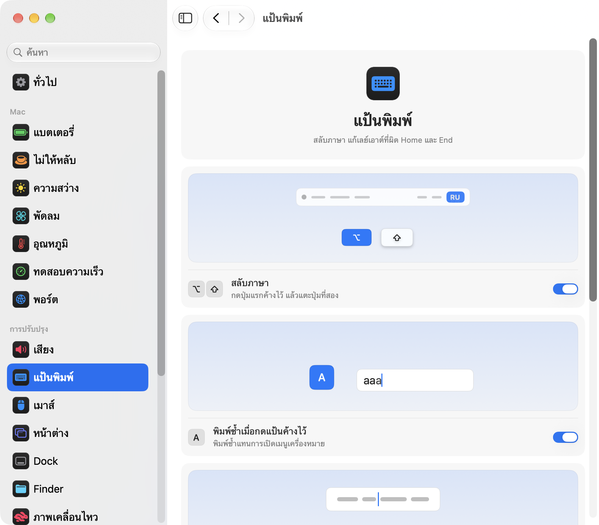

<p align="center"></p>
<h1 align="center">pikapik</h1>
<p align="center"><b>Mac ที่เข้าใจสิ่งที่คุณต้องการ</b><br>ปรับแต่งเล็กๆ สำหรับแป้นพิมพ์ เมาส์ หน้าต่าง และ Finder ใช้ได้ทันทีจากแถบเมนูของ Mac</p>
<p align="center"><sub><a href="../../README.md">English</a> · <a href="README.ru.md">Русский</a> · <a href="README.uk.md">Українська</a> · <a href="README.de.md">Deutsch</a> · <a href="README.fr.md">Français</a> · <a href="README.es.md">Español</a> · <a href="README.it.md">Italiano</a> · <a href="README.pt-BR.md">Português (Brasil)</a> · <a href="README.ja.md">日本語</a> · <a href="README.zh-Hans.md">简体中文</a> · <a href="README.ko.md">한국어</a> · <a href="README.ro.md">Română</a> · <a href="README.pl.md">Polski</a> · <a href="README.tr.md">Türkçe</a> · <a href="README.nl.md">Nederlands</a> · <a href="README.sv.md">Svenska</a> · <a href="README.cs.md">Čeština</a> · <a href="README.zh-Hant.md">繁體中文</a> · <a href="README.ar.md">العربية</a> · <a href="README.hi.md">हिन्दी</a> · <a href="README.id.md">Bahasa Indonesia</a> · <a href="README.vi.md">Tiếng Việt</a> · <b>ไทย</b></sub></p>

<p align="center">
<picture>
<source media="(prefers-color-scheme: dark)" srcset="../media/settings-th-dark.png">

</picture>
</p>

## การติดตั้ง

เปิดเทอร์มินัล วางบรรทัดนี้ แล้วกดปุ่ม Return:

```bash
/bin/bash -c "$(curl -fsSL https://raw.githubusercontent.com/dev-pikapik/pika-tools/main/install.sh)"
```

คำสั่งนี้จะดาวน์โหลดเวอร์ชันล่าสุดจาก GitHub และติดตั้งเฉพาะเมื่อเวอร์ชันนั้นได้รับการเซ็นโดยนักพัฒนาและผ่านการตรวจสอบมัลแวร์ของ Apple แล้วเท่านั้น หลังติดตั้ง pikapik จะอยู่ในแถบเมนูด้านบนของหน้าจอ ทุกอย่างปิดอยู่จนกว่าคุณจะเปิดเอง

<details>
<summary>วิธีอื่น: Homebrew หรือ dmg</summary>

หากใช้ Homebrew:

```bash
brew install --cask dev-pikapik/pika-tools/pikapik && open -a pikapik
```

หรือดาวน์โหลด [pikapik.dmg](https://github.com/dev-pikapik/pika-tools/releases/latest/download/pikapik.dmg) เปิดไฟล์ แล้วลากแอปไปไว้ในโฟลเดอร์แอปพลิเคชัน

ทั้งคำสั่งด้านบนและ Homebrew จะวางแอปไว้ใน `/Applications` เปิดแอป ขอสิทธิ์ และเปิด “เปิดเมื่อเข้าสู่ระบบ” ให้ หลังจากนั้นแอปจะอัปเดตตัวเอง ดู**การอัปเดต** หากต้องการลบ ดู**การถอนการติดตั้ง**

</details>

## ทำอะไรได้บ้าง

<table>
<tbody><tr>
<td width="50%" valign="top">
<picture><source media="(prefers-color-scheme: dark)" srcset="../media/keep-awake-dark.png"></picture>
<br><b>ไม่ให้เข้าสู่โหมดพัก</b>
<br>Mac ตื่นอยู่ได้นานเท่าที่ต้องการ แม้ปิดฝาไว้
</td>
<td width="50%" valign="top">
<picture><source media="(prefers-color-scheme: dark)" srcset="../media/fans-dark.png"></picture>
<br><b>พัดลม</b>
<br>ดูว่าพัดลมหมุนเร็วแค่ไหน และเลือกความเร็วได้
</td>
</tr></tbody>
<tbody><tr>
<td width="50%" valign="top">
<picture><source media="(prefers-color-scheme: dark)" srcset="../media/battery-dark.png"></picture>
<br><b>แบตเตอรี่</b>
<br>ดูสภาพ ความจุ และจำนวนรอบของแบตเตอรี่ ดูว่ามีกำลังไฟเข้ามากเท่าไร และจะทำให้ใช้ได้นานขึ้นได้อย่างไร
</td>
<td width="50%" valign="top">
<picture><source media="(prefers-color-scheme: dark)" srcset="../media/command-keys-dark.png"></picture>
<br><b>ป้องกัน ⌘Q และ ⌘W</b>
<br>ไม่มีอะไรปิดไปโดยไม่ตั้งใจ ถ้าตั้งใจจริงให้กด ⇧ เพิ่ม
</td>
</tr></tbody>
<tbody><tr>
<td width="50%" valign="top">
<picture><source media="(prefers-color-scheme: dark)" srcset="../media/compress-dark.png"></picture>
<br><b>สำเนาที่เล็กลง</b>
<br>คลิกขวาที่รูป PDF หรือวิดีโอ แล้วจะได้สำเนาที่เบากว่าวางอยู่ข้างๆ
</td>
<td width="50%" valign="top">
<picture><source media="(prefers-color-scheme: dark)" srcset="../media/convert-dark.png"></picture>
<br><b>แปลงไฟล์</b>
<br>บันทึกรูป วิดีโอ หรือเพลงเป็นรูปแบบอื่นได้จากเมนูคลิกขวา
</td>
</tr></tbody>
<tbody><tr>
<td width="50%" valign="top">
<picture><source media="(prefers-color-scheme: dark)" srcset="../media/input-switch-dark.png"></picture>
<br><b>สลับภาษา</b>
<br>กด ⌥ ค้างไว้แล้วแตะ ⇧ เพื่อเปลี่ยนภาษาแป้นพิมพ์
</td>
<td width="50%" valign="top">
<picture><source media="(prefers-color-scheme: dark)" srcset="../media/quit-on-close-dark.png"></picture>
<br><b>ปิดแอปพร้อมหน้าต่างสุดท้าย</b>
<br>ปิดหน้าต่างสุดท้ายของแอป แล้วแอปจะปิดตามไปด้วย
</td>
</tr></tbody>
<tbody><tr>
<td width="50%" valign="top">
<picture><source media="(prefers-color-scheme: dark)" srcset="../media/window-zoom-dark.png"></picture>
<br><b>ปุ่มสีเขียวขยายหน้าต่าง</b>
<br>หน้าต่างขยายเต็มจอโดยไม่เข้าโหมดเต็มหน้าจอ
</td>
<td width="50%" valign="top">
<picture><source media="(prefers-color-scheme: dark)" srcset="../media/dock-hide-dark.png"></picture>
<br><b>ย่อด้วยการคลิกใน Dock</b>
<br>คลิกแอปที่กำลังใช้อยู่ แล้วแอปจะหลบไป
</td>
</tr></tbody>
<tbody><tr>
<td width="50%" valign="top">
<picture><source media="(prefers-color-scheme: dark)" srcset="../media/new-file-dark.png"></picture>
<br><b>ไฟล์ใหม่</b>
<br>คลิกขวาใน Finder พิมพ์ชื่อ แล้วไฟล์เปล่าก็พร้อมใช้
</td>
<td width="50%" valign="top">
<picture><source media="(prefers-color-scheme: dark)" srcset="../media/finder-cut-dark.png"></picture>
<br><b>⌘X ย้ายไฟล์</b>
<br>ตัดไฟล์ใน Finder แล้ววางไว้ที่ไหนก็ได้
</td>
</tr></tbody>
<tbody><tr>
<td width="50%" valign="top">
<picture><source media="(prefers-color-scheme: dark)" srcset="../media/finder-open-dark.png"></picture>
<br><b>Enter เปิดไฟล์</b>
<br>เลือกไฟล์ใน Finder แล้วกด Enter เพื่อเปิด
</td>
<td width="50%" valign="top">
<picture><source media="(prefers-color-scheme: dark)" srcset="../media/finder-delete-dark.png"></picture>
<br><b>Delete ลงถังขยะ</b>
<br>กด ⌫ ใน Finder แล้วไฟล์ที่เลือกจะไปอยู่ในถังขยะ
</td>
</tr></tbody>
<tbody><tr>
<td width="50%" valign="top">
<picture><source media="(prefers-color-scheme: dark)" srcset="../media/desktop-icons-dark.png"></picture>
<br><b>ซ่อนไอคอนบนเดสก์ท็อป</b>
<br>คลิกเดียว เดสก์ท็อปก็โล่งพร้อมสำหรับการโทรหรือการจับภาพหน้าจอ
</td>
<td width="50%" valign="top">
<picture><source media="(prefers-color-scheme: dark)" srcset="../media/hidden-files-dark.png"></picture>
<br><b>แสดงไฟล์ที่ซ่อนอยู่</b>
<br>ดูไฟล์และโฟลเดอร์ที่ macOS ซ่อนไว้
</td>
</tr></tbody>
<tbody><tr>
<td width="50%" valign="top">
<picture><source media="(prefers-color-scheme: dark)" srcset="../media/game-mode-dark.png"></picture>
<br><b>โหมดเกม</b>
<br>ระหว่างเล่น จะไม่มีอะไรเด้งขึ้นมาทับเกมหรือปิดเกมไป
</td>
<td width="50%" valign="top">
<picture><source media="(prefers-color-scheme: dark)" srcset="../media/speed-test-dark.png"></picture>
<br><b>ทดสอบความเร็ว</b>
<br>อินเทอร์เน็ตเร็วแค่ไหน และพอสำหรับอะไรบ้าง
</td>
</tr></tbody>
<tbody><tr>
<td width="50%" valign="top">
<picture><source media="(prefers-color-scheme: dark)" srcset="../media/side-buttons-dark.png"></picture>
<br><b>ปุ่มด้านข้างเมาส์</b>
<br>ปุ่ม 4 และ 5 ใช้ย้อนกลับและไปข้างหน้า เหมือนปัดบนแทร็คแพด
</td>
<td width="50%" valign="top">
<picture><source media="(prefers-color-scheme: dark)" srcset="../media/hide-app-dark.png"></picture>
<br><b>ซ่อนด้วยปุ่มเมาส์</b>
<br>กดครั้งเดียวก็ซ่อนแอปที่อยู่ด้านหน้า เหมือนกด ⌘H แอปยังทำงานต่อไป
</td>
</tr></tbody>
<tbody><tr>
<td width="50%" valign="top">
<picture><source media="(prefers-color-scheme: dark)" srcset="../media/wheel-lines-dark.png"></picture>
<br><b>เลื่อนทีละบรรทัด</b>
<br>หมุนล้อเร็วแค่ไหน แต่ละคลิกก็เลื่อนเท่ากัน
</td>
<td width="50%" valign="top">
<picture><source media="(prefers-color-scheme: dark)" srcset="../media/wheel-direction-dark.png"></picture>
<br><b>ทิศทางการเลื่อน</b>
<br>ทิศหนึ่งสำหรับแทร็คแพด อีกทิศสำหรับเมาส์
</td>
</tr></tbody>
<tbody><tr>
<td width="50%" valign="top">
<picture><source media="(prefers-color-scheme: dark)" srcset="../media/linear-pointer-dark.png"></picture>
<br><b>ปิดความเร่งตัวชี้</b>
<br>ตัวชี้เคลื่อนที่เท่ากับที่มือขยับพอดี
</td>
<td width="50%" valign="top">
<picture><source media="(prefers-color-scheme: dark)" srcset="../media/key-repeat-dark.png"></picture>
<br><b>พิมพ์ซ้ำเมื่อกดแป้นค้างไว้</b>
<br>กดแป้นค้างไว้เพื่อพิมพ์ซ้ำ โดยไม่มีเมนูอักษรพิเศษ
</td>
</tr></tbody>
<tbody><tr>
<td width="50%" valign="top">
<picture><source media="(prefers-color-scheme: dark)" srcset="../media/home-end-dark.png"></picture>
<br><b>Home และ End</b>
<br>กระโดดไปต้นหรือท้ายบรรทัดขณะพิมพ์
</td>
<td width="50%" valign="top">
<picture><source media="(prefers-color-scheme: dark)" srcset="../media/animations-dark.png"></picture>
<br><b>ภาพเคลื่อนไหว</b>
<br>เร่ง Dock หน้าต่าง และดูด่วนให้เร็วขึ้น จนถึงทันที
</td>
</tr></tbody>
<tbody><tr>
<td width="50%" valign="top">
<picture><source media="(prefers-color-scheme: dark)" srcset="../media/leftover-permissions-dark.png"></picture>
<br><b>สิทธิ์ของแอปที่ลบไปแล้ว</b>
<br>ล้างสิทธิ์ที่ macOS ยังเก็บไว้ให้แอปที่คุณลบไปแล้ว
</td>
<td width="50%" valign="top">
<picture><source media="(prefers-color-scheme: dark)" srcset="../media/pet-dark.png"></picture>
<br><b>เพื่อนตัวน้อยบนเดสก์ท็อป</b>
<br>เพื่อนตัวน้อยเดินเล่นอยู่หลังหน้าต่างของคุณ จับขึ้นมาแล้วโยน หรือกดเว้นวรรคให้มันกระโดด เลือกชุดให้มันจากตู้เสื้อผ้าของมัน แล้วรับรางวัลระหว่างที่เล่นด้วยกัน มันกระฉับกระเฉงขณะคุณพิมพ์ และงีบหลับเมื่อคุณลุกไป
</td>
</tr></tbody>
<tbody><tr>
<td width="50%" valign="top">
<picture><source media="(prefers-color-scheme: dark)" srcset="../media/uninstaller-dark.png"></picture>
<br><b>ลบแอป</b>
<br>ลบแอปและไฟล์ของแอป เอากลับคืนได้ทั้งหมด
</td>
<td width="50%" valign="top">
<picture><source media="(prefers-color-scheme: dark)" srcset="../media/game-fps-dark.png"></picture>
<br><b>แสดง FPS</b>
<br>ตัวนับเล็ก ๆ ในมุมที่คุณเลือกจะบอกว่าเกมลื่นไหลแค่ไหน
</td>
</tr></tbody>
<tbody><tr>
<td width="50%" valign="top">
<picture><source media="(prefers-color-scheme: dark)" srcset="../media/archive-dark.png"></picture>
<br><b>ไฟล์บีบอัด</b>
<br>แตก RAR และไฟล์บีบอัดอื่น หรือรวมไฟล์เป็น ZIP ได้ด้วยการคลิกขวา
</td>
<td width="50%" valign="top">
<picture><source media="(prefers-color-scheme: dark)" srcset="../media/dock-display-dark.png"></picture>
<br><b>ให้ Dock อยู่บนจอเดียว</b>
<br>Dock จะไม่กระโดดไปจออื่นอีก หากต้องการย้าย ให้ตั้งจออื่นเป็นจอภาพหลัก
</td>
</tr></tbody>
<tbody><tr>
<td width="50%" valign="top">
<picture><source media="(prefers-color-scheme: dark)" srcset="../media/temperatures-dark.png"></picture>
<br><b>อุณหภูมิ</b>
<br>ดูว่าภายใน Mac ของคุณร้อนแค่ไหน ตั้งแต่โปรเซสเซอร์ไปจนถึงแบตเตอรี่
</td>
<td width="50%" valign="top">
<picture><source media="(prefers-color-scheme: dark)" srcset="../media/background-dark.png"></picture>
<br><b>งานเบื้องหลัง</b>
<br>ดูว่ามีอะไรทำงานอยู่เบื้องหลัง และมาจากไหน
</td>
</tr></tbody>
<tbody><tr>
<td width="50%" valign="top">
<picture><source media="(prefers-color-scheme: dark)" srcset="../media/ports-dark.png"></picture>
<br><b>พอร์ต</b>
<br>ดูว่าโปรแกรมไหนใช้พอร์ตอยู่ แล้วทำให้พอร์ตว่าง
</td>
<td width="50%" valign="top">
<picture><source media="(prefers-color-scheme: dark)" srcset="../media/app-volume-dark.png"></picture>
<br><b>ระดับเสียงแอป</b>
<br>ลดเสียงหรือปิดเสียงแอปใดก็ได้ โดยไม่กระทบแอปอื่น
</td>
</tr></tbody>
<tbody><tr>
<td width="50%" valign="top">
<picture><source media="(prefers-color-scheme: dark)" srcset="../media/brightness-dark.png"></picture>
<br><b>ความสว่างจอภาพ</b>
<br>หรี่หรือเพิ่มความสว่างจอภาพที่ macOS ปรับเองไม่ได้ ด้วยแถบเลื่อนหรือปุ่มความสว่าง
</td>
<td width="50%" valign="top">
<picture><source media="(prefers-color-scheme: dark)" srcset="../media/layout-fix-dark.png"></picture>
<br><b>แก้รูปแบบแป้นพิมพ์ที่ผิด</b>
<br>พิมพ์ได้ ghbdtn แทนที่จะเป็น привет ใช่ไหม กดเว้นวรรคแล้วคำจะถูกแก้ให้ทันที
</td>
</tr></tbody>
<tbody><tr>
<td width="50%" valign="top">
<picture><source media="(prefers-color-scheme: dark)" srcset="../media/middle-click-dark.png"></picture>
<br><b>คลิกกลางบนแทร็คแพด</b>
<br>แตะด้วยสามนิ้วเพื่อเปิดลิงก์ในแท็บใหม่ เหมือนปุ่มกลางของเมาส์
</td>
</tr></tbody>
</table>

## รายละเอียดเพิ่มเติม

<details>
<summary>การเปิดครั้งแรก</summary>

pikapik ต้องใช้สิทธิ์สองอย่าง เมื่อเปิดครั้งแรก แอปจะเปิดการตั้งค่าที่หน้าสิทธิ์ซึ่งจะแนะนำคุณทีละขั้นตอน และ macOS จะแสดงคำขอของตัวเอง ไปที่ **การตั้งค่าระบบ › ความเป็นส่วนตัวและความปลอดภัย** แล้วเปิด pikapik ใน:

- **การช่วยการเข้าถึง** เพื่อให้แอปเปลี่ยนการกดปุ่มหรือการคลิกได้ก่อนที่จะไปถึงแอปอื่น
- **การตรวจติดตามอินพุต** เพื่อให้แอปมองเห็นการกดปุ่มและการคลิกได้โดยไม่เปลี่ยนแปลง การสลับภาษาทำงานแบบนี้

แอปจะตรวจพบการเปลี่ยนแปลงภายในไม่กี่วินาที ไม่ต้องเริ่มการทำงานใหม่

บางฟีเจอร์ต้องการสิทธิ์เพิ่มเมื่อคุณใช้งาน ได้แก่ **การเข้าถึงของผู้ดูแลระบบ**, **ส่วนขยาย Finder**, **iCloud Drive**, **การเข้าถึงดิสก์เต็มรูปแบบ**, **การบันทึกหน้าจอ** และ **การบันทึกเสียงของระบบ** ทั้งหมดอยู่ที่หน้าการอนุญาตในการตั้งค่า แต่ละสิทธิ์มีหนึ่งบรรทัดบอกว่าใช้ทำอะไร เครื่องหมายถูกสีเขียวหรือกากบาทสีส้ม และปุ่มเดียว คือ **อนุญาต** เมื่อยังขาด และ **ปิด** เมื่อเปิดอยู่ คุณจึงเรียกคืนสิทธิ์ใดก็ได้ตรงนั้นเลย

pikapik ไม่บันทึก ไม่เก็บ และไม่ส่งสิ่งที่คุณพิมพ์หรือคลิกไปที่ใด เหตุการณ์ต่างๆ จะได้รับการจัดการในหน่วยความจำและส่งต่อทันที เพื่อแก้คำที่พิมพ์ผิดรูปแบบแป้นพิมพ์ pikapik จะจำไว้ในหน่วยความจำเพียงไม่กี่คำล่าสุดที่คุณพิมพ์ และลืมคำเหล่านั้นทันทีที่คุณคลิกหรือสลับแอป คำที่ถูกบันทึกไว้มีเพียงคำที่คุณขอให้คงไว้ตามที่พิมพ์ โดยบันทึกไว้บน Mac เครื่องนี้เท่านั้น จนกว่าคุณจะล้างที่ การตั้งค่า › แป้นพิมพ์ pikapik เชื่อมต่ออินเทอร์เน็ตเพียงสองกรณี คือการอัปเดต (ถาม GitHub ว่ารุ่นล่าสุดคือรุ่นใด และดาวน์โหลดเมื่อคุณเลือกอัปเดตเท่านั้น) กับการทดสอบความเร็วเมื่อคุณเริ่มเอง (ใช้เซิร์ฟเวอร์ของ Apple) ส่วนรุ่นบน Mac App Store ให้ App Store เป็นผู้อัปเดต และการทดสอบความเร็วของรุ่นนั้นใช้ Cloudflare ความคืบหน้าของเพื่อนตัวน้อย (จำนวนก้าว การโยน รางวัล และอื่นๆ) ถูกนับบน Mac เครื่องนี้เท่านั้น และไม่ถูกส่งไปที่ใด คุณลบได้ที่ การตั้งค่า › เพื่อนตัวน้อย

</details>

<details>
<summary>รายละเอียดของทุกเครื่องมือ</summary>

**เครื่องเล่น** วิดีโอที่ QuickTime เปิดไม่ได้ เช่น MKV, WebM, AVI, WMV และ FLV จะเล่นในหน้าต่างของตัวเอง เปิดการตั้งค่า › เครื่องเล่น แล้วคลิก **เปิดวิดีโอ…** หรือคลิกขวาที่วิดีโอแล้วเลือก **เปิดด้วย › pikapik Player** กดเว้นวรรคเพื่อเล่นและหยุดชั่วคราว ← และ → ข้ามไป 5 วินาที ↑ และ ↓ ปรับระดับเสียง และ F เปิดเต็มหน้าจอ วิดีโอที่เปิดอยู่แล้วจะถูกนำมาไว้ข้างหน้าแทนที่จะเปิดซ้ำ เครื่องเล่นไม่เชื่อมต่อเครือข่าย ไม่ขอสิทธิ์ใด ๆ และไม่เปลี่ยนแอปที่ใช้เปิดวิดีโอของคุณ สัญญาอนุญาตของ FFmpeg และ dav1d รวมถึงซอร์สโค้ดเปิดได้จากหน้าเดียวกัน ยังไม่รองรับคำบรรยาย ไม่มีในเวอร์ชัน Mac App Store

**ระดับเสียงแอป** เปิดการตั้งค่า › เสียง แล้วเปิด **ระดับเสียงแอป** แอปทุกตัวที่เล่นเสียงจะมีแถบเลื่อนและปุ่มปิดเสียงของตัวเอง ทั้งในการตั้งค่าและในเมนู ลดเสียงวิดีโอคอลที่ดังเกินไป ปิดเสียงเกมที่ส่งเสียงรบกวน และปล่อยเพลงของคุณไว้ตามเดิม โดยระดับเสียงของ Mac และของแอปอื่นจะไม่เปลี่ยน pikapik จำระดับเสียงของแต่ละแอป และแอปที่คุณปล่อยไว้ที่ระดับเสียงสูงสุดจะไม่ถูกแตะต้องเลย แอปที่คุณตั้งค่าไว้จะอยู่ในรายการต่อไปแม้หลังรีสตาร์ต และจะจางลงขณะที่ปิดอยู่ จึงตั้งระดับเสียงได้ก่อนแอปเริ่มทำงาน: คลิก **เพิ่มแอป…** หรือลากแอปมาจาก Finder เครื่องหมาย ✕ ข้างแอปจะให้ pikapik ลืมแอปนั้นและคืนเป็นระดับเสียงสูงสุด ในการเปลี่ยนระดับเสียงของแอป pikapik จะส่งเสียงของแอปนั้นผ่านตัวเอง จึงต้องมีสิทธิ์ **การบันทึกเสียงของระบบ** ซึ่งคุณอนุญาตได้ที่หน้าการอนุญาต เสียงเพียงถูกส่งต่อ ไม่มีการบันทึก เก็บ หรือส่งไปที่ไหน และไม่ใช้ไมโครโฟน ต้องใช้ macOS 14.2 ขึ้นไป และจะถูกซ่อนบน macOS 14.0 และ 14.1 ปิดอยู่ตามค่าเริ่มต้น

**ความสว่างจอภาพ** macOS ปรับความสว่างของหน้าจอในตัวและจอภาพของ Apple ได้ แต่ปรับจอภาพอื่นส่วนใหญ่ไม่ได้ เปิดการตั้งค่า › ความสว่าง แล้วจอภาพแต่ละจอที่ macOS ปรับเองไม่ได้จะมีแถบเลื่อนของตัวเอง และคุณยังเพิ่มแถว “ความสว่าง” ลงในแผงบนแถบเมนูได้ด้วย pikapik เปลี่ยนความสว่างของตัวจอภาพเอง เหมือนกับที่ปุ่มบนจอภาพทำ หากจอภาพไม่ตอบสนอง ให้เปิด **หรี่ภาพแทน** ภาพจะมืดลงแต่จะไม่ดำสนิท เปิด **ปุ่มความสว่าง** แล้วปุ่มความสว่างจะปรับจอภาพที่ตัวชี้อยู่ และแสดงแถบบอกระดับเล็กๆ บนหน้าจอ กด ⌥⇧ ค้างไว้เพื่อปรับทีละน้อย ปุ่มเหล่านี้ต้องมีสิทธิ์ **การช่วยการเข้าถึง** ซึ่งคุณอนุญาตได้ที่หน้าการอนุญาต ส่วนแถบเลื่อนใช้ได้โดยไม่ต้องมีสิทธิ์นี้ pikapik จำระดับความสว่างของแต่ละจอและตั้งค่าให้อีกครั้งหลังพักเครื่อง เวอร์ชัน Mac App Store จะหรี่ภาพเท่านั้น ปุ่มความสว่างปิดอยู่ตามค่าเริ่มต้น

**ป้องกัน ⌘Q และ ⌘W** การกด ⌘Q หรือ ⌘W อย่างเดียวจะไม่เกิดอะไรขึ้น คุณจึงไม่เผลอปิดแอปหรือปิดหน้าต่าง หากตั้งใจจะทำ ให้เพิ่ม Shift: ⇧⌘Q เพื่อปิดแอป ⇧⌘W เพื่อปิดหน้าต่าง ใช้ได้กับทุกแอป แต่ละปุ่มมีสวิตช์ของตัวเอง ปิดอยู่ตามค่าเริ่มต้น

**สลับภาษาด้วย Option+Shift** กด Option ค้างไว้แล้วแตะ Shift: macOS จะเปลี่ยนไปยังแหล่งป้อนข้อมูลถัดไป กด Option ค้างไว้ต่อแล้วแตะ Shift อีกครั้งเพื่อไปต่อ กด Shift ค้างไว้แล้วแตะ Option เพื่อย้อนกลับ หากระหว่างนั้นคุณกดปุ่มอื่น คลิก หรือเพิ่ม Command, Control หรือ Fn ภาษาจะไม่สลับ ปุ่มลัดอย่าง Option+Shift+ลูกศรจึงยังทำงานเหมือนเดิม ปิดอยู่ตามค่าเริ่มต้น

**พิมพ์ซ้ำเมื่อกดแป้นค้างไว้** กดแป้นค้างไว้แล้วตัวอักษรจะพิมพ์ซ้ำไปเรื่อย ๆ แทนที่จะขึ้นเมนูเครื่องหมาย สะดวกทั้งตอนเล่นเกมและตอนพิมพ์ แอปที่เปิดอยู่แล้วจะใช้หลังจากเปิดใหม่ ปิดเมื่อไหร่ macOS ก็กลับมาทำงานแบบเดิม ปิดอยู่ตามค่าเริ่มต้น

**Home และ End ไปต้นและท้ายบรรทัด** ขณะพิมพ์ Home จะย้ายเคอร์เซอร์ไปต้นบรรทัด และ End ไปท้ายบรรทัด แทนการเลื่อนหน้า กดพร้อม ⇧ จะเลือกข้อความถึงตรงนั้น กดพร้อม ⌘ จะไปต้นหรือท้ายของข้อความทั้งหมด นอกช่องข้อความ รวมถึงในเทอร์มินัล เครื่องเสมือน และแอปเดสก์ท็อประยะไกล ปุ่มจะทำงานเหมือนเดิม ในเวอร์ชัน Mac App Store ปุ่มจะทำงานแบบนี้นอกช่องข้อความด้วย ยกเว้นในเบราว์เซอร์ Finder และเพลง คุณเพิ่มแอปอื่นที่ต้องการให้ปุ่มทำงานตามปกติได้ ปิดอยู่เป็นค่าเริ่มต้น

**แก้คำที่พิมพ์ผิดรูปแบบแป้นพิมพ์** ถ้าคำที่พิมพ์ออกมาอ่านไม่รู้เรื่อง เช่น ghbdtn แทนที่จะเป็น привет pikapik จะพิมพ์คำนั้นใหม่ด้วยรูปแบบแป้นพิมพ์ที่ถูกต้องทันทีที่คุณกดเว้นวรรคหรือ Return แล้วสลับรูปแบบแป้นพิมพ์ให้คำถัดไปออกมาถูกต้อง ใช้ได้กับทุกรูปแบบแป้นพิมพ์ที่คุณเพิ่มไว้ใน Mac คำจะถูกเปลี่ยนก็ต่อเมื่อไม่ใช่คำในภาษาใดเลยที่คุณใช้ และปุ่มเดียวกันในรูปแบบแป้นพิมพ์อื่นกลายเป็นคำที่ใช้กันทั่วไป ชื่อ คำที่สะกดผิด และคำที่ไม่ค่อยได้ใช้จึงยังคงเป็นอย่างที่คุณพิมพ์ ข้อความในช่องรหัสผ่าน เทอร์มินัล และแอปที่คุณเลือกก็เช่นกัน กด ⌃⇧เว้นวรรค เพื่อแก้คำสุดท้ายหรือข้อความที่เลือก และกดอีกครั้งเพื่อลองรูปแบบแป้นพิมพ์อื่นของคุณ ถ้ากดปุ่มเดิมทันทีหลังการแก้ไข การแก้ไขนั้นจะถูกเลิกทำ และ pikapik จะไม่แก้คำนั้นเองอีก คุณเปลี่ยนคำสั่งลัดได้ที่ การตั้งค่า › แป้นพิมพ์ ในเวอร์ชัน Mac App Store ให้เลือกข้อความแล้วกด ⌃⇧เว้นวรรค หรือเลือก “แก้ไขรูปแบบแป้นพิมพ์” ในเมนู “บริการ” **แก้คำขณะพิมพ์** และคำสั่งลัดจะปิดอยู่จนกว่าคุณจะเปิดที่ การตั้งค่า › แป้นพิมพ์ ทั้งสองอย่างต้องใช้ การช่วยการเข้าถึง ซึ่งหน้าการอนุญาตจะขอให้คุณเปิด ปิดอยู่เป็นค่าเริ่มต้น หากมีรูปแบบแป้นพิมพ์เพียงแบบเดียว หมายเหตุในหน้านี้จะให้เพิ่มรูปแบบของภาษาคุณได้ทันที โดยไม่ต้องไปที่การตั้งค่าระบบ (เวอร์ชันจากเว็บไซต์)

**ปิดความเร่งตัวชี้** ตัวชี้จะเลื่อนไปเท่ากับระยะที่เมาส์เลื่อนพอดี ไม่ว่าคุณจะขยับเมาส์เร็วแค่ไหน แถบเลื่อน **ความเร็วการเลื่อนตัวชี้** ใช้กำหนดว่าตัวชี้จะเลื่อนเร็วแค่ไหน ใช้ได้กับเมาส์เท่านั้น แทร็คแพดยังคงเหมือนเดิม เมื่อปิดคุณสมบัตินี้หรือปิด pikapik แล้ว macOS จะกลับไปใช้การตั้งค่าของตัวเอง ปิดอยู่ตามค่าเริ่มต้น

**เลื่อนทีละบรรทัด** ทุกครั้งที่คลิกล้อเมาส์ หน้าจอจะเลื่อนด้วยจำนวนบรรทัดเท่ากันเสมอ ไม่ว่าคุณจะหมุนเร็วแค่ไหน เลือกได้ตั้งแต่ 1 ถึง 10 บรรทัดต่อการคลิก ค่าเริ่มต้นคือ 3 การเลื่อนแบบธรรมชาติยังคงเป็นอย่างที่คุณตั้งไว้ในการตั้งค่าระบบ ใช้ได้กับเมาส์เท่านั้น ส่วนแทร็คแพดยังเหมือนเดิม ปิดอยู่ตามค่าเริ่มต้น ข้างแถบเลื่อน **ระยะต่อคลิก** จะมีหน้าเล็กๆ เลื่อนตามระยะที่เลือก และมีจุดบอกค่าเริ่มต้น

บางแอปและเกมนับการเลื่อนเป็นพิกเซลที่แน่นอน สำหรับแอปเหล่านั้น ให้สลับการตั้งค่าเดียวกันนี้เป็นพิกเซล แล้วเลือก 1 ถึง 200 พิกเซลต่อการคลิก ค่าเริ่มต้นคือ 40 แถบเลื่อนยังบอกด้วยว่าระยะนั้นเป็นสัดส่วนเท่าไรของความสูงหน้าจอ

**ทิศทางการเลื่อนสำหรับแทร็คแพดและเมาส์** macOS มีสวิตช์การเลื่อนแบบธรรมชาติอันเดียวที่ใช้ทั้งแทร็คแพดและเมาส์ เปิดคุณสมบัตินี้แล้วเลือกทิศทางให้แต่ละอย่าง: **แบบธรรมชาติ** ที่หน้าเลื่อนตามนิ้วเหมือนบน iPhone หรือ **แบบคลาสสิก** ที่หน้าเลื่อนไปในทิศตรงข้าม ตัวเลือกของแทร็คแพดมีผลกับการเลื่อนด้านข้างและการไหลต่อหลังยกนิ้วด้วย Magic Mouse เลื่อนด้วยการสัมผัส จึงใช้ตัวเลือกของแทร็คแพด เลือกแบบเดียวกันบน Mac ทุกเครื่องของคุณ แล้วการเลื่อนจะรู้สึกเหมือนกันทุกเครื่อง แม้ตอนย้ายเมาส์ไปยัง Mac อีกเครื่องด้วยการควบคุมจากอุปกรณ์กลาง ปิดอยู่โดยค่าเริ่มต้น เมื่อเปิด ทั้งสองจะเริ่มต้นตามการตั้งค่าระบบ จึงไม่มีอะไรเปลี่ยนจนกว่าคุณจะเลือกแบบอื่น

**ปุ่มด้านข้างใช้ย้อนกลับและไปข้างหน้า** ปุ่มเมาส์ที่ 4 และ 5 ใช้ย้อนกลับและไปข้างหน้าได้ใน Finder, Safari และแอปอื่นๆ ของ Apple รวมถึงแอปอื่นอีกมากมาย เหมือนการปัดบนแทร็คแพด ส่วนแอปที่จัดการปุ่มเหล่านี้เองจะได้รับปุ่มตามเดิม ถ้าเมาส์ของคุณมีปุ่มสลับด้านกัน ให้เปิด **สลับปุ่มด้านข้าง** ปิดอยู่ตามค่าเริ่มต้น

**ปุ่มเมาส์ซ่อนแอปปัจจุบัน** เปิด **ซ่อนแอปปัจจุบันด้วยปุ่มเมาส์** ใน การตั้งค่า › เมาส์ แล้วกดปุ่มที่คุณต้องการใช้ เช่น ปุ่มกลางหรือปุ่มด้านข้าง จากนั้นกดครั้งเดียวก็จะซ่อนแอปที่อยู่ด้านหน้า เหมือนกด ⌘H ทุกอย่าง แอปยังทำงานต่อไป และคลิกไอคอนของแอปใน Dock ก็จะเรียกแอปกลับมา ระหว่างที่คุณเล่นเกมและโหมดเกมเปิดอยู่ ปุ่มจะทำงานในเกมตามปกติ ปิดอยู่ตามค่าเริ่มต้น

**คลิกกลางบนแทร็คแพด** แตะหรือคลิกด้วยสามนิ้ว แล้วแทร็คแพดจะทำงานเหมือนปุ่มกลางของเมาส์ ในเบราว์เซอร์ส่วนใหญ่จะเป็นการเปิดลิงก์ในแท็บใหม่หรือปิดแท็บ คุณเลือกใช้สี่นิ้วแทนก็ได้ การแตะต้องเปิด **แตะเพื่อคลิก** ใน การตั้งค่าระบบ › แทร็คแพด หากในหน้านั้นตั้ง “ค้นดูและตัวตรวจจับข้อมูล” ไว้เป็นแตะด้วยสามนิ้ว สามนิ้วจะคลิกได้อย่างเดียว และหากเปิดลากด้วยสามนิ้วอยู่ ให้เลือกสี่นิ้ว แถว **นิ้ว** ในการตั้งค่าจะบอกว่าอะไรใช้ได้บน Mac ของคุณ ส่วนเมาส์ยังทำงานเหมือนเดิม ต้องใช้สิทธิ์ **การช่วยการเข้าถึง** และ **การตรวจติดตามอินพุต** และไม่มีในเวอร์ชัน Mac App Store ปิดอยู่เป็นค่าเริ่มต้น

**ปิดแอปเมื่อปิดหน้าต่างสุดท้าย** ปิดหน้าต่างสุดท้ายของแอป แล้วแอปจะปิดไปด้วย ส่วน Finder จะยังเปิดอยู่ รวมถึงแอปที่มีหน้าต่างอยู่บนเดสก์ท็อปอื่นหรือใน Dock คุณสามารถระบุรายชื่อแอปที่ไม่ต้องการให้ปิดด้วยวิธีนี้ได้ ปิดอยู่ตามค่าเริ่มต้น

**ย่อหรือซ่อนด้วยการคลิกใน Dock** คลิกไอคอนใน Dock ของแอปที่คุณกำลังใช้อยู่ แล้วหน้าต่างทั้งหมดของแอปจะลงไปอยู่ใน Dock คลิกอีกครั้งเพื่อแสดงทั้งหมดกลับมา คุณยังตั้งให้การคลิกซ่อนทั้งแอปได้ด้วย เหมือนกด ⌘H ปิดอยู่ตามค่าเริ่มต้น

**ให้ Dock อยู่บนจอเดียว** เมื่อมีหลายจอ macOS จะย้าย Dock ไปยังอีกจอทันทีที่ตัวชี้ดันขอบล่างของจอนั้น เมื่อเปิดสวิตช์นี้ เรื่องนี้จะไม่เกิดขึ้นอีก ไม่ว่าจะขยับตัวชี้เร็วแค่ไหน โดย pikapik ปิดการย้ายนี้ด้วยการตั้งค่าของ Dock เอง และไม่แตะต้องตัวชี้เลย หากต้องการย้าย Dock โดยตั้งใจ ให้ตั้งจออื่นเป็นจอภาพหลัก ใน **การตั้งค่าระบบ › จอภาพ** ให้คลิกจอนั้น แล้วเลือก **จอภาพหลัก** ใน **ใช้เป็น** Dock จะย้ายตามไปด้วย แถว **จอภาพหลัก** ใต้สวิตช์ทำให้ได้ทันที และเมื่อปิดสวิตช์ จอภาพจะกลับเป็นเหมือนเดิม Dock อ่านการตั้งค่าของตัวเองเฉพาะตอนเริ่มทำงาน การเปิดหรือปิดสวิตช์จึงทำให้ Dock เริ่มใหม่หนึ่งครั้ง ไม่ต้องขออนุญาตใด ๆ สวิตช์นี้ปิดอยู่เป็นค่าเริ่มต้น และไม่มีในเวอร์ชัน Mac App Store

**ปุ่มสีเขียวขยายหน้าต่าง** คลิกปุ่มสีเขียวของหน้าต่าง หน้าต่างจะขยายเต็มหน้าจอโดยไม่เข้าสู่โหมดเต็มหน้าจอ คลิกอีกครั้งเพื่อกลับเป็นขนาดเดิม กด ⌥ ค้างไว้แล้วปุ่มจะทำงานตามปกติ โหมดเต็มหน้าจอยังอยู่ในเมนูของปุ่มและที่ ⌃⌘F คุณสร้างรายการแอปที่ต้องการให้ปุ่มสีเขียวทำงานตามปกติได้ ปิดอยู่ตามค่าเริ่มต้น

**ไฟล์ใหม่ใน Finder** คลิกขวาในหน้าต่าง Finder หรือบนเดสก์ท็อป เลือก **ไฟล์ใหม่** แล้วพิมพ์ชื่อ ก็จะได้ไฟล์เปล่า ค่าเริ่มต้นเป็น .txt ปิดอยู่เป็นค่าเริ่มต้น

**Enter เปิดไฟล์ใน Finder** เลือกไฟล์ในหน้าต่าง Finder หรือบนเดสก์ท็อปแล้วกด Return หรือ Enter ไฟล์ก็จะเปิด ส่วน F2 หรือ fn F2 จะเปลี่ยนชื่อไฟล์ที่เลือก ในช่องข้อความ เช่นตอนพิมพ์ชื่อ ปุ่มเหล่านี้ทำงานตามปกติ ปิดอยู่เป็นค่าเริ่มต้น

**⌘X ตัดไฟล์ใน Finder** เลือกไฟล์แล้วกด ⌘X จากนั้นเปิดโฟลเดอร์ปลายทางแล้วกด ⌘V ไฟล์จะถูกย้ายไปที่นั่นแทนการคัดลอก ส่วน ⌘C จะยกเลิกการตัด ปิดอยู่เป็นค่าเริ่มต้น

**Delete ลบไฟล์ใน Finder** เลือกไฟล์แล้วกด ⌫ หรือ ⌦ (fn ⌫ บนแล็ปท็อป) ไฟล์จะไปที่ถังขยะ เหมือนกด ⌘⌫ ขณะเปลี่ยนชื่อไฟล์ ค้นหา หรือพิมพ์ในช่องอื่น ปุ่มจะลบตัวอักษรตามปกติ ปิดอยู่เป็นค่าเริ่มต้น

**สำเนาที่เล็กลงใน Finder** คลิกขวาที่ไฟล์ใน Finder แล้วเลือก **สร้างสำเนาที่เล็กลง** รูปภาพ GIF PDF หรือวิดีโอเวอร์ชันที่เบากว่าจะถูกบันทึกไว้ข้าง ๆ ซึ่งมักเล็กลงหลายเท่า เสียงที่ไม่บีบอัด เช่น WAV หรือ AIFF จะกลายเป็น M4A ขนาดเล็ก ถ้าไฟล์เล็กลงอีกไม่ได้ จะไม่มีการสร้างสำเนา และ pikapik จะบอกให้คุณรู้ ต้นฉบับยังอยู่เหมือนเดิม และไม่มีอะไรออกจาก Mac ของคุณ ปิดอยู่เป็นค่าเริ่มต้น

**แปลงไฟล์ใน Finder** คลิกขวาที่ไฟล์ใน Finder แล้วเลือก **แปลงเป็น** เพื่อบันทึกเป็นรูปแบบอื่น: รูปภาพเป็น JPEG, PNG, HEIC, GIF, TIFF หรือ PDF วิดีโอเป็น MP4, MOV หรือเฉพาะเสียง เพลงเป็น M4A, WAV หรือ AIFF ต้นฉบับยังอยู่เหมือนเดิม และไม่มีอะไรออกจาก Mac ของคุณ เปิดแยกจากสำเนาที่เล็กลงได้ ปิดอยู่เป็นค่าเริ่มต้น

**ไฟล์บีบอัดใน Finder** คลิกขวาที่ไฟล์บีบอัดใน Finder แล้วเลือก **แตกไฟล์** ไฟล์ข้างในจะปรากฏอยู่ข้าง ๆ คลิกขวาที่ไฟล์หรือโฟลเดอร์อื่นแล้วเลือก **สร้างไฟล์บีบอัด…** เพื่อสร้าง ZIP, 7Z, TAR.GZ หรือ TAR.XZ ZIP และ 7Z ตั้งรหัสผ่านได้ และไฟล์บีบอัดทุกแบบแบ่งเป็นส่วน ๆ ได้ เช่น ส่วนละ 15 MB สำหรับส่งอีเมล หรือส่วนละ 4 GB สำหรับแฟลชไดรฟ์ USB รหัสผ่านต้องพิมพ์สองครั้ง เพื่อไม่ให้การพิมพ์ผิดทำให้คุณเปิดไฟล์ของตัวเองไม่ได้ ZIP ที่สร้างด้วยวิธีนี้ไม่มีไฟล์ซ่อนที่ระบบเพิ่มเข้ามา ชื่อไฟล์ในทุกภาษายังอ่านได้ และรองรับไฟล์ที่ใหญ่กว่า 4 GB ปิดอยู่เป็นค่าเริ่มต้น เวอร์ชัน Mac App Store มีข้อจำกัดบางอย่าง อธิบายไว้ด้านล่าง

pikapik เปิดสิ่งที่ macOS เปิดไม่ได้ด้วย ได้แก่ RAR (แม้จะแบ่งเป็นหลายส่วน), 7Z ที่ล็อกด้วยรหัสผ่าน, ชุดไฟล์แบ่งส่วนอย่าง .001, .z01, .r00 และ .part1.rar รวมถึง ZIPX, CAB, LZH, ARJ, ZST, LZMA, WIM และอื่น ๆ ดับเบิลคลิกแล้วจะเปิดใน pikapik ชื่อไฟล์ใน ZIP รุ่นเก่า เช่น อักษรซีริลลิก ญี่ปุ่น หรือจีน จะแสดงเป็นตัวอักษรที่อ่านได้ สวิตช์ **เปิดไฟล์บีบอัดด้วยแอปนี้** ใน การตั้งค่า › Finder จะส่ง ZIP และ 7Z ให้ pikapik ด้วย ส่วน TAR และ GZ ยังอยู่กับแอปจัดการไฟล์บีบอัดที่มากับเครื่อง ซึ่งจัดการได้ดีอยู่แล้ว pikapik เปิด RAR ได้แต่สร้างไม่ได้ เพราะใบอนุญาตของ RAR อนุญาตให้แตกไฟล์เท่านั้น

จะมีหน้าต่างถามรหัสผ่าน **หยุด** ยกเลิกงานใดก็ได้ และจากไฟล์บีบอัดที่เสียหายหรือไม่สมบูรณ์ pikapik จะดึงเอาส่วนที่ยังอ่านได้ออกมา ก่อนแตกไฟล์บีบอัดที่จะขยายใหญ่โตมหาศาล pikapik จะถามก่อน จะหยุดให้ทันเมื่อดิสก์กำลังจะเต็ม และจะบล็อกไฟล์บีบอัดที่พยายามเขียนนอกโฟลเดอร์ของตัวเอง เลือกไฟล์บีบอัดใน Finder แล้วกดเว้นวรรคเพื่อดูว่าข้างในมีอะไร
**ไฟล์บีบอัดในเวอร์ชัน Mac App Store** ใช้งานได้เช่นกัน แต่ใช้เครื่องมือที่มีอยู่ใน macOS แทน 7-Zip ที่แถมมา จึงมีข้อจำกัด: ตั้งรหัสผ่านได้เฉพาะ ZIP ไม่ใช่ 7Z; แบ่งไฟล์บีบอัดเป็นส่วน ๆ ไม่ได้ และเปิดไฟล์บีบอัดที่แบ่งเป็นหลายส่วน (.001, .part1.rar, .z01 และแบบเดียวกัน) ไม่ได้; เปิดไฟล์ .xz, .lzma และ .zst เดี่ยว ๆ ไม่ได้ (.gz และ .bz2 เปิดได้); เปิด 7Z และ RAR ที่มีรหัสผ่านไม่ได้; และไม่มีสวิตช์ **เปิดไฟล์บีบอัดด้วยแอปนี้** ครั้งแรก pikapik จะขอสิทธิ์เข้าถึงโฟลเดอร์โฮมของคุณ เหมือนกับไฟล์ใหม่และสำเนาที่เล็กลง เพราะเวอร์ชันนี้เขียนไฟล์ได้เฉพาะที่ที่คุณอนุญาต เปิดส่วนขยาย Finder ได้ที่ การตั้งค่าระบบ › ทั่วไป › รายการเข้าสู่ระบบและส่วนขยาย แล้ว pikapik จะแสดงว่าต้องคลิกตรงไหน


**ซ่อนไอคอนบนเดสก์ท็อป** เปิดก่อนการโทร การบันทึกหน้าจอ หรือการจับภาพหน้าจอ แล้วไฟล์และโฟลเดอร์บนเดสก์ท็อปจะหายไป ปิดแล้วทุกอย่างจะกลับมาอยู่ที่เดิม ไม่มีอะไรถูกย้าย ไฟล์ยังอยู่ในโฟลเดอร์เดสก์ท็อปใน Finder เหมือนเดิม นี่คือการตั้งค่า **แสดงรายการ › บนเดสก์ท็อป** ใน การตั้งค่าระบบ › เดสก์ท็อปและ Dock ที่ย้ายมาไว้ใกล้มือ ทั้งสองจึงตรงกันเสมอ ในเวอร์ชัน Mac App Store แถวนี้จะปิดทับไอคอนด้วยวอลเปเปอร์ในทุกหน้าจอแทน หรือใช้สีพื้นเรียบถ้าวอลเปเปอร์เคลื่อนไหว และการคลิกยังส่งถึงเดสก์ท็อปตามปกติ ในการตั้งค่า ปุ่ม **เปิด** ด้านล่างยังเปิดหน้านั้นของการตั้งค่าระบบได้เหมือนเดิม

**แสดงไฟล์ที่ซ่อนอยู่** ไฟล์และโฟลเดอร์ที่ macOS ซ่อนไว้ เช่น คลังในโฟลเดอร์โฮมของคุณ หรือไฟล์ที่ชื่อขึ้นต้นด้วยจุด จะแสดงเป็นสีจางใน Finder และบนเดสก์ท็อป เหมือนกับการกด ⇧⌘. ใน Finder แต่คุณจะเห็นได้ทันทีว่าเปิดอยู่หรือไม่ เพื่อให้การเปลี่ยนแปลงมีผล Finder จะเริ่มใหม่ชั่วครู่ แล้วเปิดหน้าต่างและแท็บขึ้นมาอีกครั้ง ถ้า Finder กำลังคัดลอกหรือย้ายไฟล์อยู่ จะรอให้เสร็จก่อนแล้วจึงเริ่มใหม่ ทั้งสองอย่างอยู่ใน การตั้งค่า › Finder หากต้องการให้อยู่ในแผงบนแถบเมนู ให้คลิกปุ่มดินสอด้านล่างของแผงแล้วติ๊กเครื่องหมายถูก ในเวอร์ชัน Mac App Store การตั้งค่า › Finder จะแสดงปุ่ม ⇧⌘. แทน

**โหมดเกม** เพิ่มเกมของคุณ แล้วระหว่างที่คุณเล่น Mac จะไม่ดึงคุณออกจากเกม Spotlight, Siri, ⌘Tab, Mission Control และการปัดระหว่างเดสก์ท็อปจะไม่เปิดทับเกม ⌘Q และ ⌘W จะไม่ปิดเกมโดยไม่ตั้งใจ ตัวชี้จะไม่หลุดไปที่ Dock แถบเมนู หรือหน้าจออื่น และหน้าจอจะเปิดค้างไว้ แต่ละอย่างมีสวิตช์ของตัวเองในหน้าเกม และ pikapik จะแนะนำเกมที่พบใน Mac ของคุณ ในเกม Control-คลิกยังเป็นการคลิกปกติ และ Control กับลูกศรจะไม่สลับเดสก์ท็อป Minecraft ก็รู้จักด้วย เพิ่ม Minecraft Launcher หรือ CurseForge แล้วโหมดจะเปิดเมื่อคุณอยู่ใน Minecraft หากต้องการออกจากเกม ให้กด ⇧⌘Q และหากต้องการปิดหน้าต่างเกม ให้กด ⇧⌘W ส่วน ⌥⌘Esc ใช้ได้เสมอ ทันทีที่คุณออกจากเกม ทุกอย่างจะทำงานตามปกติ ปิดอยู่เป็นค่าเริ่มต้น

เปิดโหมดเกมแล้วเล่นได้เลย การตั้งค่าเกมเพิ่มเติมมีแค็ตตาล็อกของ Mac ปุ่มปัจจุบัน และตัวอย่างเคลื่อนไหวสำหรับทุกการทำงาน

โหมดอัตโนมัติหยุดการทำงานที่เปิดหน้าต่างหรือย้ายโฟกัส ปุ่มลัดเปลี่ยนภาษาที่กดสั้นและตั้งใจจะเปลี่ยนแหล่งป้อนข้อมูลโดยไม่เปิดหน้าต่างระบบ ปุ่มเคลื่อนที่ที่กดค้างมีความสำคัญก่อน วิ่งและกระโดดจึงไม่เปลี่ยนภาษาโดยบังเอิญ

ที่ การตั้งค่า → เกม → การตั้งค่าเกมเพิ่มเติม มีกลุ่ม “เมาส์และแทร็คแพด” กลุ่มนี้แสดงเฉพาะสิ่งที่เปิดอยู่ใน macOS บน Mac ของคุณ พร้อมชื่อตามที่ Apple เรียกและภาพวาดเล็กๆ ของแต่ละรายการ ได้แก่ คีย์ลัดบนปุ่มเมาส์ การปัดระหว่างเดสก์ท็อปและแอปแบบเต็มหน้าจอ Mission Control และ App Exposé การหนีบนิ้วเพื่อเปิดแอปและการกางนิ้วเพื่อแสดงเดสก์ท็อป การปัดจากขอบขวาเพื่อเปิดศูนย์การแจ้งเตือน และมุมแอ็คทีฟทุกมุมพร้อมการทำงานของมุมนั้น ขณะที่เกมอยู่ด้านหน้า รายการเหล่านี้จะถูกหยุดไว้ชั่วคราว การปัดพลาดหรือเมาส์เฉี่ยวมุมจอจึงไม่พาคุณออกจากเกม ท่าทางสัมผัสภายในเกมยังใช้งานได้ตามปกติ แต่ละรายการตั้งให้ทำงานตามปกติได้ ในเวอร์ชันจากเว็บไซต์ **เปลี่ยน…** ที่มุมลัดช่วยเลือกการทำงานอื่นได้ทันที และ **นำกลับที่เดิม** จะคืนค่าแรก การเปลี่ยนทุกครั้งจะรีสตาร์ท Dock หนึ่งครั้ง

เปิดการตั้งค่า → เกม → เพิ่มเกม แล้วคลิกเกมที่กำลังทำงาน เกมที่ใช้ Java และสภาพแวดล้อมอื่นก็จะแสดงด้วย แม้ไม่มีไฟล์ .app Minecraft จะแสดงชื่อ Minecraft แทน java หาโปรเซสเกม แล้วลากแถวไปที่เกมของคุณในการตั้งค่า → เกม

**แสดง FPS** FPS คือจำนวนเฟรมต่อวินาที หรือจำนวนภาพที่เกมวาดในทุกวินาที เปิด **แสดง FPS** ในหน้าเกม แล้วขณะที่โหมดเกมเปิดอยู่ ป้ายสีเข้มเล็ก ๆ ที่มีตัวเลขนี้จะปรากฏที่มุมของเกมใดก็ได้ คลิกที่มุมบนรูปเหนือสวิตช์เพื่อเลือกมุมนั้น เครื่องหมาย — หมายถึงเฟรมแรกยังมาไม่ถึง ส่วนเลข 0 สีจางหมายถึงเกมหยุดวาดภาพแล้ว บน macOS 27 เกมส่วนใหญ่ถูกนับโดย macOS เอง โดยไม่ต้องขออนุญาต เกมที่ macOS นับไม่ได้ ซึ่งส่วนใหญ่เป็นเกมรุ่นเก่า จะถูกนับผ่านการบันทึกหน้าจอ เมื่อนั้นแถว **การบันทึกหน้าจอ** จะปรากฏที่หน้าการอนุญาต pikapik จะไม่ขออนุญาตระหว่างเล่นเกมเด็ดขาด และตัวเลขจะสูงกว่าอัตราการรีเฟรชของหน้าจอไม่ได้ บน macOS 14–26 และในเวอร์ชัน Mac App Store เกมทุกเกมถูกนับด้วยวิธีนี้ ดังนั้นแถวนี้จะปรากฏทันทีที่เปิด **แสดง FPS** และปุ่ม **อนุญาต** ใต้สวิตช์จะพาคุณไปที่แถวนั้น ไม่มีภาพใดถูกเก็บหรือส่งออกไป ปิดไว้เป็นค่าเริ่มต้น

**ตู้เสื้อผ้าและรางวัลของเพื่อนตัวน้อย** เปิด การตั้งค่า › เพื่อนตัวน้อย เพื่อแต่งตัวให้เพื่อนตัวน้อยของคุณ: มีของให้ใส่มากกว่า 30 ชิ้น ตั้งแต่หมวกและแว่นตาไปจนถึงผ้าคลุมและปีก รวมถึงลุคสำเร็จรูปอย่างพ่อมด โจรสลัด หรือนักบินอวกาศ มีไม่กี่ชิ้นที่ใช้ได้ฟรีตั้งแต่เริ่มต้น ที่เหลือเป็นรางวัลที่ได้ระหว่างเล่นด้วยกัน เช่น จับเพื่อนตัวน้อยขึ้นมาแล้วโยน เตะบอล ดูมันปีนหน้าต่างและพูดคุย หรือแค่อยู่เป็นเพื่อนมันไปทุกวัน เมื่อคุณได้รางวัลใหม่ เพื่อนตัวน้อยจะบอกคุณเอง

เพื่อรู้ว่าถึงเวลามอบรางวัลเมื่อไร pikapik จะนับเฉพาะสิ่งที่คุณและเพื่อนตัวน้อยทำ ได้แก่ จำนวนก้าว จำนวนครั้งที่คุณจับขึ้นมาและโยน การกระโดด การปีน การเล่นบอล การพูดคุย จำนวนวันที่อยู่ด้วยกัน ว่าคุณอยู่ด้วยกันตอนเช้าตรู่ หลังเที่ยงคืน หรือวันหยุดสุดสัปดาห์หรือไม่ หน้าการตั้งค่าที่คุณเปิด และของที่คุณลองใส่ นอก Mac App Store pikapik ยังจดไว้ด้วยว่าคุณเปิดหน้า GitHub ของเราจากการตั้งค่าหรือไม่ ตัวเลขเหล่านี้ วันที่ได้รับแต่ละรางวัล และสิ่งที่เพื่อนตัวน้อยสวมอยู่จะอยู่บน Mac เครื่องนี้เท่านั้น ไม่มีอะไรถูกส่งไปที่ใด และไม่มีสิ่งใดเข้าไปอยู่ในไฟล์การตั้งค่าที่ส่งออกหรือการซิงค์ iCloud คุณลบทั้งหมดได้ทุกเมื่อที่ การตั้งค่า › เพื่อนตัวน้อย แล้วเพื่อนตัวน้อยจะเริ่มใหม่ตั้งแต่ต้น

**ลบแอป** เปิด การตั้งค่า › ลบแอป แล้วเลือกแอปจากรายการ หรือลากแอปมาวางบนภาพ pikapik จะแสดงทุกอย่างที่แอปนั้นเก็บไว้ใน Mac ของคุณ ทั้งตัวแอป ข้อมูลที่บันทึกไว้ การตั้งค่า ไฟล์ชั่วคราว ตัวช่วยเบื้องหลัง และอื่น ๆ พร้อมเหตุผลที่แต่ละรายการอยู่ในรายการนี้ ไฟล์ที่เป็นของแอปอย่างชัดเจนจะมีเครื่องหมายถูก ส่วนไฟล์ที่อาจเกี่ยวข้องเท่านั้นจะไม่มี และไฟล์ที่แอปอื่นใช้ด้วยจะมีเครื่องหมายกำกับ เลือกสิ่งที่ต้องการลบ แล้วคลิก **ย้ายไปที่ถังขยะ** ไม่มีอะไรถูกลบถาวร ทุกอย่างจะไปอยู่ในถังขยะ หากแอปเปิดอยู่ pikapik จะขอให้แอปปิดตัวก่อน และหากบางไฟล์ต้องใช้สิทธิ์ผู้ดูแล Mac จะขอรหัสผ่านของคุณเพียงครั้งเดียว

เปลี่ยนใจแล้ว? คลิก **นำกลับที่เดิม** ทุกอย่างจะกลับไปอยู่ที่เดิม และตัวช่วยเบื้องหลังจะเริ่มทำงานอีกครั้ง การลบ 10 ครั้งล่าสุดจะอยู่ใน “ที่เพิ่งลบ” ตราบเท่าที่ไฟล์ของมันยังอยู่ในถังขยะ **รีเซ็ตแอป** จะเก็บแอปไว้ และลบเฉพาะข้อมูลที่บันทึกไว้ การตั้งค่า และไฟล์ชั่วคราวของแอป ซึ่งช่วยได้เมื่อแอปทำงานผิดปกติ แอปที่คุณย้ายไปถังขยะเองจะปรากฏใน “ในถังขยะ” พร้อมไฟล์ที่แอปทิ้งไว้ และ “ไฟล์ที่เหลือจากแอปที่ลบแล้ว” จะหาไฟล์ของแอปที่ไม่มีอยู่แล้ว สวิตช์ “เสนอให้ล้างข้อมูลเมื่อแอปถูกย้ายไปถังขยะ” ปิดอยู่เป็นค่าเริ่มต้น และจะไม่มีอะไรถูกลบจนกว่าคุณจะเลือก เพื่อให้เห็นทุกอย่างที่แอปเก็บไว้ หน้านี้ต้องมี **การเข้าถึงดิสก์เต็มรูปแบบ** เครื่องมือนี้ไม่มีในเวอร์ชัน Mac App Store

**อุณหภูมิ** เปิด การตั้งค่า › อุณหภูมิ เพื่อดูว่าภายใน Mac ของคุณร้อนแค่ไหน ด้านบนมีคำเดียวที่สรุปภาพรวม ตั้งแต่ “ปกติ” ไปจนถึง “ร้อนมาก” พร้อมบรรทัดที่บอกว่า Mac กำลังทำงานเต็มความเร็วหรือกำลังช้าลงเพื่อลดความร้อน ด้านล่างแต่ละส่วนมีแถวของตัวเองพร้อมชื่อที่เข้าใจง่ายแทนรหัสเซ็นเซอร์ ได้แก่ โปรเซสเซอร์ กราฟิก หน่วยความจำ พื้นที่จัดเก็บข้อมูล Wi-Fi และแบตเตอรี่ ตามเซ็นเซอร์ที่ Mac ของคุณมี แต่ละแถวแสดงองศาและแถบสั้นๆ ที่เปลี่ยนเป็นสีเขียว เหลือง หรือส้ม ตามช่วงปกติของส่วนนั้น ตัวเลขอัปเดตทุกสองวินาทีและเฉพาะตอนที่คุณกำลังดูอยู่ จึงแทบไม่เป็นภาระกับ Mac ไม่ต้องใช้รหัสผ่านหรือการอนุญาตใดๆ คุณยังเพิ่มแถว “อุณหภูมิ” ลงในแผงบนแถบเมนูได้ด้วย เวอร์ชัน Mac App Store แสดงระดับโดยรวม และบน Mac ที่มีแบตเตอรี่จะแสดงอุณหภูมิของแบตเตอรี่ด้วย

หน้า **งานเบื้องหลัง** แสดงทุกอย่างที่เริ่มทำงานเองบน Mac ของคุณ ทั้งแอปที่เปิดเมื่อเข้าสู่ระบบ บริการเบื้องหลัง ตัวช่วยที่ซ่อนอยู่ในแอป และไฟล์ที่เหลือจากแอปที่คุณลบไปแล้ว แต่ละงานจะบอกว่าแอปไหนเพิ่มเข้ามา กำลังทำงานอยู่ตอนนี้หรือไม่ และไฟล์อยู่ที่ไหน คลิกครั้งเดียวก็แสดงไฟล์ใน Finder ได้ งานที่เอเจนต์เริ่มขึ้น รวมถึงงานของผู้ใช้ทุกคน และรายการเข้าสู่ระบบแบบเก่า ปิดได้ใน pikapik ด้วยปุ่มเดียว ไม่ต้องใช้รหัสผ่าน และเปิดกลับได้ง่าย ๆ เหมือนกัน โดยไม่มีอะไรถูกลบ บริการเบื้องหลังจากโฟลเดอร์ Library ที่ใช้ร่วมกัน การเข้าสู่ระบบระยะไกล และการแชร์หน้าจอ ปิดได้แบบเดียวกัน เมื่อคุณอนุญาตการเข้าถึงของผู้ดูแลระบบในหน้าการอนุญาต ส่วนตัวช่วยที่แอปลงทะเบียนเองและบริการจากที่อื่นเป็นของ macOS ปุ่มของงานเหล่านี้จึงเปิดรายการเข้าสู่ระบบในการตั้งค่าระบบ และมีบรรทัดใต้แถวบอกเหตุผล ในเวอร์ชัน Mac App Store หน้านี้แสดงงานได้อย่างเดียว คุณให้สิทธิ์เข้าถึงโฟลเดอร์โฮมเพียงครั้งเดียวในหน้าต่างเปิดไฟล์ที่คุ้นเคย และปุ่มต่าง ๆ จะเปิดรายการเข้าสู่ระบบ

**พอร์ต** เมื่อโปรแกรมแจ้งว่าพอร์ตของมันถูกใช้อยู่แล้ว ให้เปิด การตั้งค่า › พอร์ต คุณจะเห็นทุกโปรแกรมที่ใช้พอร์ตอยู่บน Mac ของคุณ พร้อมไอคอน หมายเลขพอร์ต และบอกว่าอุปกรณ์อื่นในเครือข่ายของคุณเชื่อมต่อได้หรือไม่ พิมพ์หมายเลขเพื่อหาว่าใครใช้พอร์ตนั้นอยู่ หรือเพื่อให้แน่ใจว่าพอร์ตว่าง คลิกแถวเพื่อดูที่อยู่ที่เปิดในเบราว์เซอร์ได้ ไฟล์ของโปรแกรม คำสั่งที่ใช้เริ่มโปรแกรม โฟลเดอร์ และหมายเลขโปรเซส **ทำให้ว่าง** จะขอให้โปรแกรมออกก่อน เพื่อให้โปรแกรมบันทึกงานได้ทัน ถ้าโปรแกรมไม่ปิด ก็จะเสนอให้บังคับออก ทั้งสองขั้นตอนจะถามคุณก่อนเสมอ pikapik ไม่ปิดส่วนต่าง ๆ ของ macOS หรือโปรแกรมของผู้ใช้อื่นเด็ดขาด สำหรับตัวรับสัญญาณ AirPlay และการแชร์ไฟล์ pikapik จะบอกว่าสวิตช์ไหนในการตั้งค่าระบบที่ทำให้พอร์ตว่าง ส่วนการเข้าสู่ระบบระยะไกลและการแชร์หน้าจอ ปิดได้ทันทีด้วยปุ่มปิด หน้าพอร์ตไม่มีในเวอร์ชัน Mac App Store เพราะที่นั่น macOS ไม่ให้แอปดูได้ว่าโปรแกรมไหนใช้พอร์ตอยู่

เครื่องมือแต่ละอย่างมีสวิตช์ของตัวเองในเมนูและในการตั้งค่า

ไอคอนบนแถบเมนูบอกสถานะได้ในแวบเดียว: สัญลักษณ์ pikapik เมื่อเครื่องมือทำงานอยู่ สัญลักษณ์เดียวกันแต่จางลงเมื่อทุกอย่างปิดอยู่ และสามเหลี่ยมเตือนเมื่อเปิดเครื่องมือไว้แต่ยังขาดสิทธิ์

แผงบนแถบเมนูเริ่มต้นจะแสดงเพียงไม่กี่แถว คุณเลือกได้ว่าจะแสดงแถวใดบ้าง: คลิกปุ่มดินสอด้านล่าง ติ๊กเครื่องหมายถูกที่รายการที่ต้องการเห็น แล้วคลิก **เสร็จสิ้น** แถวที่ซ่อนไว้ยังทำงานต่อไปและยังอยู่ในการตั้งค่า หากแผงสูงเกินหน้าจอ จะเลื่อนดูได้

แอปจะใช้ภาษาของระบบ หรือภาษาที่คุณเลือกในการตั้งค่า รองรับทั้ง 23 ภาษาตามรายการที่ด้านบนของหน้านี้

</details>

<details>
<summary>ไม่ให้เข้าสู่โหมดพัก</summary>

ป้องกันไม่ให้ Mac เข้าสู่โหมดพักขณะที่คุณไม่ได้อยู่หน้าแป้นพิมพ์: นานเท่าใดก็ได้ตั้งแต่ 1 วินาทีถึง 365 วัน หรือจนกว่าคุณจะปิด เปิดได้จากเมนู และตั้งระยะเวลาในการตั้งค่า โดยพิมพ์วัน ชั่วโมง นาที และวินาที กด ↑ และ ↓ หรือคลิกตัวเลือกสำเร็จรูปตั้งแต่ 15 นาทีถึง 8 ชั่วโมง เมนูจะแสดงเวลาที่เหลือและเวลาที่จะสิ้นสุด **หน้าจอ** มีให้เลือกสองแบบ **เปิดตลอด**: หน้าจอไม่ดับ ไม่มีภาพพักหน้าจอและไม่ล็อกหน้าจอ **ปิดตามปกติ**: หน้าจอดับตามตัวจับเวลาของตัวเอง ส่วน Mac ยังทำงานต่อ **ปิดหน้าจอตอนนี้** (มีในเมนูด้วย) จะดับหน้าจอทันทีโดยที่ Mac ยังทำงานต่อ หากต้องการให้หน้าจอกลับมา ให้ขยับเมาส์หรือกดแป้นใดก็ได้ การออกจาก pikapik จะสิ้นสุดโหมดนี้ไปด้วย

บน MacBook คุณยังเปิด **ทำงานต่อเมื่อปิดฝา** ได้ด้วย macOS ไม่มีสวิตช์สำหรับเรื่องนี้ pikapik จึงเรียกใช้ `pmset -a disablesleep 1` และขอรหัสผ่านผู้ดูแลระบบ: เฉพาะผู้ดูแลระบบเท่านั้นที่เปลี่ยนวิธีที่ Mac เข้าสู่โหมดพักได้ การตั้งค่าจะกลับเป็นปกติเองเมื่อโหมดนี้สิ้นสุด เมื่อคุณออกจากแอป หรือหากแอปหยุดทำงานกะทันหัน ถ้าคุณไม่ป้อนรหัสผ่าน จะไม่มีอะไรเปลี่ยนแปลง ดูแลให้ Mac ระบายอากาศได้ดีเมื่อปิดฝา **หยุดเมื่อแบตเตอรี่ต่ำกว่า 20%** จะสิ้นสุดเซสชันก่อนที่แบตเตอรี่จะหมด

Keep Awake โหมดหน้าจอ และโหมดปิดฝา สามารถวางเป็นปุ่มในศูนย์ควบคุม แถบเมนู หรือวิดเจ็ตบนเดสก์ท็อปผ่านแอปคำสั่งลัด โดยคัดลอกลิงก์จากการตั้งค่า › ไม่ให้หลับ

</details>

<details>
<summary>ทดสอบความเร็ว</summary>

แสดงว่าตอนนี้อินเทอร์เน็ตของคุณเร็วแค่ไหน คลิก **ตรวจความเร็ว** ในการตั้งค่า › ทดสอบความเร็ว หรือคลิก **ตรวจ** ในเมนูหลังจากเพิ่มแถวด้วยปุ่มดินสอ ราวครึ่งนาทีคุณจะเห็นความเร็วดาวน์โหลดและอัปโหลด Ping และการตอบสนอง คือทุกอย่างตอบสนองเร็วแค่ไหนขณะที่การเชื่อมต่อใช้งานหนัก ด้านล่างจะบอกด้วยคำง่ายๆ ว่าเหมาะกับอะไร ได้แก่ ภาพยนตร์ 4K วิดีโอคอล เกมออนไลน์ และดาวน์โหลดไฟล์ใหญ่ การตรวจใช้ networkQuality ที่มากับ macOS และเซิร์ฟเวอร์ของ Apple ผลล่าสุดจะอยู่จนถึงการตรวจครั้งถัดไป และลิงก์สำหรับคำสั่งลัดใช้เริ่มการตรวจจากศูนย์ควบคุมได้

</details>

<details>
<summary>การตั้งค่า</summary>

เปิดการตั้งค่าจากเมนูด้วย **การตั้งค่า…** หรือ ⌘, หรือเปิด pikapik อีกครั้งจาก Finder, Launchpad หรือ Spotlight ขณะที่หน้าต่างเปิดอยู่ แอปจะแสดงใน Dock และใน ⌘Tab

- **ทั่วไป**: เปิดเมื่อเข้าสู่ระบบ ลักษณะที่ปรากฏ (ระบบ สว่าง หรือมืด) ภาษา การอัปเดต และการสำรองข้อมูล: ส่งออกและนำเข้าการตั้งค่าเป็นไฟล์ หรือซิงค์ผ่าน iCloud Drive
- **แบตเตอรี่**: ระดับประจุ เวลาก่อนชาร์จเต็มหรือเวลาที่ใช้ได้อีก สภาพ ความจุสูงสุด จำนวนรอบ อะแดปเตอร์แปลงไฟและกำลังไฟเป็นวัตต์ และเคล็ดลับให้แบตเตอรี่ใช้ได้นานขึ้น หน้านี้แสดงข้อมูลเท่านั้น ขีดจำกัดการชาร์จยังคงอยู่ใน**การตั้งค่าระบบ › แบตเตอรี่** แสดงเฉพาะบน Mac ที่มีแบตเตอรี่
- **ไม่ให้หลับ**: ระยะเวลา ตัวเลือกจอภาพและฝา
- **ความสว่าง**: แถบเลื่อนสำหรับจอภาพแต่ละจอที่ macOS ปรับเองไม่ได้ ปุ่มความสว่าง และการหรี่ภาพแทน
- **พัดลม**: ดูความเร็วของพัดลมแต่ละตัว เลือกอัตโนมัติหรือกำหนดความเร็วเอง เมื่ออนุญาตการเข้าถึงของผู้ดูแลระบบแล้ว
- **อุณหภูมิ**: Mac ของคุณร้อนแค่ไหน ทั้งภาพรวมและแต่ละส่วน เช่น โปรเซสเซอร์ หน่วยความจำ และแบตเตอรี่
- **ทดสอบความเร็ว**: ตรวจความเร็วอินเทอร์เน็ตและดูว่าเหมาะกับอะไร
- **พอร์ต**: โปรแกรมไหนใช้พอร์ตไหน ที่อยู่และรายละเอียด และปุ่มสำหรับทำให้พอร์ตว่าง
- **เสียง**: ระดับเสียงแอป แถบเลื่อนและปุ่มปิดเสียงสำหรับทุกแอปที่เล่นเสียง
- **แป้นพิมพ์**: การสลับภาษา, การกดแป้นค้างเพื่อพิมพ์ซ้ำ, Home และ End, การแก้รูปแบบแป้นพิมพ์ที่ผิด
- **เมาส์**: ความเร่งของตัวชี้และความเร็วการเลื่อนตัวชี้, การเลื่อนทีละบรรทัด, ทิศทางการเลื่อน, ปุ่มด้านข้าง, ปุ่มที่ซ่อนแอปปัจจุบัน, คลิกกลางบนแทร็คแพด
- **หน้าต่าง**: ขยายหน้าต่างด้วยปุ่มสีเขียว (มีรายการข้อยกเว้น), การป้องกัน ⌘Q และ ⌘W และปิดแอปเมื่อปิดหน้าต่างสุดท้าย (มีรายการข้อยกเว้น)
- **Dock**: ย่อหรือซ่อนด้วยการคลิกใน Dock และให้ Dock อยู่บนจอเดียว
- **Finder**: ไฟล์ใหม่, สำเนาที่เล็กลง, การแปลงและไฟล์บีบอัด, เปิดด้วย Return, ตัดด้วย ⌘X, ลบด้วย ⌫, ซ่อนไอคอนบนเดสก์ท็อป และแสดงไฟล์ที่ซ่อนอยู่
- **เครื่องเล่น**: เปิดวิดีโอในหน้าต่างของตัวเอง, รูปแบบที่เล่นได้ และสัญญาอนุญาตของ FFmpeg และ dav1d
- **ลบแอป**: ลบแอปพร้อมไฟล์ของแอป นำทุกอย่างกลับที่เดิมได้ภายหลัง และล้างสิ่งที่แอปที่ลบแล้วทิ้งไว้
- **งานเบื้องหลัง**: ทุกอย่างที่ทำงานอยู่เบื้องหลัง แอปที่เพิ่มเข้ามา และปุ่มสำหรับปิดงานแล้วเปิดกลับโดยไม่ต้องเปิดการตั้งค่าระบบ
- **เกม**: รายการเกมของคุณและตัวเลือกของโหมดเกม
- **เพื่อนตัวน้อย**: เปิดหรือปิดเพื่อนตัวน้อย ให้มันคุย ใช้ชีวิตตามจังหวะของคุณ และเล่นบอล แต่งตัวให้มัน และดูรางวัลของคุณ
- **การอนุญาต**: สิทธิ์ทั้งหมดที่ pikapik ใช้ แต่ละสิทธิ์มีสถานะและปุ่มสำหรับอนุญาตหรือปิด เครื่องมือที่ขาดสิทธิ์จะดูเป็นสีเทาจาง ๆ และเมื่อคลิกจะเปิดหน้านี้ที่แถวที่ถูกต้อง
- **เกี่ยวกับ**: เวอร์ชัน ลิงก์ไปยังบันทึกการเปลี่ยนแปลงและการรายงานปัญหา

การตั้งค่าหลายอย่างมีภาพเล็ก ๆ ที่แสดงว่าทำอะไร เช่น Mac ที่ไม่หลับ หรือหน้าต่างที่ซ่อนอยู่หลัง Dock ภาพจะเปลี่ยนไปตามสวิตช์ และหยุดนิ่งเมื่อเปิด “ลดการเคลื่อนไหว” ในการตั้งค่าระบบ

ทุกหน้ามีปุ่ม **กู้คืนค่าเริ่มต้น…** อยู่ด้านล่าง ปุ่มนี้จะถามก่อน แล้วจึงปิดเครื่องมือในหน้านั้นและคืนค่าตัวเลือกต่างๆ เหมือนกับว่า pikapik ไม่เคยแตะต้องเลย

**ซิงค์การตั้งค่ากับ iCloud** ช่วยให้ pikapik เหมือนกันบน Mac ทุกเครื่องของคุณ การตั้งค่าจะอยู่ในโฟลเดอร์ pikapik ใน iCloud Drive และใช้การเปลี่ยนแปลงล่าสุดเป็นหลัก ปิดอยู่ตามค่าเริ่มต้น และต้องเปิด iCloud Drive ไว้ สิทธิ์จะไม่ถูกซิงค์ Mac แต่ละเครื่องจะขอสิทธิ์เอง

**สำเนาหลักเพียงหนึ่งเดียว** ถ้าเปิด pikapik สองสำเนาพร้อมกัน เช่น สำเนาจากเว็บไซต์กับสำเนาจาก App Store จะมีเฉพาะสำเนาที่เปิดทีหลังสุดเท่านั้นที่เปลี่ยนค่าบน Mac ของคุณ อีกสำเนาจะแสดงข้อความสั้น ๆ พร้อมปุ่ม **ตั้งสำเนานี้เป็นสำเนาหลัก** และจะรับช่วงต่อเมื่อสำเนาหลักปิดลง สำเนาที่ไม่ได้เป็นสำเนาหลักอีกต่อไปจะคืนค่าทุกอย่างที่เคยเปลี่ยน

</details>

<details>
<summary>การอัปเดต</summary>

pikapik ตรวจหาเวอร์ชันใหม่เมื่อเปิดแอปและทุก 6 ชั่วโมง คุณปิดการตรวจนี้ได้ใน การตั้งค่า › ทั่วไป เมื่อมีเวอร์ชันใหม่ ปุ่ม **อัปเดตเป็น …** จะปรากฏในเมนู: คลิกครั้งเดียว แอปจะดาวน์โหลดอัปเดต ติดตั้ง และเริ่มการทำงานใหม่ คุณยังตรวจเองได้ด้วย **ตรวจสอบเดี๋ยวนี้** ใน การตั้งค่า › ทั่วไป

หากใช้ Homebrew คุณยังเรียกใช้ `brew upgrade --cask pikapik` ได้ด้วย

ตั้งแต่เวอร์ชัน 1.3 สิทธิ์จะยังคงอยู่หลังการอัปเดต

</details>

<details>
<summary>การถอนการติดตั้ง</summary>

```bash
/bin/bash -c "$(curl -fsSL https://raw.githubusercontent.com/dev-pikapik/pika-tools/main/uninstall.sh)"
```

หากติดตั้งด้วย Homebrew: `brew uninstall --cask --zap pikapik`

ทั้งสองวิธีจะปิดแอป เอาแอปออกจากรายการเข้าสู่ระบบ และลบแอป สคริปต์จะรีเซ็ตสิทธิ์ของแอปด้วย

</details>

<details>
<summary>คำถามที่พบบ่อย</summary>

**ทำไมต้องใช้สิทธิ์สองอย่าง**
macOS แบ่งการเข้าถึงแป้นพิมพ์และเมาส์ออกเป็นสองส่วน การช่วยการเข้าถึงทำให้แอปเปลี่ยนการกดปุ่มหรือการคลิกได้ และฟีเจอร์ส่วนใหญ่ต้องใช้แค่สิทธิ์นี้ การตรวจติดตามอินพุตทำให้แอปดูได้อย่างเดียว ซึ่งเพียงพอสำหรับการสลับภาษา

**macOS แจ้งว่าแอปมาจากนักพัฒนาที่ไม่ได้รับการระบุ**
pikapik ได้รับการเซ็นโดยนักพัฒนาและผ่านการตรวจสอบมัลแวร์ของ Apple จึงไม่ควรเห็นข้อความนี้ หากยังเห็น ให้เปิด **การตั้งค่าระบบ › ความเป็นส่วนตัวและความปลอดภัย** แล้วคลิก **เปิดต่อไป**

**ใช้กับ Mac ที่ใช้ Intel ได้ไหม**
ได้ เป็นแอปแบบ Universal สำหรับ Apple silicon และ Intel ใช้กับ macOS 14 Sonoma ขึ้นไป

**เปิดสิทธิ์แล้ว แต่ไม่มีอะไรทำงาน**
ใน **การตั้งค่าระบบ › ความเป็นส่วนตัวและความปลอดภัย** ให้เอา pikapik ออกจากทั้งสองรายการด้วยปุ่ม − แล้วเพิ่มกลับเข้าไปใหม่ หรือทำใน pikapik เอง ที่หน้าการอนุญาต กด **ปิด** ของแต่ละสิทธิ์ แล้วกด **อนุญาต** อีกครั้ง

</details>

<p align="center">☕ ถ้าชอบ pikapik <a href="https://buymeacoffee.com/pikapik">เลี้ยงกาแฟสักแก้วได้นะ</a> ทุกการสนับสนุนจะนำไปพัฒนาและดูแลแอป</p>

<p align="center"><sub><a href="../whats-new/README.th.md">มีอะไรใหม่</a> · <a href="https://github.com/dev-pikapik/homebrew-pika-tools">Homebrew tap</a> · <a href="../../CONTRIBUTING.md">สร้างเอง</a> · <a href="../../LICENSE">สัญญาอนุญาต MIT</a> · © 2026 pikapik</sub></p>
