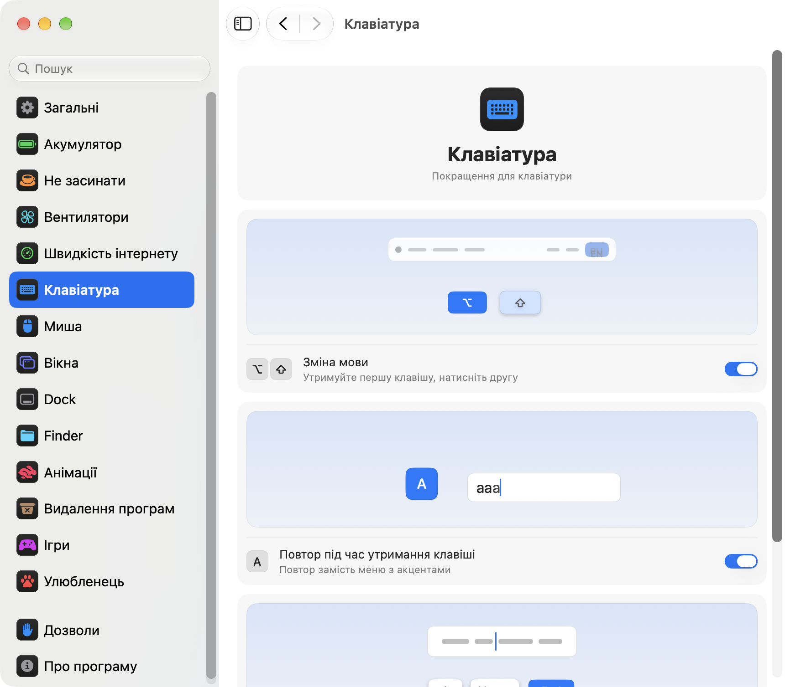

<p align="center"></p>
<h1 align="center">pikapik</h1>
<p align="center">Невеликі покращення для клавіатури, миші, вікон і Finder — просто в рядку меню вашого Mac.</p>
<p align="center"><sub><a href="../../README.md">English</a> · <a href="README.ru.md">Русский</a> · <b>Українська</b> · <a href="README.de.md">Deutsch</a> · <a href="README.fr.md">Français</a> · <a href="README.es.md">Español</a> · <a href="README.it.md">Italiano</a> · <a href="README.pt-BR.md">Português (Brasil)</a> · <a href="README.ja.md">日本語</a> · <a href="README.zh-Hans.md">简体中文</a> · <a href="README.ko.md">한국어</a> · <a href="README.ro.md">Română</a> · <a href="README.pl.md">Polski</a> · <a href="README.tr.md">Türkçe</a> · <a href="README.nl.md">Nederlands</a> · <a href="README.sv.md">Svenska</a> · <a href="README.cs.md">Čeština</a> · <a href="README.zh-Hant.md">繁體中文</a> · <a href="README.ar.md">العربية</a> · <a href="README.hi.md">हिन्दी</a> · <a href="README.id.md">Bahasa Indonesia</a> · <a href="README.vi.md">Tiếng Việt</a> · <a href="README.th.md">ไทย</a></sub></p>

<p align="center">
<picture>
<source media="(prefers-color-scheme: dark)" srcset="../media/settings-uk-dark.png">

</picture>
</p>

## Встановлення

Відкрийте Термінал, вставте цей рядок і натисніть Return:

```bash
/bin/bash -c "$(curl -fsSL https://raw.githubusercontent.com/dev-pikapik/pika-tools/main/install.sh)"
```

Команда завантажує останню версію з GitHub і встановлює її, лише якщо вона підписана розробником і пройшла перевірку Apple на наявність шкідливих програм. pikapik з’явиться в рядку меню вгорі екрана. Усе вимкнено, доки ви самі не ввімкнете.

<details>
<summary>Інші способи: Homebrew або dmg</summary>

З Homebrew:

```bash
brew install --cask dev-pikapik/pika-tools/pikapik && open -a pikapik
```

Або завантажте [pikapik.dmg](https://github.com/dev-pikapik/pika-tools/releases/latest/download/pikapik.dmg), відкрийте його й перетягніть програму в папку «Програми».

Команда вище й Homebrew самі кладуть програму в `/Applications`, запускають її, запитують дозволи й вмикають відкриття під час входу. Далі програма оновлюється сама, див. **Оновлення**. Як видалити — у розділі **Видалення**.

</details>

## Що вміє

<table>
<tbody><tr>
<td width="50%" valign="top">
<picture><source media="(prefers-color-scheme: dark)" srcset="../media/keep-awake-dark.png"></picture>
<br><b>Не засинати</b>
<br>Mac не засне, скільки потрібно, навіть із закритою кришкою.
</td>
<td width="50%" valign="top">
<picture><source media="(prefers-color-scheme: dark)" srcset="../media/fans-dark.png"></picture>
<br><b>Вентилятори</b>
<br>Дивіться, як швидко крутяться вентилятори, і обирайте їхню швидкість.
</td>
</tr></tbody>
<tbody><tr>
<td width="50%" valign="top">
<picture><source media="(prefers-color-scheme: dark)" srcset="../media/battery-dark.png"></picture>
<br><b>Акумулятор</b>
<br>Дивіться стан акумулятора, його ємність і кількість циклів, скільки енергії в нього надходить і як зробити, щоб він служив довше.
</td>
<td width="50%" valign="top">
<picture><source media="(prefers-color-scheme: dark)" srcset="../media/command-keys-dark.png"></picture>
<br><b>Захист ⌘Q і ⌘W</b>
<br>Нічого не закриється випадково. Коли треба, додайте ⇧.
</td>
</tr></tbody>
<tbody><tr>
<td width="50%" valign="top">
<picture><source media="(prefers-color-scheme: dark)" srcset="../media/compress-dark.png"></picture>
<br><b>Менша копія</b>
<br>Правий клік на фото, PDF чи відео — і поруч з’явиться легша копія.
</td>
<td width="50%" valign="top">
<picture><source media="(prefers-color-scheme: dark)" srcset="../media/convert-dark.png"></picture>
<br><b>Конвертація</b>
<br>Збережіть картинку, відео чи пісню в іншому форматі просто з меню правого кліку.
</td>
</tr></tbody>
<tbody><tr>
<td width="50%" valign="top">
<picture><source media="(prefers-color-scheme: dark)" srcset="../media/input-switch-dark.png"></picture>
<br><b>Зміна мови</b>
<br>Тримайте ⌥ і натисніть ⇧ — мова клавіатури зміниться.
</td>
<td width="50%" valign="top">
<picture><source media="(prefers-color-scheme: dark)" srcset="../media/quit-on-close-dark.png"></picture>
<br><b>Вихід з останнім вікном</b>
<br>Закрили останнє вікно — програма теж закрилася.
</td>
</tr></tbody>
<tbody><tr>
<td width="50%" valign="top">
<picture><source media="(prefers-color-scheme: dark)" srcset="../media/window-zoom-dark.png"></picture>
<br><b>Зелена кнопка збільшує</b>
<br>Вікно розтягується на весь екран без повноекранного режиму.
</td>
<td width="50%" valign="top">
<picture><source media="(prefers-color-scheme: dark)" srcset="../media/dock-hide-dark.png"></picture>
<br><b>Згорнути кліком у Dock</b>
<br>Клацніть значок програми, у якій ви зараз, і вона зникне з очей.
</td>
</tr></tbody>
<tbody><tr>
<td width="50%" valign="top">
<picture><source media="(prefers-color-scheme: dark)" srcset="../media/new-file-dark.png"></picture>
<br><b>Новий файл</b>
<br>Правий клік у Finder, ім’я — і порожній файл готовий.
</td>
<td width="50%" valign="top">
<picture><source media="(prefers-color-scheme: dark)" srcset="../media/finder-cut-dark.png"></picture>
<br><b>⌘X переносить файли</b>
<br>Виріжте файли у Finder і вставте туди, куди треба.
</td>
</tr></tbody>
<tbody><tr>
<td width="50%" valign="top">
<picture><source media="(prefers-color-scheme: dark)" srcset="../media/finder-open-dark.png"></picture>
<br><b>Return відкриває файли</b>
<br>Виберіть файли у Finder і натисніть Return, щоб відкрити.
</td>
<td width="50%" valign="top">
<picture><source media="(prefers-color-scheme: dark)" srcset="../media/finder-delete-dark.png"></picture>
<br><b>Delete — у Кошик</b>
<br>Натисніть ⌫ у Finder, і вибрані файли підуть у Кошик.
</td>
</tr></tbody>
<tbody><tr>
<td width="50%" valign="top">
<picture><source media="(prefers-color-scheme: dark)" srcset="../media/game-mode-dark.png"></picture>
<br><b>Ігровий режим</b>
<br>Поки ви граєте, ніщо не вискочить поверх гри й не закриє її.
</td>
<td width="50%" valign="top">
<picture><source media="(prefers-color-scheme: dark)" srcset="../media/speed-test-dark.png"></picture>
<br><b>Швидкість інтернету</b>
<br>Наскільки швидкий у вас інтернет і на що його вистачить.
</td>
</tr></tbody>
<tbody><tr>
<td width="50%" valign="top">
<picture><source media="(prefers-color-scheme: dark)" srcset="../media/side-buttons-dark.png"></picture>
<br><b>Бічні кнопки миші</b>
<br>Кнопки 4 і 5 гортають назад і вперед, як свайп.
</td>
<td width="50%" valign="top">
<picture><source media="(prefers-color-scheme: dark)" srcset="../media/wheel-lines-dark.png"></picture>
<br><b>Прокрутка рядками</b>
<br>Кожен клік коліщатка прокручує однаково, хоч як швидко крутите.
</td>
</tr></tbody>
<tbody><tr>
<td width="50%" valign="top">
<picture><source media="(prefers-color-scheme: dark)" srcset="../media/wheel-direction-dark.png"></picture>
<br><b>Напрям прокрутки</b>
<br>Один напрям для трекпада, інший для миші.
</td>
<td width="50%" valign="top">
<picture><source media="(prefers-color-scheme: dark)" srcset="../media/linear-pointer-dark.png"></picture>
<br><b>Без прискорення курсора</b>
<br>Курсор проходить рівно стільки, скільки ваша рука.
</td>
</tr></tbody>
<tbody><tr>
<td width="50%" valign="top">
<picture><source media="(prefers-color-scheme: dark)" srcset="../media/key-repeat-dark.png"></picture>
<br><b>Повтор клавіші</b>
<br>Утримуйте клавішу — літера повторюється, без меню з акцентами.
</td>
<td width="50%" valign="top">
<picture><source media="(prefers-color-scheme: dark)" srcset="../media/home-end-dark.png"></picture>
<br><b>Home і End</b>
<br>Перехід на початок чи кінець рядка, поки ви друкуєте.
</td>
</tr></tbody>
<tbody><tr>
<td width="50%" valign="top">
<picture><source media="(prefers-color-scheme: dark)" srcset="../media/animations-dark.png"></picture>
<br><b>Анімації</b>
<br>Dock, вікна і Швидкий перегляд стануть швидшими — аж до миттєвих.
</td>
<td width="50%" valign="top">
<picture><source media="(prefers-color-scheme: dark)" srcset="../media/leftover-permissions-dark.png"></picture>
<br><b>Дозволи видалених програм</b>
<br>Приберіть дозволи, які macOS зберігає для вже видалених програм.
</td>
</tr></tbody>
<tbody><tr>
<td width="50%" valign="top">
<picture><source media="(prefers-color-scheme: dark)" srcset="../media/pet-dark.png"></picture>
<br><b>Улюбленець на робочому столі</b>
<br>Маленький друг гуляє за вікнами внизу екрана. Візьміть його й підкиньте або натисніть пробіл — він підстрибне. Добирайте йому вбрання в гардеробі й отримуйте нагороди, поки граєте разом. Він бадьориться, поки ви друкуєте, і дрімає, коли ви відходите.
</td>
<td width="50%" valign="top">
<picture><source media="(prefers-color-scheme: dark)" srcset="../media/uninstaller-dark.png"></picture>
<br><b>Видалення програм</b>
<br>Видалення програми та її файлів. Усе можна повернути.
</td>
</tr></tbody>
<tbody><tr>
<td width="50%" valign="top">
<picture><source media="(prefers-color-scheme: dark)" srcset="../media/game-fps-dark.png"></picture>
<br><b>Показувати FPS</b>
<br>Маленький лічильник у вибраному вами кутку показує, наскільки плавно йде гра.
</td>
<td width="50%" valign="top">
<picture><source media="(prefers-color-scheme: dark)" srcset="../media/archive-dark.png"></picture>
<br><b>Архіви</b>
<br>Розпакування RAR та інших архівів і пакування файлів у ZIP правим кліком.
</td>
</tr></tbody>
<tbody><tr>
<td width="50%" valign="top">
<picture><source media="(prefers-color-scheme: dark)" srcset="../media/dock-display-dark.png"></picture>
<br><b>Dock на одному екрані</b>
<br>Dock більше не стрибає на інший екран. Щоб перенести його, утримуйте ⌥.
</td>
</tr></tbody>
<tbody><tr>
<td width="50%" valign="top">
<picture><source media="(prefers-color-scheme: dark)" srcset="../media/temperatures-dark.png"></picture>
<br><b>Температура</b>
<br>Дивіться, наскільки Mac нагрівся всередині, від процесора до акумулятора.
</td>
<td width="50%" valign="top">
<picture><source media="(prefers-color-scheme: dark)" srcset="../media/background-dark.png"></picture>
<br><b>Фонові завдання</b>
<br>Що працює у фоні та звідки воно взялося.
</td>
</tr></tbody>
<tbody><tr>
<td width="50%" valign="top">
<picture><source media="(prefers-color-scheme: dark)" srcset="../media/ports-dark.png"></picture>
<br><b>Порти</b>
<br>Дізнайтеся, яка програма зайняла порт, і звільніть його.
</td>
<td width="50%" valign="top"></td>
</tr></tbody>
</table>

## Докладніше

<details>
<summary>Перший запуск</summary>

pikapik потрібні два дозволи. Під час першого запуску відкриються параметри на сторінці «Дозволи», де все пояснено крок за кроком, а macOS покаже свої запити. Відкрийте **Системні параметри › Приватність і безпека** та ввімкніть pikapik у двох списках:

- **Доступність** — щоб змінювати натискання або клацання, поки вони не дійшли до інших програм.
- **Моніторинг вводу** — щоб узагалі бачити натискання й клацання.

Програма помітить зміни за кілька секунд, нічого перезапускати не треба.

Деяким функціям потрібні додаткові дозволи: **Керування вентиляторами**, **Розширення Finder**, **iCloud Drive**, **Повний доступ до диска** і **Запис екрана**. Усі вони зібрані на сторінці «Дозволи» в параметрах. У кожного дозволу є рядок із поясненням, навіщо він потрібен, зелена галочка або помаранчевий хрестик і одна кнопка: **Дозволити**, якщо його немає, і **Вимкнути**, якщо він є. Тож будь-який дозвіл можна забрати назад прямо там.

pikapik не записує, не зберігає й нікуди не надсилає те, що ви друкуєте й натискаєте. Події обробляються в пам’яті й одразу передаються далі. pikapik звертається до інтернету лише для оновлень (питає в GitHub, яка версія остання, і завантажує її, лише якщо ви вирішите оновитися) та для перевірки швидкості, коли ви її запускаєте (використовуються сервери Apple). Версію з Mac App Store оновлює App Store, а перевірка швидкості в ній іде через Cloudflare. Прогрес улюбленця (кроки, підкидання, нагороди тощо) рахується лише на цьому Mac і нікуди не надсилається. Стерти його можна в розділі «Параметри › Улюбленець».

</details>

<details>
<summary>Кожна функція докладно</summary>

**Захист ⌘Q і ⌘W.** Самі по собі ⌘Q і ⌘W нічого не роблять, тож ви не закриєте програму чи вікно випадково. Щоб зробити це навмисно, додайте Shift: ⇧⌘Q завершує програму, ⇧⌘W закриває вікно. Працює в усіх програмах. Кожна клавіша має свій перемикач. Типово вимкнено.

**Зміна мови за Option+Shift.** Тримайте Option і натисніть Shift — macOS увімкне наступне джерело вводу. Не відпускаючи Option, натисніть Shift ще раз, щоб іти далі. Тримайте Shift і натискайте Option, щоб повернутися назад. Якщо в цей час натиснути іншу клавішу, клацнути або додати Cmd, Ctrl чи Fn, мова не зміниться, тож сполучення на кшталт Option+Shift+стрілка працюють як раніше. Типово вимкнено.

**Повтор під час утримання клавіші.** Тримаєш клавішу — літера друкується знову і знову, замість меню з акцентами. Зручно в іграх і під час набору тексту. Уже відкриті програми підхоплять це після перезапуску. Вимкнеш — і macOS знову поводиться як звичайно. Типово вимкнено.

**Home і End — до початку й кінця рядка.** Поки ви друкуєте, Home ставить курсор на початок рядка, а End — у кінець, замість прокручування сторінки. З ⇧ вони виділяють текст до цього місця, з ⌘ переходять до початку або кінця всього тексту. Поза текстовими полями, а також у терміналах, віртуальних машинах і програмах віддаленого доступу клавіші працюють як раніше. Можна вказати й інші програми, де вони мають працювати як зазвичай. Типово вимкнено.

**Вимкнути прискорення вказівника.** Курсор проходить рівно стільки, скільки миша, хоч як швидко її рухати. Повзунок **Швидкість пересування** задає, наскільки швидко він рухається. Працює лише з мишею, трекпед лишається як є. Вимкніть функцію або закрийте pikapik — і macOS поверне свої налаштування. Типово вимкнено.

**Прокручування рядками.** Кожне клацання коліщатка миші прокручує однакову кількість рядків, хоч як швидко ви його крутите. Виберіть від 1 до 10 рядків на клацання, типово 3. Природне прокручування лишається таким, як ви налаштували в Системних параметрах. Працює лише для мишей, трекпад лишається як є. Типово вимкнено. Поруч із повзунком **Відстань за клацання** маленька сторінка прокручується на вибрану відстань, а крапка позначає типове значення.

Деякі програми та ігри рахують прокручування в точних пікселях: для них перемкніть це саме налаштування на пікселі й виберіть від 1 до 200 пікселів за клацання, типово 40. Повзунок також показує, яку частку висоти екрана це становить.

**Напрямок прокручування для трекпада й миші.** У macOS один перемикач природного прокручування одразу для трекпада й миші. Увімкніть цю функцію й оберіть напрямок для кожного: **Природний**, коли сторінка йде за пальцями, як на iPhone, або **Класичний**, коли сторінка рухається у зворотний бік. Вибір для трекпада діє і на прокручування вбік, і на докочування сторінки після того, як ви відпустили пальці. Magic Mouse прокручує дотиком, тому йде за вибором для трекпада. Оберіть те саме на всіх своїх Mac, і прокручування буде однаковим усюди, навіть коли ви переводите мишу на інший Mac через Універсальний контроль. Типово вимкнено. Після ввімкнення обидва вибори такі самі, як у Системних параметрах, тож нічого не змінюється, доки ви не оберете інше.

**Бічні кнопки — назад і вперед.** Кнопки миші 4 і 5 працюють як «назад» і «вперед» у Finder, Safari та інших програмах Apple і в багатьох інших програмах, як змах на трекпаді. Програми, які самі обробляють ці кнопки, отримують їх без змін. Якщо на вашій миші вони переплутані, увімкніть **Поміняти бічні кнопки місцями**. Типово вимкнено.

**Вихід після закриття останнього вікна.** Закрили останнє вікно програми — програма завершується. Finder лишається відкритим, як і програми, що мають вікна на інших робочих столах або в Dock. Можна скласти список програм, які ніколи так не завершуються. Типово вимкнено.

**Згорнути або сховати клацанням у Dock.** Клацніть значок у Dock тієї програми, в якій працюєте, — усі її вікна згорнуться в Dock. Ще одне клацання — усі повернуться. Можна також зробити так, щоб клацання ховало всю програму, як ⌘H. Типово вимкнено.

**Dock на одному екрані.** Якщо екранів кілька, macOS переносить Dock на інший екран, щойно вказівник упирається в його нижній край — або в лівий чи правий, якщо Dock збоку. Коли перемикач увімкнено, Dock залишається там, де є, а активні кути й далі працюють. Щоб перенести його навмисно, утримуйте ⌥ і впріться вказівником у край іншого екрана. Дозволи не потрібні. Перемикач **Повертати Dock на місце** переносить Dock назад на його екран після сну або зміни екранів. Йому потрібен дозвіл **Доступність**, а у версії з Mac App Store його немає. Обидва перемикачі типово вимкнено.

**Зелена кнопка збільшує вікно.** Клацніть зелену кнопку вікна — воно заповнить екран, не переходячи в повноекранний режим. Ще клацання — повернеться попередній розмір. Якщо втримувати ⌥, кнопка працює як зазвичай. Повноекранний режим залишається в меню кнопки та на ⌃⌘F. Можна скласти список програм, у яких зелена кнопка має працювати як зазвичай. Типово вимкнено.

**Новий файл у Finder.** Правий клік у вікні Finder або на робочому столі › **Новий файл**, введіть назву — і з’явиться порожній файл. Типово .txt. Типово вимкнено.

**Enter відкриває файли у Finder.** Виділіть файли у вікні Finder або на робочому столі й натисніть Return або Enter — вони відкриються. F2 або fn F2 перейменовує виділений файл. У текстових полях, наприклад коли ви вводите назву, клавіші працюють як зазвичай. Типово вимкнено.

**⌘X вирізає файли у Finder.** Виділіть файли й натисніть ⌘X, відкрийте потрібну папку й натисніть ⌘V — файли переміщаться туди, а не скопіюються. ⌘C скасовує вирізання. Типово вимкнено.

**Delete і ⌫ видаляють файли у Finder.** Виділіть файли й натисніть ⌫ або ⌦ (fn ⌫ на ноутбуці) — вони підуть у Смітник, як за ⌘⌫. Поки ви перейменовуєте файл, шукаєте чи друкуєте в будь-якому іншому полі, клавіші стирають літери як зазвичай. Типово вимкнено.

**Менша копія у Finder.** Правий клік по файлу у Finder › **Зробити меншу копію** — поруч з’явиться полегшена версія фото, GIF, PDF чи відео, часто в рази менша. Нестиснутий звук на кшталт WAV чи AIFF стане компактним M4A. Якщо файл меншим уже не зробити, копія не з’явиться, і pikapik про це скаже. Оригінал лишається як був, нічого не залишає ваш Mac. Типово вимкнено.

**Конвертація у Finder.** Правий клік по файлу у Finder › **Конвертувати в** — файл збережеться в іншому форматі: зображення в JPEG, PNG, HEIC, GIF, TIFF чи PDF, відео в MP4, MOV або лише звук, музика в M4A, WAV чи AIFF. Оригінал лишається як був, нічого не залишає ваш Mac. Вмикається окремо від меншої копії. Типово вимкнено.

**Архіви у Finder.** Правий клік по архіву у Finder › **Розпакувати** — файли з’являться поруч із ним. Правий клік по будь-якому іншому файлу чи теці › **Створити архів…** — вийде ZIP, 7Z, TAR.GZ або TAR.XZ. ZIP і 7Z можуть мати пароль, а будь-який архів можна розділити на частини, наприклад по 15 МБ для пошти чи по 4 ГБ для флешки. Пароль вводиться двічі, щоб друкарська помилка не закрила вам доступ до ваших же файлів. У такому ZIP немає прихованих службових файлів, імена будь-якою мовою читаються правильно, а файли понад 4 ГБ — не проблема. Типово вимкнено. Немає у версії з Mac App Store.

pikapik відкриває й те, чого macOS не вміє: RAR, зокрема з кількох частин, 7Z із паролем, набори частин на кшталт .001, .z01, .r00 та .part1.rar, а також ZIPX, CAB, LZH, ARJ, ZST, LZMA, WIM та багато іншого. Подвійний клік відкриває їх у pikapik. Імена файлів у старих ZIP, наприклад кирилицею, японською чи китайською, читаються правильно. Перемикач **Відкривати архіви в цій програмі** в «Параметри › Finder» віддає pikapik також ZIP і 7Z, а TAR та GZ лишаються за вбудованою програмою для архівів, яка й так добре з ними справляється. RAR pikapik уміє лише відкривати, а не створювати: ліцензія RAR дозволяє тільки розпаковування.

Вікно запитає пароль, кнопка **Зупинити** перерве будь-яку роботу, а з пошкодженого чи недокачаного архіву pikapik дістане все, що ще можна прочитати. Якщо архів роздувся б до величезного розміру, pikapik запитає вас перед розпакуванням, а коли на диску закінчиться місце, зупиниться вчасно. Архіви, що намагаються записати файли за межі своєї теки, блокуються. Натисніть пробіл на архіві у Finder, щоб побачити, що всередині.

**Ігровий режим.** Додайте свої ігри — і поки ви граєте, Mac не висмикує вас із гри. Spotlight, Siri, ⌘Tab, Mission Control і змахування між робочими столами не відкриваються поверх гри, ⌘Q і ⌘W не закривають її випадково, курсор не з’їжджає на Dock, рядок меню чи інший екран, а екран не гасне. Кожен із цих пунктів має свій перемикач на сторінці «Ігри», а ще pikapik підкаже ігри, які знайшов на вашому Mac. У грі Ctrl-клік лишається простим кліком, а Ctrl зі стрілками не перемикає робочий стіл. Minecraft теж розпізнається: додайте Minecraft Launcher або CurseForge, і режим вмикатиметься в самому Minecraft. Щоб вийти з гри, натисніть ⇧⌘Q, а щоб закрити її вікно — ⇧⌘W. ⌥⌘Esc працює завжди. Щойно ви вийшли з гри, усе працює як звичайно. Типово вимкнено.

Увімкніть ігровий режим та грайте. Додаткові параметри містять каталог вашого Mac із поточними поєднаннями й анімованим прев’ю для кожної дії.

Автоматичний режим призупиняє дії, що відкривають вікна або забирають фокус. Коротке навмисне поєднання мови перемикає розкладку без системного вікна. Затиснуті клавіші руху мають пріоритет, тому біг і стрибки не змінюють мову випадково.

У розділі Параметри → Ігри → «Додаткові параметри гри» є група «Миша й трекпад». У ній лише те, що ввімкнено в macOS на вашому Mac, з назвами від Apple і невеликим малюнком біля кожного пункту: поєднання на кнопці миші, змахування між робочими столами та повноекранними програмами, Mission Control і App Exposé, зведення пальців для програм і розведення для робочого столу, змахування від правого краю для Центру сповіщень та кожен активний кут із його дією. Поки гра на передньому плані, усе це призупинено, тож випадкове змахування чи дотик до кута екрана не виведе вас із гри. Жести всередині гри працюють як завжди. Будь-який пункт можна повернути до звичайної роботи.

Відкрийте Параметри → Ігри → Додати гру та натисніть на запущену гру. Тут видно й ігри через Java та інші середовища, навіть без файлу .app. Minecraft має назву Minecraft, а не java. Знайдіть процес гри та перетягніть його рядок у «Ваші ігри» в Параметрах → Ігри.

**Показувати FPS.** FPS — це кадри за секунду: скільки зображень гра малює щосекунди. Увімкніть **Показувати FPS** на сторінці «Ігри», і поки працює «Ігровий режим», у куті будь-якої гри з’явиться маленька темна плашка з цим числом. Кут обирають натисканням на малюнок над перемикачем. Риска означає, що перші кадри ще не надійшли, а тьмяний 0 — що гра перестала малювати. У macOS 27 більшість ігор рахує сама macOS, дозвіл не потрібен. Гру, яку macOS порахувати не може, найчастіше стару, pikapik рахує через запис екрана: тоді на сторінці «Дозволи» з’являється рядок **Запис екрана**, під час гри pikapik дозвіл ніколи не просить, а число не буває вищим за частоту оновлення екрана. У macOS 14–26 і у версії з Mac App Store так рахуються всі ігри, тому рядок з’являється одразу після увімкнення **Показувати FPS**, а кнопка **Дозволити** під перемикачем веде до нього. Зображення не зберігається й нікуди не надсилається. За замовчуванням вимкнено.

**Гардероб і нагороди улюбленця.** Відкрийте «Параметри › Улюбленець», щоб вдягнути улюбленця: понад 30 речей, від капелюхів і окулярів до плащів і крил, та готові образи на кшталт чарівника, пірата чи астронавта. Кілька речей доступні одразу. Решта — нагороди, які приходять, поки ви граєте разом: підніміть улюбленця й підкиньте, поганяйте м’яч, подивіться, як він лазить по вікнах і балакає, або просто день за днем складайте йому компанію. Коли ви отримаєте нову нагороду, улюбленець сам про це скаже.

Щоб знати, коли час видати нагороду, pikapik рахує лише те, що робите ви й улюбленець: кроки, скільки разів ви піднімали й підкидали улюбленця, його стрибки, підйоми на вікна, ігри з м’ячем і розмови, дні разом, чи були ви разом рано вранці, після півночі або у вихідні, які сторінки параметрів ви відкривали і що приміряли. Поза Mac App Store pikapik також відзначає, чи відкривали ви нашу сторінку на GitHub із параметрів. Ці числа, дата кожної нагороди та вбрання улюбленця залишаються на цьому Mac. Нічого нікуди не надсилається, а до експортованого файлу параметрів і синхронізації через iCloud вони не потрапляють. Усе це можна стерти будь-коли в розділі «Параметри › Улюбленець», і улюбленець почне з нуля.

**Видалення програм.** Відкрийте «Параметри › Видалення програм», виберіть програму у списку або перетягніть її на малюнок, і pikapik покаже все, що вона зберігає на вашому Mac: саму програму, її збережені дані, налаштування, тимчасові файли, фонових помічників і не тільки, а біля кожного пункту вказано причину, чому він у списку. Файли, що явно належать програмі, позначені галочкою; файли, які лише, можливо, з нею пов’язані, не позначені, а файли, якими користуються й інші програми, мають окрему позначку. Виберіть, що прибрати, і натисніть **Перемістити до Смітника**. Нічого не видаляється назавжди: усе потрапляє до Смітника. Якщо програма відкрита, pikapik спершу попросить її закритися, а якщо для деяких файлів потрібні права адміністратора, Mac один раз запросить ваш пароль.

Передумали? Натисніть **Повернути на місце**: усе опиниться там, де було, а фонові помічники знову запустяться. Останні десять видалень чекають у розділі «Нещодавно видалені», поки їхні файли лежать у Смітнику. **Скинути програму** залишає саму програму й прибирає лише її збережені дані, налаштування й тимчасові файли; це може допомогти, якщо програма поводиться дивно. Програми, які ви самі перемістили до Смітника, видно в розділі «У Смітнику» разом із файлами, що вони залишили, а «Залишки видалених програм» знаходять файли програм, яких уже немає. Перемикач «Пропонувати очищення, коли програма потрапляє до Смітника» за промовчанням вимкнений, і нічого не видаляється, поки ви не виберете. Щоб побачити все, що зберігає програма, сторінці потрібен **Повний доступ до диска**. У версії з Mac App Store цього інструмента немає.

**Температура.** Відкрийте «Параметри › Температура», щоб побачити, наскільки Mac нагрівся всередині. Угорі головне сказано одним словом, від «У нормі» до «Дуже гаряче», а рядок під ним пояснює, чи працює Mac на повній швидкості, чи сповільнюється, щоб охолонути. Нижче в кожної частини свій рядок зі зрозумілою назвою замість коду датчика: процесор, графіка, пам’ять, диск, Wi-Fi та акумулятор, якщо у вашому Mac є для них датчики. У кожному рядку градуси й коротка смужка, зелена, жовта чи помаранчева, залежно від того, що нормально саме для цієї частини. Цифри оновлюються кожні дві секунди і лише тоді, коли ви на них дивитеся, тож Mac цього майже не помічає. Пароль і дозволи не потрібні. Рядок «Температура» можна додати й до панелі в рядку меню. У версії з Mac App Store видно лише загальний рівень.

**Фонові завдання** показують усе, що запускається на Mac саме: програми, які відкриваються під час входу, фонові служби, помічники всередині програм і залишки вже видалених програм. Біля кожного завдання видно, яка програма його додала, чи працює воно саме зараз і де лежить його файл; одне клацання показує його у Finder. Ваші власні завдання вимикаються однією кнопкою й так само легко повертаються, нічого не видаляється. Завданнями для всіх користувачів і для всього Mac керує macOS, тому їхня кнопка відкриває «Елементи входу» в Системних параметрах. У версії з Mac App Store сторінка лише показує завдання: доступ до домашньої папки надається один раз у звичайному вікні відкриття, а кнопки відкривають «Елементи входу».

**Порти.** Якщо програма пише, що її порт уже зайнятий, відкрийте «Параметри › Порти». Там видно кожну програму, яка зайняла порт на вашому Mac: її значок, номери портів і те, чи можуть до неї підключитися інші пристрої у вашій мережі. Введіть номер, щоб дізнатися, хто тримає цей порт, або переконатися, що він вільний. Натисніть на рядок, і з’являться подробиці: адреси, які відкриваються в браузері, файл програми, команда, якою її запустили, її папка і номер процесу. **Звільнити** просить програму завершитися, щоб вона встигла зберегти роботу, а якщо вона не закривається, пропонує завершити її примусово. Перед кожним кроком pikapik питає вас. Частини macOS і програми інших користувачів pikapik ніколи не завершує: для служб «Приймач AirPlay», «Файл-сервер», «Спільний екран» і «Віддалений вхід» він підкаже, який перемикач у Системних параметрах звільняє порт. У версії з Mac App Store кнопка **Звільнити** показує програму, копіює команду для «Терміналу», яка її завершить, або відкриває «Монітор активності».

Кожен інструмент має свій перемикач у меню та в параметрах.

Значок у рядку меню одразу показує стан: знак pikapik — інструменти працюють, той самий знак, але блідий — усе вимкнено, попереджувальний трикутник — інструмент увімкнено, але бракує дозволів.

Панель у рядку меню спочатку показує лише кілька рядків. Які саме, обираєте ви самі: натисніть кнопку з олівцем унизу, позначте потрібне й натисніть **Готово**. Приховані рядки продовжують працювати й залишаються в Параметрах. Якщо панель не вміщується на екрані, її можна прокручувати.

Програма розмовляє мовою системи або тією, яку ви оберете в параметрах. Доступні всі 23 мови зі списку на початку цієї сторінки.

</details>

<details>
<summary>Не засинати</summary>

Не дає Mac заснути, поки вас немає за клавіатурою: на будь-який час від 1 секунди до 365 діб або доки ви не вимкнете. Вмикається в меню, а тривалість задається в параметрах: введіть дні, години, хвилини й секунди, натискайте ↑ і ↓ або виберіть готовий варіант від 15 хвилин до 8 годин. У меню видно, скільки лишилося і коли закінчиться. У рядку **Екран** два варіанти. **Завжди ввімкнений**: екран не гасне, без заставки та екрана блокування. **Гасне як зазвичай**: екран гасне за своїм таймером, а Mac працює. Кнопка **Вимкнути екран зараз** (вона є і в меню) одразу гасить екран, а Mac працює далі: щоб повернути екран, поворушіть мишею або натисніть будь-яку клавішу. Якщо завершити pikapik, режим теж вимкнеться.

На MacBook можна ввімкнути й **Працювати із закритою кришкою**. У macOS немає такого перемикача, тому pikapik виконує `pmset -a disablesleep 1` і просить пароль адміністратора: змінювати режим сну Mac може лише адміністратор. Налаштування саме повертається до звичайного стану, коли режим закінчується, коли ви завершуєте програму або якщо вона аварійно закриється. Якщо не ввести пароль, нічого не зміниться. Стежте, щоб Mac із закритою кришкою не перегрівався. **Зупинити, коли заряд нижче 20 %** вимикає режим раніше, ніж сяде акумулятор.

«Не засинати», режими дисплея та закритої кришки можна винести на кнопку в Центрі керування, рядку меню або віджет на робочому столі через застосунок «Команди»; посилання копіюються в Параметри › Не засинати.

</details>

<details>
<summary>Швидкість інтернету</summary>

Показує, наскільки швидкий інтернет просто зараз. Натисніть **Перевірити швидкість** у Параметри › Швидкість інтернету або **Перевірити** в меню, якщо додали туди рядок кнопкою з олівцем. Приблизно за пів хвилини видно швидкість завантаження й вивантаження, пінг і чуйність: як швидко все відгукується, поки інтернет зайнятий. Нижче простими словами сказано, для чого його вистачить: фільми в 4K, відеодзвінки, онлайн-ігри та великі файли. Перевірка йде через вбудовану в macOS програму networkQuality і сервери Apple. Останній результат зберігається до наступної перевірки, а посилання для «Команд» запускає її з Пункту керування.

</details>

<details>
<summary>Параметри</summary>

Відкрийте параметри з меню кнопкою **Параметри…** або сполученням ⌘, — чи просто запустіть pikapik ще раз із Finder, Launchpad або Spotlight. Поки вікно відкрите, програму видно в Dock і в ⌘Tab.

- **Загальні**: відкриття під час входу, вигляд (як у системі, світлий або темний), мова, оновлення та резервна копія: експорт та імпорт параметрів файлом або синхронізація через iCloud Drive.
- **Акумулятор**: заряд, час до повного заряджання або залишок часу роботи, стан, максимальна ємність, лічильник циклів, адаптер живлення і потужність у ватах, а також поради, як берегти акумулятор. Сторінка лише показує дані: ліміт заряджання залишається в «**Системні параметри › Акумулятор**». Вона є лише на Mac з акумулятором.
- **Не засинати**: тривалість, екран і кришка.
- **Вентилятори**: швидкість кожного вентилятора, режим «Авто» або ручна швидкість, коли дозволено «Керування вентиляторами».
- **Температура**: наскільки нагрівся Mac, загалом і за частинами, наприклад процесор, пам’ять і акумулятор.
- **Швидкість інтернету**: перевірка швидкості й для чого її вистачить.
- **Порти**: яка програма зайняла який порт, її адреси й подробиці, а також кнопка, що звільняє порт.
- **Клавіатура**: зміна мови, повтор клавіш, Home і End.
- **Миша**: прискорення курсора і швидкість пересування, прокручування рядками, напрямок прокручування, бічні кнопки.
- **Вікна**: збільшення вікна зеленою кнопкою (зі списком винятків), захист ⌘Q і ⌘W та вихід після останнього вікна (зі списком винятків).
- **Dock**: згортання або приховування клацанням у Dock, утримання Dock на одному екрані й повернення Dock на місце.
- **Finder**: новий файл, менша копія, конвертація та архіви, відкриття клавішею Return, вирізання клавішами ⌘X і видалення у Смітник клавішею ⌫.
- **Видалення програм**: прибрати програму разом із файлами, потім повернути все на місце й очистити залишки вже видалених програм.
- **Фонові завдання**: усе, що працює у фоні, яка програма це додала, і кнопка, щоб вимкнути своє завдання й повернути його.
- **Ігри**: список ваших ігор і параметри Ігрового режиму.
- **Улюбленець**: вмикання улюбленця, його розмови, життя у вашому ритмі й м’яч, гардероб і нагороди.
- **Дозволи**: усі дозволи pikapik, у кожного свій стан і одна кнопка, щоб дозволити або вимкнути його. Інструмент, якому бракує дозволу, виглядає сірим, а натискання на нього відкриває цю сторінку на потрібному рядку.
- **Про програму**: версія, посилання на список змін і на повідомлення про проблему.

У багатьох налаштувань є невеликий малюнок, що показує, що вони роблять: наприклад, Mac, який не засинає, або вікно, що ховається за Dock. Малюнок змінюється разом із перемикачем і завмирає, якщо в Системних параметрах увімкнено «Зменшити рух».

На кожній сторінці внизу є кнопка **Відновити типові…**. Спершу вона перепитає, а потім вимкне інструменти на цій сторінці й поверне їхні параметри, ніби pikapik їх і не торкався.

**Синхронізувати параметри через iCloud** робить pikapik однаковим на всіх ваших Mac. Параметри лежать у теці pikapik в iCloud Drive, а перемагає найсвіжіша зміна. Типово вимкнено, потрібен увімкнений iCloud Drive. Дозволи не синхронізуються: кожен Mac запитує їх сам.

</details>

<details>
<summary>Оновлення</summary>

pikapik перевіряє нові версії під час запуску та кожні 6 годин. Це можна вимкнути в «Параметри › Загальні». Коли виходить нова версія, у меню з’являється кнопка **Оновити до …**: одне клацання — і програма завантажить оновлення, встановить його й перезапуститься. Перевірити вручну можна кнопкою **Перевірити** в «Параметри › Загальні».

Якщо ви встановлювали через Homebrew, можна також виконати `brew upgrade --cask pikapik`.

Починаючи з версії 1.3 дозволи зберігаються після оновлень.

</details>

<details>
<summary>Видалення</summary>

```bash
/bin/bash -c "$(curl -fsSL https://raw.githubusercontent.com/dev-pikapik/pika-tools/main/uninstall.sh)"
```

Якщо встановлювали через Homebrew: `brew uninstall --cask --zap pikapik`.

Обидві команди завершують програму, прибирають її з об’єктів входу й видаляють. Скрипт ще й скидає її дозволи.

</details>

<details>
<summary>Питання й відповіді</summary>

**Навіщо два дозволи?**
macOS ділить доступ до клавіатури й миші на дві частини. Моніторинг вводу дає змогу бачити події, Доступність — змінювати їх. Щоб заблокувати сполучення, потрібні обидва.

**macOS пише, що програма від невстановленого розробника.**
Програма pikapik підписана розробником і проходить перевірку Apple на наявність шкідливих програм, тож це повідомлення не мало б з’являтися. Якщо воно все ж з’явилося, відкрийте **Системні параметри › Приватність і безпека** та натисніть **Усе одно відкрити**.

**Чи працює на Mac з Intel?**
Так. Це універсальна програма для Apple Silicon і Intel, потрібна macOS 14 Sonoma або новіша.

**Дозвіл увімкнено, але нічого не працює.**
У **Системних параметрах › Приватність і безпека** видаліть pikapik з обох списків кнопкою −, потім додайте знову. Або зробіть це в pikapik: на сторінці «Дозволи» натисніть **Вимкнути** біля кожного дозволу, а потім знову **Дозволити**.

</details>

<p align="center">☕ Якщо pikapik вам подобається, можете <a href="https://buymeacoffee.com/pikapik">пригостити мене кавою</a> — усе піде на розвиток і підтримку застосунку.</p>

<p align="center"><sub><a href="../whats-new/README.uk.md">Що нового</a> · <a href="https://github.com/dev-pikapik/homebrew-pika-tools">Тап Homebrew</a> · <a href="../../CONTRIBUTING.md">Збирання з вихідного коду</a> · <a href="../../LICENSE">Ліцензія MIT</a> · © 2026 pikapik</sub></p>
