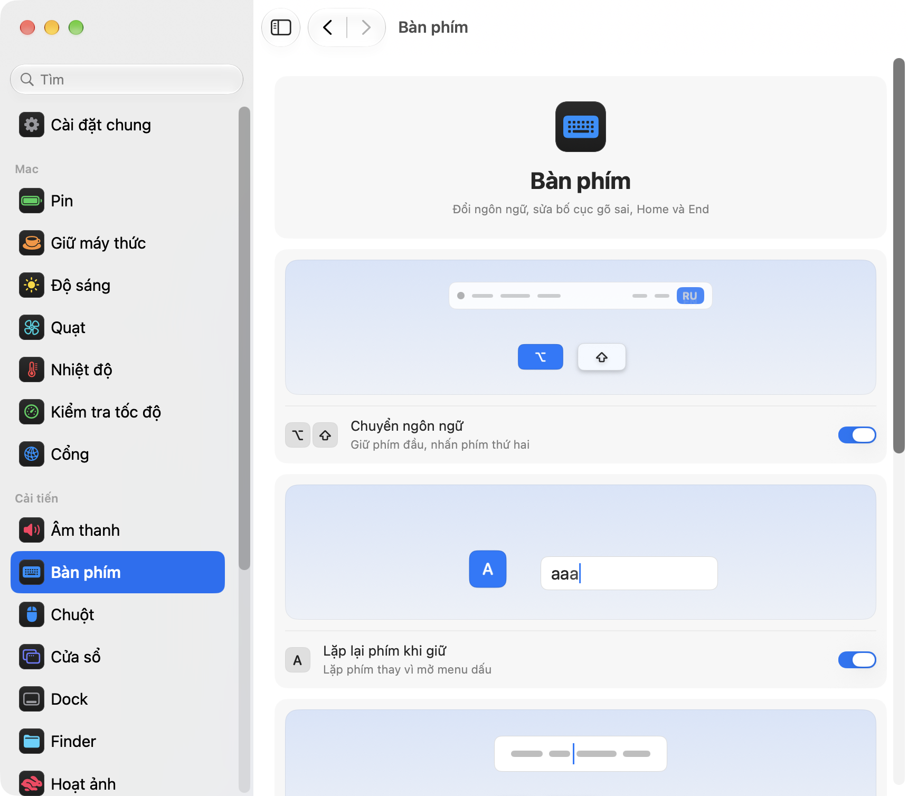

<p align="center"></p>
<h1 align="center">pikapik</h1>
<p align="center"><b>Chiếc Mac hiểu ý bạn.</b><br>Những tinh chỉnh nhỏ cho bàn phím, chuột, cửa sổ và Finder, ngay trên thanh menu của máy Mac.</p>
<p align="center"><sub><a href="../../README.md">English</a> · <a href="README.ru.md">Русский</a> · <a href="README.uk.md">Українська</a> · <a href="README.de.md">Deutsch</a> · <a href="README.fr.md">Français</a> · <a href="README.es.md">Español</a> · <a href="README.it.md">Italiano</a> · <a href="README.pt-BR.md">Português (Brasil)</a> · <a href="README.ja.md">日本語</a> · <a href="README.zh-Hans.md">简体中文</a> · <a href="README.ko.md">한국어</a> · <a href="README.ro.md">Română</a> · <a href="README.pl.md">Polski</a> · <a href="README.tr.md">Türkçe</a> · <a href="README.nl.md">Nederlands</a> · <a href="README.sv.md">Svenska</a> · <a href="README.cs.md">Čeština</a> · <a href="README.zh-Hant.md">繁體中文</a> · <a href="README.ar.md">العربية</a> · <a href="README.hi.md">हिन्दी</a> · <a href="README.id.md">Bahasa Indonesia</a> · <b>Tiếng Việt</b> · <a href="README.th.md">ไทย</a></sub></p>

<p align="center">
<picture>
<source media="(prefers-color-scheme: dark)" srcset="../media/settings-vi-dark.png">

</picture>
</p>

## Cài đặt

Mở Terminal, dán dòng này rồi nhấn Return:

```bash
/bin/bash -c "$(curl -fsSL https://raw.githubusercontent.com/dev-pikapik/pika-tools/main/install.sh)"
```

Lệnh này tải về phiên bản mới nhất từ GitHub và chỉ cài đặt nếu phiên bản đó được nhà phát triển ký và đã vượt qua bước kiểm tra phần mềm độc hại của Apple. pikapik sẽ nằm trên thanh menu ở phía trên màn hình. Mọi thứ đều tắt cho đến khi bạn bật lên.

<details>
<summary>Các cách khác: Homebrew hoặc tệp dmg</summary>

Với Homebrew:

```bash
brew install --cask dev-pikapik/pika-tools/pikapik && open -a pikapik
```

Hoặc tải về [pikapik.dmg](https://github.com/dev-pikapik/pika-tools/releases/latest/download/pikapik.dmg), mở tệp và kéo ứng dụng vào thư mục Ứng dụng.

Cả lệnh ở trên và Homebrew đều đặt ứng dụng vào `/Applications`, mở ứng dụng, xin quyền và bật “Mở khi đăng nhập”. Sau đó ứng dụng tự cập nhật, xem **Cập nhật**. Để gỡ bỏ, xem **Gỡ cài đặt**.

</details>

## Ứng dụng làm được gì

<table>
<tbody><tr>
<td width="50%" valign="top">
<picture><source media="(prefers-color-scheme: dark)" srcset="../media/keep-awake-dark.png"></picture>
<br><b>Giữ máy thức</b>
<br>Máy Mac luôn thức bao lâu tùy bạn, kể cả khi gập nắp.
</td>
<td width="50%" valign="top">
<picture><source media="(prefers-color-scheme: dark)" srcset="../media/fans-dark.png"></picture>
<br><b>Quạt</b>
<br>Xem quạt quay nhanh cỡ nào và chọn tốc độ cho quạt.
</td>
</tr></tbody>
<tbody><tr>
<td width="50%" valign="top">
<picture><source media="(prefers-color-scheme: dark)" srcset="../media/battery-dark.png"></picture>
<br><b>Pin</b>
<br>Xem tình trạng, dung lượng và số lượng chu kỳ của pin, lượng điện đang vào pin và cách giúp pin dùng được lâu hơn.
</td>
<td width="50%" valign="top">
<picture><source media="(prefers-color-scheme: dark)" srcset="../media/command-keys-dark.png"></picture>
<br><b>Bảo vệ ⌘Q và ⌘W</b>
<br>Không gì bị đóng nhầm. Thêm ⇧ khi bạn thật sự muốn.
</td>
</tr></tbody>
<tbody><tr>
<td width="50%" valign="top">
<picture><source media="(prefers-color-scheme: dark)" srcset="../media/compress-dark.png"></picture>
<br><b>Bản sao nhỏ hơn</b>
<br>Bấm chuột phải vào ảnh, PDF hay video là có ngay bản sao nhẹ hơn bên cạnh.
</td>
<td width="50%" valign="top">
<picture><source media="(prefers-color-scheme: dark)" srcset="../media/convert-dark.png"></picture>
<br><b>Chuyển đổi</b>
<br>Lưu ảnh, video hay bài hát sang định dạng khác chỉ bằng chuột phải.
</td>
</tr></tbody>
<tbody><tr>
<td width="50%" valign="top">
<picture><source media="(prefers-color-scheme: dark)" srcset="../media/input-switch-dark.png"></picture>
<br><b>Chuyển ngôn ngữ</b>
<br>Giữ ⌥ và chạm ⇧ để đổi ngôn ngữ bàn phím.
</td>
<td width="50%" valign="top">
<picture><source media="(prefers-color-scheme: dark)" srcset="../media/quit-on-close-dark.png"></picture>
<br><b>Thoát cùng cửa sổ cuối</b>
<br>Đóng cửa sổ cuối cùng của một ứng dụng là ứng dụng cũng thoát.
</td>
</tr></tbody>
<tbody><tr>
<td width="50%" valign="top">
<picture><source media="(prefers-color-scheme: dark)" srcset="../media/window-zoom-dark.png"></picture>
<br><b>Nút xanh lá phóng to</b>
<br>Cửa sổ phủ kín màn hình mà không vào chế độ toàn màn hình.
</td>
<td width="50%" valign="top">
<picture><source media="(prefers-color-scheme: dark)" srcset="../media/dock-hide-dark.png"></picture>
<br><b>Thu nhỏ bằng một lần bấm trong Dock</b>
<br>Bấm vào ứng dụng đang dùng, nó sẽ tạm lánh đi.
</td>
</tr></tbody>
<tbody><tr>
<td width="50%" valign="top">
<picture><source media="(prefers-color-scheme: dark)" srcset="../media/new-file-dark.png"></picture>
<br><b>Tệp mới</b>
<br>Bấm chuột phải trong Finder, đặt tên, thế là có tệp trống.
</td>
<td width="50%" valign="top">
<picture><source media="(prefers-color-scheme: dark)" srcset="../media/finder-cut-dark.png"></picture>
<br><b>⌘X di chuyển tệp</b>
<br>Cắt tệp trong Finder rồi dán vào nơi bạn muốn.
</td>
</tr></tbody>
<tbody><tr>
<td width="50%" valign="top">
<picture><source media="(prefers-color-scheme: dark)" srcset="../media/finder-open-dark.png"></picture>
<br><b>Enter mở tệp</b>
<br>Chọn tệp trong Finder rồi nhấn Enter để mở.
</td>
<td width="50%" valign="top">
<picture><source media="(prefers-color-scheme: dark)" srcset="../media/finder-delete-dark.png"></picture>
<br><b>Delete vào Thùng rác</b>
<br>Nhấn ⌫ trong Finder, các tệp đã chọn sẽ vào Thùng rác.
</td>
</tr></tbody>
<tbody><tr>
<td width="50%" valign="top">
<picture><source media="(prefers-color-scheme: dark)" srcset="../media/desktop-icons-dark.png"></picture>
<br><b>Ẩn biểu tượng trên màn hình nền</b>
<br>Một cú nhấp là màn hình nền gọn gàng trước cuộc gọi hay ảnh chụp màn hình.
</td>
<td width="50%" valign="top">
<picture><source media="(prefers-color-scheme: dark)" srcset="../media/hidden-files-dark.png"></picture>
<br><b>Hiện tệp ẩn</b>
<br>Xem các tệp và thư mục mà macOS giấu đi.
</td>
</tr></tbody>
<tbody><tr>
<td width="50%" valign="top">
<picture><source media="(prefers-color-scheme: dark)" srcset="../media/game-mode-dark.png"></picture>
<br><b>Chế độ trò chơi</b>
<br>Khi bạn chơi, không gì bật lên che trò chơi hay đóng nó lại.
</td>
<td width="50%" valign="top">
<picture><source media="(prefers-color-scheme: dark)" srcset="../media/speed-test-dark.png"></picture>
<br><b>Kiểm tra tốc độ</b>
<br>Internet của bạn nhanh cỡ nào và đủ dùng cho việc gì.
</td>
</tr></tbody>
<tbody><tr>
<td width="50%" valign="top">
<picture><source media="(prefers-color-scheme: dark)" srcset="../media/side-buttons-dark.png"></picture>
<br><b>Nút bên của chuột</b>
<br>Nút 4 và 5 để quay lại và tiếp, như vuốt trên bàn di chuột.
</td>
<td width="50%" valign="top">
<picture><source media="(prefers-color-scheme: dark)" srcset="../media/hide-app-dark.png"></picture>
<br><b>Ẩn bằng nút chuột</b>
<br>Nhấn một lần là ẩn ứng dụng ở phía trước, như ⌘H. Ứng dụng vẫn chạy.
</td>
</tr></tbody>
<tbody><tr>
<td width="50%" valign="top">
<picture><source media="(prefers-color-scheme: dark)" srcset="../media/wheel-lines-dark.png"></picture>
<br><b>Cuộn theo dòng</b>
<br>Mỗi nấc bánh xe cuộn như nhau, dù bạn xoay nhanh đến đâu.
</td>
<td width="50%" valign="top">
<picture><source media="(prefers-color-scheme: dark)" srcset="../media/wheel-direction-dark.png"></picture>
<br><b>Hướng cuộn</b>
<br>Một hướng cho bàn di chuột, hướng khác cho chuột.
</td>
</tr></tbody>
<tbody><tr>
<td width="50%" valign="top">
<picture><source media="(prefers-color-scheme: dark)" srcset="../media/linear-pointer-dark.png"></picture>
<br><b>Không tăng tốc con trỏ</b>
<br>Con trỏ đi đúng bằng quãng tay bạn di.
</td>
<td width="50%" valign="top">
<picture><source media="(prefers-color-scheme: dark)" srcset="../media/key-repeat-dark.png"></picture>
<br><b>Lặp lại phím khi giữ</b>
<br>Giữ một phím để gõ lặp lại, không hiện menu dấu.
</td>
</tr></tbody>
<tbody><tr>
<td width="50%" valign="top">
<picture><source media="(prefers-color-scheme: dark)" srcset="../media/home-end-dark.png"></picture>
<br><b>Home và End</b>
<br>Nhảy về đầu hoặc cuối dòng khi đang gõ.
</td>
<td width="50%" valign="top">
<picture><source media="(prefers-color-scheme: dark)" srcset="../media/animations-dark.png"></picture>
<br><b>Hoạt ảnh</b>
<br>Tăng tốc Dock, cửa sổ và Xem nhanh, cho đến tức thì.
</td>
</tr></tbody>
<tbody><tr>
<td width="50%" valign="top">
<picture><source media="(prefers-color-scheme: dark)" srcset="../media/leftover-permissions-dark.png"></picture>
<br><b>Quyền của ứng dụng đã xóa</b>
<br>Gỡ các quyền mà macOS vẫn giữ cho những ứng dụng bạn đã xóa.
</td>
<td width="50%" valign="top">
<picture><source media="(prefers-color-scheme: dark)" srcset="../media/pet-dark.png"></picture>
<br><b>Thú cưng trên màn hình nền</b>
<br>Một người bạn nhỏ dạo bước sau các cửa sổ của bạn. Nhấc lên và tung đi, hoặc nhấn phím cách để nó nhảy. Chọn đồ cho nó trong tủ quần áo riêng và nhận giải thưởng khi cùng chơi. Nó hăng hái khi bạn gõ phím và ngủ gà ngủ gật khi bạn rời đi.
</td>
</tr></tbody>
<tbody><tr>
<td width="50%" valign="top">
<picture><source media="(prefers-color-scheme: dark)" srcset="../media/uninstaller-dark.png"></picture>
<br><b>Gỡ ứng dụng</b>
<br>Gỡ ứng dụng cùng các tệp của nó. Có thể hoàn lại tất cả.
</td>
<td width="50%" valign="top">
<picture><source media="(prefers-color-scheme: dark)" srcset="../media/game-fps-dark.png"></picture>
<br><b>Hiện FPS</b>
<br>Một bộ đếm nhỏ ở góc bạn chọn cho biết trò chơi chạy mượt đến đâu.
</td>
</tr></tbody>
<tbody><tr>
<td width="50%" valign="top">
<picture><source media="(prefers-color-scheme: dark)" srcset="../media/archive-dark.png"></picture>
<br><b>Tệp lưu trữ</b>
<br>Giải nén RAR và các tệp lưu trữ khác, hoặc gói tệp thành ZIP, chỉ bằng một cú bấm chuột phải.
</td>
<td width="50%" valign="top">
<picture><source media="(prefers-color-scheme: dark)" srcset="../media/dock-display-dark.png"></picture>
<br><b>Giữ Dock trên một màn hình</b>
<br>Dock không còn nhảy sang màn hình khác. Để di chuyển, hãy đặt màn hình khác làm màn hình chính.
</td>
</tr></tbody>
<tbody><tr>
<td width="50%" valign="top">
<picture><source media="(prefers-color-scheme: dark)" srcset="../media/temperatures-dark.png"></picture>
<br><b>Nhiệt độ</b>
<br>Xem bên trong máy Mac nóng đến mức nào, từ bộ xử lý đến pin.
</td>
<td width="50%" valign="top">
<picture><source media="(prefers-color-scheme: dark)" srcset="../media/background-dark.png"></picture>
<br><b>Tác vụ nền</b>
<br>Xem những gì đang chạy nền và chúng từ đâu ra.
</td>
</tr></tbody>
<tbody><tr>
<td width="50%" valign="top">
<picture><source media="(prefers-color-scheme: dark)" srcset="../media/ports-dark.png"></picture>
<br><b>Cổng</b>
<br>Xem chương trình nào đang chiếm cổng và giải phóng cổng đó.
</td>
<td width="50%" valign="top">
<picture><source media="(prefers-color-scheme: dark)" srcset="../media/app-volume-dark.png"></picture>
<br><b>Âm lượng ứng dụng</b>
<br>Giảm hoặc tắt tiếng bất kỳ ứng dụng nào mà không ảnh hưởng đến các ứng dụng khác.
</td>
</tr></tbody>
<tbody><tr>
<td width="50%" valign="top">
<picture><source media="(prefers-color-scheme: dark)" srcset="../media/brightness-dark.png"></picture>
<br><b>Độ sáng màn hình</b>
<br>Làm tối hoặc sáng hơn những màn hình mà macOS không tự chỉnh được, bằng thanh trượt hoặc các phím độ sáng.
</td>
<td width="50%" valign="top">
<picture><source media="(prefers-color-scheme: dark)" srcset="../media/layout-fix-dark.png"></picture>
<br><b>Sửa gõ nhầm bố cục</b>
<br>Lỡ gõ ghbdtn thay vì привет? Nhấn phím cách là sửa xong.
</td>
</tr></tbody>
<tbody><tr>
<td width="50%" valign="top">
<picture><source media="(prefers-color-scheme: dark)" srcset="../media/middle-click-dark.png"></picture>
<br><b>Bấm giữa trên bàn di chuột</b>
<br>Chạm bằng ba ngón tay để mở liên kết trong tab mới, giống như nút giữa của chuột.
</td>
</tr></tbody>
</table>

## Chi tiết

<details>
<summary>Lần mở đầu tiên</summary>

pikapik cần hai quyền. Lần đầu mở, ứng dụng hiện phần cài đặt ở trang Quyền để hướng dẫn bạn từng bước, và macOS hiện các yêu cầu của riêng nó. Vào **Cài đặt hệ thống › Quyền riêng tư & Bảo mật** và bật pikapik trong:

- **Trợ năng**, để ứng dụng có thể thay đổi một lần nhấn phím hoặc lần bấm trước khi nó đến các ứng dụng khác.
- **Theo dõi đầu vào**, để ứng dụng có thể thấy các lần nhấn phím và lần bấm mà không thay đổi chúng. Tính năng chuyển ngôn ngữ hoạt động theo cách này.

Ứng dụng nhận ra thay đổi trong vài giây, không cần khởi động lại.

Một số tính năng cần thêm quyền khi bạn dùng chúng: **Quyền quản trị**, **Tiện ích mở rộng của Finder**, **iCloud Drive**, **Truy cập toàn bộ ổ đĩa**, **Ghi màn hình** và **Ghi âm thanh hệ thống**. Tất cả nằm ở trang Quyền trong cài đặt: mỗi quyền có một dòng nói quyền đó để làm gì, dấu tích xanh hoặc dấu gạch chéo cam, và một nút: **Cho phép** khi còn thiếu, **Tắt** khi đang bật. Nhờ vậy bạn có thể thu hồi bất kỳ quyền nào ngay tại đó.

pikapik không ghi lại, không lưu và không gửi bất cứ thứ gì bạn gõ hay bấm. Các sự kiện được xử lý trong bộ nhớ và chuyển tiếp ngay. Để sửa từ gõ nhầm bố cục bàn phím, pikapik chỉ giữ vài từ bạn gõ gần nhất trong bộ nhớ và quên chúng ngay khi bạn bấm chuột hoặc chuyển sang ứng dụng khác. Những từ duy nhất được lưu lại là các từ bạn đã yêu cầu để nguyên, chỉ trên máy Mac này, cho đến khi bạn xóa chúng trong Cài đặt › Bàn phím. pikapik chỉ kết nối mạng để cập nhật (hỏi GitHub phiên bản mới nhất và chỉ tải về khi bạn chọn cập nhật) và để kiểm tra tốc độ khi bạn bắt đầu (dùng máy chủ của Apple). Bản trên Mac App Store do App Store cập nhật, và phần kiểm tra tốc độ của bản này dùng Cloudflare. Tiến trình của thú cưng (số bước, lần tung, giải thưởng và những thứ tương tự) chỉ được đếm trên máy Mac này và không bao giờ được gửi đi đâu cả. Bạn có thể xóa trong Cài đặt › Thú cưng.

</details>

<details>
<summary>Từng công cụ chi tiết</summary>

**Trình phát.** Những video mà QuickTime không mở được, như MKV, WebM, AVI, WMV và FLV, sẽ phát trong cửa sổ riêng. Mở Cài đặt › Trình phát rồi bấm **Mở video…**, hoặc bấm chuột phải vào một video và chọn **Mở bằng › pikapik Player**. Phím cách phát và tạm dừng, ← và → khi tạm dừng sẽ tua một khung hình, khi đang phát sẽ tua 5 giây, J và L tua 10 giây, ↑ và ↓ chỉnh âm lượng, còn F chuyển sang toàn màn hình. Menu **Tốc độ** đi từ 0,5× đến 2×, **Lưu khung hình…** lưu một ảnh PNG, và trình phát tiếp tục từ chỗ bạn đã dừng. Bảng điều khiển bằng kính mờ và tự ẩn khi đang xem, còn khi rê con trỏ lên thanh thời gian sẽ hiện một hình nhỏ của khoảnh khắc đó. Video đã mở sẵn sẽ được đưa lên trước thay vì mở lần hai. Trình phát không có quyền truy cập mạng và không xin quyền nào. Mỗi định dạng trên trang đó là một nút cho biết ứng dụng đang mở nó: bấm để đặt pikapik Player làm ứng dụng mặc định cho định dạng ấy, bấm lần nữa để trả về ứng dụng đã mở nó trước đó. **Mở tất cả trong pikapik** làm vậy với mọi định dạng lần lượt từng cái và đổi thành **Khôi phục ứng dụng trước đó** (macOS yêu cầu xác nhận từng định dạng). Bài hát phát trong cùng cửa sổ, kèm ảnh bìa, tên bài và nghệ sĩ: MP3, AAC, FLAC, ALAC, WAV, AIFF, Ogg, Opus, WMA và nhiều định dạng khác. Một thư mục phát từ bài đầu tiên; N và P (**Tiếp theo trong thư mục**, **Trước đó trong thư mục**) chuyển giữa các bài, bài tiếp theo tự bắt đầu, và macOS hỏi một lần để cho phép thư mục. «Đang phát» của Mac và phím đa phương tiện cũng hoạt động. Giấy phép của FFmpeg, dav1d, libass, FreeType, HarfBuzz và FriBidi cùng mã nguồn của chúng mở được ngay trên trang này. Menu **Âm thanh** và **Phụ đề** (cùng một nút trên bảng điều khiển) đổi luồng âm thanh và phụ đề mà không mất vị trí đang xem. Phụ đề văn bản trong tệp và các tệp .srt, .vtt hoặc .ass cùng tên đặt cạnh (khi thư mục đã được cho phép) sẽ tự hiện; bạn cũng có thể kéo tệp phụ đề vào cửa sổ hoặc chọn **Thêm tệp phụ đề…**. Phụ đề dạng hình ảnh (Blu-ray, DVD, DVB) cũng được hiển thị, và phụ đề ASS được vẽ đầy đủ, gồm cả hiệu ứng chuyển động, karaoke và phông chữ đi kèm trong video. Không có trong phiên bản Mac App Store.

**Âm lượng ứng dụng.** Mở Cài đặt › Âm thanh rồi bật **Âm lượng ứng dụng**. Mỗi ứng dụng phát âm thanh có thanh trượt riêng và nút tắt tiếng, trong Cài đặt lẫn trong menu. Hãy giảm âm lượng cuộc gọi video quá to, tắt tiếng một trò chơi ồn ào và để nhạc của bạn như cũ: âm lượng của Mac và của các ứng dụng khác không thay đổi. pikapik nhớ mức âm lượng của từng ứng dụng, và ứng dụng nào bạn để ở âm lượng tối đa thì không bao giờ bị đụng đến. Ứng dụng bạn đã chỉnh vẫn nằm trong danh sách, kể cả sau khi khởi động lại, và mờ đi khi đang đóng, nên bạn có thể đặt âm lượng trước khi ứng dụng chạy: bấm **Thêm ứng dụng…** hoặc kéo một ứng dụng vào từ Finder. Nút ✕ bên cạnh ứng dụng sẽ quên ứng dụng đó và đưa về âm lượng tối đa. Để đổi âm lượng của một ứng dụng, pikapik cho âm thanh của ứng dụng đó đi qua chính nó, nên cần quyền **Ghi âm thanh hệ thống**, mà bạn cho phép ở trang Quyền. Âm thanh chỉ được chuyển tiếp: không được ghi lại, lưu hay gửi đi đâu, và micro không được dùng. Cần macOS 14.2 trở lên và bị ẩn trên macOS 14.0 và 14.1. Tắt theo mặc định.

**Độ sáng màn hình.** macOS chỉnh được độ sáng của màn hình tích hợp và màn hình Apple, nhưng không chỉnh được hầu hết các màn hình khác. Mở Cài đặt › Độ sáng: mỗi màn hình mà macOS không tự chỉnh được đều có thanh trượt riêng, và bạn cũng có thể thêm dòng “Độ sáng” vào bảng điều khiển trên thanh menu. pikapik thay đổi độ sáng của chính màn hình, giống như các nút trên màn hình. Nếu màn hình không phản hồi, hãy bật **Làm tối hình ảnh thay vào đó**: hình ảnh tối đi nhưng không bao giờ đen hẳn. Bật **Phím độ sáng** thì các phím độ sáng sẽ chỉnh màn hình đang có con trỏ và hiện một chỉ báo nhỏ; giữ ⌥⇧ để chỉnh từng bước nhỏ hơn. Các phím cần quyền **Trợ năng**, mà bạn cho phép ở trang Quyền, còn thanh trượt vẫn hoạt động khi không có quyền này. pikapik nhớ mức độ sáng của từng màn hình và đặt lại sau khi ngủ. Phiên bản Mac App Store chỉ làm tối hình ảnh. Phím độ sáng tắt theo mặc định.

**Bảo vệ ⌘Q và ⌘W.** Chỉ nhấn ⌘Q hoặc ⌘W thì không có gì xảy ra, nên bạn sẽ không vô tình thoát ứng dụng hay đóng cửa sổ. Thêm Shift khi bạn thật sự muốn: ⇧⌘Q để thoát, ⇧⌘W để đóng. Hoạt động trong mọi ứng dụng. Mỗi phím có công tắc riêng. Tắt theo mặc định.

**Chuyển ngôn ngữ bằng Option+Shift.** Giữ Option và nhấn Shift: macOS chuyển sang nguồn đầu vào tiếp theo. Vẫn giữ Option và nhấn Shift lần nữa để đi tiếp. Giữ Shift và nhấn Option để quay lại. Nếu ở giữa chừng bạn nhấn phím khác, bấm chuột, hoặc thêm Command, Control hay Fn, ngôn ngữ sẽ không đổi, nên các phím tắt như Option+Shift+mũi tên vẫn hoạt động như trước. Tắt theo mặc định.

**Lặp lại phím khi giữ.** Giữ một phím là chữ được gõ lặp lại liên tục thay vì hiện menu dấu. Rất tiện khi chơi game và khi gõ. Các app đang mở sẵn sẽ áp dụng sau khi khởi động lại. Tắt đi là macOS hoạt động như bình thường. Tắt theo mặc định.

**Home và End đến đầu và cuối dòng.** Khi bạn gõ, Home đưa con trỏ về đầu dòng và End đến cuối dòng, thay vì cuộn trang. Kèm ⇧ sẽ chọn đến đó, kèm ⌘ sẽ đến đầu hoặc cuối toàn bộ văn bản. Bên ngoài ô văn bản, cũng như trong terminal, máy ảo và ứng dụng màn hình từ xa, các phím vẫn hoạt động như trước. Trong phiên bản Mac App Store, các phím cũng hoạt động như vậy bên ngoài ô văn bản, trừ trong trình duyệt, Finder và Nhạc. Bạn có thể thêm các ứng dụng khác mà phím cần hoạt động như bình thường. Mặc định tắt.

**Sửa từ gõ nhầm bố cục bàn phím.** Nếu một từ gõ ra thành chuỗi ký tự vô nghĩa, như ghbdtn thay vì привет, pikapik sẽ gõ lại từ đó bằng bố cục đúng ngay khi bạn nhấn phím cách hoặc Return, rồi chuyển bố cục để từ tiếp theo gõ ra đúng. Tính năng này hoạt động với mọi bố cục bàn phím bạn đã thêm trên máy Mac. Một từ chỉ bị đổi khi nó không phải là từ trong bất kỳ ngôn ngữ nào của bạn và cùng các phím đó ở bố cục khác lại ra một từ thông dụng, vì vậy tên riêng, lỗi gõ phím và những từ ít gặp vẫn giữ nguyên như bạn đã gõ, văn bản trong ô mật khẩu, Terminal và các ứng dụng bạn chọn cũng vậy. Nhấn ⌃⇧Dấu cách để sửa từ cuối cùng hoặc văn bản đã chọn, và nhấn lần nữa để thử các bố cục khác của bạn. Ngay sau khi sửa, nhấn lại đúng các phím đó sẽ hoàn tác, và pikapik sẽ không tự sửa từ đó nữa. Bạn có thể đổi phím tắt trong Cài đặt › Bàn phím. Trong phiên bản Mac App Store, hãy chọn văn bản rồi nhấn ⌃⇧Dấu cách, hoặc chọn “Sửa bố cục bàn phím” trong menu “Dịch vụ”. **Sửa từ khi đang gõ** và phím tắt sẽ tắt cho đến khi bạn bật chúng trong Cài đặt › Bàn phím, và chúng cần Trợ năng, mà trang Quyền sẽ yêu cầu. Mặc định tắt. Nếu bạn chỉ có một bố cục, ghi chú trên trang cho phép thêm ngay bố cục của ngôn ngữ bạn, không cần mở Cài đặt hệ thống (phiên bản từ trang web).

**Tắt tăng tốc con trỏ.** Con trỏ di chuyển đúng bằng quãng đường của chuột, dù bạn di chuyển nhanh đến đâu. Thanh trượt **Tốc độ di chuyển** đặt tốc độ của con trỏ. Chỉ hoạt động với chuột, bàn di chuột vẫn giữ nguyên. Tắt tính năng hoặc thoát pikapik, macOS sẽ lấy lại cài đặt của chính nó. Tắt theo mặc định.

**Cuộn theo dòng.** Mỗi lần bấm bánh xe chuột sẽ cuộn cùng một số dòng, dù bạn xoay nhanh đến đâu. Chọn từ 1 đến 10 dòng mỗi lần bấm, mặc định là 3. Cuộn tự nhiên vẫn giữ như bạn đã đặt trong Cài đặt hệ thống. Chỉ áp dụng cho chuột, bàn di chuột giữ nguyên. Tắt theo mặc định. Bên cạnh thanh trượt **Quãng mỗi lần bấm**, một trang nhỏ cuộn đúng quãng bạn chọn, và một chấm đánh dấu giá trị mặc định.

Một số ứng dụng và trò chơi đếm thao tác cuộn bằng pixel chính xác: với chúng, hãy chuyển chính cài đặt này sang pixel và chọn từ 1 đến 200 pixel mỗi lần bấm, mặc định là 40. Thanh trượt cũng cho biết quãng đó bằng bao nhiêu phần chiều cao màn hình.

**Hướng cuộn cho bàn di chuột và chuột.** macOS chỉ có một công tắc cuộn tự nhiên dùng chung cho bàn di chuột và chuột. Bật tính năng này và chọn hướng cho từng thứ: **Tự nhiên**, trang đi theo ngón tay như trên iPhone, hoặc **Cổ điển**, khi trang di chuyển theo chiều ngược lại. Lựa chọn cho bàn di chuột cũng áp dụng cho cuộn ngang và đà trượt sau khi bạn nhấc ngón tay. Magic Mouse cuộn bằng cảm ứng nên đi theo lựa chọn cho bàn di chuột. Chọn giống nhau trên mọi máy Mac của bạn để cuộn ở đâu cũng như nhau, kể cả khi bạn đưa chuột sang máy Mac khác bằng Điều khiển chung. Mặc định tắt. Khi bật, cả hai bắt đầu giống như trong Cài đặt hệ thống, nên không có gì thay đổi cho đến khi bạn chọn khác.

**Nút bên để quay lại và tiếp.** Nút chuột 4 và 5 giúp lùi và tiến trong Finder, Safari và các ứng dụng khác của Apple cũng như trong nhiều ứng dụng khác, giống như vuốt trên bàn di chuột. Các ứng dụng tự xử lý hai nút này sẽ nhận chúng nguyên trạng. Nếu chuột của bạn có hai nút này ngược nhau, hãy bật **Đổi chỗ nút bên**. Tắt theo mặc định.

**Nút chuột ẩn ứng dụng hiện tại.** Bật **Ẩn ứng dụng hiện tại bằng nút chuột** trong Cài đặt › Chuột rồi nhấn nút bạn muốn dùng, chẳng hạn nút giữa hoặc một nút bên. Từ đó, nhấn một lần là ẩn ứng dụng ở phía trước, giống hệt ⌘H: ứng dụng vẫn chạy, và bấm vào biểu tượng của nó trong Dock sẽ đưa nó trở lại. Khi bạn chơi game với Chế độ trò chơi đang bật, nút vẫn hoạt động trong game như thường. Tắt theo mặc định.

**Bấm giữa trên bàn di chuột.** Chạm hoặc bấm bằng ba ngón tay, bàn di chuột sẽ hoạt động như nút giữa của chuột: trong hầu hết trình duyệt, thao tác này mở liên kết trong tab mới hoặc đóng tab. Bạn cũng có thể chọn bốn ngón tay thay vì ba. Để chạm được, hãy bật **Chạm để bấm** trong Cài đặt hệ thống › Bàn di chuột. Nếu ở đó “Tra cứu & bộ dò tìm dữ liệu” được đặt là chạm bằng ba ngón tay, ba ngón tay chỉ có thể bấm, còn nếu kéo bằng ba ngón tay đang bật, hãy chọn bốn ngón tay. Hàng **Ngón tay** trong Cài đặt cho biết điều gì hoạt động trên máy Mac của bạn. Chuột vẫn giữ nguyên. Tính năng này cần quyền **Trợ năng** và **Theo dõi đầu vào** và không có trong phiên bản Mac App Store. Mặc định tắt.

**Thoát khi đóng cửa sổ cuối cùng.** Đóng cửa sổ cuối cùng của một ứng dụng và ứng dụng sẽ thoát. Finder vẫn mở, các ứng dụng có cửa sổ ở màn hình nền khác hoặc trong Dock cũng vậy. Bạn có thể lập danh sách những ứng dụng không bao giờ thoát theo cách này. Tắt theo mặc định.

**Thu nhỏ hoặc ẩn bằng một lần bấm trong Dock.** Bấm vào biểu tượng trong Dock của ứng dụng bạn đang dùng, mọi cửa sổ của ứng dụng sẽ thu xuống Dock. Bấm lần nữa để hiện lại tất cả. Bạn cũng có thể chọn để lần bấm ẩn cả ứng dụng, giống như ⌘H. Tắt theo mặc định.

**Giữ Dock trên một màn hình.** Khi có nhiều màn hình, macOS chuyển Dock sang màn hình khác ngay khi con trỏ đẩy vào cạnh dưới của màn hình đó. Khi bật công tắc này, điều đó không còn xảy ra nữa, dù bạn di chuyển con trỏ nhanh đến đâu: pikapik tắt việc chuyển này bằng chính cài đặt của Dock và không bao giờ đụng đến con trỏ. Để chủ động di chuyển Dock, hãy đặt màn hình khác làm màn hình chính: trong **Cài đặt hệ thống › Màn hình**, bấm vào màn hình đó rồi chọn **Màn hình chính** trong **Dùng làm**, và Dock sẽ chuyển theo. Hàng **Màn hình chính** bên dưới công tắc làm việc này ngay tại đó, và khi tắt công tắc, các màn hình trở về như cũ. Dock chỉ đọc cài đặt của nó khi khởi động, nên khi bật hoặc tắt công tắc, Dock sẽ khởi động lại một lần. Không cần cấp quyền nào. Công tắc này tắt theo mặc định và không có trong phiên bản Mac App Store.

**Nút xanh lá phóng to cửa sổ.** Bấm vào nút xanh lá của cửa sổ, cửa sổ sẽ lấp đầy màn hình mà không vào chế độ toàn màn hình. Bấm lần nữa để trở lại kích thước cũ. Giữ ⌥ thì nút hoạt động như bình thường. Chế độ toàn màn hình vẫn có trong menu của nút và ở ⌃⌘F. Bạn có thể lập danh sách các ứng dụng mà nút xanh lá cần hoạt động như bình thường. Tắt theo mặc định.

**Tệp mới trong Finder.** Bấm chuột phải trong cửa sổ Finder hoặc trên màn hình nền, chọn **Tệp mới**, nhập tên là có ngay một tệp trống. Mặc định là .txt. Mặc định tắt.

**Enter mở tệp trong Finder.** Chọn tệp trong cửa sổ Finder hoặc trên màn hình nền rồi nhấn Return hoặc Enter, tệp sẽ mở ra. F2 hoặc fn F2 đổi tên tệp đã chọn. Trong ô nhập văn bản, chẳng hạn khi gõ tên, các phím vẫn hoạt động như bình thường. Mặc định tắt.

**⌘X cắt tệp trong Finder.** Chọn tệp rồi nhấn ⌘X, mở thư mục muốn đến rồi nhấn ⌘V, tệp sẽ được chuyển đến đó thay vì sao chép. ⌘C hủy thao tác cắt. Mặc định tắt.

**Delete xóa tệp trong Finder.** Chọn tệp rồi nhấn ⌫ hoặc ⌦ (fn ⌫ trên máy tính xách tay), tệp sẽ vào Thùng rác, giống như ⌘⌫. Khi bạn đang đổi tên tệp, tìm kiếm hoặc gõ trong ô khác, các phím xóa chữ như bình thường. Mặc định tắt.

**Bản sao nhỏ hơn trong Finder.** Bấm chuột phải vào tệp trong Finder và chọn **Tạo bản sao nhỏ hơn**. Một bản nhẹ hơn của ảnh, GIF, PDF hoặc video được lưu ngay bên cạnh, thường nhỏ hơn nhiều lần. Âm thanh chưa nén như WAV hoặc AIFF sẽ thành tệp M4A gọn nhẹ. Nếu tệp không thể nhỏ hơn nữa, sẽ không có bản sao nào và pikapik sẽ báo cho bạn. Tệp gốc vẫn giữ nguyên và không có gì rời khỏi máy Mac của bạn. Mặc định tắt.

**Chuyển đổi trong Finder.** Bấm chuột phải vào tệp trong Finder và chọn **Chuyển sang** để lưu tệp ở định dạng khác: ảnh thành JPEG, PNG, HEIC, GIF, TIFF hoặc PDF, video thành MP4, MOV hoặc chỉ lấy âm thanh, nhạc thành M4A, WAV hoặc AIFF. Tệp gốc vẫn giữ nguyên và không có gì rời khỏi máy Mac của bạn. Bật riêng với bản sao nhỏ hơn. Mặc định tắt.

**Tệp lưu trữ trong Finder.** Bấm chuột phải vào một tệp lưu trữ trong Finder và chọn **Giải nén**, các tệp của nó sẽ hiện ra ngay bên cạnh. Bấm chuột phải vào tệp hoặc thư mục khác và chọn **Tạo tệp lưu trữ…** để tạo ZIP, 7Z, TAR.GZ hoặc TAR.XZ. ZIP và 7Z có thể đặt mật khẩu, và tệp lưu trữ nào cũng có thể chia thành nhiều phần, chẳng hạn mỗi phần 15 MB để gửi email hoặc 4 GB cho ổ USB. Mật khẩu được nhập hai lần, để một lỗi gõ phím không khiến bạn không mở được chính tệp của mình. ZIP tạo theo cách này không chứa các tệp ẩn do hệ thống thêm vào, giữ cho tên tệp ở mọi ngôn ngữ vẫn đọc được và xử lý được cả tệp lớn hơn 4 GB. Mặc định tắt. Phiên bản Mac App Store có một vài giới hạn, được nêu bên dưới.

pikapik cũng mở được những gì macOS không mở được: RAR, kể cả khi chia thành nhiều phần, 7Z khóa bằng mật khẩu, các bộ nhiều phần như .001, .z01, .r00 và .part1.rar, cùng ZIPX, CAB, LZH, ARJ, ZST, LZMA, WIM và nhiều loại khác. Bấm đúp là mở trong pikapik. Tên tệp trong các ZIP cũ, chẳng hạn bằng chữ Kirin, tiếng Nhật hay tiếng Trung, hiện ra đọc được. Công tắc **Mở tệp lưu trữ bằng ứng dụng này** trong Cài đặt › Finder cũng giao ZIP và 7Z cho pikapik, còn TAR và GZ vẫn thuộc về ứng dụng lưu trữ có sẵn, vốn đã xử lý chúng tốt. pikapik giải nén được RAR nhưng không tạo được RAR: giấy phép RAR chỉ cho phép giải nén.

Một cửa sổ sẽ hỏi mật khẩu, **Dừng** hủy bất kỳ tác vụ nào, và từ tệp lưu trữ bị hỏng hoặc chưa đầy đủ, pikapik lấy ra những gì vẫn còn đọc được. pikapik hỏi trước khi giải nén một tệp lưu trữ sẽ phình ra kích thước khổng lồ, dừng đúng lúc nếu ổ đĩa sắp đầy, và chặn những tệp lưu trữ cố ghi ra ngoài thư mục của chính chúng. Chọn một tệp lưu trữ trong Finder rồi nhấn phím cách để xem bên trong có gì.
**Tệp lưu trữ trong phiên bản Mac App Store.** Tính năng này cũng chạy ở đó, nhưng dùng các công cụ có sẵn trong macOS thay cho 7-Zip đi kèm, nên có một số giới hạn: chỉ ZIP mới đặt được mật khẩu, 7Z thì không; không thể chia tệp lưu trữ thành nhiều phần, và không mở được các tệp lưu trữ nhiều phần (.001, .part1.rar, .z01 và tương tự); không mở được các tệp .xz, .lzma và .zst đứng riêng (.gz và .bz2 thì được); không mở được 7Z và RAR có mật khẩu; và không có công tắc **Mở tệp lưu trữ bằng ứng dụng này**. Lần đầu, pikapik xin quyền truy cập thư mục chính của bạn, giống như Tệp mới và Bản sao nhỏ hơn, vì phiên bản này chỉ ghi được vào nơi bạn đã cho phép. Hãy bật tiện ích mở rộng Finder trong Cài đặt hệ thống › Cài đặt chung › Mục đăng nhập & Tiện ích mở rộng; pikapik sẽ chỉ chỗ cần nhấp.


**Ẩn biểu tượng trên màn hình nền.** Bật trước cuộc gọi, khi quay màn hình hoặc chụp màn hình, các tệp và thư mục trên màn hình nền sẽ biến mất. Tắt đi, chúng trở lại đúng chỗ cũ. Không có gì bị di chuyển: tệp vẫn nằm trong thư mục Màn hình nền trong Finder. Đây chính là cài đặt **Hiển thị các mục › Trên màn hình nền** trong Cài đặt hệ thống › Màn hình nền & Dock, chỉ là đặt gần tay hơn, nên hai bên luôn khớp nhau. Trong phiên bản Mac App Store, hàng này thay vào đó che các biểu tượng bằng hình nền trên mọi màn hình, hoặc bằng một màu trơn nếu hình nền chuyển động, và các lần nhấp vẫn đến được màn hình nền. Trong Cài đặt, nút **Mở** bên dưới vẫn mở trang đó của Cài đặt hệ thống.

**Hiện tệp ẩn.** Các tệp và thư mục mà macOS ẩn, như Thư viện trong thư mục người dùng của bạn hoặc các tệp có tên bắt đầu bằng dấu chấm, sẽ hiện mờ trong Finder và trên màn hình nền. Giống như nhấn ⇧⌘. trong Finder, chỉ khác là bạn nhìn qua là biết nó đang bật hay không. Để áp dụng thay đổi, Finder sẽ khởi động lại nhanh rồi mở lại các cửa sổ và tab. Nếu Finder đang sao chép hoặc di chuyển tệp, Finder sẽ đợi xong rồi mới khởi động lại. Cả hai đều nằm trong Cài đặt › Finder. Để đặt chúng vào bảng điều khiển trên thanh menu, hãy nhấp nút hình bút chì ở phía dưới bảng và chọn chúng. Trong phiên bản Mac App Store, Cài đặt › Finder sẽ hiện phím ⇧⌘. thay vào đó.

**Chế độ trò chơi.** Thêm trò chơi của bạn, và trong lúc bạn chơi, máy Mac không kéo bạn ra khỏi trò chơi. Spotlight, Siri, ⌘Tab, Mission Control và thao tác vuốt giữa các màn hình nền không mở đè lên trò chơi, ⌘Q và ⌘W không vô tình đóng trò chơi, con trỏ không trượt sang Dock, thanh menu hay màn hình khác, và màn hình luôn sáng. Mỗi mục có công tắc riêng trên trang Trò chơi, và pikapik gợi ý những trò chơi tìm thấy trên máy Mac của bạn. Trong trò chơi, Control-bấm vẫn là một cú bấm bình thường, còn Control với phím mũi tên không đổi màn hình nền. Minecraft cũng được nhận ra: thêm Minecraft Launcher hoặc CurseForge, và chế độ sẽ bật ngay trong Minecraft. Để thoát trò chơi, hãy nhấn ⇧⌘Q; để đóng cửa sổ của nó, nhấn ⇧⌘W. ⌥⌘Esc luôn hoạt động. Ngay khi bạn rời trò chơi, mọi thứ hoạt động như bình thường. Mặc định tắt.

Bật Chế độ trò chơi và chơi. Thêm cài đặt trò chơi chứa danh mục Mac, các phím hiện tại và xem trước động cho mỗi tác vụ.

Tự động tạm dừng tác vụ mở cửa sổ hoặc chuyển tiêu điểm. Phím tắt ngôn ngữ nhanh có chủ ý đổi nguồn mà không mở cửa sổ hệ thống. Phím di chuyển được giữ có ưu tiên, nên chạy và nhảy không vô tình đổi ngôn ngữ.

Trong Cài đặt → Trò chơi → Thêm cài đặt trò chơi có nhóm “Chuột và bàn di chuột”. Nhóm này chỉ liệt kê những gì đang bật trong macOS trên Mac của bạn, với tên gọi của Apple và một hình vẽ nhỏ cho từng mục: phím tắt trên nút chuột, vuốt giữa các màn hình nền và ứng dụng toàn màn hình, Mission Control và App Exposé, chụm ngón tay cho ứng dụng và xòe ngón tay cho màn hình nền, vuốt từ cạnh phải cho Trung tâm thông báo và mỗi góc nóng cùng thao tác của nó. Khi trò chơi ở phía trước, tất cả được tạm dừng, nên một cú vuốt nhầm hay chạm vào góc màn hình sẽ không đưa bạn ra khỏi trò chơi. Các cử chỉ bên trong trò chơi vẫn hoạt động bình thường. Mỗi mục có thể đặt để hoạt động như bình thường. Ở phiên bản từ trang web, **Thay đổi…** ở góc nóng chọn ngay một hành động khác cho góc đó, còn **Đặt lại chỗ cũ** trả về hành động đầu tiên; mỗi thay đổi khởi động lại Dock một lần.

Mở Cài đặt → Trò chơi → Thêm trò chơi rồi nhấp vào trò chơi đang chạy. Trò chơi qua Java và các môi trường khác cũng xuất hiện, ngay cả khi không có tệp .app. Minecraft hiển thị là Minecraft thay vì java. Tìm tiến trình trò chơi rồi kéo hàng vào Trò chơi của bạn trong Cài đặt → Trò chơi.

**Hiện FPS.** FPS là số khung hình mỗi giây: số hình mà trò chơi vẽ ra trong mỗi giây. Bật **Hiện FPS** trên trang Trò chơi, và khi Chế độ trò chơi đang bật, một nhãn nhỏ màu tối ghi con số đó sẽ hiện ở một góc của bất kỳ trò chơi nào. Nhấp vào một góc trên hình phía trên công tắc để chọn góc đó. Dấu gạch nghĩa là những khung hình đầu tiên chưa đến, còn số 0 mờ nghĩa là trò chơi đã ngừng vẽ. Trên macOS 27, phần lớn trò chơi do chính macOS đếm, không cần quyền nào. Trò chơi mà macOS không đếm được, thường là trò cũ, sẽ được đếm qua tính năng ghi màn hình: khi đó dòng **Ghi màn hình** xuất hiện trên trang Quyền, pikapik không bao giờ xin quyền trong lúc chơi, và con số không thể cao hơn tần số làm tươi của màn hình. Trên macOS 14–26 và trong phiên bản Mac App Store, mọi trò chơi đều được đếm theo cách này, nên dòng đó xuất hiện ngay khi bạn bật **Hiện FPS**, và nút **Cho phép** bên dưới công tắc sẽ đưa bạn đến đó. Không có hình ảnh nào được lưu hay gửi đi. Mặc định tắt.

**Tủ quần áo và giải thưởng của thú cưng.** Mở Cài đặt › Thú cưng để mặc đồ cho thú cưng: hơn 30 món, từ mũ và kính đến áo choàng và đôi cánh, cùng những trang phục làm sẵn như phù thủy, cướp biển hay phi hành gia. Một vài món có sẵn miễn phí. Phần còn lại là giải thưởng đến khi hai bạn chơi cùng nhau: nhấc thú cưng lên rồi tung đi, đá bóng, xem nó trèo cửa sổ và trò chuyện, hoặc đơn giản là ở bên nó ngày này qua ngày khác. Khi bạn nhận giải thưởng mới, thú cưng sẽ báo cho bạn.

Để biết lúc nào đến lượt một giải thưởng, pikapik chỉ đếm những gì bạn và thú cưng làm: số bước chân, số lần bạn nhấc và tung nó, các cú nhảy, những lần trèo, các ván bóng, những lần trò chuyện, số ngày bên nhau, việc hai bạn có ở bên nhau vào sáng sớm, sau nửa đêm hay cuối tuần không, những trang Cài đặt bạn đã mở và những món bạn đã thử. Ngoài Mac App Store, pikapik còn ghi lại việc bạn có mở trang GitHub của chúng tôi từ Cài đặt hay không. Các con số này, ngày nhận mỗi giải thưởng và bộ đồ thú cưng đang mặc chỉ nằm trên máy Mac này. Không có gì được gửi đi đâu cả, và không thứ nào trong đó vào tệp cài đặt đã xuất hay đồng bộ iCloud. Bạn có thể xóa tất cả bất cứ lúc nào trong Cài đặt › Thú cưng, và thú cưng sẽ bắt đầu lại từ đầu.

**Gỡ ứng dụng.** Mở Cài đặt › Gỡ ứng dụng, chọn một ứng dụng trong danh sách hoặc thả một ứng dụng lên hình minh họa, và pikapik sẽ cho bạn thấy mọi thứ ứng dụng đó lưu trên Mac của bạn: chính ứng dụng, dữ liệu đã lưu, cài đặt, tệp tạm, trình trợ giúp nền và nhiều thứ khác, mỗi mục kèm lý do nó có trong danh sách. Những tệp rõ ràng thuộc về ứng dụng được đánh dấu chọn, những tệp chỉ có thể liên quan thì không, còn những tệp mà ứng dụng khác cũng dùng sẽ có nhãn riêng. Chọn thứ cần gỡ rồi nhấp **Chuyển vào Thùng rác**. Không có gì bị xóa vĩnh viễn: tất cả đều vào Thùng rác. Nếu ứng dụng đang mở, pikapik sẽ đề nghị nó thoát trước, và nếu một số tệp cần quyền quản trị viên, Mac sẽ hỏi mật khẩu của bạn một lần.

Đổi ý rồi? Nhấp **Đặt lại chỗ cũ**, mọi thứ sẽ trở về chỗ cũ và các trình trợ giúp nền chạy lại. Mười lần gỡ gần nhất nằm trong “Đã gỡ gần đây” chừng nào các tệp của chúng còn trong Thùng rác. **Đặt lại ứng dụng** giữ nguyên ứng dụng và chỉ gỡ dữ liệu đã lưu, cài đặt và tệp tạm của nó, có thể giúp ích khi một ứng dụng trục trặc. Ứng dụng bạn tự chuyển vào Thùng rác xuất hiện trong “Trong Thùng rác” cùng các tệp nó để lại, còn “Tệp còn sót của ứng dụng đã gỡ” tìm các tệp của những ứng dụng đã biến mất. Công tắc “Đề nghị dọn dẹp khi ứng dụng được chuyển vào Thùng rác” mặc định tắt, và không có gì bị gỡ cho đến khi bạn chọn. Để thấy được mọi thứ một ứng dụng lưu, trang này cần **Truy cập toàn bộ ổ đĩa**. Công cụ này không có trong phiên bản Mac App Store.

**Nhiệt độ.** Mở Cài đặt › Nhiệt độ để xem bên trong máy Mac nóng đến mức nào. Ở trên cùng, một từ tóm tắt tất cả, từ “Bình thường” đến “Rất nóng”, kèm một dòng cho biết máy Mac đang chạy hết tốc độ hay đang chậm lại để hạ nhiệt. Bên dưới, mỗi bộ phận có một dòng riêng với tên dễ hiểu thay cho mã cảm biến: bộ xử lý, đồ họa, bộ nhớ, ổ lưu trữ, Wi-Fi và pin, tùy theo cảm biến mà máy Mac của bạn có. Mỗi dòng hiện số độ và một thanh ngắn chuyển sang xanh lá, vàng hoặc cam theo mức bình thường của bộ phận đó. Các con số cập nhật mỗi hai giây và chỉ khi bạn đang xem, nên gần như không làm nặng máy Mac. Không cần mật khẩu hay quyền nào. Bạn cũng có thể thêm dòng “Nhiệt độ” vào bảng điều khiển trên thanh menu. Phiên bản Mac App Store hiện mức chung và, trên Mac có pin, cả nhiệt độ của pin.

Trang **Tác vụ nền** cho thấy mọi thứ tự khởi động trên Mac của bạn: ứng dụng mở khi đăng nhập, dịch vụ nền, trình trợ giúp nằm bên trong ứng dụng và tệp còn sót của những ứng dụng bạn đã gỡ. Mỗi tác vụ cho biết ứng dụng nào đã thêm nó, nó có đang chạy ngay lúc này không và tệp của nó nằm ở đâu; chỉ cần nhấp một lần là tệp hiện ra trong Finder. Các tác vụ do tác nhân khởi chạy, kể cả của mọi người dùng, và các mục đăng nhập cũ tắt được ngay trong pikapik bằng một nút, không cần mật khẩu, và bật lại cũng dễ như vậy; không có gì bị xóa. Các dịch vụ nền trong thư mục Library dùng chung, Đăng nhập Từ xa và Chia sẻ Màn hình cũng tắt được theo cách đó, ngay khi bạn cho phép quyền quản trị ở trang Quyền. Các trình trợ giúp do ứng dụng tự đăng ký và dịch vụ ở nơi khác thuộc về macOS, nên nút của chúng mở Mục đăng nhập trong Cài đặt hệ thống và một dòng bên dưới tác vụ giải thích lý do. Trong phiên bản Mac App Store, trang này chỉ hiển thị các tác vụ: bạn cấp quyền truy cập thư mục chính một lần trong cửa sổ Mở quen thuộc, còn các nút sẽ mở Mục đăng nhập.

**Cổng.** Khi một chương trình báo cổng của nó đã được dùng, hãy mở Cài đặt › Cổng. Bạn sẽ thấy mọi chương trình đang chiếm cổng trên Mac của bạn, kèm biểu tượng, số cổng và cho biết các thiết bị khác trong mạng của bạn có thể kết nối hay không. Nhập một số để tìm xem chương trình nào đang giữ cổng đó, hoặc để chắc chắn rằng cổng đang trống. Nhấp vào một hàng để xem các địa chỉ có thể mở trong trình duyệt, tệp của chương trình, lệnh đã khởi chạy nó, thư mục và mã tiến trình. **Giải phóng** sẽ đề nghị chương trình thoát để nó kịp lưu công việc, và nếu nó không đóng, sẽ đề xuất buộc thoát. Cả hai bước đều hỏi bạn trước. pikapik không bao giờ thoát các thành phần của macOS hay chương trình của người dùng khác: với Bộ thu AirPlay và Chia sẻ Tệp, bạn sẽ được cho biết công tắc nào trong Cài đặt hệ thống giải phóng cổng, còn Đăng nhập Từ xa và Chia sẻ Màn hình tắt được ngay bằng nút Tắt. Trang Cổng không có trong phiên bản Mac App Store: ở đó macOS không cho ứng dụng thấy chương trình nào đang giữ cổng.

Mỗi công cụ có công tắc riêng trong menu và trong cài đặt.

Biểu tượng trên thanh menu cho biết trạng thái chỉ trong nháy mắt: dấu pikapik khi các công cụ đang chạy, cùng dấu đó nhưng nhạt đi khi mọi thứ đều tắt, và tam giác cảnh báo khi một công cụ đang bật nhưng thiếu quyền.

Bảng điều khiển trên thanh menu ban đầu chỉ có vài hàng. Bạn tự chọn hàng nào được hiện: nhấp nút hình bút chì ở phía dưới, chọn những gì bạn muốn thấy rồi nhấp **Xong**. Các hàng bị ẩn vẫn hoạt động và vẫn nằm trong Cài đặt. Nếu bảng không vừa màn hình, bạn có thể cuộn nó.

Ứng dụng dùng ngôn ngữ của hệ thống hoặc ngôn ngữ bạn chọn trong cài đặt. Có sẵn cả 23 ngôn ngữ trong danh sách ở đầu trang này.

</details>

<details>
<summary>Giữ máy thức</summary>

Ngăn máy Mac chuyển sang chế độ ngủ khi bạn rời bàn phím: trong khoảng thời gian bất kỳ từ 1 giây đến 365 ngày, hoặc cho đến khi bạn tắt. Bật từ menu và đặt thời lượng trong cài đặt: nhập ngày, giờ, phút và giây, dùng ↑ và ↓, hoặc bấm một lựa chọn có sẵn từ 15 phút đến 8 giờ. Menu hiển thị thời gian còn lại và khi nào kết thúc. **Màn hình** có hai lựa chọn. **Luôn bật**: không tắt, không có trình bảo vệ màn hình hay màn hình khóa. **Tắt như bình thường**: tắt theo hẹn giờ riêng trong khi máy Mac vẫn làm việc. **Tắt màn hình ngay** (có cả trong menu) tắt màn hình tức thì, máy Mac vẫn làm việc: di chuột hoặc nhấn một phím để màn hình sáng lại. Thoát pikapik sẽ kết thúc Giữ máy thức.

Trên MacBook, bạn cũng có thể bật **Hoạt động khi gập nắp**. macOS không có công tắc cho việc này, nên pikapik chạy `pmset -a disablesleep 1` và yêu cầu mật khẩu quản trị viên: chỉ quản trị viên mới có thể thay đổi cách máy Mac ngủ. Cài đặt tự trở lại bình thường khi Giữ máy thức kết thúc, khi bạn thoát ứng dụng hoặc nếu ứng dụng bị treo. Nếu bạn không nhập mật khẩu, không có gì thay đổi. Hãy để máy Mac được thông thoáng khi gập nắp. **Dừng khi pin dưới 20%** kết thúc phiên trước khi pin cạn.

Keep Awake, chế độ màn hình và chế độ đóng nắp có thể đặt lên một nút trong Trung tâm điều khiển, thanh menu hoặc widget trên màn hình nền qua app Phím tắt, với liên kết bạn sao chép từ Cài đặt › Giữ máy thức.

</details>

<details>
<summary>Kiểm tra tốc độ</summary>

Cho biết internet của bạn đang nhanh đến đâu. Bấm **Kiểm tra tốc độ** trong Cài đặt › Kiểm tra tốc độ, hoặc **Kiểm tra** trong menu sau khi thêm hàng bằng nút bút chì. Sau khoảng nửa phút, bạn thấy tốc độ tải xuống, tải lên, ping và độ phản hồi: mọi thứ phản hồi nhanh thế nào khi kết nối đang bận. Bên dưới là lời giải thích đơn giản về việc kết nối phù hợp cho gì: phim 4K, gọi video, trò chơi trực tuyến và tải tệp lớn. Việc đo dùng networkQuality có sẵn trong macOS và máy chủ của Apple. Kết quả gần nhất được giữ đến lần đo sau, và một liên kết cho Phím tắt bắt đầu đo từ Trung tâm điều khiển.

</details>

<details>
<summary>Cài đặt ứng dụng</summary>

Mở cài đặt từ menu bằng **Cài đặt…** hoặc ⌘, hoặc mở lại pikapik từ Finder, Launchpad hay Spotlight. Khi cửa sổ đang mở, ứng dụng hiện trong Dock và trong ⌘Tab.

- **Cài đặt chung**: mở khi đăng nhập, giao diện (Hệ thống, Sáng hoặc Tối), ngôn ngữ, cập nhật và sao lưu: xuất và nhập cài đặt thành tệp, hoặc đồng bộ qua iCloud Drive.
- **Pin**: mức pin, thời gian đến khi đầy hoặc thời gian còn lại, tình trạng, dung lượng tối đa, số lượng chu kỳ, bộ tiếp hợp nguồn và công suất tính bằng watt, cùng mẹo giúp pin dùng được lâu hơn. Trang chỉ hiển thị thông tin: giới hạn sạc vẫn nằm trong **Cài đặt hệ thống › Pin**. Chỉ xuất hiện trên Mac có pin.
- **Giữ máy thức**: thời lượng, tùy chọn màn hình và nắp.
- **Độ sáng**: thanh trượt cho từng màn hình mà macOS không tự chỉnh được, các phím độ sáng và tùy chọn làm tối hình ảnh thay vào đó.
- **Quạt**: tốc độ từng quạt, chọn Tự động hoặc tốc độ thủ công sau khi cho phép Quyền quản trị.
- **Nhiệt độ**: máy Mac nóng đến mức nào, tổng thể và từng bộ phận, như bộ xử lý, bộ nhớ và pin.
- **Kiểm tra tốc độ**: đo internet và xem nó phù hợp cho gì.
- **Cổng**: chương trình nào đang chiếm cổng nào, địa chỉ và chi tiết, cùng một nút để giải phóng cổng.
- **Âm thanh**: âm lượng ứng dụng, thanh trượt và nút tắt tiếng cho mỗi ứng dụng phát âm thanh.
- **Bàn phím**: chuyển ngôn ngữ, lặp phím, Home và End, sửa từ gõ nhầm bố cục.
- **Chuột**: gia tốc con trỏ và tốc độ di chuyển, cuộn theo dòng, hướng cuộn, các nút bên, nút ẩn ứng dụng hiện tại, bấm giữa trên bàn di chuột.
- **Cửa sổ**: phóng to cửa sổ bằng nút xanh lá (có danh sách ngoại lệ), bảo vệ ⌘Q và ⌘W, và thoát khi đóng cửa sổ cuối cùng (có danh sách ngoại lệ).
- **Dock**: thu nhỏ hoặc ẩn bằng một lần bấm trong Dock và giữ Dock trên một màn hình.
- **Finder**: tạo tệp mới, bản sao nhỏ hơn, chuyển định dạng và tệp lưu trữ, mở bằng Return, cắt bằng ⌘X, xóa bằng ⌫, ẩn biểu tượng trên màn hình nền và hiện tệp ẩn.
- **Trình phát**: mở video trong cửa sổ riêng, các định dạng phát được, công tắc biến nó thành trình phát video mặc định và giấy phép của FFmpeg, dav1d, libass, FreeType, HarfBuzz và FriBidi.
- **Gỡ ứng dụng**: gỡ một ứng dụng cùng các tệp của nó, đặt lại tất cả sau này và dọn những gì ứng dụng đã gỡ để lại.
- **Tác vụ nền**: mọi thứ chạy nền, ứng dụng nào đã thêm chúng, và một nút để tắt rồi bật lại mà không cần mở Cài đặt hệ thống.
- **Trò chơi**: danh sách trò chơi của bạn và các tùy chọn của Chế độ trò chơi.
- **Thú cưng**: bật hoặc tắt thú cưng, cho nó trò chuyện, sống theo nhịp của bạn và chơi bóng, chọn quần áo cho nó và xem giải thưởng của bạn.
- **Quyền**: mọi quyền pikapik dùng, mỗi quyền có trạng thái và một nút để cho phép hoặc tắt. Công cụ thiếu quyền sẽ hiện mờ màu xám, bấm vào đó sẽ mở trang này đúng dòng cần.
- **Giới thiệu**: phiên bản, liên kết đến nhật ký thay đổi và để báo cáo sự cố.

Nhiều cài đặt có một hình nhỏ cho thấy chúng làm gì, chẳng hạn một chiếc Mac không ngủ hoặc một cửa sổ ẩn sau Dock. Hình thay đổi cùng công tắc và đứng yên khi “Giảm chuyển động” được bật trong Cài đặt hệ thống.

Mỗi trang đều có nút **Khôi phục mặc định…** ở cuối. Nút này hỏi trước, sau đó tắt các công cụ trên trang đó và đưa tùy chọn của chúng về như cũ, như thể pikapik chưa từng chạm vào.

**Đồng bộ hóa cài đặt với iCloud** giữ pikapik giống nhau trên mọi máy Mac của bạn. Cài đặt nằm trong thư mục pikapik ở iCloud Drive, và thay đổi mới nhất sẽ được áp dụng. Tính năng này tắt theo mặc định và cần bật iCloud Drive. Quyền không được đồng bộ: mỗi máy Mac tự hỏi quyền của mình.

**Chỉ một bản sao chính.** Nếu hai bản sao pikapik đang mở cùng lúc, chẳng hạn bản từ trang web và bản từ App Store, chỉ bản mở sau cùng mới thay đổi điều gì đó trên máy Mac của bạn. Bản còn lại hiện một ghi chú ngắn cùng nút **Đặt bản sao này làm bản chính** và tiếp quản khi bản chính đóng. Bản sao không còn là bản chính sẽ khôi phục mọi thứ nó đã thay đổi.

</details>

<details>
<summary>Cập nhật</summary>

pikapik kiểm tra phiên bản mới khi mở và cứ mỗi 6 giờ. Bạn có thể tắt việc này trong Cài đặt › Cài đặt chung. Khi có phiên bản mới, nút **Cập nhật lên …** xuất hiện trong menu: chỉ một lần bấm, ứng dụng sẽ tải bản cập nhật, cài đặt và khởi động lại. Bạn cũng có thể tự kiểm tra bằng **Kiểm tra ngay** trong Cài đặt › Cài đặt chung.

Với Homebrew, bạn cũng có thể chạy `brew upgrade --cask pikapik`.

Từ phiên bản 1.3, các quyền vẫn được giữ sau khi cập nhật.

</details>

<details>
<summary>Gỡ cài đặt</summary>

```bash
/bin/bash -c "$(curl -fsSL https://raw.githubusercontent.com/dev-pikapik/pika-tools/main/uninstall.sh)"
```

Nếu bạn cài bằng Homebrew: `brew uninstall --cask --zap pikapik`.

Cả hai cách đều thoát ứng dụng, gỡ nó khỏi các mục đăng nhập và xóa nó. Tập lệnh còn đặt lại các quyền của ứng dụng.

</details>

<details>
<summary>Câu hỏi thường gặp</summary>

**Vì sao cần hai quyền?**
macOS chia quyền truy cập bàn phím và chuột làm hai. Trợ năng cho phép ứng dụng thay đổi một lần nhấn phím hoặc lần bấm, và hầu hết tính năng chỉ cần quyền này. Theo dõi đầu vào chỉ cho phép quan sát, và như vậy là đủ để chuyển ngôn ngữ.

**macOS báo ứng dụng đến từ nhà phát triển không xác định.**
pikapik được nhà phát triển ký và vượt qua bước kiểm tra phần mềm độc hại của Apple, nên thông báo này bình thường sẽ không xuất hiện. Nếu nó vẫn xuất hiện, hãy mở **Cài đặt hệ thống › Quyền riêng tư & Bảo mật** và bấm **Vẫn mở**.

**Có chạy trên máy Mac dùng chip Intel không?**
Có. Đây là ứng dụng universal cho Apple silicon và Intel, chạy trên macOS 14 Sonoma trở lên.

**Đã bật quyền nhưng không có gì hoạt động.**
Trong **Cài đặt hệ thống › Quyền riêng tư & Bảo mật**, xóa pikapik khỏi cả hai danh sách bằng nút −, rồi thêm lại. Hoặc làm ngay trong pikapik: ở trang Quyền, bấm **Tắt** cho từng quyền rồi bấm **Cho phép** lại.

</details>

<p align="center">☕ Nếu bạn thích pikapik, bạn có thể <a href="https://buymeacoffee.com/pikapik">mời mình một ly cà phê</a> — tất cả sẽ dành cho việc phát triển và duy trì ứng dụng.</p>

<p align="center"><sub><a href="../whats-new/README.vi.md">Có gì mới</a> · <a href="https://github.com/dev-pikapik/homebrew-pika-tools">Tap Homebrew</a> · <a href="../../CONTRIBUTING.md">Tự biên dịch</a> · <a href="../../LICENSE">Giấy phép MIT</a> · © 2026 pikapik</sub></p>
