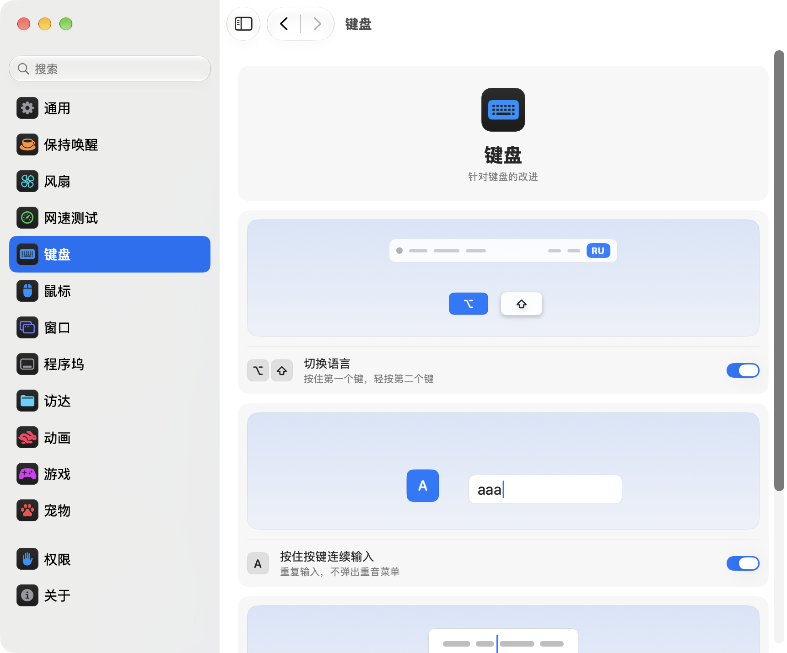

<p align="center"></p>
<h1 align="center">pikapik</h1>
<p align="center"><b>你的 Mac，一点就通。</b><br>键盘、鼠标、窗口和访达的小改进，就在 Mac 的菜单栏里。</p>
<p align="center"><sub><a href="../../README.md">English</a> · <a href="README.ru.md">Русский</a> · <a href="README.uk.md">Українська</a> · <a href="README.de.md">Deutsch</a> · <a href="README.fr.md">Français</a> · <a href="README.es.md">Español</a> · <a href="README.it.md">Italiano</a> · <a href="README.pt-BR.md">Português (Brasil)</a> · <a href="README.ja.md">日本語</a> · <b>简体中文</b> · <a href="README.ko.md">한국어</a> · <a href="README.ro.md">Română</a> · <a href="README.pl.md">Polski</a> · <a href="README.tr.md">Türkçe</a> · <a href="README.nl.md">Nederlands</a> · <a href="README.sv.md">Svenska</a> · <a href="README.cs.md">Čeština</a> · <a href="README.zh-Hant.md">繁體中文</a> · <a href="README.ar.md">العربية</a> · <a href="README.hi.md">हिन्दी</a> · <a href="README.id.md">Bahasa Indonesia</a> · <a href="README.vi.md">Tiếng Việt</a> · <a href="README.th.md">ไทย</a></sub></p>

<p align="center">
<picture>
<source media="(prefers-color-scheme: dark)" srcset="../media/settings-zh-Hans-dark.png">

</picture>
</p>

## 安装

打开“终端”，粘贴下面这行，然后按下 Return 键：

```bash
/bin/bash -c "$(curl -fsSL https://raw.githubusercontent.com/dev-pikapik/pika-tools/main/install.sh)"
```

这条命令会从 GitHub 下载最新版本，只有在它由开发者签名，并且通过了 Apple 的恶意软件检查时才会安装。安装后，pikapik 会出现在屏幕顶部的菜单栏中。在你打开之前，所有功能都保持关闭。

<details>
<summary>其他方法：Homebrew 或 dmg</summary>

使用 Homebrew 时：

```bash
brew install --cask dev-pikapik/pika-tools/pikapik && open -a pikapik
```

或者下载 [pikapik.dmg](https://github.com/dev-pikapik/pika-tools/releases/latest/download/pikapik.dmg)，打开后将 App 拖到“应用程序”文件夹。

上面的命令和 Homebrew 都会把 App 放到 `/Applications`，启动它，请求权限，并打开“登录时打开”。之后 App 会自动更新，详见**更新**。如需移除，请参阅**卸载**。

</details>

## 功能

<table>
<tbody><tr>
<td width="50%" valign="top">
<picture><source media="(prefers-color-scheme: dark)" srcset="../media/keep-awake-dark.png"></picture>
<br><b>保持唤醒</b>
<br>Mac 想醒多久就醒多久，合上盖子也行。
</td>
<td width="50%" valign="top">
<picture><source media="(prefers-color-scheme: dark)" srcset="../media/fans-dark.png"></picture>
<br><b>风扇</b>
<br>查看风扇转得有多快，并选择它的转速。
</td>
</tr></tbody>
<tbody><tr>
<td width="50%" valign="top">
<picture><source media="(prefers-color-scheme: dark)" srcset="../media/battery-dark.png"></picture>
<br><b>电池</b>
<br>查看电池的状态、最大容量和循环次数，有多少电力正在充入，以及怎样让它更耐用。
</td>
<td width="50%" valign="top">
<picture><source media="(prefers-color-scheme: dark)" srcset="../media/command-keys-dark.png"></picture>
<br><b>保护 ⌘Q 和 ⌘W</b>
<br>不会误退出或误关闭。真想这么做时，加上 ⇧。
</td>
</tr></tbody>
<tbody><tr>
<td width="50%" valign="top">
<picture><source media="(prefers-color-scheme: dark)" srcset="../media/compress-dark.png"></picture>
<br><b>较小副本</b>
<br>右键点按照片、PDF 或视频，旁边就会出现一个更小的副本。
</td>
<td width="50%" valign="top">
<picture><source media="(prefers-color-scheme: dark)" srcset="../media/convert-dark.png"></picture>
<br><b>转换</b>
<br>通过右键菜单把图片、视频或歌曲存成其他格式。
</td>
</tr></tbody>
<tbody><tr>
<td width="50%" valign="top">
<picture><source media="(prefers-color-scheme: dark)" srcset="../media/input-switch-dark.png"></picture>
<br><b>切换语言</b>
<br>按住 ⌥ 再轻点 ⇧，就能切换键盘语言。
</td>
<td width="50%" valign="top">
<picture><source media="(prefers-color-scheme: dark)" srcset="../media/quit-on-close-dark.png"></picture>
<br><b>关闭最后一个窗口时退出</b>
<br>关闭 App 的最后一个窗口，App 也随之退出。
</td>
</tr></tbody>
<tbody><tr>
<td width="50%" valign="top">
<picture><source media="(prefers-color-scheme: dark)" srcset="../media/window-zoom-dark.png"></picture>
<br><b>绿色按钮放大窗口</b>
<br>窗口铺满屏幕，但不进入全屏模式。
</td>
<td width="50%" valign="top">
<picture><source media="(prefers-color-scheme: dark)" srcset="../media/dock-hide-dark.png"></picture>
<br><b>在程序坞中点按以最小化</b>
<br>点按正在使用的 App，它就会让开。
</td>
</tr></tbody>
<tbody><tr>
<td width="50%" valign="top">
<picture><source media="(prefers-color-scheme: dark)" srcset="../media/new-file-dark.png"></picture>
<br><b>新建文件</b>
<br>在访达中右键点按，输入名称，空文件就建好了。
</td>
<td width="50%" valign="top">
<picture><source media="(prefers-color-scheme: dark)" srcset="../media/finder-cut-dark.png"></picture>
<br><b>⌘X 移动文件</b>
<br>在访达中剪切文件，再粘贴到想要的位置。
</td>
</tr></tbody>
<tbody><tr>
<td width="50%" valign="top">
<picture><source media="(prefers-color-scheme: dark)" srcset="../media/finder-open-dark.png"></picture>
<br><b>Enter 打开文件</b>
<br>在访达中选中文件，按 Enter 即可打开。
</td>
<td width="50%" valign="top">
<picture><source media="(prefers-color-scheme: dark)" srcset="../media/finder-delete-dark.png"></picture>
<br><b>Delete 移到废纸篓</b>
<br>在访达中按 ⌫，选中的文件就会移到废纸篓。
</td>
</tr></tbody>
<tbody><tr>
<td width="50%" valign="top">
<picture><source media="(prefers-color-scheme: dark)" srcset="../media/desktop-icons-dark.png"></picture>
<br><b>隐藏桌面图标</b>
<br>通话或截屏前，点一下就能让桌面干干净净。
</td>
<td width="50%" valign="top">
<picture><source media="(prefers-color-scheme: dark)" srcset="../media/hidden-files-dark.png"></picture>
<br><b>显示隐藏文件</b>
<br>看到 macOS 隐藏起来的文件和文件夹。
</td>
</tr></tbody>
<tbody><tr>
<td width="50%" valign="top">
<picture><source media="(prefers-color-scheme: dark)" srcset="../media/game-mode-dark.png"></picture>
<br><b>游戏模式</b>
<br>玩游戏时，不会有东西弹到游戏上面，也不会把游戏关掉。
</td>
<td width="50%" valign="top">
<picture><source media="(prefers-color-scheme: dark)" srcset="../media/speed-test-dark.png"></picture>
<br><b>网速测试</b>
<br>网速有多快、够做什么，一看便知。
</td>
</tr></tbody>
<tbody><tr>
<td width="50%" valign="top">
<picture><source media="(prefers-color-scheme: dark)" srcset="../media/side-buttons-dark.png"></picture>
<br><b>鼠标侧键</b>
<br>按键 4 和 5 用于返回和前进，就像在触控板上轻扫。
</td>
<td width="50%" valign="top">
<picture><source media="(prefers-color-scheme: dark)" srcset="../media/hide-app-dark.png"></picture>
<br><b>用鼠标按钮隐藏</b>
<br>按一下即可隐藏最前面的 App，就像按 ⌘H 一样。它会继续运行。
</td>
</tr></tbody>
<tbody><tr>
<td width="50%" valign="top">
<picture><source media="(prefers-color-scheme: dark)" srcset="../media/wheel-lines-dark.png"></picture>
<br><b>按行滚动</b>
<br>无论滚轮转得多快，每一格都滚动相同的距离。
</td>
<td width="50%" valign="top">
<picture><source media="(prefers-color-scheme: dark)" srcset="../media/wheel-direction-dark.png"></picture>
<br><b>滚动方向</b>
<br>触控板一个方向，鼠标另一个方向。
</td>
</tr></tbody>
<tbody><tr>
<td width="50%" valign="top">
<picture><source media="(prefers-color-scheme: dark)" srcset="../media/linear-pointer-dark.png"></picture>
<br><b>关闭指针加速</b>
<br>手移动多少，指针就移动多少。
</td>
<td width="50%" valign="top">
<picture><source media="(prefers-color-scheme: dark)" srcset="../media/key-repeat-dark.png"></picture>
<br><b>按住按键连续输入</b>
<br>按住按键会重复输入字母，而不是弹出重音符号菜单。
</td>
</tr></tbody>
<tbody><tr>
<td width="50%" valign="top">
<picture><source media="(prefers-color-scheme: dark)" srcset="../media/home-end-dark.png"></picture>
<br><b>Home 和 End</b>
<br>输入时跳到行首或行尾。
</td>
<td width="50%" valign="top">
<picture><source media="(prefers-color-scheme: dark)" srcset="../media/animations-dark.png"></picture>
<br><b>动画</b>
<br>让程序坞、窗口和快速查看更快，甚至瞬间完成。
</td>
</tr></tbody>
<tbody><tr>
<td width="50%" valign="top">
<picture><source media="(prefers-color-scheme: dark)" srcset="../media/leftover-permissions-dark.png"></picture>
<br><b>已删除 App 的权限</b>
<br>清除 macOS 为已删除的 App 保留的权限。
</td>
<td width="50%" valign="top">
<picture><source media="(prefers-color-scheme: dark)" srcset="../media/pet-dark.png"></picture>
<br><b>桌面宠物</b>
<br>一个小伙伴在窗口后面散步。把它拎起来扔出去，或者按空格键让它跳一下。用衣橱给它换装，一起玩的时候还能赢得奖章。你打字时它精神抖擞，你走开时它打起瞌睡。
</td>
</tr></tbody>
<tbody><tr>
<td width="50%" valign="top">
<picture><source media="(prefers-color-scheme: dark)" srcset="../media/uninstaller-dark.png"></picture>
<br><b>卸载 App</b>
<br>移除 App 及其文件。一切都能放回。
</td>
<td width="50%" valign="top">
<picture><source media="(prefers-color-scheme: dark)" srcset="../media/game-fps-dark.png"></picture>
<br><b>显示 FPS</b>
<br>一个小计数器会在你选的角落显示游戏运行得有多流畅。
</td>
</tr></tbody>
<tbody><tr>
<td width="50%" valign="top">
<picture><source media="(prefers-color-scheme: dark)" srcset="../media/archive-dark.png"></picture>
<br><b>压缩文件</b>
<br>右键点按，就能解压 RAR 等压缩文件，或把文件打包成 ZIP。
</td>
<td width="50%" valign="top">
<picture><source media="(prefers-color-scheme: dark)" srcset="../media/dock-display-dark.png"></picture>
<br><b>让程序坞固定在一台显示器上</b>
<br>程序坞不会再跳到另一台显示器。要移动它，请将另一台显示器设为主显示器。
</td>
</tr></tbody>
<tbody><tr>
<td width="50%" valign="top">
<picture><source media="(prefers-color-scheme: dark)" srcset="../media/temperatures-dark.png"></picture>
<br><b>温度</b>
<br>查看 Mac 内部有多热，从处理器到电池。
</td>
<td width="50%" valign="top">
<picture><source media="(prefers-color-scheme: dark)" srcset="../media/background-dark.png"></picture>
<br><b>后台任务</b>
<br>查看在后台运行的内容，以及它们从哪里来。
</td>
</tr></tbody>
<tbody><tr>
<td width="50%" valign="top">
<picture><source media="(prefers-color-scheme: dark)" srcset="../media/ports-dark.png"></picture>
<br><b>端口</b>
<br>看看哪个程序占用了端口，并释放它。
</td>
<td width="50%" valign="top">
<picture><source media="(prefers-color-scheme: dark)" srcset="../media/app-volume-dark.png"></picture>
<br><b>App 音量</b>
<br>调低或静音任意 App，不影响其他 App。
</td>
</tr></tbody>
<tbody><tr>
<td width="50%" valign="top">
<picture><source media="(prefers-color-scheme: dark)" srcset="../media/brightness-dark.png"></picture>
<br><b>显示器亮度</b>
<br>用滑块或亮度键，调暗或调亮 macOS 无法自行调节的显示器。
</td>
<td width="50%" valign="top">
<picture><source media="(prefers-color-scheme: dark)" srcset="../media/layout-fix-dark.png"></picture>
<br><b>修正用错的键盘布局</b>
<br>想打 привет，却打成了 ghbdtn？按一下空格键就改好了。
</td>
</tr></tbody>
<tbody><tr>
<td width="50%" valign="top">
<picture><source media="(prefers-color-scheme: dark)" srcset="../media/middle-click-dark.png"></picture>
<br><b>触控板中键点按</b>
<br>三指轻点即可在新标签页中打开链接，就像鼠标中键一样。
</td>
</tr></tbody>
</table>

## 详细信息

<details>
<summary>首次启动</summary>

pikapik 需要两项权限。首次启动时，它会打开设置中的“权限”页面，一步步引导你完成，macOS 也会显示自己的提示。前往 **系统设置 › 隐私与安全性**，在以下两项中打开 pikapik：

- **辅助功能**：让 App 能在按键或点按传到其他 App 之前对其进行修改。
- **输入监控**：让 App 能看到按键和点按但不修改它们，切换语言就是这样工作的。

App 会在一两秒内识别到更改，无需重新启动。

有些功能在使用时需要更多权限：**管理员权限**、**访达扩展**、**iCloud 云盘**、**完全磁盘访问权限**、**屏幕录制** 和 **系统音频录制**。它们都集中在设置的“权限”页面：每一项都有一行说明用途、一个绿色对勾或橙色叉号，以及一个按钮：缺少时是 **允许**，已开启时是 **关闭**。这样你可以当场收回任何权限。

pikapik 不会记录、存储或发送你输入或点按的任何内容。事件只在内存中处理并立即传递出去。为了修正用错键盘布局输入的文字，pikapik 只在内存中保留你最近输入的几个词，一旦你点按或切换 App 就会忘掉。它只保存你要求保持原样的词，而且只存在这台 Mac 上，直到你在“设置 › 键盘”里清除。pikapik 只在两种情况下联网：更新（向 GitHub 查询最新版本，只有你选择更新时才会下载），以及你启动网速测试时（使用 Apple 的服务器）。Mac App Store 版由 App Store 负责更新，它的网速测试使用 Cloudflare。宠物的进度（步数、投掷次数、奖章等）只在这台 Mac 上统计，不会发送到任何地方。你可以在“设置 › 宠物”里清除。

</details>

<details>
<summary>每项功能的详细说明</summary>

**播放器。** QuickTime 打不开的视频，比如 MKV、WebM、AVI、WMV 和 FLV，会在独立窗口中播放。打开“设置 › 播放器”，点按 **打开视频…**，或者右键点按视频，然后选择 **打开方式 › pikapik Player**。空格键播放和暂停，← 和 → 在暂停时前进或后退一帧，播放时跳转 5 秒，J 和 L 跳转 10 秒，↑ 和 ↓ 调节音量，F 进入全屏幕。**速度**菜单从 0.5 倍到 2 倍，**存储帧…** 存储为 PNG，播放器会从你上次停下的位置继续。视频的章节会显示为时间条上的标记，也列在**章节**菜单里，Page Down 和 Page Up 在章节之间跳转，按两次 A 会重复两次之间的片段，直到你第三次按 A。**画中画**（⌘⌥P）会把视频显示在其他窗口上方的小窗口里。**声音输出到**（播放菜单）会把播放器的声音送到其他扬声器或耳机，而不改变 Mac 本身的输出。控制面板是磨砂玻璃效果，观看时会自动隐藏；把指针移到时间条上，会显示该时刻的小图。窗口没有标题栏：视频铺满整个窗口，三个窗口按钮也会随控制面板一起出现和隐藏。已经打开的视频会回到最前面，不会再打开第二个窗口。播放器不联网、不请求任何权限。该页面上的每种格式都是一个按钮，显示当前打开它的 App：点按后 pikapik Player 成为该格式的默认 App，再点按一次就交还给原来的 App。**全部用 pikapik 打开** 会依次处理所有格式，并变为 **恢复原来的 App**（macOS 会逐个请求确认）。歌曲在同一个窗口中播放，并显示封面、标题和艺人：支持 MP3、AAC、FLAC、ALAC、WAV、AIFF、Ogg、Opus、WMA 等。文件夹从第一首歌开始播放；N 和 P（**文件夹中的下一个**、**文件夹中的上一个**）在歌曲间切换，下一首会自动开始，macOS 会询问一次是否允许该文件夹。Mac 的“正在播放”和媒体键也能使用。FFmpeg、dav1d、libass、FreeType、HarfBuzz 和 FriBidi 的许可证及其源代码，可以在同一页面打开。**音频** 和 **字幕** 菜单（以及面板上的按钮）可切换音轨和字幕，不会丢失播放位置。文件内的文本字幕，以及旁边同名的 .srt、.vtt 或 .ass 文件（文件夹已被允许时）会自动出现；也可以把字幕文件拖到窗口上，或选择 **添加字幕文件…**。图像字幕（Blu-ray、DVD、DVB）也会显示，ASS 字幕会完整绘制，包括动画、卡拉 OK 效果和视频中附带的字体。Mac App Store 版本中没有此功能。

**App 音量。** 打开“设置 › 声音”，开启 **App 音量**。每个播放声音的 App 都有自己的滑块和静音按钮，在设置和菜单里都能用。把太吵的视频通话调低，把嘈杂的游戏静音，音乐保持原样：你 Mac 的音量和其他 App 的音量都不会变。pikapik 会记住每个 App 的音量，保持最大音量的 App 绝不会被改动。你设置过的 App 会一直留在列表里，重启后也一样，关闭时显示为灰色，所以可以在 App 启动前先设好音量：点按 **添加应用…**，或从 Finder 拖入一个 App。App 旁边的 ✕ 会清除它的记录，并恢复为最大音量。要改变某个 App 的音量，pikapik 会让它的声音先经过自己，所以需要 **系统音频录制** 权限，你可以在“权限”页面允许。声音只是被转交，不会被录制、保存或发送到任何地方，也不使用麦克风。需要 macOS 14.2 或更高版本，在 macOS 14.0 和 14.1 上会隐藏。默认关闭。

**显示器亮度。** macOS 能调节内建显示屏和 Apple 显示器的亮度，但调节不了大多数其他显示器。打开“设置 › 亮度”，每台 macOS 无法自行调节的显示器都有自己的滑块；你还可以在菜单栏面板中添加“亮度”一行。pikapik 调节的是显示器本身的亮度，和显示器上的按钮调的是同一个设置。如果某台显示器没有反应，就开启 **改为调暗画面**：画面会变暗，但绝不会变成全黑。开启 **亮度键** 后，亮度键会调节指针所在显示器的亮度，并在屏幕上显示一个小指示条；按住 ⌥⇧ 可以调得更细。亮度键需要 **辅助功能** 权限，你可以在“权限”页面允许；滑块不需要这个权限也能用。pikapik 会记住每台显示器的亮度，并在睡眠后重新设置。Mac App Store 版本只会调暗画面。亮度键默认关闭。

**保护 ⌘Q 和 ⌘W。** 单独按 ⌘Q 和 ⌘W 不会有任何反应，因此不会误退出 App 或误关窗口。想要退出或关闭时，加按 Shift：⇧⌘Q 退出，⇧⌘W 关闭。适用于所有 App。每个按键都有单独的开关。默认关闭。

**用 Option+Shift 切换语言。** 按住 Option 再按一下 Shift：macOS 会切换到下一个输入法。继续按住 Option 再按一下 Shift，就会继续往下切换。按住 Shift 再按一下 Option，则切回上一个。如果中途按了其他键、点按了鼠标，或者加按了 Command、Control 或 Fn，就不会切换，所以像 Option+Shift+箭头键这样的快捷键照常可用。默认关闭。

**按住按键连续输入。** 按住一个键，就会不停地重复输入这个字母，而不是弹出重音菜单。玩游戏和打字时都很方便。已经打开的 App 需重新启动后生效。关闭后，macOS 恢复原来的行为。默认关闭。

**Home 和 End 跳到行首和行尾。** 输入时，Home 把光标移到行首，End 移到行尾，不再滚动页面。按住 ⇧ 会选到那里，按住 ⌘ 会跳到整段文本的开头或末尾。在文本框以外，以及终端、虚拟机和远程桌面 App 中，这两个键照旧工作。在 Mac App Store 版本中，除浏览器、访达和“音乐”外，这两个键在文本框以外也会这样工作。你还可以添加其他需要照常工作的 App。默认关闭。

**修正用错键盘布局输入的文字。** 如果打出来的词变成了乱码，比如把 привет 打成了 ghbdtn，只要你按下空格键或 Return 键，pikapik 就会用正确的布局重新输入，并切换布局，让下一个词直接打对。你在 Mac 上添加的所有键盘布局都适用。只有当一个词不属于你使用的任何一种语言，而同样的按键在另一种布局下能打出常用词时，它才会被修改，所以人名、拼错的词和生僻词都会保持你输入的样子，密码框、“终端”和你选择的 App 中的文字也一样。按 ⌃⇧空格键可修正最后一个词或所选文本，再按一次可尝试其他布局。修正后立即按下同样的键即可撤销，而且 pikapik 以后不会再自动修正这个词。你可以在“设置 › 键盘”里更改快捷键。在 Mac App Store 版中，选中文本，然后按 ⌃⇧空格键，或在“服务”菜单中选择“修正键盘布局”。在你于“设置 › 键盘”里打开之前，**输入时修正文字**和快捷键都是关闭的；它们还需要“辅助功能”，“权限”页面会请求这一项。默认关闭。 如果只有一个键盘布局，页面上的提示可直接添加您语言对应的布局，无需前往“系统设置”（网站版）。

**关闭指针加速。** 无论鼠标移动得多快，指针都只移动与鼠标完全相同的距离。**追踪速度** 滑块用于设定指针移动的快慢。仅对鼠标有效，触控板保持不变。关闭此功能或退出 pikapik 后，macOS 会恢复它自己的设置。默认关闭。

**按行滚动。** 鼠标滚轮每滚一格，滚动的行数都一样，不管你转得多快。每格可以选 1 到 10 行，默认 3 行。自然滚动保持你在“系统设置”中的设置。只对鼠标有效，触控板保持不变。默认关闭。在 **每格距离** 滑块旁边，一张小页面会按所选距离滚动，圆点标出默认值。

有些 App 和游戏以精确像素计算滚动：遇到它们时，把同一个设置切换为按像素，每格可选 1 到 200 像素，默认 40。滑块还会显示这相当于屏幕高度的多少。

**触控板和鼠标的滚动方向。** macOS 只有一个自然滚动开关，同时作用于触控板和鼠标。打开此功能，为每一个选择方向：**自然**，页面像在 iPhone 上一样跟着手指走；或 **经典**，页面朝相反方向移动。触控板的选择也适用于横向滚动和抬起手指后的惯性滚动。妙控鼠标靠触摸滚动，所以跟随触控板的选择。在你的每台 Mac 上选择相同的方向，滚动在哪里都一样，即使用通用控制把鼠标移到另一台 Mac 上也是如此。默认关闭。打开时两者都和系统设置一致，所以在你选择别的方向之前什么都不会变。

**侧键用于返回和前进。** 鼠标按键 4 和 5 可以在访达、Safari 等 Apple App 以及许多其他 App 中后退和前进，就像在触控板上轻扫一样。自行处理这两个按键的 App 会原样收到它们。如果你的鼠标侧键方向相反，请打开 **交换侧键**。默认关闭。

**用鼠标按钮隐藏当前 App。** 在“设置 › 鼠标”中打开 **用鼠标按钮隐藏当前应用**，然后按下你想用的按钮，比如中键或侧键。之后按一下就能隐藏最前面的 App，和按 ⌘H 完全一样：App 会继续运行，点按它在程序坞中的图标即可让它回来。开启游戏模式玩游戏时，这个按钮在游戏里照常工作。默认关闭。

**触控板中键点按。** 用三指轻点或点按，触控板就像鼠标中键一样：在大多数浏览器中，这样可以在新标签页中打开链接或关闭标签页。你也可以改用四指。轻点需要打开“系统设置 › 触控板”中的 **轻点以点按**。如果那里的“查询与数据检测器”设为三指轻点，三指就只能点按；如果打开了三指拖移，请选择四指。设置中的 **手指** 一行会告诉你这台 Mac 上哪些操作可用。鼠标保持不变。它需要 **辅助功能** 和 **输入监控** 权限，Mac App Store 版本中没有此功能。默认关闭。

**关闭最后一个窗口时退出。** 关闭 App 的最后一个窗口后，App 就会退出。访达会保持打开，在其他桌面上有窗口或有窗口最小化到程序坞的 App 也不会退出。你可以列出永远不要以这种方式退出的 App。默认关闭。

**点按程序坞最小化或隐藏。** 在程序坞中点按当前正在使用的 App 的图标，它的所有窗口都会收进程序坞。再点按一次即可全部恢复。你也可以让点按隐藏整个 App，就像按 ⌘H 一样。默认关闭。

**让程序坞固定在一台显示器上。** 有多台显示器时，一旦指针抵住另一台显示器的下边缘，macOS 就会把程序坞移到那台显示器上。打开这个开关后，无论你把指针移得多快，都不会再发生这种情况：pikapik 通过程序坞自己的设置关闭这种移动，也从不碰指针。要主动移动程序坞，请将另一台显示器设为主显示器：在**系统设置 › 显示器**中点按那台显示器，然后在**用途**中选择**主显示器**，程序坞就会跟着过去。开关下方的**主显示器**一行可以直接完成这一步，关闭开关后，显示器会恢复原样。程序坞只在启动时读取自己的设置，所以打开或关闭这个开关时，程序坞会重新启动一次。不需要任何权限。这个开关默认是关闭的，Mac App Store 版本中没有此功能。

**绿色按钮放大窗口。** 点按窗口的绿色按钮，窗口会铺满屏幕，而不会进入全屏幕。再点按一次，恢复原来的大小。按住 ⌥ 时，按钮照常工作。全屏幕仍可在按钮的菜单中或按 ⌃⌘F 使用。可以列出绿色按钮应照常工作的 App。默认关闭。

**在访达中新建文件。** 在访达窗口或桌面上右键点按，选取 **新建文件**，输入名称，就会出现一个空文件。默认为 .txt。默认关闭。

**在访达中用 Enter 打开文件。** 在访达窗口或桌面上选中文件，按 Return 或 Enter 即可打开。按 F2 或 fn F2 可重命名所选文件。在文本框中，比如输入名称时，这些键照常工作。默认关闭。

**在访达中用 ⌘X 剪切文件。** 选中文件并按 ⌘X，打开目标文件夹后按 ⌘V，文件会移动到那里而不是被拷贝。按 ⌘C 可取消剪切。默认关闭。

**在访达中用 Delete 删除文件。** 选中文件后按 ⌫ 或 ⌦（笔记本电脑上为 fn ⌫），文件就会移到废纸篓，和 ⌘⌫ 一样。重命名文件、搜索或在其他输入框中输入时，这两个键照常删除文字。默认关闭。

**在访达中制作较小副本。** 在访达中右键点按文件，然后选择 **制作较小副本**。照片、GIF、PDF 或视频的轻量版本会存储在旁边，通常小好几倍。WAV 或 AIFF 等未压缩的声音会变为小巧的 M4A。如果文件无法再缩小，就不会制作副本，pikapik 会告诉你。原文件保持不变，任何内容都不会离开你的 Mac。默认关闭。

**在访达中转换。** 在访达中右键点按文件，然后选择 **转换为**，即可存储为其他格式：图片存为 JPEG、PNG、HEIC、GIF、TIFF 或 PDF，视频存为 MP4、MOV 或只保留声音，音乐存为 M4A、WAV 或 AIFF。原文件保持不变，任何内容都不会离开你的 Mac。与较小副本分开开启。默认关闭。

**访达中的压缩文件。** 在访达中右键点按压缩文件，然后选择 **解压缩**，里面的文件就会出现在它旁边。右键点按其他任意文件或文件夹，然后选择 **创建压缩文件…**，即可生成 ZIP、7Z、TAR.GZ 或 TAR.XZ。ZIP 和 7Z 可以设置密码，任何压缩文件都可以分成多个部分，例如发邮件用的 15 MB 一份，或放进 U 盘的 4 GB 一份。密码需要输入两次，免得一个笔误让你打不开自己的文件。这样生成的 ZIP 不夹带系统生成的隐藏文件，任何语言的文件名都能正常显示，也能处理超过 4 GB 的文件。默认关闭。Mac App Store 版本有一些限制，详见下文。

pikapik 还能打开 macOS 打不开的文件：RAR（包括分成多个部分的）、带密码的 7Z、.001、.z01、.r00、.part1.rar 这类分卷，以及 ZIPX、CAB、LZH、ARJ、ZST、LZMA、WIM 等。双击就会在 pikapik 中打开。旧版 ZIP 里的文件名，例如西里尔文、日文或中文的，也能正常显示。“设置”›“访达”里的开关 **用此 App 打开压缩文件** 还会把 ZIP 和 7Z 也交给 pikapik，而 TAR 和 GZ 仍由内置的压缩文件 App 处理，它本来就处理得很好。pikapik 能打开 RAR，但不能创建 RAR：RAR 的许可只允许解压。

会弹出窗口询问密码，**停止** 可以取消任何任务，对于损坏或不完整的压缩文件，pikapik 会取出仍然可以读取的部分。如果压缩文件解压后会膨胀到巨大体积，pikapik 会先询问你；磁盘快要写满时它会及时停下；试图写到自己文件夹之外的压缩文件会被拦下。在访达中选中压缩文件后按空格键，即可预览里面有什么。
**Mac App Store 版本中的压缩文件。** 这个版本里也能用，但使用的是 macOS 自带的工具，而不是随附的 7-Zip，所以有一些限制：只有 ZIP 能设密码，7Z 不行；压缩文件不能分成多个部分，分卷压缩文件（.001、.part1.rar、.z01 等）也打不开；单独的 .xz、.lzma 和 .zst 文件打不开（.gz 和 .bz2 可以）；带密码的 7Z 和 RAR 打不开；也没有“用此 App 打开压缩文件”开关。第一次使用时，pikapik 会请求访问你的个人文件夹，和“新建文件”“较小副本”一样，因为这个版本只能写入你允许的位置。请在“系统设置” › “通用” › “登录项与扩展”中打开访达扩展，pikapik 会告诉你该点哪里。


**隐藏桌面图标。** 在通话、录屏或截屏前打开它，桌面上的文件和文件夹就会消失。关掉它，它们会回到原来的位置。什么都不会被移动：文件仍在访达的“桌面”文件夹里。它就是“系统设置 › 桌面与程序坞”中的 **“显示项目” › “桌面上”**，只是放在了手边，所以两者始终一致。在 Mac App Store 版本中，这一行会改为在每台显示器上用壁纸盖住图标，壁纸会动时则用纯色盖住，点按操作仍会传到桌面。在“设置”中，下方的 **打开** 按钮仍会打开系统设置的这个页面。

**显示隐藏文件。** macOS 隐藏的文件和文件夹，例如个人文件夹中的“资源库”或名称以点开头的文件，会以半透明的样子出现在访达和桌面上。这和在访达中按 ⇧⌘. 一样，只是一眼就能看出是否已打开。为了应用更改，访达会短暂重新启动，并再次打开其窗口和标签页。如果访达正在拷贝或移动文件，会等到完成后再重新启动。两者都在“设置 › 访达”中。想把它们放进菜单栏面板，请点按面板底部的铅笔按钮并勾选它们。在 Mac App Store 版本中，“设置 › 访达”会改为显示 ⇧⌘. 这组按键。

**游戏模式。** 添加你的游戏后，玩游戏时 Mac 不会把你拉出游戏。聚焦、Siri、⌘Tab、调度中心和在桌面之间轻扫都不会在游戏上方打开，⌘Q 和 ⌘W 不会意外关闭游戏，指针不会滑到程序坞、菜单栏或另一块屏幕上，屏幕也保持常亮。每一项都可以在“游戏”页面单独开关，pikapik 还会推荐它在你的 Mac 上找到的游戏。游戏中 Control-点按仍是普通点按，Control+箭头也不会切换桌面。也能识别 Minecraft：添加 Minecraft Launcher 或 CurseForge，在 Minecraft 里就会打开这个模式。要退出游戏，请按 ⇧⌘Q；要关闭其窗口，请按 ⇧⌘W。⌥⌘Esc 始终有效。一离开游戏，一切照常工作。默认关闭。

开启游戏模式就能玩。更多游戏设置中有Mac公开的完整目录、当前按键设置，以及每项操作的动画预览。

自动模式暂停打开窗口或转移焦点的操作。快速且有意的语言快捷键直接切换输入源，不弹出系统窗口。持续按住的移动键优先，因此跑动和跳跃不会意外切换语言。

设置 → 游戏 → 更多游戏设置中有一个“鼠标和触控板”分组。它只列出你的 Mac 上在 macOS 里已开启的项目，使用 Apple 的原名，并为每一项配有小插图：鼠标按键上的快捷键、在桌面和全屏 App 之间轻扫、调度中心和 App Exposé、捏合打开 App、张开显示桌面、从右边缘轻扫打开通知中心，以及每个触发角和它执行的操作。游戏在最前面时，这些操作会被暂停，所以不小心轻扫或碰到屏幕角落，都不会把你带出游戏。游戏内的手势照常工作。每一项也都可以设为照常工作。 网站版中，热角旁的**更改…**可直接为它选择另一个操作，**放回原处**则恢复最初的操作；每次更改会重新启动一次 Dock。

打开设置 → 游戏 → 添加游戏，点击正在运行的游戏。通过Java或其他运行环境启动的游戏也会显示，即使没有.app文件。Minecraft会显示为Minecraft，而不是java。 找到游戏进程，将其所在行拖到设置 → 游戏中的「你的游戏」。

**显示 FPS。** FPS 指每秒帧数，也就是游戏每秒绘制的画面数。在“游戏”页面打开**显示 FPS**，游戏模式开启时，任何游戏的一个角落都会出现一个带着这个数字的深色小标签。点按开关上方图片里的角落，就能选择它的位置。“—”表示最初的画面还没到，变淡的“0”表示游戏已停止绘制。在 macOS 27 上，大多数游戏由 macOS 自己计数，不需要权限。macOS 数不了的游戏（多为较旧的游戏）会通过屏幕录制来计数：这时“权限”页面里会出现**屏幕录制**一行，pikapik 绝不会在游戏中请求权限，数值也不会超过屏幕的刷新率。在 macOS 14–26 和 Mac App Store 版本中，所有游戏都这样计数，所以一打开**显示 FPS**，这一行就会出现，开关下方的**允许**按钮会带你到那里。不会保存或发送任何图像。默认关闭。

**宠物衣橱和奖章。** 打开“设置 › 宠物”，给你的宠物换装：30 多件衣饰，从帽子、眼镜到披风和翅膀，还有巫师、海盗、宇航员等现成的造型。少数几件一开始就能用，其余的是奖章，一起玩的时候就会慢慢拿到：把宠物拎起来扔出去、踢一踢球、看它爬窗户和聊天，或者每天陪它待一会儿。获得新奖章时，宠物会告诉你。

为了知道什么时候该颁发奖章，pikapik 只统计你和宠物做的事：步数、你拎起和抛出宠物的次数、跳跃、攀爬、踢球玩耍、聊天、一起度过的天数、是不是在清晨、午夜后或周末陪着它、你打开过的设置页面和试穿过的衣饰。在 Mac App Store 之外的版本中，pikapik 还会记下你是否在设置里打开过我们的 GitHub 页面。这些数字、每枚奖章的获得日期和宠物身上穿的衣服只保存在这台 Mac 上。不会向任何地方发送，也不会进入导出的设置文件或 iCloud 同步。你可以随时在“设置 › 宠物”里全部清除，宠物会从头开始。

**卸载 App。** 打开“设置 › 卸载 App”，在列表中选一个 App，或把 App 拖到图片上，pikapik 就会列出这个 App 在你的 Mac 上留下的所有内容：App 本身、它保存的数据、设置、临时文件、后台辅助程序等，每一项都写明了列出的原因。明确属于这个 App 的文件会被勾选，只是可能相关的文件不会，其他 App 也在使用的文件会加上标记。选好要移除的内容，点按**移到废纸篓**。任何东西都不会被永久删除：全部会进入废纸篓。如果 App 正开着，pikapik 会先请它退出；如果有些文件需要管理员权限，Mac 会询问一次密码。

改主意了？点按**放回原处**，一切都会回到原来的位置，后台辅助程序也会重新启动。最近十次移除会留在“最近移除”里，直到它们的文件离开废纸篓。**重置 App** 会保留 App，只移除它保存的数据、设置和临时文件，App 出问题时可以试试。你自己移到废纸篓的 App 会连同留下的文件出现在“在废纸篓中”，而“已移除 App 的残留文件”会找出已经不在的 App 留下的文件。开关“App 被移到废纸篓时，提议清理”默认关闭，在你选择之前不会移除任何内容。页面需要**完全磁盘访问权限**，才能看到 App 留下的全部内容。Mac App Store 版本中没有这个工具。

**温度。** 打开“设置 › 温度”，就能看到 Mac 内部有多热。最上方用一个词概括整体情况，从“正常”到“非常热”，下面一行告诉你 Mac 是在全速运行，还是正在降速以便降温。再往下，每个部件各占一行，用通俗的名称代替传感器代码：处理器、图形处理器、内存、存储、Wi-Fi 和电池，具体取决于你的 Mac 有哪些传感器。每一行显示温度和一根短条，短条会根据该部件的正常范围变成绿色、黄色或橙色。数值每两秒刷新一次，而且只在你查看时刷新，所以几乎不会给 Mac 增加负担。不需要密码，也不需要任何权限。你还可以在菜单栏面板中添加“温度”一行。Mac App Store 版本显示整体情况，带电池的 Mac 上还会显示电池温度。

**后台任务**页面会列出 Mac 上所有自行启动的内容：登录时打开的 App、后台服务、藏在 App 里的辅助程序，以及已经移除的 App 留下的残留文件。每个任务都会显示是哪个 App 添加的、现在是否正在运行、文件在哪里；点按一下就能在访达中显示这个文件。由代理启动的任务（包括所有用户的任务）和旧的登录项，直接在 pikapik 中用一个按钮就能关闭，不需要密码，重新打开也一样简单，任何东西都不会被删除。共享 Library 文件夹里的后台服务、远程登录和屏幕共享也能用同样的方式关闭，只要在“权限”页面允许一次管理员权限。App 自己注册的辅助程序和其他位置的服务归 macOS 管理，所以它们的按钮会打开“系统设置”中的“登录项”，行下方还有一行说明原因。在 Mac App Store 版本中，这个页面只显示任务：你只需在熟悉的“打开”窗口中授权访问一次个人文件夹，按钮则会打开“登录项”。

**端口。** 当某个程序提示它的端口已被占用时，打开“设置 › 端口”。你会看到 Mac 上占用端口的每个程序，以及它的图标、端口号，还有网络中的其他设备能否连接。输入一个号码，就能找出是谁占用了这个端口，或者确认它没有被占用。点按一行，就能看到可以在浏览器中打开的地址、程序文件、启动它的命令、它所在的文件夹和进程编号。**释放**会先请程序退出，让它有机会保存工作；如果它没有关闭，再提议强制退出。每一步都会先征得你的同意。pikapik 从不退出 macOS 的组成部分或其他用户的程序：对于“隔空播放接收器”和“文件共享”，它会告诉你“系统设置”中的哪个开关可以释放端口；“远程登录”和“屏幕共享”可以直接用“关闭”按钮关闭。Mac App Store 版本中没有“端口”页面，因为在那里 macOS 不允许 App 查看是哪个程序占用了端口。

每个工具在菜单和设置中都有单独的开关。

菜单栏图标一眼就能看出状态：工具正在运行时显示 pikapik 标志，全部关闭时同一个标志会变淡，工具已打开但缺少权限时显示警告三角形。

菜单栏面板一开始只显示几行。显示哪些行，由你来选：点按底部的铅笔按钮，勾选想看到的项目，再点按**完成**。隐藏的行仍会照常工作，并保留在设置中。面板在屏幕上放不下时，可以滚动。

App 跟随系统语言，或使用你在设置中选择的语言。支持本页顶部列出的全部 23 种语言。

</details>

<details>
<summary>保持唤醒</summary>

在你离开键盘时防止 Mac 进入睡眠：时长可以是 1 秒到 365 天之间的任意时间，或者一直持续到你手动关闭。在菜单中打开它，在设置中设定时长：输入天、小时、分钟和秒，按 ↑ 和 ↓，或点按 15 分钟到 8 小时的预设。菜单会显示剩余时间和结束时间。**显示器** 有两种选择。**始终开启**：不会熄灭，也不会出现屏幕保护程序和锁定屏幕。**照常关闭**：按自己的计时关闭，Mac 继续工作。**立即关闭显示器**（菜单中也有）会马上关闭显示器，Mac 继续工作：移动鼠标或按任意键即可唤醒。退出 pikapik 会结束“保持唤醒”。

在 MacBook 上，你还可以打开 **合盖时继续运行**。macOS 没有这样的开关，因此 pikapik 会运行 `pmset -a disablesleep 1` 并要求输入管理员密码：只有管理员才能更改 Mac 的睡眠方式。当“保持唤醒”结束、你退出 App 或 App 崩溃时，此设置都会自动恢复原状。如果不输入密码，什么都不会改变。合盖使用时请保持 Mac 通风良好。**电池电量低于 20% 时停止** 会在电池耗尽前结束本次会话。

通过“快捷指令”App，可以把“保持唤醒”、屏幕常亮和合盖模式放到控制中心、菜单栏或桌面小组件的按钮上，链接在“设置 › 保持唤醒”里拷贝。

</details>

<details>
<summary>网速测试</summary>

显示你的网络现在有多快。在“设置 › 网速测试”里点按**测速**，或者用铅笔按钮把这一行加到菜单后，点按菜单里的**测速**。大约半分钟后，就能看到下载和上传速度、延迟和响应能力，也就是网络繁忙时一切反应有多快。下面会用简单的话告诉你，这个网速够不够看 4K 电影、视频通话、玩在线游戏和下载大文件。测速使用 macOS 自带的 networkQuality 和 Apple 的服务器。上次的结果会一直保留到下次测速；用“快捷指令”里的链接，还能从控制中心开始测速。

</details>

<details>
<summary>设置</summary>

从菜单中选择 **设置…** 或按 ⌘, 打开设置，也可以从访达、启动台或聚焦搜索再次启动 pikapik。窗口打开期间，App 会显示在程序坞和 ⌘Tab 中。

- **通用**：登录时打开、外观（跟随系统、浅色或深色）、语言、更新和备份：把设置导出为文件或从文件导入，也可以通过 iCloud 云盘同步。
- **电池**：电量、充满还需多久或还能用多久、状态、最大容量、循环次数、电源适配器和功率（瓦）、让电池更耐用的建议。它只显示信息，充电上限仍在**系统设置 › 电池**中设置。只有带电池的 Mac 才会显示。
- **保持唤醒**：时长、显示器和合盖选项。
- **亮度**：macOS 无法自行调节的每台显示器的滑块、亮度键，以及改为调暗画面的选项。
- **风扇**：查看每个风扇的转速，允许管理员权限后可选择自动或手动转速。
- **温度**：Mac 有多热，包括整体情况和各个部件，比如处理器、内存和电池。
- **网速测试**：测网速，看看它适合做什么。
- **端口**：哪个程序占用了哪个端口、它的地址和详细信息，以及释放端口的按钮。
- **声音**：App 音量，为每个播放声音的 App 提供滑块和静音按钮。
- **键盘**：语言切换、按键重复、Home 和 End、修正用错的键盘布局。
- **鼠标**：指针加速和追踪速度、按行滚动、滚动方向、侧键、隐藏当前 App 的按钮、触控板中键点按。
- **窗口**：用绿色按钮放大窗口（附例外列表）、⌘Q 和 ⌘W 保护，以及关闭最后一个窗口时退出（附例外列表）。
- **程序坞**：点按程序坞最小化或隐藏，以及让程序坞固定在一台显示器上。
- **访达**：新建文件、较小副本、转换和压缩文件、用 Return 打开、用 ⌘X 剪切、用 ⌫ 删除、隐藏桌面图标、显示隐藏文件。
- **播放器**：在独立窗口中打开视频、支持的格式、将其设为默认视频播放器的开关，以及 FFmpeg、dav1d、libass、FreeType、HarfBuzz 和 FriBidi 的许可证。
- **卸载 App**：移除 App 及其全部文件，之后还能全部放回，并清理已移除 App 留下的残留文件。
- **后台任务**：所有在后台运行的内容、是哪个 App 添加的，以及一个无需打开“系统设置”就能关闭和重新打开它们的按钮。
- **游戏**：你的游戏列表和游戏模式的选项。
- **宠物**：开启或关闭宠物，让它聊天、跟着你的节奏、玩球，给它换装，查看奖章。
- **权限**：pikapik 用到的所有权限，每项都显示状态，并有一个允许或关闭它的按钮。缺少权限的工具会显示为半灰色，点按它就会在对应的那一行打开此页面。
- **关于**：版本、更新日志链接和问题反馈链接。

许多设置配有一幅小图，展示它们的作用，例如保持唤醒的 Mac，或藏到 Dock 后面的窗口。图会随开关一起变化；如果在系统设置中开启了“减弱动态效果”，图就保持静止。

每个页面底部都有一个 **恢复默认…** 按钮。它会先询问你，然后关闭该页面上的工具并还原它们的选项，就像 pikapik 从未改动过一样。

**通过 iCloud 同步设置** 能让 pikapik 在你所有的 Mac 上保持一致。设置保存在 iCloud 云盘的 pikapik 文件夹里，以最近一次的更改为准。默认关闭，并且需要先打开 iCloud 云盘。权限不会同步：每台 Mac 都会各自请求。

**只有一个主副本。** 如果同时打开了两个 pikapik 副本，例如网站版和 App Store 版，只有最后打开的那个会更改 Mac 上的任何内容。另一个会显示一条简短的说明和**将此副本设为主副本**按钮，并在主副本退出时接手。不再是主副本的那个副本会把它更改过的内容恢复原样。

</details>

<details>
<summary>更新</summary>

pikapik 会在启动时以及每隔 6 小时检查新版本。你可以在“设置 › 通用”中关闭此功能。有新版本时，菜单中会出现 **更新到 …** 按钮：点按一下，App 就会下载更新、安装并重新启动。你也可以在“设置 › 通用”中点按 **立即检查** 手动检查。

使用 Homebrew 时，也可以运行 `brew upgrade --cask pikapik`。

从 1.3 版开始，更新后权限会保留。

</details>

<details>
<summary>卸载</summary>

```bash
/bin/bash -c "$(curl -fsSL https://raw.githubusercontent.com/dev-pikapik/pika-tools/main/uninstall.sh)"
```

如果是用 Homebrew 安装的：`brew uninstall --cask --zap pikapik`。

两种方式都会退出 App、将其从登录项中移除并删除。脚本还会重置它的权限。

</details>

<details>
<summary>常见问题</summary>

**为什么需要两项权限？**
macOS 把对键盘和鼠标的访问分成两部分。“辅助功能”让 App 能修改按键或点按，大多数功能只需要这一项。“输入监控”只让 App 看到事件而不修改，切换语言用它就够了。

**macOS 提示 App 来自身份不明的开发者。**
pikapik 由开发者签名，并通过了 Apple 的恶意软件检查，因此这个提示不应该出现。如果仍然出现，请打开 **系统设置 › 隐私与安全性** 并点按 **仍要打开**。

**支持搭载 Intel 处理器的 Mac 吗？**
支持。这是适用于 Apple 芯片和 Intel 的通用 App，需要 macOS 14 Sonoma 或更高版本。

**权限已打开，但什么都不起作用。**
在 **系统设置 › 隐私与安全性** 中，用 − 按钮从两个列表中移除 pikapik，然后重新添加。也可以直接在 pikapik 里操作：在“权限”页面中，对每项权限先点按 **关闭**，再点按 **允许**。

</details>

<p align="center">☕ 如果你喜欢 pikapik，可以<a href="https://buymeacoffee.com/pikapik">请我喝杯咖啡</a>，每一份心意都会用于 App 的开发与维护。</p>

<p align="center"><sub><a href="../whats-new/README.zh-Hans.md">更新内容</a> · <a href="https://github.com/dev-pikapik/homebrew-pika-tools">Homebrew tap</a> · <a href="../../CONTRIBUTING.md">自行构建</a> · <a href="../../LICENSE">MIT 许可证</a> · © 2026 pikapik</sub></p> ¶NL¶
