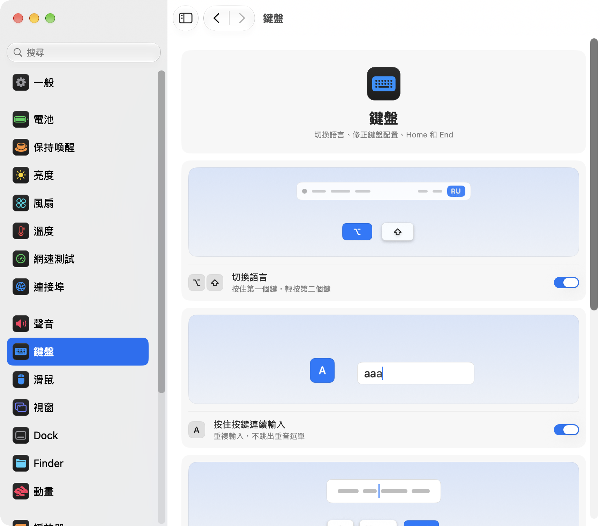

<p align="center"></p>
<h1 align="center">pikapik</h1>
<p align="center"><b>你的 Mac，一點就通。</b><br>鍵盤、滑鼠、視窗和 Finder 的小改進，就在 Mac 的選單列裡。</p>
<p align="center"><sub><a href="../../README.md">English</a> · <a href="README.ru.md">Русский</a> · <a href="README.uk.md">Українська</a> · <a href="README.de.md">Deutsch</a> · <a href="README.fr.md">Français</a> · <a href="README.es.md">Español</a> · <a href="README.it.md">Italiano</a> · <a href="README.pt-BR.md">Português (Brasil)</a> · <a href="README.ja.md">日本語</a> · <a href="README.zh-Hans.md">简体中文</a> · <a href="README.ko.md">한국어</a> · <a href="README.ro.md">Română</a> · <a href="README.pl.md">Polski</a> · <a href="README.tr.md">Türkçe</a> · <a href="README.nl.md">Nederlands</a> · <a href="README.sv.md">Svenska</a> · <a href="README.cs.md">Čeština</a> · <b>繁體中文</b> · <a href="README.ar.md">العربية</a> · <a href="README.hi.md">हिन्दी</a> · <a href="README.id.md">Bahasa Indonesia</a> · <a href="README.vi.md">Tiếng Việt</a> · <a href="README.th.md">ไทย</a></sub></p>

<p align="center">
<picture>
<source media="(prefers-color-scheme: dark)" srcset="../media/settings-zh-Hant-dark.png">

</picture>
</p>

## 安裝

打開「終端機」，貼上下面這一行，然後按下 Return 鍵：

```bash
/bin/bash -c "$(curl -fsSL https://raw.githubusercontent.com/dev-pikapik/pika-tools/main/install.sh)"
```

這行指令會從 GitHub 下載最新版本，只有在它由開發者簽署，並且通過 Apple 的惡意軟體檢查時才會安裝。安裝後，pikapik 會出現在螢幕頂端的選單列。在你開啟之前，所有功能都保持關閉。

<details>
<summary>其他方式：Homebrew 或 dmg</summary>

使用 Homebrew 時：

```bash
brew install --cask dev-pikapik/pika-tools/pikapik && open -a pikapik
```

或下載 [pikapik.dmg](https://github.com/dev-pikapik/pika-tools/releases/latest/download/pikapik.dmg)，打開後將 App 拖到「應用程式」檔案夾。

上面的指令和 Homebrew 都會把 App 放到 `/Applications`，啟動它，要求權限，並開啟「登入時打開」。之後 App 會自動更新，請參閱**更新**。若要移除，請參閱**解除安裝**。

</details>

## 功能

<table>
<tbody><tr>
<td width="50%" valign="top">
<picture><source media="(prefers-color-scheme: dark)" srcset="../media/keep-awake-dark.png"></picture>
<br><b>保持喚醒</b>
<br>Mac 想醒多久就醒多久，闔上螢幕也可以。
</td>
<td width="50%" valign="top">
<picture><source media="(prefers-color-scheme: dark)" srcset="../media/fans-dark.png"></picture>
<br><b>風扇</b>
<br>查看風扇轉得有多快，並選擇它的轉速。
</td>
</tr></tbody>
<tbody><tr>
<td width="50%" valign="top">
<picture><source media="(prefers-color-scheme: dark)" srcset="../media/battery-dark.png"></picture>
<br><b>電池</b>
<br>查看電池的狀態、最大容量和循環使用次數，有多少電力正在充入，以及怎樣讓它更耐用。
</td>
<td width="50%" valign="top">
<picture><source media="(prefers-color-scheme: dark)" srcset="../media/command-keys-dark.png"></picture>
<br><b>保護 ⌘Q 和 ⌘W</b>
<br>不會誤結束或誤關閉。真的要這麼做時，加上 ⇧。
</td>
</tr></tbody>
<tbody><tr>
<td width="50%" valign="top">
<picture><source media="(prefers-color-scheme: dark)" srcset="../media/compress-dark.png"></picture>
<br><b>較小拷貝</b>
<br>在照片、PDF 或影片上按右鍵，旁邊就會出現較小的拷貝。
</td>
<td width="50%" valign="top">
<picture><source media="(prefers-color-scheme: dark)" srcset="../media/convert-dark.png"></picture>
<br><b>轉換</b>
<br>從右鍵選單把圖片、影片或歌曲存成其他格式。
</td>
</tr></tbody>
<tbody><tr>
<td width="50%" valign="top">
<picture><source media="(prefers-color-scheme: dark)" srcset="../media/input-switch-dark.png"></picture>
<br><b>切換語言</b>
<br>按住 ⌥ 再點一下 ⇧，就能切換鍵盤語言。
</td>
<td width="50%" valign="top">
<picture><source media="(prefers-color-scheme: dark)" srcset="../media/quit-on-close-dark.png"></picture>
<br><b>關閉最後一個視窗時結束</b>
<br>關閉 App 的最後一個視窗，App 也會跟著結束。
</td>
</tr></tbody>
<tbody><tr>
<td width="50%" valign="top">
<picture><source media="(prefers-color-scheme: dark)" srcset="../media/window-zoom-dark.png"></picture>
<br><b>綠色按鈕放大視窗</b>
<br>視窗填滿螢幕，但不進入全螢幕模式。
</td>
<td width="50%" valign="top">
<picture><source media="(prefers-color-scheme: dark)" srcset="../media/dock-hide-dark.png"></picture>
<br><b>在 Dock 中按一下以縮到最小</b>
<br>按一下正在使用的 App，它就會讓開。
</td>
</tr></tbody>
<tbody><tr>
<td width="50%" valign="top">
<picture><source media="(prefers-color-scheme: dark)" srcset="../media/new-file-dark.png"></picture>
<br><b>新增檔案</b>
<br>在 Finder 中按右鍵、輸入名稱，空白檔案就完成了。
</td>
<td width="50%" valign="top">
<picture><source media="(prefers-color-scheme: dark)" srcset="../media/finder-cut-dark.png"></picture>
<br><b>⌘X 搬移檔案</b>
<br>在 Finder 中剪下檔案，再貼到想要的位置。
</td>
</tr></tbody>
<tbody><tr>
<td width="50%" valign="top">
<picture><source media="(prefers-color-scheme: dark)" srcset="../media/finder-open-dark.png"></picture>
<br><b>Enter 打開檔案</b>
<br>在 Finder 中選取檔案，按 Enter 就能打開。
</td>
<td width="50%" valign="top">
<picture><source media="(prefers-color-scheme: dark)" srcset="../media/finder-delete-dark.png"></picture>
<br><b>Delete 丟到垃圾桶</b>
<br>在 Finder 中按 ⌫，選取的檔案就會丟到垃圾桶。
</td>
</tr></tbody>
<tbody><tr>
<td width="50%" valign="top">
<picture><source media="(prefers-color-scheme: dark)" srcset="../media/desktop-icons-dark.png"></picture>
<br><b>隱藏桌面圖像</b>
<br>通話或截圖前，按一下就讓桌面乾乾淨淨。
</td>
<td width="50%" valign="top">
<picture><source media="(prefers-color-scheme: dark)" srcset="../media/hidden-files-dark.png"></picture>
<br><b>顯示隱藏檔案</b>
<br>看見 macOS 藏起來的檔案和檔案夾。
</td>
</tr></tbody>
<tbody><tr>
<td width="50%" valign="top">
<picture><source media="(prefers-color-scheme: dark)" srcset="../media/game-mode-dark.png"></picture>
<br><b>遊戲模式</b>
<br>玩遊戲時，不會有東西跳到遊戲上面，也不會把遊戲關掉。
</td>
<td width="50%" valign="top">
<picture><source media="(prefers-color-scheme: dark)" srcset="../media/speed-test-dark.png"></picture>
<br><b>網速測試</b>
<br>網路有多快、夠做什麼，一看就知道。
</td>
</tr></tbody>
<tbody><tr>
<td width="50%" valign="top">
<picture><source media="(prefers-color-scheme: dark)" srcset="../media/side-buttons-dark.png"></picture>
<br><b>滑鼠側邊按鈕</b>
<br>按鈕 4 和 5 用於返回和前進，就像在觸控式軌跡板上滑動。
</td>
<td width="50%" valign="top">
<picture><source media="(prefers-color-scheme: dark)" srcset="../media/hide-app-dark.png"></picture>
<br><b>用滑鼠按鈕隱藏</b>
<br>按一下就能隱藏最前面的 App，就像按 ⌘H 一樣。它會繼續執行。
</td>
</tr></tbody>
<tbody><tr>
<td width="50%" valign="top">
<picture><source media="(prefers-color-scheme: dark)" srcset="../media/wheel-lines-dark.png"></picture>
<br><b>按行捲動</b>
<br>無論滾輪轉多快，每一格都捲動相同的距離。
</td>
<td width="50%" valign="top">
<picture><source media="(prefers-color-scheme: dark)" srcset="../media/wheel-direction-dark.png"></picture>
<br><b>捲動方向</b>
<br>觸控式軌跡板一個方向，滑鼠另一個方向。
</td>
</tr></tbody>
<tbody><tr>
<td width="50%" valign="top">
<picture><source media="(prefers-color-scheme: dark)" srcset="../media/linear-pointer-dark.png"></picture>
<br><b>關閉指標加速</b>
<br>手移動多少，指標就移動多少。
</td>
<td width="50%" valign="top">
<picture><source media="(prefers-color-scheme: dark)" srcset="../media/key-repeat-dark.png"></picture>
<br><b>按住按鍵連續輸入</b>
<br>按住按鍵會重複輸入字母，而不是跳出重音符號選單。
</td>
</tr></tbody>
<tbody><tr>
<td width="50%" valign="top">
<picture><source media="(prefers-color-scheme: dark)" srcset="../media/home-end-dark.png"></picture>
<br><b>Home 和 End</b>
<br>輸入時跳到行首或行尾。
</td>
<td width="50%" valign="top">
<picture><source media="(prefers-color-scheme: dark)" srcset="../media/animations-dark.png"></picture>
<br><b>動畫</b>
<br>讓 Dock、視窗和快速查看更快，甚至瞬間完成。
</td>
</tr></tbody>
<tbody><tr>
<td width="50%" valign="top">
<picture><source media="(prefers-color-scheme: dark)" srcset="../media/leftover-permissions-dark.png"></picture>
<br><b>已刪除 App 的權限</b>
<br>清除 macOS 為已刪除的 App 保留的權限。
</td>
<td width="50%" valign="top">
<picture><source media="(prefers-color-scheme: dark)" srcset="../media/pet-dark.png"></picture>
<br><b>桌面寵物</b>
<br>一個小夥伴在視窗後面散步。把它拎起來丟出去，或按空白鍵讓它跳一下。用衣櫃幫它換裝，一起玩的時候還能贏得獎章。你打字時它精神抖擻，你走開時它打起瞌睡。
</td>
</tr></tbody>
<tbody><tr>
<td width="50%" valign="top">
<picture><source media="(prefers-color-scheme: dark)" srcset="../media/uninstaller-dark.png"></picture>
<br><b>解除安裝 App</b>
<br>移除 App 及其檔案。一切都能放回。
</td>
<td width="50%" valign="top">
<picture><source media="(prefers-color-scheme: dark)" srcset="../media/game-fps-dark.png"></picture>
<br><b>顯示 FPS</b>
<br>一個小計數器會在你選的角落顯示遊戲執行得有多流暢。
</td>
</tr></tbody>
<tbody><tr>
<td width="50%" valign="top">
<picture><source media="(prefers-color-scheme: dark)" srcset="../media/archive-dark.png"></picture>
<br><b>壓縮檔</b>
<br>按右鍵，就能解壓縮 RAR 等壓縮檔，或把檔案打包成 ZIP。
</td>
<td width="50%" valign="top">
<picture><source media="(prefers-color-scheme: dark)" srcset="../media/dock-display-dark.png"></picture>
<br><b>讓 Dock 固定在一台顯示器上</b>
<br>Dock 不會再跳到另一台顯示器。若要移動，請將另一台顯示器設為主要顯示器。
</td>
</tr></tbody>
<tbody><tr>
<td width="50%" valign="top">
<picture><source media="(prefers-color-scheme: dark)" srcset="../media/temperatures-dark.png"></picture>
<br><b>溫度</b>
<br>查看 Mac 內部有多熱，從處理器到電池。
</td>
<td width="50%" valign="top">
<picture><source media="(prefers-color-scheme: dark)" srcset="../media/background-dark.png"></picture>
<br><b>背景工作</b>
<br>查看在背景執行的項目，以及它們從哪裡來。
</td>
</tr></tbody>
<tbody><tr>
<td width="50%" valign="top">
<picture><source media="(prefers-color-scheme: dark)" srcset="../media/ports-dark.png"></picture>
<br><b>連接埠</b>
<br>看看哪個程式佔用了連接埠，並釋放它。
</td>
<td width="50%" valign="top">
<picture><source media="(prefers-color-scheme: dark)" srcset="../media/app-volume-dark.png"></picture>
<br><b>App 音量</b>
<br>調低或靜音任何 App，不影響其他 App。
</td>
</tr></tbody>
<tbody><tr>
<td width="50%" valign="top">
<picture><source media="(prefers-color-scheme: dark)" srcset="../media/brightness-dark.png"></picture>
<br><b>顯示器亮度</b>
<br>用滑桿或亮度鍵，調暗或調亮 macOS 無法自行調整的顯示器。
</td>
<td width="50%" valign="top">
<picture><source media="(prefers-color-scheme: dark)" srcset="../media/layout-fix-dark.png"></picture>
<br><b>修正用錯的鍵盤配置</b>
<br>想打 привет，卻打成了 ghbdtn？按一下空白鍵就改好了。
</td>
</tr></tbody>
<tbody><tr>
<td width="50%" valign="top">
<picture><source media="(prefers-color-scheme: dark)" srcset="../media/middle-click-dark.png"></picture>
<br><b>觸控式軌跡板中間按鈕</b>
<br>用三指點一下即可在新標籤頁中打開連結，就像滑鼠的中間按鈕一樣。
</td>
</tr></tbody>
</table>

## 詳細資訊

<details>
<summary>第一次啟動</summary>

pikapik 需要兩項權限。第一次啟動時，它會打開設定中的「權限」頁面，一步步引導你完成，macOS 也會顯示自己的提示。前往 **系統設定 › 隱私權與安全性**，在以下兩項中開啟 pikapik：

- **輔助使用**：讓 App 能在按鍵或按一下傳到其他 App 之前加以修改。
- **輸入監控**：讓 App 能看到按鍵和按一下的動作但不修改它們，切換語言就是這樣運作的。

App 會在一兩秒內偵測到變更，不需要重新啟動。

有些功能在使用時需要更多權限：**管理員權限**、**Finder 擴充功能**、**iCloud 雲碟**、**完整磁碟取用權限**、**螢幕錄製** 和 **系統音訊錄製**。它們都集中在設定的「權限」頁面：每一項都有一行說明用途、一個綠色勾號或橘色叉號，以及一個按鈕：缺少時是 **允許**，已開啟時是 **關閉**。這樣你可以當場收回任何權限。

pikapik 不會記錄、儲存或傳送你輸入或點按的任何內容。事件只在記憶體中處理並立即傳遞出去。為了修正用錯鍵盤配置輸入的文字，pikapik 只在記憶體中保留你最近輸入的幾個字詞，一旦你點按或切換 App 就會忘掉。它只儲存你要求保持原樣的字詞，而且只存在這台 Mac 上，直到你在「設定 › 鍵盤」裡清除。pikapik 只在兩種情況下連網：更新（向 GitHub 詢問最新版本，只有你選擇更新時才會下載），以及你啟動網速測試時（使用 Apple 的伺服器）。Mac App Store 版由 App Store 負責更新，它的網速測試使用 Cloudflare。寵物的進度（步數、投擲次數、獎章等）只在這台 Mac 上統計，不會傳送到任何地方。你可以在「設定 › 寵物」裡清除。

</details>

<details>
<summary>每項功能的詳細說明</summary>

**播放器。** QuickTime 打不開的影片，例如 MKV、WebM、AVI、WMV 和 FLV，會在獨立視窗中播放。打開「設定 › 播放器」，點按 **打開影片…**，或在影片上按右鍵點按，然後選擇 **打開方式 › pikapik Player**。空白鍵播放和暫停，← 和 → 在暫停時前進或後退一格，播放時跳轉 5 秒，J 和 L 跳轉 10 秒，↑ 和 ↓ 調整音量，F 進入全螢幕。**速度**選單從 0.5 倍到 2 倍，**儲存影格…** 儲存為 PNG，播放器會從你上次停下的位置繼續。影片的章節會顯示為時間軸上的標記，也列在**章節**選單裡，Page Down 和 Page Up 在章節之間跳轉，按兩次 A 會重複兩次之間的片段，直到你第三次按 A。**子母畫面**（⌘⌥P）會把影片顯示在其他視窗上方的小視窗裡。控制面板是毛玻璃效果，觀看時會自動隱藏；把指標移到時間軸上，會顯示該時刻的小圖。已經打開的影片會回到最前面，不會再開第二個視窗。播放器不連網、不要求任何權限。該頁面上的每種格式都是一個按鈕，顯示目前開啟它的 App：點按後 pikapik Player 會成為該格式的預設 App，再點按一次就交還給原本的 App。**全部用 pikapik 打開** 會依序處理所有格式，並變為 **還原原本的 App**（macOS 會逐一要求確認）。歌曲在同一個視窗中播放，並顯示封面、標題和藝人：支援 MP3、AAC、FLAC、ALAC、WAV、AIFF、Ogg、Opus、WMA 等。資料夾從第一首歌開始播放；N 和 P（**資料夾中的下一個**、**資料夾中的上一個**）在歌曲間切換，下一首會自動開始，macOS 會詢問一次是否允許該資料夾。Mac 的「現正播放」和媒體鍵也能使用。FFmpeg 和 dav1d 的授權及其原始碼，可以在同一頁面打開。暫不支援字幕。Mac App Store 版本中沒有此功能。

**App 音量。** 打開「設定 › 聲音」，開啟 **App 音量**。每個播放聲音的 App 都有自己的滑桿和靜音按鈕，在設定和選單裡都能用。把太吵的視訊通話調低，把嘈雜的遊戲靜音，音樂維持原樣：你 Mac 的音量和其他 App 的音量都不會變。pikapik 會記住每個 App 的音量，維持最大音量的 App 絕不會被更動。你設定過的 App 會一直留在列表中，重新啟動後也一樣，關閉時顯示為灰色，所以可以在 App 啟動前先設好音量：按一下 **加入 App…**，或從 Finder 拖入一個 App。App 旁邊的 ✕ 會清除它的記錄，並恢復為最大音量。要改變某個 App 的音量，pikapik 會讓它的聲音先經過自己，所以需要 **系統音訊錄製** 權限，你可以在「權限」頁面允許。聲音只是被轉交，不會被錄製、儲存或傳送到任何地方，也不使用麥克風。需要 macOS 14.2 或更新版本，在 macOS 14.0 和 14.1 上會隱藏。預設為關閉。

**顯示器亮度。** macOS 能調整內建顯示器和 Apple 顯示器的亮度，但調整不了大多數其他顯示器。打開「設定 › 亮度」，每台 macOS 無法自行調整的顯示器都有自己的滑桿；你也可以在選單列面板中加入「亮度」一列。pikapik 調整的是顯示器本身的亮度，和顯示器上的按鈕調的是同一個設定。如果某台顯示器沒有反應，就開啟 **改為調暗畫面**：畫面會變暗，但絕不會變成全黑。開啟 **亮度鍵** 後，亮度鍵會調整指標所在顯示器的亮度，並在螢幕上顯示一個小指示條；按住 ⌥⇧ 可以調得更細。亮度鍵需要 **輔助使用** 權限，你可以在「權限」頁面允許；滑桿不需要這個權限也能用。pikapik 會記住每台顯示器的亮度，並在睡眠後重新設定。Mac App Store 版本只會調暗畫面。亮度鍵預設為關閉。

**保護 ⌘Q 和 ⌘W。** 單獨按 ⌘Q 和 ⌘W 不會有任何作用，因此不會誤結束 App 或誤關視窗。想要結束或關閉時，加按 Shift：⇧⌘Q 結束，⇧⌘W 關閉。適用於所有 App。每個按鍵都有各自的開關。預設為關閉。

**用 Option+Shift 切換語言。** 按住 Option 再按一下 Shift：macOS 會切換到下一個輸入方式。繼續按住 Option 再按一下 Shift，就會繼續往下切換。按住 Shift 再按一下 Option，則切回上一個。如果中途按了其他鍵、按了一下滑鼠，或加按 Command、Control 或 Fn，就不會切換，所以像 Option+Shift+方向鍵這類快速鍵照常可用。預設為關閉。

**按住按鍵連續輸入。** 按住一個鍵，就會不停地重複輸入這個字母，而不是彈出重音選單。玩遊戲和打字時都很方便。已經打開的 App 需重新啟動後生效。關閉後，macOS 恢復原來的行為。預設為關閉。

**Home 和 End 跳到行首和行尾。** 輸入時，Home 會把游標移到行首，End 移到行尾，不再捲動頁面。按住 ⇧ 會選取到那裡，按住 ⌘ 會跳到整段文字的開頭或結尾。在文字欄位以外，以及終端機、虛擬機器和遠端桌面 App 中，這兩個鍵照常運作。在 Mac App Store 版本中，除了瀏覽器、Finder 和「音樂」，這兩個鍵在文字欄位以外也會這樣運作。你也可以加入其他需要照常運作的 App。預設關閉。

**修正用錯鍵盤配置輸入的文字。** 如果打出來的字詞變成亂碼，例如把 привет 打成了 ghbdtn，只要你按下空白鍵或 Return 鍵，pikapik 就會用正確的配置重新輸入，並切換配置，讓下一個字詞直接打對。你在 Mac 上加入的所有鍵盤配置都適用。只有當一個字詞不屬於你使用的任何一種語言，而同樣的按鍵在另一種配置下能打出常用字詞時，它才會被修改，所以人名、拼錯的字和罕見字詞都會保持你輸入的樣子，密碼欄位、「終端機」和你選擇的 App 中的文字也一樣。按 ⌃⇧空白鍵可修正最後一個字詞或所選文字，再按一次可嘗試其他配置。修正後立即按下同樣的按鍵即可還原，而且 pikapik 之後不會再自動修正這個字詞。你可以在「設定 › 鍵盤」裡更改快速鍵。在 Mac App Store 版中，選取文字，然後按 ⌃⇧空白鍵，或在「服務」選單中選擇「修正鍵盤配置」。在你於「設定 › 鍵盤」裡開啟之前，**輸入時修正文字**和快速鍵都是關閉的；它們還需要「輔助使用」，「權限」頁面會要求這一項。預設關閉。 如果只有一個鍵盤配置，頁面上的提示可直接加入您語言對應的配置，不必前往「系統設定」（網站版）。

**關閉指標加速。** 無論滑鼠移動得多快，指標都只移動與滑鼠完全相同的距離。**軌跡速度** 滑桿用來設定指標移動的快慢。只對滑鼠有效，觸控式軌跡板保持不變。關閉此功能或結束 pikapik 後，macOS 會恢復它自己的設定。預設為關閉。

**按行捲動。** 滑鼠滾輪每捲一格，捲動的行數都一樣，不管你轉得多快。每格可以選 1 到 10 行，預設 3 行。自然捲動維持你在「系統設定」中的設定。只對滑鼠有效，觸控式軌跡板維持不變。預設為關閉。在 **每格距離** 滑桿旁邊，一張小頁面會依所選距離捲動，圓點標示預設值。

有些 App 和遊戲以精確像素計算捲動：遇到它們時，把同一個設定切換為按像素，每格可選 1 到 200 像素，預設 40。滑桿也會顯示這相當於螢幕高度的多少。

**觸控式軌跡板和滑鼠的捲動方向。** macOS 只有一個自然捲動開關，同時作用於觸控式軌跡板和滑鼠。開啟此功能，為每一個選擇方向：**自然**，頁面像在 iPhone 上一樣跟著手指走；或 **經典**，頁面朝相反方向移動。觸控式軌跡板的選擇也適用於橫向捲動和抬起手指後的慣性捲動。巧控滑鼠靠觸碰捲動，所以跟隨觸控式軌跡板的選擇。在你的每台 Mac 上選擇相同的方向，捲動在哪裡都一樣，即使用通用控制把滑鼠移到另一台 Mac 上也是如此。預設關閉。開啟時兩者都和系統設定一致，所以在你選擇別的方向之前什麼都不會變。

**側邊按鈕用於返回和前進。** 滑鼠按鈕 4 和 5 可以在 Finder、Safari 等 Apple App 以及許多其他 App 中返回和前進，就像在觸控式軌跡板上輕掃一樣。自行處理這兩個按鈕的 App 會原樣收到它們。如果你的滑鼠側邊按鈕方向相反，請開啟 **交換側邊按鈕**。預設為關閉。

**用滑鼠按鈕隱藏目前的 App。** 在「設定 › 滑鼠」中開啟 **用滑鼠按鈕隱藏目前的 App**，然後按下你想用的按鈕，例如中間按鈕或側邊按鈕。之後按一下就能隱藏最前面的 App，和按 ⌘H 完全一樣：App 會繼續執行，在 Dock 中按一下它的圖像就能讓它回來。開啟遊戲模式玩遊戲時，這個按鈕在遊戲裡照常運作。預設為關閉。

**觸控式軌跡板中間按鈕。** 用三指點一下或按一下，觸控式軌跡板就像滑鼠的中間按鈕一樣：在大多數瀏覽器中，這樣可以在新標籤頁中打開連結或關閉標籤頁。你也可以改用四指。點一下需要開啟「系統設定」›「觸控式軌跡板」中的 **點一下來選按**。如果那裡的「查詢和資料偵測器」設為用三指點一下，三指就只能按一下；如果開啟了三指拖移，請選擇四指。設定中的 **手指** 一列會告訴你這台 Mac 上哪些操作可用。滑鼠維持不變。它需要 **輔助使用** 和 **輸入監控** 權限，Mac App Store 版本中沒有此功能。預設關閉。

**關閉最後一個視窗時結束。** 關閉 App 的最後一個視窗後，App 就會結束。Finder 會保持開啟，在其他桌面上有視窗或有視窗縮到 Dock 的 App 也不會結束。你可以列出永遠不要以這種方式結束的 App。預設為關閉。

**在 Dock 中點按以縮到最小或隱藏。** 在 Dock 中按一下目前正在使用的 App 圖像，它的所有視窗都會收進 Dock。再按一下即可全部恢復。你也可以讓按一下改成隱藏整個 App，就像按 ⌘H 一樣。預設為關閉。

**讓 Dock 固定在一台顯示器上。** 有多台顯示器時，一旦指標抵住另一台顯示器的下邊緣，macOS 就會把 Dock 移到那台顯示器上。開啟這個開關後，無論你把指標移得多快，都不會再發生這種情況：pikapik 透過 Dock 本身的設定關閉這種移動，也從不碰觸指標。若要刻意移動 Dock，請將另一台顯示器設為主要顯示器：在**系統設定 › 顯示器**中按一下那台顯示器，然後在**做為**中選擇**主要顯示器**，Dock 就會跟著過去。開關下方的**主要顯示器**一列可以直接完成這一步，關閉開關後，顯示器會恢復原樣。Dock 只在啟動時讀取自己的設定，所以開啟或關閉這個開關時，Dock 會重新啟動一次。不需要任何權限。這個開關預設是關閉的，Mac App Store 版本中沒有此功能。

**綠色按鈕放大視窗。** 按一下視窗的綠色按鈕，視窗會填滿螢幕，而不會進入全螢幕。再按一下，恢復原本大小。按住 ⌥ 時，按鈕照常運作。全螢幕仍可在按鈕的選單中或按 ⌃⌘F 使用。可以列出綠色按鈕應照常運作的 App。預設為關閉。

**在 Finder 中新增檔案。** 在 Finder 視窗或桌面上按右鍵，選擇 **新增檔案**，輸入名稱，就會出現一個空白檔案。預設為 .txt。預設關閉。

**在 Finder 中用 Enter 打開檔案。** 在 Finder 視窗或桌面上選取檔案，按 Return 或 Enter 就會打開。按 F2 或 fn F2 可重新命名所選檔案。在文字欄位中，例如輸入名稱時，這些按鍵照常運作。預設關閉。

**在 Finder 中用 ⌘X 剪下檔案。** 選取檔案並按 ⌘X，打開目的地檔案夾後按 ⌘V，檔案會移到那裡而不是被拷貝。按 ⌘C 可取消剪下。預設關閉。

**在 Finder 中用 Delete 刪除檔案。** 選取檔案後按 ⌫ 或 ⌦（筆電上為 fn ⌫），檔案就會移到垃圾桶，和 ⌘⌫ 一樣。重新命名檔案、搜尋或在其他欄位中輸入時，這兩個鍵照常刪除文字。預設關閉。

**在 Finder 中製作較小拷貝。** 在 Finder 中按右鍵點按檔案，然後選擇 **製作較小拷貝**。照片、GIF、PDF 或影片的輕量版本會儲存在旁邊，通常小好幾倍。WAV 或 AIFF 等未壓縮的聲音會變成小巧的 M4A。如果檔案無法再縮小，就不會製作拷貝，pikapik 會告訴你。原始檔案維持不變，任何內容都不會離開你的 Mac。預設關閉。

**在 Finder 中轉換。** 在 Finder 中按右鍵點按檔案，然後選擇 **轉換為**，即可儲存為其他格式：圖片存為 JPEG、PNG、HEIC、GIF、TIFF 或 PDF，影片存為 MP4、MOV 或只保留聲音，音樂存為 M4A、WAV 或 AIFF。原始檔案維持不變，任何內容都不會離開你的 Mac。與較小拷貝分開開啟。預設關閉。

**Finder 中的壓縮檔。** 在 Finder 中按右鍵點按壓縮檔，然後選擇 **解壓縮**，裡面的檔案就會出現在它旁邊。按右鍵點按其他任何檔案或檔案夾，然後選擇 **建立壓縮檔…**，即可產生 ZIP、7Z、TAR.GZ 或 TAR.XZ。ZIP 和 7Z 可以設定密碼，任何壓縮檔都可以分成多個部分，例如適合用電子郵件寄送的 15 MB 一份，或放進隨身碟的 4 GB 一份。密碼需要輸入兩次，免得一個打錯字讓你打不開自己的檔案。這樣產生的 ZIP 不夾帶系統產生的隱藏檔案，任何語言的檔名都能正常顯示，也能處理超過 4 GB 的檔案。預設關閉。Mac App Store 版本有一些限制，詳見下文。

pikapik 還能打開 macOS 打不開的檔案：RAR（包括分成多個部分的）、帶密碼的 7Z、.001、.z01、.r00、.part1.rar 這類分割檔組，以及 ZIPX、CAB、LZH、ARJ、ZST、LZMA、WIM 等。連按兩下就會在 pikapik 中打開。舊版 ZIP 裡的檔名，例如西里爾文、日文或中文的，也能正常顯示。「設定 › Finder」裡的開關 **用此 App 打開壓縮檔** 還會把 ZIP 和 7Z 也交給 pikapik，而 TAR 和 GZ 仍由內建的壓縮檔 App 處理，它本來就處理得很好。pikapik 能打開 RAR，但不能建立 RAR：RAR 的授權只允許解壓縮。

會彈出視窗詢問密碼，**停止** 可以取消任何工作，對於損壞或不完整的壓縮檔，pikapik 會取出仍然可以讀取的部分。如果壓縮檔解壓縮後會膨脹到巨大體積，pikapik 會先詢問你；磁碟快要寫滿時它會及時停下；試圖寫到自己檔案夾之外的壓縮檔會被攔下。在 Finder 中選取壓縮檔後按空白鍵，即可預覽裡面有什麼。
**Mac App Store 版本中的壓縮檔。** 這個版本裡也能用，但使用的是 macOS 內建的工具，而不是隨附的 7-Zip，所以有一些限制：只有 ZIP 能設定密碼，7Z 不行；壓縮檔不能分成多個部分，分割的壓縮檔（.001、.part1.rar、.z01 等）也打不開；單獨的 .xz、.lzma 和 .zst 檔案打不開（.gz 和 .bz2 可以）；有密碼的 7Z 和 RAR 打不開；也沒有「用此 App 打開壓縮檔」開關。第一次使用時，pikapik 會要求取用你的個人檔案夾，和「新增檔案」「製作較小拷貝」一樣，因為這個版本只能寫入你允許的位置。請在「系統設定」›「一般」›「登入項目與延伸功能」中開啟 Finder 延伸功能，pikapik 會告訴你該點哪裡。


**隱藏桌面圖像。** 在通話、螢幕錄影或截圖前開啟，桌面上的檔案和檔案夾就會消失。關閉後，它們會回到原來的位置。不會移動任何東西：檔案仍在 Finder 的「桌面」檔案夾中。它就是「系統設定」›「桌面與Dock」中的 **「顯示項目」›「在桌面上」**，只是放在手邊，所以兩者總是一致。在 Mac App Store 版本中，這一列會改為在每台顯示器上用背景圖片蓋住圖像，背景圖片會動時則用純色蓋住，點按操作仍會傳到桌面。在「設定」中，下方的 **打開** 按鈕仍會打開系統設定的這個頁面。

**顯示隱藏檔案。** macOS 隱藏的檔案和檔案夾，例如個人專屬檔案夾中的「資源庫」或名稱以句點開頭的檔案，會以半透明的樣子出現在 Finder 和桌面上。這和在 Finder 中按 ⇧⌘. 一樣，只是一眼就能看出是否已開啟。為了套用變更，Finder 會短暫重新啟動，並再次打開其視窗和標籤頁。如果 Finder 正在拷貝或移動檔案，會等到完成後再重新啟動。兩者都在「設定 › Finder」裡。想放進選單列面板，請按一下面板底部的鉛筆按鈕並勾選它們。在 Mac App Store 版本中，「設定 › Finder」會改為顯示 ⇧⌘. 這組按鍵。

**遊戲模式。** 加入你的遊戲後，玩遊戲時 Mac 不會把你拉出遊戲。Spotlight、Siri、⌘Tab、指揮中心和在桌面之間滑動都不會在遊戲上方打開，⌘Q 和 ⌘W 不會意外關閉遊戲，指標不會滑到 Dock、選單列或另一個螢幕上，螢幕也保持開啟。每一項都可以在「遊戲」頁面單獨開關，pikapik 也會推薦它在你的 Mac 上找到的遊戲。遊戲中 Control 點按仍是一般點按，Control+方向鍵也不會切換桌面。也能辨識 Minecraft：加入 Minecraft Launcher 或 CurseForge，在 Minecraft 裡就會開啟這個模式。要結束遊戲，請按 ⇧⌘Q；要關閉其視窗，請按 ⇧⌘W。⌥⌘Esc 永遠有效。一離開遊戲，一切照常運作。預設關閉。

開啟遊戲模式就能玩。更多遊戲設定中有Mac公開的完整目錄、目前按鍵設定，以及每項操作的動畫預覽。

自動模式暫停開啟視窗或轉移焦點的操作。快速且有意的語言快速鍵直接切換輸入來源，不彈出系統視窗。持續按住的移動鍵優先，因此跑動和跳躍不會意外切換語言。

設定 → 遊戲 → 更多遊戲設定中有一個「滑鼠與觸控板」群組。它只列出你的 Mac 上在 macOS 中已開啟的項目，使用 Apple 的原名，並為每一項附上小圖：滑鼠按鍵上的快速鍵、在桌面和全螢幕 App 之間滑動、指揮中心與 App Exposé、捏合以開啟 App、張開以顯示桌面、從右邊緣滑動以開啟通知中心，以及每個熱角和它執行的動作。遊戲在最前面時，這些操作會暫停，所以不小心滑動或碰到螢幕角落，都不會把你帶出遊戲。遊戲內的手勢照常運作。每一項也都可以設為照常運作。 網站版中，熱角旁的**更改…**可直接為它選擇另一個動作，**放回原處**則恢復最初的動作；每次更改會重新啟動一次 Dock。

開啟設定 → 遊戲 → 加入遊戲，點擊正在執行的遊戲。透過Java或其他執行環境啟動的遊戲也會顯示，即使沒有.app檔案。Minecraft會顯示為Minecraft，而不是java。 找到遊戲程序，將其所在列拖到設定 → 遊戲中的「你的遊戲」。

**顯示 FPS。** FPS 是每秒影格數，也就是遊戲每秒繪製的畫面數。在「遊戲」頁面開啟**顯示 FPS**，遊戲模式開啟時，任何遊戲的一個角落都會出現一個帶著這個數字的深色小標籤。按一下開關上方圖片裡的角落，就能選擇它的位置。「—」表示最初的畫面還沒到，變淡的「0」表示遊戲已停止繪製。在 macOS 27 上，大多數遊戲由 macOS 自己計數，不需要權限。macOS 數不了的遊戲（多為較舊的遊戲）會透過螢幕錄製來計數：這時「權限」頁面裡會出現**螢幕錄製**一列，pikapik 絕不會在遊戲中要求權限，數值也不會超過螢幕的更新率。在 macOS 14–26 和 Mac App Store 版本中，所有遊戲都這樣計數，所以一開啟**顯示 FPS**，這一列就會出現，開關下方的**允許**按鈕會帶你到那裡。不會儲存或傳送任何影像。預設為關閉。

**寵物衣櫃和獎章。** 打開「設定 › 寵物」，幫你的寵物換裝：30 多件衣飾，從帽子、眼鏡到披風和翅膀，還有巫師、海盜、太空人等現成的造型。少數幾件一開始就能用，其餘的是獎章，一起玩的時候就會慢慢拿到：把寵物拎起來丟出去、踢一踢球、看它爬視窗和聊天，或每天陪它待一會兒。獲得新獎章時，寵物會告訴你。

為了知道什麼時候該頒發獎章，pikapik 只統計你和寵物做的事：步數、你拎起和丟出寵物的次數、跳躍、攀爬、踢球玩耍、聊天、一起度過的天數、是否在清晨、午夜過後或週末陪著它、你打開過的設定頁面和試穿過的衣飾。在 Mac App Store 以外的版本中，pikapik 還會記下你是否在設定裡打開過我們的 GitHub 頁面。這些數字、每枚獎章的獲得日期和寵物身上穿的衣服只保存在這台 Mac 上。不會傳送到任何地方，也不會進入匯出的設定檔或 iCloud 同步。你可以隨時在「設定 › 寵物」裡全部清除，寵物會從頭開始。

**解除安裝 App。** 打開「設定 › 解除安裝 App」，在清單中選一個 App，或把 App 拖到圖片上，pikapik 就會列出這個 App 在你的 Mac 上留下的所有內容：App 本身、它儲存的資料、設定、暫存檔案、背景輔助程式等，每一項都註明了列出的原因。明確屬於這個 App 的檔案會被勾選，只是可能相關的檔案不會，其他 App 也在使用的檔案會加上標記。選好要移除的內容，按一下**移到垃圾桶**。任何東西都不會被永久刪除：全部會進入垃圾桶。如果 App 正開著，pikapik 會先請它結束；如果有些檔案需要管理員權限，Mac 會詢問一次密碼。

改變主意了？按一下**放回原處**，一切都會回到原來的位置，背景輔助程式也會重新啟動。最近十次移除會留在「最近移除」裡，直到它們的檔案離開垃圾桶。**重置 App** 會保留 App，只移除它儲存的資料、設定和暫存檔案，App 出問題時可以試試。你自己移到垃圾桶的 App 會連同留下的檔案出現在「在垃圾桶中」，而「已移除 App 的殘留檔案」會找出已經不在的 App 留下的檔案。開關「App 被移到垃圾桶時，提議清理」預設是關閉的，在你選擇之前不會移除任何內容。頁面需要**完整磁碟取用權限**，才能看到 App 留下的全部內容。Mac App Store 版本中沒有這個工具。

**溫度。** 打開「設定 › 溫度」，就能看到 Mac 內部有多熱。最上方用一個詞概括整體情況，從「正常」到「非常熱」，下面一行告訴你 Mac 是在全速運作，還是正在降速以便降溫。再往下，每個元件各佔一行，用淺白的名稱取代感應器代碼：處理器、圖形處理器、記憶體、儲存空間、Wi-Fi 和電池，視你的 Mac 有哪些感應器而定。每一行顯示溫度和一條短橫條，橫條會依該元件的正常範圍變成綠色、黃色或橙色。數值每兩秒更新一次，而且只在你查看時更新，所以幾乎不會增加 Mac 的負擔。不需要密碼，也不需要任何權限。你也可以在選單列面板中加入「溫度」一列。Mac App Store 版本顯示整體情況，有電池的 Mac 上還會顯示電池溫度。

**背景工作**頁面會列出 Mac 上所有自行啟動的項目：登入時打開的 App、背景服務、藏在 App 裡的輔助程式，以及已經移除的 App 留下的殘留檔案。每個工作都會顯示是哪個 App 加入的、現在是否正在執行、檔案在哪裡；按一下就能在 Finder 中顯示這個檔案。由代理啟動的工作（包括所有使用者的工作）和舊的登入項目，直接在 pikapik 中用一個按鈕就能關閉，不需要密碼，重新打開也一樣簡單，任何東西都不會被刪除。共享 Library 檔案夾裡的背景服務、遠端登入和螢幕共享也能用同樣的方式關閉，只要在「權限」頁面允許一次管理員權限。App 自己註冊的輔助程式和其他位置的服務由 macOS 管理，所以它們的按鈕會打開「系統設定」中的「登入項目」，列下方還有一行說明原因。在 Mac App Store 版本中，這個頁面只會顯示工作：你只要在熟悉的「打開」視窗中允許取用個人檔案夾一次，按鈕則會打開「登入項目」。

**連接埠。** 當某個程式提示它的連接埠已被佔用時，打開「設定 › 連接埠」。你會看到 Mac 上佔用連接埠的每個程式，以及它的圖像、連接埠號碼，還有網路上的其他裝置能否連線。輸入一個號碼，就能找出是誰佔用了這個連接埠，或者確認它沒有被佔用。按一下其中一列，就能看到可以在瀏覽器中打開的位址、程式檔案、啟動它的指令、它所在的檔案夾和程序編號。**釋放**會先請程式結束，讓它有機會儲存工作；如果它沒有關閉，再提議強制結束。每個步驟都會先徵得你的同意。pikapik 從不結束 macOS 的組成部分或其他使用者的程式：對於「AirPlay接收器」和「檔案共享」，它會告訴你「系統設定」中的哪個開關可以釋放連接埠；「遠端登入」和「螢幕共享」可以直接用「關閉」按鈕關閉。Mac App Store 版本中沒有「連接埠」頁面，因為在那裡 macOS 不允許 App 查看是哪個程式佔用了連接埠。

每個工具在選單和設定中都有各自的開關。

選單列圖像一眼就能看出狀態：工具正在運作時顯示 pikapik 標誌，全部關閉時同一個標誌會變淡，工具已開啟但缺少權限時顯示警告三角形。

選單列面板一開始只顯示幾列。要顯示哪些列，由你決定：按一下底部的鉛筆按鈕，勾選想看到的項目，再按一下**完成**。隱藏的列仍會照常運作，並保留在設定中。面板在螢幕上放不下時，可以捲動。

App 會跟隨系統語言，或使用你在設定中選擇的語言。支援本頁頂端列出的全部 23 種語言。

</details>

<details>
<summary>保持喚醒</summary>

在你離開鍵盤時防止 Mac 進入睡眠：時間可以是 1 秒到 365 天之間的任意長度，或一直持續到你手動關閉。在選單中開啟它，並在設定中設定時間長度：輸入天、小時、分鐘和秒，按 ↑ 和 ↓，或按一下 15 分鐘到 8 小時的預設值。選單會顯示剩餘時間和結束時間。**顯示器** 有兩種選擇。**永遠開啟**：不會熄滅，也不會出現螢幕保護程式和鎖定畫面。**照常關閉**：依自己的計時關閉，Mac 繼續運作。**立即關閉顯示器**（選單中也有）會馬上關閉顯示器，Mac 繼續運作：移動滑鼠或按任意鍵即可喚醒。結束 pikapik 也會結束「保持喚醒」。

在 MacBook 上，你也可以開啟 **闔上螢幕時繼續運作**。macOS 沒有這樣的開關，因此 pikapik 會執行 `pmset -a disablesleep 1` 並要求輸入管理者密碼：只有管理者才能更改 Mac 的睡眠方式。當「保持喚醒」結束、你結束 App 或 App 當掉時，此設定都會自動恢復原狀。如果不輸入密碼，什麼都不會改變。闔上螢幕使用時，請保持 Mac 通風良好。**電池電量低於 20% 時停止** 會在電池耗盡前結束這次工作階段。

透過「捷徑」App，可以把「保持喚醒」、螢幕常亮和闔蓋模式放到控制中心、選單列或桌面小工具的按鈕上，連結在「設定 › 保持喚醒」裡拷貝。

</details>

<details>
<summary>網速測試</summary>

顯示你的網路現在有多快。在「設定 › 網速測試」裡點按**測速**，或者用鉛筆按鈕把這一列加到選單後，點按選單裡的**測速**。大約半分鐘後，就能看到下載和上傳速度、延遲和回應能力，也就是網路忙碌時一切反應有多快。下面會用簡單的話告訴你，這個網速夠不夠看 4K 電影、視訊通話、玩線上遊戲和下載大型檔案。測速使用 macOS 內建的 networkQuality 和 Apple 的伺服器。上次的結果會一直保留到下次測速；用「捷徑」裡的連結，還能從控制中心開始測速。

</details>

<details>
<summary>設定</summary>

從選單中選擇 **設定⋯** 或按 ⌘, 打開設定，也可以從 Finder、Launchpad 或 Spotlight 再次啟動 pikapik。視窗打開期間，App 會顯示在 Dock 和 ⌘Tab 中。

- **一般**：登入時打開、外觀（跟隨系統、淺色或深色）、語言、更新和備份：把設定輸出為檔案或從檔案輸入，也可以透過 iCloud 雲碟同步。
- **電池**：電量、充飽還需多久或還能用多久、狀態、最大容量、循環使用次數、電源轉接器和功率（瓦）、讓電池更耐用的建議。它只顯示資訊，充電上限仍在**系統設定 › 電池**中設定。只有配備電池的 Mac 才會顯示。
- **保持喚醒**：時間長度、顯示器和螢幕闔上選項。
- **亮度**：macOS 無法自行調整的每台顯示器的滑桿、亮度鍵，以及改為調暗畫面的選項。
- **風扇**：查看每個風扇的轉速，允許管理員權限後可選擇自動或手動轉速。
- **溫度**：Mac 有多熱，包括整體情況和各個元件，例如處理器、記憶體和電池。
- **網速測試**：測網速，看看它適合做什麼。
- **連接埠**：哪個程式佔用了哪個連接埠、它的位址和詳細資訊，以及釋放連接埠的按鈕。
- **聲音**：App 音量，為每個播放聲音的 App 提供滑桿和靜音按鈕。
- **鍵盤**：語言切換、按鍵重複、Home 和 End、修正用錯的鍵盤配置。
- **滑鼠**：指標加速和軌跡速度、按行捲動、捲動方向、側邊按鈕、隱藏目前 App 的按鈕、觸控式軌跡板中間按鈕。
- **視窗**：用綠色按鈕放大視窗（附例外列表）、⌘Q 和 ⌘W 保護，以及關閉最後一個視窗時結束（附例外列表）。
- **Dock**：在 Dock 中點按以縮到最小或隱藏，以及讓 Dock 固定在一台顯示器上。
- **Finder**：新增檔案、較小拷貝、轉換和壓縮檔、用 Return 打開、用 ⌘X 剪下、用 ⌫ 刪除、隱藏桌面圖像、顯示隱藏檔案。
- **播放器**：在獨立視窗中打開影片、支援的格式、將其設為預設影片播放器的開關，以及 FFmpeg 和 dav1d 的授權。
- **解除安裝 App**：移除 App 及其全部檔案，之後還能全部放回，並清理已移除 App 留下的殘留檔案。
- **背景工作**：所有在背景執行的項目、是哪個 App 加入的，以及一個不必打開「系統設定」就能關閉和重新打開它們的按鈕。
- **遊戲**：你的遊戲清單和遊戲模式的選項。
- **寵物**：開啟或關閉寵物，讓它聊天、跟著你的節奏、玩球，幫它換裝，查看獎章。
- **權限**：pikapik 用到的所有權限，每項都顯示狀態，並有一個允許或關閉它的按鈕。缺少權限的工具會顯示為半灰色，點按它就會在對應的那一列打開此頁面。
- **關於**：版本、更新記錄連結和問題回報連結。

許多設定附有一張小圖，展示它們的作用，例如保持喚醒的 Mac，或藏到 Dock 後面的視窗。圖會隨開關一起變化；如果在系統設定中開啟了「減少動態效果」，圖就保持靜止。

每個頁面底部都有一個 **回復預設值…** 按鈕。它會先詢問你，然後關閉該頁面上的工具並還原它們的選項，就像 pikapik 從未動過一樣。

**透過 iCloud 同步設定** 能讓 pikapik 在你所有的 Mac 上保持一致。設定存放在 iCloud 雲碟的 pikapik 檔夾裡，以最近一次的更改為準。預設為關閉，而且需要先開啟 iCloud 雲碟。權限不會同步：每台 Mac 都會各自請求。

**只有一個主要副本。** 如果同時開啟了兩個 pikapik 副本，例如網站版和 App Store 版，只有最後開啟的那個會更改 Mac 上的任何內容。另一個會顯示一則簡短說明和**將此副本設為主副本**按鈕，並在主要副本結束時接手。不再是主要副本的那個副本會把它更改過的內容還原。

</details>

<details>
<summary>更新</summary>

pikapik 會在啟動時以及每隔 6 小時檢查新版本。你可以在「設定 › 一般」中關閉此功能。有新版本時，選單中會出現 **更新到 ⋯** 按鈕：按一下，App 就會下載更新、安裝並重新啟動。你也可以在「設定 › 一般」中按一下 **立即檢查** 手動檢查。

使用 Homebrew 時，也可以執行 `brew upgrade --cask pikapik`。

從 1.3 版開始，更新後權限會保留。

</details>

<details>
<summary>解除安裝</summary>

```bash
/bin/bash -c "$(curl -fsSL https://raw.githubusercontent.com/dev-pikapik/pika-tools/main/uninstall.sh)"
```

如果是用 Homebrew 安裝的：`brew uninstall --cask --zap pikapik`。

兩種方式都會結束 App、將其從登入項目中移除並刪除。指令碼還會重置它的權限。

</details>

<details>
<summary>常見問題</summary>

**為什麼需要兩項權限？**
macOS 把對鍵盤和滑鼠的存取分成兩部分。「輔助使用」讓 App 能修改按鍵或按一下的動作，大多數功能只需要這一項。「輸入監控」只讓 App 看到事件而不修改，切換語言用它就夠了。

**macOS 提示 App 來自未識別的開發者。**
pikapik 由開發者簽署，並通過 Apple 的惡意軟體檢查，因此不應該出現這個提示。如果仍然出現，請打開 **系統設定 › 隱私權與安全性** 並按一下 **強制打開**。

**支援搭載 Intel 處理器的 Mac 嗎？**
支援。這是適用於 Apple 晶片和 Intel 的通用 App，需要 macOS 14 Sonoma 或以上版本。

**權限已開啟，但什麼都沒有作用。**
在 **系統設定 › 隱私權與安全性** 中，用 − 按鈕從兩個列表中移除 pikapik，然後重新加入。也可以直接在 pikapik 裡操作：在「權限」頁面中，對每項權限先點按 **關閉**，再點按 **允許**。

</details>

<p align="center">☕ 如果你喜歡 pikapik，可以<a href="https://buymeacoffee.com/pikapik">請我喝杯咖啡</a>，每一份心意都會用於 App 的開發與維護。</p>

<p align="center"><sub><a href="../whats-new/README.zh-Hant.md">更新內容</a> · <a href="https://github.com/dev-pikapik/homebrew-pika-tools">Homebrew tap</a> · <a href="../../CONTRIBUTING.md">自行建置</a> · <a href="../../LICENSE">MIT 授權</a> · © 2026 pikapik</sub></p>
