

<h1 align="center">Novinky v pikapik</h1>

Každá aktualizace v pár slovech a jednom obrázku, od nejnovější.

<a href="README.md">English</a> · <a href="README.ru.md">Русский</a> · <a href="README.uk.md">Українська</a> · <a href="README.de.md">Deutsch</a> · <a href="README.fr.md">Français</a> · <a href="README.es.md">Español</a> · <a href="README.it.md">Italiano</a> · <a href="README.pt-BR.md">Português (Brasil)</a> · <a href="README.ja.md">日本語</a> · <a href="README.zh-Hans.md">简体中文</a> · <a href="README.ko.md">한국어</a> · <a href="README.ro.md">Română</a> · <a href="README.pl.md">Polski</a> · <a href="README.tr.md">Türkçe</a> · <a href="README.nl.md">Nederlands</a> · <a href="README.sv.md">Svenska</a> · <b>Čeština</b> · <a href="README.zh-Hant.md">繁體中文</a> · <a href="README.ar.md">العربية</a> · <a href="README.hi.md">हिन्दी</a> · <a href="README.id.md">Bahasa Indonesia</a> · <a href="README.vi.md">Tiếng Việt</a> · <a href="README.th.md">ไทย</a>

---

## Ověřeno Applem

1.37.2 · 12. října 2026

pikapik je teď podepsaný ověřeným vývojářem Apple a zkontrolovaný Applem. Proto vás macOS při prvním otevření už nevaruje.

Po této aktualizaci se macOS může znovu zeptat na oprávnění, která jste pikapiku dali, třeba Zpřístupnění, Sledování vstupu nebo Plný přístup k disku. Povolte je ještě jednou v Nastavení systému › Soukromí a zabezpečení. Pokud používáte ovládání ventilátorů, povolte ho znovu v nastavení pikapiku a macOS se jednou zeptá na heslo.

---

## Štítek FPS drží krok s vaší hrou

1.37.1 · 12. října 2026

Posuňte okno hry a štítek FPS se teď posune spolu s ním.

<picture><source media="(prefers-color-scheme: dark)" srcset="../media/game-fps-dark.png"></picture>

Dřív štítek doháněl pohybující se okno jen zhruba jednou za sekundu, takže se opožďoval. Teď kontroluje okno při každém snímku obrazovky a nikdy se nezpozdí o víc než pár tisícin sekundy. Když okno stojí, kontroluje ho méně často, proto váš Mac při hraní skoro nezatěžuje. A už neodskočí jinam, když část okna přesahuje okraj obrazovky.

Když klidná hra jako šachy ukazuje 0, je všechno v pořádku: takové hry kreslí nový obrázek, jen když se něco pohne. Číslo roste, dokud figurka klouže, a když se na šachovnici nic nehýbe, vrátí se na 0.

---

## Podívejte se, jak plynule hra běží

1.37.0 · 12. října 2026

Nové „Zobrazit FPS“ ukazuje v rohu hry malé počítadlo, takže hned vidíte, jak plynule hra běží.

<picture><source media="(prefers-color-scheme: dark)" srcset="../media/game-fps-dark.png"></picture>

Otevřete Nastavení › Hry a zapněte „Zobrazit FPS“. Dokud je zapnutý Herní režim, objeví se v rohu každé hry malý tmavý štítek s číslem. FPS znamená snímky za sekundu: kolik obrázků hra nakreslí za jednu sekundu, a čím vyšší číslo, tím plynulejší hra. Roh vyberete kliknutím na něj v obrázku nad přepínačem.

Na kliknutí štítek nereaguje a pohybuje se s oknem hry. Pomlčka znamená, že první snímky ještě nedorazily, a pobledlá 0 znamená, že hra přestala kreslit. „Zobrazit FPS“ je vypnuté, dokud ho nezapnete.

V macOS 27 většinu her počítá sám macOS, takže oprávnění není potřeba. Některé hry, hlavně starší, se dají spočítat jen přes záznam obrazovky, a pak číslo nemůže být vyšší než obnovovací frekvence obrazovky. V macOS 14–26 a ve verzi z Mac App Store se tak počítají všechny hry, proto pikapik při zapnutí „Zobrazit FPS“ požádá o „Záznam obrazovky“. Žádný obraz se neukládá ani neodesílá.

---

## Odebírejte aplikace bez obav

1.36.0 · 12. října 2026

Nová Odinstalace aplikací odebere aplikaci se všemi soubory a vrátí vše zpět, když si to rozmyslíte.

<picture><source media="(prefers-color-scheme: dark)" srcset="../media/uninstaller-dark.png"></picture>

Otevřete Nastavení › Odinstalace aplikací a vyberte aplikaci, nebo ji přetáhněte na obrázek. pikapik ukáže vše, co aplikace ve vašem Macu uchovává, a u každého souboru uvede důvod. Soubory, které k aplikaci jednoznačně patří, jsou zaškrtnuté, a ty, které s ní jen možná souvisejí, ne. Klikněte na „Přesunout do Koše“ a všechno skončí v Koši, takže se nic nemaže natrvalo.

Rozmysleli jste si to? Klikněte na „Vrátit zpět“ a všechno se vrátí na původní místo. Posledních deset odebrání čeká v části „Nedávno odebrané“, dokud jsou jejich soubory v Koši. „Resetovat aplikaci“ ponechá aplikaci a odebere jen její uložená data, nastavení a dočasné soubory, kdyby se chovala divně.

Přesunuli jste aplikaci do Koše sami? Stránka takové aplikace a soubory, které po sobě nechaly, také ukáže a přepínač může nabídnout úklid pokaždé, když aplikace skončí v Koši. Nic se neodebere, dokud nevyberete. Aby stránka viděla všechno, potřebuje Úplný přístup k disku.

---

## Oblékněte svého mazlíčka

1.35.0 · 12. října 2026

Mazlíček má šatník a při společné hře získáváte nové oblečení.

<picture><source media="(prefers-color-scheme: dark)" srcset="../media/whats-new/1.35.0/wardrobe-dark.png">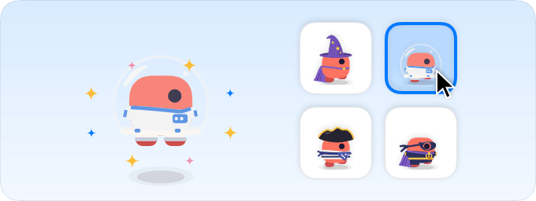</picture>

Otevřete Nastavení › Mazlíček a vyberte, co bude mazlíček nosit: klobouky, brýle, šály, trička, boty, pláště a dokonce křídla. Hned si to oblékne. Pár kousků je zdarma, zbytek jsou ocenění, která přicházejí při společné hře: zvedněte mazlíčka a hoďte s ním, kopejte do míče, sledujte, jak leze po oknech a povídá si, nebo mu prostě dělejte společnost den za dnem. Až získáte ocenění, mazlíček vám to řekne.

Hotové kostýmy ho jedním kliknutím oblečou od hlavy až k patě: čaroděj, pirát, astronaut, superhrdina, král a další. Kostým je připravený, jakmile získáte všechny jeho součásti.

Ukládají se jen jednoduchá čísla, například kroky, hody a společné dny. Zůstávají ve vašem Macu, nic se nikam neposílá a smazat je můžete kdykoli v Nastavení › Mazlíček.

---

## Myš a trackpad ve hrách

1.34.0 · 12. října 2026

Přejetí, sevření prstů a aktivní rohy vás už z hry nevyvedou, stejně jako klávesové zkratky.

<picture><source media="(prefers-color-scheme: dark)" srcset="../media/whats-new/1.34.0/pointer-shortcuts-dark.png">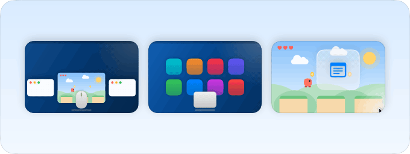</picture>

V Nastavení › Hry › Další nastavení hry je skupina „Myš a trackpad“. Zobrazuje jen to, co je v macOS na vašem Macu zapnuté, s názvy od Applu a malým obrázkem u každé položky: zkratky na tlačítku myši, přejetí mezi plochami a aplikacemi na celou obrazovku, Mission Control a App Exposé, sevření prstů pro aplikace a rozevření pro plochu, přejetí od pravého okraje pro Oznamovací centrum a každý aktivní roh s jeho akcí. Dokud je hra v popředí, jsou pozastavené, takže nechtěné přejetí nebo dotek rohu obrazovky vás z hry nevyvede. Gesta uvnitř hry fungují dál. Každou položku lze nastavit tak, aby fungovala jako obvykle.

---

## Skupiny zkratek se otevírají okamžitě

1.33.2 · 11. října 2026

I ta nejdelší skupina systémových zkratek se otevře hned a každý řádek má jasný název.

<picture><source media="(prefers-color-scheme: dark)" srcset="../media/whats-new/1.31.0/system-shortcuts-dark.png">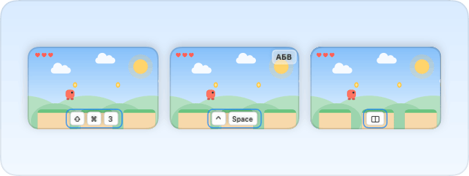</picture>

Dřív se okno nastavení na chvíli zaseklo, když se otevírala skupina s desítkami řádků, protože se všechny řádky i s animovanými náhledy vytvářely najednou. Teď se vytvářejí jen řádky, které jsou vidět, a pár sousedních. Zmizely i řádky „Systémová akce“ s číslem: Diktování, Siri a klávesy jasu a zvětšení ukazují svůj skutečný název a akce, kterým macOS nedává název, jsou skryté, ale ve hrách se dál pozastavují stejně jako dřív.

---

## Skupiny zkratek se otevírají bez zasekávání

1.33.1 · 11. října 2026

Stránka Hry zůstává plynulá, i když se rozbalí dlouhý seznam náhledů.

<picture><source media="(prefers-color-scheme: dark)" srcset="../media/whats-new/1.31.0/system-shortcuts-dark.png"></picture>

Rozbalení skupiny systémových klávesových zkratek dřív zamrazilo okno nastavení až na tři sekundy, protože se každý řádek s náhledem počítal několikrát. Teď se každý řádek počítá jen jednou, takže se skupiny otevírají téměř okamžitě.

---

## Všechna oprávnění na jednom místě

1.33.0 · 11. října 2026

Nastavení › Oprávnění nově ukazuje vše, co pikapik používá, a každé oprávnění můžete vzít zpět.

<picture><source media="(prefers-color-scheme: dark)" srcset="../media/whats-new/1.33.0/permissions-dark.png">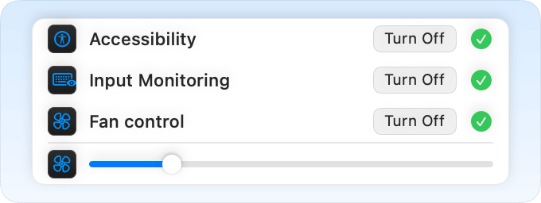</picture>

Nastavení › Oprávnění nově ukazuje každé oprávnění, které pikapik používá, od Zpřístupnění a Monitorování vstupu až po Ovládání ventilátorů, Rozšíření Finderu, iCloud Drive a Úplný přístup k disku. Každý řádek jednou větou říká, k čemu slouží, a zelená fajfka znamená, že je zapnuté, oranžový křížek, že chybí.

Každý řádek má jedno tlačítko: Povolit, když oprávnění chybí, Vypnout, když je zapnuté. Libovolné oprávnění tak můžete vzít zpět rovnou tam, bez hledání v Nastavení systému. U Zpřístupnění a Monitorování vstupu se pikapik nejdřív zeptá a pak se bez nich znovu spustí.

Nástroj, který potřebuje oprávnění, jež jste mu zatím nedali, vypadá napůl šedě. Klikněte na něj a otevře se Oprávnění se zvýrazněným správným řádkem, připravené na jedno kliknutí na Povolit.

**Vyzkoušejte:** Otevřete Nastavení › Oprávnění a prohlédněte si každý řádek. Kliknutím na šedý nástroj se hned dostanete k oprávnění, které potřebuje.

---

## Bezpečnější instalace a aktualizace, které aplikaci nikdy neztratí

1.32.2 · 11. října 2026

Série oprav, které dělají instalaci, aktualizaci i odinstalaci bezpečnější.

<picture><source media="(prefers-color-scheme: dark)" srcset="../media/fans-dark.png"></picture>

Pomocník ventilátorů se nyní instaluje pečlivěji a před spuštěním se ověřuje. Pokud se aktualizaci nepodaří zkopírovat, váš současný pikapik zůstane na místě. Při odinstalaci se odstraní i pomocník ventilátorů a vrátí se vaše nastavení opakování kláves, rohy Docku a systémové zkratky.

Držené klávesy se už nezasekávají, když se nástroj restartuje, a po vypnutí „Opakovat podrženou klávesu“ se vám vrátí vaše vlastní nastavení nabídky akcentů. Mazlíček odpočívá, dokud obrazovka spí nebo je zamčená, a kopie archive.tar.gz se nyní jmenuje archive 2.tar.gz.

---

## Ruční rychlost ventilátorů platí hned na první pokus

1.32.1 · 11. října 2026

Volba Ručně u Ventilátorů se už nevrací zpět na Auto.

<picture><source media="(prefers-color-scheme: dark)" srcset="../media/fans-dark.png"></picture>

Někdy první klepnutí na Ručně vrátilo ventilátory na Auto s bezpečnostním upozorněním a teprve druhé zabralo. Teď Ručně vydrží už od prvního pokusu.

Pokud ventilátor ručního režimu přesto sám opustí, pikapik ho skutečně vrátí na Auto, takže to, co vidíte, vždy odpovídá tomu, co váš Mac dělá.

Nemusíte nic znovu povolovat. Aktualizujte a funguje to.

**Vyzkoušejte:** Otevřete Nastavení › Ventilátory a zvolte Ručně.

---

## Podívejte se, jak rychle se točí ventilátory

1.32.0 · 11. října 2026

Nový panel Ventilátory ukazuje každý ventilátor živě a dovolí vám vybrat rychlost.

<picture><source media="(prefers-color-scheme: dark)" srcset="../media/fans-dark.png"></picture>

Ventilátory mají teď v Nastavení vlastní panel a v nabídce vlastní řádek. V reálném čase vidíte, jak rychle se každý z nich právě točí, a vedle něj se točí malý ventilátor.

Nechte Auto a Mac se rozhodne sám, jako vždy. Nebo zvolte Ručně a jedním posuvníkem nastavte rychlost, jakou chcete. Poprvé to jednou povolíte heslem správce, a to je vše.

Je to postavené tak, aby to bylo bezpečné. Ventilátory se vrátí na Auto, když ukončíte pikapik, když Mac usne, když pikapik havaruje nebo když se Mac zahřeje.

**Vyzkoušejte:** Otevřete Nastavení › Ventilátory a podívejte se na rychlost. Zvolte Ručně a vyzkoušejte posuvník.

---

## Podrobnosti, když je potřebujete

1.31.4 · 11. října 2026

Klidnější herní stránka a jedno hledání.

<picture><source media="(prefers-color-scheme: dark)" srcset="../media/whats-new/1.31.4/game-choices-dark.png">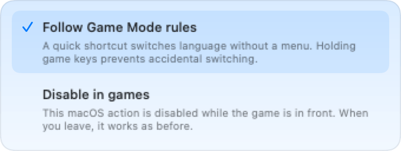</picture>

Každý režim vysvětluje své chování v rozbalovacím seznamu. Po zavření zůstane na stránce jen vybraný název.

Popisy opakující název akce byly odstraněny. Užitečné doplňující informace zůstávají.

Globální hledání najde systémové akce podle názvu, významu a kláves. Výsledek otevře a zvýrazní přesné nastavení.

**Vyzkoušejte:** Najděte akci v globálním hledání a otevřete seznam jejích režimů.

---

## Jednotný vzhled herních nastavení

1.31.3 · 11. října 2026

Stejné náhledy a srozumitelnější volby zkratek.

<picture><source media="(prefers-color-scheme: dark)" srcset="../media/whats-new/1.31.3/game-preview-dark.png">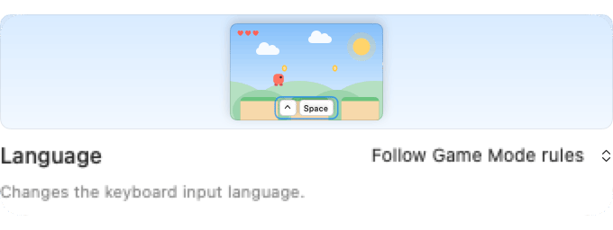</picture>

Každá zkratka má nyní stejný široký náhled jako ochrana hry a ostatní stránky nastavení. Pod ním je popis, ovládání a vysvětlení vybrané možnosti.

«Podle pravidel herního režimu». Krátká zkratka změní jazyk bez nabídky. Držené herní klávesy brání nechtěné změně jazyka.

«Vypnout ve hrách». Tato akce macOS je vypnutá, když je hra v popředí. Po opuštění hry funguje jako dříve. «Povolit ve hrách». macOS provádí akci normálně, i když otevře okno nebo přenese zaměření ze hry.

**Vyzkoušejte:** Otevřete další herní nastavení, rozbalte systémové ovládání a zvolte chování akce při hraní.

---

## Srozumitelnější herní nastavení

1.31.2 · 11. října 2026

Upravte ochranu a prozkoumejte zkratky svého Macu.

<picture><source media="(prefers-color-scheme: dark)" srcset="../media/whats-new/1.31.2/game-settings-dark.png">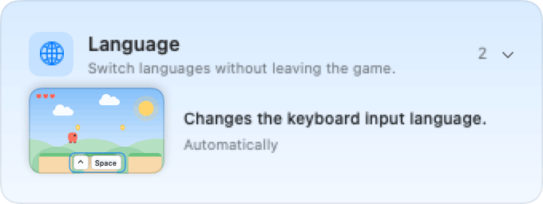</picture>

Osm jasných témat nahrazuje opakované složky. Každý nadpis má název, vysvětlení, ikonu a počet. Kliknutím kamkoli na řádek jej otevřete.

Každá akce vysvětluje svůj účel vedle animovaného náhledu. Aktuální klávesy a chování ve hře mají vlastní řádek. Hledání zahrnuje také popisy.

Nepřiřazené klávesy mají jasný odkaz do Nastavení systému. Obecná ochrana hry je v samostatné sekci a vaše volby zůstávají zachované.

**Vyzkoušejte:** Otevřete další herní nastavení, rozbalte téma a porovnejte popis akce s jejím náhledem.

---

## Gesta pro jazyk ve hrách

1.31.1 · 11. října 2026

Ve výchozím stavu jednoduché, s úplným systémovým katalogem podle potřeby.

<picture><source media="(prefers-color-scheme: dark)" srcset="../media/input-switch-dark.png"></picture>

Jazykové gesto pikapik funguje ve hře i tehdy, když jazykové zkratky macOS nejsou přiřazené nebo jsou vypnuté.

<picture><source media="(prefers-color-scheme: dark)" srcset="../media/game-mode-dark.png"></picture>

Automaticky pozastaví akce otevírající okna nebo měnící fokus. Krátká úmyslná jazyková zkratka změní zdroj bez systémového okna. Držené klávesy pohybu mají přednost, takže běh a skákání nezmění jazyk náhodou.

Každou akci lze upravit v katalogu s vyhledáváním. Jazyk může běžet na pozadí; jiné akce lze pozastavit nebo běžně povolit. Volby se synchronizují. Jiné aplikace sledující klávesy jsou zvlášť. Vynutit ukončení zůstává dostupné.

**Vyzkoušejte:** Podržte ⌥ a stiskněte ⇧: další jazyk. Podržte ⇧ a stiskněte ⌥: předchozí

---

## Herní režim zná zkratky vašeho Macu

1.31.0 · 11. října 2026

Ve výchozím stavu jednoduché, s úplným systémovým katalogem podle potřeby.

<picture><source media="(prefers-color-scheme: dark)" srcset="../media/whats-new/1.31.0/system-shortcuts-dark.png"></picture>

Zapněte herní režim a hrajte. Další nastavení hry obsahuje katalog Macu s aktuálními klávesami a animovaným náhledem každé akce.

<picture><source media="(prefers-color-scheme: dark)" srcset="../media/game-mode-dark.png"></picture>

Automaticky pozastaví akce otevírající okna nebo měnící fokus. Krátká úmyslná jazyková zkratka změní zdroj bez systémového okna. Držené klávesy pohybu mají přednost, takže běh a skákání nezmění jazyk náhodou.

Každou akci lze upravit v katalogu s vyhledáváním. Jazyk může běžet na pozadí; jiné akce lze pozastavit nebo běžně povolit. Volby se synchronizují. Jiné aplikace sledující klávesy jsou zvlášť. Vynutit ukončení zůstává dostupné.

**Vyzkoušejte:** Otevřete další nastavení, vyhledejte zkratku snímku nebo jazyka a porovnejte náhled se zapnutou a vypnutou ochranou.

---

## Odkazy na zkratky se otevírají bez pádu

1.30.14 · 11. října 2026

Kliknutí na vypnutou zkratku už nezavře pikapik.

<picture><source media="(prefers-color-scheme: dark)" srcset="../media/whats-new/1.23.2/game-shortcuts-dark.png">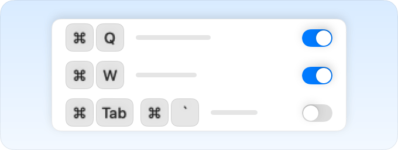</picture>

Na stránce Hry můžete kliknout na zkratku i bez přiřazených kláves. Nastavení systému se otevře bezpečně.

<picture><source media="(prefers-color-scheme: dark)" srcset="../media/game-mode-dark.png"></picture>

Dříve mohl pikapik přečíst tentýž měnící se řádek dvakrát během otevírání okna. Když text mezi čteními zmizel, aplikace spadla.

Každý řádek se nyní čte jednou. Chybějící text se přeskočí. Oprava platí i pro odkazy na zkratky na dalších stránkách.

**Vyzkoušejte:** Klikněte na vypnutou zkratku na stránce Hry.

---

## Držte Control a hrajte dál

1.30.13 · 10. října 2026

Control už nedovolí změně jazyka vzít hře mezerník.

<picture><source media="(prefers-color-scheme: dark)" srcset="../media/game-mode-dark.png"></picture>

Držte Control pro běh a stiskněte mezerník pro skok. V herním režimu se přepínání jazyka přes Control+mezerník a Control+Option+mezerník pozastaví.

<picture><source media="(prefers-color-scheme: dark)" srcset="../media/whats-new/1.23.2/game-shortcuts-dark.png"></picture>

Pozastaví se i další zkratky macOS s Control nebo se Shift a Option bez Command, včetně vlastních nastavení. Stisknutí, uvolnění a držené klávesy se dostávají do hry současně.

Gesto jazyka pikapik a zkratky ukončení s herními modifikátory také neruší. Po opuštění hry se systémové zkratky vrátí přesně do původního stavu.

**Vyzkoušejte:** Držte Control, pohybujte se a několikrát stiskněte mezerník. Pak opusťte hru a přepněte jazyk jako obvykle.

---

## Přetáhněte hru z Monitoru aktivity

1.30.12 · 10. října 2026

Herní režim přijímá procesy přetažené z Monitoru aktivity.

<picture><source media="(prefers-color-scheme: dark)" srcset="../media/whats-new/1.28.0/app-shelf-dark.png">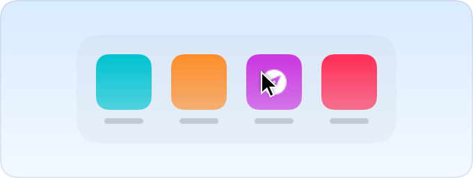</picture>

Najděte proces hry a přetáhněte řádek na Vaše hry v Nastavení → Hry.

<picture><source media="(prefers-color-scheme: dark)" srcset="../media/game-mode-dark.png"></picture>

Hry přes Javu fungují i bez běžné ikony v Docku. Dříve se tyto řádky ignorovaly, protože obsahují číslo a název procesu místo souboru.

Hra se uloží pro další spuštění. Minecraft se zobrazí pod svým názvem. Číslo a název musí odpovídat spuštěnému procesu.

**Vyzkoušejte:** Přetáhněte řádek java spuštěného Minecraftu na Vaše hry.

---

## Přidejte hru, když běží

1.30.11 · 10. října 2026

Otevřené hry se nyní při přidávání zobrazují jako první.

<picture><source media="(prefers-color-scheme: dark)" srcset="../media/whats-new/1.28.0/app-shelf-dark.png"></picture>

Otevřete Nastavení → Hry → Přidat hru a klikněte na spuštěnou hru. Objeví se i hry přes Javu a jiná prostředí, i bez souboru .app. Minecraft se jmenuje Minecraft místo java.

<picture><source media="(prefers-color-scheme: dark)" srcset="../media/game-mode-dark.png"></picture>

Aplikace z Docku mají samostatný rozbalovací seznam, takže otevřenou hru najdete hned.

Jiné… a přetažení přijímají také spustitelný soubor hry, vedle aplikací. Po přidání se herní režim zapne, když přejdete do hry.

**Vyzkoušejte:** Nechte hru otevřenou, zvolte Přidat hru a klikněte na její ikonu. Bez hledání ve složkách.

---

## Mazlíček je vidět, i když skáče

1.30.10 · 10. října 2026

Mazlíček už nemizí za okny, když skáče na obrazovce bez Docku.

<picture><source media="(prefers-color-scheme: dark)" srcset="../media/pet-dark.png"></picture>

Dřív, když byl Dock na jiném monitoru nebo skrytý, mazlíček skočil za vaše okna a zmizel, dokud nedopadl. Teď je vidět před okny hned, jak se odlepí od země, na každé obrazovce, s Dockem i bez něj. Míček stejně tak.

<picture><source media="(prefers-color-scheme: dark)" srcset="../media/whats-new/1.29.0/pet-ball-dark.png">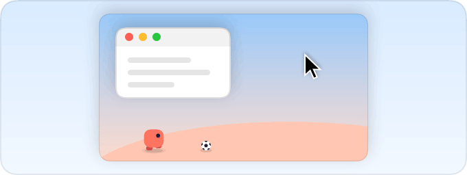</picture>

Okno, které se mazlíčka dotýká jen okrajem, ho už při skoku neschová. Mazlíček zůstane za oknem, jen když ho okno opravdu zakrývá, třeba video, které sledujete.

Na zemi se mazlíček a jeho míček procházejí za vašimi okny jako dřív.

**Vyzkoušejte:** Nechte Dock automaticky skrývat nebo ho přesuňte na jiný monitor a vedle okna stiskněte mezerník. Mazlíček vyskočí před ním.

---

## Celá obrazovka patří vám a míček hraje fér

1.30.9 · 10. října 2026

Mazlíček už nevykukuje do videa na celé obrazovce a míček nenaráží do věcí, které tam nejsou.

<picture><source media="(prefers-color-scheme: dark)" srcset="../media/pet-dark.png"></picture>

Dřív, když jste se dívali na video na celé obrazovce, mazlíček občas vykoukl. Teď se pikapik ptá přímo macOS, jestli je na obrazovce něco na celou obrazovku, a po dokončení přepnutí to zkontroluje ještě jednou. Mazlíček a míček zůstanou schovaní, dokud celou obrazovku neopustíte.

<picture><source media="(prefers-color-scheme: dark)" srcset="../media/whats-new/1.29.0/pet-ball-dark.png"></picture>

Míček se už neodráží od prázdného vzduchu. Přeletí přes Dock, místo aby narazil do neviditelné zdi. Myš teď do míčku trefí, jen když se ho ukazatel opravdu dotkne. Lehký dotek ho rozkutálí, rychlé máchnutí ho pošle do vzduchu. A když se mazlíček nebo míček schovává za oknem, myš nad tím oknem je nechá být.

Přetažení souboru přes plochu už mazlíčkovi nepostaví schůdek. To dokáže jen výběrový rámeček.

**Vyzkoušejte:** Pusťte si video na celou obrazovku a několikrát ho mezerníkem pozastavte. Mazlíček se neukáže. Pak máchněte myší do míčku.

---

## Rohy obrazovky při hraní mlčí

1.30.8 · 10. října 2026

V Herním režimu myš u okrajů a v rozích obrazovky už nespouští aktivní rohy ani nevysouvá skrytý Dock.

<picture><source media="(prefers-color-scheme: dark)" srcset="../media/game-mode-dark.png"></picture>

Dřív mohla myš uprostřed hry v rohu nebo u okraje obrazovky spustit aktivní roh nebo vysunout skrytý Dock.

<picture><source media="(prefers-color-scheme: dark)" srcset="../media/whats-new/1.23.2/game-shortcuts-dark.png"></picture>

Teď Herní režim aktivní rohy a skrytý Dock na dobu hraní vypne. Pár sekund po odchodu ze hry nebo při ukončení pikapik se vrátí přesně tak, jak byly.

A ukazatel už u okraje obrazovky se hrou necuká.

**Vyzkoušejte:** Zapněte Herní režim, spusťte hru a přesuňte myš do rohu obrazovky. Nic nevyskočí.

---

## Mazlíček už neleze do vašeho videa

1.30.7 · 10. října 2026

Když je mazlíček nebo míček za oknem, zůstane tam, i když skáče nebo letí.

<picture><source media="(prefers-color-scheme: dark)" srcset="../media/pet-dark.png"></picture>

Dřív, když se mazlíček nebo míček schovával za videem nebo hrou, mohl ho skok nebo let vynést přímo nad to, na co se díváte. I mezerník pro pozastavení videa mazlíčka vylákal ven.

<picture><source media="(prefers-color-scheme: dark)" srcset="../media/whats-new/1.29.0/pet-ball-dark.png"></picture>

Teď zůstávají za oknem, které je zakrývá, ať dělají cokoli. A video na celou obrazovku ve Firefoxu je schová hned.

Za běžnými okny se schovávají stejně jako dřív.

**Vyzkoušejte:** Pusťte video ve velkém okně, které zakrývá spodek obrazovky, a stiskněte mezerník pro pozastavení. Mazlíček zůstane za videem.

---

## Na celé obrazovce si mazlíček dá pauzu všude

1.30.6 · 10. října 2026

Když je jakákoli aplikace na celou obrazovku, mazlíček a míček se teď schovají na všech monitorech.

<picture><source media="(prefers-color-scheme: dark)" srcset="../media/pet-dark.png"></picture>

Dřív, když jste pustili video nebo hru na celou obrazovku, mazlíček a míček někdy utekli na jiný monitor a hráli si tam dál.

<picture><source media="(prefers-color-scheme: dark)" srcset="../media/whats-new/1.29.0/pet-ball-dark.png"></picture>

Teď, dokud je jakákoli aplikace na celou obrazovku, schovají se na všech vašich monitorech. Ukončete režim celé obrazovky a hned se vrátí.

Za běžnými okny se schovávají stejně jako dřív.

**Vyzkoušejte:** Máte-li dva monitory, pusťte na jednom z nich video na celou obrazovku. Mazlíček a míček zmizí z obou a vrátí se, až celou obrazovku ukončíte.

---

## Mazlíček uhne, když se díváte nebo hrajete

1.30.5 · 10. října 2026

Mazlíček a míček se teď schovají, když je aplikace na celou obrazovku, i na Macích s výřezem.

<picture><source media="(prefers-color-scheme: dark)" srcset="../media/pet-dark.png"></picture>

Dřív na Macu s výřezem mohl mazlíček zůstat nad videem nebo hrou na celou obrazovku a míček občas vyskočil nad aplikací na celou obrazovku na jiném monitoru.

<picture><source media="(prefers-color-scheme: dark)" srcset="../media/whats-new/1.29.0/pet-ball-dark.png"></picture>

Teď, dokud aplikace zabírá celou obrazovku, mazlíček a míček čekají mimo dohled. Ukončete režim celé obrazovky a hned se vrátí.

Za běžnými okny se schovávají stejně jako dřív.

**Vyzkoušejte:** Pusťte video na celou obrazovku nebo spusťte hru. Mazlíček a míček nebudou rušit, dokud neskončíte.

---

## Mazlíček je vidět, když skáče nebo se veze na výběru

1.30.4 · 10. října 2026

Mazlíček a míček už nemizí za okny, když jsou ve vzduchu.

<picture><source media="(prefers-color-scheme: dark)" srcset="../media/pet-dark.png"></picture>

Dřív, když mazlíček skákal přes ukazatel nebo se vezl nahoru na výběrovém rámečku, zakrylo ho zvětšené okno a vypadalo to, že zmizel.

<picture><source media="(prefers-color-scheme: dark)" srcset="../media/whats-new/1.29.0/pet-ball-dark.png"></picture>

Teď, dokud je mazlíček nebo míček výš než Dock, jsou vidět před okny. Zpátky na zemi zase zalezou za ně.

A mazlíček zase může chodit za Dockem, stejně jako dřív.

**Vyzkoušejte:** Zvětšete okno na celou obrazovku, začněte na ploše vedle Docku výběrový rámeček, aby na něj mazlíček vylezl, a pomalu ho táhněte nahoru. Mazlíček se na něm veze před oknem.

---

## Mazlíček a míček už nechodí pod Dock

1.30.3 · 9. října 2026

Mazlíček už pod Dockem nechodí ani nespí, takže ho vždycky vidíte.

<picture><source media="(prefers-color-scheme: dark)" srcset="../media/pet-dark.png"></picture>

Dřív mazlíček a míček často chodili a odpočívali přímo pod Dockem, kde je nikdo neviděl. Se zvětšeným oknem to vypadalo, že mazlíček úplně zmizel.

<picture><source media="(prefers-color-scheme: dark)" srcset="../media/whats-new/1.29.0/pet-ball-dark.png"></picture>

Teď je pro ně Dock jako zeď. Mazlíček se u jeho okraje otočí a míček se od něj odrazí.

Mazlíček je tak vždycky vidět vedle Docku, i když okno zabírá celou obrazovku.

**Vyzkoušejte:** Zvětšete okno na celou obrazovku a pár minut se dívejte. Mazlíček je pořád vidět vlevo nebo vpravo od Docku.

---

## Mazlíček už nemizí za okny

1.30.2 · 9. října 2026

I když mazlíčka zakryje okno, žije dál a spadne na zem, jakmile pustíte výběr.

<picture><source media="(prefers-color-scheme: dark)" srcset="../media/pet-dark.png"></picture>

Když okna zakryla celý pruh, ve kterém mazlíček žije, pikapik ho pozastavil a mohl zamrznout ve vzduchu. Teď mazlíček a jeho míč žijí dál i za oknem: chodí, padají a hrají si. Odpočívá jen kreslení.

<picture><source media="(prefers-color-scheme: dark)" srcset="../media/whats-new/1.29.0/pet-ball-dark.png"></picture>

Když výběrový rámeček zvedne mazlíčka za oknem, spadne, jakmile ho pustíte, a zase ho uvidíte u Docku.

A výběrový rámeček už mazlíčka nezvedne výš než jeho pruh.

**Vyzkoušejte:** Zvětšete okno na celou obrazovku, zvedněte za ním mazlíčka výběrovým rámečkem a pusťte. Mazlíček spadne a objeví se u Docku.

---

## Výběr na ploše zase funguje

1.30.1 · 9. října 2026

Mazlíček a jeho míč zase skáčou na výběrové rámečky a seznamy aplikací se rozsvítí jen pro aplikace.

<picture><source media="(prefers-color-scheme: dark)" srcset="../media/whats-new/1.29.0/pet-ball-dark.png"></picture>

Když Dock nebo aplikace pro vzdálenou plochu zakrývala celou obrazovku, pikapik si nevšiml výběrového rámečku, který kreslíte na ploše. Teď si ho zase všimne a mazlíček s míčem na něj skáčou jako dřív.

<picture><source media="(prefers-color-scheme: dark)" srcset="../media/whats-new/1.28.0/app-shelf-dark.png"></picture>

Seznamy aplikací v nastavení se rozsvítí, jen když nad ně přetáhnete aplikaci. Ostatní soubory se přehlížejí: rámeček se neobjeví a nic navíc se nepřidá. Když přetáhnete aplikaci spolu s jinými soubory, přidá se jen aplikace.

A rámeček zhasne hned, jak aplikaci pustíte nebo odsunete ukazatel.

**Vyzkoušejte:** Nakreslete na ploše výběrový rámeček a sledujte, jak na něj mazlíček vyskočí.

---

## Ukončit už pikapik nevypíná

1.30.0 · 9. října 2026

Zvolili jste Ukončit ze zvyku? Zkratky, „Bez spánku“ i váš mazlíček fungují dál.

<picture><source media="(prefers-color-scheme: dark)" srcset="../media/keep-awake-dark.png"></picture>

Když zvolíte „Ukončit“, stisknete ⌘Q nebo ukončíte pikapik z Docku, zavře svá okna a skryje ikonu v řádku nabídek, ale dál tiše běží na pozadí: zkratky, „Bez spánku“ i mazlíček zůstávají zapnuté. Ikonu vrátíte tak, že pikapik prostě otevřete znovu.

<picture><source media="(prefers-color-scheme: dark)" srcset="../media/pet-dark.png"></picture>

Chcete ho opravdu ukončit? Podržte Option (⌥) a zvolte „Ukončit“, nebo stiskněte ⌥⌘Q. Když pikapik poprvé přejde na pozadí, vysvětlí, co se stalo, a hned nabídne úplné ukončení.

Chcete to postaru? Vypněte „Po ukončení běžet na pozadí“ v Nastavení › Obecné. Aktualizace, změna jazyka, odhlášení, restart i vypnutí Macu pikapik vždy ukončí úplně, takže na něj nikdy nemusí čekat.

**Vyzkoušejte:** Stiskněte ⌘Q a pak pikapik otevřete znovu, aby se vrátila jeho ikona.

---

## Mazlíček se prochází po všech obrazovkách

1.29.1 · 9. října 2026

Máte víc než jeden monitor? Mazlíček a jeho míč teď chodí všude, kam se podíváte, a nikdy se neztratí.

<picture><source media="(prefers-color-scheme: dark)" srcset="../media/pet-dark.png"></picture>

Když mazlíček dojde na okraj jedné obrazovky, prostě přejde na vedlejší a míč se kutálí za ním. Mazlíčka nebo míč můžete také vzít myší a přenést na kteroukoli obrazovku. Když se aplikace přepne na celou obrazovku, přesunou se na jinou obrazovku, aby nepřekážely, a když odpojíte monitor, vrátí se na hlavní.

<picture><source media="(prefers-color-scheme: dark)" srcset="../media/whats-new/1.29.0/pet-ball-dark.png"></picture>

Míč už neuvízne v rohu. Mazlíček k němu doběhne, nabere ho dozadu přes hlavu a hraje si dál.

A mazlíček už nemizí. Každé dvě sekundy si ověří, že je na obrazovce, a když se něco pokazí, po spánku, zamknutí Macu, přepnutí plochy nebo celé obrazovce, hned se sám vrátí.

**Vyzkoušejte:** Přeneste mazlíčka na jinou obrazovku nebo dokutálejte míč do rohu.

**Opraveno**

- Hozený mazlíček už nepřistane na výběrovém rámečku, který je výš, než dokáže doskočit, a kvůli tomu nezmizí.

---

## Mazlíček dostal míč

1.29.0 · 9. října 2026

Po spodním okraji obrazovky se teď kutálí malý fotbalový míč. Mazlíček si s ním hraje a vy můžete taky.

<picture><source media="(prefers-color-scheme: dark)" srcset="../media/whats-new/1.29.0/pet-ball-dark.png"></picture>

Míč se kutálí a skáče jako opravdový. Mazlíček za ním běží, kopne do něj a zase ho dohání. Rychle přejeďte ukazatelem přes míč a kopnete do něj sami. Nebo ho chyťte, přeneste a hoďte, stejně jako mazlíčka.

Malý trik: klikněte na prázdné místo na ploše a tažením nakreslete výběrový rámeček, se Shiftem nebo bez něj. Dokud držíte tlačítko myši, rámeček se promění v poličku: mazlíček na ni vyskočí a míč na ní může přistát taky. Pusťte tlačítko a polička zmizí.

Chcete mít na ploše klid? Vypněte Míč v nastavení mazlíčka a bude se zase procházet sám.

**Vyzkoušejte:** Nastavení › Mazlíček › Míč

**Opraveno**

- Vedle Docku mazlíček zase skáče, jak vysoko chce. Dole se drží, jen když je přímo nad Dockem, takže nad ním nikdy nevykukuje.

---

## Aplikace přidáte jedním kliknutím nebo přetažením

1.28.0 · 9. října 2026

Každý seznam aplikací v Nastavení teď ukazuje, co máte v Docku a co je právě otevřené, a aplikace na něj můžete přetáhnout z Finderu.

<picture><source media="(prefers-color-scheme: dark)" srcset="../media/whats-new/1.28.0/app-shelf-dark.png"></picture>

U některých funkcí si vybíráte aplikace, ve kterých se mají držet stranou, třeba u zeleného tlačítka nebo Home a End. Dřív „Přidat aplikaci…“ otevřelo jen dlouhou složku se vším. Teď se objeví polička s aplikacemi z Docku a těmi, které jsou právě otevřené. Klikněte na aplikaci a je přidaná, klikněte znovu a je pryč. Na všechno ostatní je tu „Jiné…“.

Aplikaci můžete také přetáhnout z Finderu rovnou na seznam. Seznam se rozsvítí a ukáže, kam aplikace dopadne. S hrami to funguje stejně, se stejnou poličkou.

A když se něco pokazí, ve formuláři pro nahlášení chyby na GitHubu si teď verzi pikapik a macOS vyberete ze seznamu, takže nám to řeknete rychleji.

**Vyzkoušejte:** Nastavení › Okna, pak „Přidat aplikaci…“

**Opraveno**

- Posouvání přes AnyDesk nebo jinou aplikaci pro vzdálenou plochu se už neotáčí dvakrát, když oba Macy používají klasický směr. pikapik teď otáčí jen posouvání ze skutečné myši nebo trackpadu. Pokud si aplikace dělá vlastní plynulé posouvání, jako Mos, nastavte směr v ní.
- Mazlíček zůstává za Dockem, i když skáče, stejně jako když chodí, a sám se vrátí, když opustíte aplikaci na celé obrazovce nebo hru.
- Tenké rámečky kolem malých obrázků v Nastavení už nemizí na běžných displejích bez Retina.

---

## Mazlíček je pořád vidět a okna se otevírají připravená

1.27.3 · 9. října 2026

Mazlíček se uprostřed skoku už neschovává za okna a okna pikapik se otevírají rovnou připravená k použití.

<picture><source media="(prefers-color-scheme: dark)" srcset="../media/pet-dark.png"></picture>

Když mazlíček skákal přes ukazatel nebo dělal kotrmelec, mohl zaplout za okna jiných aplikací a zmizet ve vzduchu. Teď zůstává vepředu po celý skok a po dopadu se zase vrací za vaše okna.

<picture><source media="(prefers-color-scheme: dark)" srcset="../media/new-file-dark.png"></picture>

Když se pikapik potichu spustil na pozadí, při přihlášení, po aktualizaci nebo z odkazu pikapik://, mohla se jeho okna otevřít šedá a zůstat za ostatními, dokud jste na ně neklikli. Teď Nastavení a okénko Nový soubor přijdou dopředu a můžete hned psát.

Totéž platí pro zprávu po Vytvořit menší kopii a pro seznam, kde vybíráte aplikaci k přidání. Nemusíte nic dělat.

**Vyzkoušejte:** Nastavení › Mazlíček

---

## Nový soubor je zpět a Nastavení je ještě lehčí

1.27.2 · 9. října 2026

Nový soubor je zase u všech v nabídce pravého kliknutí ve Finderu a Nastavení Mac zatěžuje ještě méně.

<picture><source media="(prefers-color-scheme: dark)" srcset="../media/new-file-dark.png"></picture>

Po minulé aktualizaci mohl Finder Nový soubor na pozadí znovu spustit a zapomenout, ve kterých složkách funguje, takže položka potichu zmizela z nabídky pravého kliknutí. Teď Nový soubor při každém spuštění Finderu své složky připomene a pikapik krátce po spuštění ověří, že si je Finder zapamatoval. Nemusíte nic dělat.

<picture><source media="(prefers-color-scheme: dark)" srcset="../media/game-mode-dark.png"></picture>

Pohyblivé obrázky v Nastavení se teď hýbou, jen když je na obrazovce vidět aspoň polovina obrázku. V herních obrázcích se malý hrdina dál hýbe 30krát za sekundu a kopce a země za ním 15krát. Stránka Hry tak Mac zatěžuje mnohem méně. Všechno vypadá stejně.

Po aktualizaci pikapik znovu přidává své položky do Finderu jen tehdy, když se aplikace opravdu přesunula, takže je Finder nemusí pokaždé načítat znovu.

**Vyzkoušejte:** Nastavení › Hry

---

## Tišší, lehčí a Finder připravený hned

1.27.1 · 9. října 2026

Nastavení teď Mac skoro nezatěžuje a položky pravého kliknutí ve Finderu fungují hned po přechodu na pikapik.

<picture><source media="(prefers-color-scheme: dark)" srcset="../media/wheel-lines-dark.png"></picture>

Malé pohyblivé obrázky v Nastavení dřív překreslovaly celou stránku mnohokrát za sekundu, takže otevřené okno Mac zaměstnávalo. Teď každý obrázek překresluje jen sám sebe, nejvýš 30krát za sekundu, a odpočívá, když ho odrolujete nebo okno skryjete. Vypadají úplně stejně.

<picture><source media="(prefers-color-scheme: dark)" srcset="../media/new-file-dark.png"></picture>

Po přechodu z pika-tools na pikapik mohl Finder dál hledat starou aplikaci a „Nový soubor“, „Převést na“ a další položky pravého kliknutí nic nedělaly. Teď si toho pikapik všimne při prvním spuštění a Finder sám restartuje, když nejsou otevřená žádná okna Finderu a nic se nekopíruje. Jinak se na stránce Finder objeví krátký řádek s tlačítkem „Restartovat Finder“.

V Nastavení systému, mezi aplikacemi otevíranými při přihlášení, má teď aplikace nový název pikapik a zůstává zapnutá.

**Vyzkoušejte:** Nastavení › Finder

---

## Seznamte se s mazlíčkem na ploše

1.27.0 · 9. října 2026

Dole na obrazovce teď bydlí malý kamarád a aplikace má nové jméno: pikapik.

<picture><source media="(prefers-color-scheme: dark)" srcset="../media/pet-dark.png"></picture>

Zapněte ho v Nastavení › Mazlíček. Prochází se za vašimi okny a Dockem, přeskočí ukazatel, když mu stojí v cestě, a vyskočí, když stisknete mezerník. Můžete ho zvednout, přenést, hodit a znovu chytit uprostřed skoku.

Občas si sedne a řekne něco krátkého. Když opravdu vyjde nová verze, řekne vám to jednou a kliknutí na něj otevře Nastavení, kde na vás čeká aktualizace.

pika-tools se teď jmenuje pikapik. Oprávnění, nastavení i odkazy ve Zkratkách zůstávají, jak byly. Pokud jste ji instalovali přes Homebrew, jednou spusťte `brew update && brew upgrade --cask pikapik`.

**Vyzkoušejte:** Nastavení › Mazlíček

**Opraveno**

- Kontrola aktualizací hlásila novou verzi, i když jste už měli tu nejnovější.
- Stránka Oprávnění zaměstnávala Mac, dokud byla otevřená.

---

## Co je nového ve vašem jazyce

1.26.2 · 8. října 2026

„Co je nového“ v nastavení teď otevírá tuto stránku, ve stejném jazyce jako aplikace.

Otevřete Nastavení › O aplikaci a klikněte na „Co je nového“. Dostanete se přímo sem, na stránku s obrázkem ke každé aktualizaci, v jazyce, kterým mluví pika-tools.

Úplný seznam změn je také přehlednější. U každé verze je den, kdy vyšla, a každé číslo verze otevírá její stránku ke stažení.

Na tom, jak pika-tools funguje, se nic nemění. Aktualizace přicházejí jako dřív, samy nebo přes Homebrew.

**Vyzkoušejte:** Nastavení › O aplikaci › Co je nového

**Opraveno**

- „Co je nového“ otevíralo místo této stránky dlouhý technický seznam v angličtině.
- Odkazy v seznamu změn, které nikam nevedly, teď otevírají správnou stránku.

---

## Obrázky her ožily

1.26.1 · 8. října 2026

Obrázky na stránce „Hry“ se teď hýbou, takže vidíte, co který přepínač zastaví.

<picture><source media="(prefers-color-scheme: dark)" srcset="../media/whats-new/1.26.1/game-previews-dark.png">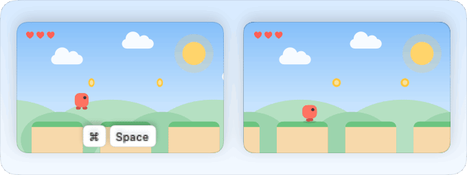</picture>

Za každým přepínačem na stránce „Hry“ teď běží malá hra. Objeví se klávesy, stisknou se a vidíte, co by vyskočilo přes vaši hru, třeba Spotlight nebo Mission Control, a hra se zastaví. Když je přepínač zapnutý, klávesy jen jemně zazáří a hra běží dál. Přepněte přepínač a obrázek hned ukáže rozdíl.

<picture><source media="(prefers-color-scheme: dark)" srcset="../media/game-mode-dark.png"></picture>

Malá hra se řídí vzhledem vašeho Macu: ve světlém režimu je slunečný den, v tmavém klidná noc s měsícem a hvězdami.

<picture><source media="(prefers-color-scheme: dark)" srcset="../media/new-file-dark.png"></picture>

Na všech obrázcích v aplikaci se ukazatel teď pohybuje jako ruka: na delší cestu si dá trochu víc času, zastaví se a teprve potom klikne. Když obrázek začíná znovu, plynule se vrátí na začátek, místo aby skočil. Když je okno skryté, obrázky odpočívají, a se zapnutým „Omezit pohyb“ stojí.

**Vyzkoušejte:** Nastavení › Hry

---

## Nová ikona a čistý stůl pro stará oprávnění

1.26.0 · 8. října 2026

pika-tools má novou tvář a teď umí smazat oprávnění, která po sobě nechaly smazané aplikace.

Nová ikona je značka pikapik v modré, fialové a korálové barvě na tmavé dlaždici. Řádek nabídek ukazuje stejný tvar, který se přizpůsobí světlému i tmavému řádku. Když jsou všechny nástroje vypnuté, tvar zbledne.

<picture><source media="(prefers-color-scheme: dark)" srcset="../media/leftover-permissions-dark.png"></picture>

Když smažete aplikaci, macOS si nechá oprávnění, která jste jí dali, a v Nastavení systému je odstranit nejde. Teď má stránka „Oprávnění“ seznam „Zbylo po smazaných aplikacích“: každá aplikace se svou ikonou, co směla dělat a kdy. „Odstranit“ vyčistí jednu aplikaci, „Odstranit vše“ všechny najednou a aplikace, kterou nainstalujete znovu, se prostě zeptá ještě jednou. Abyste seznam viděli, dejte pika-tools úplný přístup k disku: jen se dívá a nic nemění, dokud nekliknete na „Odstranit“.

<picture><source media="(prefers-color-scheme: dark)" srcset="../media/animations-dark.png"></picture>

Obrázky na stránkách „Animace“ a „Hry“ jsou nakreslené znovu pro svou skutečnou velikost, takže jsou ostré. Okno se zmenší do Docku se zaoblenými rohy a ukazatel nejdřív klikne a teprve pak se otevře nabídka. A dole v „O aplikaci“ je teď tichý řádek: „Vytvořeno s péčí · Kupte mi kávu“. Nic nevyskakuje a nic vám nepřipomíná.

**Vyzkoušejte:** Nastavení › Oprávnění, pak „Zbylo po smazaných aplikacích“

**Opraveno**

- Kliknutí na systémovou zkratku otevře přímo její oddíl v Nastavení systému, třeba Mission Control, a ne jen „Klávesnice“.
- Rada vedle kláves už nezmizí hned, jak se otevře Nastavení systému.

---

## Zkratky se otevřou tam, kde je změníte

1.25.2 · 8. října 2026

Klikněte v Nastavení na zkratku a Nastavení systému se otevře na správném místě.

<picture><source media="(prefers-color-scheme: dark)" srcset="../media/whats-new/1.23.2/game-shortcuts-dark.png"></picture>

Dřív kliknutí na zkratku, třeba pro Spotlight, vždy vedlo do „Modifikační klávesy“. Teď klávesy pro Spotlight otevřou rovnou Spotlight.

U ostatních zkratek se Nastavení systému otevře na „Klávesnice“ a vedle kláves se objeví krátká rada, kam kliknout: „Klávesové zkratky…“, potom „Mission Control“ nebo jinou část.

Stejně to funguje na stránce Hry i u „Vyjmout soubory ve Finderu“. U vyjímání souborů vás rada dovede do „Zkratky aplikací“.

**Vyzkoušejte:** Nastavení › Hry, pak klikněte na klávesy vedle „Hledání nevyskočí“

**Opraveno**

- Kliknutí na zkratku už neotevře „Modifikační klávesy“.

---

## Velké obrázky a hry rovnou z Docku

1.25.1 · 8. října 2026

Každý přepínač má teď velký obrázek a „Přidat hru…“ ukazuje, co máte v Docku.

<picture><source media="(prefers-color-scheme: dark)" srcset="../media/whats-new/1.25.1/dock-games-dark.png">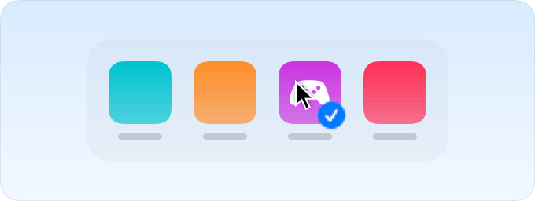</picture>

Na stránkách Animace a Hry jsou teď všechny obrázky velké, stejně jako ten nahoře na stránce. Hned je vidět, co který přepínač dělá, a obrázky se pořád hýbou rychlostí, kterou jste si vybrali.

Klikněte na „Přidat hru…“ a uvidíte svůj Dock: aplikace, které tam máte, a ty, které jsou právě otevřené, ve stejném pořadí. Hra z Docku se ukáže, i když je zavřená, Minecraft taky. Jedno kliknutí ji přidá a fajfka ukáže, že už je v seznamu. Dalším kliknutím ji zase odeberete.

Hru pořád můžete přetáhnout sem z Finderu. Z Docku ji už vytahovat nemusíte, takže Dock nenabídne, že ji odstraní.

**Vyzkoušejte:** Nastavení › Hry, pak „Přidat hru…“

**Opraveno**

- Hra, která je v Docku, ale je zavřená, se teď ukáže v seznamu pro přidání.

---

## Hru přidáte jedním kliknutím a klávesy si zvolíte sami

1.25.0 · 8. října 2026

Hru vyberete z toho, co je právě otevřené, a klávesy pro ukončení a zavření si určíte sami.

<picture><source media="(prefers-color-scheme: dark)" srcset="../media/whats-new/1.25.0/game-pictures-dark.png">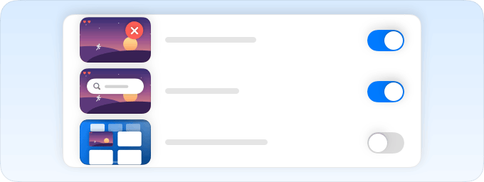</picture>

Klikněte na „Přidat hru…“ a právě otevřené aplikace se ukážou s velkými ikonami, jako v Docku. Jedno kliknutí hru přidá, nebo přetáhněte její ikonu do seznamu. Hru můžete pustit i rovnou z Finderu nebo z Docku. Hrou teď může být jakákoli aplikace, i Minecraft běžící na Javě, a dříve přidané hry zůstávají.

Přepínače Herního režimu teď mluví srozumitelně, třeba „Hra se nezavře“ nebo „Hledání nevyskočí“, a každý má malý obrázek toho, co zastaví. Systémový název, třeba Spotlight, je vedle šedě.

V Nastavení › Okna klikněte na klávesy vedle „Ukončit aplikaci“ nebo „Zavřít okno“ a stiskněte nové. ⌫ vrátí ⇧⌘Q a ⇧⌘W, a pokud už klávesy něco používá, pika-tools se nejdřív zeptá. Herní režim používá vaše klávesy také. A každá zkratka v Nastavení teď ukazuje, jak je na vašem Macu doopravdy nastavená: vaše klávesy, nebo Vypnuto.

**Vyzkoušejte:** Nastavení › Hry, pak „Přidat hru…“

**Opraveno**

- Vyjímání souborů ve Finderu se řídí zkratkou pro Vyjmout, kterou jste Finderu nastavili v Nastavení systému.
- Názvy aplikací v seznamech se ukazují bez „.app“.

---

## Zrychlení, které uvidíte hned

1.24.1 · 8. října 2026

Stránka Animace teď říká, kde se změna projeví, a chrání vaše vlastní hodnoty.

<picture><source media="(prefers-color-scheme: dark)" srcset="../media/dock-hide-dark.png"></picture>

Dock se může vysouvat rychleji, jen když se skrývá. Pokud ten váš zůstává pořád na místě, přepínač „Automaticky skrývat Dock“ je teď přímo pod posuvníkem rychlosti.

Po změně se dole na stránce objeví řádek, že ji aplikace převezmou, až je znovu otevřete. Novou rychlost Rychlého náhledu a sloupců Finder ukáže až po restartu, proto má ten řádek tlačítko „Restartovat Finder“.

Posuvník nikdy nezpomalí nic, co už bylo zrychlené, třeba vašimi příkazy v Terminálu. A „Obnovit výchozí“ i odinstalování pika-tools vrátí hodnoty, které jste měli předtím, místo aby je smazaly.

**Vyzkoušejte:** Nastavení › Animace

**Opraveno**

- Dock se už zbytečně nerestartuje, když se neskrývá.

---

## Vyberte si, jak rychle se váš Mac hýbe

1.24.0 · 8. října 2026

Nová stránka Animace určuje, jak rychle se věci na Macu otevírají, vysouvají a objevují.

<picture><source media="(prefers-color-scheme: dark)" srcset="../media/animations-dark.png"></picture>

Stačí jeden posuvník. Posuňte ho a skrytý Dock, nová okna, dialogy ukládání, Rychlý náhled i sloupce ve Finderu se zrychlí najednou, od „Jako v macOS“ až po „Okamžitě“.

Chcete doladit jen jednu věc? Každý efekt má vlastní nastavení, stejně jako efekt minimalizace, poskakující ikony v Docku a animace Finderu. Vedle každého nastavení se malý obrázek pohybuje přesně rychlostí, kterou jste zvolili.

„Obnovit výchozí“ vrátí jen to, co změnil pika-tools, a odinstalování udělá totéž. Pokud jste kdysi některou z těchto hodnot nastavili sami v Terminálu, pika-tools ji ukáže tak, jak je.

**Vyzkoušejte:** Nastavení › Animace

---

## Vlastní přepínač pro každou zkratku v Herním režimu

1.23.2 · 8. října 2026

Teď sami rozhodujete, zkratku po zkratce, co Herní režim během hraní ztiší.

<picture><source media="(prefers-color-scheme: dark)" srcset="../media/whats-new/1.23.2/game-shortcuts-dark.png"></picture>

⌘Q a ⌘W mají teď samostatné přepínače, stejně jako Spotlight, Siri, ⌘Tab, Mission Control, přejetí, ukazatel, obrazovka a všechno ostatní. Vaše dřívější volby zůstávají.

Každý řádek ukazuje přesně ty klávesy, které zastavuje, takže vždycky víte, co přepínač dělá.

Nastavení jazyka klávesnice z Herního režimu zmizelo. ⌃Mezerník a další způsoby přepnutí jazyka fungují vždy, i ve hře.

**Vyzkoušejte:** Nastavení › Hry

**Opraveno**

- Klávesy jedné zkratky jsou blíž u sebe a mezi různými zkratkami je trochu víc místa, takže je snadno vidět, kde jedna končí a další začíná.

---

## Jak rychlý je váš internet, srozumitelně

1.23.1 · 8. října 2026

Test rychlosti prověří vaše připojení a jednoduše řekne, na co stačí.

<picture><source media="(prefers-color-scheme: dark)" srcset="../media/speed-test-dark.png"></picture>

Klikněte na „Změřit rychlost“ a asi za půl minuty uvidíte stahování, odesílání, ping a odezvu. Pod čísly jednoduchými slovy stojí, jestli to stačí na filmy ve 4K, videohovory, online hry a velká stahování.

Měření probíhá na serverech Apple a poslední výsledek zůstane až do dalšího. Test rychlosti má vlastní stránku v Nastavení, řádek v panelu na řádku nabídek a odkaz pro aplikaci Zkratky: `pika-tools://speed-test`.

Herní režim se naučil dvě věci. Blokování zkratek s Control je teď jeho součástí: ve hře zůstane ⌃-kliknutí obyčejným kliknutím a zkratky s ⌃ nic nespustí; všude jinde funguje ⌃ jako obvykle. A pozná Minecraft: přidejte do her Minecraft Launcher nebo CurseForge a Herní režim se zapne, když je vepředu samotný Minecraft.

**Vyzkoušejte:** Nastavení › Test rychlosti, pak „Změřit rychlost“

**Opraveno**

- Testovací verze pika-tools, které si lidé sestaví sami, ukládají nastavení na iCloud Drive odděleně a vašich se už nedotknou.

---

## Herní režim: hrajte bez vyrušování

1.23.0 · 7. října 2026

Přidejte své hry a Mac vás z nich přestane vytrhávat.

<picture><source media="(prefers-color-scheme: dark)" srcset="../media/game-mode-dark.png"></picture>

Během hraní se Spotlight, Siri, ⌘Tab, Mission Control ani přejetí mezi plochami neotevřou přes hru. ⌘Q a ⌘W ji omylem nezavřou, ukazatel zůstane na obrazovce hry a obrazovka zůstane zapnutá.

Hru ukončíte stiskem ⇧⌘Q, její okno zavřete stiskem ⇧⌘W. ⌥⌘Esc funguje vždy. pika-tools vám nabídne hry, které na vašem Macu najde. Herní režim je vypnutý, dokud ho nezapnete.

V nástroji Bez spánku si teď vyberete, co dělá obrazovka: zůstane zapnutá, bez spořiče a zamčené obrazovky, nebo zhasne jako obvykle, zatímco Mac dál pracuje. Nové tlačítko „Vypnout displej hned“ ji hned ztmaví; pohněte myší nebo stiskněte klávesu a je zpátky.

**Vyzkoušejte:** Nastavení › Hry, pak „Přidat hru…“

**Opraveno**

- Na Macích bez víka už Bez spánku neukazuje volby pro zavřené víko.

---

Starší verze najdete v <a href="../../CHANGELOG.md">seznamu změn</a> (anglicky).

