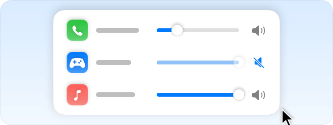

<h1 align="center">Quoi de neuf dans pikapik</h1>

Chaque mise à jour en quelques mots et une image, la plus récente en premier.

<a href="README.md">English</a> · <a href="README.ru.md">Русский</a> · <a href="README.uk.md">Українська</a> · <a href="README.de.md">Deutsch</a> · <b>Français</b> · <a href="README.es.md">Español</a> · <a href="README.it.md">Italiano</a> · <a href="README.pt-BR.md">Português (Brasil)</a> · <a href="README.ja.md">日本語</a> · <a href="README.zh-Hans.md">简体中文</a> · <a href="README.ko.md">한국어</a> · <a href="README.ro.md">Română</a> · <a href="README.pl.md">Polski</a> · <a href="README.tr.md">Türkçe</a> · <a href="README.nl.md">Nederlands</a> · <a href="README.sv.md">Svenska</a> · <a href="README.cs.md">Čeština</a> · <a href="README.zh-Hant.md">繁體中文</a> · <a href="README.ar.md">العربية</a> · <a href="README.hi.md">हिन्दी</a> · <a href="README.id.md">Bahasa Indonesia</a> · <a href="README.vi.md">Tiếng Việt</a> · <a href="README.th.md">ไทย</a>

---

## Un bureau dégagé en un clic

1.47.0 · 13 octobre 2026

Deux nouveaux interrupteurs dans pikapik masquent les icônes du bureau et affichent les fichiers que macOS cache.

<picture><source media="(prefers-color-scheme: dark)" srcset="../media/desktop-icons-dark.png"></picture>

**Masquer les icônes du bureau.** Activez-le avant un appel, un enregistrement de l’écran ou une capture d’écran, et les fichiers et dossiers du bureau disparaissent. Désactivez-le, et ils reviennent à leur place. Rien n’est déplacé : les fichiers restent dans le dossier Bureau du Finder. C’est le réglage **Afficher les éléments › Sur le bureau** de Réglages Système › Bureau et Dock, en plus accessible, donc les deux sont toujours d’accord. Dans la version du Mac App Store, cette ligne ouvre plutôt cette page des Réglages Système.

<picture><source media="(prefers-color-scheme: dark)" srcset="../media/hidden-files-dark.png"></picture>

**Afficher les fichiers masqués.** Les fichiers et dossiers que macOS masque, comme Bibliothèque dans votre dossier de départ ou les fichiers dont le nom commence par un point, apparaissent en grisé dans le Finder et sur le bureau. C’est comme appuyer sur ⇧⌘. dans le Finder, sauf que vous voyez d’un coup d’œil si c’est activé. Pour appliquer le changement, le Finder redémarre un instant et rouvre ses fenêtres et ses onglets. Si le Finder copie ou déplace des fichiers, il redémarre une fois qu’il a terminé. Les deux se trouvent dans Réglages › Finder. Pour les avoir dans le panneau de la barre des menus, cliquez sur le bouton en forme de crayon en bas du panneau et cochez-les. Dans la version du Mac App Store, Réglages › Finder indique plutôt les touches ⇧⌘. du Finder.

---

## La page « Autorisations » dit tout

1.46.1 · 13 octobre 2026

Quand un outil a encore besoin d’une autorisation de la liste ci-dessous, la page le dit maintenant.

Avant, dès que les deux autorisations du haut étaient actives, la page promettait que tous les outils fonctionnaient, même si un outil de « Pour certaines fonctions » attendait encore son autorisation. Maintenant, elle indique que certains outils ont aussi besoin d’une autorisation de la liste ci-dessous, et ne dit plus que tout fonctionne avant que ce soit vraiment le cas.

**Pour essayer :** Réglages › Autorisations

**Corrigé**

- Dans la version du Mac App Store, « Dire merci » sur la page « À propos » n’apparaît que lorsque les pourboires sont prêts à être choisis. Avant, une roue tournait pendant le chargement, et la section disparaissait si l’App Store ne répondait pas.
- Si le disque se remplit pendant l’extraction d’une archive, « Pas assez de place » indique désormais l’espace vraiment libre, une fois les fichiers à moitié extraits supprimés. Avant, il pouvait annoncer qu’il ne restait presque rien.

---

## Masquez l’app au premier plan d’un bouton de la souris

1.46.0 · 13 octobre 2026

Appuyez sur le bouton du milieu ou sur un bouton latéral, et l’app dans laquelle vous êtes s’efface, comme avec ⌘H.

<picture><source media="(prefers-color-scheme: dark)" srcset="../media/hide-app-dark.png"></picture>

Ouvrez Réglages › Souris, activez « Masquer l’app active avec un bouton de la souris » et appuyez sur le bouton que vous voulez utiliser. « Modifier… » permet d’en choisir un autre plus tard. L’app continue de tourner, et un clic sur son icône dans le Dock la fait revenir. Quand vous jouez avec le Mode Jeu activé, le bouton fait dans le jeu ce qu’il a toujours fait. Si « Boutons latéraux pour Précédent et Suivant » est aussi activé, le bouton latéral choisi masque plutôt les apps. La fonction nécessite l’autorisation « Accessibilité » et est désactivée par défaut.

Dans la version du Mac App Store, ⌘X coupe les fichiers dans le Finder : sélectionnez des fichiers, appuyez sur ⌘X, ouvrez un autre dossier, puis choisissez « Déplacer les éléments ici » dans le menu pikapik ou appuyez sur ⌥⌘V. « Animations » et « Désactiver l’accélération du pointeur » sont de retour, et la page « Autorisations » a une nouvelle section, « Laissées par des apps supprimées ». Cette version ne peut pas modifier ces réglages elle-même : chaque ligne explique donc quoi changer et ouvre le bon endroit dans Réglages Système. Le compagnon se promène désormais sur toute la largeur de l’écran, au-dessus du Dock.

**Pour essayer :** Réglages › Souris › Masquer l’app active avec un bouton de la souris

**Corrigé**

- Les dessins de la page « Souris » sont de nouveau nets.
- Les fonctions du clavier et de la souris ne demandent plus que l’autorisation dont elles se servent vraiment. La plupart n’ont besoin que de l’autorisation « Accessibilité » ; avant, elles demandaient aussi « Surveillance de l’entrée » et restaient grisées sans elle.
- « Changer de langue » signale quand il a besoin de « Surveillance de l’entrée », et un clic dessus ouvre la page « Autorisations ». Avant, il restait activé sans fonctionner.
- « Quitter à la fermeture de la dernière fenêtre » attend que vous accordiez « Surveillance de l’entrée », au lieu de pousser macOS à la demander au lancement de pikapik.
- Sur macOS 27, « Accessibilité » apparaît sous son nouveau nom, « Contrôle de l’appareil et accès aux données », comme dans Réglages Système.
- Avec VoiceOver, vous pouvez maintenant choisir les vêtements et les tenues de votre compagnon dans « Garde-robe » et « Tenues », et ouvrir ses récompenses dans « Récompenses ». Avant, ces vignettes ne réagissaient pas.

---

## Chaque app a son propre volume

1.45.0 · 13 octobre 2026

Baissez un appel trop fort, coupez le son d’un jeu bruyant et laissez votre musique telle quelle.

<picture><source media="(prefers-color-scheme: dark)" srcset="../media/whats-new/1.45.0/app-volume-dark.png"></picture>

Ouvrez Réglages › Son et activez « Volume des apps ». Chaque app qui joue du son a son propre curseur et un bouton pour couper le son, dans les Réglages et dans le menu. Le volume de votre Mac et celui des autres apps ne change pas, et pikapik retient le niveau de chaque app. Une app que vous laissez à fond n’est jamais touchée.

Pour changer le volume d’une app, pikapik fait passer son son par lui-même ; il a donc besoin de l’autorisation « Enregistrement de l’audio système », que vous accordez sur la page « Autorisations ». Le son est seulement transmis : il n’est ni enregistré, ni conservé, ni envoyé nulle part, et le micro n’est pas utilisé. Il faut macOS 14.2 ou plus récent (sous macOS 14.0 et 14.1, la fonction reste masquée), et c’est désactivé par défaut.

**Pour essayer :** Réglages › Son › Volume des apps

---

## Les mots tapés avec la mauvaise disposition se corrigent tout seuls

1.44.3 · 13 octobre 2026

Tapez un mot avec la mauvaise disposition de clavier, appuyez sur Espace, et pikapik le retape avec la bonne et change de disposition pour vous.

<picture><source media="(prefers-color-scheme: dark)" srcset="../media/layout-fix-dark.png"></picture>

Activez la fonction dans Réglages › Clavier. Quand un mot donne du charabia, comme ghbdtn au lieu de привет, pikapik le retape dès que vous appuyez sur Espace ou Retour, et change de disposition pour que le mot suivant s’écrive correctement. Cela marche avec toutes les dispositions de clavier ajoutées sur votre Mac, dans toutes vos langues.

Le texte normal reste exactement tel que vous l’avez tapé. pikapik ne change un mot que s’il n’existe dans aucune de vos langues et que les mêmes touches donnent un mot courant dans une autre disposition. Les noms, les fautes de frappe et les mots rares restent tels quels, tout comme les champs de mot de passe, Terminal et les apps que vous choisissez.

Un mot n’a pas été corrigé, ou vous voulez retrouver celui que vous aviez tapé ? Appuyez sur ⌃⇧Espace pour corriger le dernier mot ou le texte sélectionné, et appuyez de nouveau pour essayer vos autres dispositions. Juste après une correction, les mêmes touches l’annulent, et pikapik ne corrigera plus ce mot de lui-même. Dans la version du Mac App Store, sélectionnez le texte et choisissez « Corriger la disposition du clavier » dans le menu Services.

**Pour essayer :** Réglages › Clavier › Corriger les mots tapés avec la mauvaise disposition

---

## VoiceOver ouvre à nouveau le menu pikapik

1.44.2 · 13 octobre 2026

Sous macOS 27, vous pouvez de nouveau ouvrir le menu pikapik dans la barre des menus avec VoiceOver.

Avant, rien ne se passait quand vous activiez l’icône pikapik avec VoiceOver ou un autre outil d’accessibilité. Désormais, le menu s’ouvre, et si vous activez l’icône une seconde fois, il se referme, comme avec un clic.

---

## Voyez quel programme occupe un port

1.44.0 · 13 octobre 2026

Une nouvelle page Ports dans les Réglages montre quel programme occupe chaque port de votre Mac, et libère le port quand vous en avez besoin.

<picture><source media="(prefers-color-scheme: dark)" srcset="../media/ports-dark.png"></picture>

Quand un programme vous dit que son port est déjà utilisé, ouvrez Réglages › Ports. Chaque programme qui occupe un port y figure, avec son icône, les ports qu’il occupe et si d’autres appareils de votre réseau peuvent s’y connecter. Tapez un numéro de port pour savoir qui l’occupe, ou pour vérifier qu’il est libre.

Cliquez sur une ligne pour voir les adresses à ouvrir dans un navigateur, le fichier du programme, la commande qui l’a lancé, son dossier et son numéro de processus. « Libérer » demande au programme de quitter, pour qu’il puisse enregistrer son travail. S’il ne se ferme pas, pikapik propose de le forcer à quitter. Chaque étape vous demande d’abord votre accord.

Les éléments de macOS et les programmes d’autres utilisateurs restent intacts. Pour Récepteur AirPlay, Partage de fichiers, Partage d’écran et Session à distance, pikapik vous indique quel interrupteur de Réglages Système libère le port. Dans la version du Mac App Store, « Libérer » affiche le programme, copie une commande à coller dans Terminal pour le quitter, ou ouvre Moniteur d’activité.

---

## Voyez ce qui tourne en arrière-plan

1.43.0 · 13 octobre 2026

pikapik montre désormais tout ce qui se lance tout seul et quelle app l’a ajouté, et éteint vos propres tâches sans rien supprimer.

<picture><source media="(prefers-color-scheme: dark)" srcset="../media/whats-new/1.43.0/background-dark.png"></picture>

Dans les Réglages, la nouvelle page Tâches en arrière-plan liste les apps qui s’ouvrent à la connexion, les services en arrière-plan, les assistants cachés dans les apps et les restes d’apps supprimées. Pour chaque tâche, vous voyez quelle app l’a ajoutée, si elle tourne en ce moment et où se trouve son fichier. Un clic affiche le fichier dans le Finder.

Vos propres tâches s’éteignent et se rallument d’un seul bouton. Rien n’est supprimé. Pour les tâches de tous les utilisateurs et de tout le Mac, le bouton ouvre la section Ouverture de Réglages Système.

Dans la version du Mac App Store, la page affiche les tâches, et ses boutons ouvrent la section Ouverture.

---

## Voyez à quel point votre Mac chauffe à l’intérieur

1.42.0 · 13 octobre 2026

Une nouvelle page Température dans les Réglages montre la température du processeur, du processeur graphique, de la mémoire, du stockage, de la batterie et du Wi-Fi, et vous dit simplement si tout va bien.

<picture><source media="(prefers-color-scheme: dark)" srcset="../media/temperatures-dark.png"></picture>

Ouvrez Réglages › Température. En haut, un seul mot résume tout : « Normal », « Un peu chaud », « Chaud » ou « Très chaud », et une courte ligne en dessous indique si votre Mac fonctionne à pleine vitesse ou ralentit pour refroidir. Plus bas, chaque composant que votre Mac sait mesurer a sa propre ligne avec sa température et une barre de couleur, verte si tout va bien, jaune si c’est un peu chaud et orange si c’est chaud, selon ce qui est normal pour ce composant.

Vous voulez garder un œil dessus ? Cliquez sur le crayon en bas du menu pikapik et cochez « Température ». Le menu affiche alors le même mot et la température du processeur, et un clic sur la ligne ouvre la page.

Les températures se mettent à jour toutes les deux secondes, mais seulement quand la page ou le menu est ouvert : rien n’est vérifié en arrière-plan. pikapik ne fait que lire les températures : pas besoin de mot de passe, et rien n’est modifié.

**Corrigé**

- Si vous avez choisi les lignes affichées dans le menu pikapik, la ligne « Garder le Dock sur un seul écran » n’y apparaît plus d’elle-même. Pour l’afficher, cliquez sur le crayon et cochez-la.
- Quand vous fermez les Réglages, pikapik arrête désormais tout de suite de surveiller les ventilateurs et la batterie au lieu de continuer en arrière-plan.

---

## Le contrôle des ventilateurs ne demande plus votre mot de passe

1.41.1 · 13 octobre 2026

L’assistant qui règle la vitesse des ventilateurs se met désormais à jour avec pikapik, et les nouvelles versions ne demandent plus le mot de passe administrateur.

<picture><source media="(prefers-color-scheme: dark)" srcset="../media/fans-dark.png"></picture>

Cette mise à jour le demande une dernière fois. Si vous utilisez le contrôle des ventilateurs, ouvrez Réglages › Autorisations, cliquez sur « Autoriser » à côté de « Contrôle des ventilateurs » et saisissez le mot de passe. Ensuite, pikapik met l’assistant à jour tout seul et n’accepte qu’un assistant qui vient vraiment de pikapik.

**Corrigé**

- Dans Réglages Système › Général › Ouverture, l’assistant des ventilateurs apparaît désormais sous le nom pikapik, avec l’icône de l’app.

---

## Voyez l’état de votre batterie

1.41.0 · 13 octobre 2026

Une nouvelle page Batterie dans les Réglages montre l’usure de la batterie, ce qui la charge et comment la faire durer.

<picture><source media="(prefers-color-scheme: dark)" srcset="../media/battery-dark.png"></picture>

Ouvrez Réglages › Batterie. Vous voyez la charge et ce qui se passe avec la batterie en ce moment, son état, sa capacité maximum par rapport à celle d’une batterie neuve, et le nombre de cycles déjà effectués sur les 1000 pour lesquels elle est conçue.

Quand votre Mac est branché, la page affiche l’adaptateur secteur et sa puissance et, pendant la charge, aussi la puissance de charge, c’est-à-dire ce qui entre dans la batterie en ce moment. Quand votre Mac fonctionne sur batterie, la page affiche ce qu’il consomme en ce moment.

Des conseils en bas de la page aident la batterie à durer plus longtemps, et « Réglages Batterie… » ouvre Batterie dans Réglages Système, où vous choisissez comment macOS la charge. La page ne modifie rien et ne demande aucune autorisation, y compris dans la version du Mac App Store. Elle n’apparaît que sur les Mac dotés d’une batterie.

**Corrigé**

- Supprimer pikapik avec Homebrew désactive désormais aussi « Ouvrir à la connexion » et rétablit les réglages système modifiés par l’app, comme les animations, la répétition des touches et les coins actifs. Si pikapik s’est mis à jour tout seul, exécutez une fois brew upgrade --cask pikapik avant de le supprimer.

---

## Les mises à jour avec Homebrew ne redémarrent plus le Dock

1.40.2 · 13 octobre 2026

Quand vous mettez à jour pikapik avec Homebrew, le Dock ne disparaît plus un instant.

La mise à jour vers cette version peut encore redémarrer le Dock une dernière fois, car cette étape est toujours effectuée par la version que vous aviez avant. Les mises à jour suivantes n’y touchent plus.

---

## Un clic dans le Dock range les fenêtres

1.40.1 · 13 octobre 2026

Cliquez dans le Dock sur l’icône de l’app que vous utilisez, et toutes ses fenêtres sont réduites dans le Dock. Cliquez à nouveau, et elles reviennent toutes.

<picture><source media="(prefers-color-scheme: dark)" srcset="../media/whats-new/1.40.1/dock-minimize-dark.png"></picture>

Ouvrez Réglages › Dock et activez « Réduire ou masquer d’un clic dans le Dock ». Les fenêtres reviennent dans le même ordre, avec celle où vous travailliez au premier plan. Un clic sur une autre app, l’appui prolongé sur une icône pour ouvrir son menu et le déplacement des icônes fonctionnent comme avant.

Vous préférez masquer toute l’app, comme avec ⌘H ? Sous l’interrupteur, réglez « Un clic sur l’icône » sur « Masque l’app ». Si vous masquiez déjà des apps d’un clic dans le Dock, rien ne change pour vous. L’interrupteur nécessite l’autorisation « Accessibilité », n’existe pas dans la version du Mac App Store et est désactivé par défaut.

---

## Le Dock reste sur un seul écran

1.40.0 · 13 octobre 2026

Le Dock ne saute plus sur un autre écran quand le pointeur pousse contre le bord de cet écran : il reste là où vous l’avez mis.

<picture><source media="(prefers-color-scheme: dark)" srcset="../media/dock-display-dark.png"></picture>

Ouvrez Réglages › Dock et activez « Garder le Dock sur un seul écran ». Le Dock reste alors sur son écran, en bas ou sur le côté, et les coins actifs continuent de fonctionner. Aucune autorisation n’est nécessaire, y compris dans la version du Mac App Store.

Pour déplacer le Dock volontairement, maintenez ⌥ et poussez le pointeur contre le bord de l’autre écran. Le Dock passe sur cet écran et y reste ensuite.

Un second interrupteur, « Ramener le Dock », remet automatiquement le Dock sur son écran après la veille ou un changement d’écrans. Il nécessite l’autorisation « Accessibilité » et n’existe pas dans la version du Mac App Store. Les deux interrupteurs sont désactivés par défaut.

---

## Le bouton rouge n’arrête plus les archives

1.39.4 · 13 octobre 2026

Auparavant, si vous fermiez la fenêtre du mot de passe avec le bouton rouge, pikapik n’ouvrait et ne créait plus d’archives jusqu’à son redémarrage. C’est corrigé.

Le bouton rouge de la fenêtre du mot de passe et de celle d’une nouvelle archive fonctionne désormais exactement comme « Annuler », et l’archive suivante s’ouvre aussitôt. VoiceOver lit maintenant le bouton de mise à jour dans Réglages › À propos sous son propre nom.

---

## Votre compagnon vit à votre rythme

1.39.3 · 13 octobre 2026

Quand vous tapez, votre compagnon s’anime et trottine d’un pas guilleret. Éloignez-vous de votre Mac, et il commence à avoir sommeil, s’assoit et s’assoupit.

<picture><source media="(prefers-color-scheme: dark)" srcset="../media/whats-new/1.39.3/pet-rhythm-dark.png"></picture>

Si vous ne touchez ni au clavier ni à la souris pendant environ 40 secondes, ses paupières s’alourdissent, et au bout d’une minute et demie, il dort à poings fermés, tandis que de petits z s’envolent au-dessus de lui. Appuyez sur une touche ou bougez la souris, et il se réveille, se relève et repart. Pendant sa sieste, il reste silencieux et consomme moins d’énergie.

pikapik ne regarde jamais ce que vous tapez : il vérifie seulement combien de temps s’est écoulé depuis la dernière touche pressée ou le dernier mouvement de la souris, comme le fait macOS avant d’assombrir l’écran. Aucune autorisation n’est donc nécessaire. Vous préférez que votre compagnon reste toujours plein d’entrain ? Désactivez « Vit à votre rythme » dans les réglages du compagnon.

**Pour essayer :** Réglages › Compagnon › Vit à votre rythme

---

## Les réglages synchronisés sont désormais dans un dossier pikapik

1.39.2 · 13 octobre 2026

Si vous synchronisez vos réglages avec iCloud, ils se trouvent désormais dans iCloud Drive, dans un dossier pikapik au lieu de pika-tools, et pikapik les y déplace tout seul.

Vous n’avez rien à faire : vos réglages restent les mêmes, et l’ancien dossier disparaît une fois qu’ils ont été déplacés. Si vous y avez mis vos propres fichiers, il reste à sa place. Si vous synchronisez plusieurs Mac, mettez à jour pikapik sur chacun d’eux pour qu’ils continuent de partager leurs réglages.

**Corrigé**

- La suppression complète de pikapik avec Homebrew (brew uninstall --zap) efface désormais aussi la liste des apps supprimées récemment.
- Les anciens articles de cette page appellent désormais l’app pikapik.

---

## La barre de titre habituelle dans les fenêtres d’archive

1.39.1 · 13 octobre 2026

Les fenêtres d’archive retrouvent la barre de titre habituelle de macOS, avec trois boutons ronds à gauche.

Vous pouvez déplacer une fenêtre en la faisant glisser par le haut, comme partout sur le Mac. Dans la fenêtre d’une nouvelle archive et dans celle du mot de passe, le bouton rouge ferme la fenêtre sans rien créer ni décompresser. Les boutons qui n’ont rien à faire dans une fenêtre sont gris. La fenêtre qui affiche la progression d’une copie allégée ou d’une conversion de fichier a maintenant les mêmes boutons. Désormais, l’option « Ouvrir les archives avec cette app » retient quelle app ouvrait les fichiers ZIP et 7Z avant, et les lui rend quand vous la désactivez.

---

## Nouvelles fenêtres d’archive, et le mot de passe saisi deux fois

1.39.0 · 13 octobre 2026

Quand vous protégez une nouvelle archive par un mot de passe, vous le saisissez désormais deux fois, pour qu’une faute de frappe ne vous empêche pas d’ouvrir vos propres fichiers.

<picture><source media="(prefers-color-scheme: dark)" srcset="../media/whats-new/1.39.0/archive-password-dark.png"></picture>

Sous les champs, une ligne verte apparaît quand les mots de passe correspondent, ou une ligne rouge quand ils diffèrent, et « Créer » attend qu’ils soient identiques.

Toutes les fenêtres d’archive ont un nouvel aspect : une grande icône, un seul interrupteur pour le mot de passe et une courte ligne qui vous dit si les noms de fichiers restent visibles, comme dans un ZIP, ou sont masqués eux aussi, comme dans un 7Z. Sous macOS 26, les boutons sont en Liquid Glass.

L’installation est plus simple aussi : la commande en haut de la page de pikapik sur GitHub n’a besoin de rien d’autre sur votre Mac. Elle n’installe pikapik que si le téléchargement est signé par son développeur et a passé le contrôle anti-malware d’Apple.

---

## Des mises à jour plus sûres à côté de la version de l’App Store

1.38.2 · 12 octobre 2026

Si pikapik de l’App Store est aussi installé sur votre Mac, la version GitHub se met désormais à jour sur place et ne touche pas à la version de l’App Store.

Auparavant, si la version GitHub portait encore son ancien nom, pika-tools, et n’avait pas été installée avec Homebrew, la mise à jour ne s’installait pas, la version de l’App Store s’ouvrait à la place et l’ouverture de pikapik à la connexion était désactivée.

---

## Un menu du Finder plus fiable

1.38.1 · 12 octobre 2026

Les commandes que pikapik ajoute au Finder, accessibles d’un clic droit, ne disparaissent plus lorsque vous connectez un disque, ouvrez une image disque, réactivez votre Mac ou passez au Finder.

Dans de rares cas, l’assistant qui les affiche se fermait à ce moment-là.

---

## Ouvrez et créez des archives dans le Finder

1.38.0 · 12 octobre 2026

Les nouvelles « Archives dans le Finder » ouvrent les RAR et d’autres archives que macOS ne sait pas lire, et créent des ZIP et des 7Z d’un clic droit.

<picture><source media="(prefers-color-scheme: dark)" srcset="../media/archive-dark.png"></picture>

Ouvrez Réglages › Finder et activez « Archives dans le Finder ». Faites un clic droit sur une archive et choisissez « Extraire » : ses fichiers apparaissent à côté. Faites un clic droit sur tout autre fichier ou dossier et choisissez « Créer une archive… » pour obtenir un ZIP, un 7Z, un TAR.GZ ou un TAR.XZ. Un ZIP ou un 7Z peut avoir un mot de passe, et toute archive peut être divisée en parties, par exemple de 15 Mo pour l’e-mail. Un ZIP créé ainsi ne contient aucun fichier système caché et garde lisibles les noms dans toutes les langues.

pikapik ouvre aussi ce que macOS ne sait pas ouvrir : les RAR, même répartis en plusieurs fichiers, les 7Z protégés par mot de passe, les ZIPX, CAB, LZH, ARJ, ZST, WIM et bien d’autres. Un double-clic les ouvre dans pikapik. Les noms de fichiers des anciens ZIP, par exemple en cyrillique, en japonais ou en chinois, s’affichent désormais correctement. L’interrupteur « Ouvrir les archives avec cette app » confie aussi les ZIP et les 7Z à pikapik, tandis que les TAR et les GZ restent à l’app d’archives intégrée, qui s’en occupe déjà très bien.

Une fenêtre demande le mot de passe, « Arrêter » interrompt n’importe quelle tâche, et d’une archive endommagée, pikapik récupère ce qui est encore lisible. Avant d’extraire une archive qui gonflerait jusqu’à une taille énorme, pikapik vous demande confirmation, et les archives qui tentent d’écrire en dehors de leur propre dossier sont bloquées. Absent de la version du Mac App Store. Sélectionnez une archive et appuyez sur Espace pour voir ce qu’elle contient.

---

## La pastille FPS demande l’autorisation au bon endroit

1.37.3 · 12 octobre 2026

L’enregistrement de l’écran pour la pastille FPS s’autorise désormais sur la page Autorisations, avec toutes les autres autorisations.

<picture><source media="(prefers-color-scheme: dark)" srcset="../media/game-fps-dark.png"></picture>

Pour compter les images d’un jeu, « Afficher les FPS » peut avoir besoin de l’enregistrement de l’écran. Avant, pikapik le demandait directement sur la page Jeux. Il se trouve maintenant avec toutes les autres autorisations : quand « Afficher les FPS » en a besoin, une ligne « Enregistrement de l’écran » apparaît dans Réglages › Autorisations, et vous y cliquez sur « Autoriser ».

Sur la page Jeux, il ne reste que la ligne habituelle sous l’interrupteur : « Nécessite une autorisation. Cliquez pour l’accorder. » Son bouton « Autoriser » vous mène droit à la ligne « Enregistrement de l’écran ». Activer « Afficher les FPS » ne pose plus de question tout seul, et pikapik ne demande toujours rien pendant que vous jouez.

---

## Vérifié par Apple

1.37.2 · 12 octobre 2026

pikapik est désormais signé par un développeur Apple vérifié et contrôlé par Apple. macOS ne vous avertit donc plus à la première ouverture.

Après cette mise à jour, macOS peut vous redemander les autorisations accordées à pikapik, comme Accessibilité, Surveillance de l’entrée ou Accès complet au disque. Autorisez-les à nouveau dans Réglages Système › Confidentialité et sécurité. Si vous utilisez le contrôle des ventilateurs, autorisez-le de nouveau dans les réglages de pikapik, et macOS vous demandera votre mot de passe une fois.

---

## La pastille FPS suit votre jeu sans retard

1.37.1 · 12 octobre 2026

Déplacez la fenêtre du jeu : la pastille FPS se déplace désormais avec elle.

<picture><source media="(prefers-color-scheme: dark)" srcset="../media/game-fps-dark.png"></picture>

Auparavant, la pastille ne rattrapait une fenêtre en mouvement qu’environ une fois par seconde, si bien qu’elle traînait derrière. Désormais, elle vérifie la fenêtre à chaque image de l’écran et n’a jamais plus de quelques millièmes de seconde de retard. Quand la fenêtre ne bouge pas, elle vérifie moins souvent et sollicite donc à peine votre Mac pendant que vous jouez. Et elle ne saute plus ailleurs quand une partie de la fenêtre dépasse le bord de l’écran.

Si un jeu calme comme les échecs affiche 0, tout va bien : ces jeux ne dessinent une nouvelle image que lorsque quelque chose bouge. Le nombre augmente pendant qu’une pièce glisse et retombe à 0 quand l’échiquier est immobile.

---

## Voyez la fluidité de votre jeu

1.37.0 · 12 octobre 2026

Le nouvel interrupteur « Afficher les FPS » place un petit compteur dans un coin de votre jeu : vous voyez tout de suite s’il est fluide.

<picture><source media="(prefers-color-scheme: dark)" srcset="../media/game-fps-dark.png"></picture>

Ouvrez Réglages › Jeux et activez « Afficher les FPS ». Tant que le Mode Jeu est activé, une petite pastille sombre avec un nombre s’affiche dans un coin de n’importe quel jeu. Les FPS sont les images par seconde : le nombre d’images que le jeu dessine chaque seconde, et plus il est élevé, plus le jeu est fluide. Pour choisir le coin, cliquez sur l’un des coins de l’image au-dessus de l’interrupteur.

Les clics traversent la pastille, qui suit la fenêtre du jeu. Un tiret signifie que les premières images ne sont pas encore arrivées, et un 0 grisé que le jeu ne dessine plus rien. « Afficher les FPS » reste désactivé tant que vous ne l’activez pas.

Sous macOS 27, macOS compte lui-même la plupart des jeux, sans autorisation. Quelques jeux, surtout anciens, ne peuvent être comptés que via l’enregistrement de l’écran, et le nombre ne peut alors pas dépasser la fréquence de rafraîchissement de l’écran. Sous macOS 14 à 26 et dans la version du Mac App Store, tous les jeux sont comptés ainsi : pikapik demande donc « Enregistrement de l’écran » quand vous activez « Afficher les FPS ». Aucune image n’est conservée ni envoyée.

---

## Supprimez vos apps sans souci

1.36.0 · 12 octobre 2026

Le nouvel outil Supprimer des apps retire une app avec tous ses fichiers et remet tout en place si vous changez d’avis.

<picture><source media="(prefers-color-scheme: dark)" srcset="../media/uninstaller-dark.png"></picture>

Ouvrez Réglages › Supprimer des apps, puis choisissez une app ou déposez-la sur l’image. pikapik affiche tout ce que l’app garde sur votre Mac, avec la raison de chaque fichier. Les fichiers qui appartiennent clairement à l’app sont cochés, ceux qui n’y sont peut-être liés que de loin ne le sont pas. Cliquez sur « Mettre à la Corbeille » : tout va à la Corbeille, donc rien n’est effacé définitivement.

Vous avez changé d’avis ? Cliquez sur « Remettre en place » et tout revient où c’était. Les dix dernières suppressions restent sous « Supprimés récemment » tant que leurs fichiers sont dans la Corbeille. « Réinitialiser l’app » garde l’app et ne supprime que ses données enregistrées, ses réglages et ses fichiers temporaires, au cas où elle se comporte mal.

Vous avez mis une app à la Corbeille vous-même ? La page liste ces apps et les fichiers qu’elles ont laissés, et un interrupteur permet de proposer un nettoyage chaque fois qu’une app va à la Corbeille. Rien n’est supprimé tant que vous n’avez pas choisi. Pour tout voir, la page a besoin de l’Accès complet au disque.

---

## Habillez votre compagnon

1.35.0 · 12 octobre 2026

Votre compagnon a maintenant une garde-robe, et vous gagnez de nouvelles pièces en jouant ensemble.

<picture><source media="(prefers-color-scheme: dark)" srcset="../media/whats-new/1.35.0/wardrobe-dark.png"></picture>

Ouvrez Réglages › Compagnon et choisissez ce que porte votre compagnon : chapeaux, lunettes, écharpes, chemises, chaussures, capes et même des ailes. Il l’enfile aussitôt. Quelques pièces sont offertes, les autres sont des récompenses qui arrivent quand vous jouez ensemble : attrapez votre compagnon et lancez-le, faites rouler le ballon, regardez-le grimper sur les fenêtres et bavarder, ou tenez-lui simplement compagnie jour après jour. Quand vous gagnez une récompense, il vous le dit.

Des tenues toutes prêtes l’habillent de la tête aux pieds d’un seul clic : sorcier, pirate, astronaute, super-héros, roi et d’autres. Une tenue est prête dès que vous avez gagné toutes ses pièces.

Seuls des chiffres simples sont gardés, comme les pas, les lancers et les jours passés ensemble. Ils restent sur votre Mac, rien n’est envoyé nulle part et vous pouvez les effacer à tout moment dans Réglages › Compagnon.

---

## Souris et trackpad dans les jeux

1.34.0 · 12 octobre 2026

Les balayages, les pincements et les coins actifs ne vous sortent plus du jeu, comme les raccourcis clavier.

<picture><source media="(prefers-color-scheme: dark)" srcset="../media/whats-new/1.34.0/pointer-shortcuts-dark.png"></picture>

Dans Réglages › Jeux › Autres réglages de jeu, le groupe « Souris et trackpad » liste uniquement ce qui est activé dans macOS sur votre Mac, avec les noms d’Apple et un petit dessin pour chaque élément : raccourcis sur un bouton de la souris, balayage entre bureaux et apps en plein écran, Mission Control et App Exposé, pincement pour les apps et écartement pour le bureau, balayage depuis le bord droit pour le centre de notifications et chaque coin actif avec son action. Tant qu’un jeu est au premier plan, ils sont suspendus : un balayage involontaire ou un effleurement d’un coin de l’écran ne vous sortira pas du jeu. Les gestes à l’intérieur du jeu continuent de fonctionner. Chaque élément peut être réglé pour fonctionner comme d’habitude.

---

## Les groupes de raccourcis s’ouvrent instantanément

1.33.2 · 11 octobre 2026

Même le plus long groupe de raccourcis système s’ouvre aussitôt, et chaque ligne a un nom clair.

<picture><source media="(prefers-color-scheme: dark)" srcset="../media/whats-new/1.31.0/system-shortcuts-dark.png"></picture>

Avant, la fenêtre des réglages se figeait un instant à l’ouverture d’un groupe de plusieurs dizaines de lignes, car toutes les lignes et leurs aperçus animés étaient construits d’un coup. Désormais, seules les lignes visibles et quelques voisines sont construites. Les lignes « Action système » suivies d’un numéro ont aussi disparu : Dictée, Siri et les touches de luminosité et de zoom affichent leur vrai nom, et les actions que macOS ne nomme pas sont masquées, mais restent suspendues dans les jeux comme avant.

---

## Les groupes de raccourcis s’ouvrent sans blocage

1.33.1 · 11 octobre 2026

La page Jeux reste fluide quand une longue liste d’aperçus s’ouvre.

<picture><source media="(prefers-color-scheme: dark)" srcset="../media/whats-new/1.31.0/system-shortcuts-dark.png"></picture>

Ouvrir un groupe de raccourcis clavier système figeait la fenêtre des réglages jusqu’à trois secondes, car chaque ligne et son aperçu étaient calculés plusieurs fois. Désormais, chaque ligne n’est calculée qu’une fois : les groupes s’ouvrent presque aussitôt.

---

## Toutes les autorisations au même endroit

1.33.0 · 11 octobre 2026

Réglages › Autorisations liste maintenant tout ce que pikapik utilise, et vous permet de reprendre n’importe laquelle.

<picture><source media="(prefers-color-scheme: dark)" srcset="../media/whats-new/1.33.0/permissions-dark.png"></picture>

Réglages › Autorisations affiche maintenant chaque autorisation utilisée par pikapik, d’Accessibilité et Surveillance de l’entrée à Contrôle des ventilateurs, Extensions du Finder, iCloud Drive et Accès complet au disque. Chaque ligne explique en une phrase à quoi elle sert, avec une coche verte quand elle est activée et une croix orange quand elle manque.

Chaque ligne a un seul bouton : Autoriser quand l’autorisation manque, Éteindre quand elle est active. Vous pouvez donc reprendre n’importe quelle autorisation sur place, sans fouiller dans Réglages Système. Pour Accessibilité et Surveillance de l’entrée, pikapik demande d’abord confirmation, puis redémarre sans elles.

Un outil qui a besoin d’une autorisation que vous n’avez pas donnée apparaît à moitié grisé. Cliquez dessus : Autorisations s’ouvre sur la bonne ligne, prête pour un clic sur Autoriser.

**Pour essayer :** Ouvrez Réglages › Autorisations et regardez chaque ligne. Cliquez sur un outil grisé pour aller droit à l’autorisation dont il a besoin.

---

## Installation plus sûre, et une mise à jour ne perd jamais l’app

1.32.2 · 11 octobre 2026

Une série de corrections pour installer, mettre à jour et désinstaller en toute sécurité.

<picture><source media="(prefers-color-scheme: dark)" srcset="../media/fans-dark.png"></picture>

L’assistant des ventilateurs s’installe désormais plus soigneusement et est vérifié avant de démarrer. Si une mise à jour ne peut pas être copiée, votre pikapik actuel reste en place. La désinstallation retire aussi l’assistant des ventilateurs et rétablit votre réglage de répétition des touches, les coins du Dock et les raccourcis système.

Les touches maintenues ne restent plus bloquées quand un outil redémarre, et en désactivant « Répéter une touche maintenue », vous retrouvez votre propre réglage du menu des accents. L’animal se repose quand l’écran est en veille ou verrouillé, et une copie de archive.tar.gz s’appelle désormais archive 2.tar.gz.

---

## La vitesse manuelle des ventilateurs tient dès le premier essai

1.32.1 · 11 octobre 2026

Choisir Manuel dans Ventilateurs ne repasse plus en Auto.

<picture><source media="(prefers-color-scheme: dark)" srcset="../media/fans-dark.png"></picture>

Parfois, le premier toucher sur Manuel remettait les ventilateurs en Auto avec un avertissement de sécurité, et seul le second fonctionnait. Manuel tient désormais dès le premier essai.

Si un ventilateur quitte quand même le mode Manuel tout seul, pikapik le remet réellement en Auto : ce que vous voyez correspond toujours à ce que fait votre Mac.

Inutile de tout réautoriser. Mettez à jour, et ça fonctionne.

**Pour essayer :** Ouvrez Réglages › Ventilateurs et choisissez Manuel.

---

## Voyez à quelle vitesse tournent vos ventilateurs

1.32.0 · 11 octobre 2026

Un nouvel onglet Ventilateurs affiche chaque ventilateur en direct et vous laisse choisir sa vitesse.

<picture><source media="(prefers-color-scheme: dark)" srcset="../media/fans-dark.png"></picture>

Les ventilateurs ont maintenant leur propre onglet dans les réglages et une ligne dans le menu. Vous voyez en temps réel à quelle vitesse tourne chaque ventilateur, avec un petit ventilateur qui tourne en même temps.

Laissez sur Auto et votre Mac décide, comme toujours. Ou choisissez Manuel et réglez la vitesse voulue avec un seul curseur. La première fois, vous l’autorisez une seule fois avec le mot de passe administrateur, et c’est tout.

Tout est pensé pour la sécurité. Les ventilateurs repassent en Auto quand vous quittez pikapik, quand votre Mac se met en veille, si pikapik plante ou quand votre Mac chauffe trop.

**Pour essayer :** Ouvrez Réglages › Ventilateurs et regardez la vitesse. Choisissez Manuel pour essayer le curseur.

---

## Les détails au bon moment

1.31.4 · 11 octobre 2026

Une page Jeux plus calme et une seule recherche.

<picture><source media="(prefers-color-scheme: dark)" srcset="../media/whats-new/1.31.4/game-choices-dark.png"></picture>

Chaque mode explique son effet dans la liste déroulante. Une fois la liste fermée, seul le nom choisi reste sur la page.

Les descriptions qui répètent le nom de l’action sont retirées. Les informations supplémentaires utiles sont conservées.

La recherche globale trouve les actions système par nom, fonction et touches. Un résultat ouvre et met en évidence le réglage précis.

**Pour essayer :** Trouvez une action dans la recherche globale et ouvrez sa liste de modes.

---

## Un style commun aux réglages de jeu

1.31.3 · 11 octobre 2026

Des aperçus harmonisés et des choix plus clairs.

<picture><source media="(prefers-color-scheme: dark)" srcset="../media/whats-new/1.31.3/game-preview-dark.png"></picture>

Chaque raccourci a désormais le même aperçu large que les protections du jeu et les autres pages de réglages. Sa description, ses commandes et l’explication du choix sélectionné se trouvent dessous.

«Suivre les règles du mode Jeu». Un raccourci bref change la langue sans menu. Les touches de jeu maintenues empêchent un changement accidentel.

«Désactiver en jeu». Cette action macOS est désactivée quand le jeu est au premier plan. Quand vous le quittez, elle fonctionne comme avant. «Autoriser en jeu». macOS exécute l’action normalement, même si elle ouvre une fenêtre ou détourne le focus du jeu.

**Pour essayer :** Ouvrez les réglages de jeu supplémentaires, développez les commandes système et choisissez le comportement d’une action pendant le jeu.

---

## Des réglages de jeu plus clairs

1.31.2 · 11 octobre 2026

Ajustez la protection et explorez les raccourcis de votre Mac.

<picture><source media="(prefers-color-scheme: dark)" srcset="../media/whats-new/1.31.2/game-settings-dark.png"></picture>

Huit thèmes clairs remplacent les dossiers répétés. Chaque titre a un nom, une explication, une icône et un compteur. Cliquez n’importe où sur la ligne pour l’ouvrir.

Chaque action explique son rôle à côté de son aperçu animé. Ses touches et son comportement en jeu ont leur propre ligne. La recherche trouve aussi les descriptions.

Les touches non attribuées ont un lien clair vers les Réglages Système. Les protections générales du jeu sont regroupées séparément et vos choix sont conservés.

**Pour essayer :** Ouvrez les réglages de jeu supplémentaires, développez un thème et comparez la description d’une action à son aperçu.

---

## Changer de langue en jeu

1.31.1 · 11 octobre 2026

Simple par défaut, avec le catalogue système complet au besoin.

<picture><source media="(prefers-color-scheme: dark)" srcset="../media/input-switch-dark.png"></picture>

Le geste de langue de pikapik fonctionne en jeu même si les raccourcis de langue de macOS ne sont pas attribués ou sont désactivés.

<picture><source media="(prefers-color-scheme: dark)" srcset="../media/game-mode-dark.png"></picture>

Automatique suspend les actions qui ouvrent des fenêtres ou déplacent le focus. Un raccourci de langue bref et volontaire change la source sans fenêtre système. Les touches de déplacement maintenues ont priorité pour éviter les changements de langue pendant la course et les sauts.

Chaque action se règle dans le catalogue avec recherche. La langue peut changer en arrière-plan; les autres actions peuvent être suspendues ou autorisées normalement. Les choix sont synchronisés. Les autres apps observant le clavier sont affichées séparément. Forcer à quitter reste disponible.

**Pour essayer :** Maintenez ⌥ et appuyez sur ⇧ : langue suivante. Maintenez ⇧ et appuyez sur ⌥ : précédente

---

## Le mode Jeu connaît les raccourcis de votre Mac

1.31.0 · 11 octobre 2026

Simple par défaut, avec le catalogue système complet au besoin.

<picture><source media="(prefers-color-scheme: dark)" srcset="../media/whats-new/1.31.0/system-shortcuts-dark.png"></picture>

Activez le mode Jeu et jouez. Autres réglages de jeu contient le catalogue publié par votre Mac, avec les touches actuelles et un aperçu animé pour chaque action.

<picture><source media="(prefers-color-scheme: dark)" srcset="../media/game-mode-dark.png"></picture>

Automatique suspend les actions qui ouvrent des fenêtres ou déplacent le focus. Un raccourci de langue bref et volontaire change la source sans fenêtre système. Les touches de déplacement maintenues ont priorité pour éviter les changements de langue pendant la course et les sauts.

Chaque action se règle dans le catalogue avec recherche. La langue peut changer en arrière-plan; les autres actions peuvent être suspendues ou autorisées normalement. Les choix sont synchronisés. Les autres apps observant le clavier sont affichées séparément. Forcer à quitter reste disponible.

**Pour essayer :** Ouvrez les réglages supplémentaires, recherchez un raccourci de capture ou de langue et comparez l’aperçu avec et sans protection.

---

## Les liens de raccourcis s’ouvrent sans plantage

1.30.14 · 11 octobre 2026

Cliquer sur un raccourci désactivé ne ferme plus pikapik.

<picture><source media="(prefers-color-scheme: dark)" srcset="../media/whats-new/1.23.2/game-shortcuts-dark.png"></picture>

Sur la page Jeux, cliquez sur un raccourci même si aucune touche n’est définie. Réglages Système s’ouvre sans risque.

<picture><source media="(prefers-color-scheme: dark)" srcset="../media/game-mode-dark.png"></picture>

pikapik pouvait lire deux fois la même ligne changeante pendant l’ouverture de la fenêtre. Si le texte disparaissait entre les lectures, l’app plantait.

Chaque ligne est désormais lue une fois. Le texte manquant est ignoré. Cela corrige aussi les liens de raccourcis des autres pages.

**Pour essayer :** Cliquez sur un raccourci désactivé sur la page Jeux.

---

## Gardez Control enfoncé et continuez à jouer

1.30.13 · 10 octobre 2026

Control ne laisse plus le changement de langue voler la barre d’espace au jeu.

<picture><source media="(prefers-color-scheme: dark)" srcset="../media/game-mode-dark.png"></picture>

Maintenez Control pour courir et appuyez sur Espace pour sauter. En mode Jeu, le changement de langue par Control+Espace ou Control+Option+Espace est suspendu.

<picture><source media="(prefers-color-scheme: dark)" srcset="../media/whats-new/1.23.2/game-shortcuts-dark.png"></picture>

Les autres raccourcis macOS avec Control, ou Maj et Option sans Command, sont aussi suspendus, y compris vos propres choix. Appuis, relâchements et touches maintenues arrivent ensemble au jeu.

Le geste de langue de pikapik et les raccourcis de fermeture utilisant ces touches ne gênent pas non plus. En quittant le jeu, les raccourcis système reviennent exactement comme avant.

**Pour essayer :** Maintenez Control, déplacez-vous et appuyez plusieurs fois sur Espace. Quittez le jeu puis changez de langue comme d’habitude.

---

## Glissez votre jeu depuis Moniteur d’activité

1.30.12 · 10 octobre 2026

Le mode Jeu accepte les processus glissés depuis Moniteur d’activité.

<picture><source media="(prefers-color-scheme: dark)" srcset="../media/whats-new/1.28.0/app-shelf-dark.png"></picture>

Trouvez le processus du jeu et glissez sa ligne sur Vos jeux dans Réglages → Jeux.

<picture><source media="(prefers-color-scheme: dark)" srcset="../media/game-mode-dark.png"></picture>

Les jeux Java fonctionnent aussi sans icône habituelle dans le Dock. Ces lignes étaient ignorées car elles contiennent un numéro et un nom de processus au lieu d’un fichier.

Le jeu reste enregistré pour les prochains lancements. Minecraft apparaît sous son nom. Le numéro et le nom doivent correspondre à un processus en cours.

**Pour essayer :** Glissez la ligne java de Minecraft ouvert sur Vos jeux.

---

## Ajoutez votre jeu pendant qu’il tourne

1.30.11 · 10 octobre 2026

Vos jeux ouverts apparaissent désormais en premier lors de l’ajout.

<picture><source media="(prefers-color-scheme: dark)" srcset="../media/whats-new/1.28.0/app-shelf-dark.png"></picture>

Ouvrez Réglages → Jeux → Ajouter un jeu et cliquez sur votre jeu en cours. Les jeux utilisant Java ou d’autres environnements apparaissent aussi, même sans fichier .app. Minecraft s’appelle Minecraft au lieu de java.

<picture><source media="(prefers-color-scheme: dark)" srcset="../media/game-mode-dark.png"></picture>

Les apps du Dock ont leur propre liste à déplier. Vous trouvez ainsi tout de suite le jeu ouvert.

Autre… et le glisser-déposer acceptent aussi le fichier exécutable du jeu, en plus des apps. Une fois ajouté, le mode Jeu s’active lorsque vous passez au jeu.

**Pour essayer :** Laissez le jeu ouvert, choisissez Ajouter un jeu et cliquez sur son icône. Plus besoin de chercher dans les dossiers.

---

## Votre compagnon reste visible quand il saute

1.30.10 · 10 octobre 2026

Votre compagnon ne disparaît plus derrière les fenêtres quand il saute sur un écran sans Dock.

<picture><source media="(prefers-color-scheme: dark)" srcset="../media/pet-dark.png"></picture>

Avant, si le Dock était sur un autre écran ou masqué, votre compagnon sautait derrière vos fenêtres et disparaissait jusqu’à l’atterrissage. Désormais, dès qu’il quitte le sol, il passe devant vos fenêtres sur tous les écrans, avec ou sans Dock. La balle aussi.

<picture><source media="(prefers-color-scheme: dark)" srcset="../media/whats-new/1.29.0/pet-ball-dark.png"></picture>

Une fenêtre qui ne fait que toucher le bord de votre compagnon ne le cache plus pendant un saut. Il reste derrière une fenêtre seulement quand elle le recouvre vraiment, comme une vidéo que vous regardez.

Au sol, votre compagnon et sa balle se promènent derrière vos fenêtres, comme avant.

**Pour essayer :** Masquez le Dock automatiquement ou placez-le sur un autre écran, puis appuyez sur Espace à côté d’une fenêtre. Votre compagnon saute devant.

---

## Le plein écran est à vous, et la balle joue franc jeu

1.30.9 · 10 octobre 2026

Votre compagnon ne se glisse plus dans une vidéo en plein écran, et la balle ne se cogne plus contre des choses qui n’existent pas.

<picture><source media="(prefers-color-scheme: dark)" srcset="../media/pet-dark.png"></picture>

Avant, pendant une vidéo en plein écran, votre compagnon pouvait surgir de temps en temps. Désormais, pikapik demande directement à macOS si un écran est en plein écran, et vérifie encore une fois quand la transition est finie. Votre compagnon et sa balle restent cachés jusqu’à ce que vous quittiez le plein écran.

<picture><source media="(prefers-color-scheme: dark)" srcset="../media/whats-new/1.29.0/pet-ball-dark.png"></picture>

La balle ne rebondit plus sur du vide. Elle passe au-dessus du Dock au lieu de heurter un mur invisible. La souris ne frappe la balle que si le pointeur la touche vraiment. Un léger contact la fait rouler, un geste vif la fait s’envoler. Et si votre compagnon ou sa balle se cache derrière une fenêtre, la souris au-dessus de cette fenêtre les laisse tranquilles.

Faire glisser un fichier sur le bureau ne construit plus de marche pour votre compagnon. Seul un cadre de sélection le fait.

**Pour essayer :** Regardez une vidéo en plein écran et mettez-la en pause plusieurs fois avec la barre d’espace. Votre compagnon reste invisible. Puis donnez un coup de souris dans la balle.

---

## Les coins de l’écran restent calmes pendant que vous jouez

1.30.8 · 10 octobre 2026

En Mode Jeu, la souris sur les bords et dans les coins de l’écran ne déclenche plus les coins actifs et ne fait plus sortir le Dock masqué.

<picture><source media="(prefers-color-scheme: dark)" srcset="../media/game-mode-dark.png"></picture>

Avant, en pleine partie, la souris dans un coin ou au bord de l’écran pouvait déclencher un coin actif ou faire sortir le Dock masqué.

<picture><source media="(prefers-color-scheme: dark)" srcset="../media/whats-new/1.23.2/game-shortcuts-dark.png"></picture>

Maintenant, le Mode Jeu désactive les coins actifs et le Dock masqué pendant que vous jouez. Quelques secondes après avoir quitté le jeu, ou quand vous quittez pikapik, ils reviennent exactement comme avant.

Et le pointeur ne saccade plus au bord de l’écran du jeu.

**Pour essayer :** Activez le Mode Jeu, lancez un jeu et emmenez la souris dans un coin de l’écran. Rien ne surgit.

---

## Votre compagnon ne s’invite plus dans votre vidéo

1.30.7 · 10 octobre 2026

Quand votre compagnon ou sa balle est derrière une fenêtre, il y reste, même quand il saute ou s’envole.

<picture><source media="(prefers-color-scheme: dark)" srcset="../media/pet-dark.png"></picture>

Avant, si votre compagnon ou sa balle se cachait derrière une vidéo ou un jeu, un saut ou un vol pouvait le faire surgir juste par-dessus ce que vous regardiez. La touche Espace pour mettre une vidéo en pause le faisait sortir aussi.

<picture><source media="(prefers-color-scheme: dark)" srcset="../media/whats-new/1.29.0/pet-ball-dark.png"></picture>

Maintenant, ils restent derrière la fenêtre qui les couvre, quoi qu’ils fassent. Et une vidéo en plein écran dans Firefox les cache tout de suite.

Derrière les fenêtres ordinaires, ils se glissent toujours comme avant.

**Pour essayer :** Lancez une vidéo dans une grande fenêtre qui couvre le bas de l’écran et appuyez sur Espace pour la mettre en pause. Votre compagnon reste derrière la vidéo.

---

## En plein écran, votre compagnon fait une pause partout

1.30.6 · 10 octobre 2026

Quand une app est en plein écran, votre compagnon et sa balle se cachent maintenant sur tous les écrans.

<picture><source media="(prefers-color-scheme: dark)" srcset="../media/pet-dark.png"></picture>

Avant, quand vous mettiez une vidéo ou un jeu en plein écran, votre compagnon et sa balle filaient parfois sur un autre écran pour continuer à jouer.

<picture><source media="(prefers-color-scheme: dark)" srcset="../media/whats-new/1.29.0/pet-ball-dark.png"></picture>

Maintenant, tant qu’une app est en plein écran, ils se cachent sur tous vos écrans. Quittez le plein écran, et ils reviennent aussitôt.

Derrière les fenêtres ordinaires, ils se glissent toujours comme avant.

**Pour essayer :** Si vous avez deux écrans, mettez une vidéo en plein écran sur l’un d’eux. Votre compagnon et sa balle disparaissent des deux et reviennent quand vous quittez le plein écran.

---

## Votre compagnon s’efface quand vous regardez ou jouez

1.30.5 · 10 octobre 2026

Votre compagnon et sa balle se cachent maintenant quand une app est en plein écran, y compris sur les Mac avec encoche.

<picture><source media="(prefers-color-scheme: dark)" srcset="../media/pet-dark.png"></picture>

Avant, sur un Mac avec encoche, votre compagnon pouvait rester par-dessus une vidéo ou un jeu en plein écran, et la balle surgissait parfois au-dessus d’une app en plein écran sur un autre écran.

<picture><source media="(prefers-color-scheme: dark)" srcset="../media/whats-new/1.29.0/pet-ball-dark.png"></picture>

Maintenant, tant qu’une app occupe tout l’écran, votre compagnon et sa balle attendent hors de vue. Quittez le plein écran, et ils reviennent aussitôt.

Derrière les fenêtres ordinaires, ils se glissent toujours comme avant.

**Pour essayer :** Mettez une vidéo en plein écran ou lancez un jeu. Votre compagnon et sa balle ne vous gênent pas jusqu’à ce que vous ayez fini.

---

## Votre compagnon reste visible quand il saute ou monte sur une sélection

1.30.4 · 10 octobre 2026

Votre compagnon et sa balle ne disparaissent plus derrière les fenêtres quand ils sont en l’air.

<picture><source media="(prefers-color-scheme: dark)" srcset="../media/pet-dark.png"></picture>

Avant, quand votre compagnon sautait par-dessus le pointeur ou montait sur un cadre de sélection, une fenêtre agrandie le cachait, et on aurait dit qu’il avait disparu.

<picture><source media="(prefers-color-scheme: dark)" srcset="../media/whats-new/1.29.0/pet-ball-dark.png"></picture>

Désormais, tant que votre compagnon ou sa balle est plus haut que le Dock, ils passent devant vos fenêtres. De retour au sol, ils repassent derrière.

Et votre compagnon peut de nouveau se promener derrière le Dock, comme avant.

**Pour essayer :** Agrandissez une fenêtre sur tout l’écran, commencez un cadre de sélection sur le bureau à côté du Dock pour que votre compagnon monte dessus, puis tirez-le lentement vers le haut. Votre compagnon monte avec lui, devant la fenêtre.

---

## Votre compagnon et sa balle ne vont plus sous le Dock

1.30.3 · 9 octobre 2026

Votre compagnon ne se promène et ne dort plus sous le Dock, vous le voyez donc toujours.

<picture><source media="(prefers-color-scheme: dark)" srcset="../media/pet-dark.png"></picture>

Avant, votre compagnon et sa balle se promenaient et se reposaient souvent juste sous le Dock, où personne ne pouvait les voir. Avec une fenêtre agrandie, on aurait dit que votre compagnon avait disparu pour de bon.

<picture><source media="(prefers-color-scheme: dark)" srcset="../media/whats-new/1.29.0/pet-ball-dark.png"></picture>

Désormais, le Dock est comme un mur pour eux. Votre compagnon fait demi-tour à son bord, et la balle rebondit dessus.

Votre compagnon reste donc toujours visible à côté du Dock, même quand une fenêtre occupe tout l’écran.

**Pour essayer :** Agrandissez une fenêtre sur tout l’écran et observez quelques minutes. Votre compagnon est toujours visible à gauche ou à droite du Dock.

---

## Votre compagnon ne disparaît plus derrière les fenêtres

1.30.2 · 9 octobre 2026

Même caché par une fenêtre, votre compagnon continue de vivre et retombe au sol quand vous relâchez la sélection.

<picture><source media="(prefers-color-scheme: dark)" srcset="../media/pet-dark.png"></picture>

Quand des fenêtres recouvraient toute la bande où vit votre compagnon, pikapik le mettait en pause et il pouvait rester figé en l’air. Désormais, votre compagnon et son ballon continuent de vivre derrière la fenêtre : ils marchent, tombent et jouent. Seul le dessin fait une pause.

<picture><source media="(prefers-color-scheme: dark)" srcset="../media/whats-new/1.29.0/pet-ball-dark.png"></picture>

Si un cadre de sélection soulève votre compagnon derrière une fenêtre, il retombe dès que vous relâchez, et vous le revoyez près du Dock.

Et un cadre de sélection ne soulève plus votre compagnon au-dessus de sa bande.

**Pour essayer :** Agrandissez une fenêtre, soulevez votre compagnon derrière elle avec un cadre de sélection, puis relâchez. Il retombe et réapparaît près du Dock.

---

## Les sélections sur le bureau fonctionnent à nouveau

1.30.1 · 9 octobre 2026

Votre compagnon et son ballon sautent à nouveau sur les cadres de sélection, et les listes d’apps ne s’allument que pour des apps.

<picture><source media="(prefers-color-scheme: dark)" srcset="../media/whats-new/1.29.0/pet-ball-dark.png"></picture>

Quand le Dock ou une app de bureau à distance couvrait tout l’écran, pikapik ne voyait pas le cadre de sélection que vous tracez sur le bureau. C’est réparé : votre compagnon et son ballon sautent dessus comme avant.

<picture><source media="(prefers-color-scheme: dark)" srcset="../media/whats-new/1.28.0/app-shelf-dark.png"></picture>

Dans les réglages, les listes d’apps ne s’allument que lorsque vous faites glisser une app dessus. Les autres fichiers sont ignorés : aucun cadre n’apparaît et rien de superflu n’est ajouté. Si vous faites glisser une app avec d’autres fichiers, seule l’app est ajoutée.

Et le cadre s’éteint dès que vous lâchez l’app ou que vous éloignez le pointeur.

**Pour essayer :** Tracez un cadre de sélection sur le bureau et regardez votre compagnon sauter dessus.

---

## Quitter n’éteint plus pikapik

1.30.0 · 9 octobre 2026

Vous avez choisi Quitter par habitude ? Vos raccourcis, « Rester éveillé » et votre compagnon continuent de fonctionner.

<picture><source media="(prefers-color-scheme: dark)" srcset="../media/keep-awake-dark.png"></picture>

Quand vous choisissez « Quitter », appuyez sur ⌘Q ou quittez pikapik depuis le Dock, il ferme ses fenêtres et masque son icône dans la barre des menus, mais continue discrètement en arrière-plan : les raccourcis, « Rester éveillé » et votre compagnon restent actifs. Pour retrouver l’icône, rouvrez simplement pikapik.

<picture><source media="(prefers-color-scheme: dark)" srcset="../media/pet-dark.png"></picture>

Vous voulez vraiment quitter ? Maintenez Option (⌥) et choisissez « Quitter », ou appuyez sur ⌥⌘Q. La première fois que pikapik passe en arrière-plan, il vous explique ce qui s’est passé et vous propose de quitter complètement tout de suite.

Vous préférez l’ancien comportement ? Désactivez « Continuer en arrière-plan après Quitter » dans Réglages › Général. Les mises à jour, le changement de langue, la fermeture de session, le redémarrage et l’extinction quittent toujours pikapik complètement, ils n’ont donc jamais à l’attendre.

**Pour essayer :** Appuyez sur ⌘Q, puis rouvrez pikapik pour retrouver son icône.

---

## Votre compagnon se promène sur tous vos écrans

1.29.1 · 9 octobre 2026

Plus d’un moniteur ? Votre compagnon et son ballon vont désormais partout où vous regardez, et ne se perdent jamais.

<picture><source media="(prefers-color-scheme: dark)" srcset="../media/pet-dark.png"></picture>

Arrivé au bord d’un écran, votre compagnon passe simplement au suivant, et le ballon roule derrière lui. Vous pouvez aussi prendre le compagnon ou le ballon avec la souris et les porter sur n’importe quel écran. Si une app passe en plein écran, ils filent sur un autre écran pour ne pas gêner, et si vous débranchez un moniteur, ils reviennent sur l’écran principal.

<picture><source media="(prefers-color-scheme: dark)" srcset="../media/whats-new/1.29.0/pet-ball-dark.png"></picture>

Le ballon ne reste plus coincé dans un coin. Votre compagnon accourt, le renvoie par-dessus sa tête et continue de jouer.

Et votre compagnon ne disparaît plus. Toutes les deux secondes, il vérifie qu’il est bien à l’écran, et si quelque chose s’est mal passé, après la veille, le verrouillage du Mac, un changement de bureau ou le plein écran, il revient tout seul aussitôt.

**Pour essayer :** Portez votre compagnon sur un autre écran, ou faites rouler le ballon dans un coin.

**Corrigé**

- Un compagnon lancé ne se pose plus sur un cadre de sélection placé plus haut qu’il ne peut sauter, et ne disparaît plus à cause de cela.

---

## Votre compagnon a un ballon

1.29.0 · 9 octobre 2026

Un petit ballon de foot roule désormais en bas de l’écran. Votre compagnon joue avec, et vous aussi.

<picture><source media="(prefers-color-scheme: dark)" srcset="../media/whats-new/1.29.0/pet-ball-dark.png"></picture>

Le ballon roule et rebondit comme un vrai. Votre compagnon court après, tire dedans et le poursuit encore. Passez vite le pointeur sur le ballon pour tirer vous-même, ou attrapez-le, déplacez-le et lancez-le, comme le compagnon.

Une petite astuce : cliquez sur un endroit vide du bureau et faites glisser pour tracer un cadre de sélection, avec ou sans Maj. Tant que vous gardez le bouton enfoncé, le cadre devient une étagère : votre compagnon saute dessus, et le ballon peut s’y poser aussi. Relâchez, et l’étagère disparaît.

Vous préférez un bureau calme ? Désactivez Ballon dans les réglages du compagnon, et il se promènera de nouveau tout seul.

**Pour essayer :** Réglages › Compagnon › Ballon

**Corrigé**

- À côté du Dock, le compagnon saute de nouveau aussi haut qu’il veut. Il reste bas seulement juste au-dessus du Dock, pour ne jamais dépasser derrière lui.

---

## Ajoutez des apps d’un clic ou d’un glisser

1.28.0 · 9 octobre 2026

Chaque liste d’apps des Réglages montre maintenant ce qui se trouve dans votre Dock et ce qui est ouvert, et vous pouvez y glisser des apps depuis le Finder.

<picture><source media="(prefers-color-scheme: dark)" srcset="../media/whats-new/1.28.0/app-shelf-dark.png"></picture>

Certaines fonctions vous laissent choisir des apps où elles s’effacent, comme le bouton vert ou Début et Fin. Avant, « Ajouter une app… » ouvrait seulement un long dossier avec tout ce que vous avez. Maintenant, une étagère montre les apps de votre Dock et celles ouvertes en ce moment. Cliquez sur une app pour l’ajouter, cliquez encore pour la retirer. Pour le reste, il y a « Autre… ».

Vous pouvez aussi glisser une app depuis le Finder directement sur une liste. La liste s’illumine pour montrer où l’app va arriver. Vos jeux fonctionnent pareil, avec la même étagère.

Et si quelque chose ne va pas, le formulaire de signalement de bug sur GitHub vous laisse maintenant choisir votre version de pikapik et de macOS dans une liste : nous prévenir prend moins de temps.

**Pour essayer :** Réglages › Fenêtres, puis « Ajouter une app… »

**Corrigé**

- Le défilement via AnyDesk ou une autre app de bureau à distance n’est plus inversé deux fois quand les deux Mac utilisent le sens classique. pikapik n’inverse plus que le défilement d’une vraie souris ou d’un vrai trackpad. Si une app fait son propre défilement fluide, comme Mos, réglez le sens dans cette app.
- Le compagnon reste derrière le Dock quand il saute, comme quand il marche, et revient tout seul quand vous quittez une app en plein écran ou un jeu.
- Les fins contours autour des petites images des Réglages ne disparaissent plus sur les écrans ordinaires, sans Retina.

---

## Le compagnon reste en vue, et les fenêtres s’ouvrent prêtes

1.27.3 · 9 octobre 2026

Le compagnon ne se cache plus derrière les fenêtres en plein saut, et les fenêtres de pikapik s’ouvrent prêtes à l’emploi.

<picture><source media="(prefers-color-scheme: dark)" srcset="../media/pet-dark.png"></picture>

Quand le compagnon sautait par-dessus le pointeur ou faisait une culbute, il pouvait glisser derrière les fenêtres d’autres apps et disparaître en plein vol. Désormais, il reste devant pendant tout le saut et repasse derrière vos fenêtres une fois posé.

<picture><source media="(prefers-color-scheme: dark)" srcset="../media/new-file-dark.png"></picture>

Quand pikapik démarrait discrètement en arrière-plan, à l’ouverture de session, après une mise à jour ou depuis un lien pikapik://, ses fenêtres pouvaient s’ouvrir grisées et rester derrière les autres jusqu’à ce que vous cliquiez dessus. Maintenant, les Réglages et la fenêtre Nouveau fichier passent au premier plan, prêts pour la saisie.

Il en va de même pour le message après Créer une copie allégée et pour la liste où vous choisissez une app à ajouter. Vous n’avez rien à faire.

**Pour essayer :** Réglages › Compagnon

---

## Nouveau fichier est de retour, et les Réglages sont encore plus légers

1.27.2 · 9 octobre 2026

Nouveau fichier revient pour tout le monde dans le menu du clic droit du Finder, et les Réglages sollicitent encore moins votre Mac.

<picture><source media="(prefers-color-scheme: dark)" srcset="../media/new-file-dark.png"></picture>

Après la dernière mise à jour, le Finder pouvait relancer Nouveau fichier en arrière-plan et oublier dans quels dossiers il travaille : l’option disparaissait alors sans bruit du menu du clic droit. Désormais, Nouveau fichier rappelle ses dossiers au Finder à chaque démarrage, et pikapik vérifie peu après son lancement que le Finder les a bien retenus. Vous n’avez rien à faire.

<picture><source media="(prefers-color-scheme: dark)" srcset="../media/game-mode-dark.png"></picture>

Les images animées des Réglages ne bougent plus que lorsqu’au moins la moitié de l’image est à l’écran. Dans les images de jeu, le petit héros bouge toujours 30 fois par seconde, et les collines et le sol derrière lui 15 fois. La page Jeux sollicite donc beaucoup moins votre Mac. Tout a le même aspect.

Après une mise à jour, pikapik ne réinstalle plus ses options du Finder sauf si l’app a vraiment changé de place, et le Finder n’a plus à les recharger à chaque fois.

**Pour essayer :** Réglages › Jeux

---

## Plus discret, plus léger, et le Finder prêt tout de suite

1.27.1 · 9 octobre 2026

Les Réglages ne pèsent presque plus sur votre Mac, et les commandes du clic droit dans le Finder marchent dès le passage à pikapik.

<picture><source media="(prefers-color-scheme: dark)" srcset="../media/wheel-lines-dark.png"></picture>

Les petites images animées des Réglages redessinaient toute la page plusieurs fois par seconde, si bien qu’une fenêtre ouverte occupait votre Mac. Désormais chaque image ne redessine qu’elle-même, au plus 30 fois par seconde, et se repose quand vous la faites défiler hors de vue ou masquez la fenêtre. Elles ont exactement le même aspect.

<picture><source media="(prefers-color-scheme: dark)" srcset="../media/new-file-dark.png"></picture>

Après le passage de pika-tools à pikapik, le Finder pouvait continuer à chercher l’ancienne app, et « Nouveau fichier », « Convertir en » et les autres commandes du clic droit ne faisaient rien. pikapik le remarque maintenant au premier lancement et redémarre le Finder tout seul quand aucune fenêtre du Finder n’est ouverte et que rien n’est en cours de copie. Sinon, une courte ligne sur la page Finder propose le bouton « Redémarrer le Finder ».

Dans Réglages Système, parmi les apps ouvertes à la connexion, l’app porte maintenant son nouveau nom, pikapik, et reste activée.

**Pour essayer :** Réglages › Finder

---

## Voici votre compagnon de bureau

1.27.0 · 9 octobre 2026

Un petit ami vit désormais en bas de votre écran, et l’app porte un nouveau nom : pikapik.

<picture><source media="(prefers-color-scheme: dark)" srcset="../media/pet-dark.png"></picture>

Activez-le dans Réglages › Compagnon. Il se promène derrière vos fenêtres et le Dock, saute par-dessus le pointeur s’il lui barre la route et bondit quand vous appuyez sur Espace. Attrapez-le, promenez-le, lancez-le et rattrapez-le en plein saut.

De temps en temps, il s’assoit et dit un petit mot. Quand une nouvelle version sort vraiment, il vous le dit une fois, et un clic sur lui ouvre les Réglages, où la mise à jour vous attend.

pika-tools s’appelle maintenant pikapik. Vos autorisations, vos réglages et vos liens dans Raccourcis restent tels quels. Si vous l’avez installée avec Homebrew, lancez une fois `brew update && brew upgrade --cask pikapik`.

**Pour essayer :** Réglages › Compagnon

**Corrigé**

- La vérification des mises à jour annonçait une nouvelle version alors que vous aviez déjà la dernière.
- La page Autorisations occupait votre Mac tant qu’elle était ouverte.

---

## Les nouveautés dans votre langue

1.26.2 · 8 octobre 2026

« Nouveautés » dans les réglages ouvre maintenant cette page, dans la même langue que l’app.

Ouvrez Réglages › À propos et cliquez sur « Nouveautés ». Vous arrivez directement ici, sur la page avec une image pour chaque mise à jour, dans la langue que parle pikapik.

La liste complète des changements est aussi mieux rangée. Chaque version indique le jour de sa sortie, et chaque numéro de version ouvre sa page de téléchargement.

Rien ne change dans le fonctionnement de pikapik. Les mises à jour arrivent comme avant, toutes seules ou via Homebrew.

**Pour essayer :** Réglages › À propos › Nouveautés

**Corrigé**

- « Nouveautés » ouvrait une longue liste technique en anglais au lieu de cette page.
- Les liens de la liste des changements qui ne menaient nulle part ouvrent maintenant la bonne page.

---

## Les images de jeu prennent vie

1.26.1 · 8 octobre 2026

Les images de la page « Jeux » bougent maintenant : vous voyez ce que chaque interrupteur arrête.

<picture><source media="(prefers-color-scheme: dark)" srcset="../media/whats-new/1.26.1/game-previews-dark.png"></picture>

Derrière chaque interrupteur de la page « Jeux », un petit jeu tourne maintenant. Des touches apparaissent et sont pressées, et vous voyez ce qui surgirait par-dessus votre jeu, comme Spotlight ou Mission Control, pendant que le jeu s’arrête. Quand l’interrupteur est activé, les touches brillent juste doucement et le jeu continue. Basculez un interrupteur, et l’image montre aussitôt la différence.

<picture><source media="(prefers-color-scheme: dark)" srcset="../media/game-mode-dark.png"></picture>

Le petit jeu suit l’apparence de votre Mac : une journée ensoleillée en mode clair et une nuit calme avec la lune et les étoiles en mode sombre.

<picture><source media="(prefers-color-scheme: dark)" srcset="../media/new-file-dark.png"></picture>

Dans toutes les images de l’app, le pointeur bouge maintenant comme une main : il prend un peu plus de temps pour les longs trajets, se pose, puis seulement clique. Quand une image recommence, elle revient en douceur au début au lieu de sauter. Les images se reposent quand la fenêtre est cachée, et avec « Réduire les animations » elles restent immobiles.

**Pour essayer :** Réglages › Jeux

---

## Une nouvelle icône, et place nette pour les anciennes autorisations

1.26.0 · 8 octobre 2026

pikapik change de visage et efface désormais les autorisations que laissent les apps supprimées.

La nouvelle icône est le symbole pikapik en bleu, violet et corail sur une tuile sombre. La barre des menus affiche la même forme, qui s’adapte à une barre claire ou sombre. Quand tous les outils sont désactivés, la forme pâlit.

<picture><source media="(prefers-color-scheme: dark)" srcset="../media/leftover-permissions-dark.png"></picture>

Quand vous supprimez une app, macOS garde les autorisations que vous lui aviez données, et Réglages Système ne permet pas de les retirer. La page « Autorisations » a maintenant une liste « Laissées par des apps supprimées » : chaque app avec son icône, ce qu’elle avait le droit de faire et quand. « Supprimer » efface une app, « Tout supprimer » les efface toutes, et une app que vous réinstallez redemandera simplement. Pour voir la liste, donnez à pikapik l’accès complet au disque : il ne fait que regarder et ne change rien tant que vous n’appuyez pas sur « Supprimer ».

<picture><source media="(prefers-color-scheme: dark)" srcset="../media/animations-dark.png"></picture>

Les images des pages « Animations » et « Jeux » sont redessinées pour leur vraie taille, elles sont donc nettes. Une fenêtre se range dans le Dock avec des coins arrondis, et le pointeur clique d’abord, puis seulement un menu s’ouvre. Et en bas de « À propos », il y a maintenant une ligne discrète : « Fait avec soin · Offrez-moi un café ». Rien ne s’affiche tout seul, et rien ne vous le rappelle.

**Pour essayer :** Réglages › Autorisations, puis « Laissées par des apps supprimées »

**Corrigé**

- Un clic sur un raccourci système ouvre directement sa section dans Réglages Système, comme Mission Control, et pas seulement « Clavier ».
- L’astuce à côté des touches ne disparaît plus dès que Réglages Système s’ouvre.

---

## Les raccourcis s’ouvrent là où on les modifie

1.25.2 · 8 octobre 2026

Cliquez sur un raccourci dans Réglages, et Réglages Système s’ouvre au bon endroit.

<picture><source media="(prefers-color-scheme: dark)" srcset="../media/whats-new/1.23.2/game-shortcuts-dark.png"></picture>

Avant, un clic sur un raccourci, comme celui de Spotlight, menait toujours à « Touches de modification ». Désormais, les touches de Spotlight ouvrent directement Spotlight.

Pour les autres raccourcis, Réglages Système s’ouvre sur « Clavier », et une courte astuce à côté des touches indique où cliquer : « Raccourcis clavier… », puis « Mission Control » ou une autre section.

C’est pareil sur la page Jeux et pour « Couper des fichiers dans le Finder ». Pour couper des fichiers, l’astuce mène à « Raccourcis de l’application ».

**Pour essayer :** Réglages › Jeux, puis cliquez sur les touches à côté de « La recherche ne surgit pas »

**Corrigé**

- Un clic sur un raccourci n’ouvre plus « Touches de modification ».

---

## De grandes images, et vos jeux depuis le Dock

1.25.1 · 8 octobre 2026

Chaque interrupteur a maintenant une grande image, et « Ajouter un jeu… » montre ce qu’il y a dans votre Dock.

<picture><source media="(prefers-color-scheme: dark)" srcset="../media/whats-new/1.25.1/dock-games-dark.png"></picture>

Sur les pages Animations et Jeux, toutes les images sont maintenant grandes, comme celle en haut de la page. On voit tout de suite ce que fait chaque interrupteur, et les images bougent toujours à la vitesse que vous avez choisie.

Cliquez sur « Ajouter un jeu… » et vous voyez votre Dock : les apps que vous y gardez et celles ouvertes en ce moment, dans le même ordre. Un jeu du Dock apparaît même s’il est fermé, Minecraft aussi. Un clic l’ajoute, et une coche montre qu’il est dans la liste. Cliquez encore une fois pour le retirer.

Vous pouvez toujours faire glisser un jeu ici depuis le Finder. Plus besoin de le tirer hors du Dock, donc le Dock ne propose plus de le supprimer.

**Pour essayer :** Réglages › Jeux, puis « Ajouter un jeu… »

**Corrigé**

- Un jeu qui est dans le Dock mais fermé apparaît maintenant dans la liste pour l’ajouter.

---

## Ajoutez un jeu en un clic, et choisissez vos touches

1.25.0 · 8 octobre 2026

Choisissez un jeu parmi ce qui est ouvert, et décidez des touches pour quitter et fermer.

<picture><source media="(prefers-color-scheme: dark)" srcset="../media/whats-new/1.25.0/game-pictures-dark.png"></picture>

Cliquez sur « Ajouter un jeu… » : les apps ouvertes en ce moment apparaissent en grandes icônes, comme dans le Dock. Un clic ajoute un jeu, ou faites glisser son icône dans la liste. Vous pouvez aussi déposer un jeu directement depuis le Finder ou le Dock. Toute app peut désormais être un jeu, même Minecraft qui tourne sous Java, et les jeux ajoutés auparavant restent là.

Les interrupteurs du Mode Jeu parlent désormais simplement, comme « Le jeu ne se ferme pas » ou « La recherche ne surgit pas », et chacun a une petite image de ce qu’il bloque. Le nom système, comme Spotlight, figure à côté en gris.

Dans Réglages › Fenêtres, cliquez sur les touches à côté de « Quitter l’app » ou « Fermer la fenêtre » et appuyez sur les nouvelles. ⌫ rétablit ⇧⌘Q et ⇧⌘W, et si les touches sont déjà prises, pikapik vous demande d’abord. Le Mode Jeu utilise aussi vos touches. Et chaque raccourci des Réglages montre désormais comment il est vraiment configuré sur votre Mac : vos touches, ou Désactivé.

**Pour essayer :** Réglages › Jeux, puis « Ajouter un jeu… »

**Corrigé**

- Couper des fichiers dans le Finder suit le raccourci Couper que vous avez défini pour le Finder dans Réglages Système.
- Les noms d’apps dans les listes s’affichent sans « .app ».

---

## Une vitesse que vous voyez tout de suite

1.24.1 · 8 octobre 2026

La page Animations indique maintenant où un changement apparaît, et elle protège vos propres valeurs.

<picture><source media="(prefers-color-scheme: dark)" srcset="../media/dock-hide-dark.png"></picture>

Le Dock ne peut glisser plus vite que s’il se masque. Si le vôtre reste toujours en place, l’interrupteur « Masquer automatiquement le Dock » se trouve maintenant juste sous le curseur de vitesse.

Après un changement, une ligne en bas de la page vous dit que les apps le prennent en compte quand vous les rouvrez. Le Finder n’affiche les nouvelles vitesses de Coup d’œil et des colonnes qu’après un redémarrage : la ligne propose donc un bouton « Redémarrer le Finder ».

Le curseur ne ralentit jamais ce que vous aviez déjà accéléré, par exemple avec des commandes dans Terminal. Et « Rétablir les réglages par défaut » ou la désinstallation de pikapik remettent les valeurs que vous aviez avant, au lieu de les effacer.

**Pour essayer :** Réglages › Animations

**Corrigé**

- Le Dock ne redémarre plus pour rien quand il ne se masque pas.

---

## Choisissez la vitesse de votre Mac

1.24.0 · 8 octobre 2026

Une nouvelle page Animations règle la vitesse à laquelle tout s’ouvre, glisse et apparaît sur votre Mac.

<picture><source media="(prefers-color-scheme: dark)" srcset="../media/animations-dark.png"></picture>

Un seul curseur suffit. Déplacez-le, et le Dock masqué, les nouvelles fenêtres, les dialogues d’enregistrement, Coup d’œil et les colonnes du Finder accélèrent ensemble, de « Comme dans macOS » à « Instantané ».

Vous voulez régler une seule chose ? Chaque effet a son propre réglage, tout comme l’effet de réduction, les icônes qui rebondissent dans le Dock et les animations du Finder. À côté de chaque réglage, une petite image bouge exactement à la vitesse choisie.

« Rétablir les réglages par défaut » ne remet que ce que pikapik a modifié, et la désinstallation fait de même. Si vous aviez réglé vous-même une de ces valeurs dans Terminal, pikapik l’affiche telle quelle.

**Pour essayer :** Réglages › Animations

---

## Un interrupteur pour chaque raccourci du Mode Jeu

1.23.2 · 8 octobre 2026

Vous décidez maintenant, raccourci par raccourci, ce que le Mode Jeu fait taire pendant que vous jouez.

<picture><source media="(prefers-color-scheme: dark)" srcset="../media/whats-new/1.23.2/game-shortcuts-dark.png"></picture>

⌘Q et ⌘W ont désormais chacun leur interrupteur, tout comme Spotlight, Siri, ⌘Tab, Mission Control, les balayages, le pointeur, l’écran et le reste. Vos choix précédents sont conservés.

Chaque ligne montre exactement les touches qu’elle bloque : vous savez toujours ce que fait un interrupteur.

Le réglage de la langue du clavier a quitté le Mode Jeu. ⌃Espace et les autres façons de changer de langue fonctionnent toujours, même en jeu.

**Pour essayer :** Réglages › Jeux

**Corrigé**

- Les touches d’un même raccourci sont plus serrées, et il y a un peu plus d’espace entre deux raccourcis : on voit facilement où l’un finit et où l’autre commence.

---

## La vitesse de votre connexion, en mots simples

1.23.1 · 8 octobre 2026

Test de débit vérifie votre connexion et vous dit simplement à quoi elle suffit.

<picture><source media="(prefers-color-scheme: dark)" srcset="../media/speed-test-dark.png"></picture>

Cliquez sur « Tester le débit » et, en une trentaine de secondes, vous voyez le téléchargement, l’envoi, le ping et la réactivité. Sous les chiffres, des mots simples disent si cela suffit pour des films en 4K, des appels vidéo, des jeux en ligne et de gros téléchargements.

La mesure passe par les serveurs d’Apple, et le dernier résultat reste affiché jusqu’au suivant. Test de débit a sa propre page dans les Réglages, une ligne dans le panneau de la barre des menus et un lien pour l’app Raccourcis : `pikapik://speed-test`.

Le Mode Jeu a appris deux choses. Le blocage des raccourcis Contrôle en fait maintenant partie : en jeu, ⌃-clic reste un clic et les raccourcis avec ⌃ ne se déclenchent pas ; partout ailleurs, ⌃ fonctionne comme d’habitude. Et il reconnaît Minecraft : ajoutez Minecraft Launcher ou CurseForge à vos jeux, et le Mode Jeu s’active quand Minecraft lui-même est au premier plan.

**Pour essayer :** Réglages › Test de débit, puis « Tester le débit »

**Corrigé**

- Les versions de test de pikapik que l’on compile soi-même gardent leurs réglages à part dans iCloud Drive et ne touchent plus aux vôtres.

---

## Mode Jeu : jouez sans interruption

1.23.0 · 7 octobre 2026

Ajoutez vos jeux, et votre Mac cesse de vous en faire sortir.

<picture><source media="(prefers-color-scheme: dark)" srcset="../media/game-mode-dark.png"></picture>

Pendant que vous jouez, Spotlight, Siri, ⌘Tab, Mission Control et les balayages entre bureaux ne s’ouvrent pas par-dessus le jeu. ⌘Q et ⌘W ne le ferment pas par accident, le pointeur reste sur l’écran du jeu et l’écran reste allumé.

Pour quitter un jeu, appuyez sur ⇧⌘Q ; pour fermer sa fenêtre, sur ⇧⌘W. ⌥⌘Échap fonctionne toujours. pikapik vous propose les jeux qu’il trouve sur votre Mac. Le Mode Jeu reste désactivé tant que vous ne l’activez pas.

Rester éveillé vous laisse choisir ce que fait l’écran : rester allumé, sans économiseur d’écran ni écran de verrouillage, ou s’éteindre comme d’habitude pendant que votre Mac continue de travailler. Le nouveau bouton « Éteindre l’écran maintenant » l’éteint aussitôt ; bougez la souris ou appuyez sur une touche pour le rallumer.

**Pour essayer :** Réglages › Jeux, puis « Ajouter un jeu… »

**Corrigé**

- Sur les Mac sans capot, Rester éveillé n’affiche plus les options capot fermé.

---

Les versions précédentes sont dans le <a href="../../CHANGELOG.md">journal des modifications</a> (en anglais).

