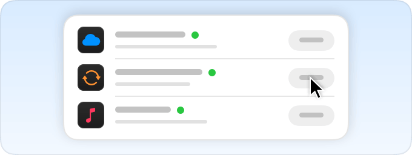
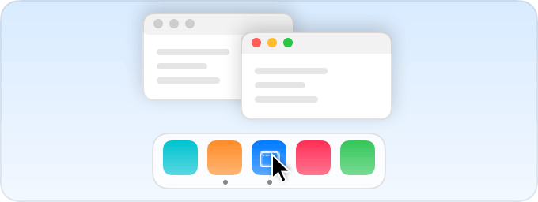
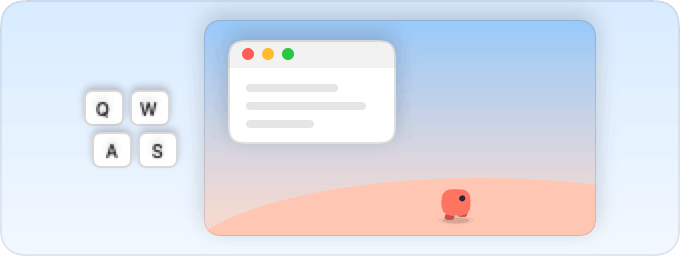
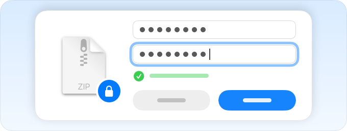

<h1 align="center">Что нового в pikapik</h1>

Каждое обновление — в нескольких словах и одной картинке. Сначала самое свежее.

<a href="README.md">English</a> · <b>Русский</b> · <a href="README.uk.md">Українська</a> · <a href="README.de.md">Deutsch</a> · <a href="README.fr.md">Français</a> · <a href="README.es.md">Español</a> · <a href="README.it.md">Italiano</a> · <a href="README.pt-BR.md">Português (Brasil)</a> · <a href="README.ja.md">日本語</a> · <a href="README.zh-Hans.md">简体中文</a> · <a href="README.ko.md">한국어</a> · <a href="README.ro.md">Română</a> · <a href="README.pl.md">Polski</a> · <a href="README.tr.md">Türkçe</a> · <a href="README.nl.md">Nederlands</a> · <a href="README.sv.md">Svenska</a> · <a href="README.cs.md">Čeština</a> · <a href="README.zh-Hant.md">繁體中文</a> · <a href="README.ar.md">العربية</a> · <a href="README.hi.md">हिन्दी</a> · <a href="README.id.md">Bahasa Indonesia</a> · <a href="README.vi.md">Tiếng Việt</a> · <a href="README.th.md">ไทย</a>

---

## Слова, набранные не в той раскладке, исправляются сами

1.44.3 · 13 октября 2026

Наберите слово не в той раскладке, нажмите пробел, и pikapik перепечатает его в нужной и сам переключит раскладку.

<picture><source media="(prefers-color-scheme: dark)" srcset="../media/layout-fix-dark.png"></picture>

Включите это в «Настройки» › «Клавиатура». Если слово вышло абракадаброй, например ghbdtn вместо привет, pikapik перепечатает его, как только вы нажмёте Пробел или Return, и переключит раскладку, чтобы следующее слово набралось правильно. Работают все раскладки, которые вы добавили на Mac, на любом из ваших языков.

Обычный текст остаётся ровно таким, как вы его набрали. pikapik меняет слово, только если такого слова нет ни в одном из ваших языков, а те же клавиши в другой раскладке дают частое слово. Имена, опечатки и редкие слова остаются как есть, как и поля для паролей, Терминал и программы, которые вы выберете.

Слово не исправилось или нужно вернуть как было? Нажмите ⌃⇧Пробел, и исправится последнее слово или выделенный текст, а следующее нажатие попробует другие раскладки. Сразу после исправления эти же клавиши отменяют его, и это слово pikapik больше не будет исправлять сам. В версии из Mac App Store выделите текст и выберите «Исправить раскладку» в меню «Службы».

**Попробовать:** Настройки › Клавиатура › Исправлять слова, набранные не в той раскладке

---

## VoiceOver снова открывает меню pikapik

1.44.2 · 13 октября 2026

В macOS 27 меню pikapik в строке меню снова открывается с VoiceOver.

Раньше, если нажать на значок pikapik с VoiceOver или другой функцией универсального доступа, ничего не происходило. Теперь меню открывается, а повторное нажатие его закрывает, как обычный щелчок.

---

## Кто занял порт

1.44.0 · 13 октября 2026

Новый раздел «Порты» в настройках показывает, какая программа держит каждый порт на вашем Mac, и освобождает порт, когда он вам нужен.

<picture><source media="(prefers-color-scheme: dark)" srcset="../media/ports-dark.png"></picture>

Если программа пишет, что её порт уже занят, откройте «Настройки» › «Порты». Там видна каждая программа, которая заняла порт: её значок, порты, которые она держит, и могут ли к ней подключиться другие устройства в вашей сети. Введите номер порта, чтобы узнать, кто его держит, или убедиться, что он свободен.

Нажмите на строку, и появятся адреса, которые открываются в браузере, файл программы, команда, которой её запустили, её папка и номер процесса. Кнопка «Освободить» просит программу завершиться, чтобы она успела сохранить работу. Если программа не закрывается, pikapik предложит завершить её принудительно. Перед каждым шагом pikapik спрашивает вас.

pikapik не трогает части macOS и программы других пользователей. Для служб «Ресивер AirPlay», «Общий доступ к файлам», «Общий экран» и «Удаленный вход» он подскажет, какой переключатель в Системных настройках освобождает порт. В версии из Mac App Store кнопка «Освободить» показывает программу, копирует команду для «Терминала», которая её завершит, или открывает «Мониторинг системы».

---

## Что работает в фоне

1.43.0 · 13 октября 2026

pikapik теперь показывает всё, что запускается само, какая программа это добавила, и выключает ваши задачи, ничего не удаляя.

<picture><source media="(prefers-color-scheme: dark)" srcset="../media/whats-new/1.43.0/background-dark.png"></picture>

В настройках появились «Фоновые задачи»: программы при входе, фоновые службы, помощники внутри программ и остатки удалённых программ. У каждой задачи видно, какая программа её добавила, работает ли она сейчас и где лежит её файл. Один щелчок показывает файл в Finder.

Свои задачи выключаются и возвращаются одной кнопкой. Ничего не удаляется. Задачи для всех пользователей и для всего Mac открывают «Объекты входа» в Системных настройках.

В версии из Mac App Store страница показывает задачи, а кнопки открывают «Объекты входа».

---

## Насколько нагрелся ваш Mac

1.42.0 · 13 октября 2026

Новый раздел «Температура» в настройках показывает, насколько нагрелись процессор, графика, память, диск, аккумулятор и Wi-Fi, и простыми словами говорит, всё ли в порядке.

<picture><source media="(prefers-color-scheme: dark)" srcset="../media/temperatures-dark.png"></picture>

Откройте «Настройки» › «Температура». Вверху одно слово подводит итог: «В норме», «Тепло», «Горячо» или «Очень горячо», а подпись под ним подсказывает, работает ли Mac на полной скорости или замедляется, чтобы остыть. Ниже у каждой детали, которую может измерить Mac, своя строка с температурой и цветной полоской: зелёная — всё хорошо, жёлтая — тепло, оранжевая — горячо, с учётом того, что нормально именно для этой детали.

Хотите всегда видеть температуру? Нажмите на карандаш внизу меню pikapik и отметьте «Температура». В меню появится то же слово и температура процессора, а клик по строке откроет раздел.

Температура обновляется раз в две секунды и только пока открыт раздел или меню, так что в фоне ничего не проверяется. pikapik только смотрит на температуру: пароль не нужен, и на Mac ничего не меняется.

**Исправлено**

- Если вы выбирали, какие строки показывает меню pikapik, строка «Dock на одном экране» больше не появляется в нём сама. Чтобы она была видна, нажмите на карандаш и отметьте её.
- Когда вы закрываете настройки, pikapik теперь сразу перестаёт проверять вентиляторы и аккумулятор, а не продолжает делать это в фоне.

---

## Управление вентиляторами больше не просит пароль

1.41.1 · 13 октября 2026

Помощник, который задаёт скорость вентиляторов, теперь обновляется вместе с pikapik, и новые версии больше не спрашивают пароль администратора.

<picture><source media="(prefers-color-scheme: dark)" srcset="../media/fans-dark.png"></picture>

Это обновление спросит его в последний раз. Если вы управляете вентиляторами, откройте «Настройки» › «Разрешения», нажмите «Разрешить» рядом с пунктом «Управление вентиляторами» и введите пароль. Дальше pikapik обновляет помощника сам и принимает только помощника, который действительно пришёл от pikapik.

**Исправлено**

- В «Системных настройках» › «Основные» › «Объекты входа» помощник вентиляторов теперь виден как pikapik, со значком программы.

---

## В каком состоянии ваш аккумулятор

1.41.0 · 13 октября 2026

Новый раздел «Аккумулятор» в настройках показывает, насколько износился аккумулятор, от чего он заряжается и как продлить его срок службы.

<picture><source media="(prefers-color-scheme: dark)" srcset="../media/battery-dark.png"></picture>

Откройте «Настройки» › «Аккумулятор». Там видно заряд и что происходит с аккумулятором сейчас, его состояние, максимальную ёмкость относительно нового аккумулятора и сколько циклов перезарядки он прошёл из 1000, на которые рассчитан.

Когда Mac подключён к сети, раздел показывает сетевой адаптер и его мощность, а во время зарядки ещё и сколько энергии идёт в аккумулятор. Когда Mac работает от аккумулятора, раздел показывает, сколько энергии он потребляет сейчас.

Советы внизу помогут аккумулятору прослужить дольше, а кнопка «Настройки аккумулятора…» открывает «Аккумулятор» в Системных настройках, где вы выбираете, как macOS его заряжает. Раздел ничего не меняет и не просит разрешений, в том числе в версии из Mac App Store. Он есть только на Mac с аккумулятором.

**Исправлено**

- Удаление pikapik через Homebrew теперь выключает «Открывать при входе» и возвращает системные настройки, которые меняла программа: анимации, повтор клавиш, активные углы. Если pikapik обновлялся сам, перед удалением один раз выполните brew upgrade --cask pikapik.

---

## Обновления через Homebrew больше не перезапускают Dock

1.40.2 · 13 октября 2026

Когда вы обновляете pikapik через Homebrew, Dock больше не пропадает на мгновение.

Обновление до этой версии ещё может в последний раз перезапустить Dock, потому что этот шаг ещё выполняет прежняя версия. Следующие обновления его уже не трогают.

---

## Один клик в Dock убирает окна

1.40.1 · 13 октября 2026

Кликните в Dock по значку программы, в которой работаете, и все её окна свернутся. Кликните ещё раз, и они все вернутся.

<picture><source media="(prefers-color-scheme: dark)" srcset="../media/whats-new/1.40.1/dock-minimize-dark.png"></picture>

Откройте «Настройки» › «Dock» и включите «Свернуть или скрыть кликом в Dock». Окна вернутся в том же порядке, а то, в котором вы работали, окажется сверху. Клик по другой программе, меню при долгом нажатии на значок и перетаскивание значков работают как раньше.

Хотите скрывать программу целиком, как по ⌘H? Под переключателем выберите в пункте «Клик по значку» вариант «Скрывает приложение». Если вы уже скрывали программы кликом в Dock, для вас ничего не изменится. Переключателю нужен «Универсальный доступ», в версии из Mac App Store его нет, а по умолчанию он выключен.

---

## Dock остаётся на одном экране

1.40.0 · 13 октября 2026

Dock больше не перескакивает на другой экран, когда указатель упирается в край этого экрана, и остаётся там, где вы его поставили.

<picture><source media="(prefers-color-scheme: dark)" srcset="../media/dock-display-dark.png"></picture>

Откройте «Настройки» › «Dock» и включите «Dock на одном экране». После этого Dock остаётся на своём экране, внизу или сбоку, а активные углы продолжают работать. Разрешения не нужны, в том числе в версии из Mac App Store.

Чтобы перенести Dock намеренно, удерживайте ⌥ и упритесь указателем в край другого экрана. Dock переедет на тот экран и дальше будет оставаться на нём.

Второй переключатель, «Возвращать Dock на место», сам возвращает Dock на его экран после сна или смены экранов. Ему нужен «Универсальный доступ», а в версии из Mac App Store его нет. Оба переключателя по умолчанию выключены.

---

## Красная кнопка больше не останавливает архивы

1.39.4 · 13 октября 2026

Раньше, если закрыть окно пароля красной кнопкой, pikapik до перезапуска больше не открывал и не создавал архивы. Это исправлено.

Красная кнопка в окне пароля и в окне нового архива теперь работает точно так же, как «Отменить», и следующий архив открывается сразу. VoiceOver теперь читает кнопку обновления на вкладке «О программе» в настройках по её собственному названию.

---

## Питомец живёт в вашем ритме

1.39.3 · 13 октября 2026

Пока вы печатаете, питомец бодрится и шагает пружинистой походкой. Стоит отойти от Mac, и он начинает клевать носом, садится и задрёмывает.

<picture><source media="(prefers-color-scheme: dark)" srcset="../media/whats-new/1.39.3/pet-rhythm-dark.png"></picture>

Секунд через 40 без клавиатуры и мыши у него тяжелеют глаза, а через полторы минуты он уже крепко спит, и над ним всплывают буквы z. Нажмите любую клавишу или подвиньте мышь, и он проснётся, встанет и пойдёт дальше. Пока питомец дремлет, он молчит и бережёт энергию.

pikapik не смотрит, что вы печатаете. Он только узнаёт, сколько времени прошло с последнего нажатия клавиши или движения мыши, так же как macOS перед тем, как притушить экран, поэтому никаких разрешений не нужно. Хотите, чтобы питомец всегда был бодрым? Выключите «Живёт в вашем ритме» в настройках питомца.

**Попробовать:** Настройки › Питомец › Живёт в вашем ритме

---

## Синхронизированные настройки теперь в папке pikapik

1.39.2 · 13 октября 2026

Если вы синхронизируете настройки через iCloud, теперь они лежат в iCloud Drive в папке pikapik, а не pika-tools, и pikapik переносит их туда сам.

Делать ничего не нужно: настройки остаются прежними, а старая папка исчезает, когда они переедут. Если вы положили в неё свои файлы, она останется на месте. Если синхронизируете несколько Mac, обновите pikapik на каждом, чтобы они и дальше делились настройками.

**Исправлено**

- Полное удаление pikapik через Homebrew (brew uninstall --zap) теперь убирает и список недавно удалённых программ.
- В старых постах на этой странице программа теперь называется pikapik.

---

## Привычная строка заголовка в окнах архивов

1.39.1 · 13 октября 2026

У окон архивов снова привычная для macOS строка заголовка с тремя круглыми кнопками слева.

Окно можно перетащить за верхнюю часть, как везде на Mac. В окне нового архива и в окне пароля красная кнопка закрывает окно, ничего не создавая и не распаковывая. Кнопки, которые в окне не нужны, серые. Те же кнопки появились и в окне, где видно, как создаётся копия поменьше или преобразуется файл. Теперь переключатель «Открывать архивы в этом приложении» запоминает, какая программа открывала ZIP и 7Z раньше, и при выключении возвращает файлы ей.

---

## Новые окна архиватора и пароль дважды

1.39.0 · 13 октября 2026

Когда вы ставите пароль на новый архив, теперь его нужно ввести дважды, чтобы опечатка не закрыла вам доступ к вашим же файлам.

<picture><source media="(prefers-color-scheme: dark)" srcset="../media/whats-new/1.39.0/archive-password-dark.png"></picture>

Под полями появляется зелёная строка, когда пароли совпадают, или красная, когда нет, а кнопка «Создать» ждёт, пока они совпадут.

Все окна архиватора выглядят по-новому: большой значок, один переключатель для пароля и короткая строка, которая подсказывает, останутся ли имена файлов видны, как в ZIP, или тоже скроются, как в 7Z. В macOS 26 кнопки из материала Liquid Glass.

Установка тоже стала проще: команде в начале страницы pikapik на GitHub больше ничего не нужно на вашем Mac. Она ставит pikapik, только если загрузка подписана разработчиком и прошла проверку Apple на вредоносные программы.

---

## Безопасное обновление рядом с версией из App Store

1.38.2 · 12 октября 2026

Если на Mac есть и pikapik из App Store, версия с GitHub теперь обновляется на своём месте и не трогает версию из App Store.

Раньше, если версия с GitHub называлась по-старому, pika-tools, и была установлена без Homebrew, обновление не устанавливалось, вместо него открывалась версия из App Store, а автозапуск pikapik выключался.

---

## Меню Finder работает надёжнее

1.38.1 · 12 октября 2026

Пункты pikapik в меню по правому клику в Finder больше не пропадают, когда вы подключаете диск, открываете образ диска, выводите Mac из сна или переключаетесь на Finder.

Раньше в редких случаях помощник, который их показывает, в этот момент закрывался.

---

## Открывайте и создавайте архивы в Finder

1.38.0 · 12 октября 2026

Новые «Архивы в Finder» открывают RAR и другие архивы, с которыми macOS не справляется, а ZIP и 7Z создают по правому клику.

<picture><source media="(prefers-color-scheme: dark)" srcset="../media/archive-dark.png"></picture>

Откройте «Настройки» › «Finder» и включите «Архивы в Finder». Щёлкните архив правой кнопкой и выберите «Распаковать», и файлы появятся рядом с ним. Щёлкните правой кнопкой любой другой файл или папку и выберите «Создать архив…», чтобы получить ZIP, 7Z, TAR.GZ или TAR.XZ. У ZIP и 7Z может быть пароль, а любой архив можно разделить на части, например по 15 МБ для почты. В таком ZIP нет скрытых служебных файлов, а имена на любом языке остаются читаемыми.

pikapik открывает и то, что macOS не умеет: RAR, в том числе из нескольких частей, 7Z с паролем, ZIPX, CAB, LZH, ARJ, ZST, WIM и многое другое. Двойной щелчок открывает их в pikapik. Имена файлов в старых ZIP, например на кириллице, японском или китайском, теперь читаются правильно. Переключатель «Открывать архивы в этом приложении» отдаёт pikapik также ZIP и 7Z, а TAR и GZ остаются за встроенной программой для архивов, которая и так хорошо с ними справляется.

Окно спросит пароль, «Остановить» прервёт любую работу, а из повреждённого архива pikapik достанет всё, что ещё читается. Перед распаковкой архива, который раздулся бы до огромного размера, pikapik спросит вас, а архивы, которые пытаются записать файлы за пределы своей папки, блокируются. Нет в версии из Mac App Store. Нажмите пробел на архиве, чтобы посмотреть, что внутри.

---

## FPS теперь просит разрешение в нужном месте

1.37.3 · 12 октября 2026

Запись экрана для счётчика FPS теперь разрешается на странице «Разрешения», вместе со всеми остальными разрешениями.

<picture><source media="(prefers-color-scheme: dark)" srcset="../media/game-fps-dark.png"></picture>

Чтобы посчитать кадры игры, функции «Показывать FPS» может понадобиться «Запись экрана». Раньше pikapik просил её прямо на странице «Игры». Теперь она лежит вместе с остальными разрешениями: когда она нужна, на странице «Разрешения» в «Настройках» появляется строка «Запись экрана», и вы нажимаете в ней «Разрешить».

На странице «Игры» теперь остаётся только привычная строка под переключателем: «Нужно разрешение. Нажмите, чтобы разрешить.» Кнопка «Разрешить» в ней ведёт прямо к строке «Запись экрана». Включение «Показывать FPS» больше не задаёт вопрос само по себе, а во время игры pikapik по-прежнему никогда ничего не просит.

---

## Проверено Apple

1.37.2 · 12 октября 2026

pikapik теперь подписан проверенным разработчиком Apple и проверен самой Apple. Поэтому macOS больше не предупреждает при первом запуске.

После этого обновления macOS может снова запросить разрешения, которые вы давали pikapik, например «Универсальный доступ», «Мониторинг ввода» или «Полный доступ к диску». Разрешите их ещё раз в Системных настройках › Конфиденциальность и безопасность. Если вы управляете вентиляторами, разрешите это снова в настройках pikapik, и macOS один раз спросит пароль.

---

## Плашка FPS больше не отстаёт от игры

1.37.1 · 12 октября 2026

Перетаскивайте окно игры, и плашка FPS теперь движется вместе с ним.

<picture><source media="(prefers-color-scheme: dark)" srcset="../media/game-fps-dark.png"></picture>

Раньше плашка догоняла движущееся окно примерно раз в секунду и заметно отставала. Теперь она сверяется с окном на каждом кадре экрана и отстаёт от него не более чем на несколько тысячных долей секунды. Когда окно стоит на месте, плашка проверяет его реже, поэтому почти не нагружает Mac во время игры. И она больше не перескакивает в другое место, когда часть окна уходит за край экрана.

Если спокойная игра вроде шахмат показывает 0, всё в порядке: такие игры рисуют новую картинку, только когда что-то движется. Пока фигура скользит по доске, число растёт, а когда всё замирает, снова становится 0.

---

## Смотрите, насколько плавно идёт игра

1.37.0 · 12 октября 2026

Новая функция «Показывать FPS» выводит в углу игры маленький счётчик, и вы сразу видите, насколько плавно идёт игра.

<picture><source media="(prefers-color-scheme: dark)" srcset="../media/game-fps-dark.png"></picture>

Откройте «Настройки» › «Игры» и включите «Показывать FPS». Пока работает «Игровой режим», в углу любой игры появляется маленькая тёмная плашка с числом. FPS — это кадры в секунду: сколько картинок игра рисует за секунду, и чем число больше, тем плавнее игра. Чтобы выбрать угол, нажмите на нужный угол картинки над переключателем.

Нажатия проходят сквозь плашку, а сама она следует за окном игры. Прочерк означает, что первые кадры ещё не пришли, а тусклый 0 — что игра перестала рисовать. Пока вы не включите «Показывать FPS», плашка не появляется.

В macOS 27 большинство игр считает сама macOS, поэтому разрешение не нужно. Некоторые игры, в основном старые, можно посчитать только через запись экрана, и тогда число не бывает выше частоты обновления экрана. В macOS 14–26 и в версии из Mac App Store так считаются все игры, поэтому «Показывать FPS» просит разрешение «Запись экрана». Изображение нигде не сохраняется и никуда не отправляется.

---

## Удаляйте программы без опаски

1.36.0 · 12 октября 2026

Новое удаление программ убирает программу вместе со всеми её файлами и возвращает всё на место, если вы передумаете.

<picture><source media="(prefers-color-scheme: dark)" srcset="../media/uninstaller-dark.png"></picture>

Откройте «Настройки» › «Удаление программ» и выберите программу или перетащите её на картинку. pikapik покажет всё, что она хранит на вашем Mac, и объяснит, почему каждый файл в списке. Файлы, которые явно относятся к программе, отмечены галочкой, а те, что лишь возможно с ней связаны, нет. Нажмите «Переместить в Корзину», и всё попадёт в Корзину, так что насовсем ничего не удаляется.

Передумали? Нажмите «Вернуть на место», и всё окажется на прежних местах. Последние десять удалений ждут в разделе «Недавно удалённые», пока их файлы лежат в Корзине. «Сбросить программу» оставляет саму программу и убирает только её сохранённые данные, настройки и временные файлы: на случай, если она ведёт себя странно.

Сами переместили программу в Корзину? Страница покажет такие программы и файлы, которые они оставили, а специальный переключатель будет предлагать очистку каждый раз, когда программа попадает в Корзину. Ничего не удаляется, пока вы не выберете. Чтобы увидеть всё, странице нужен «Полный доступ к диску».

---

## Наряжайте питомца

1.35.0 · 12 октября 2026

У питомца появился гардероб, а новые вещи вы получаете, пока играете вместе.

<picture><source media="(prefers-color-scheme: dark)" srcset="../media/whats-new/1.35.0/wardrobe-dark.png"></picture>

Откройте «Настройки» › «Питомец» и выберите, что наденет питомец: шляпы, очки, шарфы, рубашки, обувь, плащи и даже крылья. Он наденет это сразу. Несколько вещей доступны с самого начала, остальные — награды, которые приходят, пока вы играете вместе: поднимите питомца и подбросьте, погоняйте мяч, посмотрите, как он лазает по окнам и болтает, или просто день за днём составляйте ему компанию. Когда вы получите награду, питомец сам об этом скажет.

Готовые образы наряжают питомца с головы до ног одним щелчком: волшебник, пират, астронавт, супергерой, король и другие. Образ готов, когда вы получили все его части.

Хранятся только простые числа: шаги, броски, дни вместе. Они остаются на вашем Mac, ничего никуда не отправляется, а стереть их можно в любой момент в разделе «Настройки» › «Питомец».

---

## Мышь и трекпад в играх

1.34.0 · 12 октября 2026

Смахивания, сведение пальцев и активные углы теперь не выдёргивают из игры, как и сочетания клавиш.

<picture><source media="(prefers-color-scheme: dark)" srcset="../media/whats-new/1.34.0/pointer-shortcuts-dark.png"></picture>

В разделе Настройки › Игры › «Дополнительные настройки игры» есть группа «Мышь и трекпад». В ней только то, что включено в macOS на вашем Mac, с названиями от Apple и небольшим рисунком у каждого пункта: сочетания на кнопке мыши, смахивание между рабочими столами и полноэкранными приложениями, Mission Control и App Exposé, сведение пальцев для приложений и разведение для рабочего стола, смахивание от правого края для Центра уведомлений и каждый активный угол с его действием. Пока игра на переднем плане, всё это приостановлено, поэтому случайное смахивание или касание угла экрана не выдернет вас из игры. Жесты внутри игры продолжают работать. Любой пункт можно вернуть в обычную работу.

---

## Группы сочетаний открываются мгновенно

1.33.2 · 11 октября 2026

Даже самая длинная группа системных сочетаний открывается сразу, а у каждой строки понятное название.

<picture><source media="(prefers-color-scheme: dark)" srcset="../media/whats-new/1.31.0/system-shortcuts-dark.png"></picture>

Раньше окно настроек ненадолго зависало, когда открывалась группа из десятков строк: все строки вместе с анимированными картинками строились разом. Теперь строятся только строки, которые видно, и несколько соседних. Пропали и строки «Системное действие» с номером: диктовка, Siri, клавиши яркости и увеличения показывают свои настоящие названия, а действия, которым macOS не даёт названия, скрыты, но в играх по-прежнему приостанавливаются.

---

## Группы сочетаний открываются без зависаний

1.33.1 · 11 октября 2026

Вкладка «Игры» больше не подтормаживает, когда раскрывается длинный список превью.

<picture><source media="(prefers-color-scheme: dark)" srcset="../media/whats-new/1.31.0/system-shortcuts-dark.png"></picture>

Раньше при раскрытии группы системных сочетаний клавиш окно настроек замирало до трёх секунд: каждая строка с превью просчитывалась по несколько раз. Теперь каждая строка просчитывается один раз, поэтому группы открываются почти сразу.

---

## Все разрешения — в одном месте

1.33.0 · 11 октября 2026

На странице «Разрешения» теперь собрано всё, что использует pikapik, и любое разрешение можно забрать обратно.

<picture><source media="(prefers-color-scheme: dark)" srcset="../media/whats-new/1.33.0/permissions-dark.png"></picture>

Страница «Настройки» › «Разрешения» теперь показывает все разрешения pikapik: «Универсальный доступ», «Мониторинг ввода», «Управление вентиляторами», «Расширения Finder», iCloud Drive и «Полный доступ к диску». Каждая строка одной фразой объясняет, зачем оно нужно: зелёная галочка — разрешение включено, оранжевый крестик — его не хватает.

У каждой строки одна кнопка: «Разрешить», если разрешения нет, и «Выключить», если оно есть. Так любое разрешение можно забрать обратно прямо здесь, не копаясь в системных настройках. Для «Универсального доступа» и «Мониторинга ввода» pikapik сначала спросит, а потом перезапустится уже без них.

Инструмент, которому нужно ещё не выданное разрешение, выглядит серым. Нажмите на него — откроется страница «Разрешения» с выделенной нужной строкой, останется одно нажатие на «Разрешить».

**Попробовать:** Откройте «Настройки» › «Разрешения» и посмотрите на каждую строку. Нажмите на серый инструмент, чтобы сразу попасть к разрешению, которое ему нужно.

---

## Надёжнее установка, а обновление не теряет приложение

1.32.2 · 11 октября 2026

Исправления, которые делают установку, обновление и удаление безопаснее.

<picture><source media="(prefers-color-scheme: dark)" srcset="../media/fans-dark.png"></picture>

Помощник вентиляторов теперь ставится аккуратнее и проверяется перед запуском. Если обновление не удалось скопировать, текущий pikapik остаётся на месте. При удалении также убирается помощник вентиляторов и возвращаются ваша настройка повтора клавиш, углы Dock и системные сочетания.

Зажатые клавиши больше не залипают, когда инструмент перезапускается, а при выключении «Повтор зажатой клавиши» возвращается ваша собственная настройка меню акцентов. Питомец отдыхает, пока экран спит или заблокирован, а копия archive.tar.gz теперь называется archive 2.tar.gz.

---

## Ручная скорость вентиляторов включается с первого раза

1.32.1 · 11 октября 2026

Выбор «Вручную» на вкладке «Вентиляторы» больше не откатывается в «Авто».

<picture><source media="(prefers-color-scheme: dark)" srcset="../media/fans-dark.png"></picture>

Раньше первое нажатие на «Вручную» иногда возвращало вентиляторы в «Авто» с предупреждением о безопасности, и срабатывало только второе. Теперь «Вручную» держится с первой попытки.

Если вентилятор всё же сам выйдет из ручного режима, pikapik по-настоящему вернёт его в «Авто», так что на экране всегда то, что делает ваш Mac.

Ничего разрешать заново не нужно. Обновитесь — и всё работает.

**Попробовать:** Откройте «Настройки» › «Вентиляторы» и выберите «Вручную».

---

## Смотрите, как быстро крутятся вентиляторы

1.32.0 · 11 октября 2026

На новой вкладке «Вентиляторы» видна скорость каждого из них, а ещё её можно выбрать.

<picture><source media="(prefers-color-scheme: dark)" srcset="../media/fans-dark.png"></picture>

В настройках появилась вкладка «Вентиляторы», а в меню — своя строка. Вы видите, как быстро сейчас вращается каждый вентилятор, прямо в реальном времени, а рядом крутится маленький вентилятор в такт.

Оставьте «Авто», и Mac решит сам, как и раньше. Или выберите «Вручную» и одним ползунком задайте нужную скорость. В первый раз вы один раз разрешаете это паролем администратора — и всё.

Всё сделано безопасно. Вентиляторы возвращаются в режим «Авто», когда вы выходите из pikapik, когда Mac засыпает, если pikapik аварийно закрылся или если Mac сильно нагрелся.

**Попробовать:** Откройте «Настройки» › «Вентиляторы» и посмотрите на скорость. Выберите «Вручную», чтобы попробовать ползунок.

---

## Подробности — когда они нужны

1.31.4 · 11 октября 2026

Спокойнее вкладка «Игры», один поиск для всех настроек.

<picture><source media="(prefers-color-scheme: dark)" srcset="../media/whats-new/1.31.4/game-choices-dark.png"></picture>

Внутри выпадающего списка каждый режим объясняет своё действие. Когда список закрыт, на странице остаётся только выбранное название.

Описания, повторяющие название действия, убраны. Полезные дополнительные сведения сохранены.

Общий поиск находит системные действия по названию, смыслу и клавишам. Нажатие на результат открывает и подсвечивает именно эту настройку.

**Попробовать:** Найдите действие в общем поиске и откройте список его режимов.

---

## Единый вид игровых настроек

1.31.3 · 11 октября 2026

Одинаковые превью и понятный выбор для сочетаний.

<picture><source media="(prefers-color-scheme: dark)" srcset="../media/whats-new/1.31.3/game-preview-dark.png"></picture>

У каждого сочетания теперь такое же широкое превью, как в «Защите игры» и других вкладках. Под ним — описание, управление и пояснение выбранного варианта.

«По правилам игрового режима». Короткое сочетание меняет язык без меню. Зажатые игровые клавиши защищают от случайной смены языка.

«Отключить в игре». Пока игра на переднем плане, это действие macOS отключено. Когда вы уходите из игры, оно работает как раньше. «Разрешить в игре». macOS выполняет действие как обычно, даже если оно открывает окно или уводит фокус из игры.

**Попробовать:** Откройте дополнительные настройки игры, раскройте «Функции Mac» и выберите, как действие работает во время игры.

---

## Понятные настройки для игры

1.31.2 · 11 октября 2026

Настройте защиту и изучите сочетания вашего Mac.

<picture><source media="(prefers-color-scheme: dark)" srcset="../media/whats-new/1.31.2/game-settings-dark.png"></picture>

Вместо повторяющихся папок — восемь понятных тем. У каждого заголовка есть название, пояснение, значок и счётчик. Раздел открывается нажатием на всю строку.

Рядом с анимированным превью каждого действия теперь объясняется, что оно делает. Текущие клавиши и поведение в игре находятся в отдельной строке. Поиск работает и по описаниям.

У неназначенных клавиш есть понятная ссылка на системные настройки. Общие переключатели защиты игры собраны отдельно, а ваш выбор сохраняется.

**Попробовать:** Откройте дополнительные настройки игры, раскройте тему и сравните описание действия с его превью.

---

## Жест смены языка в игре

1.31.1 · 11 октября 2026

По умолчанию всё просто, а полный системный каталог доступен, когда нужен.

<picture><source media="(prefers-color-scheme: dark)" srcset="../media/input-switch-dark.png"></picture>

Жест смены языка pikapik работает в игре, даже если системные сочетания смены языка не назначены или выключены.

<picture><source media="(prefers-color-scheme: dark)" srcset="../media/game-mode-dark.png"></picture>

Автоматический режим приостанавливает действия, которые открывают окна или уводят фокус. Короткое намеренное сочетание смены языка переключает раскладку без системного окна. Зажатые клавиши движения имеют приоритет, поэтому бег и прыжки не меняют язык случайно.

Каждое действие можно настроить в каталоге с поиском. Смена языка может работать фоном; другие действия можно приостановить или разрешить как обычно. Выбор синхронизируется с настройками. Другие программы, наблюдающие за клавиатурой, показаны отдельно. Принудительное завершение остаётся доступным.

**Попробовать:** Держите ⌥ и нажимайте ⇧ — следующий язык. Держите ⇧ и нажимайте ⌥ — предыдущий

---

## Игровой режим знает сочетания вашего Mac

1.31.0 · 11 октября 2026

По умолчанию всё просто, а полный системный каталог доступен, когда нужен.

<picture><source media="(prefers-color-scheme: dark)" srcset="../media/whats-new/1.31.0/system-shortcuts-dark.png"></picture>

Включите игровой режим и играйте. В дополнительных настройках находится каталог, который публикует ваш Mac: текущие сочетания и анимированное превью для каждого действия.

<picture><source media="(prefers-color-scheme: dark)" srcset="../media/game-mode-dark.png"></picture>

Автоматический режим приостанавливает действия, которые открывают окна или уводят фокус. Короткое намеренное сочетание смены языка переключает раскладку без системного окна. Зажатые клавиши движения имеют приоритет, поэтому бег и прыжки не меняют язык случайно.

Каждое действие можно настроить в каталоге с поиском. Смена языка может работать фоном; другие действия можно приостановить или разрешить как обычно. Выбор синхронизируется с настройками. Другие программы, наблюдающие за клавиатурой, показаны отдельно. Принудительное завершение остаётся доступным.

**Попробовать:** Откройте дополнительные настройки игры, найдите сочетание снимка экрана или смены языка и сравните превью с защитой и без неё.

---

## Ссылки на сочетания открываются без вылета

1.30.14 · 11 октября 2026

Нажатие на сочетание с надписью «Выключено» больше не закрывает pikapik.

<picture><source media="(prefers-color-scheme: dark)" srcset="../media/whats-new/1.23.2/game-shortcuts-dark.png"></picture>

На странице «Игры» можно нажать на сочетание, даже если клавиши не назначены. Системные настройки откроются безопасно.

<picture><source media="(prefers-color-scheme: dark)" srcset="../media/game-mode-dark.png"></picture>

Раньше pikapik мог дважды прочитать одну и ту же меняющуюся строку, пока открывалось окно настроек. Если между чтениями текст пропадал, приложение падало.

Теперь каждая строка читается один раз. Пропавший текст пропускается. Исправление действует и на ссылки на сочетания на других страницах.

**Попробовать:** На странице «Игры» нажмите на сочетание с надписью «Выключено».

---

## Держите Control и играйте

1.30.13 · 10 октября 2026

Control больше не даёт смене языка забрать пробел у игры.

<picture><source media="(prefers-color-scheme: dark)" srcset="../media/game-mode-dark.png"></picture>

Держите Control для бега и нажимайте пробел для прыжка. В игровом режиме смена языка по Control+пробелу и Control+Option+пробелу приостанавливается.

<picture><source media="(prefers-color-scheme: dark)" srcset="../media/whats-new/1.23.2/game-shortcuts-dark.png"></picture>

Другие сочетания macOS с Control, а также с Shift или Option без Command тоже приостанавливаются, включая назначенные вами. Нажатия, отпускания и зажатые клавиши продолжают поступать в игру вместе.

Жест смены языка pikapik и сочетания выхода с игровыми модификаторами тоже не вмешиваются. После выхода из игры системные сочетания возвращаются ровно как были.

**Попробовать:** Держите Control, двигайтесь и несколько раз нажмите пробел. Затем выйдите из игры и переключите язык как обычно.

---

## Перетащите игру из Мониторинга системы

1.30.12 · 10 октября 2026

Игровой режим теперь принимает процессы из Мониторинга системы.

<picture><source media="(prefers-color-scheme: dark)" srcset="../media/whats-new/1.28.0/app-shelf-dark.png"></picture>

Найдите процесс игры и перетащите его строку в «Ваши игры» в Настройках → Игры.

<picture><source media="(prefers-color-scheme: dark)" srcset="../media/game-mode-dark.png"></picture>

Игры через Java тоже работают, даже без обычного значка в Dock. Раньше такие строки не добавлялись: в них номер и имя процесса, а не файл.

Игра сохраняется для следующих запусков. Minecraft показывается своим именем. Номер и имя должны совпадать с запущенным процессом.

**Попробовать:** Перетащите строку java запущенного Minecraft в «Ваши игры».

---

## Добавьте игру прямо во время игры

1.30.11 · 10 октября 2026

При добавлении игры сначала видны игры, которые уже открыты.

<picture><source media="(prefers-color-scheme: dark)" srcset="../media/whats-new/1.28.0/app-shelf-dark.png"></picture>

Откройте Настройки → Игры → Добавить игру и нажмите на запущенную игру. Здесь видны и игры через Java и другие среды, даже без файла .app. Minecraft называется Minecraft, а не java.

<picture><source media="(prefers-color-scheme: dark)" srcset="../media/game-mode-dark.png"></picture>

Приложения из Dock теперь в отдельном раскрывающемся списке, поэтому до открытой игры можно добраться сразу.

Через «Другое…» и перетаскивание можно добавить и исполняемый файл игры, и приложение .app. После добавления игровой режим включается, когда вы переходите в игру.

**Попробовать:** Оставьте игру открытой, нажмите «Добавить игру» и выберите её значок. Искать папки больше не нужно.

---

## Питомец не прячется, когда прыгает

1.30.10 · 10 октября 2026

Питомец больше не пропадает за окнами, когда прыгает на экране без Dock.

<picture><source media="(prefers-color-scheme: dark)" srcset="../media/pet-dark.png"></picture>

Раньше, если Dock был на другом мониторе или скрывался, питомец прыгал за окнами и пропадал, пока не приземлится. Теперь, как только он отрывается от земли, его видно перед окнами на любом экране, с Dock и без. С мячиком то же самое.

<picture><source media="(prefers-color-scheme: dark)" srcset="../media/whats-new/1.29.0/pet-ball-dark.png"></picture>

Окно, которое лишь задевает питомца краем, больше не прячет его в прыжке. Питомец остаётся за окном, только когда окно правда его закрывает, например видео, которое вы смотрите.

На земле питомец и мячик, как и раньше, гуляют за вашими окнами.

**Попробовать:** Включите автоскрытие Dock или переведите его на другой монитор и нажмите пробел рядом с окном. Питомец прыгнет перед ним.

---

## Полный экран — ваш, а мячик играет честно

1.30.9 · 10 октября 2026

Питомец больше не выглядывает в видео на весь экран, а мячик не натыкается на то, чего нет.

<picture><source media="(prefers-color-scheme: dark)" srcset="../media/pet-dark.png"></picture>

Раньше, пока вы смотрели видео на весь экран, питомец иногда выглядывал. Теперь pikapik спрашивает у macOS напрямую, открыто ли на экране что-то на весь экран, и проверяет ещё раз, когда переключение закончится. Питомец и мячик прячутся, пока вы не выйдете из полного экрана.

<picture><source media="(prefers-color-scheme: dark)" srcset="../media/whats-new/1.29.0/pet-ball-dark.png"></picture>

Мячик больше не отскакивает от пустоты. Он перелетает через Dock, а не бьётся о невидимую стену над ним. Мышь теперь попадает по мячику, только когда курсор правда его касается. Лёгкое касание катит мячик, быстрый взмах подбрасывает его. А если питомец или мячик спрятались за окном, мышь над этим окном их не трогает.

Перетаскивание файла по рабочему столу больше не строит питомцу ступеньку. Её строит только рамка выделения.

**Попробовать:** Включите видео на весь экран и несколько раз поставьте его на паузу пробелом. Питомец не покажется. А потом махните мышью по мячику.

---

## Углы экрана молчат, пока вы играете

1.30.8 · 10 октября 2026

В игровом режиме мышь у краёв и в углах экрана больше не включает активные углы и не выдвигает скрытый Dock.

<picture><source media="(prefers-color-scheme: dark)" srcset="../media/game-mode-dark.png"></picture>

Раньше во время игры мышь в углу или у края экрана могла включить активный угол или выдвинуть скрытый Dock прямо посреди партии.

<picture><source media="(prefers-color-scheme: dark)" srcset="../media/whats-new/1.23.2/game-shortcuts-dark.png"></picture>

Теперь игровой режим выключает активные углы и скрытый Dock на время игры. Через несколько секунд после выхода из игры или при закрытии pikapik они возвращаются такими, какими были.

А курсор у края экрана с игрой больше не дёргается.

**Попробовать:** Включите игровой режим, запустите игру и уведите мышь в угол экрана. Ничего не выскочит.

---

## Питомец больше не лезет в кадр

1.30.7 · 10 октября 2026

Если питомец или мячик спрятались за окном, они остаются за ним, даже когда прыгают или летят.

<picture><source media="(prefers-color-scheme: dark)" srcset="../media/pet-dark.png"></picture>

Раньше, если питомец или мячик прятались за видео или игрой, прыжок или полёт мог вынести их прямо поверх того, что вы смотрите. А пробел для паузы видео тоже выманивал питомца.

<picture><source media="(prefers-color-scheme: dark)" srcset="../media/whats-new/1.29.0/pet-ball-dark.png"></picture>

Теперь они остаются за окном, которое их закрывает, что бы ни делали. А видео на весь экран в Firefox прячет их сразу.

За обычными окнами они по-прежнему прячутся, как раньше.

**Попробовать:** Включите видео в большом окне, которое закрывает низ экрана, и нажмите пробел, чтобы поставить паузу. Питомец останется за видео.

---

## На весь экран — и питомец отдыхает везде

1.30.6 · 10 октября 2026

Пока любое приложение открыто на весь экран, питомец и мячик прячутся на всех мониторах.

<picture><source media="(prefers-color-scheme: dark)" srcset="../media/pet-dark.png"></picture>

Раньше, когда вы открывали видео или игру на весь экран, питомец и мячик иногда убегали на соседний монитор и играли там.

<picture><source media="(prefers-color-scheme: dark)" srcset="../media/whats-new/1.29.0/pet-ball-dark.png"></picture>

Теперь, пока любое приложение открыто на весь экран, они прячутся на всех мониторах. Выйдете из полного экрана — они сразу вернутся.

За обычными окнами они по-прежнему прячутся, как раньше.

**Попробовать:** Если у вас два монитора, откройте видео на весь экран на одном из них. Питомец и мячик пропадут с обоих и вернутся, когда вы выйдете из полного экрана.

---

## Питомец не мешает смотреть видео и играть

1.30.5 · 10 октября 2026

Питомец и мячик прячутся, пока приложение открыто на весь экран, в том числе на Маках с чёлкой.

<picture><source media="(prefers-color-scheme: dark)" srcset="../media/pet-dark.png"></picture>

Раньше на Маке с чёлкой питомец мог остаться поверх видео или игры на весь экран, а мячик иногда выскакивал поверх полноэкранного приложения на другом мониторе.

<picture><source media="(prefers-color-scheme: dark)" srcset="../media/whats-new/1.29.0/pet-ball-dark.png"></picture>

Теперь, пока приложение открыто на весь экран, питомец и мячик ждут в сторонке. Выйдите из полноэкранного режима — и они сразу вернутся.

За обычными окнами они по-прежнему прячутся, как раньше.

**Попробовать:** Откройте видео на весь экран или запустите игру. Питомец и мячик не будут мешать, пока вы не закончите.

---

## Питомца видно, когда он прыгает или катается на выделении

1.30.4 · 10 октября 2026

Питомец и мяч больше не пропадают за окнами, пока они в воздухе.

<picture><source media="(prefers-color-scheme: dark)" srcset="../media/pet-dark.png"></picture>

Раньше, когда питомец перепрыгивал курсор или поднимался на выделении, его закрывало развёрнутое окно, и казалось, что он пропал.

<picture><source media="(prefers-color-scheme: dark)" srcset="../media/whats-new/1.29.0/pet-ball-dark.png"></picture>

Теперь, пока питомец или мяч выше Дока, они видны поверх окон. А на земле снова уходят за них.

И питомец снова может гулять за Доком, как раньше.

**Попробовать:** Разверните окно на весь экран, начните выделение на рабочем столе рядом с Доком, чтобы питомец на него залез, и медленно тяните вверх. Питомец едет на нём поверх окна.

---

## Питомец и мяч больше не прячутся под Доком

1.30.3 · 9 октября 2026

Питомец больше не гуляет и не спит под Доком, так что его всегда видно.

<picture><source media="(prefers-color-scheme: dark)" srcset="../media/pet-dark.png"></picture>

Раньше питомец и мяч часто гуляли и лежали прямо под Доком, где их никто не видел. При развёрнутом окне казалось, что питомец пропал совсем.

<picture><source media="(prefers-color-scheme: dark)" srcset="../media/whats-new/1.29.0/pet-ball-dark.png"></picture>

Теперь Док для них как стена. Питомец разворачивается у его края, а мяч от него отскакивает.

Поэтому питомец всегда виден рядом с Доком, даже когда окно занимает весь экран.

**Попробовать:** Разверните окно на весь экран и понаблюдайте пару минут. Питомец всё время виден слева или справа от Дока.

---

## Питомец больше не пропадает за окнами

1.30.2 · 9 октября 2026

Даже когда питомца закрыло окно, он продолжает жить и падает на землю, когда выделение отпускают.

<picture><source media="(prefers-color-scheme: dark)" srcset="../media/pet-dark.png"></picture>

Когда окна целиком закрывали полосу, где живёт питомец, pikapik ставил его на паузу, и он мог замереть в воздухе. Теперь питомец и мяч продолжают жить и за окном: ходят, падают и играют. Отдыхает только рисование.

<picture><source media="(prefers-color-scheme: dark)" srcset="../media/whats-new/1.29.0/pet-ball-dark.png"></picture>

Если рамка выделения подняла питомца за окном, он падает вниз, как только вы её отпустите, и снова виден у Дока.

А рамка выделения больше не поднимает питомца выше его полосы.

**Попробовать:** Разверните окно, поднимите питомца рамкой выделения за окно и отпустите. Питомец упадёт и появится у Дока.

---

## Выделение на рабочем столе снова работает

1.30.1 · 9 октября 2026

Питомец и мяч снова запрыгивают на рамки выделения, а списки приложений подсвечиваются только для приложений.

<picture><source media="(prefers-color-scheme: dark)" srcset="../media/whats-new/1.29.0/pet-ball-dark.png"></picture>

Когда Dock или программа для удалённого доступа занимали весь экран, pikapik не замечал рамку, которую вы рисуете на рабочем столе. Теперь замечает снова, и питомец с мячом запрыгивают на неё, как раньше.

<picture><source media="(prefers-color-scheme: dark)" srcset="../media/whats-new/1.28.0/app-shelf-dark.png"></picture>

Списки приложений в настройках подсвечиваются, только когда над ними приложение. Другие файлы не мешают: рамка не появляется, и ничего лишнего не добавляется. Если перетащить приложение вместе с другими файлами, добавится только приложение.

А рамка гаснет сразу, как только вы отпустите приложение или уведёте курсор.

**Попробовать:** Нарисуйте рамку выделения на рабочем столе и посмотрите, как питомец на неё запрыгнет.

---

## «Выйти» больше не выключает pikapik

1.30.0 · 9 октября 2026

Нажали «Выйти» по привычке? Сочетания клавиш, «Не засыпать» и питомец всё равно продолжают работать.

<picture><source media="(prefers-color-scheme: dark)" srcset="../media/keep-awake-dark.png"></picture>

Когда вы выбираете «Выйти», нажимаете ⌘Q или завершаете pikapik из Dock, он закрывает свои окна и убирает значок из строки меню, но тихо работает в фоне: сочетания клавиш, «Не засыпать» и питомец остаются с вами. Чтобы вернуть значок, просто откройте pikapik ещё раз.

<picture><source media="(prefers-color-scheme: dark)" srcset="../media/pet-dark.png"></picture>

Нужно выйти по-настоящему? Удерживайте Option и выберите «Выйти» или нажмите ⌥⌘Q. Когда pikapik впервые уходит в фон, он объясняет, что произошло, и тут же предлагает выйти полностью.

Хотите как раньше? Выключите «Работать в фоне после выхода» в Настройках › Основные. Обновление, смена языка, выход из учётной записи, перезагрузка и выключение Mac всегда завершают pikapik полностью, поэтому им никогда не приходится его ждать.

**Попробовать:** Нажмите ⌘Q, а потом откройте pikapik ещё раз, чтобы вернуть значок.

---

## Питомец гуляет по всем экранам

1.29.1 · 9 октября 2026

Мониторов больше одного? Теперь питомец и мяч бывают везде, куда вы смотрите, и никогда не теряются.

<picture><source media="(prefers-color-scheme: dark)" srcset="../media/pet-dark.png"></picture>

Дойдя до края одного экрана, питомец просто переходит на соседний, а мяч катится следом. Питомца или мяч можно взять мышью и перенести на любой экран. Если приложение развернулось на весь экран, они уходят на другой экран, чтобы не мешать, а если отключить монитор — возвращаются на главный.

<picture><source media="(prefers-color-scheme: dark)" srcset="../media/whats-new/1.29.0/pet-ball-dark.png"></picture>

Мяч больше не застревает в углу. Питомец подбегает, подкидывает его назад через голову и продолжает играть.

И питомец больше не пропадает. Каждые две секунды он проверяет, что он на экране, а если что-то пошло не так — после сна, блокировки Mac, смены рабочего стола или полноэкранного режима, — сам сразу возвращается.

**Попробовать:** Перенесите питомца на другой экран или закатите мяч в угол.

**Исправлено**

- Брошенный питомец больше не садится на рамку выделения, до которой ему не допрыгнуть, и не исчезает из-за этого.

---

## У питомца появился мяч

1.29.0 · 9 октября 2026

По нижнему краю экрана теперь катается маленький футбольный мяч. Питомец с ним играет — и вы тоже можете.

<picture><source media="(prefers-color-scheme: dark)" srcset="../media/whats-new/1.29.0/pet-ball-dark.png"></picture>

Мяч катится и подпрыгивает как настоящий. Питомец бежит за ним, пинает и снова догоняет. Резко проведите курсором по мячу — и пнёте его сами. А можно взять мяч, перенести и бросить, как самого питомца.

Есть маленький секрет. Нажмите на пустое место рабочего стола и потяните, чтобы нарисовать рамку выделения, — с Shift или без. Пока кнопка мыши нажата, рамка становится полочкой: питомец запрыгивает на неё, и мяч тоже может на неё упасть. Отпустите кнопку — и полочка исчезнет.

Хочется, чтобы на столе было спокойнее? Выключите «Мяч» в настройках питомца, и он снова будет гулять сам по себе.

**Попробовать:** Настройки › Питомец › Мяч

**Исправлено**

- Рядом с Dock питомец снова прыгает так высоко, как хочет. Пониже он держится, только когда находится прямо над Dock, поэтому из-за него не выглядывает.

---

## Приложения добавляются одним щелчком или перетаскиванием

1.28.0 · 9 октября 2026

Любой список приложений в Настройках теперь показывает, что есть в Dock и что открыто сейчас, а приложение можно просто перетащить туда из Finder.

<picture><source media="(prefers-color-scheme: dark)" srcset="../media/whats-new/1.28.0/app-shelf-dark.png"></picture>

В некоторых функциях можно выбрать приложения, где они не вмешиваются, — например, у зелёной кнопки или у Home и End. Раньше «Добавить…» открывало длинную папку со всем подряд. Теперь появляется полка с приложениями из Dock и теми, что открыты сейчас. Нажмите на приложение — и оно добавлено, нажмите ещё раз — и его больше нет в списке. Для всего остального есть «Другое…».

А ещё приложение можно перетащить из Finder прямо на список. Список подсветится и покажет, куда оно попадёт. С играми всё так же, и полка у них та же.

Если что-то пошло не так, в форме для сообщения об ошибке на GitHub теперь можно выбрать версию pikapik и macOS из списка — рассказать нам о проблеме стало быстрее.

**Попробовать:** Настройки › Окна, затем «Добавить…»

**Исправлено**

- Прокрутка через AnyDesk и другие программы удалённого доступа больше не переворачивается дважды, если на обоих Mac выбрано классическое направление. Теперь pikapik переворачивает только прокрутку от настоящей мыши или трекпада. Если приложение само делает плавную прокрутку, как Mos, выберите направление в нём.
- Питомец остаётся за Dock, когда прыгает, — так же, как когда ходит, — и сам возвращается, когда вы выходите из полноэкранного приложения или игры.
- Тонкие рамки вокруг маленьких картинок в Настройках больше не пропадают на обычных мониторах без Retina.

---

## Питомец всегда на виду, а окна открываются готовыми к работе

1.27.3 · 9 октября 2026

Питомец больше не прячется за окнами посреди прыжка, а окна pikapik открываются сразу готовыми к работе.

<picture><source media="(prefers-color-scheme: dark)" srcset="../media/pet-dark.png"></picture>

Когда питомец перепрыгивал через курсор или кувыркался, он мог нырнуть за окна других приложений и пропасть прямо в воздухе. Теперь весь прыжок он остаётся впереди, а приземлившись, снова уходит за ваши окна.

<picture><source media="(prefers-color-scheme: dark)" srcset="../media/new-file-dark.png"></picture>

Если pikapik запускался тихо, в фоне — при входе в систему, после обновления или по ссылке pikapik:// — его окна могли открыться серыми и остаться позади других, пока по ним не щёлкнешь. Теперь Настройки и окошко «Новый файл» выходят вперёд, и можно сразу печатать.

То же самое с сообщением после «Сделать копию поменьше» и со списком, где вы выбираете приложение, чтобы добавить его. Делать ничего не нужно.

**Попробовать:** Настройки › Питомец

---

## «Новый файл» вернулся, а Настройки стали ещё легче

1.27.2 · 9 октября 2026

«Новый файл» снова есть в меню правого клика в Finder у всех, а Настройки нагружают Mac ещё меньше.

<picture><source media="(prefers-color-scheme: dark)" srcset="../media/new-file-dark.png"></picture>

После прошлого обновления Finder мог незаметно перезапустить «Новый файл» и забыть, в каких папках он работает, и пункт тихо пропадал из меню правого клика. Теперь «Новый файл» при каждом запуске напоминает Finder о своих папках, а pikapik вскоре после запуска проверяет, что Finder это запомнил. Ничего делать не нужно.

<picture><source media="(prefers-color-scheme: dark)" srcset="../media/game-mode-dark.png"></picture>

Движущиеся картинки в Настройках теперь играют, только когда на экране видно хотя бы половину картинки. В игровых картинках маленький герой по-прежнему двигается 30 раз в секунду, а холмы и земля за ним — 15, поэтому страница «Игры» нагружает Mac гораздо меньше. Выглядит всё так же.

После обновления pikapik больше не добавляет свои пункты в Finder заново, если приложение на самом деле не переехало, и Finder не приходится каждый раз их перезагружать.

**Попробовать:** Настройки › Игры

---

## Тише, легче, и Finder готов сразу

1.27.1 · 9 октября 2026

Настройки почти не нагружают Mac, а пункты правого клика в Finder работают сразу после переезда в pikapik.

<picture><source media="(prefers-color-scheme: dark)" srcset="../media/wheel-lines-dark.png"></picture>

Маленькие движущиеся картинки в Настройках раньше перерисовывали всю страницу много раз в секунду, и открытое окно нагружало Mac. Теперь каждая картинка перерисовывает только себя, не чаще 30 раз в секунду, и отдыхает, когда вы прокрутили её или скрыли окно. Выглядят они точно так же.

<picture><source media="(prefers-color-scheme: dark)" srcset="../media/new-file-dark.png"></picture>

После переезда из pika-tools в pikapik Finder мог по-прежнему искать старое приложение, и «Новый файл», «Конвертировать в» и другие пункты правого клика не срабатывали. Теперь pikapik замечает это при первом запуске и сам перезапускает Finder, если в нём нет открытых окон и ничего не копируется. Иначе на странице Finder появится короткая строка с кнопкой «Перезапустить Finder».

В Системных настройках, среди приложений, которые открываются при входе, теперь видно новое имя — pikapik, и приложение остаётся включённым.

**Попробовать:** Настройки › Finder

---

## Знакомьтесь: питомец на рабочем столе

1.27.0 · 9 октября 2026

Внизу экрана теперь живёт маленький друг, а у приложения новое имя — pikapik.

<picture><source media="(prefers-color-scheme: dark)" srcset="../media/pet-dark.png"></picture>

Включите его в Настройки › Питомец. Он гуляет за окнами и Dock, перепрыгивает курсор, если тот стоит на пути, и подпрыгивает, когда вы жмёте пробел. Его можно взять, перенести, подбросить и поймать прямо в прыжке.

Иногда он садится и говорит пару слов. А когда действительно выходит новая версия, он скажет об этом один раз, и щелчок по нему откроет настройки, где ждёт обновление.

pika-tools теперь называется pikapik. Разрешения, настройки и ссылки в «Быстрых командах» остаются как были. Если вы ставили приложение через Homebrew, один раз выполните `brew update && brew upgrade --cask pikapik`.

**Попробовать:** Настройки › Питомец

**Исправлено**

- Проверка обновлений сообщала о новой версии, даже когда у вас уже стояла последняя.
- Страница «Разрешения» нагружала Mac, пока была открыта.

---

## «Что нового» на вашем языке

1.26.2 · 8 октября 2026

«Что нового» в настройках теперь открывает эту страницу, на том же языке, что и приложение.

Откройте Настройки › О программе и нажмите «Что нового». Вы попадёте прямо сюда, на страницу с картинкой к каждому обновлению, на языке, на котором говорит pikapik.

Полный список изменений тоже стал аккуратнее. У каждой версии теперь стоит день выхода, а номер версии открывает её страницу загрузки.

В работе pikapik ничего не меняется. Обновления приходят как раньше, сами или через Homebrew.

**Попробовать:** Настройки › О программе › Что нового

**Исправлено**

- «Что нового» открывало длинный технический список на английском вместо этой страницы.
- Ссылки в списке изменений, которые никуда не вели, теперь открывают нужную страницу.

---

## Картинки игр ожили

1.26.1 · 8 октября 2026

Картинки на странице «Игры» теперь двигаются, и видно, что именно останавливает каждый переключатель.

<picture><source media="(prefers-color-scheme: dark)" srcset="../media/whats-new/1.26.1/game-previews-dark.png"></picture>

За каждым переключателем на странице «Игры» теперь идёт маленькая игра. Появляются клавиши, они нажимаются — и видно, что выскочило бы поверх игры, например Spotlight или Mission Control, а игра замирает. Когда переключатель включён, клавиши лишь мягко светятся, и игра идёт дальше. Щёлкните переключатель — и картинка сразу покажет разницу.

<picture><source media="(prefers-color-scheme: dark)" srcset="../media/game-mode-dark.png"></picture>

Маленькая игра подстраивается под оформление Mac: в светлом — солнечный день, в тёмном — спокойная ночь с луной и звёздами.

<picture><source media="(prefers-color-scheme: dark)" srcset="../media/new-file-dark.png"></picture>

Во всех картинках приложения курсор теперь движется как рука: на длинный путь тратит чуть больше времени, останавливается и только потом щёлкает. Когда картинка начинается заново, она плавно возвращается к началу, а не прыгает. Пока окно скрыто, картинки отдыхают, а с включённым «Уменьшением движения» стоят на месте.

**Попробовать:** Настройки › Игры

---

## Новый значок и чистый лист для старых разрешений

1.26.0 · 8 октября 2026

У pikapik новое лицо, а ещё он теперь убирает разрешения, которые остаются после удалённых приложений.

Новый значок — знак pikapik синего, фиолетового и кораллового цвета на тёмной плитке. В строке меню та же фигура, и она подстраивается под светлую и тёмную строку меню. Когда все инструменты выключены, фигура бледнеет.

<picture><source media="(prefers-color-scheme: dark)" srcset="../media/leftover-permissions-dark.png"></picture>

Когда вы удаляете приложение, macOS хранит выданные ему разрешения, а в Системных настройках их не убрать. Теперь на странице «Разрешения» есть список «Остались от удалённых приложений»: каждое приложение со значком, что ему было разрешено и когда. «Удалить» убирает одно приложение, «Удалить все» — все сразу, а приложение, которое вы поставите снова, просто спросит заново. Чтобы увидеть список, дайте pikapik полный доступ к диску: он только смотрит и ничего не меняет, пока вы не нажмёте «Удалить».

<picture><source media="(prefers-color-scheme: dark)" srcset="../media/animations-dark.png"></picture>

Картинки на страницах «Анимации» и «Игры» нарисованы заново под свой настоящий размер, поэтому они чёткие. Окно уходит в Dock с круглыми углами, а курсор сначала щёлкает, и только потом открывается меню. А внизу «О программе» появилась тихая строка «Сделано с душой · Угостить кофе». Ничего не выскакивает и ни о чём не напоминает.

**Попробовать:** Настройки › Разрешения, затем «Остались от удалённых приложений»

**Исправлено**

- Щелчок по системному сочетанию открывает именно его раздел в Системных настройках, например Mission Control, а не просто «Клавиатуру».
- Подсказка рядом с клавишами больше не пропадает, как только открываются Системные настройки.

---

## Сочетания клавиш открываются там, где их меняют

1.25.2 · 8 октября 2026

Щёлкните сочетание в Настройках, и Системные настройки откроются в нужном месте.

<picture><source media="(prefers-color-scheme: dark)" srcset="../media/whats-new/1.23.2/game-shortcuts-dark.png"></picture>

Раньше щелчок по сочетанию, например для Spotlight, всегда вёл в «Клавиши модификации». Теперь клавиши Spotlight открываются сразу на Spotlight.

Для остальных сочетаний Системные настройки открываются на «Клавиатуре», а рядом с клавишами появляется короткая подсказка, куда нажать: «Сочетания клавиш…», а затем «Mission Control» или другой раздел.

Так же работают страница «Игры» и «Вырезать файлы в Finder». Для вырезания файлов подсказка ведёт в «Сочетания клавиш приложений».

**Попробовать:** Настройки › Игры, затем щёлкните клавиши рядом с «Поиск не выскакивает»

**Исправлено**

- Щелчок по сочетанию больше не открывает «Клавиши модификации».

---

## Большие картинки и игры прямо из Dock

1.25.1 · 8 октября 2026

У каждого переключателя теперь большая картинка, а «Добавить игру…» показывает всё, что есть в Dock.

<picture><source media="(prefers-color-scheme: dark)" srcset="../media/whats-new/1.25.1/dock-games-dark.png"></picture>

На страницах «Анимации» и «Игры» все картинки теперь большие, как та, что вверху страницы. Сразу видно, что делает каждый переключатель, а картинки по-прежнему двигаются с той скоростью, которую вы выбрали.

Нажмите «Добавить игру…» — и вы увидите свой Dock: приложения, которые там лежат, и те, что открыты сейчас, в том же порядке. Игра из Dock видна, даже если она закрыта, и Minecraft тоже. Один щелчок добавляет игру, а галочка показывает, что она уже в списке. Щёлкните ещё раз, чтобы убрать её.

Игру по-прежнему можно перетащить сюда из Finder. А вытаскивать её из Dock больше не нужно, так что Dock не предложит её удалить.

**Попробовать:** Настройки › Игры, затем «Добавить игру…»

**Исправлено**

- Игра, которая лежит в Dock, но закрыта, теперь появляется в списке для добавления.

---

## Игра добавляется одним щелчком, а клавиши — ваши

1.25.0 · 8 октября 2026

Игру теперь можно выбрать среди открытых приложений, а клавиши для выхода и закрытия назначить самим.

<picture><source media="(prefers-color-scheme: dark)" srcset="../media/whats-new/1.25.0/game-pictures-dark.png"></picture>

Нажмите «Добавить игру…» — и открытые сейчас приложения появятся крупными значками, как в Dock. Один щелчок добавляет игру, а ещё её значок можно перетащить в список. Игру можно бросить и прямо из Finder или Dock. Игрой теперь может быть любое приложение, даже Minecraft на Java, а добавленные раньше игры остаются на месте.

Переключатели игрового режима теперь говорят простыми словами: «Игра не закрывается» или «Поиск не выскакивает», и у каждого есть маленькая картинка того, что он останавливает. Системное название, например Spotlight, стоит рядом серым.

В Настройках › Окна щёлкните по клавишам рядом с «Выход из приложения» или «Закрытие окна» и нажмите новые. ⌫ вернёт ⇧⌘Q и ⇧⌘W, а если клавиши уже заняты, pikapik сначала спросит. Игровой режим тоже использует ваши клавиши. И каждое сочетание в Настройках теперь показано так, как оно на самом деле настроено на вашем Mac: ваши клавиши или «Выключено».

**Попробовать:** Настройки › Игры, затем «Добавить игру…»

**Исправлено**

- Вырезание файлов в Finder следует сочетанию «Вырезать», которое вы задали для Finder в Системных настройках.
- Названия приложений в списках показаны без «.app».

---

## Ускорение, которое видно сразу

1.24.1 · 8 октября 2026

Страница «Анимации» теперь подсказывает, где появится изменение, и бережёт ваши собственные значения.

<picture><source media="(prefers-color-scheme: dark)" srcset="../media/dock-hide-dark.png"></picture>

Dock выезжает быстрее, только если он прячется. Если ваш Dock всегда на месте, переключатель «Автоматически скрывать Dock» теперь стоит прямо под ползунком скорости.

После изменения внизу страницы появляется строка: приложения подхватят его, когда вы откроете их заново. Новую скорость «Быстрого просмотра» и колонок Finder показывает только после перезапуска, поэтому в этой строке есть кнопка «Перезапустить Finder».

Ползунок никогда не замедлит то, что вы уже ускорили сами, например командами в Терминале. А «Восстановить настройки по умолчанию» и удаление pikapik возвращают ваши прежние значения, а не стирают их.

**Попробовать:** Настройки › Анимации

**Исправлено**

- Dock больше не перезапускается зря, если он не прячется.

---

## Выберите, как быстро движется ваш Mac

1.24.0 · 8 октября 2026

Новая страница «Анимации» задаёт, как быстро всё на Mac открывается, выезжает и появляется.

<picture><source media="(prefers-color-scheme: dark)" srcset="../media/animations-dark.png"></picture>

Хватит одного ползунка. Сдвиньте его — и скрытый Dock, новые окна, окна сохранения, «Быстрый просмотр» и колонки в Finder ускорятся все вместе: от «Как в macOS» до «Мгновенно».

Хотите настроить что-то одно? У каждого эффекта своя настройка — как и у эффекта сворачивания, прыгающих значков в Dock и анимаций Finder. Рядом с каждой настройкой маленькая картинка движется ровно с той скоростью, которую вы выбрали.

«Восстановить настройки по умолчанию» возвращает на место только изменения pikapik, и удаление pikapik делает то же самое. Если вы когда-то сами задали одно из этих значений в Терминале, pikapik покажет его как есть.

**Попробовать:** Настройки › Анимации

---

## Свой переключатель для каждого сочетания в игровом режиме

1.23.2 · 8 октября 2026

Теперь вы сами решаете, какие сочетания клавиш игровой режим отключит, пока вы играете.

<picture><source media="(prefers-color-scheme: dark)" srcset="../media/whats-new/1.23.2/game-shortcuts-dark.png"></picture>

У ⌘Q и ⌘W теперь отдельные переключатели — как и у Spotlight, Siri, ⌘Tab, Mission Control, смахиваний, курсора, экрана и всего остального. Прежние настройки сохранились.

В каждой строке видно, какие именно клавиши она останавливает, так что всегда понятно, что делает переключатель.

Настройка языка клавиатуры ушла из игрового режима. ⌃Пробел и другие способы сменить язык работают всегда, даже в игре.

**Попробовать:** Настройки › Игры

**Исправлено**

- Клавиши одного сочетания стоят теснее, а между разными сочетаниями чуть больше места — легко увидеть, где кончается одно и начинается другое.

---

## Скорость интернета — простыми словами

1.23.1 · 8 октября 2026

«Скорость интернета» проверяет подключение и просто говорит, на что его хватит.

<picture><source media="(prefers-color-scheme: dark)" srcset="../media/speed-test-dark.png"></picture>

Нажмите «Проверить скорость», и примерно через полминуты вы увидите загрузку, отдачу, пинг и отзывчивость. Под цифрами простыми словами написано, хватит ли этого для фильмов в 4K, видеозвонков, онлайн-игр и больших загрузок.

Проверка идёт на серверах Apple, а последний результат остаётся до следующей. У «Скорости интернета» своя страница в настройках, свой пункт в панели строки меню и ссылка для приложения «Быстрые команды»: `pikapik://speed-test`.

Игровой режим научился двум вещам. Блокировка сочетаний с Control теперь его часть: в игре ⌃-клик остаётся обычным кликом, а сочетания с ⌃ не срабатывают; вне игры ⌃ работает как обычно. А ещё он узнаёт Minecraft: добавьте в игры Minecraft Launcher или CurseForge, и игровой режим включится, когда на экране сам Minecraft, а не лаунчер.

**Попробовать:** Настройки › Скорость интернета, затем «Проверить скорость»

**Исправлено**

- Тестовые сборки pikapik, которые собирают самостоятельно, хранят настройки в iCloud Drive отдельно и больше не трогают ваши.

---

## Игровой режим: играйте без помех

1.23.0 · 7 октября 2026

Добавьте свои игры — и Mac перестанет выдёргивать вас из них.

<picture><source media="(prefers-color-scheme: dark)" srcset="../media/game-mode-dark.png"></picture>

Пока вы играете, Spotlight, Siri, ⌘Tab, Mission Control и смахивания между рабочими столами не открываются поверх игры. ⌘Q и ⌘W не закроют её случайно, курсор не уйдёт с экрана игры, а экран не погаснет.

Чтобы выйти из игры, нажмите ⇧⌘Q, чтобы закрыть её окно — ⇧⌘W. ⌥⌘Esc работает всегда. pikapik предложит игры, найденные на вашем Mac. Пока вы не включите игровой режим, он выключен.

В «Не засыпать» теперь можно выбрать, что делает экран: остаётся включённым — без заставки и экрана блокировки — или гаснет как обычно, а Mac продолжает работать. Новая кнопка «Выключить экран сейчас» гасит его сразу; чтобы вернуть, подвиньте мышь или нажмите клавишу.

**Попробовать:** Настройки › Игры, затем «Добавить игру…»

**Исправлено**

- На Mac без крышки «Не засыпать» больше не показывает настройки для закрытой крышки.

---

Более ранние версии — в <a href="../../CHANGELOG.md">списке изменений</a> (на английском).

