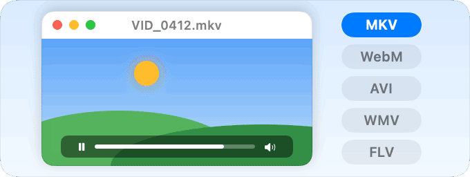

<h1 align="center">pikapik 更新內容</h1>

每次更新，幾句話加一張圖，最新的在最前面。

<a href="README.md">English</a> · <a href="README.ru.md">Русский</a> · <a href="README.uk.md">Українська</a> · <a href="README.de.md">Deutsch</a> · <a href="README.fr.md">Français</a> · <a href="README.es.md">Español</a> · <a href="README.it.md">Italiano</a> · <a href="README.pt-BR.md">Português (Brasil)</a> · <a href="README.ja.md">日本語</a> · <a href="README.zh-Hans.md">简体中文</a> · <a href="README.ko.md">한국어</a> · <a href="README.ro.md">Română</a> · <a href="README.pl.md">Polski</a> · <a href="README.tr.md">Türkçe</a> · <a href="README.nl.md">Nederlands</a> · <a href="README.sv.md">Svenska</a> · <a href="README.cs.md">Čeština</a> · <b>繁體中文</b> · <a href="README.ar.md">العربية</a> · <a href="README.hi.md">हिन्दी</a> · <a href="README.id.md">Bahasa Indonesia</a> · <a href="README.vi.md">Tiếng Việt</a> · <a href="README.th.md">ไทย</a>

---

## 任何滑鼠都能關閉指標加速

1.52.3 · 2026年10月17日

開關和速度現在對每個滑鼠都有效，包括 pikapik 啟動後才連接的滑鼠。

<picture><source media="(prefers-color-scheme: dark)" srcset="../media/linear-pointer-dark.png"></picture>

以前，滑鼠喚醒、重新連接或稍後才接上時，可能仍保留加速。現在不論用哪個滑鼠，指標都和你的手移動得一樣遠，速度滑桿也會一起調整所有滑鼠。

**試試看：** 設定 › 滑鼠 › 關閉指標加速

**修正**

- 關掉開關後，會恢復你在「系統設定」中的設定。
- 如果「系統設定」中已關閉指標加速，滑鼠頁面會說明這點，並告訴你在哪裡重新開啟。

---

## 寵物會表達心情，播放器也能打開圖片

1.52.2 · 2026年10月17日

寵物現在會表達心情，播放器也能打開你的圖片，收進 Dock 的視窗在玩遊戲時不會再跑回來。

<picture><source media="(prefers-color-scheme: dark)" srcset="../media/pet-dark.png"></picture>

牠的表情會變化，頭上會出現一個小記號，例如愛心、閃光或一朵小雲，讓你知道牠的心情。衣櫥裡有 15 樣新東西：鬍子、帽子和髮型。

<picture><source media="(prefers-color-scheme: dark)" srcset="../media/player-dark.png"></picture>

在網站版中，圖片會在同一個播放器裡打開，就像「預覽程式」那樣：JPEG、PNG、HEIC、相機 RAW、PSD 等等。

- 播放器（網站版）：選擇音軌或字幕，在章節之間跳轉，按 A 重複播放一段。
- 播放器（網站版）：子母畫面、AirPlay 到電視，以及在不改變 Mac 輸出的情況下用其他揚聲器播放聲音。

**試試看：** 設定 › 寵物 · 設定 › 播放器

**修正**

- 遊戲（網站版）：遊戲打開或關閉時，收進 Dock 的視窗不會再跑回來。
- ⇧⌘Q 和你自己設定的結束快速鍵現在每次都能結束 App。
- 停止隱藏桌面圖像後，桌面上的檔案一定會回來。
- Chrome、Slack、VS Code（網站版）：pikapik 不再關閉其他 App 在那裡開啟的功能，結束 pikapik 後 Chrome 會恢復原狀。
- 設定：影片、音樂和圖片各只有一個開關，左側列表一定會顯示目前開啟的頁面。

---

## 播放器播放你的音樂，當機後設定也會還原

1.52.1 · 2026年10月16日

播放器現在能播放歌曲，控制面板變成玻璃質感，當機後你的設定也會還原。

- 播放器（網站版）：歌曲在同一個視窗播放，顯示封面、標題和演出者，資料夾會一首接一首播放。
- 播放器（網站版）：每種格式都是一個按鈕，點一下交給 pikapik Player，再點一下還給原本的 App；**全部用 pikapik 打開** 一次處理全部。
- 播放器（網站版）：霧面玻璃控制面板，觀看時會自動隱藏；指向時間列時會出現影片的小圖。

**試試看：** 設定 › 播放器

**修正**

- 你的設定，例如「自動隱藏 Dock」，即使 pikapik 意外停止也會還原。
- Chrome、Slack、VS Code（網站版）：當機後不再停留在 pikapik 的模式，卡住的視窗也不再拖慢 pikapik 的打開和結束。
- 側邊按鈕：設定中顯示返回和前進箭頭，而不是 4 和 5；「前進」不再在 Mail 或 Outlook 中轉寄郵件。
- **將此副本設為主副本** 每次按下只會生效一次，一些開關下方的簡短說明也更清楚地說明作用。
- Mac App Store 版：「寵物」頁面不再承諾通知更新，因為 App Store 會自己帶來更新。

---

## 打字修正和滑鼠側鍵，現在幾乎在所有 App 裡都能用

1.52.0 · 2026年10月15日

用錯語言輸入的字詞，現在在 Chrome、Slack 和 VS Code 裡也能改正；滑鼠側鍵也幾乎在所有地方都能返回和前進。

<picture><source media="(prefers-color-scheme: dark)" srcset="../media/layout-fix-dark.png"></picture>

在網站版中，用錯語言輸入的字詞，現在在 Chrome、Slack、VS Code、Discord 等類似的 App 裡也會被修正，「ghbdtn」在那裡同樣會變成「привет」。關閉這個功能或結束 pikapik，這些 App 就會恢復原樣。

<picture><source media="(prefers-color-scheme: dark)" srcset="../media/side-buttons-dark.png"></picture>

滑鼠側鍵現在幾乎在所有 App 裡都能返回和前進，在 pikapik 自己的設定裡也恢復了：pikapik 會替你點按該 App 自己的「返回」或「前進」按鈕。在 Mac App Store 版中，pikapik 和 Apple 的 App 可用。

同時開啟兩個 pikapik，例如網站版和 App Store 版，只有最後開啟的那個會更動你的 Mac，所以設定裡顯示的永遠是真實狀況。結束時，它改過的一切都會還原。

**另外新增**

- 「觸控式軌跡板中間按鈕」：用三指輕點，在網站版中。
- 「結束 App」和「關閉視窗」用圖示顯示按鍵的作用。
- ⇧⌘. 現在直接放在「顯示隱藏檔案」那一列裡。
- 設定的側邊欄有了群組名稱。
- 播放器，在網站版中：和 QuickTime Player 一樣的按鍵、滾輪調音量、倍速，以及從上次位置繼續播放。

**試試看：** 設定 › 鍵盤、設定 › 滑鼠

**修正**

- 更新後，即使還沒開過播放器，「打開方式」裡也會立刻列出 pikapik Player。
- App 音量：把某個 App 的滑桿拉回 100% 時，聲音結尾不再有輕微的「喀」聲。
- 遊戲（網站版）：快速甩動滑鼠不再滑到另一個顯示器上，游標也不會再彈回來。

---

## QuickTime 打不開的影片，現在能播放了

1.51.0 · 2026年10月15日

在網站版中，QuickTime 打不開的 MKV、WebM、AVI、WMV、FLV 等影片，現在可以用 pikapik Player 播放了。

<picture><source media="(prefers-color-scheme: dark)" srcset="../media/player-dark.png"></picture>

在影片上按右鍵，選擇「打開方式 › pikapik Player」，或在「設定 › 播放器」中點按「打開影片…」。影片會在獨立視窗中播放：空白鍵播放和暫停，← 和 → 跳轉 5 秒，↑ 和 ↓ 調整音量，F 進入全螢幕。

播放器是一個獨立的小 App。它只能看到你打開的影片，無法連上網路，也不需要任何權限。預設打開影片的 App 保持不變。暫不支援字幕。

**試試看：** 設定 › 播放器

---

## 熱點和主要顯示器的選單現在能用了

1.50.3 · 2026年10月15日

在網站版中，熱點那一列的「更改…」選單和「主要顯示器」選單，現在都能照說的那樣運作。

<picture><source media="(prefers-color-scheme: dark)" srcset="../media/dock-display-dark.png"></picture>

在 1.50.2 中，這兩個選單裡的每個選項都出現了三次，選了也沒有任何變化。現在每個選項只出現一次，目前的選項帶有勾號，你的選擇會立刻生效。熱點在「設定 › 遊戲」中，「主要顯示器」在「讓 Dock 固定在一台顯示器上」之下。按「放回原處」，或關掉開關，一切仍會原樣恢復。

---

## pikapik 自己搞定，不用再去「系統設定」

1.50.2 · 2026年10月15日

在網站版中，關閉背景工作、加入鍵盤配置、更改熱點和選擇主要顯示器，現在都能直接在 pikapik 裡完成。

<picture><source media="(prefers-color-scheme: dark)" srcset="../media/background-dark.png"></picture>

在「設定 › 背景工作」中關閉一項工作，它那一列會立刻改變。不需要密碼，你的選擇在重新啟動後也會保留。按「重新打開」就能讓工作恢復。針對整部 Mac 的工作，以及 App 自己加入的輔助程式，仍會開啟「系統設定」，列下方的一句話會說明原因。

<picture><source media="(prefers-color-scheme: dark)" srcset="../media/layout-fix-dark.png"></picture>

修正用錯配置輸入的文字，需要有兩個以上鍵盤配置才能用。如果只有一個，「設定 › 鍵盤」裡的提示現在會推薦適合你語言的配置。在「加入配置」中選一個，馬上就能用，不需要密碼。如果都不合適，「鍵盤設定…」仍然在那裡。

<picture><source media="(prefers-color-scheme: dark)" srcset="../media/dock-display-dark.png"></picture>

在「設定 › 遊戲」中，熱點那一列的「更改…」選單可以為該角選擇另一個動作。在「讓 Dock 固定在一台顯示器上」中，「主要顯示器」選單會把你選的顯示器設為主要顯示器，Dock 也跟著過去。pikapik 會記住原來的樣子：按「放回原處」，或關掉開關，一切都會原樣恢復。

**試試看：** 設定 › 背景工作

**修正**

- 在 Dock 中點按以縮到最小或隱藏：如果你在點按會縮小視窗時打開了它，重新啟動後它不會再自己變成隱藏 App。
- 打開 pikapik 時，它現在會檢查另一部 Mac 上改過的設定，錯過更改的 Mac 會立刻跟上。
- 「保持喚醒」現在會說明它會一直開著，直到你關掉；「遊戲模式」也不會再推薦你已經加入過的遊戲。

---

## Mac App Store 版本的 pikapik，功能更多了

1.50.0 · 2026年10月15日

開啟壓縮檔、清空桌面、使用 Home 和 End……這些功能現在在 Mac App Store 版本中也能用了。

**Mac App Store 版本的新功能**

- **在 Finder 中開啟和建立壓縮檔。** 在壓縮檔上按一下右鍵，選擇「解壓縮」。要建立壓縮檔，請在檔案上按一下右鍵，選擇「建立壓縮檔…」。在壓縮檔上按空白鍵，就能看看裡面有什麼。在這個版本中，只有 ZIP 可以設定密碼。
- **桌面乾乾淨淨。** 開啟「隱藏桌面圖像」，pikapik 就會用你的桌布蓋住圖像。你的點按仍然會傳到桌面，也不需要任何權限。
- **Home 和 End 又能用了。** 它們會跳到行首和行尾，在瀏覽器、Finder、「音樂」和「電視」以外的所有地方都能用。
- **用快速鍵修正按錯鍵盤配置打出的文字。** 選取文字，按下 ⌃⇧空白鍵。在「設定 › 鍵盤」中開啟「修正所選文字」，你也可以在那裡更改按鍵。
- **一鍵關閉顯示器。** 「立即關閉顯示器」會讓顯示器馬上變暗，而 Mac 繼續工作。移動滑鼠就能恢復。
- **玩遊戲不被打擾。** 在「遊戲模式」中，遊戲在最前面時，Spotlight 等 Mac 快速鍵會暫停。指標也不會靠近螢幕角落，所以熱角不會被誤觸發。
- **電池數值回來了。** 「電池」在 macOS 27 上又能顯示「最大容量」，「溫度」也會顯示電池的溫度。
- **看到哪些 App 可以要求權限。** 「設定 › 權限」中的「其他 App 的權限」會連同圖像一起列出它們。
- **知道該點按哪裡。** 當 macOS 不允許 pikapik 更改某項設定時，一段簡短的動畫會告訴你在「系統設定」裡該點按哪裡。

**兩個版本都有**

- **App 還沒開，就能先設好音量。** 設定過音量的 App，即使關著也會帶著滑桿留在設定 › 聲音中，再次發出聲音時，即使重新啟動之後，也會恢復原來的音量。按「加入 App…」或把 App 從 Finder 拖進來，就能提前設定；按 ✕ 會忘記該 App，並恢復為滿音量。
- **一眼看到更新加了什麼。** 更新後，有新內容的設定分頁會出現一個藍色小圓點，對應的區段會帶「新」標籤。你看過之後它們就消失，21 天後也會自動消失。
- **安靜的首次開啟。** 官網版本第一次開啟時不再索取權限，只有當你開啟需要權限的工具時才會詢問。
- **影片也能做出較小的拷貝。** 「製作較小拷貝」現在能讓影片縮小到大約一半。以前，大多數影片只會得到「已經很小了」。
- **兩個版本互不干擾。** 如果你同時使用 App Store 版本和官網版本，它們不會再互相抵銷。遊戲中的 ⇧⌘Q 和 ⇧⌘W 也能用了。
- **睡眠後遊戲模式自動恢復。** Mac 喚醒後，「遊戲模式」會自己重新開啟。
- **「連接埠」說實話了。** 在 macOS 27 上，被 macOS 或其他使用者佔用的連接埠，不會再顯示為閒置。
- **回報問題更快了。** 「設定 › 關於」中的「回報問題」會開啟表單，並已選好你的版本。
- **壓縮檔更順暢。** 解壓縮時進度列會動，密碼錯誤會立刻提示，Mac 也不會再在解壓縮或建立的途中睡著。
- **更穩的選單列面板。** 在面板裡展開一列，例如「保持喚醒」下方的顯示器選項，捲動軸不會再閃一下。「保持喚醒」旁邊的箭頭現在寫著「顯示器設定」。
- **連接埠自己會講解。** 標題下的一行字說明什麼是連接埠，一段小動畫示範一扇門只容得下一個程式。你自己啟動的程式和最好別碰的程式，現在都有了清楚的名稱。
- **設定說得更明白。** 每個分頁都以一句話開頭，告訴你能在這裡做什麼；側邊欄的各組之間有了間距；「保持喚醒」「權限」「電池」會如實說明目前情況。「需要權限」按鈕只在你開啟的工具缺少權限時才出現。

**Mac App Store 版本中已修正**

- 在 Finder 中按 ⌘X 之後，⌘V 現在會移動檔案，和官網版本一樣。以前它只會拷貝。
- 「在 Finder 中新增檔案」「在 Finder 中製作較小拷貝」和「在 Finder 中轉換」現在各自顯示自己的狀態。以前開啟其中一個，三個看起來都是開著的。
- 空的「連接埠」頁面沒有了。macOS 不會告訴這個版本是哪個程式佔用了連接埠，所以「設定 › 連接埠」裡沒有內容可顯示。

---

## 每台顯示器都能調亮度

1.49.0 · 2026年10月13日

macOS 調整不了的顯示器，也能直接在 pikapik 裡調暗或調亮。

<picture><source media="(prefers-color-scheme: dark)" srcset="../media/brightness-dark.png"></picture>

macOS 能調整內建顯示器和 Apple 顯示器的亮度，但大多數其他顯示器只聽自己按鈕的話。現在，它們每一台都在「設定 › 亮度」中有了自己的滑桿，你也可以在選單列面板中加入「亮度」一列。

pikapik 調整的是顯示器本身的亮度，和它的按鈕一樣。如果某台顯示器沒有反應，就開啟「改為調暗畫面」：畫面會變暗，但絕不會變成全黑。pikapik 會記住每台顯示器的亮度，並在睡眠後重新設定。

開啟「亮度鍵」後，鍵盤上的亮度鍵會調整指標所在顯示器的亮度，螢幕上還會顯示一個小指示條。按住 ⌥⇧ 可以調得更細。亮度鍵需要「輔助使用」權限，可以在「權限」頁面允許。

**試試看：** 設定 › 亮度

**修正**

- 使用 VoiceOver 時，現在可以開啟和關閉「設定」中的開關了。以前 VoiceOver 會把每個開關的名稱讀兩次，按下去也沒有反應。

---

## 無論移動多快，Dock 都會留在自己的顯示器上

1.48.0 · 2026年10月13日

「讓 Dock 固定在一台顯示器上」現在改用 Dock 本身的設定，因此不管速度多快，Dock 都不會再跟著指標跑到另一台顯示器上。

<picture><source media="(prefers-color-scheme: dark)" srcset="../media/dock-display-dark.png"></picture>

以前 pikapik 會把指標從另一台顯示器的底部邊緣推回去，但快速甩動滑鼠時，Dock 仍可能跳過去。現在這個開關會直接在 Dock 中關閉這種移動，pikapik 完全不再碰觸指標。Dock 只在啟動時讀取這項設定，所以開啟或關閉這個開關時，Dock 會重新啟動一次。如果這個開關原本就已開啟，更新後 Dock 也會重新啟動一次。

若要刻意移動 Dock，請將另一台顯示器設為主要顯示器。按一下開關下方的「主要顯示器」，打開「系統設定 › 顯示器」，按一下想要的顯示器，然後在「做為」中選擇「主要顯示器」。Dock 會移到那台顯示器上。

「讓 Dock 回到原處」開關已經移除：它同樣是靠推開指標來運作，而現在 Dock 已不再跟著指標移動。「讓 Dock 固定在一台顯示器上」不需要任何權限，預設為關閉。Mac App Store 版本中沒有這個開關，因為來自 App Store 的 App 無法更改 Dock 的設定。

**試試看：** 設定 › Dock

---

## 一鍵讓桌面清清爽爽

1.47.0 · 2026年10月13日

pikapik 新增兩個開關：隱藏桌面上的圖像，以及顯示 macOS 隱藏的檔案。

<picture><source media="(prefers-color-scheme: dark)" srcset="../media/desktop-icons-dark.png"></picture>

**隱藏桌面圖像。** 在通話、螢幕錄影或截圖前開啟，桌面上的檔案和檔案夾就會消失。關閉後，它們會回到原來的位置。不會移動任何東西：檔案仍在 Finder 的「桌面」檔案夾中。它就是「系統設定」›「桌面與Dock」中的 **「顯示項目」›「在桌面上」**，只是放在手邊，所以兩者總是一致。在 Mac App Store 版本中，這一列會改為打開系統設定的這個頁面。

<picture><source media="(prefers-color-scheme: dark)" srcset="../media/hidden-files-dark.png"></picture>

**顯示隱藏檔案。** macOS 隱藏的檔案和檔案夾，例如個人專屬檔案夾中的「資源庫」或名稱以句點開頭的檔案，會以半透明的樣子出現在 Finder 和桌面上。這和在 Finder 中按 ⇧⌘. 一樣，只是一眼就能看出是否已開啟。為了套用變更，Finder 會短暫重新啟動，並再次打開其視窗和標籤頁。如果 Finder 正在拷貝或移動檔案，會等到完成後再重新啟動。兩者都在「設定 › Finder」裡。想放進選單列面板，請按一下面板底部的鉛筆按鈕並勾選它們。在 Mac App Store 版本中，「設定 › Finder」會改為顯示 ⇧⌘. 這組按鍵。

---

## 「權限」頁面如實說明

1.46.1 · 2026年10月13日

如果某個工具還需要下方列表中的權限，頁面現在會明確說明。

以前，只要頂部的兩項權限都已開啟，即使「用於部分功能」中的某個工具還在等待權限，頁面也會說所有工具都在正常運作。現在，它會提示部分工具還需要下方列表中的權限，只有在真正一切正常時才會說所有工具都在運作。

**試試看：** 設定 › 權限

**修正**

- 在 Mac App Store 版本中，「關於」頁面上的「說聲謝謝」只會在小費可以選擇時才出現。以前載入時會轉圈，如果 App Store 沒有回應，這個區塊就會消失。
- 解壓縮壓縮檔時如果磁碟被佔滿，「空間不足」現在會顯示刪除解壓縮到一半的檔案之後真正的可用空間。以前它可能會顯示幾乎沒有可用空間。

---

## 用滑鼠按鈕隱藏最前面的 App

1.46.0 · 2026年10月13日

按下滑鼠中鍵或側邊按鈕，你正在使用的 App 就會讓到一旁，就像按 ⌘H 一樣。

<picture><source media="(prefers-color-scheme: dark)" srcset="../media/hide-app-dark.png"></picture>

打開「設定 › 滑鼠」，開啟「用滑鼠按鈕隱藏目前的 App」，再按下你想用的按鈕。之後可以用「更改…」換一個。App 會繼續執行，點按它在 Dock 中的圖像就能讓它回來。開著遊戲模式玩遊戲時，這個按鈕在遊戲裡的作用和平常一樣。如果同時開啟「側邊按鈕用於返回和前進」，你選的側邊按鈕會改為隱藏 App。需要「輔助使用」權限，預設為關閉。

在 Mac App Store 版本中，⌘X 可以在 Finder 中剪下檔案：選取檔案，按下 ⌘X，打開另一個檔案夾，然後在 pikapik 選單中選擇「搬移項目至此」，或按下 ⌥⌘V。「動畫」和「關閉指標加速」回來了，「權限」頁面也新增了一個部分：「已刪除 App 留下的權限」。這個版本無法自己更改這些設定，所以每一列都會說明要改什麼，並打開「系統設定」中對應的位置。寵物現在會在 Dock 上方走遍整個螢幕的寬度。

**試試看：** 設定 › 滑鼠 › 用滑鼠按鈕隱藏目前的 App

**修正**

- 「滑鼠」頁面上的插圖又變清晰了。
- 鍵盤和滑鼠功能只要求真正用到的權限。大多數只需要「輔助使用」；以前它們還會要求「輸入監控」，沒有它就一直是灰色的。
- 「切換語言」缺少「輸入監控」權限時會明確提示，點按它會打開「權限」頁面。以前它看起來是開著的，其實不起作用。
- 「關閉最後一個視窗時結束」會等你允許「輸入監控」，而不是在 pikapik 啟動時讓 macOS 來要求這項權限。
- 在 macOS 27 上，「輔助使用」會以新名稱「裝置控制和資料取用」顯示，與「系統設定」中一致。
- 使用 VoiceOver 時，現在可以在「衣櫃」和「造型」中為寵物挑選衣服和造型，並在「獎章」中打開它的獎章。以前這些方塊沒有反應。

---

## 每個 App 都有自己的音量

1.45.0 · 2026年10月13日

吵鬧的通話調低，嘈雜的遊戲靜音，音樂維持原樣。

<picture><source media="(prefers-color-scheme: dark)" srcset="../media/whats-new/1.45.0/app-volume-dark.png"></picture>

打開「設定 › 聲音」，開啟「App 音量」。每個播放聲音的 App 都有自己的滑桿和靜音按鈕，在設定和選單裡都能用。你 Mac 的音量和其他 App 的音量不會變，pikapik 會記住每個 App 的音量。維持最大音量的 App 絕不會被更動。

要改變某個 App 的音量，pikapik 會讓它的聲音先經過自己，所以需要「系統音訊錄製」權限，你可以在「權限」頁面允許。聲音只是被轉交，不會被錄製、儲存或傳送到任何地方，也不使用麥克風。需要 macOS 14.2 或更新版本（在 macOS 14.0 和 14.1 上會隱藏），預設為關閉。

**試試看：** 設定 › 聲音 › App 音量

---

## 用錯鍵盤配置輸入的文字會自動修正

1.44.3 · 2026年10月13日

用錯鍵盤配置輸入一個字詞後按下空白鍵，pikapik 就會用正確的配置重新輸入，並幫你切換配置。

<picture><source media="(prefers-color-scheme: dark)" srcset="../media/layout-fix-dark.png"></picture>

在「設定 › 鍵盤」中打開這項功能。如果打出來的字詞變成一串看不懂的字母，例如把 привет 打成了 ghbdtn，只要按下空白鍵或 Return，pikapik 就會重新輸入，並切換配置，讓下一個字詞正確打出來。你在 Mac 上加入的所有鍵盤配置都能用，任何語言都可以。

一般文字會保持原樣。只有當一個字詞在你使用的所有語言中都不存在，而同樣的按鍵換一種配置能打出常用字詞時，pikapik 才會修改它。人名、拼字錯誤和罕見字詞都保持原樣，密碼欄位、「終端機」和你選擇的 App 裡也不會做任何更動。

有字詞沒改到，或想改回原樣？按下 ⌃⇧空白鍵，就能修正最後一個字詞或所選文字，再按一次可以試試其他配置。剛修正完時按同樣的鍵就能還原，之後 pikapik 不會再自動修正這個字詞。在 Mac App Store 版本中，選取文字，然後在「服務」選單中選擇「修正鍵盤配置」。

**試試看：** 設定 › 鍵盤 › 修正用錯鍵盤配置輸入的文字

---

## VoiceOver 又能打開 pikapik 選單了

1.44.2 · 2026年10月13日

在 macOS 27 上，你又可以用 VoiceOver 打開選單列中的 pikapik 選單了。

以前，用 VoiceOver 或其他輔助使用功能按下 pikapik 圖像時，什麼都不會發生。現在選單會打開，再按一次就會關閉，跟按一下一樣。

---

## 查看是誰佔用了連接埠

1.44.0 · 2026年10月13日

「設定」裡新增的「連接埠」頁面會顯示 Mac 上的每個連接埠被哪個程式佔用，並在你需要時釋放連接埠。

<picture><source media="(prefers-color-scheme: dark)" srcset="../media/ports-dark.png"></picture>

當某個程式提示它的連接埠已被佔用時，打開「設定 › 連接埠」。每個佔用連接埠的程式都會列在這裡，附帶它的圖像、它佔用的連接埠，以及網路上的其他裝置能否連線。輸入連接埠號碼，就能找出是誰佔用了它，或者確認它沒有被佔用。

按一下其中一列，就能看到可以在瀏覽器中打開的位址、程式檔案、啟動它的指令、它所在的檔案夾和程序編號。「釋放」會先請程式結束，讓它有機會儲存工作。如果它沒有關閉，pikapik 會提議強制結束。每個步驟都會先徵得你的同意。

pikapik 不會動 macOS 的組成部分和其他使用者的程式。對於「AirPlay接收器」「檔案共享」「螢幕共享」和「遠端登入」，pikapik 會告訴你「系統設定」中的哪個開關可以釋放連接埠。在 Mac App Store 版本中，「釋放」可以顯示程式、拷貝一條在「終端機」中結束它的指令，或者打開「活動監視器」。

---

## 查看背景在執行什麼

1.43.0 · 2026年10月13日

pikapik 現在會顯示所有自行啟動的項目和加入它們的 App，還能關閉你自己的工作，不刪除任何東西。

<picture><source media="(prefers-color-scheme: dark)" srcset="../media/whats-new/1.43.0/background-dark.png"></picture>

「設定」裡新增的「背景工作」頁面會列出登入時打開的 App、背景服務、藏在 App 裡的輔助程式，以及已移除 App 的殘留檔案。每個工作都會顯示是哪個 App 加入的、現在是否正在執行、檔案在哪裡。按一下就能在 Finder 中顯示這個檔案。

你自己的工作用一個按鈕就能關閉，也能重新打開。任何東西都不會被刪除。對於所有使用者和整台 Mac 的工作，按鈕會打開「系統設定」中的「登入項目」。

在 Mac App Store 版本中，這個頁面會顯示工作，按鈕則會打開「登入項目」。

---

## 查看 Mac 內部有多熱

1.42.0 · 2026年10月13日

「設定」裡新增的「溫度」頁面會顯示處理器、圖形處理器、記憶體、儲存空間、電池和 Wi-Fi 的溫度，並用簡單的話告訴你一切是否正常。

<picture><source media="(prefers-color-scheme: dark)" srcset="../media/temperatures-dark.png"></picture>

打開「設定 › 溫度」。最上方用一個詞概括情況：「正常」、「偏熱」、「很熱」或「非常熱」，下方的一行小字會告訴你 Mac 是在全速運作，還是正在降速以便降溫。再往下，Mac 能測量的每個部件各占一列，顯示溫度和一條彩色橫條：綠色表示沒問題，黃色表示偏熱，橙色表示很熱，顏色會依該部件的正常溫度範圍來判斷。

想隨時留意溫度？點按 pikapik 選單底部的鉛筆，勾選「溫度」。選單就會顯示同一個詞和處理器溫度，點按這一列即可打開這個頁面。

溫度每 2 秒更新一次，但只在這個頁面或選單打開時更新，所以不會在背景檢查。pikapik 只讀取溫度：不需要密碼，也不會做任何更改。

**修正**

- 如果你選過 pikapik 選單顯示哪些列，「讓 Dock 固定在一台顯示器上」這一列不會再自己出現在選單裡。想顯示它，點按鉛筆並勾選它。
- 關閉設定後，pikapik 現在會立即停止檢查風扇和電池，不再在背景繼續。

---

## 風扇控制不再要求輸入密碼

1.41.1 · 2026年10月13日

設定風扇轉速的輔助程式現在會隨 pikapik 一起更新，新版本不再要求輸入管理者密碼。

<picture><source media="(prefers-color-scheme: dark)" srcset="../media/fans-dark.png"></picture>

這次更新會最後一次要求輸入密碼。如果你有在使用風扇控制，請打開「設定 › 權限」，按一下「風扇控制」旁邊的「允許」，然後輸入密碼。之後 pikapik 會自行更新輔助程式，而且只接受真正來自 pikapik 的輔助程式。

**修正**

- 在「系統設定」›「一般」›「登入項目」中，風扇輔助程式現在會顯示為 pikapik，並帶有 App 圖像。

---

## 查看電池的狀況

1.41.0 · 2026年10月13日

「設定」裡新增的「電池」頁面會顯示電池的損耗程度、用什麼來充電，以及如何讓電池更耐用。

<picture><source media="(prefers-color-scheme: dark)" srcset="../media/battery-dark.png"></picture>

打開「設定 › 電池」。你會看到電量和電池此刻的情況、電池的狀態、與全新時相比的最大容量，以及循環使用次數，也就是在設計可承受的 1,000 次循環中已經用掉了多少。

Mac 接上電源時，頁面會顯示電源轉接器及其功率；充電時還會顯示充電功率，也就是此刻流入電池的功率。Mac 使用電池供電時，頁面會顯示它此刻的用電功率。

頁面底部的小提示能幫電池用得更久，「電池設定…」會在「系統設定」中打開「電池」，你可以在那裡選擇 macOS 如何為它充電。這個頁面不會更改任何內容，也不需要任何權限，Mac App Store 版本也不例外。它只會出現在有電池的 Mac 上。

**修正**

- 現在用 Homebrew 移除 pikapik 時，也會關閉「登入時打開」，並還原 pikapik 更改過的系統設定，例如動畫、按鍵重複和熱角。如果 pikapik 一直在自行更新，請在移除前先執行一次 brew upgrade --cask pikapik。

---

## 透過 Homebrew 更新不會再重新啟動 Dock

1.40.2 · 2026年10月13日

透過 Homebrew 更新 pikapik 時，Dock 不會再突然消失一下。

更新到這個版本時，Dock 可能還會最後重新啟動一次，因為這一步仍由你之前用的版本完成。之後的更新不會再動到 Dock。

---

## 在 Dock 中點按一下，就能收起視窗

1.40.1 · 2026年10月13日

在 Dock 中點按你正在使用的 App 的圖像，它的所有視窗都會縮到最小並收進 Dock。再點按一次，它們就會全部回來。

<picture><source media="(prefers-color-scheme: dark)" srcset="../media/whats-new/1.40.1/dock-minimize-dark.png"></picture>

打開「設定 › Dock」，開啟「在 Dock 中點按以縮到最小或隱藏」。視窗會依原本的順序回來，你剛才使用的視窗在最上面。點按其他 App、按住圖像打開選單以及拖移圖像，都和以前一樣。

想像按 ⌘H 那樣隱藏整個 App？在開關下方，把「點按圖像時」設為「隱藏 App」。如果你之前已經透過點按 Dock 來隱藏 App，一切保持不變。這個開關需要「輔助使用」權限，Mac App Store 版本中沒有此功能，預設是關閉的。

---

## Dock 固定在一台顯示器上

1.40.0 · 2026年10月13日

指標推向另一台顯示器的邊緣時，Dock 不再跳過去，而是留在你放的地方。

<picture><source media="(prefers-color-scheme: dark)" srcset="../media/dock-display-dark.png"></picture>

打開「設定 › Dock」，開啟「讓 Dock 固定在一台顯示器上」。之後 Dock 會留在原本的顯示器上，不論在下方還是側邊，熱角也照常運作。不需要任何權限，Mac App Store 版本也不例外。

若要刻意移動 Dock，請按住 ⌥，並將指標推向另一台顯示器的邊緣。Dock 會移到那台顯示器上，此後就留在那裡。

第二個開關「讓 Dock 回到原處」會在睡眠後或顯示器變更時，自動把 Dock 送回它原本的顯示器。它需要「輔助使用」權限，Mac App Store 版本中沒有此功能。兩個開關預設都是關閉的。

---

## 紅色按鈕不會再讓壓縮檔停擺

1.39.4 · 2026年10月13日

以前，如果用紅色按鈕關閉輸入密碼的視窗，pikapik 在重新啟動前都無法再打開或製作壓縮檔。現在已經修正。

現在，在新增壓縮檔的視窗和輸入密碼的視窗中，紅色按鈕的作用與「取消」完全相同，下一個壓縮檔也能立即打開。VoiceOver 現在會用更新按鈕自己的名稱來朗讀「設定」中「關於」裡的這個按鈕。

---

## 寵物跟著你的節奏

1.39.3 · 2026年10月13日

你打字時，寵物精神抖擻，踩著輕快的步伐小跑。你一離開 Mac，它就開始想睡，坐下來打起瞌睡。

<picture><source media="(prefers-color-scheme: dark)" srcset="../media/whats-new/1.39.3/pet-rhythm-dark.png"></picture>

大約 40 秒沒碰鍵盤和滑鼠，它的眼皮就開始打架；一分半鐘後，它已經呼呼大睡，頭頂飄起小小的字母 z。按任意鍵或移動滑鼠，它就會醒來，站起身繼續往前走。打盹時它安安靜靜，也更省電。

pikapik 從不查看你輸入的內容，只留意距離上次按鍵或移動滑鼠過了多久，就像 macOS 在調暗螢幕之前做的那樣，所以不需要任何權限。想讓寵物一直精神飽滿？在寵物設定中關閉「跟著你的節奏」。

**試試看：** 設定 › 寵物 › 跟著你的節奏

---

## 同步的設定現在放在 pikapik 資料夾

1.39.2 · 2026年10月13日

如果你透過 iCloud 同步設定，設定現在會存放在 iCloud 雲碟的 pikapik 資料夾，而不是 pika-tools，pikapik 會自動把它們搬過去。

你不需要做任何事：設定保持不變，搬移完成後舊資料夾就會消失。如果你在裡面放了自己的檔案，它會留在原處。如果你在多台 Mac 上同步，請在每台 Mac 上更新 pikapik，讓它們繼續共用設定。

**修正**

- 用 Homebrew 完整移除 pikapik（brew uninstall --zap）時，現在也會刪除「最近移除」的 App 列表。
- 本頁較早的文章現在也把 App 稱為 pikapik。

---

## 壓縮檔視窗恢復常見的標題列

1.39.1 · 2026年10月13日

壓縮檔視窗再次有了 macOS 常見的標題列，左側有三個圓形按鈕。

跟 Mac 上的其他視窗一樣，拖移視窗頂部就能移動視窗。在新壓縮檔視窗和密碼視窗中，按下紅色按鈕會關閉視窗，不會製作或解壓縮任何內容。視窗中用不到的按鈕會顯示為灰色。顯示製作較小拷貝或轉換檔案進度的視窗也有了同樣的按鈕。「用此 App 打開壓縮檔」現在會記住之前打開 ZIP 和 7Z 檔案的 App，關閉這個開關後會把檔案交還給它。

---

## 全新的壓縮檔視窗，密碼要輸入兩次

1.39.0 · 2026年10月13日

為新的壓縮檔設定密碼時，現在要輸入兩次，免得一個打錯字讓你打不開自己的檔案。

<picture><source media="(prefers-color-scheme: dark)" srcset="../media/whats-new/1.39.0/archive-password-dark.png"></picture>

兩次密碼相同時，輸入欄位下方會出現一行綠字，不同時則是紅字；在相同之前，「建立」無法按下。

所有壓縮檔視窗都換上新外觀：大圖像、一個用於密碼的開關，以及一行簡短提示，告訴你檔名是像 ZIP 那樣仍然看得到，還是像 7Z 那樣一併隱藏。在 macOS 26 上，按鈕採用 Liquid Glass 材質。

安裝也更簡單了：GitHub 上 pikapik 頁面開頭的指令不需要你的 Mac 再裝任何東西。只有當下載的檔案帶有開發者簽名並通過 Apple 的惡意軟體檢查時，它才會安裝 pikapik。

---

## 與 App Store 版本並存時，更新更安全

1.38.2 · 2026年10月12日

如果 Mac 上同時有來自 App Store 的 pikapik，GitHub 版本現在會在原位置更新，不會動到 App Store 版本。

先前，如果 GitHub 版本仍使用舊名稱 pika-tools，而且不是透過 Homebrew 安裝，更新就不會安裝，而是會打開 App Store 版本，pikapik 的「登入時打開」也會被關閉。

---

## 更穩定的 Finder 選單

1.38.1 · 2026年10月12日

連接磁碟、打開磁碟映像檔、喚醒 Mac 或切換到 Finder 後，pikapik 在 Finder 右鍵選單中的項目不會再消失。

先前在少數情況下，顯示這些項目的輔助程式會在那一刻結束。

---

## 在 Finder 中打開和建立壓縮檔

1.38.0 · 2026年10月12日

新的「Finder 中的壓縮檔」可以打開 RAR 等 macOS 打不開的壓縮檔，還能在右鍵選單裡建立 ZIP 和 7Z。

<picture><source media="(prefers-color-scheme: dark)" srcset="../media/archive-dark.png"></picture>

打開「設定 › Finder」，開啟「Finder 中的壓縮檔」。在壓縮檔上按右鍵點按並選擇「解壓縮」，裡面的檔案就會出現在它旁邊。在其他任何檔案或檔案夾上按右鍵點按並選擇「建立壓縮檔…」，即可產生 ZIP、7Z、TAR.GZ 或 TAR.XZ。ZIP 和 7Z 可以設定密碼，任何壓縮檔都可以分成多個部分，例如適合用電子郵件寄送的 15 MB 一份。這樣產生的 ZIP 不夾帶系統產生的隱藏檔案，任何語言的檔名也都能正常顯示。

pikapik 還能打開 macOS 打不開的檔案：RAR（包括分成多個檔案的）、帶密碼的 7Z、ZIPX、CAB、LZH、ARJ、ZST、WIM 等。連按兩下就會在 pikapik 中打開。舊版 ZIP 裡的檔名，例如西里爾文、日文或中文的，也能正常顯示。開關「用此 App 打開壓縮檔」還會把 ZIP 和 7Z 也交給 pikapik，而 TAR 和 GZ 仍由內建的壓縮檔 App 處理，它本來就處理得很好。

會彈出視窗詢問密碼，「停止」可以取消任何工作，對於損壞的壓縮檔，pikapik 會取出仍然可以讀取的部分。解壓縮後會膨脹到巨大體積的壓縮檔，pikapik 會先詢問你，並攔下那些試圖寫到自己檔案夾之外的壓縮檔。Mac App Store 版本中沒有此功能。選取壓縮檔後按空白鍵，即可預覽裡面有什麼。

---

## FPS 現在在正確的地方請求權限

1.37.3 · 2026年10月12日

FPS 標籤所需的螢幕錄製，現在和其他權限一樣，在「權限」頁面裡允許。

<picture><source media="(prefers-color-scheme: dark)" srcset="../media/game-fps-dark.png"></picture>

為了統計遊戲的影格數，「顯示 FPS」可能需要螢幕錄製。以前 pikapik 直接在「遊戲」頁面裡要求；現在它和所有其他權限放在一起：當「顯示 FPS」需要它時，「設定 › 權限」裡會出現「螢幕錄製」一列，你在那裡點按「允許」即可。

「遊戲」頁面現在只在開關下方顯示熟悉的那一行：「需要權限。點按即可允許。」它的「允許」按鈕會直接帶你到「螢幕錄製」那一列。開啟「顯示 FPS」不會再自己跳出詢問，玩遊戲時 pikapik 也依然從不要求權限。

---

## 已通過 Apple 檢查

1.37.2 · 2026年10月12日

pikapik 現在由經過驗證的 Apple 開發者簽署，並經過 Apple 檢查。所以第一次打開時，macOS 不會再跳出警告。

更新後，macOS 可能會再次詢問你給過 pikapik 的權限，例如「輔助使用」「輸入監控」或「完整磁碟取用權限」。請在「系統設定 › 隱私權與安全性」中再允許一次。如果你使用風扇控制，請在 pikapik 的設定中重新允許，macOS 會詢問一次密碼。

---

## FPS 標籤緊跟你的遊戲

1.37.1 · 2026年10月12日

拖移遊戲視窗時，FPS 標籤現在會隨之一起移動。

<picture><source media="(prefers-color-scheme: dark)" srcset="../media/game-fps-dark.png"></picture>

以前，標籤大約每秒才追上移動中的視窗一次，所以總是落在後面。現在它在螢幕的每一格畫面都會核對視窗位置，最多只慢幾毫秒。視窗靜止時，它會降低檢查頻率，所以玩遊戲時幾乎不佔用 Mac 的資源。而且當視窗有一部分超出螢幕邊緣時，標籤也不會再跳到別處。

如果像西洋棋這樣的安靜遊戲顯示 0，這完全正常：這類遊戲只在有東西移動時才繪製新畫面。棋子滑動時數字會上升，棋盤靜止後又會回到 0。

---

## 看看你的遊戲有多流暢

1.37.0 · 2026年10月12日

全新的「顯示 FPS」會在遊戲的一角放一個小計數器，讓你一眼看出遊戲執行得有多流暢。

<picture><source media="(prefers-color-scheme: dark)" srcset="../media/game-fps-dark.png"></picture>

打開「設定 › 遊戲」，開啟「顯示 FPS」。遊戲模式開啟時，任何遊戲的一角都會出現一個帶數字的深色小標籤。FPS 是每秒影格數，也就是遊戲每秒繪製的畫面數，數字越大越流暢。按一下開關上方圖片裡的角落，就能選擇標籤的位置。

標籤不會擋住你的操作，還會跟著遊戲視窗移動。「—」表示最初的畫面還沒到，變淡的「0」表示遊戲已停止繪製。「顯示 FPS」預設為關閉，開啟後才會出現。

在 macOS 27 上，大多數遊戲由 macOS 自己計數，不需要權限。少數遊戲（多為較舊的遊戲）只能透過螢幕錄製來計數，此時數值不會超過螢幕的更新率。在 macOS 14–26 和 Mac App Store 版本中，所有遊戲都這樣計數，所以開啟「顯示 FPS」時會要求「螢幕錄製」權限。不會儲存或傳送任何影像。

---

## 放心地解除安裝 App

1.36.0 · 2026年10月12日

全新的解除安裝 App 頁面會連同所有檔案一起移除 App，你改變主意了還能全部放回。

<picture><source media="(prefers-color-scheme: dark)" srcset="../media/uninstaller-dark.png"></picture>

打開「設定 › 解除安裝 App」，選一個 App，或把它拖到圖片上。pikapik 會列出這個 App 在你的 Mac 上留下的所有內容，並說明每個檔案為什麼在清單裡。明確屬於這個 App 的檔案會被勾選，只是可能相關的檔案不會。按一下「移到垃圾桶」，一切都會進入垃圾桶，所以不會有東西被永久刪除。

改變主意了？按一下「放回原處」，一切都會回到原來的位置。最近十次移除會留在「最近移除」裡，直到它們的檔案離開垃圾桶。「重置 App」會保留 App，只移除它儲存的資料、設定和暫存檔案，App 出問題時可以試試。

自己把 App 移到了垃圾桶？頁面也會列出這些 App 和它們留下的檔案，你還可以打開一個開關，在每次有 App 被移到垃圾桶時提議清理。在你選擇之前不會移除任何內容。頁面需要「完整磁碟取用權限」才能看到全部內容。

---

## 幫寵物換裝

1.35.0 · 2026年10月12日

寵物有衣櫃了，一起玩的時候還能贏得新衣飾。

<picture><source media="(prefers-color-scheme: dark)" srcset="../media/whats-new/1.35.0/wardrobe-dark.png"></picture>

打開「設定 › 寵物」，選一選寵物要穿什麼：帽子、眼鏡、圍巾、襯衫、鞋子、披風，甚至還有翅膀。它會馬上穿上。少數幾件一開始就能用，其餘的是獎章，一起玩的時候就會拿到：把寵物拎起來丟出去、踢一踢球、看它爬視窗和聊天，或每天陪它待一會兒。獲得獎章時，寵物會告訴你。

現成的造型一鍵就能讓寵物從頭到腳換好裝：巫師、海盜、太空人、超級英雄、國王等等。集齊一個造型的所有部件，它就可以用了。

只會儲存步數、投擲次數、相處天數這類簡單的數字。它們只留在你的 Mac 上，不會傳送到任何地方，你也可以隨時在「設定 › 寵物」裡清除。

---

## 遊戲中的滑鼠與觸控板

1.34.0 · 2026年10月12日

滑動、捏合和熱角現在與鍵盤快速鍵一樣，不會再把你帶出遊戲。

<picture><source media="(prefers-color-scheme: dark)" srcset="../media/whats-new/1.34.0/pointer-shortcuts-dark.png"></picture>

設定 › 遊戲 › 更多遊戲設定中有一個「滑鼠與觸控板」群組。它只列出你的 Mac 上在 macOS 中已開啟的項目，使用 Apple 的原名，並為每一項附上小圖：滑鼠按鍵上的快速鍵、在桌面和全螢幕 App 之間滑動、指揮中心與 App Exposé、捏合以開啟 App、張開以顯示桌面、從右邊緣滑動以開啟通知中心，以及每個熱角和它執行的動作。遊戲在最前面時，這些操作會暫停，所以不小心滑動或碰到螢幕角落，都不會把你帶出遊戲。遊戲內的手勢照常運作。每一項也都可以設為照常運作。

---

## 快速鍵分組立即開啟

1.33.2 · 2026年10月11日

即使是最長的系統快速鍵分組也會馬上開啟，每一列都有清楚的名稱。

<picture><source media="(prefers-color-scheme: dark)" srcset="../media/whats-new/1.31.0/system-shortcuts-dark.png"></picture>

以前開啟一個有幾十列的分組時，設定視窗會卡住片刻，因為所有列和它們的動畫預覽會一次產生。現在只產生螢幕上看得到的列和附近的幾列。顯示為「系統操作」加編號的列也不見了：聽寫、Siri、亮度和縮放鍵顯示真實名稱，macOS沒有命名的操作會被隱藏，但在遊戲中仍和以前一樣會被暫停。

---

## 快速鍵群組展開不再卡頓

1.33.1 · 2026年10月11日

在「遊戲」頁面展開含大量預覽的長列表時依然流暢。

<picture><source media="(prefers-color-scheme: dark)" srcset="../media/whats-new/1.31.0/system-shortcuts-dark.png"></picture>

以往展開一組系統鍵盤快速鍵時，設定視窗會卡住最多三秒，因為每一列及其預覽都要計算好幾次。現在每一列只計算一次，群組幾乎立即展開。

---

## 所有權限，集中在一處

1.33.0 · 2026年10月11日

「設定」›「權限」現在列出 pikapik 用到的全部權限，每一項都能隨時收回。

<picture><source media="(prefers-color-scheme: dark)" srcset="../media/whats-new/1.33.0/permissions-dark.png"></picture>

「設定」›「權限」現在會顯示 pikapik 用到的每一項權限，從輔助使用、輸入監控，到風扇控制、Finder 擴充功能、iCloud 雲碟和完整磁碟取用權限。每一列都用一句話說明用途：已開啟時顯示綠色勾號，缺少時顯示橘色叉號。

每一列只有一個按鈕：缺少權限時是「允許」，已開啟時是「關閉」。這樣不必翻找系統設定，就能當場收回任何權限。對於輔助使用和輸入監控，pikapik 會先詢問確認，再在沒有這些權限的情況下重新啟動。

需要某項尚未授予之權限的工具，會顯示為半灰色。點按它，「權限」頁面就會開啟並標示對應的那一列，只需再點按一下「允許」。

**試試看：** 打開「設定」›「權限」，看看每一列。點按灰色的工具，就能直接跳到它需要的權限。

---

## 更安全的安裝，更新不再遺失 App

1.32.2 · 2026年10月11日

一批讓安裝、更新與解除安裝更安全的修正。

<picture><source media="(prefers-color-scheme: dark)" srcset="../media/fans-dark.png"></picture>

風扇小幫手現在安裝得更謹慎，並在啟動前經過驗證。如果更新無法拷貝，目前的 pikapik 會原封不動保留。解除安裝時也會移除風扇小幫手，並還原你的按鍵重複設定、Dock 角落與系統快速鍵。

工具重新啟動時，按住的按鍵不再卡住；關閉「重複按住的按鍵」後，會還原你自己的重音選單設定。螢幕休眠或鎖定時寵物會休息，archive.tar.gz 的拷貝現在叫 archive 2.tar.gz。

---

## 風扇手動轉速第一次就能生效

1.32.1 · 2026年10月11日

在「風扇」中選擇「手動」不再彈回「自動」。

<picture><source media="(prefers-color-scheme: dark)" srcset="../media/fans-dark.png"></picture>

之前，第一次點「手動」有時會帶著安全提示讓風扇回到「自動」，要點第二次才有效。現在第一次就能維持「手動」。

如果風扇自己離開了手動模式，pikapik 現在會真正把它切回「自動」，所以你看到的永遠和 Mac 實際的狀態一致。

無需重新授權。更新後即可正常使用。

**試試看：** 打開「設定」›「風扇」，選擇「手動」。

---

## 看看風扇轉得有多快

1.32.0 · 2026年10月11日

新的「風扇」分頁即時顯示每個風扇，還能讓你選擇轉速。

<picture><source media="(prefers-color-scheme: dark)" srcset="../media/fans-dark.png"></picture>

設定裡新增了「風扇」分頁，選單裡也多了一列。你可以即時看到每個風扇此刻轉得多快，旁邊還有一個小風扇跟著一起轉。

保持「自動」，Mac 就像往常一樣自己決定。也可以選擇「手動」，拖動一個滑桿設定想要的轉速。第一次使用時，只需用管理員密碼允許一次即可。

它是為安全而設計的。結束 pikapik、Mac 進入睡眠、pikapik 意外當機，或是 Mac 變熱時，風扇都會恢復為「自動」。

**試試看：** 打開「設定」›「風扇」查看轉速。選擇「手動」即可試試滑桿。

---

## 需要時再看詳細資訊

1.31.4 · 2026年10月11日

更簡潔的遊戲頁面，統一的搜尋。

<picture><source media="(prefers-color-scheme: dark)" srcset="../media/whats-new/1.31.4/game-choices-dark.png"></picture>

每種模式都在下拉列表中解釋其作用。關閉列表後，頁面只顯示所選名稱。

已移除重複動作名稱的說明。有用的補充資訊仍然保留。

全域搜尋可依名稱、含義和按鍵尋找系統動作。選擇結果會開啟並突顯對應設定。

**試試看：** 在全域搜尋中尋找動作，然後開啟模式列表。

---

## 統一遊戲設定的樣式

1.31.3 · 2026年10月11日

一致的預覽，更清楚的快速鍵選項。

<picture><source media="(prefers-color-scheme: dark)" srcset="../media/whats-new/1.31.3/game-preview-dark.png"></picture>

每個快速鍵現在都使用與遊戲保護及其他設定頁面相同的寬幅預覽。下方顯示說明、控制項和所選選項的解釋。

«遵循遊戲模式規則». 短按快速鍵可切換語言而不開啟選單。按住遊戲按鍵時會避免意外切換語言。

«在遊戲中停用». 遊戲在前景時，此 macOS 動作會被停用。離開遊戲後，它恢復原來的行為。 «在遊戲中允許». macOS 正常執行此動作，即使它開啟視窗或從遊戲奪取焦點。

**試試看：** 開啟更多遊戲設定，展開系統控制，選擇遊戲中每項動作的行為。

---

## 更清楚的遊戲設定

1.31.2 · 2026年10月11日

調整保護並探索 Mac 的快速鍵。

<picture><source media="(prefers-color-scheme: dark)" srcset="../media/whats-new/1.31.2/game-settings-dark.png"></picture>

八個清晰主題取代了重複資料夾。每個標題都有名稱、說明、圖示與數量。點按列內任意位置即可展開。

每項動作的動畫預覽旁都有用途說明。目前按鍵與遊戲中的行為單獨列出。搜尋也能查找說明內容。

未指派的按鍵有清楚的系統設定連結。一般遊戲保護單獨整理，你的選擇會保留。

**試試看：** 開啟更多遊戲設定，展開主題並對照動作說明與預覽。

---

## 遊戲中的語言切換手勢

1.31.1 · 2026年10月11日

預設簡單易用，需要時可查看完整系統目錄。

<picture><source media="(prefers-color-scheme: dark)" srcset="../media/input-switch-dark.png"></picture>

即使 macOS 的語言快速鍵未指派或已關閉，pikapik 的語言切換手勢仍可在遊戲中使用。

<picture><source media="(prefers-color-scheme: dark)" srcset="../media/game-mode-dark.png"></picture>

自動模式暫停開啟視窗或轉移焦點的操作。快速且有意的語言快速鍵直接切換輸入來源，不彈出系統視窗。持續按住的移動鍵優先，因此跑動和跳躍不會意外切換語言。

每項操作可在可搜尋目錄中調整。語言可在背景切換；其他操作可暫停或允許正常執行。選擇會同步。其他監看鍵盤的App單獨顯示，強制結束仍可用。

**試試看：** 按住 ⌥ 再按 ⇧：下一個語言。按住 ⇧ 再按 ⌥：上一個語言

---

## 遊戲模式了解你的Mac快速鍵

1.31.0 · 2026年10月11日

預設簡單易用，需要時可查看完整系統目錄。

<picture><source media="(prefers-color-scheme: dark)" srcset="../media/whats-new/1.31.0/system-shortcuts-dark.png"></picture>

開啟遊戲模式就能玩。更多遊戲設定中有Mac公開的完整目錄、目前按鍵設定，以及每項操作的動畫預覽。

<picture><source media="(prefers-color-scheme: dark)" srcset="../media/game-mode-dark.png"></picture>

自動模式暫停開啟視窗或轉移焦點的操作。快速且有意的語言快速鍵直接切換輸入來源，不彈出系統視窗。持續按住的移動鍵優先，因此跑動和跳躍不會意外切換語言。

每項操作可在可搜尋目錄中調整。語言可在背景切換；其他操作可暫停或允許正常執行。選擇會同步。其他監看鍵盤的App單獨顯示，強制結束仍可用。

**試試看：** 開啟更多遊戲設定，搜尋截圖或語言快速鍵，比較保護開啟和關閉時的預覽。

---

## 快速鍵連結不再導致當機

1.30.14 · 2026年10月11日

點擊已關閉的快速鍵不會再結束pikapik。

<picture><source media="(prefers-color-scheme: dark)" srcset="../media/whats-new/1.23.2/game-shortcuts-dark.png"></picture>

在遊戲頁面，即使沒有設定按鍵，也可以點擊快速鍵。系統設定會安全開啟。

<picture><source media="(prefers-color-scheme: dark)" srcset="../media/game-mode-dark.png"></picture>

之前，設定視窗開啟時pikapik可能會兩次讀取同一個正在變化的列。如果兩次讀取之間文字消失，App就會當機。

現在每列只讀取一次，缺失的文字會被略過。其他頁面的快速鍵連結也得到修復。

**試試看：** 在遊戲頁面點擊已關閉的快速鍵。

---

## 按住Control，繼續玩遊戲

1.30.13 · 2026年10月10日

按住Control時，切換語言不再搶走遊戲的空格鍵。

<picture><source media="(prefers-color-scheme: dark)" srcset="../media/game-mode-dark.png"></picture>

按住Control跑動，按空格跳躍。遊戲模式會暫停Control+空格和Control+Option+空格的語言切換。

<picture><source media="(prefers-color-scheme: dark)" srcset="../media/whats-new/1.23.2/game-shortcuts-dark.png"></picture>

其他使用Control，或不含Command的Shift、Option組合的macOS快速鍵，包括你自己設定的組合，也會暫停。按下、放開和持續按住的鍵會一起傳給遊戲。

pikapik的語言切換手勢和使用遊戲修飾鍵的結束快速鍵也不會干擾操作。離開遊戲後，系統快速鍵會恢復原樣。

**試試看：** 按住Control移動，多次按空格。然後離開遊戲，像平常一樣切換語言。

---

## 從活動監視器拖入遊戲

1.30.12 · 2026年10月10日

遊戲模式現在支援從活動監視器拖入程序。

<picture><source media="(prefers-color-scheme: dark)" srcset="../media/whats-new/1.28.0/app-shelf-dark.png"></picture>

找到遊戲程序，將其所在列拖到設定 → 遊戲中的「你的遊戲」。

<picture><source media="(prefers-color-scheme: dark)" srcset="../media/game-mode-dark.png"></picture>

沒有普通Dock圖示的Java遊戲也能加入。之前這些列會被忽略，因為其中是程序編號和名稱，而不是檔案。

遊戲會儲存供以後啟動使用，Minecraft會顯示自己的名稱。編號和名稱必須符合正在執行的程序。

**試試看：** 將正在執行的Minecraft對應的java列拖到「你的遊戲」。

---

## 直接加入正在執行的遊戲

1.30.11 · 2026年10月10日

加入遊戲時，已開啟的遊戲現在會最先顯示。

<picture><source media="(prefers-color-scheme: dark)" srcset="../media/whats-new/1.28.0/app-shelf-dark.png"></picture>

開啟設定 → 遊戲 → 加入遊戲，點擊正在執行的遊戲。透過Java或其他執行環境啟動的遊戲也會顯示，即使沒有.app檔案。Minecraft會顯示為Minecraft，而不是java。

<picture><source media="(prefers-color-scheme: dark)" srcset="../media/game-mode-dark.png"></picture>

Dock中的App現在放在單獨的摺疊列表中，讓你立即找到正在玩的遊戲。

其他…和拖放現在也支援加入遊戲的執行檔，以及App。加入後，切換到遊戲時，遊戲模式會自動開啟。

**試試看：** 保持遊戲執行，選擇加入遊戲，再點擊圖示。無需在檔案夾中尋找。

---

## 寵物跳起來也看得見

1.30.10 · 2026年10月10日

在沒有 Dock 的螢幕上，寵物跳起來不會再消失在視窗後面。

<picture><source media="(prefers-color-scheme: dark)" srcset="../media/pet-dark.png"></picture>

以前，如果 Dock 在另一台顯示器上或被隱藏，寵物會跳到視窗後面，落地前一直看不見。現在它一離開地面，就會出現在視窗前面，不管哪個螢幕、有沒有 Dock 都一樣。球也是這樣。

<picture><source media="(prefers-color-scheme: dark)" srcset="../media/whats-new/1.29.0/pet-ball-dark.png"></picture>

只碰到寵物邊緣的視窗，不會再在跳躍時把它擋住。只有視窗真正蓋住寵物時，例如你正在看的影片，它才會留在視窗後面。

回到地面後，寵物和球像以前一樣在視窗後面散步。

**試試看：** 讓 Dock 自動隱藏，或把它移到另一台顯示器，然後在視窗旁按空白鍵。寵物會在視窗前面跳起來。

---

## 全螢幕歸你，球也守規矩了

1.30.9 · 2026年10月10日

寵物不會再在全螢幕影片裡冒出來，球也不會再撞上根本不存在的東西。

<picture><source media="(prefers-color-scheme: dark)" srcset="../media/pet-dark.png"></picture>

以前，你全螢幕看影片時，寵物偶爾會冒出來。現在 pikapik 會直接問 macOS 螢幕是否處於全螢幕，並在切換結束後再確認一次。在你離開全螢幕之前，寵物和球都會一直躲著。

<picture><source media="(prefers-color-scheme: dark)" srcset="../media/whats-new/1.29.0/pet-ball-dark.png"></picture>

球不會再從空氣中彈回來了。它會直接飛過 Dock，不再撞上上方看不見的牆。現在只有指標真正碰到球時，滑鼠才會打中它。輕輕一碰球會滾動，快速一揮球就飛起來。如果寵物或球躲在視窗後面，在那個視窗上移動滑鼠也不會打擾它們。

在桌面上拖移檔案不會再幫寵物搭出台階了，只有選取框才會。

**試試看：** 全螢幕看一段影片，用空白鍵暫停幾次，寵物不會出現。然後用滑鼠朝球一揮。

---

## 玩遊戲時，螢幕角落安安靜靜

1.30.8 · 2026年10月10日

在遊戲模式下，滑鼠移到螢幕邊緣和角落時，不會再觸發熱點，也不會拉出隱藏的 Dock。

<picture><source media="(prefers-color-scheme: dark)" srcset="../media/game-mode-dark.png"></picture>

以前玩到一半，滑鼠移到螢幕角落或邊緣，可能會觸發熱點，或把隱藏的 Dock 拉出來。

<picture><source media="(prefers-color-scheme: dark)" srcset="../media/whats-new/1.23.2/game-shortcuts-dark.png"></picture>

現在，遊戲模式會在你玩遊戲時關掉熱點和隱藏的 Dock。離開遊戲幾秒後，或結束 pikapik 時，它們會原樣回來。

而且指標在遊戲所在螢幕的邊緣不會再卡頓。

**試試看：** 打開遊戲模式，開始一場遊戲，把滑鼠移到螢幕角落。什麼都不會跳出來。

---

## 寵物不再闖進你的影片

1.30.7 · 2026年10月10日

寵物或球躲在視窗後面時，就算跳起來或飛起來，也會一直待在後面。

<picture><source media="(prefers-color-scheme: dark)" srcset="../media/pet-dark.png"></picture>

以前，寵物或球躲在影片或遊戲後面時，一跳或一飛就可能冒到你正在看的畫面上方。按空白鍵暫停影片，也會把寵物引出來。

<picture><source media="(prefers-color-scheme: dark)" srcset="../media/whats-new/1.29.0/pet-ball-dark.png"></picture>

現在，不管它們做什麼，都會待在擋住它們的視窗後面。在 Firefox 裡全螢幕看影片，它們會馬上躲起來。

在一般視窗後面，它們還是和以前一樣躲進躲出。

**試試看：** 在一個蓋住螢幕底部的大視窗裡播放影片，按空白鍵暫停。寵物會留在影片後面。

---

## 全螢幕時，寵物在所有螢幕上都去休息

1.30.6 · 2026年10月10日

只要有 App 處於全螢幕，寵物和球現在會在所有顯示器上躲起來。

<picture><source media="(prefers-color-scheme: dark)" srcset="../media/pet-dark.png"></picture>

以前全螢幕打開影片或遊戲時，寵物和球有時會跑到另一台螢幕上繼續玩。

<picture><source media="(prefers-color-scheme: dark)" srcset="../media/whats-new/1.29.0/pet-ball-dark.png"></picture>

現在，只要有 App 處於全螢幕，它們會在你所有的顯示器上躲起來。離開全螢幕，它們馬上回來。

在一般視窗後面，它們還是和以前一樣躲進躲出。

**試試看：** 如果你有兩台顯示器，在其中一台上全螢幕播放影片。寵物和球會從兩台螢幕上消失，離開全螢幕後再回來。

---

## 看影片、玩遊戲時，寵物會自動讓開

1.30.5 · 2026年10月10日

App 全螢幕時，寵物和球現在會躲起來，有瀏海的 Mac 上也一樣。

<picture><source media="(prefers-color-scheme: dark)" srcset="../media/pet-dark.png"></picture>

以前在有瀏海的 Mac 上，寵物可能會停在全螢幕影片或遊戲上面，球有時還會跳到另一台顯示器上的全螢幕 App 上方。

<picture><source media="(prefers-color-scheme: dark)" srcset="../media/whats-new/1.29.0/pet-ball-dark.png"></picture>

現在，只要 App 佔滿整個螢幕，寵物和球就在看不見的地方等著。離開全螢幕，它們馬上回來。

在一般視窗後面，它們還是和以前一樣躲進躲出。

**試試看：** 全螢幕播放一段影片或開始一場遊戲。在你結束之前，寵物和球都不會打擾你。

---

## 寵物跳起來或搭著選取框上升時，一直看得見

1.30.4 · 2026年10月10日

寵物和球在半空中時，不會再消失在視窗後面。

<picture><source media="(prefers-color-scheme: dark)" srcset="../media/pet-dark.png"></picture>

以前，寵物跳過指標或搭著選取框往上升時，會被放到最大的視窗擋住，看起來就像寵物不見了。

<picture><source media="(prefers-color-scheme: dark)" srcset="../media/whats-new/1.29.0/pet-ball-dark.png"></picture>

現在，只要寵物或球比 Dock 高，它們就會顯示在視窗前面。回到地面後，又會回到視窗後面。

而且寵物又能像以前一樣在 Dock 後面散步了。

**試試看：** 把一個視窗放到最大，在桌面上 Dock 旁邊開始畫選取框，讓寵物爬上去，然後慢慢往上拖移。寵物會搭著它在視窗前面上升。

---

## 寵物和球不再躲到 Dock 下面

1.30.3 · 2026年10月9日

寵物不再在 Dock 下面散步或睡覺，所以你隨時都看得到它。

<picture><source media="(prefers-color-scheme: dark)" srcset="../media/pet-dark.png"></picture>

以前，寵物和球常常就在 Dock 正下方散步、休息，誰也看不到它們。視窗放到最大時，看起來就像寵物徹底不見了。

<picture><source media="(prefers-color-scheme: dark)" srcset="../media/whats-new/1.29.0/pet-ball-dark.png"></picture>

現在 Dock 對它們來說就像一道牆。寵物走到它的邊緣會轉身，球碰到它會彈回來。

所以即使視窗佔滿整個螢幕，寵物也總是在 Dock 旁邊看得見。

**試試看：** 把一個視窗放到最大，觀察幾分鐘。寵物始終出現在 Dock 的左邊或右邊。

---

## 寵物不會再在視窗後面消失了

1.30.2 · 2026年10月9日

即使被視窗擋住，寵物也會繼續活動，放開選取框時就會落到地面。

<picture><source media="(prefers-color-scheme: dark)" srcset="../media/pet-dark.png"></picture>

以前視窗把寵物生活的那條區域整個擋住時，pikapik 會暫停寵物，牠可能就停在半空中。現在寵物和足球在視窗後面也會繼續活動：走路、落下、玩耍，只有繪製暫停一下。

<picture><source media="(prefers-color-scheme: dark)" srcset="../media/whats-new/1.29.0/pet-ball-dark.png"></picture>

如果選取框在視窗後面把寵物舉起來，一放開牠就會落下，你又能在 Dock 旁看到牠。

而且選取框不會再把寵物舉到牠那條區域之上。

**試試看：** 把一個視窗放到最大，在它後面用選取框舉起寵物，然後放開。寵物會落下，出現在 Dock 旁邊。

---

## 桌面上的選取框又能用了

1.30.1 · 2026年10月9日

寵物和足球又會跳上選取框了，App 列表也只在拖入 App 時才亮起。

<picture><source media="(prefers-color-scheme: dark)" srcset="../media/whats-new/1.29.0/pet-ball-dark.png"></picture>

當 Dock 或遠端桌面 App 蓋滿整個螢幕時，pikapik 察覺不到你在桌面上畫的選取框。現在又能察覺了，寵物和足球會像以前一樣跳上去。

<picture><source media="(prefers-color-scheme: dark)" srcset="../media/whats-new/1.28.0/app-shelf-dark.png"></picture>

設定裡的 App 列表只在你把 App 拖過來時才亮起。其他檔案會被略過：不會出現邊框，也不會多加任何東西。如果把 App 和其他檔案一起拖進來，只會加入 App。

一放開 App 或把指標移開，邊框就會立刻熄滅。

**試試看：** 在桌面上畫一個選取框，看看寵物跳上去。

---

## 「結束」不再關掉 pikapik

1.30.0 · 2026年10月9日

習慣性地按了「結束」？快速鍵、「保持喚醒」和寵物仍然照常運作。

<picture><source media="(prefers-color-scheme: dark)" srcset="../media/keep-awake-dark.png"></picture>

當你選擇「結束」、按下 ⌘Q 或從 Dock 結束 pikapik 時，它會關閉視窗並隱藏選單列圖像，但仍在背景安靜運作：快速鍵、「保持喚醒」和寵物都會繼續開著。想讓圖像回來，只要再次打開 pikapik 即可。

<picture><source media="(prefers-color-scheme: dark)" srcset="../media/pet-dark.png"></picture>

想真正結束？按住 Option（⌥）鍵再選擇「結束」，或按 ⌥⌘Q。pikapik 第一次進入背景時，會說明發生了什麼，並讓你當場完全結束。

比較喜歡以前的方式？在「設定 › 一般」中關閉「結束後繼續在背景執行」。更新、切換語言、登出、重新開機和關機時，pikapik 一律會完全結束，絕不會讓它們等待。

**試試看：** 按下 ⌘Q，然後再次打開 pikapik，讓圖像回來。

---

## 寵物能在所有螢幕上散步了

1.29.1 · 2026年10月9日

有不只一台顯示器？現在寵物和足球會去你看的每一個螢幕，而且再也不會走丟。

<picture><source media="(prefers-color-scheme: dark)" srcset="../media/pet-dark.png"></picture>

走到一個螢幕的邊緣時，寵物會直接走到旁邊的螢幕上，足球也會跟著滾過去。你也可以用滑鼠拿起寵物或足球，把它們帶到任何螢幕。某個 App 進入全螢幕時，它們會移到另一個螢幕，免得擋路；拔掉顯示器時，它們會回到主螢幕。

<picture><source media="(prefers-color-scheme: dark)" srcset="../media/whats-new/1.29.0/pet-ball-dark.png"></picture>

足球不會再卡在角落裡了。寵物會跑過去，把球從頭頂往後一挑，繼續玩。

寵物也不會再消失了。它每兩秒確認一次自己是否還在螢幕上，如果睡眠、鎖定 Mac、切換桌面或全螢幕之後出了問題，它會馬上自己回來。

**試試看：** 把寵物帶到另一個螢幕，或把足球滾到角落裡。

**修正**

- 被丟出去的寵物不會再落到它跳不到的高處選取框上，也不會因此消失。

---

## 寵物有了一顆足球

1.29.0 · 2026年10月9日

螢幕底部現在會滾動一顆小足球。寵物會和它玩，你也可以一起玩。

<picture><source media="(prefers-color-scheme: dark)" srcset="../media/whats-new/1.29.0/pet-ball-dark.png"></picture>

足球會像真的一樣滾動和彈跳。寵物會追著它跑，踢一腳，再追上去。用指標快速劃過足球就能自己踢它，也可以像拿起寵物那樣把球抓起來、帶著走、丟出去。

有個小竅門：在桌面的空白處按一下並拖移，畫出一個選取框，按不按 Shift 都可以。只要按住滑鼠按鈕，這個框就會變成一塊層板：寵物會跳上去，足球也能落在上面。放開按鈕，層板就消失了。

想讓桌面安靜一點？在寵物設定中關閉「足球」，寵物就會像以前一樣自己散步。

**試試看：** 設定 › 寵物 › 足球

**修正**

- 在 Dock 旁邊，寵物又能想跳多高就跳多高。只有正好在 Dock 上方時它才會待在低處，所以不會從 Dock 上面冒出來。

---

## 按一下或拖進來，就能加入 App

1.28.0 · 2026年10月9日

設定裡的每個 App 列表現在都會顯示 Dock 裡的 App 和正在開啟的 App，你也可以直接從 Finder 把 App 拖進來。

<picture><source media="(prefers-color-scheme: dark)" srcset="../media/whats-new/1.28.0/app-shelf-dark.png"></picture>

有些功能可以選出讓它們讓路的 App，例如綠色按鈕或 Home 和 End。以前按「加入 App…」只會打開一個裝著所有東西的長檔案夾。現在會出現一個架子，上面是 Dock 裡的 App 和正在開啟的 App。按一下就加入，再按一下就移除。其他 App 可以從「其他…」裡找。

你也可以從 Finder 把 App 直接拖到列表上。列表會亮起來，告訴你 App 會放在哪裡。遊戲也一樣，用的是同一個架子。

如果遇到問題，GitHub 上的問題回報表單現在可以從列表選擇 pikapik 和 macOS 的版本，告訴我們會更快。

**試試看：** 設定 › 視窗，然後按一下「加入 App…」

**修正**

- 兩台 Mac 都使用傳統捲動方向時，透過 AnyDesk 或其他遠端桌面 App 捲動不會再被反轉兩次。現在 pikapik 只反轉來自真正滑鼠或觸控式軌跡板的捲動。如果某個 App 自己做平滑捲動，例如 Mos，請在那個 App 裡設定方向。
- 寵物跳起來時也會待在 Dock 後面，和走路時一樣；離開全螢幕 App 或遊戲後，牠會自己回來。
- 設定裡小插圖周圍的細邊框在一般的非 Retina 顯示器上不會再消失。

---

## 寵物一直看得到，視窗一打開就能用

1.27.3 · 2026年10月9日

寵物不會再在跳到一半時躲到視窗後面，pikapik 的視窗一打開就能直接使用。

<picture><source media="(prefers-color-scheme: dark)" srcset="../media/pet-dark.png"></picture>

寵物跳過指標或翻跟斗時，可能會鑽到其他 App 的視窗後面，在半空中消失。現在整個跳躍過程中牠都待在前面，落地後再回到你的視窗後面。

<picture><source media="(prefers-color-scheme: dark)" srcset="../media/new-file-dark.png"></picture>

當 pikapik 在背景悄悄啟動時，例如登入時、更新後或透過 pikapik:// 連結，它的視窗可能打開時是灰色的，一直留在其他視窗後面，直到你點一下。現在設定和「新增檔案」視窗會來到最前面，可以直接輸入。

「製作較小拷貝」之後的訊息，以及選擇要加入的 App 的列表，也是一樣。你什麼都不用做。

**試試看：** 設定 › 寵物

---

## 「新增檔案」回來了，設定也更輕了

1.27.2 · 2026年10月9日

所有人的 Finder 右鍵選單都重新出現「新增檔案」，設定對 Mac 的負擔也更小了。

<picture><source media="(prefers-color-scheme: dark)" srcset="../media/new-file-dark.png"></picture>

上次更新後，Finder 可能會在背景重新啟動「新增檔案」，並忘記它在哪些檔案夾中運作，於是這個項目悄悄從右鍵選單消失。現在「新增檔案」每次啟動都會提醒 Finder 它的檔案夾，pikapik 也會在啟動後不久確認 Finder 已經記住。你不需要做任何事。

<picture><source media="(prefers-color-scheme: dark)" srcset="../media/game-mode-dark.png"></picture>

設定裡的動畫圖片現在只在至少一半畫面出現在螢幕上時才會播放。在遊戲圖片裡，小主角依然每秒動 30 次，身後的山丘和地面每秒動 15 次，所以「遊戲」頁面對 Mac 的負擔小了很多。看起來和以前一樣。

更新之後，只有在 App 真的換了位置時，pikapik 才會重新加入它的 Finder 項目，Finder 不必每次都重新載入。

**試試看：** 設定 › 遊戲

---

## 更安靜、更輕巧，Finder 馬上可用

1.27.1 · 2026年10月9日

設定幾乎不再佔用你的 Mac，搬到 pikapik 後，Finder 的右鍵選單項目馬上就能用。

<picture><source media="(prefers-color-scheme: dark)" srcset="../media/wheel-lines-dark.png"></picture>

設定裡的小動畫以前每秒會把整個頁面重繪很多次，所以只要視窗開著，Mac 就一直在忙。現在每張圖只重繪自己，每秒最多 30 次，捲出畫面或視窗隱藏時就會休息。外觀完全一樣。

<picture><source media="(prefers-color-scheme: dark)" srcset="../media/new-file-dark.png"></picture>

從 pika-tools 搬到 pikapik 後，Finder 可能還在尋找舊的 App，「新增檔案」、「轉換為」等右鍵選單項目沒有反應。現在 pikapik 會在第一次啟動時發現這件事，如果 Finder 沒有打開的視窗、也沒有正在拷貝的東西，就自動重新啟動 Finder。否則 Finder 頁面會出現一行簡短提示和「重新啟動 Finder」按鈕。

在系統設定中登入時打開的 App 列表裡，現在顯示新名稱 pikapik，並保持開啟。

**試試看：** 設定 › Finder

---

## 來認識你的桌面寵物

1.27.0 · 2026年10月9日

螢幕底部住進了一個小夥伴，App 也有了新名字：pikapik。

<picture><source media="(prefers-color-scheme: dark)" srcset="../media/pet-dark.png"></picture>

在設定 › 寵物中打開它。它會在視窗和 Dock 後面散步，指標擋路時跳過去，按空白鍵時跳一下。你可以把它拎起來、帶著走、丟出去，還能在它跳到半空時接住。

它偶爾會坐下來說句話。新版本真的推出時，它會告訴你一次，點一下它就會打開設定，更新就在那裡等著。

pika-tools 現在叫 pikapik。你的權限、設定和捷徑裡的連結都維持不變。如果你是用 Homebrew 安裝的，請執行一次 `brew update && brew upgrade --cask pikapik`。

**試試看：** 設定 › 寵物

**修正**

- 檢查更新時，即使你已經是最新版，也會提示有新版本。
- 打開權限頁面時會讓 Mac 一直忙碌。

---

## 用你的語言看「新功能」

1.26.2 · 2026年10月8日

設定裡的「新功能」現在會打開這個頁面，語言和 App 一致。

打開「設定 › 關於」，按一下「新功能」，就會直接來到這裡：每次更新都配有一張圖，語言和 pikapik 一致。

完整的變更列表也更整齊了。每個版本都標明了發佈日期，點版本號碼就能打開它的下載頁面。

pikapik 的使用方式沒有任何改變。更新照常送達，自動更新或透過 Homebrew 都可以。

**試試看：** 設定 › 關於 › 新功能

**修正**

- 「新功能」之前打開的是一份很長的英文技術列表，而不是這個頁面。
- 變更列表裡原本無處可去的連結，現在會打開正確的頁面。

---

## 遊戲圖片動起來了

1.26.1 · 2026年10月8日

「遊戲」頁面上的圖片現在會動，一眼就能看出每個開關擋住了什麼。

<picture><source media="(prefers-color-scheme: dark)" srcset="../media/whats-new/1.26.1/game-previews-dark.png"></picture>

「遊戲」頁面的每個開關旁邊，現在都有一個小遊戲在進行。按鍵出現並被按下，你會看到有什麼會跳到遊戲上面，例如 Spotlight 或「指揮中心」，同時遊戲停住。開關打開時，按鍵只會柔和地亮一下，遊戲照常進行。切換開關，圖片會立刻顯示其中的差別。

<picture><source media="(prefers-color-scheme: dark)" srcset="../media/game-mode-dark.png"></picture>

小遊戲會跟隨 Mac 的外觀：淺色模式是晴朗的白天，深色模式是有月亮和星星的寧靜夜晚。

<picture><source media="(prefers-color-scheme: dark)" srcset="../media/new-file-dark.png"></picture>

在 App 的所有圖片裡，指標現在像手一樣移動：遠的地方多花一點時間，停穩後才按下。圖片重新開始時，會平順地回到開頭，而不是跳回去。視窗被遮住時圖片會休息，打開「減少動態效果」後圖片保持不動。

**試試看：** 設定 › 遊戲

---

## 新圖像，以及舊權限的大掃除

1.26.0 · 2026年10月8日

pikapik 換上新面貌，現在還能清除已刪除 App 留下的權限。

新圖像是深色方塊上藍、紫、珊瑚色的 pikapik 標誌。選單列也顯示同樣的形狀，並會配合淺色或深色選單列。所有工具都關閉時，這個形狀會變淡。

<picture><source media="(prefers-color-scheme: dark)" srcset="../media/leftover-permissions-dark.png"></picture>

刪除 App 後，macOS 仍會保留你給過它的權限，而「系統設定」沒有辦法移除。現在「權限」頁面有一個名為「已刪除 App 留下的權限」的列表：每個 App 都附上圖像，並顯示它曾被允許做什麼以及時間。「移除」清除一個 App，「全部移除」一次清除全部；重新安裝的 App 只會再問你一次。若要看到這個列表，請給 pikapik 完整磁碟取用權限：在你按下「移除」之前，它只看不改。

<picture><source media="(prefers-color-scheme: dark)" srcset="../media/animations-dark.png"></picture>

「動畫」和「遊戲」頁面的圖片依實際尺寸重新繪製，因此很清晰。視窗會帶著圓角縮進 Dock，指標先按一下，之後才打開選單。另外，「關於」底部多了一行低調的文字：「用心打造 · 請我喝杯咖啡」。不會跳出任何東西，也從不提醒你。

**試試看：** 設定 › 權限，然後查看「已刪除 App 留下的權限」

**修正**

- 按一下系統快速鍵會直接打開它在「系統設定」中的區塊，例如 Mission Control，而不只是「鍵盤」。
- 按鍵旁的提示不會再在「系統設定」打開的瞬間消失。

---

## 按一下快速鍵，直接到能更改它的地方

1.25.2 · 2026年10月8日

在設定中按一下快速鍵，「系統設定」會在正確的位置打開。

<picture><source media="(prefers-color-scheme: dark)" srcset="../media/whats-new/1.23.2/game-shortcuts-dark.png"></picture>

以前按一下快速鍵（例如 Spotlight 的快速鍵），總是會打開「變更鍵」。現在按一下 Spotlight 的按鍵，就會直接打開 Spotlight。

其他快速鍵會打開「系統設定」的「鍵盤」，按鍵旁會出現一則簡短提示，告訴你要按哪裡：先按「鍵盤快速鍵⋯」，再按「指揮中心」或其他部分。

「遊戲」頁面和「在 Finder 中剪下檔案」也一樣。剪下檔案時，提示會帶你到「App快速鍵」。

**試試看：** 設定 › 遊戲，然後按一下「搜尋不會跳出來」旁的按鍵

**修正**

- 按一下快速鍵不會再打開「變更鍵」。

---

## 大圖片，遊戲直接從 Dock 選

1.25.1 · 2026年10月8日

每個開關現在都有一張大圖片，「加入遊戲…」會顯示 Dock 裡的內容。

<picture><source media="(prefers-color-scheme: dark)" srcset="../media/whats-new/1.25.1/dock-games-dark.png"></picture>

在「動畫」和「遊戲」頁面，所有圖片現在都變大了，和頁面最上方的那張一樣。一眼就看得懂每個開關做什麼，圖片仍照你選的速度播放。

按一下「加入遊戲…」，就能看到你的 Dock：放在那裡的 App 和正在打開的 App，順序也一樣。放在 Dock 裡的遊戲就算關著也會出現，Minecraft 也是。點一下就能加入，勾號表示它已在列表中。再點一下就能移除。

你仍然可以從 Finder 把遊戲拖到這裡。不用再把它從 Dock 裡拖出來，所以 Dock 也不會提示要移除它。

**試試看：** 設定 › 遊戲，然後按一下「加入遊戲…」

**修正**

- 放在 Dock 裡但沒有打開的遊戲，現在會出現在加入列表中。

---

## 一鍵加入遊戲，按鍵也能自己決定

1.25.0 · 2026年10月8日

從正在打開的 App 裡挑選遊戲，結束和關閉用的按鍵也由你決定。

<picture><source media="(prefers-color-scheme: dark)" srcset="../media/whats-new/1.25.0/game-pictures-dark.png"></picture>

按一下「加入遊戲…」，正在打開的 App 會像 Dock 裡那樣以大圖像排開。點一下就能加入，也可以把圖像拖進列表。還可以直接從 Finder 或 Dock 把遊戲拖進來。現在任何 App 都可以當作遊戲，連用 Java 執行的 Minecraft 也行；之前加入的遊戲都會保留。

遊戲模式的開關現在用白話說明，例如「遊戲不會關閉」或「搜尋不會跳出來」，每個開關還配了一張小圖，畫出它擋下的東西。系統裡的名稱，例如 Spotlight，會以灰色顯示在旁邊。

在「設定 › 視窗」中，按一下「結束 App」或「關閉視窗」旁邊的按鍵，然後按下新的按鍵。按 ⌫ 可恢復 ⇧⌘Q 和 ⇧⌘W；如果按鍵已被占用，pikapik 會先問你。遊戲模式也會使用你的按鍵。另外，設定裡的每個快速鍵現在都會顯示它在你的 Mac 上實際的設定：你自己的按鍵，或「已關閉」。

**試試看：** 設定 › 遊戲，然後按一下「加入遊戲…」

**修正**

- 在 Finder 中剪下檔案時，會遵循你在「系統設定」裡為 Finder 設定的「剪下」快速鍵。
- 列表中的 App 名稱不再顯示「.app」。

---

## 速度變化，馬上就看得到

1.24.1 · 2026年10月8日

「動畫」頁面現在會告訴你改動在哪裡生效，也會保護你自己設定的值。

<picture><source media="(prefers-color-scheme: dark)" srcset="../media/dock-hide-dark.png"></picture>

Dock 只有在自動隱藏時才能滑得更快。如果你的 Dock 一直顯示，「自動隱藏和顯示 Dock」開關現在就在速度滑桿正下方。

改動之後，頁面底部會出現一行提示：重新打開 App 後生效。Finder 要重新啟動才會用上快速查看和直欄的新速度，所以這行提示裡有一個「重新啟動 Finder」按鈕。

滑桿絕不會讓你已經調快的東西變慢，例如你在終端機裡用指令調過的。「回復預設值」和解除安裝 pikapik 會把你之前的值還回來，而不是把它們抹掉。

**試試看：** 設定 › 動畫

**修正**

- Dock 沒有自動隱藏時，不會再無故重新啟動。

---

## Mac 動得多快，由你決定

1.24.0 · 2026年10月8日

新的「動畫」頁面，決定 Mac 上的東西打開、滑出和出現得有多快。

<picture><source media="(prefers-color-scheme: dark)" srcset="../media/animations-dark.png"></picture>

一個滑桿就夠了。拖動它，隱藏的 Dock、新視窗、儲存對話框、快速查看和 Finder 中的直欄會一起變快，從「與 macOS 相同」一直到「即時」。

只想調一項？每種效果都有自己的設定，縮到最小效果、Dock 裡跳動的圖像和 Finder 動畫也一樣。每項設定旁邊都有一張小圖，剛好照你選的速度在動。

「回復預設值」只還原 pikapik 改過的內容，解除安裝時也一樣。如果你曾在終端機裡親自設定過其中某個值，pikapik 會原樣顯示它。

**試試看：** 設定 › 動畫

---

## 遊戲模式裡，每個快速鍵都有自己的開關

1.23.2 · 2026年10月8日

現在你可以一個一個決定，玩遊戲時遊戲模式要擋下哪些快速鍵。

<picture><source media="(prefers-color-scheme: dark)" srcset="../media/whats-new/1.23.2/game-shortcuts-dark.png"></picture>

⌘Q 和 ⌘W 現在有各自的開關，Spotlight、Siri、⌘Tab、指揮中心、滑動、指標、螢幕等其他項目也一樣。你之前的選擇都會保留。

每一行都準確顯示它擋下的按鍵，所以你總是知道一個開關管什麼。

鍵盤語言設定已從遊戲模式中移除。⌃空白鍵和其他切換語言的方式隨時可用，在遊戲裡也一樣。

**試試看：** 設定 › 遊戲

**修正**

- 同一個快速鍵的按鍵靠得更近，不同快速鍵之間多留了一點空間，一眼就能看出哪個在哪裡結束、下一個從哪裡開始。

---

## 網速多快，用白話告訴你

1.23.1 · 2026年10月8日

「網速測試」會檢查你的網路連線，並簡單告訴你它夠做什麼。

<picture><source media="(prefers-color-scheme: dark)" srcset="../media/speed-test-dark.png"></picture>

按一下「測速」，大約半分鐘後就能看到下載、上傳、Ping 和回應能力。數字下方用簡單的話說明，夠不夠看 4K 電影、視訊通話、玩線上遊戲和下載大型檔案。

測速在 Apple 的伺服器上進行，最近一次結果會一直保留到下一次測速。「網速測試」在設定裡有自己的頁面，在選單列面板裡有一行，還有一個給「捷徑」App 用的連結：`pikapik://speed-test`。

遊戲模式學會了兩件事。阻擋 Control 快速鍵現在歸入了遊戲模式：在遊戲裡，⌃ 點按仍是一般點按，⌃ 快速鍵不會觸發；其他地方 ⌃ 照常使用。它還能辨識 Minecraft：把 Minecraft Launcher 或 CurseForge 加入你的遊戲，當 Minecraft 本身在最前面時，遊戲模式就會開啟。

**試試看：** 設定 › 網速測試，然後按一下「測速」

**修正**

- 自己編譯的 pikapik 測試版會在 iCloud 雲碟裡分開儲存設定，不會再動到你的設定。

---

## 遊戲模式：玩遊戲不被打擾

1.23.0 · 2026年10月7日

加入你的遊戲，Mac 就不會再把你拉出遊戲。

<picture><source media="(prefers-color-scheme: dark)" srcset="../media/game-mode-dark.png"></picture>

玩遊戲時，Spotlight、Siri、⌘Tab、指揮中心和在桌面之間滑動都不會在遊戲上方打開。⌘Q 和 ⌘W 不會意外關閉遊戲，指標會留在遊戲所在的螢幕上，螢幕也保持開啟。

要結束遊戲，請按 ⇧⌘Q；要關閉遊戲視窗，請按 ⇧⌘W。⌥⌘Esc 永遠有效。pikapik 會推薦它在你的 Mac 上找到的遊戲。遊戲模式預設關閉，要你打開才會生效。

「保持喚醒」現在可以選擇螢幕要怎麼做：一直亮著，不顯示螢幕保護程式和鎖定畫面；或者像平常一樣關閉，而 Mac 繼續工作。新的「立即關閉顯示器」按鈕會馬上讓螢幕變暗；移動滑鼠或按任意鍵就會恢復。

**試試看：** 設定 › 遊戲，然後按一下「加入遊戲…」

**修正**

- 在桌上型 Mac 上，「保持喚醒」不再顯示闔上螢幕相關的選項。

---

更早的版本請見<a href="../../CHANGELOG.md">更新記錄</a>（英文）。

